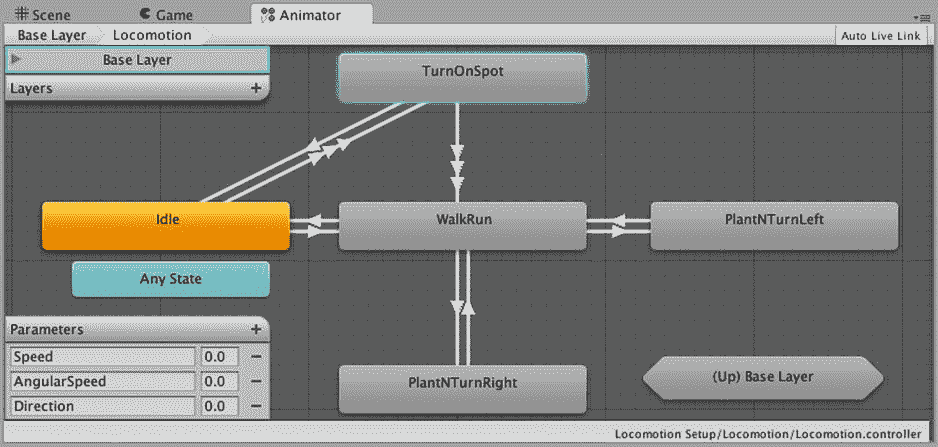
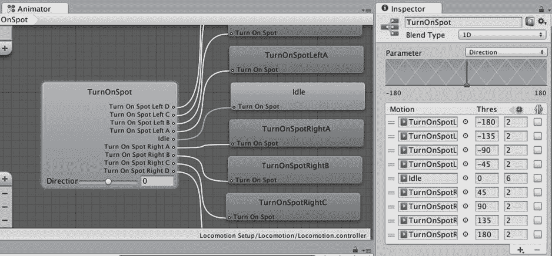

# 不要重复造轮子

你导入的 Mecanim 移动入门工具包资源是一套开箱即用的基础动画骨架和控制器。虽然这只是 Mecanim 功能的冰山一角，但既然你已经扎实理解了动画片段、动画控制器和脚本如何协同工作，现在完全可以将这类现成资源加以定制，融入你的游戏项目，而无需从零开始。接下来让我们深入审视这套移动系统，检验你的学习成果。

你应该能识别出图 5-43 所描绘的移动动画状态机的各个组成部分。



图 5-43. Unity Mecanim 移动入门工具包中的移动动画控制器

双击任意动画状态即可查看混合树（图 5-44）。虽然混合的动画片段更多，但混合树的基本构成要素是相同的。



图 5-44. Unity Mecanim 移动入门工具包中的原地转身混合树

在项目面板中，依次展开 `Locomotion Setup ➤ Locomotion ➤ Scripts` 找到 `Locomotion` 脚本。该脚本恰好是用 C# 编写的，因此语法略有不同，但通过对比这里的 UnityScript 版本，你也能轻松解读：

```
#pragma strict

private var m_Animator : Animator = null;

private var m_SpeedId : int = 0;

private var m_AgularSpeedId : int = 0;

private var m_DirectionId : int = 0;

public var m_SpeedDampTime : float = 0.1f;

public var m_AnguarSpeedDampTime : float = 0.25f;

public var m_DirectionResponseTime : float = 0.2f;

function Locomotion(animator : Animator)

{

m_Animator = animator;

m_SpeedId = Animator.StringToHash("Speed");

m_AgularSpeedId = Animator.StringToHash("AngularSpeed");

m_DirectionId = Animator.StringToHash("Direction");

}

function Do(speed : float, direction : float)

{

var state : AnimatorStateInfo = m_Animator.GetCurrentAnimatorStateInfo(0);

var inTransition : boolean = m_Animator.IsInTransition(0);

var inIdle : boolean = state.IsName("Locomotion.Idle");

var inTurn : boolean = state.IsName("Locomotion.TurnOnSpot") || state.IsName("Locomotion.PlantNTurnLeft") || state.IsName("Locomotion.PlantNTurnRight");

var inWalkRun : boolean = state.IsName("Locomotion.WalkRun");

var speedDampTime : float = inIdle ? 0 : m_SpeedDampTime;

var angularSpeedDampTime : float = inWalkRun || inTransition ? m_AnguarSpeedDampTime : 0;

var directionDampTime : float = inTurn || inTransition ? 1000000 : 0;

var angularSpeed : float = direction / m_DirectionResponseTime;

m_Animator.SetFloat(m_SpeedId, speed, speedDampTime, Time.deltaTime);

m_Animator.SetFloat(m_AgularSpeedId, angularSpeed, angularSpeedDampTime, Time.deltaTime);

m_Animator.SetFloat(m_DirectionId, direction, directionDampTime, Time.deltaTime);

}
```

这段代码的解析如下：

`private var m_Animator : Animator = null;` (1)

声明一个值为 `null` 的 `Animator` 类型引用变量。

`private var m_SpeedId : int = 0;` (2)

`private var m_AgularSpeedId : int = 0;`

`private var m_DirectionId : int = 0;`

声明用于参数 ID 的 `int` 类型变量，作为哈希标识符使用。此处不展开讨论哈希标识符的细节，但它是一种使用整数而非字符串引用参数的方式。使用哈希标识符效率更高，因此有助于提升性能。

`public var m_SpeedDampTime : float = 0.1f;` (3)

`public var m_AnguarSpeedDampTime : float = 0.25f;`

`public var m_DirectionResponseTime : float = 0.2f;`

声明 `float` 类型变量并设置默认值。这些是各种动画过渡的平滑系数。

`function Locomotion(animator : Animator)` (4)

`{`

`m_Animator = animator;`

`m_SpeedId = Animator.StringToHash("Speed");`


`m_AgularSpeedId = Animator.StringToHash("AngularSpeed");`

`m_DirectionId = Animator.StringToHash("Direction");`

`}`

`Locomotion()`函数接受一个`Animator`参数，并以此设置之前声明的`animator`和`parameter`ID 变量的值。

`(5)   function Do(speed : float, direction : float)`

`Do()`函数接受两个浮点参数`speed`和`direction`。

`(6)          var state : AnimatorStateInfo = m_Animator.GetCurrentAnimatorStateInfo(0);`

声明一个`AnimatorStateInfo`引用变量`state`，并将其设置为`Animator`的状态。通过此变量，您可以获取当前动画状态的更详细信息，例如动画状态的长度、是否循环等。

请记住

您可以使用`A978-1-4302-6587-0_5_Figc_HTML.jpg` + `'`打开脚本参考文档，以获取更多详细信息，例如`AnimatorStateInfo`可用的完整变量和函数列表。

`(7)          var inTransition : boolean = m_Animator.IsInTransition(0);`

声明布尔变量`inTransition`。如果当前`Animator`处于动画状态之间的过渡中，则此变量将被设置为`true`，否则为`false`。

`(8)          var inIdle : boolean = state.IsName("Locomotion.Idle");`

声明布尔变量`inIdle`，如果当前动画状态是`Locomotion`动画器的`Idle`状态，则将其设置为`true`。

`(9)          var inTurn : boolean = state.IsName("Locomotion.TurnOnSpot") || state.IsName("Locomotion.PlantNTurnLeft") || state.IsName("Locomotion.PlantNTurnRight");`

声明布尔变量`inTurn`，如果当前动画状态是转弯动画之一，则将其设置为`true`。请注意，`||`是逻辑或运算符，因此这一行将`inTurn`声明为布尔值，如果当前动画状态的名称是`Locomotion.TurnOnSpot`或`Locomotion.PlantNTurnLeft`或`Locomotion.PlantNTurnRight`，则将其设置为`true`。

`(10)         var inWalkRun : boolean = state.IsName("Locomotion.WalkRun");`

声明布尔变量`inWalkRun`，如果当前动画状态是`Locomotion`动画器的`WalkRun`状态，则将其设置为`true`。

`(11)         var speedDampTime : float = inIdle ? 0 : m_SpeedDampTime; var angularSpeedDampTime : float = inWalkRun || inTransition ? m_AnguarSpeedDampTime : 0; var directionDampTime : float = inTurn || inTransition ? 1000000 : 0;`

这些语句用于根据动画器的状态（无论是动画状态还是过渡状态）设置相应的阻尼因子。这里的语法是一种非常简化的条件形式，可读性不如您之前看到的那么高——请记住，代码越少，效率越高，性能越好。

问号`?`及其后的冒号被称为条件运算符。要评估的条件放在问号之前。如果条件评估为`true`，则第一个表达式（问号之后、冒号之前）的结果即为整个操作的结果。如果为`false`，则第二个表达式（冒号之后）的结果为操作的结果。

例如，在这段代码的第一行中，新声明的浮点变量`speedDampTime`在`inIdle`为`true`时被设置为 0。如果角色处于 Idle 状态，则没有速度。如果`inIdle`为`false`，则角色正在移动，因此`speedDampTime`被设置为`m_SpeedDampTime`的当前值。

在第二行中，新声明的浮点变量`angularSpeedDampTime`将在动画器处于 WalkRun 状态或过渡状态时被设置为`m_anguarspeeddsmptime`的当前值；否则评估为`false`并被设置为 0。

类似地，在第三行中，新声明的浮点变量`directionDampTime`将在动画器处于 Turn 状态或过渡状态时被设置为 1000000；否则评估为`false`并被设置为 0。

`(12)         var angularSpeed : float = direction / m_DirectionResponseTime;`

声明`angularSpeed`变量，并将其设置为计算`direction/m_DirectionResponseTime`的结果。

`(13)         m_Animator.SetFloat(m_SpeedId, speed, speedDampTime, Time.deltaTime); m_Animator.SetFloat(m_AgularSpeedId, angularSpeed, angularSpeedDampTime, Time.deltaTime); m_Animator.SetFloat(m_DirectionId, direction, directionDampTime, Time.deltaTime);`

最后，一旦您确定了动画器的状态并确定了适当的阻尼因子，就可以设置动画器的参数。如您在脚本参考文档中所见，`Animator.SetFloat`接受以下参数：参数名称、参数的新值、参数达到该值所允许的时间（平滑因子）以及当前帧的`deltaTime`。

如果您想更深入地研究动画，Unity 还提供了许多其他示例，包含更多动画、控制器和脚本，以及 Asset Store 上免费提供的包含示例场景的完整项目。这些是动画常见用途和最佳实践的优秀工作示例。请尝试这些示例，并且不要羞于在 Unity 论坛上搜索问题的答案。

## 总结

呼——这一章真是相当紧张！您从使用脚本移动基本游戏对象开始，这些脚本改变了`transform.position`和`transform.rotation`属性，然后添加了用户交互来驱动运动。您还学习了使用`Lerp()`函数来平滑这些运动过渡。

接下来，您回顾了 Unity 的 Mecanim 动画系统，并学习了使用动画控制器驱动的动画剪辑来为角色模型添加动画。接着您学习了如何使用 Mecanim 和相应的脚本在不同的动画状态之间进行过渡。在此过程中，您发现并利用了 Unity 在 Asset Store 中提供的便捷现成动画资源。

Unity 的 Mecanim 是一个出色的工具，它使学习和应用动画比以往任何时候都更容易。尽管如此，这绝非易事——为 3D 模型制作动画本身就是一个职业领域。您绝对值得为出色的工作而受到赞扬！

