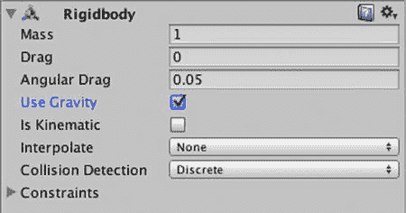
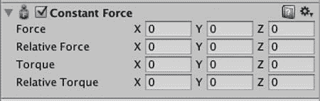

# 6. 开始编码物理

使用游戏物理是很有趣的，Unity 的物理引擎使其变得非常简单。物理定义了物体之间如何相互作用或对外部力做出响应的物理属性。Unity 强大的物理引擎允许您为游戏对象分配物理属性，以实现一致、逼真的游戏玩法。有两个物理引擎，一个用于 2D，另一个用于 3D。尽管它们使用不同的组件（如 `Box Collider 2D` 和 `Box Collider 3D`）实现，但工作方式大致相同。在本章中，您将创建一个简单的游戏，学习如何设置 3D 游戏对象的物理属性，然后添加脚本以实现更复杂的交互行为。

## 刚体（Rigidbody）

游戏对象必须带有 `Rigidbody` 组件，物理引擎才能识别它。物理引擎会计算对象的行为方式，最终体现在对象 `Transform` 的变化上。与之前在第 4 章中直接使用 `Transform` 组件的 `translate` 和 `rotate` 属性来操控对象的位置和朝向不同，这一次你将使用物理力来操控对象。

> **注意：** 虽然你也可以直接修改 `Transform`，但这可能会干扰游戏引擎的计算，并导致不可预期的行为——所以请避免这样做。

新建一个项目，并创建新场景。添加一个平行光，一个 `Transform` 位置为 `(0, 0, 0)` 的平面，然后添加一个 `Transform` 位置为 `(0, 3, 0)` 的立方体游戏对象。运行后，可以看到平面上方有一个静态的原始立方体。通过顶部菜单选择 **Component ➤ Physics ➤ Rigidbody**，或在 Inspector 中点击 **Add Component ➤ Physics ➤ Rigidbody**，为立方体添加 `Rigidbody` 组件。再次运行，立方体会落到平面上，因为它现在受到了重力的影响。

### 刚体属性

让我们更仔细地查看一下 Inspector 中显示的 `Rigidbody` 组件及其属性（图 6-1）。



`图 6-1.` Inspector 中的刚体组件

在物理学中，`质量`描述的是物体所含物质的多少。这与重量不同——重量是重力对物体拉力的度量。例如，地球上的一个高尔夫球和月球上的一个高尔夫球质量相同，但由于地球和月球的重力不同，它们的重量也不同。

如果你现在尝试调整 `Mass` 属性，比如将质量改为 100 后运行，或改为 0.1 后运行，会发现立方体下落的速度似乎是一样的。重力是对物体施加的一个恒定力。不深入数学原理的话，如果排除空气阻力等其他因素，不同质量的物体因重力产生的加速度（加速）是相同的。这意味着，在实际情况下，一枚硬币和一颗保龄球的下落速度是一样的。质量是碰撞和施加任意力时的一个重要因素。

`阻力`是一种对抗力，其作用类似于空气阻力。尝试将 `Drag` 属性值改为 10，然后运行，观察它对下落立方体的影响。

`角阻力`的作用方式与阻力基本相同，只是它对抗的是旋转运动。

取消勾选 **Use Gravity**，立方体将不再下落，因为它不再受重力影响。

在游戏中，有时你可能希望通过对象的 `Transform` 而不是物理引擎来移动它。启用 **Is Kinematic** 意味着游戏对象虽然带有 `Rigidbody` 组件，但不再由物理引擎驱动。

`Interpolate` 用于平滑对象的运动。优化性能的一般经验法则是，除非你确实看到游戏对象的运动出现抖动，否则不要使用此功能。`Interpolate` 选项会根据对象前一帧的 `Transform` 来平滑运动，而 `Extrapolate` 选项则根据对象下一帧的预估 `Transform` 来平滑运动。

`碰撞检测` 决定了物理引擎用于计算碰撞的方法。`Discrete` 是普通碰撞的默认值。`Continuous` 用于高速移动的对象，如果它们的碰撞检测不正确的话。使用 `Continuous` 碰撞检测可能会对游戏性能产生不利影响，因此仅在必要时使用。`Continuous Dynamic` 是 `Continuous` 碰撞检测的一种组合：它会对使用 `Continuous` 或 `Continuous Dynamic` 检测的其它对象以及没有刚体的静态网格碰撞体使用 `Continuous` 检测，而对其他所有情况使用 `Discrete` 检测。由于 `Continuous Dynamic` 也会使用 `Continuous`，因此它也可能对性能产生很大影响。

你已经看到 **Constraints** 用于动画的根运动，在这里它的作用方式相同。展开 **Constraints** 并勾选 **Freeze Position** 的某个轴，可以阻止对象沿该轴移动；而勾选 **Freeze Rotation** 的某个轴，则可以阻止对象绕该轴旋转。

### 使用力控制刚体

`AddForce()` 和 `AddTorque()` 是脚本中用于对刚体施加力的函数。扭矩（Torque）是一种能产生旋转运动的力。

在 Project 面板中，创建一个新文件夹并命名为 `Scripts`。选中 `Scripts` 文件夹，然后选择 `Create ➤ Javascript`，并将脚本命名为 `Forces`。将脚本拖拽到 Hierarchy 中的 Cube 游戏对象上进行挂载。双击 Project 面板中的脚本图标，在 MonoDevelop 中打开并编辑。删除 `Start()` 和 `Update()` 函数，然后添加以下代码：

```
public var aForce : float = 5;

function FixedUpdate () {

rigidbody.AddForce (Vector3.right * aForce);

}
```

物理计算依赖于离散的时间增量，因此应使用基于时间的 `FixedUpdate()` 函数，而非基于帧率的 `Update()` 函数。保存后，在编辑器中运行。注意观察，随着方块向右移动，其速度会逐渐加快。这是因为每次调用 `FixedUpdate()`（在每个固定帧率帧上触发）都会施加力。`aForce` 是一个可在 Inspector 中调整的系数，通过它可以精确控制 `AddForce` 的响应效果。

现在，将 `FixedUpdate()` 中的代码修改为以下内容：

```
rigidbody.AddTorque (Vector3.right * aForce);
```

回顾（或查阅脚本参考文档）可知，`Vector3.right` 是 `(1, 0, 0)` 的简写。此时方块不再沿 x 轴向右移动，而是绕 x 轴旋转，从而导致其向后运动。

虽然上述方法适用于施加恒定力，但如果希望在游戏运行过程中实时控制力该怎么办？请注释掉 `FixedUpdate()` 函数，并添加以下代码：

```
function OnMouseDown () {

rigidbody.AddTorque (Vector3.forward * aForce);

}
```

运行游戏，点击静止的方块，它便会开始绕 z 轴旋转。请注意，使用 `OnMouseDown()` 时，必须先点击游戏对象（此处为方块），代码才会执行。持续点击，每次点击都会让方块旋转速度更快。退出 Play 模式。

选中 Hierarchy 中的 Cube 游戏对象。将其 Transform 位置改为 `(0, 1, 0)`。然后创建一个 Transform 位置为 `(0, 2, 0)` 的 Sphere 游戏对象。在 Inspector 中，选择 `Add Component ➤ Physics ➤ Rigidbody` 来添加刚体组件。取消勾选 `Use Gravity`。从 Project 面板的 `Scripts` 文件夹中，将 `Forces` 脚本拖拽到 Hierarchy 中的 Sphere 上以添加脚本；或者，选中 Hierarchy 中的 Sphere，然后将 `Forces` 脚本图标从 Project 面板拖拽到 Inspector 底部，将其添加为 Sphere 游戏对象的组件。将 `OnMouseDown()` 中的代码行从 `AddTorque` 改为 `AddForce`：

```
rigidbody.AddForce (Vector3.forward * aForce);
```

保存脚本。返回编辑器的 Inspector 视图，将 `aForce` 的值改为 1000。进入 Play 模式并点击球体，它会沿 z 轴直线向前运动。勾选 `Use Gravity`，球体便会呈现向前并向下方的弧线运动。

使用何种方式完全取决于游戏需求。魔法火球可能会沿直线飞行，而投石机发射的橡胶鸡则应受到重力影响。但如果希望魔法火球像火箭一样加速呢？或者希望火箭真如火箭般加速呢？

有几种方法可以实现。一种是在 `FixedUpdate()` 中持续施力，而不是通过鼠标单击一次性施加。

另一种方法是 `AddForce()` 函数在 `Vector3` 参数之后接受第二个参数，名为 `ForceMode`。如果未显式指定，则默认为 `Force`。如果在学习过程中查阅了 Unity 文档，你可能已经发现它还有 `Acceleration`、`Impulse` 和 `VelocityChange` 等选项。`AddTorque()` 函数同样具有这个可选的第二个 `ForceMode` 参数。

可以通过以下方式使用 `AddForce.Acceleration` 使球体加速：

```
rigidbody.AddForce (Vector3.forward * aForce, ForceMode.Acceleration);
```

另一种方法不是通过脚本，而是借助一个可与刚体配合使用的便捷物理组件，名为 `Constant Force`。

首先，在检视面板中取消勾选球体的 `Forces` 脚本组件以禁用它。然后依次选择 `添加组件 ➤ 物理 ➤ 恒定力`，它将出现在检视面板中（图 6-2）。



图 6-2. 检视面板中的恒定力组件

`力`和`扭矩`属性定义了相对于世界空间坐标的力向量，而`相对力`和`相对扭矩`属性则定义了相对于物体局部空间坐标的向量。例如，当你的玩家角色拿着一把火箭筒跑来跑去并指向任意方向时，如果你将`相对力`的 `z` 坐标设为正值，火箭就会朝着指向的方向向前移动。我们先用一个粗略的原型来试试。

选择 `Cube` 游戏对象，将其`变换`位置改为 `(1, 1, 0)`，旋转改为 `(350, 0, 0)`，缩放改为 `(1, 1, 3)`。在层级视图中创建一个 `Capsule` 游戏对象，并将其`变换`位置设为 `(0, 1, 0)`。再次在层级视图中，将 `Cube` 拖放到 `Capsule` 游戏对象上，使其成为子对象。注意 `Cube` 的`变换`已经改变；现在它的位置被指定为相对于其父对象 `Capsule`，而不是相对于世界空间的原点。`Capsule` 游戏对象代表玩家，`Cube` 游戏对象代表火箭筒。

`Sphere` 游戏对象将代表被发射的火箭。选中 `Sphere`，点击齿轮图标并选择`移除组件`来删除 `Forces` 脚本组件。然后在`恒定力`组件中，将球体的`相对力` `z` 坐标改为 `35`，接着将其`Transform.position` 改为 `(1, 1, 2)`。在层级视图中，将 `Sphere` 拖放到 `Cube` 上，使其成为 `Cube` 的子对象，这样它就能始终从 `Cube` 火箭筒的末端发射，无论玩家指向哪个方向。

你会想要发射多枚火箭，因此需要将球体制作成预制体。按照第三章创建炫酷立方体预制体的方法操作即可。在项目面板中创建一个 `Prefabs` 文件夹。将层级视图中的 `Sphere` 拖入 `Prefabs` 文件夹，并将预制体命名为 `Rocket`。右键点击层级视图中的 `Sphere` 并选择删除。

在项目面板中，打开 `Scripts` 文件夹，然后选择 `创建 ➤ Javascript`，并将新脚本命名为 `RocketLaunch`。双击脚本图标在 MonoDevelop 中打开。将代码编辑如下：

```
#pragma strict

public var rocket : GameObject;

function Update () {

    if(Input.GetButtonUp("Fire1")) {

        var rocketInstance : GameObject = Instantiate(rocket);

    }

}
```

这些内容在前几章中应该都很熟悉。首先声明一个名为 `rocket` 的 `GameObject` 类型引用变量。然后，在 `Update()` 函数中使用 `if` 语句检查条件：由`输入管理器`管理的默认“Fire1”按钮是否已被松开。如果此条件为 `true`，则创建一个新的火箭实例。保存脚本。

在编辑器中，将 `RocketLaunch` 脚本从项目面板拖放到层级视图的主摄像机上。选中主摄像机后，你会看到 `RocketLaunch` 脚本已作为一个组件添加进来。`Rocket` 字段是空的，所以如果你现在运行游戏，尝试发射火箭时将不会有任何反应。将项目面板 `Prefabs` 文件夹中的 `Sphere` 预制体拖放到检视面板的 `Rocket` 字段中。保存场景。

使用默认的 `Fire1` 按钮（即左 Ctrl 键）进行游戏测试。太棒了！你正在发射像火箭一样加速的球体。刚体的`阻力`属性会对抗任何一种加速方式，并且可以用来限制最大速度。

这里向你展示了几种实现加速效果的方法。使用哪种方法始终取决于你游戏的具体情况。重要的一点是，Unity 通常有多种解决方案，其中一种可能比另一种更适合你的游戏场景和性能要求。在文档中查找这些方法，进行实验，并在 Unity 社区论坛中交叉搜索，以快速扩展你的游戏开发者技能库。

与此同时，观察一下层级视图中发生了什么——每次新实例化都会出现一个 `Sphere(Clone)`。物理引擎会追踪每一个实例，这最终会拖慢系统并严重影响游戏性能。

在第四章中，你使用 `Destroy()` 函数解决了这个问题。然后，你使用了 `Destroy()` 函数的时间延迟参数。在 `RocketLaunch` 脚本的 `Update()` 函数末尾添加 `Destroy(rocketInstance, 2);`，保存并运行。正如预期，火箭在三秒后消失。发射火箭的全部意义在于炸毁某些东西。击中一些目标如何？游戏对象之间的物理交互正是碰撞器发挥作用的地方。