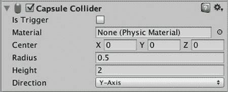
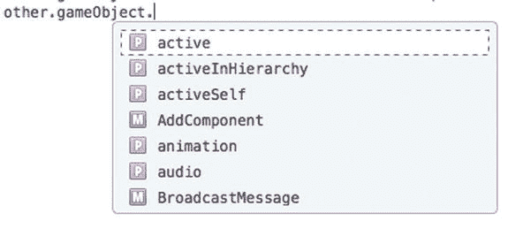
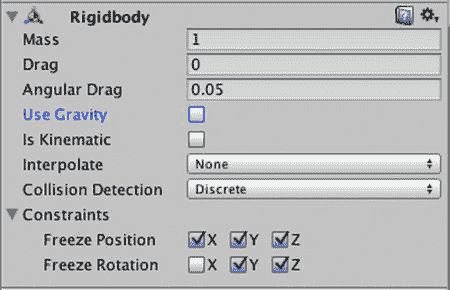
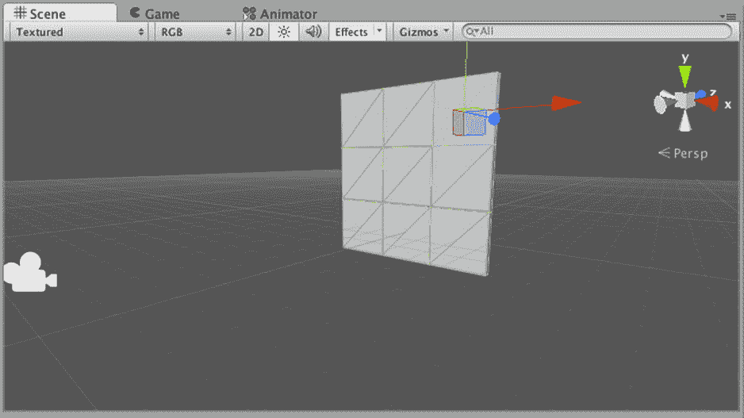
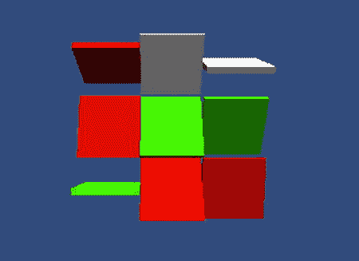
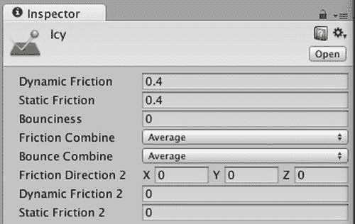
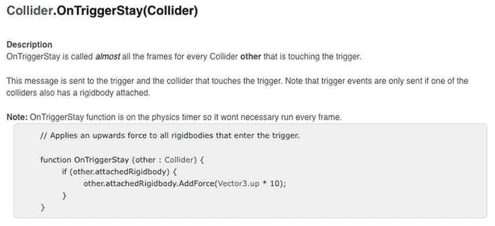

# 碰撞体

虽然 `Rigidbody`（刚体）组件能让游戏对象响应物理力，但 `Collider`（碰撞体）组件则能让游戏对象在与其他游戏对象接触时做出反应。Unity 的原始对象已附带了碰撞体组件。在层级视图中选择 `Cube`，你会在场景视图中看到盒碰撞体的绿色轮廓。

你既可以在检查器中通过选择 `Add Component ➤ Physics` 然后选择碰撞体类型来添加碰撞体，也可以通过编辑器顶部菜单选择 `Component ➤ Physics` 再选择碰撞体类型来添加。

`Mesh Collider`（网格碰撞体）选项会采用游戏对象网格的形状。虽然这听起来很理想，但网格碰撞体通常会对游戏性能产生负面影响，并且 Unity 对允许的多边形数量有限制。解决方案是使用多个原始碰撞体来近似你的 3D 模型形状。

**注意：** 最佳实践建议对场景几何体使用网格碰撞体，对移动对象使用复合原始碰撞体。

碰撞体的属性非常直观（图 6-3）。将碰撞体用作触发器将在本章的“触发器”部分进行说明。物理材质更详细地定义了对象碰撞时的行为。你可以很容易地想象出一个金属球、一个橡胶球和一个肥皂泡在与同一物体碰撞时，即使它们都是简单的球体，其反应也会截然不同。物理材质将在本章稍后的同名部分中介绍。`Center`（中心）是该碰撞体在局部空间中的 (x, y, z) 坐标。这意味着你可以将碰撞体相对于游戏对象进行偏移。尺寸也不必与游戏对象相同，因此其余字段涉及根据你拥有的原始类型来调整碰撞体大小——盒体用 x、y、z 值表示尺寸；胶囊体用半径和高度表示；球体用半径表示。



*图 6-3. 检查器中的胶囊碰撞体组件*

请按照以下每一条指令操作后，暂停并试玩测试。首先，添加一个原始游戏对象立方体，将其命名为 `Target`，并将其变换位置改为 `(1.4, 1, 7)`，缩放改为 `(2, 2, 0.2)`。碰撞中涉及的至少一个游戏对象必须具有`Rigidbody`组件。在检查器中，选择 `Add Component ➤ Physics ➤ Rigidbody`。运行游戏，`Target`会根据重力下落。

在`Rigidbody`组件中，取消勾选 `Use Gravity`（使用重力）。运行游戏，弹丸击中立方体，然后在重力作用下下落，而立方体则飞离出去，其位置和旋转的变化率由物理引擎控制。这里你可以看到，尽管你禁用了目标立方体对重力的响应，但凭借`Box Collider`组件，它仍然会对碰撞力做出响应。

改变目标刚体的约束条件，使其在受到撞击时能够原地旋转。在检查器中，找到`Rigidbody`组件并展开 Constraints（约束）属性。勾选 `Freeze Position`（冻结位置）的 `X`、`Y` 和 `Z` 选项，这将在目标被撞击时将其固定在原位。运行游戏，目标仍然会响应弹丸的撞击，但相对于世界空间保持位置不变。

仍在检查器中，勾选 `Freeze Rotation`（冻结旋转）的 `Y` 和 `Z` 选项。运行游戏，现在目标保持位置不变并绕 X 轴旋转。保存场景并保存项目。

Unity 提供的原始对象带有匹配游戏对象渲染外观尺寸和形状的碰撞体，但你不必局限于此。你可以将碰撞体相对于游戏对象进行偏移，更改碰撞体相对于游戏对象的尺寸，甚至可以使用与游戏对象形状不同的碰撞体，以实现更加多样的行为。请继续边试验边学习！

## OnCollision

虽然这对于物理引擎可以对你的游戏对象做什么来说是一个不错的小演示，但让我们回到脚本编写，看看幕后发生了什么。在弹丸首次撞击目标的那一帧，物理引擎会调用 `OnCollisionEnter()` 函数。在随后的两物体保持接触的帧中，它会调用 `OnCollisionStay()`。最后，当物体不再相互接触时，会调用 `OnCollisionExit()`。

创建一个新场景并添加一个方向光。创建一个立方体，并将变换位置设置为 `(0, 0.5, 0)`，旋转设置为 `(0, 0, 10)`。创建一个球体，变换位置设置为 `(0, 3, 0)`，并通过选择 `Add Component ➤ Physics ➤ Rigidbody` 添加`Rigidbody`组件。保存场景并为其命名。

在项目面板的 `Assets ➤ Scripts` 文件夹中，创建一个新脚本并将其命名为 `CollisionColors`。双击其图标打开进行编辑。删除 `Start()` 和 `Update()` 函数，然后添加以下代码行：

```
private var red : float;

private var green : float;

private var blue : float;

private var color : Color;

function OnCollisionEnter() {
     Debug.Log("OnCollisionEnter");
     color = GetRandomColor();
     gameObject.renderer.material.color = color;
}

function OnCollisionStay() {
     Debug.Log("OnCollisionStay");
}

function OnCollisionExit() {
     Debug.Log("OnCollisionExit");
     color = GetRandomColor();
     gameObject.renderer.material.color = color;
}

function RandomColorValue() {
     var randomValue : float;
     randomValue = Random.Range(0.000, 1.000);
     return randomValue;
}

function GetRandomColor() {
     red = RandomColorValue();
     green = RandomColorValue();
     blue = RandomColorValue();
     color = Color(red, green, blue);
     return color;
}
```

保存脚本，然后返回编辑器。将脚本拖放到球体上以附加它，然后保存场景。运行游戏，你会看到球体落到立方体上，改变颜色，然后滚过立方体倾斜的顶面并掉下边缘，再次改变颜色。在控制台中，你会看到一条 `"OnCollisionEnter"`，多行 `"OnCollisionStay"`，以及最后一条 `"OnCollisionExit"`。

分解一下，改变颜色的代码你在第 4 章中已经很熟悉了。你声明了 `float` 值来保存各个颜色值，以及一个 `Color` 类型的引用变量来保存随机生成的颜色的 RGB 值。`GetRandomColor()` 调用 `RandomColorValue()` 来为颜色的每个 RGB 值生成随机数，然后将它们赋值给 `color` 变量。

当球体在重力作用下下落时，它会与立方体发生碰撞。物理引擎会调用 `OnCollisionEnter()`，此时 `"OnCollisionEnter"` 会打印到控制台，并且调用 `GetRandomColor()` 生成一个随机颜色，然后将其赋值给球体的材质属性。

当球体滚过立方体时，物理引擎会在球体与立方体接触的每一帧调用 `OnCollisionStay()`，并且 `"OnCollisionStay"` 会在控制台中被多次打印。

最后，球体滚离立方体，碰撞体不再接触。发生这种情况时，物理引擎会调用 `OnCollisionExit()`。`"OnCollisionExit"` 会打印到控制台，并生成一个新的随机颜色赋值给球体。


### 另一个游戏对象

你还可以获取碰撞本身的信息，包括脚本对象与之碰撞的其他对象的引用。在 MonoDevelop 中，按如下方式编辑 `OnCollisionEnter()`：

```
function OnCollisionEnter(other : Collision) {
     Debug.Log("OnCollisionEnter");
     color = GetRandomColor();
     other.gameObject.renderer.material.color = color;
}
```

保存脚本。返回编辑器，保存场景，然后播放。现在，在初次碰撞时，立方体会改变颜色，而不是球体。

改变颜色只是一个示例，方便在编辑器中观察。请记住，游戏对象由组件构成，你可以通过脚本影响任何组件的属性。MonoDevelop 的自动补全功能会在此处提供帮助。输入 `other.gameObject.` 即可查看可用选项（图 6-4）。



图 6-4. gameObject 的自动补全选项

现在让我们将这些内容整合成一个简单的游戏原型，但首先请花点时间确保你的项目结构规整：脚本放在 Scripts 文件夹，预制体放在 Prefabs 文件夹，场景放在 Scenes 文件夹。如果缺少这些文件夹，请选择 Assets 文件夹，然后依次点击 Create ➤ Folder 并命名。

### 打靶练习

创建一个新场景，保存并命名为 TargetPractice，然后添加一个定向光。现在，设置一个 3×3 的九个靶标网格。在 Hierarchy 中，选择 Create ➤ Cube 并将其 Transform 位置设为 (0, 0, 0)。将其重命名为 Target，Transform 缩放设为 (2, 2, 0.2)。在 Inspector 面板中，选择 Add Component ➤ Physics ➤ Rigidbody。在 Rigidbody 组件中，取消勾选 Use Gravity 属性。展开 Constraints 属性，勾选所有三个 Freeze Position 坐标轴。对于 Freeze Rotation，勾选 Y 和 Z 坐标（图 6-5）。



图 6-5. 靶标游戏对象 Rigidbody 属性设置

要复制此游戏对象，请在 Scene 视图中选中它，然后按 +D 进行复制。将其紧邻第一个靶标放置（Transform 位置 x 为 2），然后重复操作，在原始靶标的另一侧再放置一个 Target 游戏对象（Transform 位置 x 为 –2），这样就有了三个 Target 游戏对象组成的一行。按住  键，依次点击每个 Target 游戏对象以选中整行。再次按 +D，这次复制整行。在 Inspector 中，将 Transform 位置 y 坐标改为 2。

你可能注意到，Hierarchy 中的三个 Target 游戏对象在首次选中时变为蓝色高亮，在修改 Transform 位置 y 值后又变为深灰色。点击这个灰色区域一次，使其重新变为蓝色高亮。再次按 +D 创建第三行，并将其 Transform 位置 y 坐标设为 4（图 6-6）。



图 6-6. 3×3 九个靶标游戏对象网格

靶标网格设置完成后，接下来设置发射器。我们将使用主摄像头作为瞄准和发射弹丸的源。在 Project 面板中，选择 Assets ➤ Scripts 文件夹，然后依次点击 Create ➤ Javascript，将新脚本命名为 ProjectileLauncher。双击在 MonoDevelop 中打开编辑。将 ProjectileLauncher 脚本编辑如下：

```
#pragma strict

public var projectile : GameObject;
public var cameraSpeed : float = 5;

function Update () {
    var horiz : float = Input.GetAxis("Horizontal") * Time.deltaTime * cameraSpeed;
    var verti : float = Input.GetAxis("Vertical") * Time.deltaTime * cameraSpeed;
    transform.Translate(horiz, verti, 0);

    if(Input.GetButtonUp("Fire1")) {
        var projectileInstance : GameObject = Instantiate(projectile, transform.position, transform.rotation);
        Destroy(projectileInstance, 2);
    }
}
```

保存脚本，然后在 Unity 编辑器中将其拖拽到主摄像头上进行挂载。在 Hierarchy 中选中主摄像头，转到 Project 面板，打开 Assets ➤ Prefabs 文件夹。将 Rocket 预制体拖拽到 Inspector 中 Rocket Launcher 脚本组件的 Projectile 属性上。

以下是对这段代码的分步解析，你应该已经比较熟悉了：

```
(1)     public var projectile : GameObject;
```

GameObject 类型的引用变量被声明为公共变量，这样你就可以在 Inspector 中访问它，方便拖拽不同的预制体。

```
(2)     public var cameraSpeed : float = 5;
```

同样地，`cameraSpeed` 因子被声明为公共变量，以便通过 Inspector 使用。

```
(3)     var horiz : float = Input.GetAxis("Horizontal") * Time.deltaTime * cameraSpeed;
        var verti : float = Input.GetAxis("Vertical") * Time.deltaTime * cameraSpeed;
        transform.Translate(horiz, verti, 0);
```


在`Update()`函数中，首先处理玩家输入，以确定新的水平和垂直坐标，通过`transform.Translate`移动摄像机。`z`坐标保持为 0，以维持主摄像机（作为发射器）与目标网格之间的距离。

```
(4)     if(Input.GetButtonUp("Fire1")) {

var projectileInstance : GameObject = Instantiate(projectile, transform.position, transform.rotation);

Destroy(projectileInstance, 2);

}
```

接下来，`Update()`函数测试以确定默认的`Fire1`按钮是否已释放，如果为`true`，则创建一个新的投射物游戏对象实例（实例化）。然后设置条件，使该投射物实例在两秒后被销毁。

投射物游戏对象也需要一个脚本。在 Project 面板中，回到 Assets ➤ Scripts 文件夹，选择 Create ➤ Javascript，然后将新脚本命名为`Projectile`。双击脚本图标，在 MonoDevelop 中打开进行编辑。将代码编辑如下：

```
#pragma strict

public var aForce : float = 500;

private var redColor : Color = Color (1, 0, 0);

private var greenColor : Color = Color (0, 1, 0);

function FixedUpdate () {

rigidbody.AddForce (Vector3.forward * aForce);

}

function OnCollisionEnter(other : Collision) {

var checkColor : Color = other.gameObject.renderer.material.color;

if (checkColor == greenColor) {

other.gameObject.renderer.material.color = redColor;

}  else {

other.gameObject.renderer.material.color = greenColor;

}

}
```

保存脚本，并通过在 Project 面板中打开 Assets ➤ Prefabs 文件夹，选择`Projectile`预制体，将其附加到`Rocket`预制体上。在 Inspector 中，选择 Add Component ➤ Scripts，然后在下拉菜单中找到`Projectile`脚本并选中。`Projectile`脚本应作为`Rocket`预制体的一个新组件出现在 Inspector 中。

此代码分解如下：

```
(1)     public var aForce : float = 500;

private var redColor : Color = Color (1, 0, 0);

private var greenColor : Color = Color (0, 1, 0);
```

用于确定投射物游戏对象发射力的`aForce`变量被声明为 public，以便在 Inspector 中进行调整，并赋予一个初始值。`redColor`和`greenColor`变量（类型为`Color`）被赋予红和绿对应的 RGB 值。

```
(2)     rigidbody.AddForce (Vector3.forward * aForce);
```

在`FixedUpdate()`函数中，对投射物施加一个向前的力。

```
(3)     var checkColor : Color = other.gameObject.renderer.material.color;

if (checkColor == greenColor) {

other.gameObject.renderer.material.color = redColor;

}  else {

other.gameObject.renderer.material.color = greenColor;

}
```

当`Rocket`预制体投射物与目标碰撞时，会调用`onCollisionEnter()`函数，并且目标会改变颜色。声明类型为`Color`的引用变量`checkColor`，并将其赋值为目标游戏对象的颜色值。然后任意测试目标对象的颜色是否为绿色；如果为`true`，则将其改为红色。如果为`false`，表示目标对象不是绿色，则将其改为红色。

在编辑器中，保存场景，保存项目，然后进入 Play 模式进行测试（图 6-7）。就是这样——你的第一个游戏原型！



图 6-7. Game 视图中的 Target Practice

## 物理材质

你可以通过使用物理材质进一步优化游戏对象在碰撞中的碰撞行为。物理材质是定义弹跳性和表面摩擦属性的资源。两个相互滑动的物体会因摩擦而损失能量，而弹跳的物体在每次弹跳中撞击其他表面时也会损失能量。

这个场景是一种测试物理材质的方法。首先，你将测试在平面上推动一个立方体。创建一个新场景并命名为`PhysicMaterialsTest`，并像往常一样添加一个方向光。选择 Main Camera 并将其 Transform 位置更改为(0, 1, –7)。创建一个平面，然后创建一个 Transform 位置为(0, 0.5, 0)的 Cube 游戏对象。在 Inspector 中通过 Add Component ➤ Physics ➤ Rigidbody 或从顶部菜单选择 Component ➤ Physics ➤ Rigidbody，为 Cube 添加一个 Rigidbody 组件。

在 Project 面板中，首先选择 Assets，然后选择 Create ➤ Folder 并将文件夹命名为`Physic Materials`。选中`Physic Materials`文件夹后，现在选择 Create ➤ Physic Material。你可能需要向下滚动一些才能找到它。将新的物理材质命名为`Icy`（图 6-8）。



图 6-8. Inspector 中的 Physic Material 资源

`Dynamic Friction`属性用于物体已经在移动时。值为 0 表示没有能量损失——也就是说，这是最滑的情况，因此物体会滑行很远。值为 1 是另一个极端：移动中的物体会很快停止移动。

`Static Friction`用于物体处于静止状态时。这是必须克服的摩擦才能使物体移动。这个属性的范围也是 0 到 1，其中 0 几乎是无摩擦，而 1 需要很大的力才能使物体移动。

`Bounciness`也有一个从 0 到 1 的范围，其中 0 表示所有能量都损失了——没有弹跳——而 1 表示没有能量损失，物体超级有弹性。

`Friction Combine`和`Bounce Combine`为你提供了如何组合两个碰撞游戏对象的摩擦力的选项。你可以选择`Average`来取两个值的平均值，`Minimum`使用最小值，`Maximum`使用最大值，以及`Multiply`将两个值相乘。

`Friction Direction 2`允许你为游戏对象在其表面上的不同方向创建不同的摩擦。一个例子是木纹的顺纹或逆纹方向。如果你选择了这种第二方向摩擦，你可以像使用`Dynamic Friction`和`Static Friction`一样，通过`Dynamic Friction 2`和`Static Friction 2`来修改行为。

是时候试试了。选中`Ice`物理材质资源，将`Dynamic Friction`和`Static Friction`都设为 0。现在，通过从 Project 面板拖放到 Scene 视图中的对象上，或者在 Inspector 中使用 Collider 组件 Material 属性字段右侧的圆形选择按钮并从出现的菜单中选择，将此物理材质应用于立方体和平面游戏对象。

测试所需的最后一件事是能够对立方体施加力。在 Project 面板中选择 Create ➤ JavaScript，并将新脚本命名为`Push`。双击它以在 MonoDevelop 中打开进行编辑。删除`Start()`和`Update()`函数，然后添加以下代码：

```
public var aForce : float = 50;

function OnMouseDown () {

rigidbody.AddForce (Vector3.forward * aForce);

}
```

你之前已经使用过这段代码。你可以通过公共变量`aForce`在 Inspector 中调整推动的力的大小。在`OnMouseDown()`函数中，你将`aForce`应用于物理引擎正在跟踪的游戏对象的`rigidbody`组件。保存脚本并将其附加到 Cube 游戏对象上。保存场景。播放以测试，当你点击立方体时，它开始滑动。

由于立方体和平面基本上都是无摩擦的，它会继续滑动直到掉落。测试改变`Icy`物理材质的`Dynamic Friction`和`Static Friction`值，然后在 Play 模式下推动 Cube 游戏对象。当你完成实验后，将`Icy`物理材质的`Dynamic Friction`和`Static Friction`属性重置为 0。


### 弹跳性

要测试弹跳性，请在场景中添加一个变换位置为 `(0.5, 2, 0)` 的`Sphere`游戏对象。就像你对`Cube`游戏对象所做的那样，为其添加一个`Rigidbody`组件。保存场景并播放。球体下落并撞击到立方体的边缘，然后落到平面上。球体和立方体的运动由物理引擎根据每个游戏对象的物理属性计算得出。立方体受到下落球体的冲击，朝一个方向滑动，而球体则朝另一方向滚开。注意球体完全没有弹跳起来。

Unity 在其标准资源包中确实提供了一些基本物理材质。在编辑器顶部菜单中，选择 **资源** ➤ **导入包** ➤ **物理材质**。继续导入所有材质，以便你将其保存在项目中用于实验。

> **注意**  
> 在撰写本文时，Unity 的标准资源和示例资源（测试版）正在合并中。如果这里的物理材质无法正确导入，请从资源商店下载并导入示例资源（测试版）包，然后在项目面板中使用搜索栏找到弹跳物理材质。

从项目面板的 **标准资源** ➤ **物理材质** 文件夹中将 `Bouncy` 拖拽到检查器中`Sphere Collider`组件的**材质**属性上。保存场景。现在你进行测试时，`Sphere`游戏对象在与`Cube`和`Plane`碰撞时会表现出明显的弹跳性。

标准资源包中的物理材质旨在作为起点。为了让你的游戏和游戏对象具有独特性，你应该进一步自定义和完善它们的物理特性。

### LookAt

暂时离开物理话题。既然你已有对象在移动，你可能会希望摄像机始终指向移动中的对象。`LookAt` 正是实现此功能的便捷函数。仍然使用你的`PhysicMaterialsTest`场景，在项目面板中通过**创建** ➤ **JavaScript** 创建一个新脚本，并将其命名为`PointCamera`。双击在 MonoDevelop 中打开并编辑内容如下：

```
#pragma strict

var cameraTarget : Transform;

function Update () {
     transform.LookAt(cameraTarget);
}
```

保存脚本并将其附加到主摄像机。分解说明如下：

`(1)    var cameraTarget : Transform;`

如果你不指定`public`或`private`作用域，你在此声明的`Transform`类型变量`cameraTarget`默认将是一个公共变量，可通过检查器进行访问。

`(2)    transform.LookAt(cameraTarget);`

在`Update()`函数中，脚本所附加的游戏对象（此处为主摄像机）的`Transform`会进行旋转，使其前向矢量位置指向`cameraTarget`的位置。

在检查器中，使用其字段右侧的圆形选择按钮将`Sphere`游戏对象指定给**摄像机目标**属性。保存并播放。摄像机跟随球体落到立方体上，弹起穿过平面，然后落下。摄像机位置在跟随`Sphere`运动时不发生变化。现在尝试跟随`Cube`。

#### 访问其他游戏对象

你已使用过`OnCollision()`来修改碰撞中涉及的两个游戏对象。你还可以为一个游戏对象编写脚本，使其影响任何其他游戏对象。在此示例中，当`Sphere`游戏对象撞击`Cube`游戏对象时，你的脚本会指示主摄像机跟随`Cube`而不是`Sphere`。

在项目面板中，通过**创建** ➤ **JavaScript** 创建一个新脚本，并将其命名为`ChangeCameraTarget`。双击在 MonoDevelop 中打开并编辑如下：

```
#pragma strict

function OnCollisionEnter() {
     var cameraScript : PointCamera = GameObject.Find("Main Camera").GetComponent(PointCamera);
     cameraScript.cameraTarget = GameObject.Find("Cube").transform;
}
```

这段代码分解如下：

`(1)     var cameraScript : PointCamera`

声明`cameraScript`引用变量，类型为`PointCamera`，即附加到主摄像机游戏对象上、指示其跟随`Sphere`游戏对象的脚本。

`(2)     = GameObject.Find("Main Camera").GetComponent(PointCamera);`

`cameraScript`变量被声明为脚本引用。由于此脚本附加到`Sphere`游戏对象上，你使用`GameObject.Find`函数查找名为 Main Camera 的任何对象。然后通过点符号深入查找主摄像机游戏对象的`PointCamera`脚本组件，并将其赋值给`cameraScript`。

`(3)     cameraScript.cameraTarget`

使用点符号标识`cameraTarget`公共变量，

`(4)     = GameObject.Find("Cube").transform;`

通过指定 Cube 游戏对象的变换来更改主摄像机的目标。

保存脚本并将其附加到`Sphere`游戏对象。保存场景并进行测试。摄像机跟随`Sphere`下落，然后在碰撞时切换到跟随`Cube`。

### 触发器

物理引擎会根据你为游戏对象分配的物理特性自动调整其位置和旋转。`OnCollision()`函数调用允许你控制碰撞开始、持续和结束时发生的事情。在许多游戏场景中，你希望当游戏对象到达特定位置时触发游戏行为。这可能是为了让门在游戏对象接近时自动打开，让游戏对象穿过门口时触发陷阱，或者当游戏对象离开门口进入房间时结束场景。游戏对象实际上并未与任何物理对象发生碰撞，因此在这样的场景中，你需要使用触发器碰撞器。

> **注意**  
> 最佳实践要求带有触发器碰撞器的游戏对象是静态对象。由物理引擎控制的带有`Rigidbody`组件的游戏对象可以穿过触发器碰撞器。

`Is Trigger`是`Collider`组件的一个属性。当勾选`Is Trigger`框时，碰撞器会检测碰撞但调用一系列不同的方法：`OnTriggerEnter()`、`OnTriggerStay()`和`OnTriggerExit()`。刚体穿过触发器碰撞器的体积期间不会发生物理碰撞。你使用这些方法与使用`OnCollisionEnter()`、`OnCollisionStay()`和`OnCollisionExit()`非常相似。


### `OnTrigger`

在 Project 面板的 Assets ➤ Scene 文件夹中，创建一个新场景，命名为 `TriggerTest`，然后保存。添加一个方向光，以及一个 `Plane`，其 Transform 位置为 `(0, 0, –5)`。创建一个 `Sphere` 游戏对象，其 Transform 位置为 `(0, 0.5, –7)`。你将推动 `Sphere` 游戏对象，使其滚过触发器碰撞体。从 Project 面板的 Scripts 文件夹中，将 `Push` 脚本拖放到 `Sphere` 游戏对象上。游戏对象必须具有 `Rigidbody` 才能使物理力作用于其上，因此在 Hierarchy 中选择 `Sphere` 游戏对象，在 Inspector 中选择 Add Component ➤ Physics ➤ Rigidbody。

回到 Hierarchy，创建一个 `Cube` 游戏对象，命名为 `Trigger`。设置其 Transform 位置为 `(0, 0.5, –3)`，Transform 缩放为 `(3, 3, 1)`。现在，通过创建一个 `Cube` 游戏对象（命名为 `Cube1`，Transform 缩放为 `(1, 3, 1)`）来在 `Trigger` 游戏对象两侧设置一对门柱。将 `Cube1` 的 Transform 位置设置为 `(2, 0.5, –3)`。通过选择顶部菜单的 Edit ➤ Duplicate 或按下 +D 来复制它，将新游戏对象命名为 `Cube2`，并将其 Transform 位置设置为 `(–2, 0.5, –3)`。

保存场景并进行游戏测试。推动球体，你会看到它从 `Trigger` 游戏对象上弹开。请记住，只需一个对象具有 `Rigidbody` 即可检测碰撞。退出 Play 模式。

选择 `Trigger` 游戏对象，在 Inspector 中勾选 Box Collider 组件的 `Is Trigger`。保存并再次进行游戏测试。这次，没有物理反应发生，球体在你推动后会直接穿过 `Trigger` 游戏对象。

在 Project 面板中，创建一个名为 `TriggerScript` 的新脚本。编辑并添加以下代码：

```
#pragma strict

function OnTriggerEnter() {
   Debug.Log("OnTriggerEnter");
}

function OnTriggerStay() {
   Debug.Log("OnTriggerStay");
}

function OnTriggerExit() {
   Debug.Log("OnTriggerExit");
}
```

保存脚本。在 Unity 编辑器中，将 `TriggerScript` 附加到 `Trigger` 游戏对象上。选择 Project 面板中的 Console 选项卡。播放游戏，点击球体使其向前移动。在 Console 面板中，你将看到与 `OnCollision()` 类似的结果：一次 `OnTriggerEnter()` 调用，多次 `OnTriggerStay()` 调用（当球体滚过 `Trigger` 游戏对象的触发器碰撞体体积时），以及最后的一次 `OnTriggerExit()` 调用。

在测试 `OnCollision()` 函数时，你通过修改 Renderer 的 Color 属性来改变了游戏对象组件的属性。你也可以启用和禁用整个组件。将 `OnTriggerEnter()` 函数编辑如下：

```
function OnTriggerEnter() {
   var triggerRenderer : Renderer = GetComponent(Renderer);
   triggerRenderer.enabled = false;
}
```

这段代码分解如下：

`(1) var triggerRenderer : Renderer = GetComponent(Renderer);`

声明了一个名为 `triggerRenderer` 的 Renderer 引用类型变量，然后将对 `Trigger` 游戏对象 Renderer 组件的引用赋值给它。

`(2) triggerRenderer.enabled = false;`

通过将 Renderer 组件的布尔属性 `enable` 设置为 `false` 来禁用它。

保存并播放游戏。如预期一样，当 `Sphere` 游戏对象的碰撞体与 `Trigger` 游戏对象的触发器碰撞体接触时，`Trigger` 游戏对象从视野中消失。

在游戏过程中，你经常需要将一个布尔值切换为其相反值。与其显式地将其赋值为 `true` 或 `false`，不如使用 `!` 逻辑运算符。

将 `OnTriggerEnter()` 函数中的第二行代码改为：

```
 triggerRenderer.enabled = !triggerRenderer.enabled;
```

这里你将 Renderer 组件的启用状态重新赋值为其相反的布尔值。如果当前为 `true`，它将被改为 `false`；如果当前为 `false`，则改为 `true`。

保存并再次进行游戏测试，你会看到 `Trigger` 游戏对象像之前一样消失。现在将此代码复制到 `OnTriggerExit()` 中：

```
function OnTriggerExit() {
   var triggerRenderer : Renderer = GetComponent(Renderer);
   triggerRenderer.enabled = !triggerRenderer.enabled;
}
```

保存并再次进行游戏测试。推动球体，现在当 `Sphere` 游戏对象进入触发器碰撞体体积时，`Trigger` 游戏对象消失；当 `Sphere` 游戏对象退出触发器碰撞体体积时，`Trigger` 游戏对象重新出现。

现在，编写一些代码来处理与 `Trigger` 游戏对象发生碰撞的游戏对象。在 `#pragma strict` 之后，声明一个名为 `triggerForce` 的公共浮点变量，并将其赋值为 10：

```
public var triggerForce : float = 10;
```

现在将你的 `OnTriggerStay()` 函数编辑如下：

```
function OnTriggerStay(other : Collider) {
   other.rigidbody.AddForce(Vector3.up * triggerForce);
}
```

这是对你在 `OnCollision()` 中所做内容的二次组合，其中 `other` 参数指的是与触发器碰撞体发生碰撞的另一个游戏对象（在本例中为 `Sphere` 游戏对象）。当球体位于触发器碰撞体体积内时，对其施加一个向上的力。

保存并再次进行游戏测试。`Trigger` 游戏对象在 `Sphere` 进入和退出其体积时仍然会消失和重新出现，但现在，由于在 `OnTriggerStay()` 中对其施加了力，`Sphere` 会向上移动。由于最初的推动，`Sphere` 仍然具有向前的运动，因此在几次弹跳后，它将越过触发器碰撞体的边界。

当你查阅脚本参考中的 `OnTriggerStay()` 函数时，你会发现该力是在条件语句内应用的（图 6-9）。



图 6-9。

`OnTriggerStay()` 函数的 Unity 脚本参考

当你开始剖析示例项目时，你会经常看到这种检查。如果某个没有 `Rigidbody` 组件的其他游戏对象偶然穿过了触发器碰撞体，你会得到一个错误，因为你的代码告诉物理引擎要施加一个向上的力，但没有 `Rigidbody` 就无法施加。通过添加此条件语句，游戏引擎会检查 `Rigidbody` 组件，如果不存在，则跳过这行代码以避免错误。

你现在对 Unity 的一般机制有了良好的认识：在游戏过程中，Unity 游戏引擎会调用诸如 `Awake()`、`Start()` 和 `Update()` 之类的函数，而物理引擎会调用诸如 `OnCollision()` 和 `OnTrigger()` 之类的函数。在这些调用中，你编写代码来指导游戏进程。你的代码可以对脚本所附加的游戏对象、正在物理交互的其他游戏对象或任何其他游戏对象执行操作。由于脚本也是组件，一个游戏对象的脚本可以与附加到不同游戏对象的脚本进行交互。


