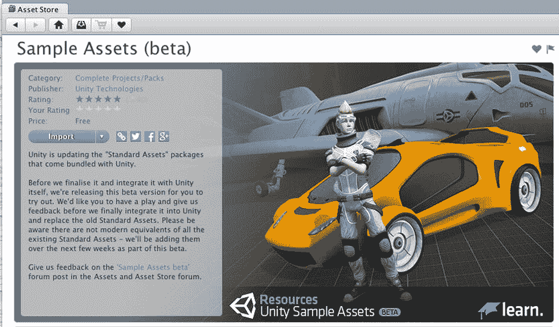
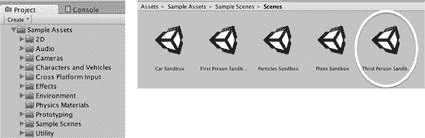
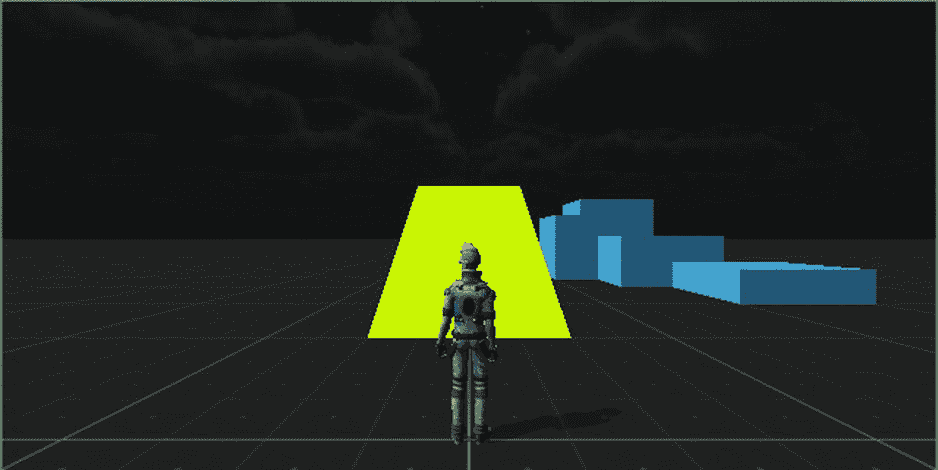
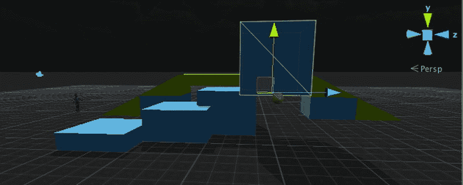
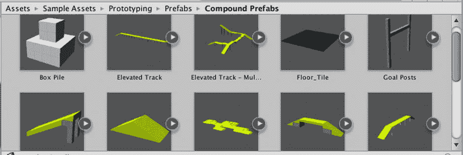
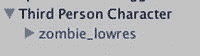
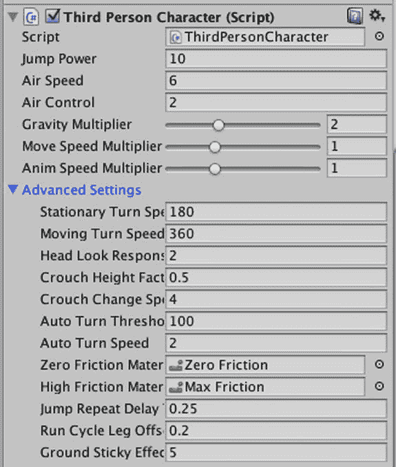
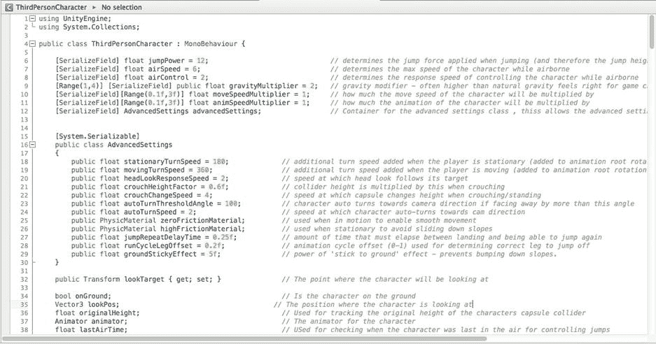

# 快速原型制作

在撰写本文时，Unity 刚刚在其资源商店的 `Sample Assets (beta)` 包中为你添加了大量实用内容。Beta 测试是指软件版本发布给原始编程团队以外的用户进行测试的阶段。测试群体可能是小规模人群，甚至是普通公众，其目的是在正式版本发布前收集反馈意见，以便对产品进行最后的打磨完善。

如果你阅读本文时 `Sample Assets` 仍处于测试版，并且你发现了从“无法运行”到“意外行为”，甚至遇到“希望它能实现这个功能”的情况，请前往资源商店产品页面底部的评论区告诉 Unity 团队（图 6-10）。



图 6-10. Unity 资源商店中的 `Sample Assets (beta)` 包

到目前为止，你已经取得了很大进展。你对编程概念和语法、Unity 编辑器、游戏对象、动画和物理系统有了基本了解。与其每次都从头开始，不如使用现成的资源并根据你的需求进行定制，从而更快速地推进游戏开发。这是学习最佳实践和解决常见问题不同方法的好途径。

Unity 的开发者们正是为你而设计了这些新资源——他们并非从一个大型特定主题项目中抽取零散部件，而是将这些资源设计为开箱即用，或者作为稳固且易于定制的入门工具包。

将 `Sample Assets (beta)` 包下载并导入到你的项目中。如果你找不到它，那说明它可能不再是测试版，这些资源已被迁移到了 Unity 编辑器自带的 `Standard Assets` 包中。看看这些精彩内容吧！（图 6-11）



图 6-11. `Sample Assets (beta)` 或 `Standard Assets` 包中新增的资源与场景

从 `Third Person Sandbox` 作为你的第一个场景模板开始（图 6-12）。回顾一下，在第一人称游戏中，你扮演主角，游戏世界的视角直接通过玩家角色的眼睛呈现；而在第三人称游戏中，你则是“第三者”，作为游戏主角在游戏世界中移动和互动时的隐形观察者。

在 `Project` 面板中，进入 `Sample Scenes` 文件夹，双击 `Third Person Sandbox`（`SceneAsset`）。在编辑器顶部菜单中，选择 `File` ➤ `Save Scene As`，将其命名为 `MyFirstPrototype`，并保存到你的 `Assets` ➤ `Scenes` 文件夹中。

Unity 每次只显示一个场景。`MyFirstPrototype` 场景现在应该是活动场景，但请快速查看一下编辑器顶部确认这一点。你需要保留 `Third Person Sandbox` 场景的原始状态，以便将其作为一个未经修改的模板，供未来项目再次复制使用。

首先，查看 `Hierarchy` 中 `Scene` 视图的内容。

`Floor_Tile` 非常基础，包含必须的 `Transform` 组件和一个用于与其他游戏对象进行物理交互的 `Collider` 组件。展开它查看 `prototype_floor`，它带有渲染器和着色器，你可以修改这些来改变地板的外观。

展开 `Free Look Camera Rig` 找到 `Main Camera`。这个 rig 的组件定义了摄像机在游戏中的运作方式。附加的脚本具体描述了摄像机的行为，而 rigidbody 则表明摄像机在游戏中具有物理存在。

场景中有两个 `Lights`：一个 `Main Directional` 灯光从上方提供基础白光，还有一个 `Ambient Directional` 灯光从下方发出柔和的蓝光，增强了游戏对象的 3D 特性。第二个灯光对游戏外观影响显著。在现实世界中，光线会在一定程度上被地面、墙壁、窗户以及任何其他物体反射。灯光的颜色对于游戏的外观和氛围都至关重要。

`Mobile Character Control Rig` 主要由处理移动设备不同输入方式的脚本以及应对移动设备图形处理能力降低的着色器替代方案组成。

展开 `Obstacles` 可以看到一长串用于该场景的单个方块、立方体、平台和斜坡构建块。你可以在 `Prototyping` ➤ `Prefabs` 文件夹中找到这些以及其他可用于你自己的原型环境的资源。

`Third Person Character` 得到了极大的改进（图 6-12）。它过去只是一个代表玩家角色的简单 `Capsule` 游戏对象，但现在它附带 Unity 基于 Mecanim 的 Ethan 模型，并嵌入了根运动动画。你可以轻松地将 Ethan 替换为你自己的人形骨骼绑定模型。

在进行修改之前，花几分钟时间运行这个模板版本，感受一下它的能力。除了使用标准输入进行前进、后退、左移、右移以及（同时按下 `Shift` 键）行走外，Ethan 角色还可以在按下 `C` 键时蹲伏移动，并通过按下空格键跳跃。



图 6-12. Unity `Sample Assets (beta)` 包中的 `Third Person Character` 示例场景

## 生成与生成点

`生成`（Spawning）是指在游戏过程中创建角色或游戏对象的过程。游戏对象出现的位置称为生成点。生成是许多游戏中的常见功能，不过在这个模板场景中，玩家角色在游戏初始化时就已经存在了。

虽说让角色在场景中跑来跑去探索一番挺有趣，但这严格来说算不上一个游戏。游戏需要某种终点——无论是达成目标、获得分数、计时结束，还是诸如此类的机制。假设这里的目标是让玩家到达最高的蓝色立方体顶部。在模板中这相当简单：角色可以依次跳上逐个增高的立方体，或者从黄色平台跳过去。通过抬高蓝色立方体，使其底部紧贴下一级较低立方体的顶部，可以增加一点难度（图 6-13）。



图 6-13. 使用变换控件将最高的立方体抬高，使其靠在相邻的立方体上

如果现在进行试玩，这个立方体太高了，无论是从蓝色立方体还是平台都无法跳上去。一个无法通关的游戏可没什么意思，因此你需要创建一个触发器碰撞体，将玩家角色传送到立方体顶部的某个生成点。

首先，指定生成点。使用顶部菜单「游戏对象 ➤ 创建空对象」创建一个空的游戏对象，并将其放置在立方体顶部。将其重命名为 `SpawnPoint01`。

其次，创建一个触发器点，用于让角色在立方体顶部重生。再次使用顶部菜单「游戏对象 ➤ 创建空对象」，然后在检视面板中选择「添加组件 ➤ 物理 ➤ 球体碰撞体」。勾选「是触发器」，并将半径改为 1。将其命名为 `RespawnPoint01Trigger01`。这个名字虽然有点长，但如果你后续添加更多重生点和触发器，每个都会有独特的描述性名称。现在，将该游戏对象放置在黄色平台上。

在项目面板中，选择「创建 ➤ JavaScript」，将新脚本命名为 `Respawn01`，然后在 MonoDevelop 中打开进行编辑。删除 `Start()` 和 `Update()` 函数，然后添加以下代码：

```
#pragma strict

public var respawnPosition: Transform;

function OnTriggerEnter(other : Collider) {

    other.gameObject.transform.position = respawnPosition.position;

}
```

其解析如下：

`(1)     public var respawnPosition: Transform;`

声明了一个名为 `respawnPosition` 的公共 `Transform` 类型引用变量。

`(2)     other.gameObject.transform.position = respawnPosition.position;`

在这种情况下，与触发器碰撞体发生碰撞的 `other` 对象就是玩家角色。这里你将 `respawnPosition` 变量所持有的位置引用赋值给了玩家角色游戏对象的变换位置。

保存脚本，并将其附加到 `RespawnPoint01Trigger01` 游戏对象上。在层级面板中选中 `RespawnPoint01Trigger01` 游戏对象后，从层级面板中拖拽 `SpawnPoint01` 游戏对象，放入 `Respawn01` 脚本组件的「重生位置」字段中。这样会将 `SpawnPoint01` 的 `transform.position`（x, y, z）坐标值赋给 `respawnPosition` 变量。

# 场景测试与角色更换

保存场景并运行游戏。让角色在平台周围跑动，直到它触发了触发器，从平台上消失，然后立即在最高蓝色立方体顶部的指定点重生。成功了！

你的玩家群体可能根本不知道有这种神奇的方法能到达立方体顶部，因此你需要给出某种提示。在项目面板中，进入「Prototyping ➤ Prefabs」文件夹并打开它。将一个「问号金币」拖拽到场景中，并将其放置在 `RespawnPoint01Trigger01` 触发器碰撞体的上方。不要在检视面板中点击「应用」，因为你不希望将这些更改应用到所有问号金币预制件上。在层级面板中，将其重命名为「Question Coin 01」。

> **注意**
> 这个问号金币预制件似乎有点大。为了快速原型制作，你可以使用变换组件的缩放属性来调整其大小，但请记住，对于最终的游戏美术资源，最好在导入之前就对模型进行合适的缩放。

如果让问号金币动起来，它将更能吸引玩家的眼球。在项目面板中，创建一个新脚本并将其命名为 `SpinCoin`。双击在 MonoDevelop 中打开，将代码编辑如下：

```
#pragma strict

public var spinSpeed : float = 50;

function Update () {

    transform.Rotate(Vector3.up * spinSpeed * Time.deltaTime);

}
```

这是一个你之前接触过的简单旋转动画。其解析如下：

`(1)     public var spinSpeed : float = 50;`

声明了一个公共的 `spinSpeed` 浮点型变量，你可以在运行时通过检视面板访问该变量，以调整问号金币游戏对象的旋转速度。

`(2)     transform.Rotate(Vector3.up * spinSpeed * Time.deltaTime);`

每帧更新问号金币的变换旋转属性，围绕 `Vector3.up` 轴（即 y 轴）旋转，乘以 `spinSpeed` 因子，并用 `Time.deltaTime` 进行平滑处理。如果没有 `spinSpeed` 因子，金币将以每秒 1 度的速度旋转。

保存脚本并将其附加到问号金币上。保存场景并运行游戏。现在，金币在原地旋转，明显成为一个吸引人的目标对象。

如果你进一步深入查看「Prototyping ➤ Prefabs」文件夹，你会遇到「Compound Prefabs」文件夹（图 6-14）。这里面有一些盒子堆和粉碎平台，玩家角色和盒子会在碰撞时产生相互作用，还有超级酷的轨道、坡道和阶梯。



图 6-14. 示例资源包中的复合预制件

在场景中找点乐子，看看这些预制件是如何工作的——例如，添加一个环形轨道，测试你的角色是否能完整走一圈。

## 更换角色模型

制作原型的目的在于能够测试游戏机制中的布局和流程，而最终的美术素材将在后续的制作过程中呈现。你可以看到，如何利用碰撞器和触发器作为障碍物、收集品等，快速搭建一个供角色穿越的迷宫。作为游戏开发者，你对游戏的外观有着清晰的构想：阴暗的后末日风格、明亮欢快的卡通风格，抑或任何符合你口味的设定。然而，你的家人和朋友往往看法模糊得多。在听你兴奋地谈论了几周游戏设计后，他们对你制作的原型可能并不怎么感冒。

别灰心；这种情况屡见不鲜，而且不仅限于独立游戏开发者。有一次，我与全球顶尖的电子设备制造商之一合作开发游戏原型。当我们展示各种原型版本时，项目经理对简陋的占位美术素材表达了失望——即便她正是负责从外包工作室获取最终美术素材的人！

这确实说明了当今游戏视觉冲击力的重要性。精美细致的高分辨率图形提高了用户的期望值，因此功能精简的原型可能是一个新概念。请花些时间向他们讲解游戏设计理念，并确保他们理解当前重点是游戏机制而非外观。

话虽如此，如果你已经准备好了角色模型，为什么不把它们放进去呢？动画模型也需要测试，从确保网格对动画的正确响应，到确保角色的特殊肢体、道具等表现得当。例如，如果你混搭使用资源商店中的动画和道具，可能会发现某些剑术动画因为道具剑过长，导致角色看似在切割自己的肢体。

在层级视图中，展开第三人称角色并删除 Ethan 角色的子游戏对象。如果你的当前项目中还没有，请选择 `Assets ➤ Import New Asset`，找到你在第 5 章中使用的 `zombie_lowres.fbx` 模型。它应该已经配置好骨架并可以投入使用，但以防万一，请在项目面板中选择它，并在检视面板中查看一下。

选中 Rig（骨架）后，Animation Type（动画类型）应为 Humanoid，并将 Avatar Definition（动画头像定义）设置为 `Create From This Model`，然后点击 Apply（应用）。现在，从项目面板中拖动 `zombie_lowres.fbx` 并放到层级视图中的 Third Person Character（第三人称角色）游戏对象上，使其成为子对象（图 6-15）。



图 6-15. 作为第三人称角色子对象的 `zombie_lowres` 模型（层级视图中）

选择 Third Person Character（第三人称角色），然后在检视面板中向下滚动到 Third Person Character（第三人称角色）脚本（图 6-16）。



图 6-16. 检视面板中的 Third Person Character（第三人称角色）脚本组件

展开 Advanced Settings（高级设置），将显示大量可供你自定义特定角色行为的属性。

如果你点击书本图标以访问参考文档，脚本参考文档将打开并显示 `MonoBehavior` 父类的描述。脚本参考文档包含脚本中使用的类和函数的信息，而非任何特定脚本的内容。即使添加了新功能，参考文档也可能不反映测试版本的新内容，因为这些内容仍有可能更改。

这是一个很好的例子，说明了养成良好命名规范习惯以及在编写脚本时添加注释的重要性。检视面板中列出的属性具有描述性的名称，因此你可以大致猜测它们的功能。如果打开脚本本身，你会发现 Unity 团队出色地通过大量详细的注释分解了脚本变量和函数（图 6-17）。



图 6-17. `ThirdPersonCharacter` 脚本中的详尽文档

在项目面板中，找到 `Sample Assets ➤ Prototyping ➤ Prefabs ➤ Compound Prefabs` 文件夹下的 Smash Boxes Platform。将一个 Smash Boxes Platform 拖入你的场景中。

移动你的 `SpawnPoint01` 游戏对象，让你的角色站上 Smash Boxes Platform，然后尝试跳到箱子堆的顶部。尝试创建更多的生成点和触发器。将 `SpawnPoint01` 游戏对象重新定位到平台顶部、箱子前方。

保存场景并播放，让你的角色站到平台上，以测试一些额外行为。如果你试图让角色走入箱子之间的空隙，你会发现它会自动蹲下来通过狭小空间。如果你让角色撞向一个箱子，与静态平台不同，这些白色箱子会对与玩家角色的碰撞做出反应。看看你是否能让角色到达箱子堆的顶部而不将其撞倒。祝你好运！

## 本章小结

本章你收获颇丰，学习了刚体与物理引擎、使用物理材质自定义游戏对象的行为，以及使用碰撞器和触发器实现游戏对象间的交互。

`OnCollision()` 和 `OnTrigger()` 函数是你脚本知识库中的新成员，同时你还学习了用于对游戏对象施加力、引导摄像机跟随游戏对象、切换摄像机跟随的目标、更改组件属性、启用/禁用组件、使用 `!` 逻辑运算符翻转布尔值，以及通过条件语句避免错误的方法。

你将脚本代码的应用范围从脚本所依附的游戏对象，扩展到影响碰撞中涉及的第二个对象，乃至访问场景中的任何游戏对象。

最重要的是，你正在运用所学知识，踏上设计功能性游戏原型的道路。干得漂亮！前方还有更多精彩内容，包括使用关节和射线投射的高级物理效果、爆炸和声音等特效，以及如何将这些整合到游戏规则中，从摆弄场景到玩转并赢下一款功能完整的游戏。呜呼！