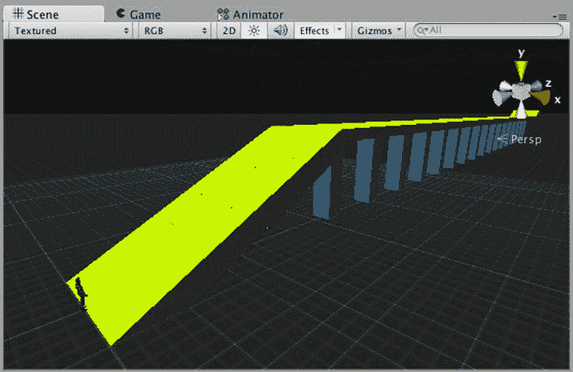

# 7. 使用高级物理概念

在本章中，你将利用已学知识开始搭建一个障碍赛道，并加入新的物理概念，包括在障碍赛道中使用关节、为玩家添加布娃娃物理效果，当然，还有将它们整合到一起的新函数和脚本。

## 搭建障碍赛道

在项目面板中，选择 `Assets ➤ Sample Assets ➤ Sample Scenes ➤ Scenes` 并打开 Third Person Character。在编辑器顶部菜单中，选择 `File ➤ Save Scene as`；将新场景命名为 Obstacle Course。在层级视图中，删除 Obstacles（障碍物）父级游戏对象，这也会删除其所有子对象。此时在场景视图中，只有玩家角色站在地面上。

在项目面板的 `Assets ➤ Sample Assets ➤ Prototyping ➤ Prefabs ➤ Compound Prefabs` 文件夹中，找到 `Elevated Track`，将其拖入场景视图，并将其 Transform 坐标设置为 `(0, 0, 22)`。你的玩家角色坐标应为 `(0, 0, 0)`，当你点击播放时，它应面向 `Elevated Track` 的斜坡（图 7-1）。

图 7-1. 障碍赛道的 `Elevated Track` 预制件