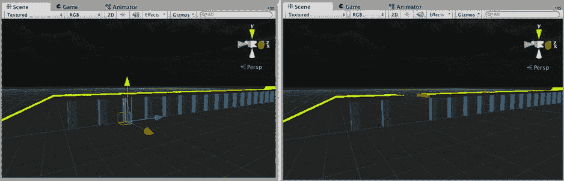
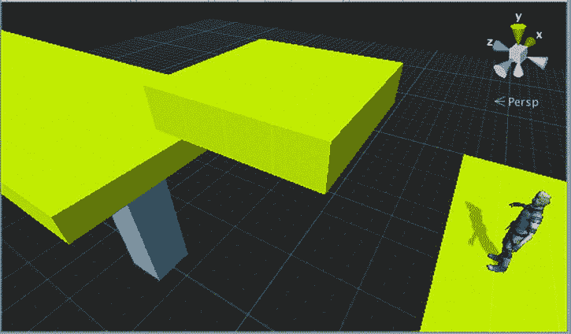

# 降低平台障碍

现在你已经有了一条漂亮的架空轨道，角色可以轻松地从起点跑到终点。最简单的起步障碍就是移除一段轨道。删除第三个 `Platform 8 × 1 × 8` 游戏对象及其支撑柱（`Pillar 8 × 2 × 8`）。你可以在层级视图中选中该游戏对象并右键单击，在弹出菜单中选择“删除”；也可以在层级视图中选中该游戏对象，然后通过编辑器顶部菜单选择**编辑** ➤ **删除**（图 7-2）。



图 7-2. 删除第三个 `Platform 8 × 1 × 8` 平台预制体及其支撑柱

如果现在运行关卡，你的角色将无法跨越这个缺口。在无法获胜的游戏中设置不可能完成的障碍毫无乐趣可言。为了解决这个缺口，在项目面板的 `Assets` ➤ `Sample Assets` ➤ `Prototyping` ➤ `Prefabs` 文件夹中找到 `Platform 4 × 1 × 4` 预制体，将其拖放至场景视图。设置其变换位置为 `(0,12, 38)`。这样它就会位于缺口的中间位置，比架空轨道略高一些。现在进行游戏测试，你可以通过空格键引导玩家角色跳过缺口、落在这个平台上，然后从平台远端跳回架空轨道。

一个有用的垫脚石是帮助玩家跨越缺口、继续前进所必需的，但如果让平台上下移动，它就能变成更具挑战性的障碍。在项目面板的 `Assets` ➤ `Scripts` 文件夹中，新建一个名为 `MovePlatform` 的脚本。在 MonoDevelop 中打开它，并编辑代码如下：

```
#pragma strict

private var platformStartPosition : Vector3;
private var platformEndPosition : Vector3;
public var lowLevel : float = 6;
public var duration : float = 5.0f;
private var step : float = 0.0f;
private var movingBack : boolean = false;

function Start () {
    platformStartPosition = transform.position;
    platformEndPosition = (transform.position - Vector3(0, lowLevel, 0));
}

function FixedUpdate() {
    var delta : float = (Time.deltaTime / duration);
    if(movingBack) step -= delta;
    else step += delta;
    step = Mathf.Clamp01(step);
    rigidbody.MovePosition(Vector3.Lerp(platformStartPosition, platformEndPosition, step));
    if(step == 1.0f) movingBack = true;
    else if(step == 0.0f) movingBack = false;
}
```

这个脚本的编写方式有很多种。本质上，你需要平台从 A 点移到 B 点，然后再返回。不过，你还需要考虑其他因素，例如脚本的可复用性以及行为调试/测试的便捷性。

基于以上考虑，本脚本的分解如下：

```
(1)     private var platformStartPosition : Vector3;
...
function Start () {
    platformStartPosition = transform.position;
    ...
```

与其在变量声明时为 `platformStartPosition` 分配具体的坐标值，你的脚本在 `Start()` 函数中直接获取平台游戏对象当前所在的位置。通过这种方式编写，你可以在场景视图中重新调整平台的位置，而无需返回编辑脚本更新起始位置坐标。

```
(2)     private var platformEndPosition : Vector3;
public var lowLevel : float = 6;
function Start () {
    ...
    platformEndPosition = (transform.position - Vector3(0,
lowLevel, 0));
}
```

同样地，`platformEndPosition` 变量被声明但未分配具体坐标。平台将沿着 Y 轴垂直向下移动，移动距离由 `lowLevel` 变量指定。虽然 `lowLevel` 已显式赋值为 6，但更重要的是 `lowLevel` 变量是公开的，因此你可以直接在编辑器中调整平台的移动范围。`platformEndPosition` 在 `Start()` 函数中被赋值为 `platformStartPosition` 的 Y 坐标减去 `lowLevel` 值的结果。

```
(3)     public var duration : float = 5.0f;
```

`duration` 变量决定了平台从 `platformStartPosition` 移动到 `platformEndPosition` 的速度。将其设为公开变量，你就可以直接从编辑器中调整平台的移动速度。

```
(4)     private var step : float = 0.0f;
private var movingBack : boolean = false;
```

`step` 和 `movingBack` 都用于改变平台运动方向，以便在游戏过程中保持重复的上下移动。

```
(5)     function FixedUpdate() {
```

由于这是基于物理的刚体运动，此处使用 `FixedUpdate()` 函数而非 `Update()`。新手常犯的错误是忘记为游戏对象添加刚体组件。请确保 `Platform 4 × 1 × 4` 拥有刚体组件。如果没有，请在层级视图中选中它，然后在检视面板中选择 **添加组件** ➤ **物理** ➤ **刚体**。当刚体组件出现在检视面板中后，取消勾选“使用重力”（这并非必需），并勾选“运动学模式”，这样平台移动就不会受到玩家角色跳上来的影响。

```
(6)     var delta : float = (Time.deltaTime / duration);
```

`Time.deltaTime` 是完成上一帧所花费的秒数，因此通过除以 `duration` 可以得到一个归一化的分数赋值给 `delta`，以便：

```
(7)     if(movingBack) step -= delta;
```

如果布尔值 `movingBack` 为 true，则从 `step` 中减去这个归一化的分数值 `delta`；否则：

```
(8)     else step += delta;
```

将归一化的分数值 `delta` 加到 `step` 上。

```
(9)     step = Mathf.Clamp01(step);
```

`Mathf.Clamp01` 是一个将数值“限制”在 0 和 1 之间并返回浮点值的函数。在本例中，如果 `step -= delta` 后的值降到 0 以下，`Mathf.Clamp01` 就返回 0。如果 `step += delta` 后的值大于 1，`Mathf.Clamp01` 就返回 1。对于任何介于 0 和 1 之间的值，`Mathf.Clamp01` 返回其本身。

```
(10)    rigidbody.MovePosition(Vector3.Lerp(platformStartPosition,
platformEndPosition, step));
```

此处并非通过设置 Transform 位置来移动平台游戏对象，而是使用 `Rigidbody.MovePosition` 方法告知物理引擎将游戏对象移动到新位置。通过使用物理引擎，其他对象会根据自身的物理属性被推开，从而在这个游戏对象移动时保持行为的一致性。使用 `Vector3.Lerp` 可以平滑化游戏对象的移动。

```
(11)    if(step == 1.0f) movingBack = true;
```

回顾一下：如果 `movingBack` 为 `false`，则 `step` 的值会增加 `delta` 的值，然后在 (9) 中，若 `step` 的值等于或大于 1，`step = Mathf.Clamp01(step)` 会返回 1。当 `step` 达到值 1 时，`movingBack` 被重新赋值为 `true`，因此在下次调用 `FixedUpdate()` 执行到 (7) 时，平台将开始朝相反方向移动。

```
(12)    else if(step == 0.0f) movingBack = false;
```

这与 (11) 相反。当 `step` 递减到 0 时，布尔值 `movingBack` 被重新赋值为 `false`，因此在下次调用 `FixedUpdate()` 执行到 (8) 时，平台将再次反向。保存脚本，将其附加到 `Platform 4 × 1 × 4` 游戏对象上，然后点击运行。尝试调整 `duration` 和 `lowLevel` 的值，直到你感觉这是一个足够有挑战性的障碍。保存场景并保存项目（图 7-3）。



图 7-3. 玩家角色与移动平台障碍物

请注意，由于脚本的编写方式，你可以删除架空轨道的另一部分，并使用同样的脚本放入另一个移动平台障碍物。在进行此操作之前，请继续阅读后续内容，了解更多障碍物！


