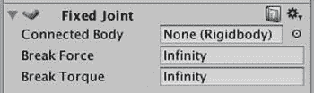
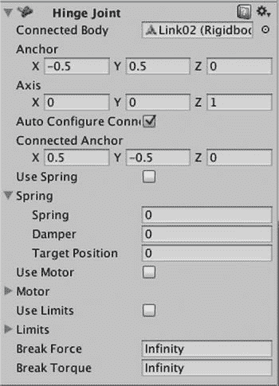
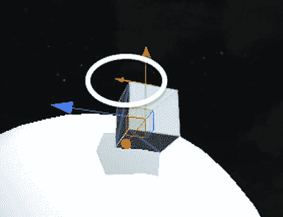
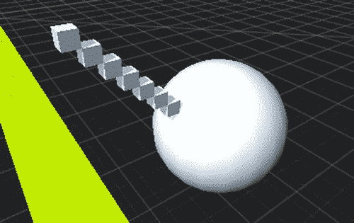
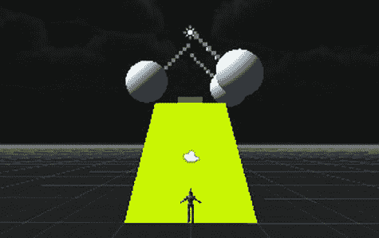
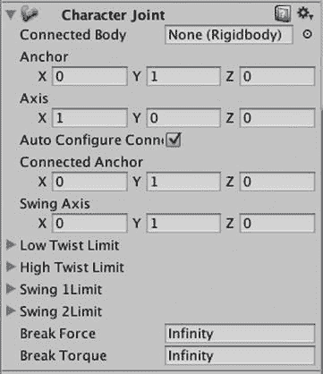
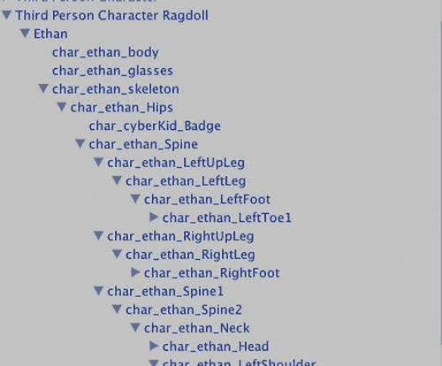
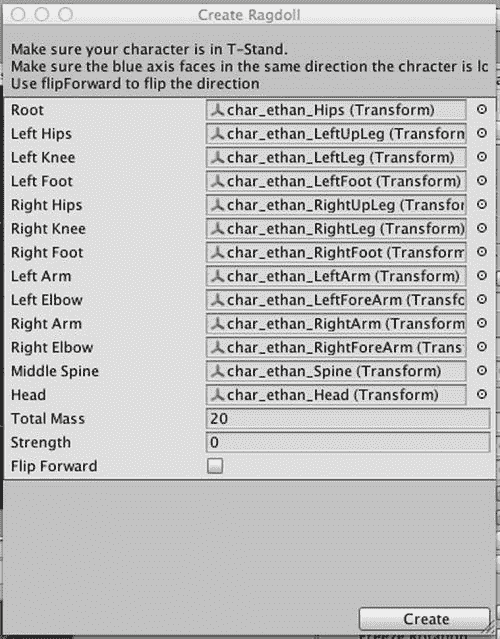
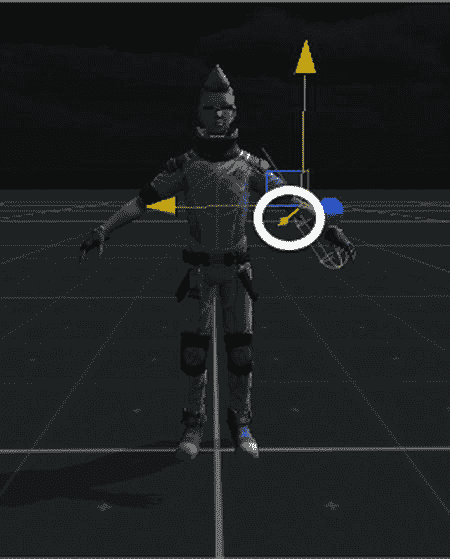
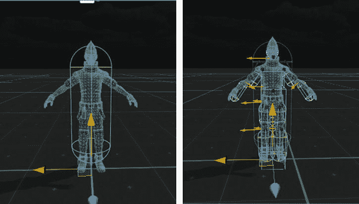

# 关节与摆锤障碍物

关节（Joint）仅仅是两个物体交汇的点。父子关系通过`Transform`连接两个或多个游戏对象，而关节则通过物理系统连接两个对象。这是Unity在构建游戏时提供多种解决方案供你选择以实现精确行为的又一个例子。

## 固定关节

`Fixed Joint`（固定关节）是最简单的关节。它将一个游戏对象的运动绑定到另一个游戏对象的运动上，与父子关系非常相似，只不过它使用的是物理引擎而非父子`Transform`关系。在层级面板中，创建一个`Sphere`游戏对象，并将其`Transform`位置设置为`(11.4, 20.3, 60)`，`Transform`缩放设置为`(11, 11, 11)`。将其重命名为`Pendulum Sphere`。请记住，任何游戏对象首先都需要一个`Rigidbody`（刚体）组件才能被物理引擎识别，因此在检查器中依次选择`Add Component` ➤ `Physics` ➤ `Rigidbody`。将其`Mass`（质量）属性设置为`20`。再次在检查器中，依次选择`Add Component` ➤ `Physics` ➤ `Fixed Joint`（如图 7-4 所示）。

图 7-4. 检查器中的`Fixed Joint`组件

`Connected Body`（连接刚体）属性持有球体通过`Fixed Joint`连接的游戏对象的引用。如果留空，关节将连接到游戏世界。`Fixed Joint`具有物理特性，包括可能断裂的特性。`Break Force`（断裂力）和`Break Torque`（断裂扭矩）告诉物理引擎需要多大的力或扭矩才能使关节断裂。默认值为`Infinity`（无穷大），指示物理引擎该关节是不可断裂的。

现在创建一个`Cube`游戏对象，其`Transform`位置为`(6.5, 24, 60)`，并将其重命名为`Link01`。添加一个`Rigidbody`组件。在层级面板中，选择`Pendulum Sphere`。将`Link01`游戏对象从层级面板拖放到检查器中`Fixed Joint`组件的`Connected Body`字段中，或者使用字段右侧的圆形选择按钮，然后选择`Link01`。现在`Pendulum Sphere`和`Link01`游戏对象通过一个`Fixed Joint`连接起来了。

## 铰链关节

`Hinge Joint`（铰链关节）正如其名：一个连接两个游戏对象并允许其围绕单个轴运动的关节，就像门上的铰链一样。在层级面板中选择`Link01`游戏对象，然后在检查器中依次选择`Add Component` ➤ `Physics` ➤ `Hinge Joint`（如图 7-5 所示）。

图 7-5. 检查器中的`Hinge Joint`组件

`Connected Body`与`Fixed Joint`中的相同。默认的`None`（无）将其连接到世界，或者你也可以选择要连接到关节的特定游戏对象。

`Anchor`（锚点）是铰链轴在局部空间中的位置。对于`Link01`游戏对象，将`Anchor`位置设置为`(–0.5, 0.5, 0)`。在场景视图中，你会看到一个代表铰链关节的橙色小箭头（如图 7-6 所示）。

被连接的游戏对象围绕铰链关节的`Axis`（轴）摆动。将`Link01`的`Hinge Joint`的轴设置为`(0, 0, 1)`。

图 7-6. 代表`Hinge Joint`位置和轴的橙色箭头

`Hinge Joint`可以通过`Use Spring`（使用弹簧）表现出带弹簧的行为。游戏对象可以通过`Use Motor`（使用马达）像被马达驱动一样自动绕关节摆动。`Limits`（限制）允许你约束物体绕铰链关节旋转的范围，以及到达极限时是否反弹。摆锤链不需要用到这些属性中的任何一个，但你可以选择蓝色的书本图标以了解更多关于它们及其各自设置的信息。

最后，`Hinge Joint`也有`Break Force`和`Break Torque`属性，它们决定了克服关节作用力、使游戏对象彼此分离所需的力的大小。

## 构建摆锤链

`Link01`是构成驱动`Pendulum Sphere`摆动的“链”的七个链接中的第一个。既然它已经有了`Rigidbody`组件和`Hinge Joint`，你就可以用它来创建一个预制件。在项目面板中，打开`Assets` ➤ `Prefabs`文件夹。将`Link01`游戏对象从层级面板拖放到`Prefabs`文件夹中，并将这个新的预制件命名为`Link`。当你重命名预制件时，原始的`Link01`游戏对象也会变成`Link`。在层级面板中选择它，并将其重命名为`Link01`。现在将`Link`预制件拖到场景视图中，将其命名为`Link02`，并设置`Transform`位置为`(5.5, 25, 60)`。选择`Link01`，然后在检查器中为`Hinge Joint`组件的`Connected Body`属性选择`Link02`。继续以这种方式添加链接，直到你有七个链接，如图 7-7 所示。请注意，对于每个新的`Link`，其`Transform`的`x`值应递减`1`，`y`值应递增`1`，而`z`值应保持在`60`。`Link07`的`Connected Body`属性应为`None`。

图 7-7. `Pendulum Sphere`与“链”

保存场景并尝试运行。注意，`Link07`的`Hinge Joint` `Connected Body`属性设置为`None`，它会自动悬挂在世界中的一个固定点上。退出播放模式。

在场景视图中，按住鼠标左键，拖动光标穿过所有立方体链节和`Pendulum Sphere`游戏对象以选中它们。按`Ctrl + D`复制整个摆锤结构，然后将复制的摆锤拖到`Transform Position`的`z`坐标为`72`的位置。重复这些步骤，将第三个摆锤放置在`Transform Position`的`z`坐标为`84`的位置。

看一下层级面板。现在你有三个编号从`1`到`7`的链接游戏对象，以及三个`Pendulum Sphere`——真是一团糟。这很好地说明了在开发游戏时保持组织有序的必要性。在编辑器顶部菜单中，选择`Game Object` ➤ `Create Empty`并将其命名为`Pendulum_01`。在层级面板中，找到第一个摆锤的每个链接以及球体，然后将它们拖放到`Pendulum_01`游戏对象中。以同样的方式创建`Pendulum_02`和`Pendulum_03`空游戏对象，以容纳构成第二个和第三个摆锤障碍物的游戏对象。这样好多了——现在你的层级面板中有了易于识别、带编号的摆锤父游戏对象，可以根据需要展开以进一步调整构成摆锤子游戏对象的构建模块。

为了给障碍物增加变化，将第二个摆锤移动到从障碍赛道左侧开始摆动的位置。将所有链接和`Pendulum Sphere`游戏对象的`Transform Position`的`x`坐标符号更改为负值（如图 7-8 所示）。

图 7-8. 摆锤障碍物

保存场景并试一下。不那么同步的摆锤摆动增加了这些障碍物的挑战性。你可以重新定位它们的起始点，或者为了快速测试，调整`Pendulum Sphere`游戏对象上的质量设置。

### 角色关节（Character Joint）

角色关节允许你为角色的关节设置限制。目前，角色的身体运动由`Animator`驱动。当角色整体与另一个游戏对象碰撞时，物理引擎会追踪`Rigidbody`和`Capsule Collider`。角色关节更常用于布娃娃效果，即角色的身体和四肢完全由物理引擎而非`Animator`组件控制。关节本身的工作原理类似于一个扩展的球窝关节，可以在原地旋转（扭转）和弯曲（摆动），通过设置各种限制属性，你可以自定义其巨大的运动范围（图 7-9）。

图 7-9. 检查器中的`Character Joint`组件

# Character Joint 属性

`Connected Body` 属性指的是 `Character Joint` 所连接到的刚体。如果其值为 `None`，则该关节会连接到世界空间，如同 `Hinge Joint` 那样。关节在游戏对象的局部空间中围绕 `Anchor` 点旋转。作为一个球窝关节，它有一个用于扭转的 `Axis`，以及一个用于“摆动”或弯曲的 `Swing Axis`。

使用 `Low Twist Limit` 和 `High Twist Limit` 属性来约束关节围绕 `Axis` 的扭转运动，使用 `Swing 1 Limit` 和 `Swing 2 Limit` 属性来约束围绕 `Swing Axis` 的运动。`Break Force` 和 `Break Torque` 决定了破坏关节所需的力量大小，其中 `Infinity` 表示关节无法被破坏。

## 布娃娃物理（Ragdoll Physics）

你可能已经注意到，当钟摆击中玩家角色时，它可能只会推动角色移动一点点，仅此而已。一个巨大的钟摆理应对角色产生更大的影响，比如将他击倒，让他像一堆——你猜对了——布娃娃一样瘫倒在地。

你的玩家角色拥有一个 `rigidbody` 和简单的 `Capsule Collider` 组件，以便与其他游戏对象交互。为了让物理引擎赋予角色身体和四肢逼真的物理属性，每个离散的身体部位都需要有自己的 `rigidbody` 和 `collider`。Unity 一如既往地提供了 `Ragdoll Wizard` 来帮助你创建这些子级刚体与碰撞体。布娃娃配置完成后，你可以将其保存为预制件以便后续重用。

首先，在层级视图中选择 `Third Person Character`，并将其重命名为 `Third Person Character Ragdoll`。展开所有内容，以便看到所有子级身体部位（图 7-10）。（你可能会发现使用方向键比鼠标更容易导航和展开树状层级结构。）

图 7-10. 在层级视图中展开的 `Third Person Character Ragdoll` 游戏对象

在编辑器顶部菜单中，选择 `Game Object` ➤ `Create Other` ➤ `Ragdoll...` 以打开 `Ragdoll Wizard`。将相应的身体部位拖放到 `Ragdoll Wizard` 中。此处，将 `char_ethan_Hips` 用于 `Root`，其余部分参照图 7-10。请注意 `Ragdoll Wizard` 窗口顶部的辅助提示。如果角色尚未处于 T 型姿势，可以通过在层级视图中选择 `Third Person Character Ragdoll`，然后将鼠标光标移至场景视图，再按下 `F` 键来设置（图 7-11）。

图 7-11. `Third Person Character Ragdoll` 的 `Ragdoll Wizard` 选择

并非所有名称都与 `Ragdoll Wizard` 中的相应字段完全匹配。如有疑问，可在层级视图中选择感兴趣的身体部位，并查找指示关节位置的橙色箭头（图 7-12）。所有字段填写完毕后，选择 `Create` 按钮。

图 7-12. 橙色箭头指示 `char_ethan_LeftForeArm` 在肘部的关节位置

创建布娃娃到此就完成了。如果你有一个新导入的角色模型并遵循了这些步骤，此时按下播放键，角色就会像预期的那样像布娃娃一样瘫倒。然而，`Third Person Character Ragdoll` 已经附加了许多其他组件，包括控制动画的脚本，所以如果你现在按下播放键，你会看到玩家角色出现一些非常奇怪的行为。

`Third Person Character` 已经附带了一个 `rigidbody` 和 `Capsule Collider`。`Third Person Character` 脚本有一个功能检查，用于判断角色是否可以通过下蹲来钻到与其碰撞的物体下方。当钟摆从角色头顶摆过时，你可能见过这种情况。这里的奇怪行为源于原始玩家角色 `Capsule Collider`、`ThirdPersonCharacter` 脚本以及新的布娃娃刚体/碰撞体之间的相互作用（图 7-13）。

图 7-13. 原始 `Capsule Collider`（左）和布娃娃碰撞体（右）