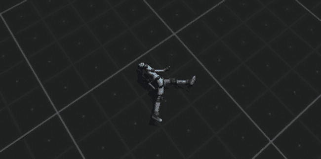
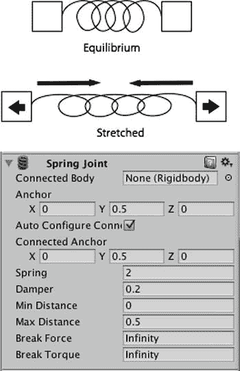
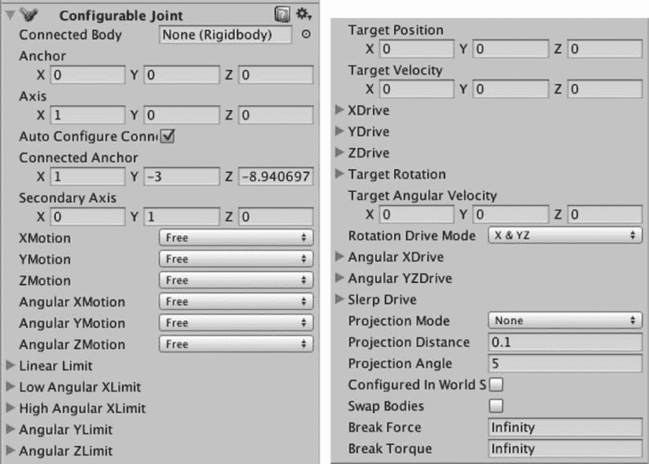

# 排版后的内容

在`Hierarchy`中，依次选择用于`Ragdoll Wizard`的每个子身体部位，取消勾选以在`Inspector`中禁用`Collider`组件，并为每个新的`Rigidbody`组件勾选`Is Kinematic`框。保持父级`Third Person Character Ragdoll`的`Rigidbody`和`Capsule Collider`组件启用。玩家角色在`Play`模式下将再次正常运行。

要从正常的玩家控制动画和运动切换到物理引擎驱动的布娃娃状态，需要一个脚本。在`Project`面板的`Assets ➤ Scripts`文件夹中，选择`Create ➤ Javascript`并将新脚本命名为`GoRagdoll`。添加以下代码：

```
#pragma strict

private var childRigidBodies : Rigidbody[];
private var childColliders : Collider[];

function Start ()
{
    childRigidBodies = gameObject.GetComponentsInChildren.<Rigidbody>();
    childColliders = gameObject.GetComponentsInChildren.<Collider>();
}

function GotoRagdoll ()
{
    if (childRigidBodies != null)
    {
        for (var childRigidBody : Rigidbody in childRigidBodies)
        {
            childRigidBody.isKinematic = false;
        }
    }
    if (childColliders != null)
    {
        for (var childCollider : Collider in childColliders)
        {
            childCollider.enabled = true;
        }
    }
    gameObject.collider.enabled = false;
    gameObject.rigidbody.isKinematic = true;
    gameObject.GetComponent(Animator).enabled = false;
    gameObject.GetComponent(ThirdPersonCharacter).enabled = false;
    gameObject.GetComponent(ThirdPersonUserControl).enabled = false;
}
```

该脚本分解如下：

`(1)     private var childRigidBodies : Rigidbody[];`
`(2)     private var childColliders : Collider[];`

这里介绍另一个编程概念：数组。数组是一组相同类型的项，称为元素。在(1)中，声明了一个名为`childRigidBodies`的数组私有引用变量，它将持有`Rigidbody`类型的元素。方括号`[]`是使其成为数组的语法，而非单个`Rigidbody`变量声明。在此示例中，`childRigidBodies`数组将把布娃娃的子刚体作为元素持有。

类似地，在(2)中，声明了一个名为`childColliders`的数组私有引用变量，它将持有`Collider`类型的元素，在此情况下是布娃娃的子碰撞体。

在`Start()`函数中：

`(3)     childRigidBodies = gameObject.GetComponentsInChildren.<Rigidbody>();`

`GetComponentsInChildren`名称恰如其分，因为它返回游戏对象及其任何子对象的所有指定类型组件。这里，角色和由`Ragdoll Wizard`创建的子刚体的刚体组件被分配为`childRigidBodies`数组的元素。

`(4)     childColliders = gameObject.GetComponentsInChildren.<Collider>();`

同样，`Third Party Character Ragdoll`游戏对象的`Collider`组件和由`Ragdoll Wizard`创建的子碰撞体组件被分配为`childColliders`数组的元素。

在`GotoRagdoll()`函数中：

`(5)     if (childRigidBodies != null)`

测试以确保`childRigidBodies`包含元素。没有元素将等于`null`状态。

`(6)     for (var childRigidBody : Rigidbody in childRigidBodies)`
`{`
`    childRigidBody.isKinematic = false;`
`}`

这是一个`for`循环的运作，对于`childRigidBodies`数组中的每个元素，创建一个`Rigidbody`类型的引用变量`childRigidBody`，然后将其`isKinematic`属性设置为`false`。将`isKinematic`设置为`false`意味着刚体现在被物理引擎识别。

`(7)     if (childColliders != null)`

测试以确保`childColliders`包含元素。

`(8)     for (var childCollider : Collider in childColliders)`
`{`
`    childCollider.enabled = true;`
`}`

另一个`for`循环，对于`childColliders`数组中的每个元素，创建一个`Collider`类型的引用变量`childCollider`，然后启用它。

`(9)     gameObject.collider.enabled = false;`
`(10)    gameObject.rigidbody.isKinematic = true;`
`(11)    gameObject.GetComponent(Animator).enabled = false;`
`(12)    gameObject.GetComponent(ThirdPersonCharacter).enabled = false;`
`(13)    gameObject.GetComponent(ThirdPersonUserControl).enabled = false;`

(7)和(8)激活布娃娃子对象以使其可被物理引擎访问，但运行玩家角色动画和运动的`Animator`和脚本也需要被停用。

(9)和(10)是简单的点符号属性更改语句，其中父级`Capsule Collider`组件（`Third Person Character Ragdoll`的）被禁用，父级`Rigidbody`组件被设置为`isKinematic`——意味着不被物理引擎识别。

(11)、(12)和(13)的语法略有不同，因为`Collider`和`Rigidbody`类直接继承自`gameObject`类。`Animator`和脚本属于`MonoBehavior`类，因此必须通过名称使用`GetComponent`函数来获取，以访问其属性并禁用它们。

保存`GoRagdoll`脚本并将其附加到`Third Person Character Ragdoll`。

**注意**

如果`Sample Assets (beta)`资产已集成到`Standard Assets`文件夹中，则可以跳过以下步骤。

如果您使用的是`Sample Assets (beta)`包，您将收到`"Unknown identifier: Third Person Character"`错误。编译器首先编译 JavaScript 文件，因此它无法识别从`GoRagdoll`脚本的`GotoRagdoll()`函数调用的`"Third Person Character"`或`"Third Person User Control"` C#脚本（尚未编译）的引用。

此规则有一个例外：`Standard Assets`文件夹中的脚本甚至在 JavaScript 文件之前编译。此处快速解决方案是在`Project`面板中：将`Sample Assets ➤ Characters ➤ Third Person Character`文件夹拖放至`Standard Assets`文件夹中，同时将`Sample Assets ➤ Cross Platform Input`文件夹也拖放至`Standard Assets`文件夹中。接下来，在`Project`面板搜索栏中找到`CrossPlatformInputInitialize`脚本并删除它。回顾一下，在撰写本文时，`Sample Assets (beta)`是一个单独的文件夹，但最终这些资产将被集成到`Standard Assets`中。如果您的情况如此，则可以跳过此步骤。

在`Project`面板中，打开`Assets ➤ Prefabs`文件夹。将`Third Person Character Ragdoll`从`Hierarchy`拖到`Assets ➤ Prefabs`文件夹中，将其保存为预制件。

现在编写一个脚本，用于在玩家角色受到钟摆撞击时激活布娃娃物理效果。

在`Project`面板的`Assets ➤ Scripts`文件夹中，选择`Create ➤ JavaScript`，将其命名为`KillOnCollision`，并在`MonoDevelop`中打开。将代码编辑为以下内容：

```
#pragma strict

function OnCollisionEnter(other : Collision) {
    if (other.gameObject.name == "Third Person Character Ragdoll")
    {
        other.gameObject.GetComponent(GoRagdoll).GotoRagdoll();
    }
}
```

这部分内容在第 6 章中已熟悉。代码分解如下：

`(1)     function OnCollisionEnter(other : Collision)`

当此脚本所附加的游戏对象的`Collider`组件检测到碰撞时，`OnCollisionEnter`函数被调用，并传入一个引用`other`，指向其碰撞到的游戏对象（玩家角色）。

`(2)     if (other.gameObject.name == "Third Person Character Ragdoll")`

检查碰撞到的游戏对象是否是`Third Person Character Ragdoll`。

`(3)     other.gameObject.GetComponent(GoRagdoll).GotoRagdoll();`

使用`GetComponent`函数访问`GoRagdoll`脚本，然后调用`GotoRagdoll()`函数。


在此特定情况下，条件判断是必要的，因为当玩家角色被钟摆击中时，钟摆可能会继续与一个或多个布娃娃碰撞器发生碰撞，从而导致错误。如果你有其他移动物体（非玩家角色）撞向钟摆，也会发生同样的情况。

保存脚本，并将其分别附加到三个钟摆球体上。保存场景，保存项目，然后进行游戏测试。现在，被钟摆击中后得到的反馈可真是令人满意！（参见图 7-14）

如果仔细观察，你会注意到玩家角色的头部和脚后跟似乎陷入了其躺卧的表面。你可以通过调整各个布娃娃碰撞体的大小和位置，来针对你的游戏玩家角色模型进行微调。



图 7-14.

玩家角色根据布娃娃物理效果倒地

### 击杀区域

你也可以编写一个`KillOnTrigger`脚本，用于不可见的击杀区域。由于障碍赛道是一条高架轨道，如果玩家角色坠落，应该会发生一些糟糕的事情，例如在地板上方设置一个不可见的击杀区域，当玩家角色撞击时立即死亡。在项目面板的`Assets ➤ Scripts`文件夹中，选择`Create ➤ JavaScript`，将新脚本命名为`KillOnTrigger`，并在 MonoDevelop 中打开。你可以从`KillOnCollision`中复制粘贴代码，然后将函数名从`OnCollisionEnter(other : Collision)`更改为`OnTriggerEnter(other : Collider)`，如下所示，然后保存脚本：

```
#pragma strict

function OnTriggerEnter(other : Collider) {

        if (other.gameObject.name == "Third Person Character Ragdoll")

        {

        other.gameObject.GetComponent(GoRagdoll).GotoRagdoll();

        }

}
```

在层级面板中选择`Create ➤ Cube`，并将其命名为`KillZone_Floor`。在检查器中，将其变换位置设置为`(0, 0, 120)`，缩放设置为`(30, 1, 200)`。取消勾选网格渲染器组件以禁用它，使其成为一个不可见的击杀区域。在盒碰撞体组件中勾选`Is Trigger`。选择`Add Component ➤ Scripts`并选择`KillOnTrigger`。保存场景，保存项目，然后进行游戏测试。当玩家角色从高架赛道坠落时，布娃娃物理效果会在其撞击地板前生效。

### 弹簧关节

弹簧关节用于连接两个刚体，使它们的运动就像通过弹簧连接一样。弹簧有一个平衡位置，在此位置时处于静止状态。如果两个刚体被拉开，弹簧会通过回拉来抵抗这种运动。你可以在图 7-15 中看到弹簧关节组件的属性。



图 7-15.

检查器中的弹簧关节组件

弹簧关节的`Connected Body`属性同样指明了该弹簧关节所连接的刚体；如果为`None`，则连接至世界空间。`Anchor`是关节相对于游戏对象本地空间的中心点，而`X`、`Y`、`Z`属性则是关节的本地中心。当你添加一个`Connected Body`时，可以看到这些值的变化。

`Spring`属性设置了弹簧抵抗相反作用力的回拉力度。`Damper`抗拒`Spring`，类似于`Drag`抗拒作用力。`Damper`值越高，弹簧在静止前的振荡或“弹跳”次数就越少。

`Min Distance`和`Max Distance`设置了一个范围，在该范围内弹簧动作不会激活，即只有当刚体移动到此范围之外时，弹簧关节才会回拉。`Break Force`和`Break Torque`决定了破坏弹簧关节所需的作用力。

### 可配置关节

可配置关节是一种高度可定制的关节，其详细内容超出了本书的范围。Unity 组件参考文档是获取更多信息的最佳起点。你可以在图 7-16 中查看可配置关节组件的属性。



图 7-16.

可配置关节组件的众多属性。


