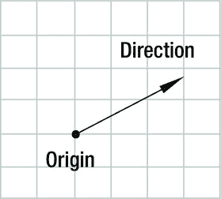
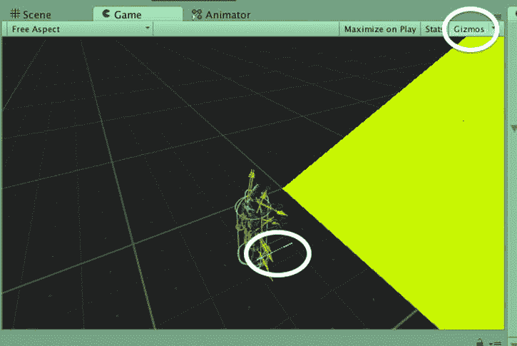
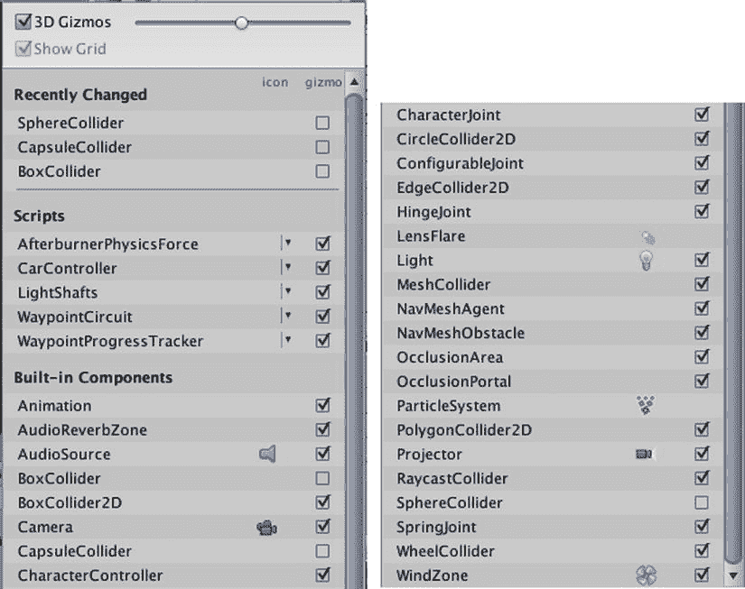
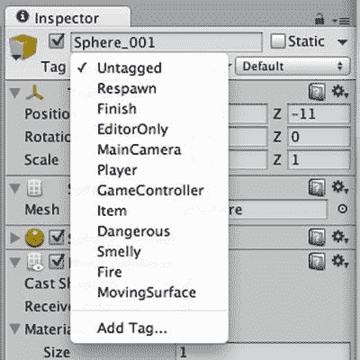
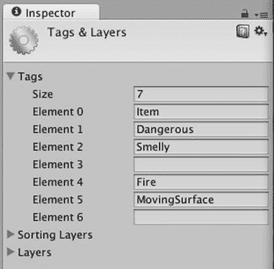
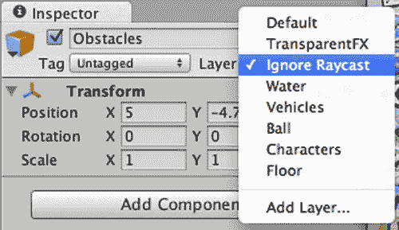
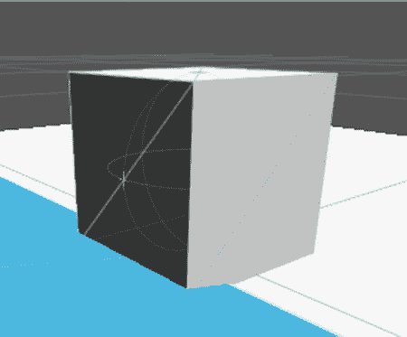
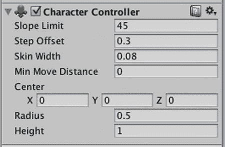
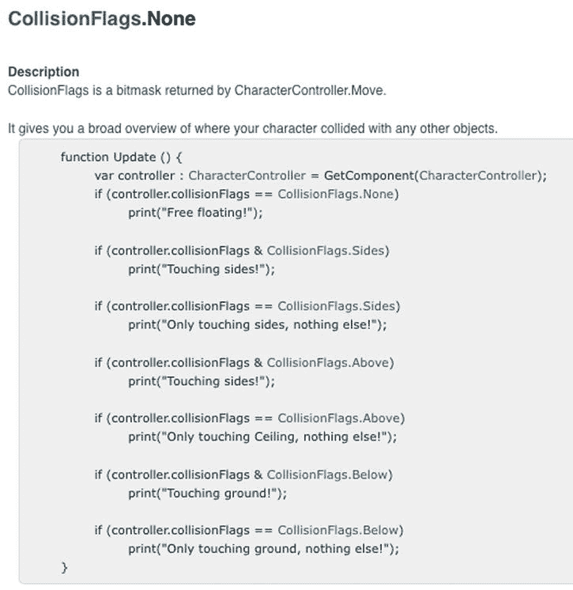
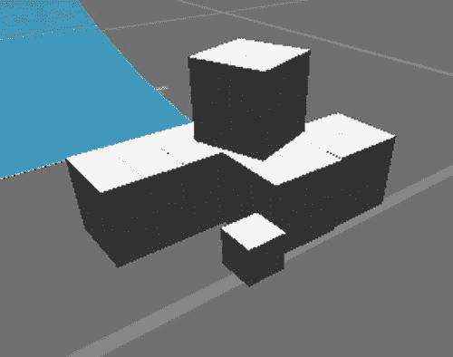

# 射线投射

射线投射是一种从游戏对象向世界延伸射线，以检测其路径上是否存在碰撞体的技术。它通常用于瞄准、计算距离等场景。该名称源于其坐标几何原理：射线是一种线，其一端在空间中具有特定点，另一端可延伸至无穷远。



`Ray` 结构体包含作为 `Vector3` 的起点和作为 `Vector3` 的方向。

在 Unity 编辑器的 Project 面板中，打开 `Assets` ➤ `Sample Assets` ➤ `Sample Scenes` ➤ `Scenes` 文件夹，并打开第三人称角色场景。在顶部菜单中选择 `File` ➤ `Save Scene as . . .`，将场景另存为 `RaycastTest`。

同样在 Project 文件夹中，选择 `Assets` ➤ `Scripts` 文件夹，然后选择 `Create` ➤ `Javascript`，将新脚本命名为 `RaycastFun`，并在 MonoDevelop 中打开。在正常游戏中你无法看到射线，但 `Debug.DrawRay(origin, direction, color)` 在开发过程中非常有帮助。将代码编辑如下：

```
public var rayLength : float = 2;

function Update () {
Debug.DrawRay(transform.position + Vector3(0, 0.5, 0), transform.forward * rayLength, Color.white);
}
```

分解说明：

(1) `public var rayLength : float = 2;`

声明一个 float 类型变量 `rayLength`，并将其设为 public，以便在 Inspector 中访问。

(2) `Debug.DrawRay(transform.position + Vector3(0, 0.5, 0), transform.forward * rayLength, Color.white);`

以游戏对象的 `transform.position` 作为射线的起点，然后向 y 坐标增加 0.5，以将其从地面略微抬高。射线的方向是玩家角色面向的方向，即游戏对象的本地 `transform.forward`，其长度由因子 `rayLength` 调整。你可以更改射线的 `color` 以达到最佳可见度。还有一些我们不会使用的参数，例如射线可见的时间以及相对于其他游戏对象的绘制方式。 有关完整详情，请查阅 `DrawRay` 的脚本参考。

保存脚本，将其附加到第三人称角色布娃娃物体上，保存场景，然后进行测试。根据你的编辑器设置，你可能看不到任何变化。如果出现这种情况，请在播放模式下选择 Game 视图顶部的 `Gizmos` 按钮。现在进行测试，所有东西都可见，包括代表从玩家角色向前延伸射线的细白线（图 7-17）。



图 7-17. 在游戏视图中显示辅助图标

Gizmos 按钮上的小箭头会按类型显示一个辅助图标上下文菜单，以便你控制测试期间希望看到和不希望看到的内容（图 7-18）。



图 7-18. 可在游戏视图中查看的各种辅助图标选择菜单

各种 `Raycast` 方法让你可以控制射线可以击中哪些碰撞体，以及是否希望获取关于射线投射所命中碰撞体的信息。

在编辑器中，通过将 `Transform.rotation` 的 y 坐标改为 180 来转动玩家角色。创建五个原始球体对象，并赋予它们 `transform.position` 坐标分别为 (0, 0.5, -5)、(4, 0.5, 5.5)、(0.7, 0.5, -4)、(-3, -0.5, -11) 和 (-4, 0.5, -2)。使用标准命名约定，将它们依次命名为 `Sphere_001` 到 `Sphere_005`。在 MonoDevelop 中，将你的 `RaycastFun` 脚本编辑如下：

```
function Update () {
var hit : RaycastHit;
if(Physics.Raycast(transform.position + Vector3(0, 0.5, 0), transform.forward, hit))
{
print ("Collided with game object " +
hit.collider.gameObject.name);
}
}
```

分解说明如下：

(1) `var hit : RaycastHit;`

声明 `RaycastHit` 类型引用变量，该变量将存储关于射线所击中的碰撞体的信息。

(2) `if(Physics.Raycast(transform.position + Vector3(0, 0.5, 0), transform.forward, hit))`

当射线与碰撞体相交时，`Raycast()` 函数返回布尔值 `true`，当没有相交时返回 `false`。如果 `Raycast()` 返回 `true`，则会执行条件内的代码块。

射线的起点被设置为游戏对象的 `transform.position`，同时将起点的 y 坐标增加 0.5，使其大致达到角色的膝盖高度。

射线的方向对应于游戏对象的正向。省略射线长度意味着它默认为无限长的射线，因此你可以从玩家角色面向的任何游戏对象处获取命中信息。

(3) `print ("Collided with game object " + hit.collider.gameObject.name);`

打印射线检测到的任何游戏对象的名称。

保存脚本。保存场景并进行测试。注意，射线会检测所有带有碰撞体的物体，包括斜坡和场景中的其他游戏对象。

假设你想摧毁这些邪恶的球体。尝试在 `Update()` 函数中添加一个“Destroy”命令：

```
function Update () {
var hit : RaycastHit;
if(Physics.Raycast(transform.position+ Vector3(0, 0.5, 0),
transform.forward, hit)) {
print ("Collided with game object " +
hit.collider.gameObject.name);
Destroy(hit.collider.gameObject);
}
}
```

保存脚本并进行测试。操控角色到处跑动，摧毁邪恶的球体。但要小心——你也会摧毁射线命中的较低斜坡和障碍物游戏对象。

你已经在条件语句中使用过 `gameObject.name` 来检测游戏对象，但现在你需要处理五个邪恶的球体。你可以使用以下方法摧毁这些球体：

```
function Update () {
var hit : RaycastHit;
if(Physics.Raycast(transform.position+ Vector3(0, 0.5, 0), transform.forward, hit)) {
print ("Collided with game object " + hit.collider.gameObject.name);
if (hit.collider.gameObject.name == ("Sphere_001"))
{
Destroy(hit.collider.gameObject);
}  else if (hit.collider.gameObject.name == ("Sphere_002"))
{
Destroy(hit.collider.gameObject);
}  else if (hit.collider.gameObject.name == ("Sphere_003"))
{
Destroy(hit.collider.gameObject);
}  else if (hit.collider.gameObject.name == ("Sphere_004"))
{
Destroy(hit.collider.gameObject);
}  else if (hit.collider.gameObject.name == ("Sphere_005"))
{
Destroy(hit.collider.gameObject);
}
}
}
```

但你可以看到，仅仅处理几个邪恶球体，代码就已经变得非常繁琐和庞大。如果邪恶球体的数量多得多，该怎么办？


#### 标签

标签是一种重要的脚本工具，它允许你对游戏对象（例如邪恶球体）进行排序和分组标识，从而简化你的代码。

在层级视图中，选择 `Sphere_001`，然后查看检视面板，你会看到靠近顶部、游戏对象名称正下方有一个标签选项（图 7‑19）。



*图 7‑19.* 检视面板中的标签下拉菜单选择器

打开标签下拉菜单，你会看到一系列常用标签。虽然有一些内置标签，但你需要创建一个名为 Enemy 的标签，因此选择菜单底部的“添加标签...”，以在检视面板中打开标签管理器（图 7‑20）。



*图 7‑20.* 检视面板中的标签和层级管理器

如果所有元素都不是空的，你可以增加“大小”的值。请记住，一个游戏对象只能有一个标签，但你可以根据需要为游戏创建任意数量的不同标签。将 Enemy 添加到标签列表中的一个空元素中，然后在层级视图中重新选择 `Sphere_001`。现在，当你选择检视面板中的标签下拉菜单时，Enemy 会作为一个选项出现，因此选择它。也将其余四个球体游戏对象的标签设置为 Enemy。

在 MonoDevelop 中，将你的 `Update()` 函数编辑为以下内容：

```
function Update () {   var hit : RaycastHit;

        if(Physics.Raycast(transform.position+ Vector3(0, 0.5, 0), transform.forward, hit)) {

                print ("Collided with game object " + hit.collider.gameObject.name);

                if (hit.collider.gameObject.tag == ("Enemy"))

                {

                        Destroy(hit.collider.gameObject);

                }       

        }

}
```

保存并运行测试，现在任何与射线相交的邪恶球体都会被销毁。在各个方向操纵玩家角色，注意平台和障碍物方块不会被销毁，只有球体被销毁。

标签并非射线检测专用；它们是为了在你的脚本中更方便地管理游戏对象组。

### 层

标签通过处理游戏对象组来减少冗长的代码，而层也同样处理游戏对象组。层有助于提升游戏性能，因为它们最常被用作约束条件，有选择地忽略某些游戏对象组或场景区域，从而减少处理负载。

层可用于限制摄像机渲染场景的哪一部分、实现基于层的碰撞检测，或确定场景的哪些区域会被照亮，这同样减少了处理负载。与标签不同，前七个层是 Unity 必需的，并且你总共只能使用 31 个层。

如果你在 `RaycastFun` 脚本的 `Update()` 函数中注释掉或修改你的代码为以下内容：

```
function Update () {

    var hit : RaycastHit;

        if(Physics.Raycast(transform.position+ Vector3(0, 0.5, 0),

        transform.forward, hit)) {

                print ("Collided with game object " +

                hit.collider.gameObject.name);

                Destroy(hit.collider.gameObject);

        }

}
```

这次，射线检测到的平台和障碍物方块将与球体一起被销毁。在层级视图中选择 Obstacles。在检视面板中，在标签菜单右侧，选择“层”下拉菜单并选择“忽略射线检测”（图 7‑21）。



*图 7‑21.* 在层下拉菜单中选择“忽略射线检测”

一个弹出窗口将询问你是否要将所有子对象的层设置为“忽略射线检测”。选择“是，更改子对象”，这样组成 Obstacles 的所有较小的预制件方块都将被包含在“忽略射线检测”层中。

保存场景并运行测试。再次，只有当射线检测到碰撞体时，邪恶球体才会消失。现在的区别在于，游戏引擎不必检查射线相交的每一个碰撞体，而是直接忽略“忽略射线检测”层上的任何碰撞体。

### 角色控制器

你已经使用脚本、动画和物理力移动过游戏对象。你也花了一些时间使用 Unity 的示例资产控制器，例如第三人称角色，但你也可以使用角色控制器组件创建自己的控制器。对于你不希望受刚体物理影响的第一人称或第三人称角色，角色控制器组件可能正是你需要的。

在编辑器中，创建一个新场景，并添加一个平面和一个方向光。在层级视图中选择“创建 ➤ 立方体”。注意，原始游戏对象 Cube 没有刚体组件。回顾一下，刚体运动是由物理引擎控制的，因此，角色控制器组件和刚体组件同时试图控制同一个游戏对象的运动会导致异常行为。

注意，Cube 游戏对象已经有一个盒子碰撞体。角色控制器本质上是一个胶囊碰撞体，其运动可以通过脚本控制。它继承自 `Collider` 类，这意味着它包含了 `Collider` 类的功能，并通过更多的自定义函数在此基础上进行构建。在层级视图中选中 Cube 游戏对象，在检视面板中选择“添加组件 ➤ 物理 ➤ 角色控制器”。在场景视图中，你会看到胶囊碰撞体的辅助图标出现在 Cube 游戏对象内部（图 7‑22）。



*图 7‑22.* Cube 游戏对象内部的角色控制器胶囊碰撞体

在检视面板中，你会找到角色控制器。控制器无法攀爬超过“坡度限制”的斜坡。“步进偏移”是一个类似的垂直约束，它决定了控制器可以从地面爬上台阶的高度。“皮肤宽度”设置了表面内部的余量，另一个碰撞体在检测到碰撞之前可以穿透到控制器碰撞体内部。一般经验法则是角色控制器半径的 10%，因此将其更改为 0.1。为了减少抖动，如果控制器被告知移动的距离小于“最小移动距离”，它将保持原地不动。数值越大，所需的控制输入越多。与标准碰撞体一样，胶囊碰撞体可以使用“中心”进行偏移，并使用“半径”和“高度”调整大小（图 7‑23）。



*图 7‑23.* 检视面板中的角色控制器组件

要测试其中一些属性，你需要用更多物品来填充场景。在项目面板中，选择 `Assets ➤ Sample Assets ➤ Prototyping ➤ Prefabs` 文件夹，并向场景中添加一个 Loop。将 Loop 的 y 轴旋转设为 90。Loop 和 Plane 的变换位置都应为 `(0, 0.5, 0)`，而 Cube 的变换位置应为 `(0, 0, 0)`。将 Plane 的缩放设为 `(20, 20, 20)`，并通过从 `Assets ➤ Sample Assets ➤ Prototyping ➤ Prefabs ➤ Textures` 文件夹中拖动 `prototype_grey_dff` 纹理并将其放到场景视图中的 Plane 上来增加一点对比。再深入一级文件夹进入 Compound Prefabs，将一个 Box Pile 拖入场景；将其变换位置设为 `(2, 0, –8)`。

最后，在 `Assets ➤ Standard Assets ➤ Scripts ➤ Camera Scripts` 文件夹中，找到鼠标轨道脚本。如果该文件夹不存在，请从顶部菜单中选择 `Assets ➤ Import Package ➤ Scripts` 来获取它。将其拖放到 Main Camera 上。在层级视图中选择 Main Camera。将 Cube 游戏对象从层级视图拖到 Main Camera 的鼠标轨道脚本组件上，并将其放入目标属性字段中。


场景已搭建完成，角色控制器属性也已设置好。现在需要编写一个脚本让 Cube 游戏对象动起来。在 Project 面板中选择 Assets ➤ Scripts 文件夹，然后依次选择 Create ➤ New Script ➤ Javascript。将其命名为 `CCScript`，并在 MonoDevelop 中打开。将代码编辑为以下内容：

```
#pragma strict

private var contr : CharacterController;

private var moveVector : Vector3 = Vector3.zero;

public var speed : float = 10.0f;

function Start () {

contr = gameObject.GetComponent.<CharacterController>();

}

function Update () {

moveVector.x = Input.GetAxis("Horizontal") * speed;

moveVector.z = Input.GetAxis("Vertical") * speed;

contr.Move(moveVector * Time.deltaTime);

}
```

这段代码的分解说明如下：

`(1)    private var contr : CharacterController;`

声明一个类型为 `CharacterController` 的引用变量 `contr`。

`(2)    private var moveVector : Vector3 = Vector3.zero;`

声明一个类型为 `Vector3` 的引用变量 `moveVector`，用于存储每帧游戏对象的移动距离信息。

`(3)    public var speed : float = 10.0f;`

声明一个公共浮点变量 `speed`，用于在 Inspector 中调整游戏对象的速度。

```
function Start () {

(4)    controller = gameObject.GetComponent.<CharacterController>();

}
```

访问 `CharacterController` 组件的引用，并将其赋值给 `controller`。

```
function Update () {

(5)         moveVector.x = Input.GetAxis("Horizontal") * speed;

(6)         moveVector.z = Input.GetAxis("Vertical") * speed;

}
```

这里将用户的输入乘以 `speed` 因子，并分别存储到 `Vector3` 变量 `moveVector` 的 x 轴和 z 轴分量中。

`(7)    controller.Move(moveVector * Time.deltaTime);`

首先将 `moveVector` 信息乘以 `Time.deltaTime` 平滑因子，然后传递给角色控制器的 `Move()` 函数。

`Move()` 函数移动游戏对象，并以 `CollisionFlags` 变量的形式返回移动过程中发生的碰撞信息。这些信息可以让你大致了解碰撞发生的位置。`CollisionFlags` 变量是一个位掩码，其解释超出了本文的范围。不过，你可以点击 MonoDevelop 中的 `CollisionFlags` 打开脚本参考文档，了解如何过滤 `CollisionFlags` 信息（图 7-24）。



图 7-24.

Unity 脚本参考文档中的 `CollisionFlags` 包含了示例布尔逻辑条件语句，用于提取感兴趣的碰撞信息

保存脚本并将其附加到 Cube 游戏对象上。保存场景并播放。尝试让 Cube 沿环形坡道向上移动。一旦环形坡道的坡度超过坡度限制值，Cube 就无法继续前进了。你还可以通过 Cube 靠近环形坡道一侧的边角被遮挡的程度，观察到皮肤宽度设置的效果。

你还会发现 Cube 会撞到箱子堆并停下来，但箱子堆对碰撞没有反应。要实现这种交互，你需要手动向脚本中添加相应功能。在 MonoDevelop 中，在其他变量声明之后添加一个变量声明：

`public var pushPower : float = 2.0;`

这将为你提供一个因子，用于通过 Inspector 调整碰撞效果。

在 `Update()` 函数下方添加以下函数：

```
function OnControllerColliderHit (hit : ControllerColliderHit) {

var body : Rigidbody = hit.collider.attachedRigidbody;

if (body == null || body.isKinematic)

return;

if (hit.moveDirection.y < -0.3)

return;

var pushDir : Vector3 = Vector3 (hit.moveDirection.x, 0,

hit.moveDirection.z);

body.velocity = pushDir * pushPower;

}
```

这段代码的分解说明如下：

`(1)     function OnControllerColliderHit (hit : ControllerColliderHit) {`

角色控制器组件有一个 `OnControllerColliderHit` 函数，当胶囊体在移动过程中碰撞到其他碰撞体时，该函数会被调用。`ControllerColliderHit` 提供关于碰撞的更详细信息。

`(2)     var body : Rigidbody = hit.collider.attachedRigidbody;`

声明一个 `Rigidbody` 类型的变量 `body`，用于存储 Cube 碰撞到的游戏对象的刚体引用。

`(3)     if (body == null || body.isKinematic)`

`return;`

检查另一个对象是否确实具有刚体组件，或者是否已设置为“是否运动学”。如果这两个条件中有一个为真，则 Cube 无法推动它，因此通过 `return` 语句退出函数。

`(4)     if (hit.moveDirection.y < -0.3)`

`return;`

此条件用于检查碰撞方向，以防止推动 Cube 下方的任何对象。

`(5)     var pushDir : Vector3 = Vector3 (hit.moveDirection.x, 0,`

`hit.moveDirection.z);`

声明一个 `Vector3` 类型的引用变量 `pushDir`，用于存储碰撞中 x 轴和 z 轴方向的 `moveDirection` 信息。

`(6)     body.velocity = pushDir * pushPower;`

对 Cube 推力的最终响应是通过将推力方向乘以你的 `pushPower` 因子，并将此速度应用于被碰撞对象的刚体来计算的。

保存脚本并进行游戏测试。这次当你将 Cube 撞向箱子堆时，箱子会对 Cube 的碰撞做出反应（图 7-25）。



图 7-25.

较小的游戏对象 Cube 推动箱子堆中的立方体

老规矩，尽情尝试修改属性，观察 Cube 的行为如何变化吧。

## 本章小结

在本章中，你开始构建一个障碍赛道，并运用目前已学到的知识搭建了第一个障碍物。你将关节（Joints）添加到物理知识库中，并设计了几个钟摆式障碍物。凭借对刚体、碰撞体、关节和动画的基本理解，你学会了使用布娃娃向导（Ragdoll Wizard）为玩家角色应用布娃娃物理效果，以实现逼真且令人满意的“死亡”表现。你还将角色控制器组件添加到了控制玩家游戏对象的选项菜单中。针对上述每一个类别，你都学习了相应的函数和变量，以及如何在基础脚本中使用它们。此外，你还将标签（Tags）和层（Layers）的使用纳入了你的通用游戏开发技能体系。

这真是了不起的成就！请坚持下去，随着我们在下一章中将这些新的物理功能与粒子发射器和特效相结合，事情会变得更加有趣和激动人心。

