# 手里剑粒子系统引擎

## 粒子系统简介

Unity 从 3.5 版本开始引入了手里剑粒子系统引擎。虽然 3D 模型和动画必须在 Unity 外部创建，但手里剑粒子引擎让您能够创建自己的粒子效果，例如火焰、雨水等。在本章中，您将学习如何使用粒子系统创建特殊效果，然后进一步学习如何通过脚本控制它们。

粒子系统在视觉上非常动态。您最好打开编辑器，以便查看粒子的运动状态以及它们如何响应系统模块的设置（图 8-1）。

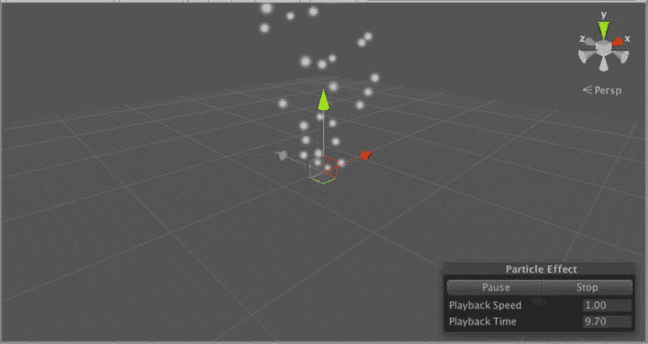

图 8-1. 场景视图中的默认粒子系统

在 Unity 编辑器中，打开“障碍赛道”场景。从顶部菜单中选择 `Game Object ➤ Create Other ➤ Particle System`。在场景视图中，新创建的粒子系统会出现，并立即开始按照默认设置发射粒子。

您会注意到粒子系统的控制按钮也出现在场景视图的右下角。暂停和停止按钮的功能不言自明。当您将 `Playback Speed`（播放速度）分别更改为 10、0.1 然后改回 1.00 时，可以观察其中的差异。播放时间有助于协调构成粒子效果的系统以及进行常规的微调。

在进一步深入之前，先介绍一些术语。粒子是由粒子系统成组发射的对象。它们通常由简单形状的纹理组成，以 2D 广告牌的形式发射。广告牌是一个带有纹理的平面，它始终面向摄像机，从而用 2D 对象呈现出 3D 效果。

请记住，游戏性能取决于场景的“繁忙”或“沉重”程度。根据游戏的需求，粒子可以是 3D 的，甚至可以使用 `Texture Sheet Animation`（纹理表动画）模块制作成动画（图 8-2）。虽然尝试它们很有趣，但请在游戏中合理使用：只使用您需要的粒子，并且只在使用它们的时间内使用。

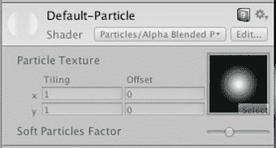

图 8-2. 在检视面板中看到的默认粒子及其右侧显示的纹理

## 粒子系统组件

粒子系统是发射粒子的组件。它拥有许多模块和设置，可以实现各种各样的效果。粒子系统还可以组合成组，以创建更复杂的粒子效果。

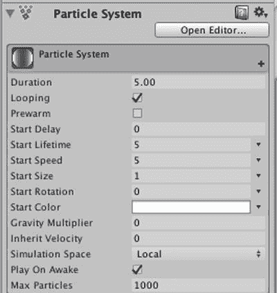

图 8-3. 检视面板中粒子系统组件的初始模块

当您在检视面板中查看 `Particle System`（粒子系统）组件时（图 8-3），您会发现它提供了强大的编辑能力。在阅读属性描述时，请花时间调整其值，并使用场景视图中粒子系统控制器的 `Simulate/Stop`（模拟/停止）按钮，观察默认粒子系统如何响应。

前几个属性控制粒子系统发射粒子。`Duration`（持续时间）是粒子系统发射粒子的时间（秒）。要获得持续效果，您可以勾选 `Looping`（循环）复选框。如果您使用 `Looping`（循环）并勾选 `Prewarm`（预热）复选框，粒子将显示为仿佛一直在发射。如果您希望在粒子发射开始前有一段延迟，则在不勾选 `Prewarm`（预热）的情况下使用 `Start Delay`（起始延迟），指定发射粒子前等待的时间（秒）。

接下来的一组属性控制单个粒子的行为。您可以使用 `Start Lifetime`（起始生命周期）指定每个粒子的生命周期（秒）。`Start Speed`（起始速度）、`Start Size`（起始大小）和 `Start Rotation`（起始旋转）顾名思义：分别是粒子首次发射时的初始速度、大小和旋转。这四个属性都可以在相应的字段中指定数值，也可以使用随机范围或曲线进行进一步自定义。

`Start Color`（起始颜色）也是如此，它提供了更多控件来改变粒子的颜色（包括不透明度的 Alpha 值）在其生命周期内的变化。

通过使用 `Gravity Multiplier`（重力乘数），您可以实现诸如向上漂浮的烟雾或落向地面的流体飞溅等效果。

粒子系统像任何其他游戏对象一样可以运动。当它们移动时，您可以使用 `Inherit Velocity`（继承速度）来决定粒子应继承多少速度。

`Simulation Space`（模拟空间）允许您在 `Local`（局部）空间或 `World`（世界）空间之间进行选择。当勾选时，`Play on Awake`（唤醒时播放）选项会告诉粒子系统在创建后自动启动。最后，`Max Particles`（最大粒子数）是系统在一个周期内发射的粒子总数。

## 模块详解

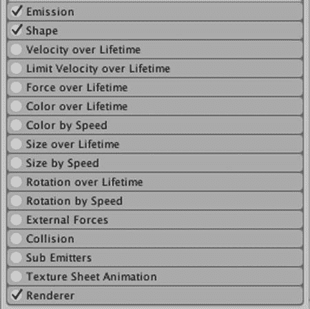

图 8-4. 检视面板中粒子系统组件的更多模块

检视面板中的其余项目是更多模块。单击每个模块可以查看其可控的属性（图 8-4）。请记住，虽然单个粒子系统并不每次都使用每个模块，但手里剑为您提供了丰富的选项（表 8-1）。

表 8-1. 检视面板中额外的手里剑粒子系统模块

| 模块 | 描述 |
| --- | --- |
| 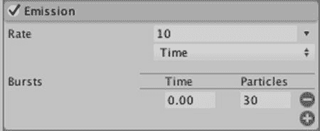 | 发射模块 `Rate`：每秒粒子数。同时也可作为`粒子/米`的可选参数。`Bursts`：指定时间（秒）及在此时间内要发射的粒子数量。使用`+`可添加更多爆发点。 |
| 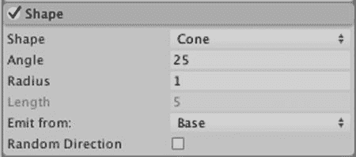 | 形状模块 发射器形状选项：`球体`、`半球体`、`锥体`、`立方体`和`网格`。根据所选形状，还会有更多可调参数来进一步细化粒子的发射方向。每种形状还提供`随机方向`选项。 |
| 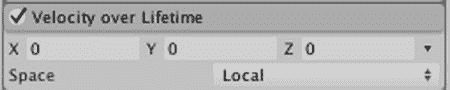 | 生命周期内速度模块 可控制粒子在生命周期内沿各轴线的速度。 |
| 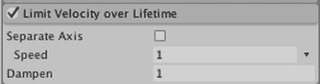 | 生命周期内速度限制模块 速度限制是阻尼或阻力的另一种说法。`速度限制`是粒子受阻尼量影响的阈值。 |
| 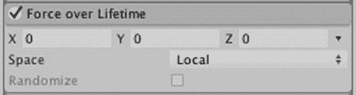 | 生命周期内力模块 使用常数值或曲线沿任意轴施加力，或勾选模块底部的`随机化`复选框。可指定`局部`或`世界`空间。 |
| 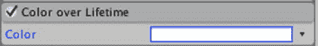 | 生命周期内颜色模块 提供`渐变`或`两个渐变间随机`选项。点击该字段将打开`渐变编辑器`。 |
| 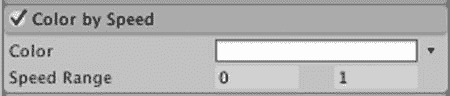 | 速度控制颜色模块 基于速度显示颜色可有效模拟多普勒成像。使用`颜色`属性设置颜色渐变，其中`最小速度`代表颜色渐变的左边界，`最大速度`代表右边界，颜色渐变按比例映射到速度范围上。 |
| 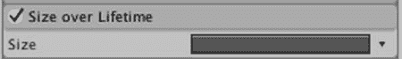 | 生命周期内大小模块 你可以选择使用曲线编辑器，或在两个常量或两条曲线之间进行随机化。 |
| 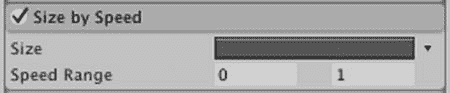 | 速度控制大小模块 选项与生命周期内大小模块相同：使用曲线编辑器，或在两个常量或两条曲线之间进行随机化。 |
| 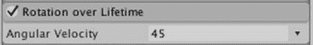 | 生命周期内旋转模块 使用常量或曲线指定粒子在其生命周期内的角速度。还提供在两个常量或两条曲线之间随机化的选项。 |
| 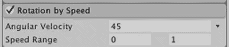 | 速度控制旋转模块 选项与生命周期内旋转模块相同，但你必须指定速度范围，因为它不像前一个模块那样由`持续时间`属性预先确定。 |
| 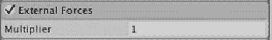 | 外力模块 此模块专门用于指定粒子受风场影响的程度。 |

### 碰撞模块
首先选择粒子是否与每个游戏对象都检测碰撞，还是仅限于平面。尽可能使用平面对游戏性能最有利。平面可视化让你可以选择使用线框状或实心网格。其余参数对粒子行为的影响类似于`刚体`和`物理材质`。勾选`发送碰撞消息`时，将调用`OnParticleCollision()`函数。

### 子发射器模块
粒子可被指定在碰撞时或在生命周期的开始/结束时转换为另一个粒子系统。使用`碰撞`选项需要启用`碰撞模块`。你可以在示例资源粒子系统演示中的`粒子沙盒`场景里找到烟花中使用子发射器的绝佳范例。

### 纹理表动画模块
可以使用一张纹理表文件中所包含的图像阵列来为粒子设置动画。请参见示例资源包中的`part_fireball_sheet_dff`粒子纹理。

### 渲染器模块
此模块包含决定粒子如何绘制或渲染的`ParticleSystemRenderer`属性。最简单的模式`广告牌`使用一个始终面向摄像机的 2D 图形。其他`广告牌`选项无需真正 3D 粒子的开销即可提供增强的视觉效果（`网格`是真正的 3D 粒子）。影响材质、光照、阴影和绘制顺序的属性适用于所有`渲染器模块`模式。操作这些设置超出了本书的讨论范围。