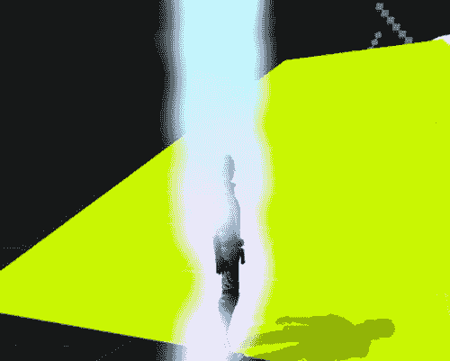

# 华丽登场

此示例将通过让玩家在能量闪光中以北欧神祇般的华丽方式登场（图 8-5），为场景增添炫酷效果。

图 8-5. 玩家在游戏开始时华丽登场

为了了解即将实现的效果，首先你将查看 Unity 示例资源中的各种粒子特效。对于你的第一个粒子系统，你将从一个示例资源预制件开始并进行修改。接着，你将从头开始创建一个自定义粒子系统，并最终将这些系统组合成一个复杂的粒子效果。最后，你将使用脚本将粒子效果及与其他游戏对象的交互整合到障碍赛场景中。

为了直奔主题，请在项目面板中进入 `Assets ➤ Sample Assets ➤ Sample Scenes ➤ Scenes`，打开`粒子`场景，然后试玩一番。爆炸、火焰、沙尘暴、烟花、水花喷射等等，尽在指尖——太棒了！

好了，当你准备好继续时，仔细观察沙尘暴，注意整个区域是如何被覆盖的。这是一个简单的粒子系统，其发射器的大小使用有着显著的不同。

在层级面板中，选择 `Particle Systems ➤ DustStorm`。接着，在检查器中展开`粒子系统`组件的`形状`模块。注意它是一个立方体形状——一个非常大的立方体，`x`和`z`值均为 100。这个整个`100×100`的立方体就是粒子发射器，它在该立方体表面区域上发射整个沙尘暴，因此播放时看起来覆盖了整个场景。

你将在障碍赛场景中构建你的粒子效果。继续在编辑器中重新打开障碍赛场景，并删除默认的粒子系统。

在项目面板中，选择 `Assets ➤ Sample Assets ➤ Effects ➤ Particle Systems ➤ Prefabs` 文件夹，将`DustStorm`粒子系统预制件的一个副本拖入场景，并将其重命名为`DustPuff`。玩家角色的着陆将通过一团灰尘的扬起得到强调。我们将从这里开始，因为它是最简单的。