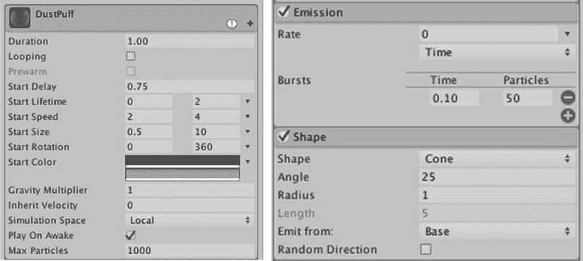

# 灰尘爆裂

这里的目标是产生一股突如其来的灰尘，以强调玩家撞击地面的力度。选中`DustPuff`后，将注意力转向检视面板中的粒子系统组件（图 8-6）。

图 8-6. `DustPuff` 粒子系统组件设置

其时序为：能量爆发首先出现，玩家从其中下落至地面，双脚着地，而灰尘则在撞击的瞬间扬起。

要实现单一的短暂灰尘爆裂，请将 `Duration` 设置为 1 秒，并取消勾选 `Looping`。将 `Start Delay` 设置为 0.75。这将为能量爆发和玩家出现留出一些时间，特别是为了与玩家落地的时刻同步。

打开 `Start Lifetime` 的下拉菜单，选择 `Random Between Two Constants`，并在相应字段中输入 0 和 2。为粒子的 `Start Lifetime`、`Start Speed` 和 `Start Size` 引入一些随机性，可以使粒子系统看起来更“自然”。将 `Start Size` 的值改为 0.5 和 10。

为了让灰尘向上喷涌然后落回地面，而不是像吹散一样，请将 `Gravity Multiplier` 改为 1。如果你想实现烟雾或蒸汽效果，可以将其设为负值，使粒子向上飘散开。

为了实现爆裂效果，在 Emission 模块中将 `Rate` 改为 0。现在在 Bursts 中，点击 +，然后将 `Time` 设置为 0.10，`Particles` 设置为 50。

使用 Shape 模块，使灰尘爆裂更集中于玩家角色落地区域周围。将 `Shape` 属性设置为 `Cone`，其 `Angle` 应为 25，`Radius` 为 1，并将 `Emit from:` 属性设置为 `Base`。

在场景视图中使用 `Simulate` 和 `Stop` 按钮，测试你在更改过程中对 `DustPuff` 粒子系统的改动。现在将第三人称角色布娃娃的 `Transform.position` 移动到 (0, 4, 0)，并确保 `DustPuff` 的 `Transform.position` 为 (0, 0, 0)，`Transform.rotation` 为 (90, 0, 0)。保存场景并运行测试。

