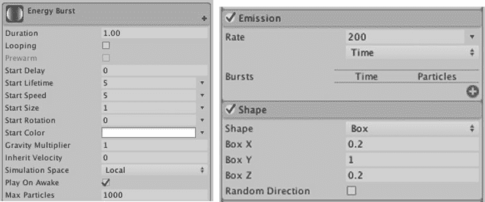
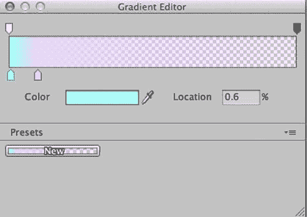
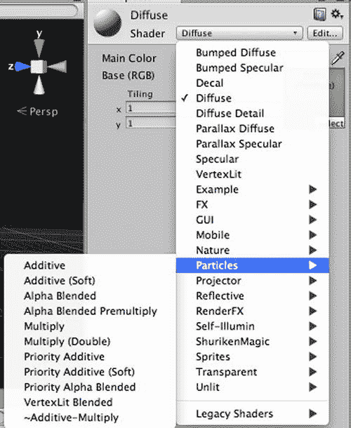

# 能量爆发

接下来要添加到“盛大登场”中的粒子系统是能量爆发（图 8-7）。在编辑器顶部菜单中，选择`Game Object` ➤ `Create Other` ➤ `Particle System`，并将其命名为`EnergyBurst`。将`Transform.position`改为`(0, 4, 0)`，以使爆发来自玩家角色最终着陆点的上方。

图 8-7. `EnergyBurst`粒子系统组件设置

检视面板中`Initial`模块的设置只需要更改少数几项。虽然这不会是一次真正瞬间的能量爆发，但会是一次短暂的、一次性粒子发射，产生类似等离子体的光流。将`Duration`改为1秒并取消勾选`Looping`。将`Gravity Multiplier`增加到1，否则玩家角色下落速度会比粒子到达地面的速度更快。

在`Emission`模块中，将`Rate`改为200。接下来，在`Shape`模块中，选择`Box`。为了获得更集中的粒子流，将`Box X`和`Box Z`设置为0.2。

最后，勾选并展开`Color Over Lifetime`模块。双击`Color`字段以打开渐变编辑器（图 8-8）。根据图 8-8选择并移动各个游标，更改它们的颜色和Alpha值。图中左下角的游标以浅电蓝色开始，过渡到右下角第二个游标的淡薰衣草色。左上角的游标Alpha值为100%，右上角的游标Alpha值为0%。你也可以根据需要点击添加更多游标，以实现更多变化。

图 8-8. `Color Over Lifetime`模块的`Color`属性所使用的渐变编辑器

虽然本书中的示例使用的是现成的资源，但若想获得更接近闪电的效果，你需要创建一个使用更尖刺形状纹理的材质。要制作粒子材质，请在`Project`面板中创建一个新材质，然后在其`Shader`属性的下拉菜单中，将默认的`Diffuse`更改为从`Particles`类别中选择一个（图 8-9）。

如需粒子系统自定义材质和纹理的更多示例，请打开`Assets` ➤ `Sample Assets` ➤ `Effects` ➤ `Particle Systems`文件夹，查看`Materials`和`Textures`文件夹中的内容。

图 8-9. 在检视面板中为粒子系统选择着色器