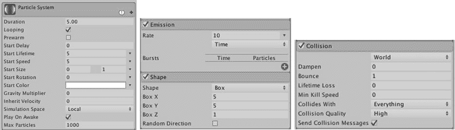
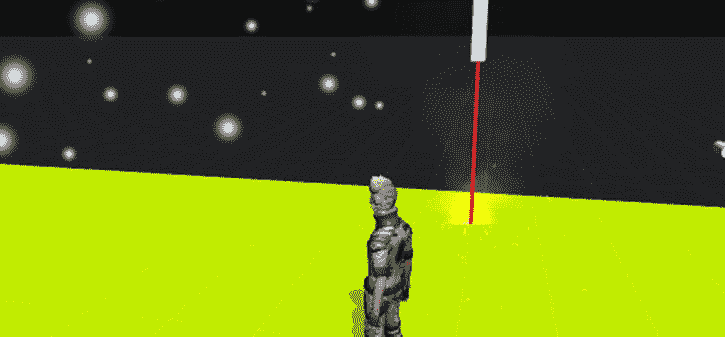
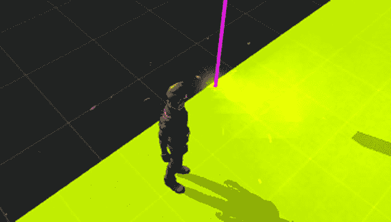

# 炸弹障碍物

戏剧性的火焰爆炸效果创建方式大致相同，只是使用了火和烟雾粒子系统，并添加了光和声音等额外的特殊效果。`Sample Assets` 包中有一个极好的爆炸示例，包含了完整的火焰和烟雾材质与纹理。

`Sample Assets` 包中的 `Ball` 预制体看起来阴暗且不祥，因此它可以成为一个很棒的炸弹。将其从 `Assets ➤ Sample Assets ➤ Vehicles ➤ Rolling Ball ➤ Prefabs` 文件夹拖拽到场景中，命名为 `Bomb`，将 `Tag` 设置为 `Untagged`，并为其设置 `Transform.position` 为 (0, 9.5, 20)。点击齿轮图标并从下拉菜单中选择“移除组件”，移除 `Ball` 和 `Ball User Control Script` 组件。

在项目面板的 `Assets ➤ Scripts` 文件夹中，创建一个名为 `BombExplosion` 的新脚本，并在 MonoDevelop 中打开它。将代码编辑为以下内容：

```
#pragma strict

public var victim : GameObject;
public var prefab : GameObject;

function Start () {
    victim = GameObject.Find("Third Person Character Ragdoll");
}

function OnCollisionEnter (collision : Collision) {
    if (collision.gameObject.name == "Third Person Character Ragdoll") {
        Explosion();
    }
}

function Explosion () {
    victim.GetComponent(GoRagdoll).GotoRagdoll();
    Instantiate (prefab, transform.position, Quaternion.identity);
    Destroy(gameObject);
}
```

保存脚本并将其附加到 `Bomb` 游戏对象上。分解说明如下：

`(1) public var victim : GameObject; public var prefab : GameObject;`

声明两个引用变量，`victim` 和 `prefab`，类型为 `GameObject`。

`(2) victim = GameObject.Find("Third Person Character Ragdoll");`

在 `Start()` 函数中，将 `Third Person Character Ragdoll` 的引用赋值给 `victim`。

`(3) if (collision.gameObject.name == "Third Person Character Ragdoll") { Explosion(); }`

如果玩家角色与炸弹发生碰撞，则调用 `Explosion()` 函数。

`(4) victim.GetComponent(GoRagdoll).GotoRagdoll();`

`(5) Instantiate (prefab, transform.position, Quaternion.identity);`

`(6) Destroy(gameObject);`

在 `Explosion()` 函数内部，将玩家角色转换为 ragdoll（布娃娃系统），在炸弹的 `transform.position` 和旋转位置实例化一个新的爆炸预制体，然后销毁炸弹游戏对象。

如果你现在进行游戏测试，玩家角色会倒下，炸弹会根据与玩家角色的碰撞而滚动，但没有爆炸效果，因为尚未将预制体指定为要在 `Explosion` 函数中实例化的对象。在控制台中，你会看到一个 `UnassignedReferenceException` 警告，提示 `prefab` 变量尚未分配，并建议你进行分配。

选中 `Bomb` 游戏对象，在检查器中找到 `BombExplosion` 脚本组件，注意 `Prefab` 属性的字段是 `None`。在项目面板的 `Assets ➤ Sample Assets ➤ Effects ➤ Particle Systems ➤ Prefabs` 文件夹中找到 `Explosion` 预制体。将其拖拽并放入检查器的 `Prefab` 属性字段中。

保存场景和项目。进行游戏测试，让玩家角色撞向炸弹。太棒了！稍后你会用到更多炸弹，所以请将 `Bomb` 游戏对象从层级面板拖拽到项目面板的 `Assets ➤ Prefabs` 文件夹中。

## 暴风雪障碍

这个简单的障碍物用于演示粒子碰撞的使用方法。在编辑器顶部菜单中，选择“游戏对象 ➤ 创建其他 ➤ 粒子系统”，并将其命名为 `Blizzard`。将其 `Transform.position` 设置为 (–11, 11.5, 106)，`Transform.rotation` 设置为 (0, 90, 0)。



图 8-10. 暴风雪粒子系统设置

在暴风雪粒子系统的初始模块中，使用“起始大小”下拉菜单选择“两个常量之间随机”。保留默认设置 0 和 1。在“发射”模块中，确保“速率”设置为 10。

其思路是让玩家需要应对更大体积的粒子。在“形状”模块中选择“盒子”，并将其比例中的盒子 X 和盒子 Y 都改为 5。

勾选“碰撞”模块并展开它。“世界”意味着粒子将与任何物体发生碰撞。请注意，此设置对游戏性能的消耗比使用平面更高。保留所有其他默认设置不变，但**勾选**“发送碰撞消息”复选框（图 8-10）。

在项目面板的“资源 ➤ 脚本”文件夹中，找到 `KillOnCollision` 脚本并在 MonoDevelop 中打开。添加以下函数：

```
function OnParticleCollision(other : GameObject)
{
    if (other.gameObject.name == "第三人称角色布娃娃")
    {
        other.gameObject.GetComponent(GoRagdoll).GotoRagdoll();
    }
}
```

当粒子系统碰撞模块中的“发送碰撞消息”复选框被勾选时，会调用 `OnParticleCollision()` 函数。函数内的代码块会检查碰撞中的另一个游戏对象是否是玩家角色，如果是，则调用玩家角色的 `GotoRagdoll` 函数。



图 8-11. 玩家角色面对暴风雪障碍

保存脚本并将其附加到 `Blizzard` 游戏对象上。与炸弹类似，将暴风雪粒子系统拖放到项目面板的“资源 ➤ 预置”文件夹中。保存场景（图 8-11）并保存项目。进行游戏测试，躲避致命的雪花吧！

## 激光障碍

对于激光障碍，你将学习使用线条渲染器（图 8-12）。线条渲染器的作用就是在两点之间绘制一条线。它也可以使用点数组，在每两个点之间绘制线段，从而形成更复杂的图案。

线条本身是一个二维公告板，就像粒子纹理一样，因此根据你的场景，它在旋转以始终面向相机时，可能会显得有些动态效果。你可以调整其宽度和颜色，甚至可以使用纹理。

这个障碍由一个位于障碍赛道上方的激光发射器组成，它向下朝高架轨道表面发射激光，并来回移动。



图 8-12. 玩家角色与激光障碍

## 激光发射器

为了模拟激光发射器，在层级面板中创建一个基本的立方体游戏对象，将其命名为 `LaserCube`，并设置其 `Transform.position` 为 (–3.8, 12, 100)，`Transform.scale` 为 (0.2, 1, 0.2)。

`LaserCube` 游戏对象需要一个简单的脚本为其添加移动功能。在项目面板的“资源 ➤ 脚本”文件夹中，选择“创建 ➤ JavaScript”，将其命名为 `MoveLaser`，并在 MonoDevelop 中打开。将代码编辑为以下内容：

```
#pragma strict

public var speed : float = 1;
public var offset : float;

function Start () {
    offset = transform.position.x - 0.2;
}

function Update () {
    transform.position = Vector3(Mathf.PingPong(Time.time * speed, 8) + offset, transform.position.y, transform.position.z);
}
```

保存脚本并将其附加到 `LaserCube` 上。

这段代码分解如下：

`(1)` `public var speed : float = 1;`

`public var offset : float;`

首先，声明变量：一个公共浮点型变量，允许你在检视面板中调整 `LaserCube` 的速度；以及一个偏移量变量，用于在 `LaserCube` 移动时正确定位它。

`(2)` `offset = transform.position.x - 0.2;`

在 `Start()` 函数中，将 `LaserCube` 游戏对象的位置减去其宽度，赋值给偏移量，这样激光束就能从高架轨道的精确边缘开始移动。

`(3)` `transform.position = Vector3(Mathf.PingPong(Time.time * speed, 8) + offset, transform.position.y, transform.position.z);`

你之前已经修改过游戏对象的 `Transform.position`。本示例引入了使用 `Mathf.PingPong()` 函数来设置 `Vector3` 的 x 坐标值，从而实现来回移动。

`Mathf.PingPong` 接受两个浮点数，并返回一个在 0 和第二个值之间来回移动的值，该值会通过偏移量进行调整，并将结果赋值给 `LaserCube` 的 `Transform.position.x` 的 x 坐标。不深入探讨其背后的数学原理，第一个浮点数必须每帧都变化才能产生乒乓移动效果，因此通常使用 `Time.time`。`Time.time` 就是自游戏开始以来的时间（以秒为单位）。