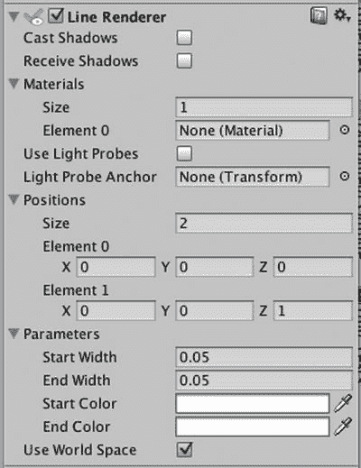
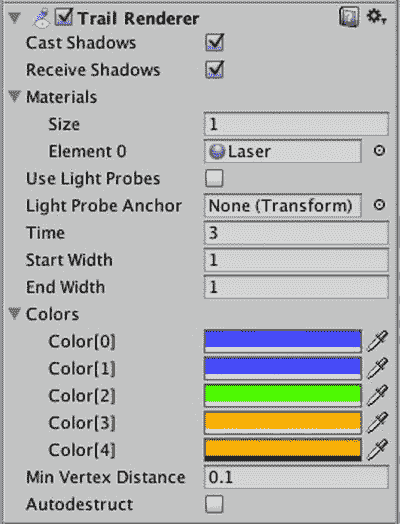
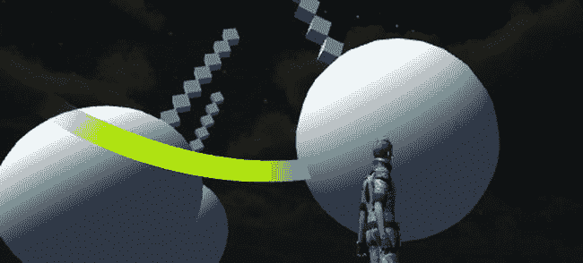

# 激光束

激光束是通过线条渲染器（Line Renderer）创建的。线条渲染器不能与已使用渲染器的游戏对象一同使用，因此最佳实践是创建一个空的游戏对象来承载线条渲染器，然后将其作为子游戏对象附加到 LaserCube 上。

在编辑器顶部菜单中，选择 **Game Object** ➤ **Create Empty**。在层级面板（Hierarchy）中，将其命名为 LaserBeam，然后拖拽到 LaserCube 游戏对象上，使其作为子游戏对象嵌套其中，并将其 `Transform.position` 设置为 (0, –0.5, 0)。由于它是子对象，这个 `Transform.position` 会使其在 y 轴上略微低于父级 LaserCube 游戏对象。继续选中这个空的游戏对象，在检查器（Inspector）中选择 **Add Component** ➤ **Effects** ➤ **Line Renderer**（图 8-13）。你会注意到场景视图（Scene view）的世界原点处出现了一条品红色线条。你将在游戏过程中通过脚本来协调渲染的线条与移动的激光发射器。



图 8-13.

检查器中的线条渲染器组件

在检查器中，取消勾选 **Cast Shadows** 和 **Receive Shadows**。Unity 基础版本不使用阴影，因此保留勾选也不会增加阴影效果。

**Materials** 表示用于绘制线条的材质。如果为 None，则默认使用你在场景视图中看到的品红色线条。若要改变激光束的颜色，你必须指定一种材质。在项目面板（Project）中选择 **Create** ➤ **Material**，将其命名为 SimpleLaser。将 SimpleLaser 材质拖拽到检查器中的 **Element 0** 属性中。选中该材质后，在检查器中使用着色器（Shader）下拉菜单选择 **Particles** ➤ **Alpha Blended**。线条渲染器使用粒子材质；否则你只会得到一条黑色线条。

重新选中 LaserBeam 游戏对象，以在检查器中再次显示其属性。**Light Probes** 是另一个 Unity Pro 功能。**Positions** 指定了线条的绘制端点。一条线条至少需要两个点（起点和终点），但你可以通过增加 **Size** 属性的值来添加更多点。

展开 **Parameters** 以获取更多自定义选项。将 **Start Width** 和 **End Width** 的值改为 0.05 以使线条更细，将 **Start Color** 和 **End Color** 改为亮红色，并勾选 **Use World Space**。

接下来，你需要一个脚本来控制激光的行为。在项目面板的 Assets ➤ Scripts 文件夹中，选择 **Create** ➤ **JavaScript**，将其命名为 Laser，并在 MonoDevelop 中打开。将代码编辑为如下内容：

```
#pragma strict

public var line : LineRenderer;

function Start () {

line = gameObject.GetComponent.<LineRenderer>();

}

function Update () {

ShowLaser();

}

function ShowLaser () {

var ray : Ray = Ray(transform.position, -transform.up);

line.SetPosition(0, ray.origin);

line.SetPosition(1, ray.GetPoint(50));

}
```

保存脚本，将其附加到子级空游戏对象上，并进行游戏测试。你会看到 LaserCube 左右移动，并发射出一道红色激光。

此代码分解如下：

```
(1)     public var line : LineRenderer;
```

声明了一个 `LineRenderer` 类型的引用变量 `line`。

```
(2)     line = gameObject.GetComponent.<LineRenderer>();
```

获取对线条渲染器组件的引用，并将其赋值给 `line` 变量。

```
(3)     ShowLaser();
```

在之前的示例中，代码主要写在 `Update()` 函数内。在本例中，采用了更好的代码编写实践，将代码分解为更小的模块。这里调用了 `ShowLaser()` 函数，该函数仅包含绘制激光的代码。

```
(4)     var ray : Ray = Ray(transform.position, -transform.up);
```

在 `ShowLaser` 函数中，创建了一个引用变量 `Ray`，并将游戏对象的 `transform.position` 作为其原点，`-transform.up` 作为向下的方向。

```
(5)     line.SetPosition(0, ray.origin);
```


线渲染器的第一个点（元素 0）设置为射线起点的位置。

`line.SetPosition(1, ray.GetPoint(50));`

待绘制线的第二个点（元素 1）设置为沿射线方向再延伸 10 个单位的位置。

这算是个好的开端，但激光会直接穿过高架轨道，因此不够真实。按如下方式编辑 Laser 脚本的 `ShowLaser()` 函数：

```
function ShowLaser () {
    var ray : Ray = Ray(transform.position, -transform.up);
    var hit : RaycastHit;
    line.SetPosition(0, ray.origin);
    if(Physics.Raycast(ray, hit, 50))
    {
        line.SetPosition(1, hit.point);
    }  else {
        line.SetPosition(1, ray.GetPoint(50));
    }
}
```

保存脚本。现在进行试玩测试时，你会看到激光在轨道表面处停止。

这段代码解析如下：

`var hit : RaycastHit;`

声明一个类型为 `RaycastHit` 的引用变量 `hit`。

`if(Physics.Raycast(ray, hit, 50))`

测试射线检测是否在 10 个单位内检测到碰撞体。

`line.SetPosition(1, hit.point);`

如果检测到碰撞体，则将待绘制线的第二个点设置在射线检测到碰撞体的位置。

`}  else {`
`line.SetPosition(1, ray.GetPoint(50));`
`}`

否则，照常将线绘制到沿射线方向 50 个单位的位置。

目前唯一能看到的效果是激光在击中轨道时停止。通过使用射线检测，如果有任何带有碰撞体的其他游戏对象与射线相交，激光就会终止于该游戏对象表面上的交点位置。要进行测试，可以在试玩时将玩家角色置于激光束的路径中。

添加粒子系统后，激光看起来会更逼真且更具威慑力。在项目面板中，打开 Assets ➤ Sample Assets ➤ Effects ➤ Particle Systems ➤ Prefabs 文件夹。找到 Flare 预制体，拖动一个副本到层级面板，并通过拖放到 LaserCube 上，使其成为 LaserCube 的子对象。

在 MonoDevelop 中，编辑 Laser 脚本，按如下方式添加三行代码：

```
#pragma strict

public var line : LineRenderer;
public var sparks : GameObject;

function Start () {
    sparks = GameObject.Find("Flare");
    line = gameObject.GetComponent.<LineRenderer>();
}

function Update () {
    ShowLaser();
}

function ShowLaser () {
    var ray : Ray = Ray(transform.position, -transform.up);
    var hit : RaycastHit;
    line.SetPosition(0, ray.origin);
    if(Physics.Raycast(ray, hit, 50))
    {
        line.SetPosition(1, hit.point);
        sparks.transform.position = hit.point;
    }  else {
        line.SetPosition(1, ray.GetPoint(50));
    }
}
```

保存脚本并进行试玩。这才像是一道激光！

这段代码解析如下：

`public var sparks : GameObject;`

声明一个类型为 `GameObject` 的引用变量 `sparks`。

`sparks = GameObject.Find(“Flare");`

找到对 Flare 粒子系统预制体的引用，并将其赋值给 `sparks`。

`sparks.transform.position = hit.point;`

将 sparks 粒子系统的位置设置在激光射线检测到碰撞体的位置。

超级酷，对吧？请注意，在试玩时，如果玩家角色被激光击中，火花会从他身上飞溅出来，仿佛他是无敌的。虽然这在其他设定中可能很酷，但这里的激光障碍物本应更具杀伤力。

在 Laser 脚本中，在变量声明部分添加以下内容：

`public var victim : GameObject;`

这声明了一个类型为 `GameObject` 的引用变量 `victim`。

要为玩家角色分配引用，请在 `Start()` 函数中添加以下代码行：

`victim = GameObject.Find("Third Person Character Ragdoll");`

最后，在 `ShowLaser()` 函数中插入以下代码行：

```
function ShowLaser () {
    var ray : Ray = Ray(transform.position, -transform.up);
    var hit : RaycastHit;
    line.SetPosition(0, ray.origin);
    if(Physics.Raycast(ray, hit, 50))
    {
        line.SetPosition(1, hit.point);
        if (hit.collider == victim.collider) {
            victim.GetComponent(GoRagdoll).GotoRagdoll();
        }
        sparks.transform.position = hit.point;
    } else {
        line.SetPosition(1, ray.GetPoint(50));
    }
}
```

如果射线检测到碰撞体，它会检查该碰撞体是否为玩家角色的碰撞体。如果是，则调用玩家角色的 `GotoRagdoll()` 函数来消灭该玩家。

保存脚本。在项目面板中，打开 Assets ➤ Prefabs 文件夹。将层级面板中的 LaserCube 拖动并放入 Prefabs 文件夹中，以备将来使用。现在就可以进行试玩了。

对于这个障碍物来说，简单的材质和红色就足够了，但如果你想通过脚本来设置颜色，样例代码片段是将以下代码行放入 `Start()` 函数中：

```
line.material = new Material (Shader.Find("Particles/Additive"));
line.SetColors(Color.green, Color.blue);
```

这里你正在新建一个简单的材质，然后设置线条的起始和结束颜色。

## 曳光弹障碍物

另一个用于视觉效果的精美渲染器是轨迹渲染器组件（图 8-14）。顾名思义，它会在移动的游戏对象后方绘制一条轨迹。它通常用作视觉提示来表示速度，例如飞机的凝结尾迹，甚至可以是速度与逼真图像（如曳光弹）的组合。曳光弹障碍物将在玩家沿高架轨道前进的路径上随机生成曳光弹。

快速演示一下，在层级面板中选择 Pendulum_01。在检视面板中，选择“添加组件 ➤ 效果 ➤ 轨迹渲染器”。



**图 8-14.** 检视面板中的轨迹渲染器组件

轨迹渲染器可以使用不同的材质数组来实现多种效果。与线渲染器一样，轨迹渲染器也使用粒子材质。将材质数组的大小（由 Size 属性指示）保留为 1。对于元素 0，选择您为激光障碍物创建的 SimpleLaser 材质。

“时间”是轨迹持续的时间（以秒为单位）。“起始宽度”和“结束宽度”调整轨迹的宽度，这类似于线渲染器，也是一个 2D 广告牌。如果您的材质中包含颜色，则可以保留颜色属性的元素不变。由于我们的 Laser 材质是白色的，请继续为所有五个元素选择颜色，创建一个绚丽的色彩光谱。

如果游戏对象在时间指定的时间段内没有移动，并且勾选了“自动销毁”，则游戏对象将被销毁。



**图 8-15.** 旋转摆锤障碍物后方绘制的轨迹

当您完成对摆锤轨迹（图 8-15）的实验后，请禁用或删除轨迹渲染器组件。


