# 游戏设计考量

在设计任何游戏时，都有几个方面需要你深思熟虑。

## 目标受众与 ESRB 分级

娱乐软件分级委员会（ESRB）是一个行业自律组织，负责定义并执行分级系统。

你的目标受众年龄以及相应的 ESRB 分级会影响你的游戏设计。敏感内容（包括血腥、暴力、裸体和粗俗语言）的程度会影响你游戏的分级，如果你不了解这些标准，可能会导致你的游戏被排除在你预期受众之外。

分级系统包含三个部分：

- **分级类别**：类似于电影分级，用于建议适龄人群（图 9-1）。

- **内容描述符**：这些描述符提供了关于导致该分级的游戏具体内容的更详细信息。例如，一款游戏可能被评为`E10+`，即“可能包含动画暴力”。如果你觉得这相当模糊，ESRB 的内容描述符会确切告诉你他们对诸如“动画暴力”等术语的定义（表 9-1）。

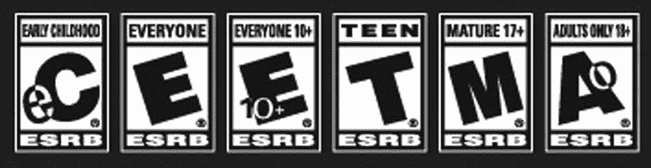

**图 9-1.** ESRB 分级类别图示

**表 9-1.** ESRB 电子游戏内容描述符

| 内容描述符 | 定义 |
| --- | --- |
| 酒精参考 | 提及和/或展示酒精饮料的图像。 |
| 动画血液 | 变色和/或不逼真的血液描绘。 |
| 血液 | 对血液的描绘。 |
| 血腥暴力 | 对血液或身体部位残缺的描绘。 |
| 卡通暴力 | 涉及卡通式情境和角色的暴力行为。可能包括角色在遭受暴力行为后毫发无损的场景。 |
| 滑稽恶搞 | 涉及闹剧或暗示性幽默的描绘或对话。 |
| 粗俗幽默 | 涉及粗俗行为的描绘或对话，包括“卫生间”幽默。 |
| 毒品参考 | 提及和/或展示非法药物的图像。 |
| 幻想暴力 | 幻想性质的暴力行为，涉及容易与现实生活区分开来的情境中的人类或非人类角色。 |
| 强烈暴力 | 对肢体冲突的写实且逼真的描绘。可能涉及极端的和/或逼真的血液、血腥、武器以及对人体受伤和死亡的描绘。 |
| 语言 | 轻度到中度的亵渎用语。 |
| 歌词 | 音乐中轻度提及亵渎、色情、暴力、酒精或药物使用。 |
| 成人幽默 | 涉及“成人”幽默的描绘或对话，包括性暗示。 |
| 裸体 | 对裸体的细致或长时间的描绘。 |
| 部分裸体 | 短暂和/或轻微的裸体描绘。 |
| 真实赌博 | 玩家可以赌博，包括用真实现金或货币下注或打赌。 |
| 性内容 | 非露骨的性行为描绘，可能包括部分裸体。 |
| 性主题 | 提及性行为或性。 |
| 模拟赌博 | 玩家可以赌博，但不用真实现金或货币下注或打赌。 |
| 粗俗语言 | 露骨和/或频繁使用亵渎用语。 |
| 强烈歌词 | 音乐中露骨和/或频繁提及亵渎、性、暴力、酒精或药物使用。 |
| 强烈性内容 | 露骨和/或频繁描绘性行为，可能包括裸体。 |
| 暗示性主题 | 轻微的挑逗性参考内容或素材。 |
| 烟草参考 | 提及和/或展示烟草制品的图像。 |
| 使用酒精 | 饮用酒精饮料。 |
| 使用药物 | 服用或使用非法药物。 |
| 使用烟草 | 使用烟草制品。 |
| 暴力 | 涉及攻击性冲突的场景。 |
| 暴力参考 | 提及暴力行为。 |

- **交互元素**：包括位置共享通知、与第三方的其他信息共享，以及与其他用户的交互（这种交互本身往往不受审查）（图 9-2）。

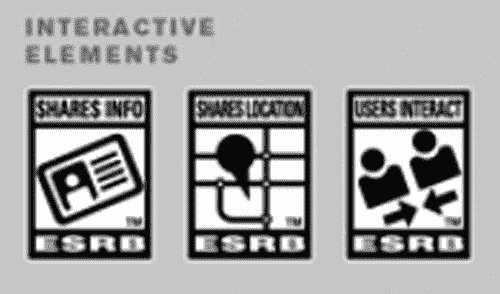

图 9-2. ESRB 互动元素示意图

请注意，虽然 AO（仅限成人）评级与 M（成熟）评级在年龄适宜性上仅相差一岁，但它是电影领域 X 评级在软件娱乐中的对应版本，对发行商和消费者而言具有同样的污名效应。

### 游戏类型

你应该制作什么样的游戏？制作一款你自己会喜欢的游戏——毕竟，这本来就应该是有趣的事。无论你是否已经有一个正在构思的概念，了解现有的游戏类型及其各自的玩法风格，都能帮助你充实游戏设计，并凭借对用户期望的更深入理解来进一步完善设计。

一个不错的起点是，从你喜欢的游戏类型中选取一个简单示例，以便将学习重点集中在最相似的游戏行为上。你当然不必强迫自己的游戏符合任何一种特定的分类。动作游戏是一个类型，冒险游戏也是一个类型。有些资料将“动作冒险”视为一个类型，而另一些资料则称之为混合类型。

从根本上复制一款现有游戏并发布可能会招致法律纠纷。然而，通过研究、剖析和学习如何重构一款现有游戏来提升自己的技能，则是完全可行的。

表 9-2 列出了一些宽泛的游戏类型分类。还有更多类型，包括派对、音乐、教育和 trivia（问答）类。你大概能想到许多游戏是类型的混合体，或者融合了多种类型。

**表 9-2. 电子游戏类型**

| 类型 | 特征 | 示例 |
| --- | --- | --- |
| 动作 | 需要良好的手眼协调能力和快速反应才能游玩。玩法通常涉及战斗。 | 射击游戏、平台游戏、潜行游戏、格斗游戏 |
| 冒险 | 不需要快速反应即可游玩。玩法涉及通过游戏角色和环境的互动来解决谜题。 | 角色扮演游戏、MMORPG*、图形冒险游戏、文字冒险游戏、生存恐怖游戏 |
| 策略 | 需要谨慎的长期思考和规划。玩家通常拥有“上帝视角”。 | 回合制策略游戏、即时战略游戏、塔防游戏、战争游戏 |
| 体育 | 玩法基于某项体育竞技或运动。 | 扮演运动员、扮演教练/经理、竞速游戏 |
| 模拟 | 玩法模拟现实。 | 载具模拟、生活模拟、宠物模拟、建造模拟、经营模拟 |
| 解谜 | 玩法基于问题解决。 | 逻辑谜题、模式完成、文字游戏 |

*MMORPG = 大型多人在线角色扮演游戏。

### 主题

选择主题的主要依据可能是特定的时代背景、环境、科技或角色类型。

| 时代背景 | 环境 | 科技 | 角色类型 |
| --- | --- | --- | --- |
| 中世纪 | 游乐园 | 中世纪 | 天使 |
| 维多利亚时代 | 丛林 | 科幻 | 恐龙 |
| 现代 | 地牢 | 奇幻/魔法 | 机器人 |
| 架空历史 | 学校 | 蒸汽朋克 | 有组织犯罪 |
| 后末日 | 派对 | 时间旅行 | 忍者 |
| | 空间站 | | 海盗 |
| | 外星世界 | | 牛仔 |
| | | | 恶魔 |
| | | | 超级英雄 |
| | | | 侦探 |
| | | | 僵尸 |
| | | | 动物 |
| | | | 疾病 |

确定了游戏的目标准受众（及对应的 ESRB 评级）、类型和主题后，这反过来将指导你对其他游戏设计元素的选择，例如配色方案、音乐、角色名称、服装和装备，以及宝藏类型、能力、武器和危险物。

## 乐趣与游戏体验

如果能简单地定义什么是“乐趣”并加以应用，那么游戏设计将会变得容易。不幸的是，“乐趣”是主观的——你觉得有趣的东西，对别人来说可能毫无乐趣。即使是同一款游戏，在你玩了很多次之后，也可能不再觉得它有趣。一个简单的事实是：你无法预测游戏玩家大众是否认为你的游戏有趣。

虽然没有具体的“乐趣公式”，但有一些众所周知的工具可以用来避免玩法机制中的常见问题，这些问题必定会降低游戏的潜在乐趣。

### 地图

一个好的起点是，在一张纸上或使用你最喜欢的绘图工具来绘制你的游戏地图。为了了解地图如何帮助你发现游戏设计问题，让我们看看障碍赛场景的地图（图 9-3）。

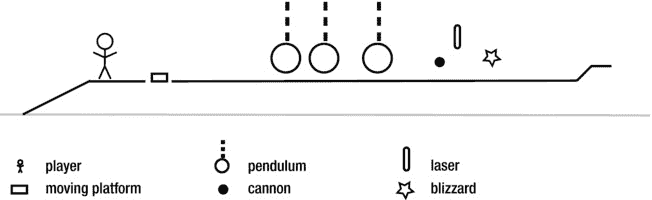

图 9-3. 障碍赛的初始地图

现在，你可以轻松地看到玩家角色、从起点到终点的架空赛道，以及各种障碍物都集中在一起。

为了达到最佳效果，地图应按比例绘制。在这个例子中，相对于障碍物和赛道，玩家角色过大。通过同时标示出玩家的起点，玩家图标为地图增加了更多信息（图 9-4）。

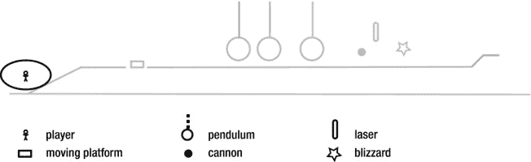

图 9-4. 按比例绘制了玩家角色的障碍赛地图

现在地图上的玩家图标已经按比例缩放，让我们用批判的眼光看看整个障碍赛的布局。

赛道上有很多空白区域，玩家除了行走无事可做。这很不好——仅仅行走是无聊的。没有太多障碍物的障碍赛是无聊的。无聊就不好玩。

在钟摆之后，加农炮、激光和暴风雪障碍物都挤在了一起。在地图上将赛道划分为区域后，这种拥挤现象就更加明显了（图 9-5）。

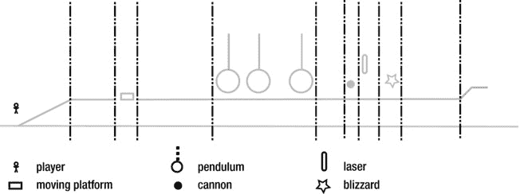

图 9-5. 将障碍赛划分为区域

为了解决这个问题，首先将赛道划分为大小更均匀的区域（图 9-6）。

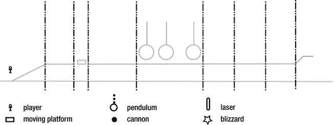

图 9-6. 将障碍赛重新划分为大小相近的区域

移动平台不需要更大的区域，而钟摆在一个大小合理的区域里算是较大的障碍物，因此这些障碍物及其区域边界可以保持不变。

现在区域已经划分好，出于多种原因，按类型设置障碍物区域，而不是每种类型只放一个，会更有意义。利用布满相似障碍物的区域是更有效地利用时间和资源的方式。在这种情况下，你可以在各自的区域中使用一组加农炮和激光，而暴风雪则可以简单地调整大小来适配一个区域。在分配这些区域之前，还有几个游戏设计因素需要考虑。

### 节奏

人类的大脑非常擅长适应几乎任何事情。即使你将游戏设计成从头到尾都是令人震惊的、达到曲速 10 级的、令人毛发直竖的激烈体验，一旦玩家的大脑适应了这种节奏，它可能会因为感觉“平淡”而被视为无聊（图 9-7）。

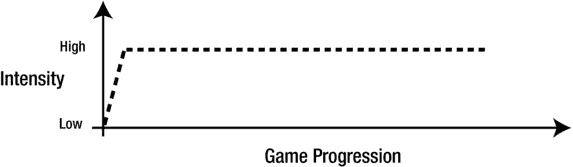
图 9-7. 持续高强度输出随着时间的推移会显得平淡

玩家的大脑需要不断调整，才能更投入、受到更多刺激，因此你需要将情感上的强烈高潮和低谷融入游戏体验中（图 9-8）。

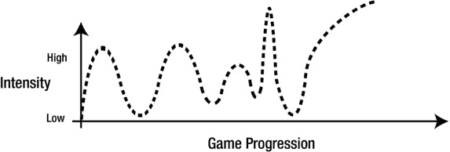
图 9-8. 随时间变化的、具有不同情感强度级别的游戏玩法

在障碍赛的例子中，障碍赛内的每个区域都可以是一个独特的强度级别，由检查点隔开。检查点处提供刚好足够的空间，让玩家站立并评估下一个障碍物。这个喘息空间让玩家在情感上平静下来，在玩家投入下一个相对更高强度的区域之前，将感知到的强度重置到一个较低的水平。

### 平衡

由于这个示例项目是一个包含机械障碍的越野赛道，因此相似的障碍物不应连续放置。这个概念基于与节奏相同的原理——大脑需要调整的越多，感知到的差异就越大。

在一个极端情况下，想象一个非常相似的加农炮区和暴风雪区。加农炮的间隔大约等同于暴风雪“雪片”的浓度，射弹的速度相同，并且两个区域的射弹都是从右向左水平移动（图 9-9）。

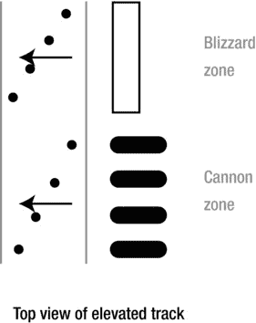
图 9-9. 加农炮区和暴风雪区看起来像是相似的障碍物

从玩家的角度来看，当玩家从加农炮区过渡到暴风雪区时，通过模式识别及后续角色控制来穿越这两个区域所需的心智能力几乎相同。

在另一个极端情况下，首先想象加农炮区。它是一排加农炮，每个加农炮以特定频率发射一枚射弹，加农炮之间有规则的间距，并且射弹是从右向左移动的。

在这种情况下，射弹的规则间距和频率意味着成功穿越这一区域基于模式识别——即，分析发射弹丸的规律以找到向前安全路径。

如果紧随加农炮区之后的是钟摆区，那么玩家现在必须调整自己以适应一个具有不同机械模式的新障碍，并且在钟摆区之后，还需再次调整以适应激光区（图 9-10）。

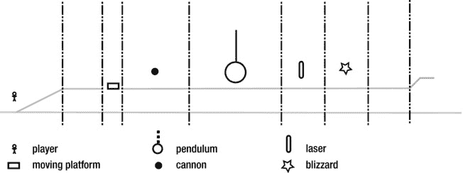
图 9-10. 分布障碍区域，使相似障碍物不相邻

经过激光区后，玩家最终到达暴风雪区，在这个场景中，该区域会以随机的大小发射雪片状射弹以使其看起来不同，射弹速度在一定范围内随机，生成点也是随机的。尽管它们水平移动，但这次它们是从左向右穿越赛道。

玩家又一次需要从激光区做出重大的评估和策略调整，才能在暴风雪区生存下来。由于玩家在完成加农炮区后已经经历了三次重大调整，并且暴风雪射弹的属性细节现在与加农炮弹丸不同，因此玩家觉得加农炮区和暴风雪区之间的玩法机制差异远大于它们在机械细节相似且紧挨着放置时的差异（图 9-11）。

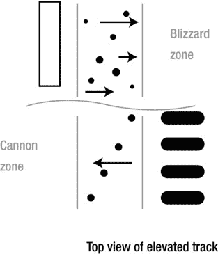
图 9-11. 重新配置和定位加农炮区和暴风雪区，以减少这两个障碍物之间的相似性

### 进程

进程指的是游戏玩法随时间的演变。从根本上说，玩家想玩，也想赢。“想玩”也意味着“不想看说明、不想听冗长的 `NPC`（非玩家角色）对话、也不想找教程”。他们想玩，并且更倾向于能够通过游戏玩法本身来弄清楚如何玩游戏。

他们希望感受到挑战，但不要过多的挫败感，然而，一款过于简单的游戏很快就会变得无聊。胜利应该是可实现的，并且对玩家而言感觉像是来之不易的成就，而非唾手可得。游戏设计的艺术在于为你的目标受众中的大多数人找到恰当的平衡点。

最直接的游戏进程是从玩家没有任何技能或能力开始游戏。最初的挑战——谜题、敌人、障碍——为玩家提供了学习曲线。在越野赛道示例项目中，玩家必须学习如何控制镜头和移动角色，包括发现角色可以蹲伏，并感受角色可以跳多高、多远，或跑多快。

以我们的越野赛道为例，由于玩家正在学习如何移动镜头和角色，像地雷这样的简单固定障碍物是第一个区域的不错选择。这些障碍物为玩家提供了需要避开的致命危险，但只需要简单的控制器操作。玩家只需学会移动和转向玩家角色就能成功穿越这个区域。

如果玩家更具冒险精神，他可能已经发现了跳跃的能力。如果没有，第二个区域的移动平台障碍则会强迫他学会跳跃，因为准确地跳跃到平台上，然后再跳到高架轨道上，是穿越的唯一方法。

随着玩家沿着高架轨道前进，后续的障碍区域需要更好的模式识别和角色控制能力。最后，暴风雪区引入了随机元素，使得模式识别不如更好的手眼协调能力有用。

作为该关卡的最终大挑战，最后一个区域引入了真正的敌人，这些敌人具有脚本控制的 `AI` 元素，可以跟踪并响应玩家的移动（图 9-12）。

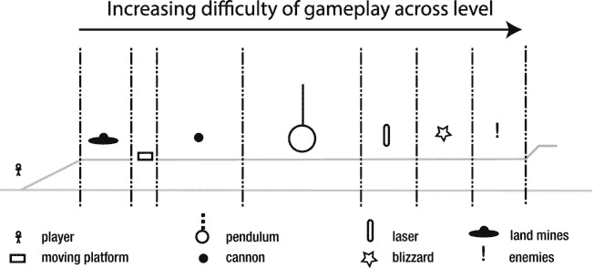
图 9-12. 按难度递增顺序分布的障碍物

前面的示例展示了一个关卡从开始到结束的进程。进程也可以应用于关卡内的子集，例如越野赛道中的各个区域（图 9-13）。

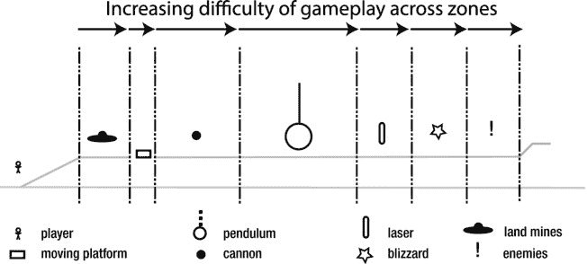
图 9-13. 在每个区域内按难度递增顺序分布的障碍物

例如，你可以通过在玩家穿越时使区域内的障碍物变得更大、更快或更密集，从而在越野赛道的每个区域内应用进程。

进程也指从一个关卡到下一个关卡的玩法演变（图 9-14）。

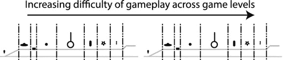
图 9-14. 在整个游戏中从一个关卡到另一个关卡的难度递增

当你开始创建多个关卡时，你会发现一个简单的电子表格可以帮助你跟踪游戏中不同关卡的各个方面，并在整个游戏中应用相同的平衡和进程概念。根据游戏类型的不同，需要考虑跟踪以便进行比较的元素包括关卡目标、游戏时间、以及玩家进程和能力相对于敌人和危险的对比。

### 惩罚与奖励

平衡是游戏设计中一个反复出现的主题，它不仅应用于游戏的物理布局。另一个需要考虑的方面是强化。玩家想要一款他们能赢的、有趣的游戏，并且希望他们足够喜欢，以至于会再玩一遍并告诉他们的朋友。当你将节奏中讨论的不同强度级别整合到你的游戏中时，你需要考虑你为玩家提供的情感体验质量。考虑一下玩家在游戏中可能会体验到的一系列情感（图 9-15）。

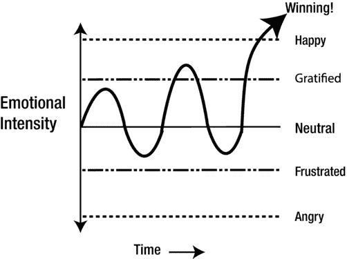
图 9-15. 玩家随着时间经历不同程度的情感强度

虽然情绪的起伏增加了游戏的整体体验，但挫败感和愤怒感肯定属于大多数玩家“不有趣”的范畴。