# 整合所有部分，构建你的游戏

既然你已经将一些基本的游戏设计概念应用到了障碍赛道的概念上，那么你就可以实施它们并创建一个功能完备的原型了（图 10-1）。

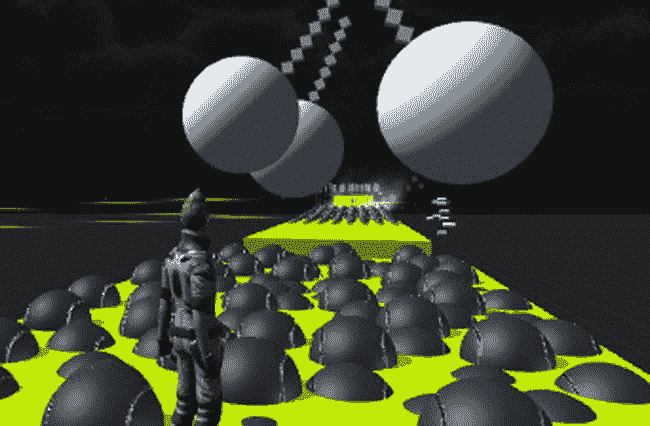

*图 10-1. 包含不同危险区域和敌人的障碍赛道原型*

游戏开发是一个迭代过程。即使你的宏伟计划已详尽记录在游戏设计文档中，在实施过程中它也会经历大量的修改和微调。每当你添加一个新的游戏对象或组件时，你都会进行测试，确保其行为正常并符合你的质量标准，然后修复或调整不符合要求的部分。你将测试它的外观、功能、交互方式以及它如何融入游戏流程。

随着场景中每增加一个新元素，你都会重复这个过程。有时会出现需要解决的 bug。有时它按预期工作，但并不符合最初设想的游戏流程。还有些时候，你或其他人想到了让它变得更好的方法，这就需要回到绘图板来实施新的更改。每一次测试都会带来更多的反馈、更多的调整和更多的重构，无论这些反馈来自内部质量控制检查还是 beta 测试人员。

每一轮额外的改进都是游戏开发过程中的一次迭代。在本章中，你将实施你在第 9 章中的游戏设计，对其进行优化，并初步了解如何解决过程中可能出现的障碍。


## 实现设计

总结第 9 章的设计变更，首先根据你学习并应用的游戏设计概念，将障碍赛道按特定顺序划分为七个区域：1. 地雷区、2. 移动平台区、3. 大炮区、4. 摆锤区、5. 激光区、6. 暴风雪区、7. 敌人区（图 10-2）。

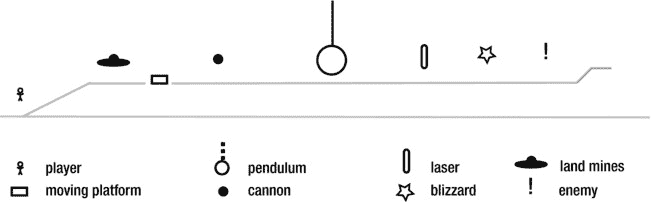

图 10-2. 修订后的障碍赛道设计

你还确定了一些附加标准。玩家越深入，障碍赛道应该变得越难。在每个区域内，你会以从起点到终点逐渐增加难度的方式布置危险物。你将在每个区域之间设置一段狭窄的安全区，让玩家在进入下一个区域前喘口气并重新组织。

首先，根据 z 坐标将空白部分划分为大小相近的区域。找到已定义的点，例如斜坡与高架轨道的连接处、移动平台的两侧、第一个摆锤的起点和第三个摆锤的终点，最后是高架轨道与第二个斜坡的连接处。剩下的工作是将第三个摆锤终点到斜坡起点之间的高架轨道分为三部分（图 10-3）：

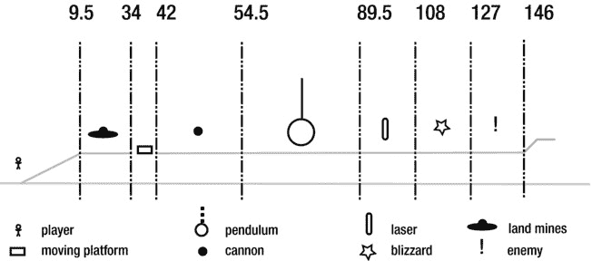

图 10-3. 由 z 坐标位置标识的区域边界

任何项目都可以分解为可管理的任务组件。在这种情况下，你已将障碍赛道划分为区域，因此有条理的方法是按顺序逐一处理。

## 游戏测试与作弊码

在测试障碍赛道时，每次玩家角色死亡后重新启动游戏并跑上斜坡可能会有点繁琐，但有一种解决方法：你可以内置快捷方式。

这就是作弊码的起源——游戏开发者需要一种快速测试游戏特定行为或功能的方法，而某些“作弊”功能如无敌、无限财富或超级力量正好满足了这一需求。如今，围绕作弊码已经形成了一个完整的产业，游戏开发者往往有意将其保留在最终发布版本中。

如果尚未打开，请打开你的障碍赛道场景。第一个作弊码将把玩家角色重新定位到斜坡顶部。在项目面板的 Assets 文件夹中，创建一个名为`Cheats`的新脚本。在 MonoDevelop 中打开脚本并编辑代码如下：

```
#pragma strict

public var player : GameObject;

function Start () {
    player = GameObject.FindWithTag("Player");
}

function Update () {
    if(Input.GetKeyDown(KeyCode.Alpha1)) {
        if (player != null) {
            player.transform.position = Vector3(0, 9, 18);
            player.gameObject.GetComponent(GoRagdoll).ExitRagdoll();
        }
    }
}
```

其分解如下：

1. `public var player : GameObject;` — 声明一个类型为`GameObject`的公共变量`player`。

2. `player = GameObject.FindWithTag("Player");` — 当调用`Start()`函数时，通过其`Player`标签找到对玩家角色的引用，并将其赋值给`player`。

3. `if(Input.GetKeyDown(KeyCode.Alpha1)) {` — 在每一帧调用`Update()`时，检查玩家是否按下了字母数字键盘上的 1 键。如果是，则执行后续代码块。

4. `if (player != null) {` — 测试是否存在有效的`GameObject`引用。如果不是`null`，则执行代码块。

5. `player.transform.position = Vector3(0, 9, 18);` — 通过重置其`Transform`位置坐标，将玩家移动到斜坡顶部。

6. `player.gameObject.GetComponent(GoRagdoll).ExitRagdoll();` — 如果玩家角色已死亡，需要将其重置出布娃娃模式，以便玩家继续。接下来你将创建`ExitRagdoll()`函数。

在 Unity 编辑器顶部菜单中，选择 Game Object ➤ Create Empty。在层级视图中选择新的游戏对象并将其重命名为`Cheats`。该游戏对象的唯一用途是承载作弊码脚本。将其`Transform`位置改为`(0, 20, 0)`，以将其移出视线。现在，通过将`Cheats`脚本拖到场景视图中的`Cheats`游戏对象上，或在检查器中通过 Add Component ➤ Scripts 并从菜单中选择`Cheats`脚本，来附加该脚本。

你仍需要为玩家角色创建`ExitRagdoll()`函数。在项目面板的 Assets ➤ Scripts 文件夹中，选择`GoRagdoll`脚本并在 MonoDevelop 中打开。此函数仅需逆转第 7 章中创建的`GotoRagdoll()`函数所做的所有操作。首先，选中`GotoRagdoll()`函数并复制它。在`GotoRagdoll()`函数的闭合大括号之后，将复制的代码粘贴回脚本中，然后将复制的函数名改为`ExitRagdoll`。将所有布尔标志改为其替代设置，你的`ExitRagdoll()`函数现在应如下所示：

```
function ExitRagdoll () {
    if (childRigidBodies != null) {
        for (var childRigidBody : Rigidbody in childRigidBodies)
        {
            childRigidBody.isKinematic = true;
        }
    }
    if (childColliders != null) {
        for (var childCollider : Collider in childColliders)
        {
            childCollider.enabled = false;
        }
    }
    gameObject.collider.enabled = true;
    gameObject.rigidbody.isKinematic = false;
    gameObject.GetComponent(Animator).enabled = true;
    gameObject.GetComponent(ThirdPersonCharacter).enabled = true;
    gameObject.GetComponent(ThirdPersonUserControl).enabled = true;
}
```

保存脚本，返回 Unity 编辑器，保存场景，然后进行游戏测试。只要你按下 1 键，玩家角色就会回到斜坡顶部。如果玩家角色已死亡，它会重新复活并准备就绪。太棒了——这肯定会加速游戏测试！


### 雷区

要制作一个地雷，我们只需要地雷本身和一个接触引爆装置。使用示例资源中的`Ball`预设作为地雷模型，以及`Explosion`粒子效果实现爆炸，可以快速简便地构建一个地雷。

在项目面板中，依次展开`Assets ➤ Sample Assets ➤ Vehicles ➤ Rolling Ball ➤ Prefabs`文件夹并打开它。你会在其中找到一个`Ball`预设。你也可以使用 Unity 的原始球体，但这个黑色球体看起来更有威慑力。

将一个`Ball`预设拖拽到场景视图中，并将其变换位置设置为`(0, 9, 18)`。在层级面板中，将其重命名为`Land Mine`。由于碰撞体嵌入到了轨道中，物理引擎会根据这种似乎存在的“碰撞”来移动该`Land Mine`，但这并不是你想要的效果。在层级面板中保持选中`Land Mine`，在检视面板中找到`Sphere Collider`组件并勾选`Is Trigger`。接着，在`Rigidbody`组件中，取消勾选`Use Gravity`，这样在游戏运行时`Land Mine`就会停留在原地。紧接着，勾选`Is Kinematic`复选框。这将防止周围的地雷受到引爆地雷的爆炸力影响。

继续往下看检视面板，`Ball`和`Ball User Control`脚本是不需要的。点击每个脚本组件上的齿轮图标，在上下文菜单中选择`Remove Component`（图 10-4）。

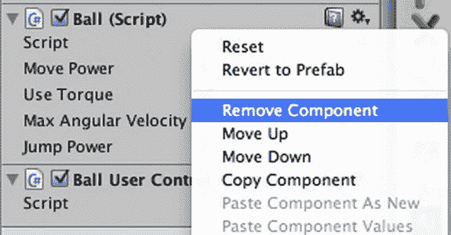

**图 10-4.** 在检视面板中从`Land Mine`游戏对象中移除`Ball`和`Ball User Control`脚本

最后，你需要一个脚本来指示：如果玩家角色与地雷发生接触，地雷就会爆炸，从而摧毁地雷并杀死玩家角色。在项目面板中打开`Assets ➤ Script`，然后创建一个名为`LandMineExplosion`的新脚本并在 MonoDevelop 中打开它。按如下方式编辑代码：

```csharp
#pragma strict

public var victim : GameObject;
public var explosionPrefab : GameObject;

function Start () {
    victim = GameObject.FindWithTag("Player");
}

function OnTriggerEnter (collider : Collider) {
    if (collider.gameObject == victim) {
        Explosion();
    }
}

function Explosion () {
    victim.GetComponent(GoRagdoll).GotoRagdoll();
    Instantiate (explosionPrefab, transform.position, Quaternion.identity);
    Destroy(gameObject);
}
```

这段代码的解析如下：

`(1)     private var victim : GameObject;`

声明一个私有的`GameObject`类型引用变量`victim`，用于存放玩家角色的引用。

`(2)     public var explosionPrefab : GameObject;`

声明一个公共的`GameObject`类型引用变量`explosionPrefab`，用于存放爆炸粒子效果。

`(3)     victim = GameObject.FindWithTag("Player");`

查找玩家角色游戏对象的引用并赋值给`victim`。

`(4)     function OnTriggerEnter (collider : Collider) { if (collider.gameObject == victim) {`

当碰撞体检测到与另一个游戏对象接触时，检查该游戏对象的身份，看它是否为玩家。如果是，

`(5)     Explosion();`

则调用`Explosion()`函数。

`(6)     function Explosion () { victim.GetComponent(GoRagdoll).GotoRagdoll();`

在`Explosion()`函数中，访问角色玩家的`GoRagdoll`脚本并调用`GotoRagdoll()`函数。

`(7)     Instantiate (explosionPrefab, transform.position, Quaternion.identity);`

实例化（创建）一个`Explosion`粒子效果预设的实例。

`(8)     Destroy(gameObject);`

销毁`Land Mine`游戏对象。

保存脚本并返回 Unity 编辑器。将`LandMineExplosion`脚本附加到`Land Mine`游戏对象上。选中`Land Mine`游戏对象，查看`Land Mine Explosion`脚本组件，会注意到`PrefabExplosion`属性是空的。在项目面板中，打开`Assets ➤ Sample Assets ➤ Effects ➤ Particle Systems ➤ Prefabs`文件夹，找到`Explosion`预设。将`Explosion`预设拖拽到`Land Mine`游戏对象上。现在，将此预设拖拽到检视面板中的`PrefabExplosion`属性字段中。你的地雷就制作完成了。

为了将其制作成一个预设，以便在本区域放置多个地雷，请在项目面板中打开你的`Assets ➤ Prefabs`文件夹，并将层级面板中的`Land Mine`拖拽到其中。

在布置雷区之前，请注意，你可以通过将地雷进一步下沉到高架轨道中来制作不同高度和宽度的地雷（图 10-5）。

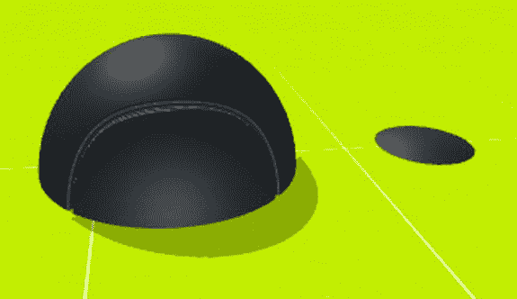

**图 10-5.** `Land Mine`游戏对象在 y 轴上的位置决定了暴露的障碍物大小

你将通过从项目面板的 Prefab 文件夹中拖拽`Land Mine`预设来布置雷区。让自己回到游戏设计模式，思考一下如何布局雷区。图 10-6 展示了几种可能的方案，从一种大小均匀、间距规则的简单模式开始。

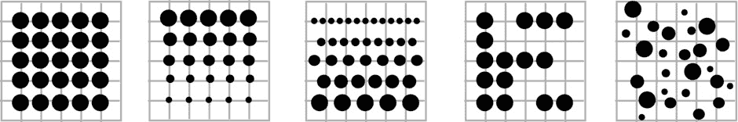

**图 10-6.** 各种地雷散布模式

请记住，你想让这个区域的难度从起点到终点逐步增加，你可以考虑随着玩家前进，增加地雷的尺寸或密度。或者，你可能希望构建一条只有一条可幸存路径的雷区，或者使用完全随机的分布。

选择哪种方式？这取决于你认为哪种方式更有趣，并且更符合你的游戏主题。但当你放置地雷并进行游戏测试时，你可能需要根据游戏过程中的模式效果，切换到不同的选项。

在考虑地雷布局时，要时刻想着玩家。玩家刚刚开始游戏，所以也才刚刚开始熟悉玩家角色的移动和响应。尝试创建一条路径，起始处宽阔、转弯轻松，但随后变得狭窄且曲折，这反过来会迫使玩家更精确地使用控制器。你可能甚至需要一次跳跃，才能到达通往移动平台的缺口边缘的最终“安全”区域。进行游戏测试和调整，直到你对布局满意为止。保存场景。

当你手动布置这个区域时，层级视图中会有许多`Land Mine`游戏对象。你可以使用空的游戏对象来让事情更有条理、更易于管理。在 Unity 编辑器顶部菜单中，选择`Game Object ➤ Create Empty`并命名为`Land Mines`。将变换位置设置为`(0, 5, 18)`，使其恰好位于雷区起点处的高架轨道下方。

在层级视图中，选中第一个`Land Mine`游戏对象。向下滚动到最后一个，但这次在点击它之前按住 Shift 键。这将选中列表中第一个和最后一个`Land Mine`游戏对象之间的所有对象。将此集合拖拽到`Land Mines`游戏对象上。好多了！再次保存场景。


### 移动平台区域

作为功能性障碍物，移动平台障碍的设计已经足够完善。只需确保玩家能从与雷区边界相邻的“安全”区域抵达移动平台即可。

在测试过程中你会发现，当前的作弊码会将玩家传送回雷区起点。现在需要为测试移动平台添加一个新的作弊码。在项目面板中，打开 `Assets` ➤ `Scripts` 文件夹。双击 `Cheats` 脚本在 MonoDevelop 中编辑。在 `Update()` 函数中，复制现有作弊码，并立即粘贴在条件语句的右花括号之后。将这段条件语句修改为 `KeyCode.Alpha2`，并将新位置设为 (0, 9, 33.5)，具体如下：

```
function Update () {
    if(Input.GetKeyDown(KeyCode.Alpha1)) {
        ...
    }
    if(Input.GetKeyDown(KeyCode.Alpha2)) {
        if (player != null) {
            player.transform.position = Vector3(0, 9, 33.5);
            player.gameObject.GetComponent(GoRagdoll).ExitRagdoll();
        }
    }
}
```

添加此代码后，按键盘上的 2 键即可快速将玩家重新定位到雷区的远端。

考虑到还有五个区域要处理，`Update()` 函数会变得越来越臃肿。是时候进行一些重构了。将 `Cheats` 脚本代码修改如下：

```
#pragma strict

public var player : GameObject;
private var relocationPoint : Vector3;

function Start () {
    player = GameObject.FindWithTag("Player");
}

function Update () {
    CheckInput();
}

function CheckInput () {
    if(Input.GetKeyDown(KeyCode.Alpha1)) {
        relocationPoint = Vector3(0, 9, 18);
        RelocatePlayer();
    }
    else if(Input.GetKeyDown(KeyCode.Alpha2)) {
        relocationPoint = Vector3(0, 9, 33.5);
        RelocatePlayer();
    }
}

function RelocatePlayer(){
    if (player != null) {
        player.transform.position = relocationPoint;
        player.gameObject.GetComponent(GoRagdoll).ExitRagdoll();
    }
}
```

这段代码的解析如下：

`(1) private var relocationPoint : Vector3;`

声明一个类型为 `Vector3` 的私有变量 `relocationPoint`。

`(2) CheckInput();`

在 `Update()` 函数中调用 `CheckInput()` 函数。现在你可以清晰地看到每帧都在检查用户输入。

`(3) function CheckInput () {`

创建一个新的 `CheckInput()` 函数，并将原本位于 `Update()` 函数中的玩家输入检测代码移至此处。

`(4) relocationPoint = Vector3(0, 9, 18);` 和 `relocationPoint = Vector3(0, 9, 33.5);`

将为该按键关联的新位置赋值给 `relocationPoint` 变量。

`(5) RelocatePlayer();`

调用 `RelocatePlayer()` 函数。

`(6) function RelocatePlayer(){`

创建 `RelocatePlayer()` 函数...

`(7) player.transform.position = relocationPoint;`

该函数首先将 `relocationPoint` 变量中的 `Vector3` 值赋给玩家角色的新位置。

请注意，`CheckInput()` 函数中的条件语句也略有变化，从两个独立的 `if` 条件变为了 `if - else if` 序列。你完全可以保留原来的两个 `if` 条件，但 `else if` 效率更高。举例来说，假设你为七个区域都创建了作弊键。当使用七个 `if` 条件时，每次调用函数都会检查每一个条件。

假设用户按下了 3 键：

*   处理器代码
*   评估条件：假（如果按下了 `Alpha1` 键）
*   评估条件：假（如果按下了 `Alpha2` 键）
*   评估条件：真（如果按下了 `Alpha3` 键）
*   处理条件内的代码块
*   评估条件：假（如果按下了 `Alpha4` 键）
*   评估条件：假（如果按下了 `Alpha5` 键）
*   评估条件：假（如果按下了 `Alpha6` 键）
*   评估条件：假（如果按下了 `Alpha7` 键）
*   评估后续代码...

在条件序列中使用 `else if` 意味着，每个条件都会被依次评估，直到找到为真的条件，一旦找到真条件，剩余的 `else if` 条件就会被跳过。

同样假设用户按下了 3 键：

*   处理器代码
*   评估条件：假（如果按下了 `Alpha1` 键）
*   评估条件：假（else if 如果按下了 `Alpha2` 键）
*   评估条件：真（else if 如果按下了 `Alpha3` 键）
*   处理条件内的代码块
*   不评估（else if 如果按下了 `Alpha4` 键）
*   不评估（else if 如果按下了 `Alpha5` 键）
*   不评估（else if 如果按下了 `Alpha6` 键）
*   不评估（else if 如果按下了 `Alpha7` 键）
*   评估后续代码...

任何能够引入代码的效率优化都能降低处理负担，从而提升整体游戏性能。


### 加农炮区域

你在第 8 章中创建了一门加农炮，下一步就是将其做成预制件。在项目面板中，打开 `Assets` ➤ `Prefab` 文件夹。在层级视图中，选中 `Cannon` 游戏对象，将其拖拽到 `Prefab` 文件夹中。然后从层级视图中删除 `Cannon` 游戏对象。

就像为地雷区域所做的那样，思考一下你将如何在当前区域布置加农炮。这次，在布置加农炮时，需要考虑两个维度：随着玩家在区域中前进的 z 轴方向，以及相对玩家角色在不同高度的 y 轴方向。通过改变高度，玩家可以运用玩家角色的“蹲伏”动画来躲避危险。

你可以手动布置加农炮：从 `Prefab` 文件夹中将其拖拽到场景视图中，然后根据喜好设置 Transform 位置坐标。另一种方法是，你也可以使用脚本来向场景中填充游戏对象（例如障碍物）。例如，创建一个脚本，在区域中随机分布加农炮。

在项目面板中，打开 `Assets` ➤ `Scripts` 文件夹，新建一个名为 `RandomCannonPositions` 的脚本。在 MonoDevelop 中打开它，并将代码编辑如下：

```
#pragma strict

public var prefab : GameObject;

public var amount : int = 10;

function Start () {

for (var i : int = 0; i < amount; i++)

{

var position: Vector3 = Vector3(5, Random.Range(9.0, 11.0),

Random.Range(44, 53));

Instantiate(prefab, position, Quaternion.Euler(0, 0, 90));

}

}
```

其分解说明如下：

`(1) public var prefab : GameObject;`  
`public var amount : int = 10;`  
声明类型为 `GameObject` 的 `prefab` 引用变量，以及类型为 `int` 的 `amount` 变量，并赋值为 10。

`(2) for (var i : int = 0; i < amount; i++)`  
`for` 循环将根据 `amount` 的值重复执行相应的次数。

`(3) var position: Vector3 = Vector3(5, Random.Range(9.0, 11.0), Random.Range(44, 53));`  
每次循环时，创建一个 `position` 的 `Vector3` 类型变量，并将其 x 坐标值设为 5，使其位于高架轨道右侧；y 坐标介于 9 和 11 之间（因为高架轨道表面 y 坐标为 9，且玩家角色高 2 个单位）；z 坐标介于 44 和 53 之间，即该区域的边界范围。

`(4) Instantiate(prefab, position, Quaternion.Euler(0, 0, 90));`  
使用先前生成的位置创建一个新的加农炮预制件实例，并使其绕 z 轴旋转 90 度，以便瞄准高架轨道的横向方向。

保存脚本。在 Unity 编辑器中，通过顶部菜单 `Game Object` ➤ `Create Empty` 创建一个空游戏对象。将其命名为 `Hazard Setup`，并挂载 `RandomCannonPositions` 脚本。将项目面板中 `Assets` ➤ `Prefab` 文件夹下的 `Cannon` 预制件拖拽到 Inspector 中 `RandomCannonPositions` 脚本的 `Prefab` 属性上。然后在场景视图中将 `Hazard Setup` 游戏对象移开，不要妨碍视线。保存场景。

现在进行游戏测试，你会发现所有加农炮同时开火。为了使发射频率各不相同，请在项目面板的 `Assets` ➤ `Scripts` 文件夹中找到 `LaunchProjectile` 脚本，并在 MonoDevelop 中打开它。添加一个带有随机选择 `frequency` 值代码的 `Start()` 函数：

```
#pragma strict

public var projectile : GameObject;

public var force : float = 25;

public var frequency : float = 2.0;

private var nextLaunch : float = 0.0;

function Start () {

frequency = Random.Range(0.5, 2.5);

}

function Update () {

if (Time.time > nextLaunch) {

nextLaunch = Time.time + frequency;

var projectileInstance : GameObject = Instantiate(projectile,

transform.position, transform.rotation);

projectileInstance.rigidbody.AddForce (projectileInstance.transform.forward

* force, ForceMode.Impulse);

Destroy(projectileInstance, 2);

}

}
```

保存脚本并保存场景。现在再次进行游戏测试，加农炮区域会呈现出良好的加农炮分布和炮弹发射频率（图 10-7）。

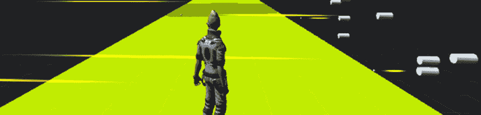

图 10-7. 完成的加农炮区域

你可以轻松添加另一个作弊码来辅助测试，只需在 Cheats 脚本的 `RelocatePlayer()` 函数中添加以下代码：

```
else if(Input.GetKeyDown(KeyCode.Alpha3)) {

relocationPoint = Vector3(0, 9, 43);

RelocatePlayer();

}
```

根据你的喜好进行任何调整，以改善游戏体验。别忘了保存场景和项目。又一个区域完成了——哇！


### 摆锤区域

为了保持每个区域强度级别各不相同的游戏设计理念，炮弹区域的强度高于移动平台区域，而摆锤区域的强度低于炮弹区域，而炮弹区域本身又比之前低强度的移动平台区域更具挑战性。这可真是高高低低，起伏不断！

摆锤已经搭建好了。如果你想增加这个区域的难度，可以改变它们的数量、大小和属性。如果你想移动它们，可以按住鼠标左键并拖动光标，将摆锤球连同链条一起框选。这时会出现一个变换控件，你可以使用它来整体移动它们，同时保持它们之间的相对位置。既然它们是一个组，不妨花点时间创建一个空的游戏对象作为摆锤的父级游戏对象，然后对另外两组也这样做。这只是一个简单的原型——想象一下，对于一个更复杂的游戏来说，`Hierarchy` 面板会变得多么杂乱和臃肿！

你还可以重复使用一些资源来增加挑战性，例如添加地雷。你可以手动放置它们，或者像处理炮弹一样，创建一个脚本来分配它们的位置。

在 `Project` 面板中，打开 `Assets ➤ Scripts` 文件夹，创建一个名为 `RandomLandMinePositions` 的新脚本。在 MonoDevelop 中打开它并添加如下代码：

```
#pragma strict

public var prefab : GameObject;

public var amount : int = 10;

function Start () {

for (var i : int = 0; i < amount; i++)

{

var position: Vector3 = Vector3(Random.Range(-3.5, 3.5),

Random.Range(8.5, 9.0), Random.Range(55, 89));

Instantiate(prefab, position, Quaternion.identity);

}

}
```

分解来看，这段代码与 `RandomCannonPositions` 脚本的唯一区别如下：

`(1) var position: Vector3 = Vector3(Random.Range(-3.5, 3.5), Random.Range(8.5, 9.0), Random.Range(55, 89));`

`position` 的 x 和 z 坐标范围反映了该区域在高架轨道上的宽度和长度，而 y 坐标范围则决定了地雷高出高架轨道表面的程度。

`(2) Instantiate(prefab, position, Quaternion.identity);`

当调用 `Instantiate()` 函数时，`Quaternion.identity` 相当于表示“无旋转”。

保存脚本，然后将它挂载到 `Hierarchy` 面板中的 `Hazard Setup` 游戏对象上。选中此脚本后，打开 `Assets ➤ Prefab` 文件夹，将 `Land Mine` 预制体拖拽到 `Inspector` 面板中 `Prefab` 属性上。保存场景并进行测试游戏。你可以在 `Inspector` 面板中使用 `amount` 属性来更改地雷的数量，并且可以在 `Cheats` 脚本的 `RelocatePlayer()` 函数中添加以下作弊代码，以快速将玩家角色带回这个区域：

```
else if(Input.GetKeyDown(KeyCode.Alpha4)) {

relocationPoint = Vector3(0, 9, 54);

RelocatePlayer();

}
```

一如既往，当你调整到满意的效果后，保存场景并保存项目。

如果你不想要随机布局怎么办？除了手动放置预制体，你还可以使用脚本按规则模式放置障碍物。在 `Project` 面板中，打开 `Assets ➤ Scripts` 文件夹，创建一个名为 `RegularLandMinePositions` 的新脚本。在 MonoDevelop 中打开它并添加如下代码：

```
#pragma strict

public var prefab : GameObject;

public var xPos : float = -3.5;

public var yPos : float = 8.5;

public var zPos : float = 55.0;

public var numberWidth : int = 8;

public var numberLength : int = 34;

function Start () {

for (var i : int = 0; i < numberLength; i++)

{

for (var j : int = 0; j < numberWidth; j++)

{

var position: Vector3 = Vector3(xPos, yPos, zPos);

Instantiate(prefab, position, Quaternion.identity);

xPos++;

}

xPos = -3.5;

yPos = yPos + 0.05;

zPos = zPos + 1;

}

}
```

这段代码分解如下：

`(1) public var prefab : GameObject;`

声明一个类型为 `GameObject` 的公共引用变量 `prefab`，用于保存要在此脚本中使用的预制体的引用。

`(2) public var xPos : float = -3.5; public var yPos : float = 8.5; public var zPos : float = 55.0;`

声明类型为 `float` 的公共变量 `xPos`、`yPos` 和 `zPos`，用于保存每个实例化预制体的 x、y、z 坐标，并分配它们的初始值。

`(3) public var numberWidth : int = 8; public var numberLength : int = 34;`

声明公共变量 `numberWidth`，用于保存沿高架轨道宽度方向放置的预制体数量，并分配初始值 8；类似地，声明公共变量 `numberLength`，用于保存沿高架轨道长度方向放置的预制体数量，并分配初始值 34。

`(4) for (var i : int = 0; i < numberLength; i++)`

此 `for` 循环遍历要创建的行数。

`(5) for (var j : int = 0; j < numberWidth; j++)`

此循环遍历每行要实例化的预制体数量。

`(6) var position: Vector3 = Vector3(xPos, yPos, zPos);`

将 x、y、z 坐标赋值给变量 `position`。

`(7) Instantiate(prefab, position, Quaternion.identity);`

在指定位置创建预制体的新实例，且无旋转。

`(8) xPos++;`

在此行创建的每个预制体后，x 坐标递增 1。循环重复，将下一个预制体放置在前一个预制体的旁边。

`(9) xPos = -3.5;`

当一行预制体完成时，x 坐标重置为下一行的初始值。

`(10) yPos = yPos + 0.05;`

下一行的 y 坐标递增 0.05。

`(11) zPos = zPos + 1;`

z 坐标递增 1，将下一行沿高架轨道向前放置 1 个单位。

保存脚本。将脚本挂载到 `Hierarchy` 面板中的 `Hazard Setup` 游戏对象上。在 `Hierarchy` 中选中 `Hazard Setup` 游戏对象后，你可以在 `Inspector` 面板中看到它已挂载了 `RandomLandMinePositions` 和 `RegularLandMinePositions` 两个脚本。务必取消勾选 `RandomLandMinePositions` 脚本组件以禁用它；`RegularLandMinePositions` 脚本应保持勾选状态。

在 `Project` 面板中，打开 `Assets ➤ Prefab` 文件夹，然后在 `Inspector` 面板中，将 `Land Mine` 预制体拖拽到 `RegularLandMinePositions` 脚本的 `Prefab` 属性上。保存场景。

进行测试游戏以观察其模式，你会发现每一行地雷的位置都比上一行更高。这个区域最后会布满地雷，变得无法穿越（图 10-8）。

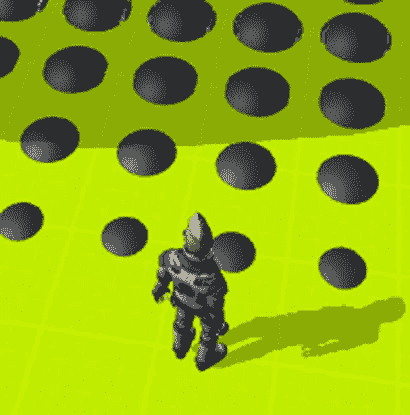  
图 10-8. 使用脚本按规则模式分布的预制体地雷

修改以下代码行：

`for (var i : int = 0; i < numberLength; i++)`

改为

`for (var i : int = 0; i < numberLength/2; i++)`

并将这一行：

`zPos = zPos + 1;`

改为

`zPos = zPos + 2;`

保存脚本并进行测试游戏。第一个代码变化意味着创建的行数减半，第二个变化则将行间距从 1 个单位改为 2 个单位。尝试更改行数和行间距，以及每行中预制体的数量与间距。按你最喜欢的方式排列，直到你在这个区域内拥有可供选择的随机和规则间隔两种地雷放置方案，并且可以通过启用和禁用相应的脚本来轻松切换。


### 激光区域

你可以将之前许多布置机关的方法应用到激光区域，例如：等距排列、随机排列、固定激光或变化速度等。在这里，我们将从等在区域长度范围内以 0.5 单位等距排列、并以不同速度横穿高架轨道宽度的激光开始。

首先，制作激光机关的预制件：将 `LaserCube` 游戏对象从层级视图拖拽到项目面板的 `Assets ➤ Prefab` 文件夹中，并将其命名为 `Laser`。然后从层级视图中删除 `LaserCube` 游戏对象。

在项目面板中，打开 `Assets ➤ Scripts` 文件夹，创建一个名为 `Laser Layout` 的新脚本。将代码编辑如下：

```
#pragma strict

public var prefab : GameObject;
public var zPos : float = 91.0;
public var numberLength : int = 16;

function Start () {
    for (var i : int = 0; i < numberLength * 2; i++)
    {
        var position: Vector3 = Vector3(-3.8, 12, zPos);
        Instantiate(prefab, position, Quaternion.identity);
        zPos = zPos + 0.5;
    }
}
```

代码解读如下：

`(1)     public var prefab : GameObject;`

一个 `GameObject` 类型的公共引用变量，用于持有对预制件游戏对象的引用。

`(2)     public var zPos : float = 91.0;`

声明一个 `float` 类型的公共变量 `zPos`，并赋值为该区域的起始值。

`(3)     public var numberLength : int = 16;`

声明一个 `int` 类型的公共变量 `numberLength`，并赋值为该区域的长度值。

`(4)     for (var i : int = 0; i < numberLength * 2; i++)`

这个 `for` 循环将在每次迭代中创建并定位一个新的预制件。由于激光非常窄，将它们间隔 0.5 单位放置意味着需要两倍数量的激光，因此 `for` 循环迭代的次数是区域长度的两倍。

`(5)     var position: Vector3 = Vector3(-3.8, 12, zPos);`

声明一个名为 `position` 的 `Vector3` 类型变量，用于指定激光预制件的初始位置。在此区域中，激光预制件的起始 x 和 y 坐标是固定的，因此只需要改变每个预制件的 z 坐标，以便它们沿着区域等距排列。

`(6)     Instantiate(prefab, position, Quaternion.identity);`

用新位置和零旋转来实例化激光预制件。

`(7)     zPos = zPos + 0.5;`

通过将新实例化预制件的 z 坐标增加 0.5 单位，前进到下一个位置。

保存脚本并将其附加到层级视图中的 `Hazard Setup` 游戏对象上。在层级视图中选择 `Hazard Setup`，然后在项目面板的 `Prefabs` 文件夹中选择 `Laser` 预制件，并将其拖拽赋值给检视面板中 `Laser Layout` 脚本组件的 `Prefab` 变量。进行游戏测试，注意只有一道激光在撞击到它本应撞击的高架轨道时发出了火花（图 10-9）。

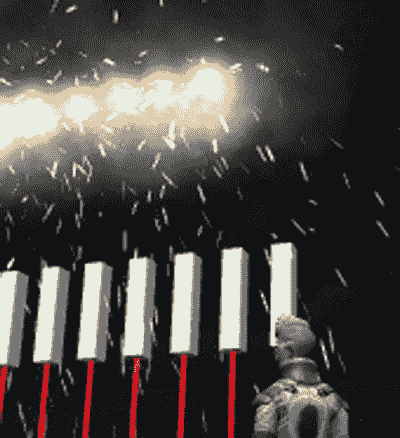

图 10-9. 除了一个之外，所有火花粒子系统都出现在错误的位置

这种异常现象来源于 `Laser` 预制件上的 `Laser` 脚本，该脚本挂载在空的子游戏对象上。在 `Assets ➤ Prefab` 文件夹中，展开 `Laser` 预制件并选择 `LaserBeam` 子对象，以在检视面板中显示其属性（图 10-10）。

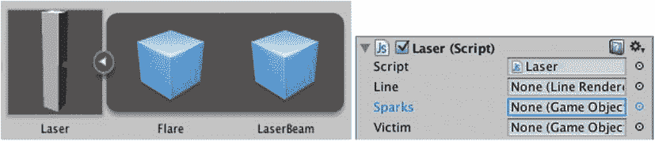

图 10-10. 项目面板中的 `Laser` 子对象 `LaserBeam` 及其在检视面板中的 `Laser` 脚本组件

`Sparks` 属性字段未分配任何游戏对象，但有一道激光的火花位置正确，其余则不然。在 MonoDevelop 中打开 `Laser` 脚本。在 `Start()` 函数中，你将找到将 `Flare` 粒子系统赋值给 `sparks` 引用变量的代码行：

```
function Start () {
    sparks = GameObject.Find("Flare");
```

`Start()` 函数只会被调用一次。它会找到第一个名为 `Flare` 的游戏对象并将其赋值给 `sparks`，然后继续执行代码块的其余部分。这就是为什么只有一道激光的火花位置正确。删除这行代码并保存脚本。通过从项目面板拖拽 `Laser` 预制件的 `Flare` 子游戏对象（`Assets/Prefabs/Laser ➤ Flare`），将其放入检视面板的 `Sparks` 属性字段中，从而将 `Flare` 粒子系统赋值给 `Sparks` 属性。进行游戏测试，现在所有火花都会出现在激光撞击高架轨道的位置（图 10-11）。

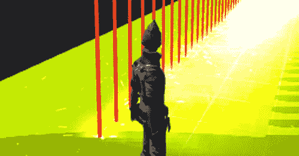

图 10-11. 每个火花粒子系统都出现在其激光撞击高架轨道表面的位置

所有激光现在都能正常工作，但同步移动并不能带来多大挑战。要通过代码解决此问题，请找到 `MoveLaser` 脚本并打开它。为了随机化每个激光预制件的速度，请在 `Start()` 函数中添加以下代码行：

```
function Start () {
    offset = transform.position.x - 0.2;
    speed = Random.Range(1.0, 3.0);
}
```

你现在应该对 `Random.Range()` 函数非常熟悉了。请记住，你始终可以使用 `Ctrl`+`'` 来打开它的脚本参考文档。你可以在图 10-12 中看到激光的随机分布情况。

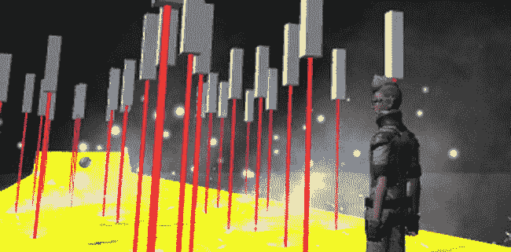

图 10-12. 对激光预制件应用随机速度后的激光区域

该区域的作弊码是：

```
else if(Input.GetKeyDown(KeyCode.Alpha5)) {
    relocationPoint = Vector3(0, 9, 90);
    RelocatePlayer();
}
```

将其添加到 `Cheats` 脚本中 `RelocatePlayer()` 函数的其他作弊码列表中。

虽然重新定位和复活玩家角色是一个方便的作弊手段，但在躲避死亡的同时评估你想要检查的机关的所有方面可能很困难。另一个常见且方便的作弊手段是无敌模式。要添加无敌模式，请在 `CheckInput()` 函数的 `if else` 序列中添加以下代码块：

```
else if(Input.GetKeyDown(KeyCode.Alpha0)) {
    player.gameObject.GetComponent(GoRagdoll).Invincibility();
}
```

代码解读如下：

`(1)     else if(Input.GetKeyDown(KeyCode.Alpha0)) {`

与其他作弊码一样，此行检查玩家是否按下了 0（零）键。如果按下，

`(2)     player.gameObject.GetComponent(GoRagdoll).Invincibility();`

获取玩家游戏对象的 `GoRagdoll` 脚本，并调用你接下来将要创建的 `Invincibility()` 函数。保存 `Cheats` 脚本，然后打开 `GoRagdoll` 脚本。首先添加 `invincible` 变量，如下所示：

```
#pragma strict

private var childRigidBodies : Rigidbody[];
private var childColliders : Collider[];
(1)     public var invincible : boolean = false;
```

首先，添加一个 `boolean` 类型的公共变量 `invincible`，并将其赋值为 `false`。这样，游戏开始时，玩家并非无敌状态。

在脚本末尾，添加 `Invincibility()` 函数：

```
function Invincibility () {
    (2)             invincible = !invincible;
}
```

这是一个简单的开关，`invincible` 的值被重新赋值为其相反的布尔值。

最后，在 `GotoRagdoll()` 函数中，添加一个条件判断，在将玩家转化为布娃娃之前测试玩家是否处于无敌状态：

```
function GotoRagdoll ()
{
    (3)     if (!invincible) {
        if (childRigidBodies != null) {
            for (var childRigidBody : Rigidbody in childRigidBodies) {
                childRigidBody.isKinematic = false;
            }
        }
        if (childColliders != null) {
            for (var childCollider : Collider in childColliders) {
                childCollider.enabled = true;
            }
        }
        gameObject.collider.enabled = false;
        gameObject.rigidbody.isKinematic = true;
        gameObject.GetComponent(Animator).enabled = false;
    }
}
```


`gameObject.GetComponent(ThirdPersonCharacter).enabled = false;`

`gameObject.GetComponent(ThirdPersonUserControl).enabled = false;`

`}`

`}`

在这个 `if` 条件语句中，它会测试括号内的内容是否为真。使用 `!invincible` 是“`invincible` 值的相反值”的简写。如果 `invincible` 是 `true`，那么 `!invincible` 就是 `false`。如果条件测试为假，则后续的代码块不会执行，这意味着玩家角色不会转变为布娃娃状态。

保存脚本、场景和项目。玩一下测试你新获得的无敌状态吧！

### 暴风雪区域

首先要解决的是重新定位和调整包含杀手粒子系统的暴风雪游戏对象的大小。在层级视图中选择暴风雪游戏对象，然后在检查器中将其变换位置坐标改为（-10, 11.5, 117），以使其在区域中居中。回想一下，-10 的 x 偏移是为了让玩家有时间看到并反应接近的雪花（图 10-13）。

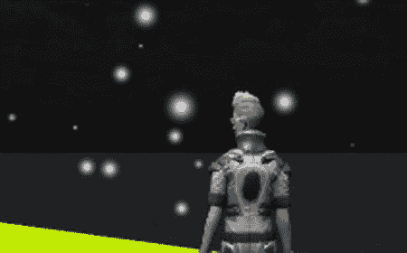

图 10-13.
致命雪花暴风雪穿过高架轨道

仍在检查器中，向下滚动到粒子系统组件的形状模块。将盒体 X 改为 17，以将粒子发射表面扩展到该区域的长度。由于雪花遵循发射模块每秒 10 个的速率，因此它们现在变得不那么密集了。

第 8 章提供了粒子系统及其模块和属性的概述。你可以浏览这些属性，并在检查器中重置它们，以适应粒子发射器的新尺寸和位置。但是，根据你的游戏设计，你如何让这个区域随着玩家的前进而变得更加困难呢？当然是通过脚本编写。

为了使雪花在玩家穿过该区域时以更高的速度发射，请打开项目面板，打开`Assets ➤ Scripts`文件夹，并创建一个名为`BlizzardZone`的新脚本。在 MonoDevelop 中打开它，并将代码编辑如下：

```
#pragma strict

public var playerTransform : Transform;
public var rateIncrease : float = 1;
private var rate : float;

function Update () {
    if (playerTransform.position.z > 109 && playerTransform.position.z < 126) {
        rate = playerTransform.position.z - 104;
        gameObject.particleSystem.startSpeed = rate * rateIncrease;
    }
}
```

这段代码解析如下：

`(1)     public var playerTransform : Transform;`

声明一个`Transform`类型的公有变量`playerTransform`，它将保存对玩家角色变换的引用。

`(2)     public var rateIncrease : float = 1;`

声明一个`float`类型的公有变量`rateIncrease`，它将允许你通过检查器调整暴风雪属性变化的速率。

`(3)     private var rate : float;`

声明一个`float`类型的私有变量`rate`，它将与玩家角色的位置一起用于计算一个随玩家角色进度而变化的速率。

`(4)     if (playerTransform.position.z > 109 && playerTransform.position.z < 126)`

这个 `if` 条件包含两个测试。第一个是测试玩家角色的变换位置 z 坐标是否大于 109，这意味着他进入了暴风雪区域。第二个是测试玩家角色的变换位置 z 坐标是否小于 126，这意味着他离开了暴风雪区域的远端。`&&` 运算符代表逻辑与运算符。条件一和条件二都必须为真，整个条件语句才会返回一个`true`结果。这进而会导致后续的代码块被执行。

`(5)     rate = playerTransform.position.z - 104;`

`rate`变量被赋值为玩家角色变换位置 z 坐标值减去 104。104 是一个基于起始速度属性原始值 5 而设定的任意值，这样当玩家首次进入从 z 坐标 109 开始的暴风雪区域时，起始速度仍然是 5。

`(6)     gameObject.particleSystem.startSpeed = rate * rateIncrease;`

将基于玩家角色位置计算出的新速率乘以`rateIncrease`值（你可以在检查器中使用该值来调整当玩家在区域内移动时`startSpeed`值变化的快慢），然后将其赋值给暴风雪游戏对象的粒子系统起始速度属性。

保存脚本并将其附加到暴风雪游戏对象上。回到编辑器中，在层级视图中选择暴风雪游戏对象，然后将第三人称角色布娃娃从层级视图拖到检查器中暴风雪区域脚本的玩家变换字段中。进行游戏测试，并注意玩家奔跑时雪花速度的变化。除了在检查器中调整初始粒子系统属性外，你还可以在游戏过程中轻松地控制它们。MonoDevelop 的自动填充功能可以通过显示可用的粒子系统属性来辅助你（图 10-14）；

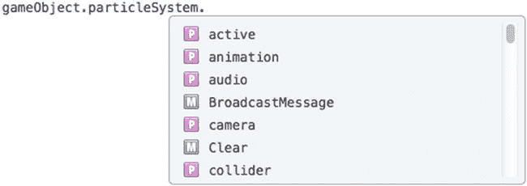

图 10-14.
MonoDevelop 自动填充弹出窗口中显示的粒子系统属性

不要忘记将此区域的作弊码添加到作弊脚本的`RelocatePlayer()`函数中：

```
else if(Input.GetKey(KeyCode.Alpha6)) {
    relocationPoint = Vector3(0, 9, 108);
    RelocatePlayer();
}
```

尽情尝试根据玩家的进度改变不同的粒子系统属性，甚至同时改变多个属性吧。当你对暴风雪区域的效果满意后，保存脚本、场景和项目。


### 敌人区域

在此区域中，你将把危险升级为一种具备足够智能、能向玩家发起攻击的敌人。你要打造一架简单的无人机敌人，当玩家进入其区域时，它会锁定并追击玩家。

要创建无人机敌人，请打开 `Assets ➤ Prefab` 文件夹，将 `land mine` 预制体拖拽到 Scene 视图。在 Hierarchy 中将其重命名为 `Enemy Drone`，然后在 Inspector 中将其 Transform 位置设为 `(0, 10, 145)`。`Land Mine` 预制体在与玩家角色接触时已经会爆炸，因此这里只需添加一项功能：能够找到玩家角色并追捕他。

当玩家离开暴风雪区域，进入区域间的小安全区时，他可以看到远端那架不祥的无人机。玩家已经从地雷中得知黑色球体并不友好，但为了增加紧张感，在攻击真正发起之前，他并不知道这次攻击的性质（如图 10-15 所示）。

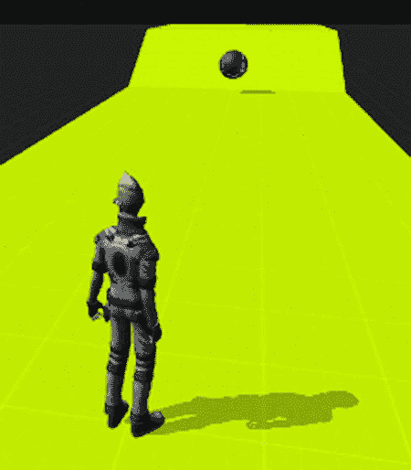

*图 10-15. 玩家角色面对无人机敌人*

在 Project 面板中的 `Assets ➤ Prefab ➤ Scripts` 文件夹内，新建一个名为 `EnemyDroneAI` 的脚本。在 MonoDevelop 中打开该脚本，并按如下代码进行编辑：

```
#pragma strict

public var playerTransform : Transform;

public var speed : float = 3.0f;

private var drone : Vector3;

private var target : Vector3;

private var distance : float;

function Update () {

if (playerTransform.position.z > 128 && playerTransform.position.z < 145) {

transform.LookAt(playerTransform);

drone = transform.position;

target = playerTransform.position + Vector3(0, 0.6, 0);

distance = speed * Time.deltaTime;

transform.position = Vector3.MoveTowards(drone, target, distance);

}

}
```

这段代码的解析如下：

`(1)     public var playerTransform : Transform;`  
`public var speed : float = 3.0f;`

声明 `playerTransform` Transform 类型的公有变量，用于持有对玩家角色 Transform 的引用，以便进行目标锁定；声明 `speed` 浮点类型变量，使得在播放测试期间可以通过 Inspector 调整无人机的速度。

`(2)     private var drone : Vector3;`  
`private var target : Vector3;`  
`private var distance : float;`

声明私有变量，这些变量将存储 `MoveTowards()` 函数所需的值：无人机的位置、玩家角色的位置，以及两者之间的距离。

`(3)     if (playerTransform.position.z > 128 && playerTransform.position.z < 145)`

此条件判断玩家角色的 z 轴 Transform 位置是否大于 128，如果是，则说明玩家角色已进入无人机的区域。同时它还检查玩家角色的 z 轴 Transform 位置是否小于 145，这意味着他尚未从远端离开该区域。`&&` 逻辑运算符表示，如果这两个条件都为 true，则说明玩家角色已进入区域且尚未离开，即玩家角色位于无人机敌人的区域内。

`(4)     transform.LookAt(playerTransform);`

`transform.LookAt` 函数以玩家角色的 Transform 为参数，旋转无人机的 Transform，使其前向矢量指向玩家角色。

`(5)     drone = transform.position;`  
`target = playerTransform.position + Vector3(0, 0.6, 0);`  
`distance = speed * Time.deltaTime;`

要移动无人机敌人朝向玩家角色，你必须指定无人机的当前位置、它要前往的目标点以及移动的距离。玩家角色的 Transform 位置基于其脚底，因此添加 `Vector3(0, 0.6, 0)` 是为了让无人机保持在架空轨道表面的上方，但同时又足够低，以便玩家角色仍可以跳跃越过它，作为一种规避策略。

`(6)     transform.position = Vector3.MoveTowards(drone, target, distance);`

无人机的新 `transform.position` 由 `MoveTowards()` 函数计算得出，该函数将无人机的位置、玩家角色的位置以及移动距离作为参数。

别忘了在 `Cheats` 脚本的 `CheckInput()` 函数中添加作弊码，以便快速到达此区域：

```
else if(Input.GetKey(KeyCode.Alpha7)) {

relocationPoint = Vector3(0, 9, 127);

RelocatePlayer();

}
```

保存脚本并将其附加到 `Enemy Drone` 游戏对象上。需要在 Inspector 中填充 `playerTransform` 属性，只需将 Hierarchy 中的 `Third Person Character Ragdoll` 拖拽到该属性字段中即可。进行播放测试，在 Inspector 中调整无人机速度，直到对你来说具有足够的挑战性。保存场景并保存项目。检查一下——所有障碍赛道的杀戮区域都已完成。干得漂亮！

### 调试

意外行为，从灾难性的崩溃到诸如火花与激光未对齐等异常现象（正如你在本章前面所见），都称为 bug。查找并修复这些问题称为调试。Unity 专门为此提供了一个特殊的 `Debug` 类。你在第 2 章中使用了 `Debug.Log` 函数在控制台显示消息，并在第 7 章中使用了 `Debug.DrawRay` 函数，在测试时使光线投射在场景视图中可见。随着你的场景和脚本变得更加复杂，你更有可能遇到 bug，也更需要高效地识别并修正它们。

#### 编译器错误

当你点击“播放”按钮在游戏视图中运行游戏场景时，编译器首先会翻译你的脚本代码，以便处理器能够理解。如果编译器在你的代码中发现错误，它会通知你。当你尝试播放测试时，Unity 编译器会在场景视图中对任何发现的错误给出一个巨大的通知（如图 10-16 所示）：

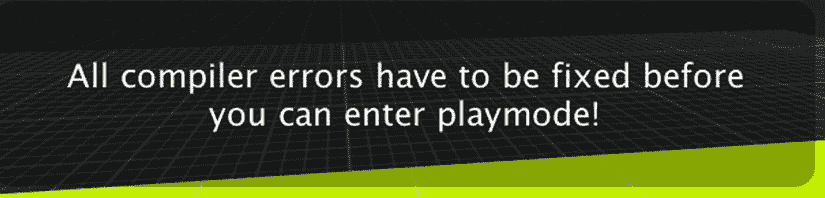

*图 10-16. 场景视图中显示的编译器错误消息*

在 Project 面板的 Console 选项卡下，还会显示有关该错误的附加信息（如图 10-17 所示）：

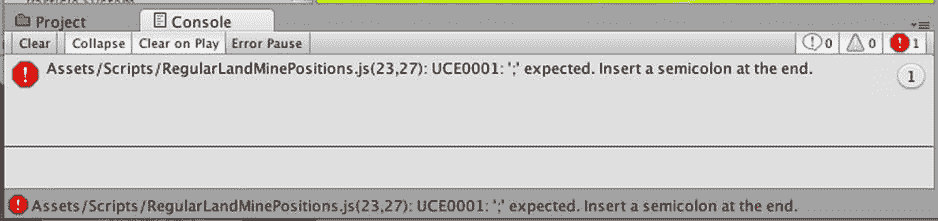

*图 10-17. 控制台显示的编译器错误信息*

此错误的解析如下：

`1. Assets/Scripts/`

在 `Assets/Scripts` 目录下，

`2. RegularLandMinePositions.js`

`RegularLandMinePositions.js` 脚本

`3. (23,27)`

在第 23 行第 27 列存在错误

`4. UCE0001`

有一个简写的错误代码标识 `UCE0001`，表示用户创建的错误 0001：缺少分号，

`5. ';' expected.`

并带有错误描述

`6. Insert a semicolon at the end.`

以及一条调试建议：在此行代码末尾插入一个分号。

如果双击底部的错误消息，MonoDevelop 将会打开，并将光标定位在错误发生的位置。通过打开你的一个脚本，删除一行代码中的分号并保存脚本来测试此功能；然后关闭 MonoDevelop。现在尝试播放测试，观察编译器的错误消息出现在 Project 面板的 Console 选项卡和场景视图中。通过重新插入分号来修复错误，并保存你的脚本。

一行代码中的错误可能会级联导致后续几行代码也出现错误。一旦第一个 bug 被修复，这些其他的伪 bug 也会随之消失，因为编译器现在可以正确读取后续的代码行了。因此，在调试时，你应该从出现的第一个错误开始，并有条不紊地依次解决这些 bug。


### 警告

尽管前一个示例中的编译器错误会显示一个红色停止标志图标，表示在错误修复前场景无法播放，但警告则使用黄色让行标志图标来提示你注意某个问题，同时表明场景仍然可以播放（图 10-18）。

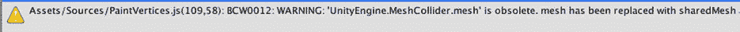

图 10-18. 控制台中显示的警告消息

警告的示例包括未使用变量的通知，或即将在后续版本中弃用（过时）的 Unity 函数。

你可以使用 `Debug.LogWarning` 创建自己的警告。它的用法与 `Debug.Log` 非常相似，但除了消息和对象上下文外，还会显示警告图标。若要尝试此功能，请在 Unity 编辑器的“项目”面板中，打开 Assets ➤ Scripts 文件夹，找到 ImpactForce 脚本。在 MonoDevelop 中打开它，并将以下代码行添加到 `Start()` 函数中：

```
Debug.LogWarning("Warning!", this);
```

保存脚本，进行游戏测试，然后查看你的新警告出现在控制台中（图 10-19）。

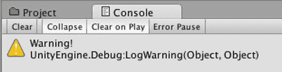

图 10-19. 控制台中显示的 `Debug.LogWarning` 消息

虽然你仍然可以在存在警告的情况下进行游戏测试，但务必在游戏发布之前解决这些问题。

### 运行时错误

运行时错误是脚本成功编译且游戏运行后发生的错误。运行时错误最简单的示例是除以零错误。

在 MonoDevelop 中仍打开 ImpactForce 脚本的情况下，首先删除或禁用你在上一节中创建的 `Start()` 函数中的警告。现在，通过将 `ImpactForce()` 函数编辑为以下内容来引入除以零错误：

```
function ImpactForce () {

        var colliders : Collider[] =
                Physics.OverlapSphere(transform.position - Vector3(0, 4, 0), 10);

        for(var cldr : Collider in colliders)
        {
                if(cldr.rigidbody == null) continue;

                var a : int = 0;

                cldr.rigidbody.AddExplosionForce(10, transform.position - Vector3(0,
                        4/a, 0), 10, 0, ForceMode.Impulse);
        }
}
```

其分解如下：

`(1) var a : int = 0;`

声明一个 int 类型变量 `a`，并将其赋值为零。

`(2) cldr.rigidbody.AddExplosionForce(10, transform.position - Vector3(0, 4/a, 0), 10, 0, ForceMode.Impulse);`

将 Vector3 计算的 y 分量除以 `a`，以创建除以零错误。

保存脚本并开始游戏测试。

请注意，脚本已编译，并且在场景运行之前，控制台中不会出现任何错误消息（图 10-20）。

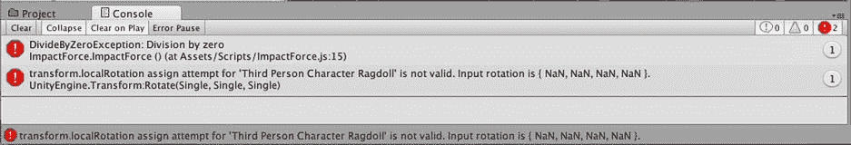

图 10-20. 控制台中显示的运行时错误

当运行时发生错误时，Unity 会创建一个异常对象，然后抛出该异常。必须捕获并处理该异常，脚本才能继续执行。如果你的脚本未提供适当处理异常的方法，默认处理程序会捕获该异常并生成错误消息。根据错误的不同，它甚至可能导致游戏崩溃或终止。

在此示例中，由于错误发生在玩家角色落地时计算其周围箱体爆炸力的代码块中，因此当抛出此错误时，箱体会保持整齐堆放状态，因为爆炸力无法正确计算或应用。

再次查看图 10-20，你可以看到生成了两条错误消息：一条是关于除以零的数学错误，紧接着是无法计算 `AddExplosionForce()` 中参数的 Vector3 坐标。通过先处理控制台中列出的第一个错误，当你修复除以零的错误后，第二个相关错误也将随之解决。移除错误，保存脚本，并进行游戏测试，你的场景将再次无错误地运行。

你也可以使用 `Debug.LogError` 创建自己的错误消息。将以下代码行添加为 `ImpactForce()` 函数的第一行：

```
Debug.LogError("My test error message", gameObject);
```

保存脚本并开始游戏测试。带有红色图标的错误消息会按预期出现在控制台中。虽然你创建的错误消息除了图标外，其行为与 `LogWarning` 消息看起来相同，但 `Debug.LogError` 还与 Unity 调试器协同工作，帮助你在运行时逐步跟踪脚本的执行。虽然使用 Unity 调试器是一个更高级的主题，但为了将来参考，请注意 Debug 类还有更复杂的用法，你最终会发现它们很有用。

### 异常处理

你已经编写了有助于防止抛出异常的代码。再次查看 `KillOnCollision` 脚本的 `OnCollisionEnter()` 函数：

```
function OnCollisionEnter(other : Collision) {
        if (other.gameObject.name == "Third Person Character Ragdoll")
        {
        other.gameObject.GetComponent(GoRagdoll).GotoRagdoll();
        }
}
```

在访问并调用 `GoRagdoll` 脚本组件上的 `GotoRagdoll()` 函数之前，条件检查确保碰撞涉及的游戏对象是玩家角色。假设你没有进行检查，而将函数简单地写为：

```
function OnCollisionEnter(other : Collision) {
        other.gameObject.GetComponent(GoRagdoll).GotoRagdoll();
}
```

当唯一的移动游戏对象是玩家角色时，这可能是合理的。但随着你继续构建障碍赛道，添加了其他移动对象——敌方无人机。如果玩家沿着障碍赛道撤退以躲避无人机，而跟随的无人机撞击到带有 `KillOnCollision` 脚本组件的危险物时，脚本将尝试访问并调用 `GoRagdoll` 脚本组件的 `GotoRagdoll()` 函数，但敌方无人机没有此组件，因此会发生错误。有了条件判断，如果碰撞涉及敌方无人机，条件测试结果为 false，则不会执行调用 `GotoRagdoll()` 的代码块，因此不会发生错误。

错误类型及其可能发生的场景组合几乎是无限的。学习如何处理错误的最佳方法是在实践中发现并解决它们，并在过程中逐步学习更多的异常处理代码。你会在 Unity 在资源商店中提供的示例项目和教程中遇到许多示例。如果遇到无法解决的错误，下一步最佳做法是在 Unity3D 社区页面的“答案”和/或“论坛”下进行快速搜索。很可能有人遇到过相同的问题，并且答案已经 readily available（随时可用）。


## 总结

本章内容相当密集，你将玩家角色和危险物原型整合在一起，实现了你在上一章中构思的游戏设计。你体验了游戏设计的迭代过程，并创建了作弊码以方便测试障碍物跑道原型。你学会了如何让玩家角色复活，并使其变得无敌。

在逐个攻克各个危险区域的过程中，你学到了更多利用脚本和预制件的方法，以固定模式或不可预测的随机化方式快速在场景中填充危险物。通过使用脚本，你学会了实时调整危险物游戏对象的属性以响应玩家的移动。你还创建了第一个敌人，并用一个简单的 AI 脚本让它动起来。

你重新利用了已有资源以节省原型开发的时间和资源。你还重构了代码以提高效率，并学习了调试的基础知识。呼——你涉及了很广的范围，在充实障碍物跑道原型的过程中，获得了大量设计实现方面的良好实践。干得漂亮！

