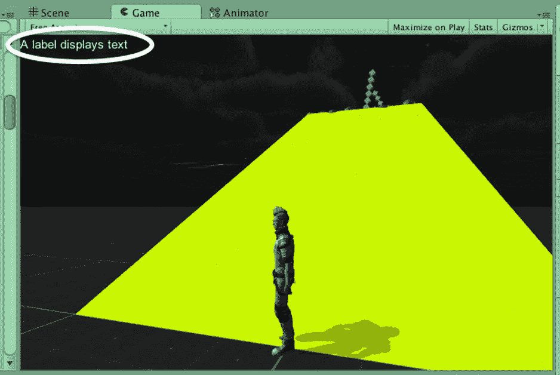
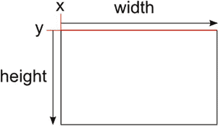
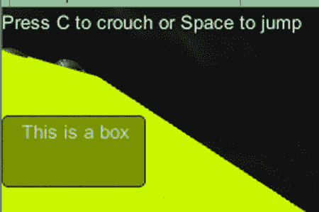
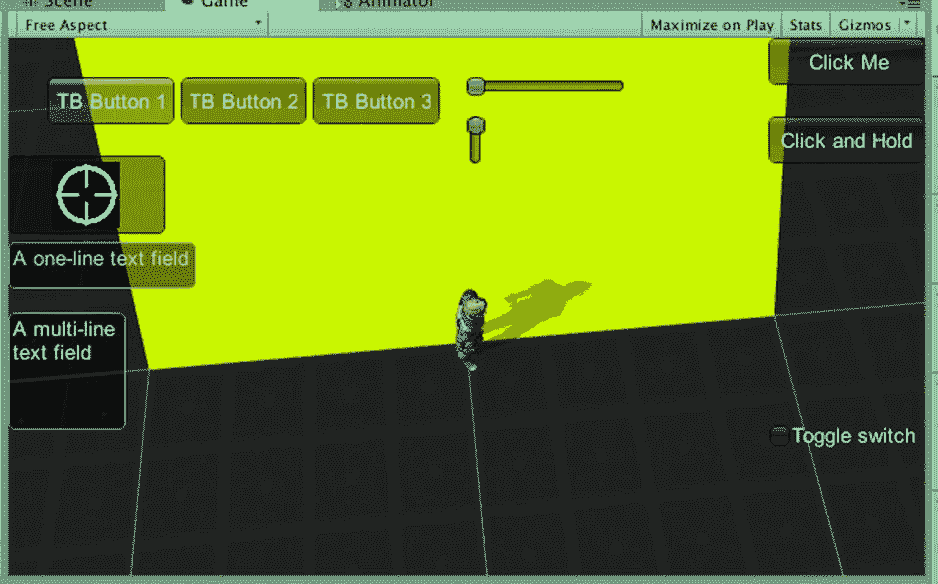
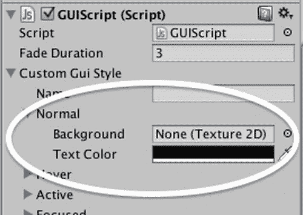
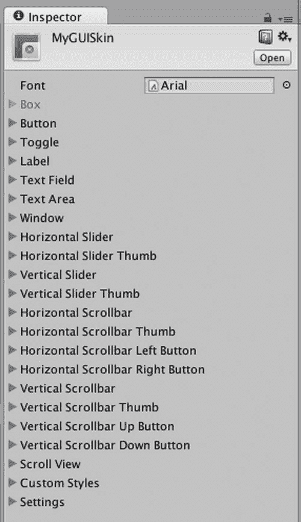

# 11. 提升用户体验：GUI 与音效

“视频游戏”这一术语用于描述通过各种视频监视器或屏幕进行游玩的游戏。早期的视频游戏仅限于在单色显示器上显示文本和键盘字符，但自那以后，它们已演变为使用 3D 图像、立体声，并且根据平台不同，还具备运动检测和感官反馈功能的复杂游戏体验。

图形用户界面（即 GUI）是一种视觉覆盖层，它通过传达分数、库存物品和地图等信息来辅助玩家，同时还能为玩家与游戏进行交互提供额外的方式。

音效对于打造稳健且丰富的游戏体验同样至关重要。音乐用于设定游戏氛围；使用（从简单音效到叙事对话在内的任何形式）向用户传递关于游戏玩法的提示和信息；或者作为音效，增强显示器上发生的相应视觉动作。

## 创建 GUI 控件

创建和使用 GUI 控件是通过脚本和 `OnGUI()` 函数来完成的。虽然你可以将 GUI 脚本添加到任何游戏对象，或将 GUI 代码添加到任何脚本中，但保持它们的组织结构良好，会使编辑、更新和排除项目故障变得更加容易。在 Unity 编辑器顶部菜单中，选择 `GameObject` ➤ `Create Empty` 并将其命名为 `GUI`。与方向光（`Directional Light`）和音频（`Audio`）游戏对象一样，精确的变换（`Transform`）位置并不重要。你创建的 GUI 控件将根据你为其指定的屏幕坐标显示，而不是根据 `GUI` 游戏对象的游戏世界坐标。

### 显示文本

GUI 与用户通信最基本的方式就是显示文本。标签和框正是执行此操作的非常简单的控件。实际上，标签和框之间的唯一区别在于，标签只显示文本，而框则是一个带有深色背景的标签。

#### 标签

要创建一个标签，首先你需要一个脚本。在“项目”面板中，打开 `Assets` ➤ `Scripts` 文件夹，然后创建一个新脚本并将其命名为 `GUIScript`。在 MonoDevelop 中打开 `GUIScript`，并将代码编辑为以下内容：

```
#pragma strict

function OnGUI() {

        GUI.Label(Rect(0, 0, 125, 25), "A label displays text");

}
```

这段代码分解如下：

`(1)     function OnGUI()`

用于创建 GUI 控件的 `OnGUI()` 函数在每一帧都会被调用。

`(2)     GUI.Label(Rect(0, 0, 125, 25), "A label displays text");`



图 11-1. 显示在“游戏”视图左上角的新标签文本

调用 `GUI` 类的 `Label()` 函数，并为其传递标签的 x 和 y 屏幕坐标、宽度和高度，然后是标签中要显示的文本。

保存脚本，将其附加到 `GUI` 游戏对象上，保存场景，然后运行。你将看到标签文本显示在“游戏”视图的左上角（图 11-1）。

##### Rect

`Rect` 变量值得再多加解释一下。它代表一个二维矩形，其中 (x, y) 坐标表示矩形左上角将根据屏幕坐标定位的位置。屏幕坐标基于目标平台显示器的宽度和高度，并且独立于游戏世界的 (x, y, z) 坐标（图 11-2）。



图 11-2. Unity 脚本参考文档中描绘的，定义二维矩形大小和位置的 `Rect` 变量属性

在 `GUIScript` 中，尝试更改 (x, y) 值来重新定位标签。当你同时尝试更改 `Rect` 的大小属性时，你会发现当把标签做小时，文本会被截断，并且不会随着矩形尺寸的缩小而缩小。

##### 淡出

假设你想在游戏开始时，通过一条在 3 秒后淡出的消息，告知玩家如何让角色蹲下和跳跃。将 `GUIScript` 编辑为以下内容：

```
#pragma strict

public var fadeDuration : float = 3;

function OnGUI() {

        var fadingColor : Color;        

        fadingColor = GUI.contentColor;

        var fading : float = (Time.time/fadeDuration);

        GUI.contentColor.a = Mathf.Lerp(1, 0, fading);

        GUI.Label(Rect(0, 0, 250, 25), "Press C to crouch or Space to jump");

}
```

分解一下：

`(1)     public var fadeDuration : float = 3;`

声明一个浮点类型变量 `fadeDuration` 并为其赋值 3。

`(2)     var fadingColor : Color;`

声明一个 `Color` 类型的引用变量 `fadingColor`。回顾一下，`Color` 由 r、g、b、a 值组成，其中 a（alpha 值）代表透明度，1 表示完全不透明，0 表示完全透明。

`(3)     fadingColor = GUI.contentColor;`

将 `GUI` 类的 `contentColor` 变量中保存的当前 GUI 文本颜色值赋给 `fadingColor` 变量。

`(4)     var fading : float = (Time.time/fadeDuration);`

声明一个浮点类型变量 `fading`，用于保存从游戏开始的时间除以 `fadeDuration`（秒）得到的结果。

`(5)     GUI.contentColor.a = Mathf.Lerp(1, 0, fading);`

使用 `Mathf.Lerp()` 函数平滑过渡 alpha 值，然后将新值赋给 `GUI.contentColor.a`，该变量保存将要渲染的 GUI 文本的参考颜色。

`(6)     GUI.Label(Rect(0, 0, 250, 25), "Press C to crouch or Space to jump");`

创建一个标签，其左上角将定位在平台屏幕的左上角，显示的文字指令将使用新计算并赋值的 alpha 值进行渲染。

保存脚本，保存场景，然后进行游戏测试。你将看到消息显示在左上角，然后在 3 秒内淡出。你可以通过在检查器（`Inspector`）中调整 `fadeDuration` 来改变消息保持可见的时间长度。

### 方框（Box）

在 `OnGUI()` 函数的末尾添加以下代码行，以查看标签（`Label`）和方框（`Box`）之间的区别：

```csharp
GUI.Box(Rect (0, 75, 100, 50), "This is a box");
```

其工作方式与 `GUI.Label` 完全相同。保存脚本并运行。方框的深色背景在障碍赛道场景（`Obstacle Course scene`）的深色天空盒背景下较难看清，因此你可能需要稍微平移摄影机才能看到它（图 11-3）。



图 11-3. 游戏视图中显示的 `GUI.Label` 和 `GUI.Box`

请注意，标签和方框的文本都会淡出。这是因为你在淡出消息代码中编写的 `GUI.contentColor` 应用于此 `OnGUI()` 函数中的所有内容。解决此问题的一种方法是为不同的 GUI 控件使用不同的脚本。

删除 `GUI.Box(Rect (0, 75, 100, 50), "This is a box");` 代码行并保存脚本。

在项目面板中，选择 `Assets` ➤ `Scripts` 文件夹，然后选择 `Create` 并创建一个名为 `GUIBoxScript` 的新脚本。按如下方式编辑代码：

```csharp
#pragma strict

function OnGUI() {
    GUI.Box(Rect (0, 75, 100, 50), "This is a box");
}
```

保存脚本，将其附加到 `GUI` 游戏对象，保存场景，并进行游戏测试。这次，方框中的文本保持可见，而标签的文本则淡出。

### 图像（Image）

你可以显示图像来代替文本。将 `GUIBoxScript` 编辑如下：

```csharp
#pragma strict

public var boxTexture : Texture2D;

function OnGUI() {
    GUI.Box(Rect (0, 75, 100, 50), boxTexture);
}
```

以下是对其的分解说明：

1. `public var boxTexture : Texture2D;` – 为图像文件声明一个 `Texture2D` 类型的引用变量 `boxTexture`。

2. `GUI.Box(Rect (0, 75, 100, 50), boxTexture);` – 这行代码创建了 GUI 方框控件，但使用的是图像参数，而非先前示例中使用的字符串参数。

保存脚本。在 Unity 编辑器中，选中 GUI 游戏对象后，你会在检查器（Inspector）中的 `GUIBoxScript` 组件里看到 `Box Texture` 属性及其空白字段。在项目面板中，打开 `Assets ➤ Sample Assets ➤ Sample Scenes ➤ Textures` 文件夹。将 `gui_reticule` 图像拖入 `Box Texture` 属性字段。保存场景，进行游戏测试，瞄准图像（reticule）就会出现在方框中。太棒了！

请记住，你可以将光标悬停在 `GUI` 上，然后使用  打开 Unity 脚本参考文档，查找可用于自定义 `GUI.Box` 或任何 GUI 控件内容的各种选项。

### 文本输入（Text Input）

有时你可能需要玩家的输入。`TextField` 和 `TextArea` GUI 控件正为此目的而设计，它们之间的唯一区别在于 `TextField` 只能容纳一行文本，而 `TextArea` 可以容纳多行。

#### TextField

在项目面板中，选择 `Assets ➤ Scripts` 文件夹，创建一个名为 `GUITextInputScript` 的新脚本。在 MonoDevelop 中打开它，并将代码编辑如下：

```csharp
#pragma strict

var textFieldString : String = "A one-line text field";

function OnGUI () {
    textFieldString = GUI.TextField (Rect (0, 130, 120, 30), textFieldString);
}
```

这段代码分解如下：

1. `public var textFieldString : String = "A one-line text field";` – 声明 `String` 类型的 `textFieldString` 变量，并为其分配一个初始消息字符串“A one-line text field”。

2. `textFieldString = GUI.TextField (Rect (0, 130, 120, 30), textFieldString);` – 请记住，`OnGUI()` 在每一帧都会被调用。`String` 变量 `textFieldString` 会反映 `GUI.TextField` 的内容，因为玩家可以对其进行编辑。

保存脚本，将其附加到 GUI 游戏对象，它会在检查器中显示为一个脚本组件。你可以直接在检查器的 `Text Field String` 属性中编辑初始消息，也可以在游戏测试期间观察其变化，以反映游戏过程中对 `GUI.TextField` 所做的任何更改。

#### TextArea

`TextArea` 的工作方式与 `TextField` 类似。在 MonoDevelop 中，将 `GUITextInputScript` 编辑如下：

```csharp
#pragma strict

var textFieldString : String = "A one-line text field";
var textAreaString  : String = "A multi-line text field";

function OnGUI () {
    textFieldString = GUI.TextField (Rect (0, 130, 120, 30), textFieldString);
    textAreaString = GUI.TextArea (Rect (0, 175, 75, 75), textAreaString);
}
```

保存脚本并进行游戏测试。现在，当你在 `TextArea` 中添加更多文字时，它会自动换行以适应其空间内的新文本行。

### 更多控件（More Controls）

许多常见的交互元素都可以作为 GUI 控件使用，包括按钮（Button）、开关（Toggle）和滑块（Slider）。在创建任何 GUI 控件时，你会注意到它们都遵循位置 - 大小 - 内容（position–size–content）的模式。

#### Button

基本按钮在鼠标按钮释放时响应一次点击。点击时返回 `true`，否则返回 `false`。在你的脚本中，你可以使用条件语句来测试 `true` 状态；当按钮被点击时，它会执行其代码块。

在项目面板中，选择 `Assets ➤ Scripts` 文件夹，创建一个名为 `GUIButtons` 的新脚本。在 MonoDevelop 中打开它，并将代码编辑如下：

```csharp
#pragma strict

function OnGUI () {
    if (GUI.Button (Rect (25, 260, 100, 30), "Click Me")) {
        Debug.Log("Button has been clicked");
    }
}
```

这段代码分解如下：

1. `if (GUI.Button (Rect (25, 260, 100, 30), "Click Me"))` – 这行高效的代码同时创建了 GUI 按钮并测试了其状态。

2. `Debug.Log("Button has been clicked");` – 如果按钮状态返回 `true`（意味着它被点击了），`Debug.Log` 语句将出现在控制台（Console）中。

保存脚本，将其附加到 GUI 游戏对象，并进行游戏测试。点击按钮以确认“Button has been clicked”出现在控制台中。

你可以将任何类型的代码放入此条件语句中。由于你已经知道如何编写影响脚本所附加的游戏对象以及场景中任何其他游戏对象的代码，因此这里的代码可以影响任何游戏对象的行为。保存场景和项目。

#### Repeat Button（重复按钮）

重复按钮与按钮的不同之处在于，只要重复按钮被按住，它就会在每一帧返回 `true`。

在 MonoDevelop 中，将 `GUIButtons` 脚本代码编辑如下：

```csharp
function OnGUI () {
    if (GUI.Button (Rect (25, 260, 100, 30), "Click Me")) {
        Debug.Log("Button has been clicked");
    }
    if (GUI.RepeatButton (Rect (25, 300, 100, 30), "Click and Hold")) {
        Debug.Log("The repeat button is being pressed");
    }
}
```

保存脚本并进行游戏测试。比较两个按钮的动作，注意只要按住重复按钮，其 `Debug.Log` 语句就会在每一帧打印到控制台。

#### 屏幕

游戏视图的左侧已经挤满了控件，所以在添加更多控件之前，你需要将按钮移动到右侧。Unity 为你提供了一个便捷的 `Screen` 类，它可以提供诸如屏幕分辨率和尺寸，或鼠标光标是显示还是隐藏等信息。在本示例中，你将使用 `Screen.width` 和 `Screen.height` 变量来辅助 GUI 控件的放置。

要将按钮移动到右上角，请在 `GUIButtons` 脚本中将其位置修改为以下内容：

```
if (GUI.Button (Rect (Screen.width - 100, 0, 100, 30), "点击我")) {
```

由于按钮的位置坐标与其左上角重合，因此你必须减去按钮的宽度。否则，它的左侧会从屏幕右侧的最后一个像素开始。

将其下方的重复按钮也移动过去，请在 `GUIButtons` 脚本中将其位置修改为以下内容：

```
if (GUI.RepeatButton (Rect (Screen.width - 100, 50, 100, 30), "点击并按住")) {
```

保存场景并运行测试以查看新的按钮位置。

同样地，你可以将标签中的玩家指示重新定位到屏幕中央，方法是在 `GUIText` 脚本中将代码修改如下：

```
GUI.Label(Rect(Screen.width/2, Screen.height/2, 250, 25), "按 C 键蹲下，或按空格键跳跃");
```

# Unity GUI 控件示例

如果你现在保存并运行测试，会发现标签位置过低且偏右。这同样是因为标签的左上角被定位在了 (`Screen.width/2`, `Screen.height/2`) 坐标处。你可以像处理按钮一样处理这个问题，但为了保持居中，这次需要减去标签宽度和高度的一半。代码行现在应如下所示：

```
GUI.Label(Rect(Screen.width/2 - 125, Screen.height/2 - 12.5, 250, 25), "按 C 键蹲下，或按空格键跳跃");
```

保存脚本，保存场景，然后运行测试，会看到淡出的消息显示在屏幕中央。

### 工具栏

工具栏是一组按钮行，同一时间只能选中其中一个按钮。

在 `GUIButtons` 脚本中，将代码编辑为以下内容：

```
#pragma strict

private var toolbarSelectedButton = 0;

private var toolbarButtonNames : String[] = ["工具栏按钮 1", "工具栏按钮 2", "工具栏按钮 3"];

function OnGUI () {
    if (GUI.Button (Rect (Screen.width - 100, 0, 100, 30), "点击我")) {
        Debug.Log("按钮已被点击");
    }

    if (GUI.RepeatButton (Rect (Screen.width - 100, 50, 100, 30), "点击并按住")) {
        Debug.Log("重复按钮正在被按住");
    }

    toolbarSelectedButton = GUI.Toolbar (Rect (25, 25, 250, 30), toolbarSelectedButton, toolbarButtonNames);
}
```

分解如下：

`(1) private var toolbarSelectedButton = 0;`

声明一个私有变量 `toolbarSelectedButton`，用于指定创建工具栏时哪个按钮将处于选中状态。和之前一样，计算机从 0 开始计数，而不是 1，因此这行代码指定第一个按钮将被选中。

`(2) private var toolbarButtonNames : String[] = ["工具栏按钮 1", "工具栏按钮 2", "工具栏按钮 3"];`

声明一个引用变量 `toolbarButtonNames`，它将持有一个字符串类型的数组，然后是引号内实际名称字符串的赋值。方括号 `[]` 代表一个数组。名称字符串的数量同时指定了要在工具栏中创建的按钮数量。

`(3) toolbarSelectedButton = GUI.Toolbar (Rect (25, 25, 250, 30), toolbarSelectedButton, toolbarButtonNames);`

`toolbarSelectedButton` 变量与工具栏初始化代码一起保存当前选中按钮的状态。对于工具栏，此处的模式为：位置、工具栏尺寸、选中的按钮、然后是按钮名称。

保存脚本，保存场景，然后运行测试。注意第一个按钮初始处于选中状态，并且你一次无法选中多个按钮。

### 开关

开关控件在其初始化时的模式略有不同，因为它始终持有一个布尔值，表示它是“开”还是“关”。在项目面板的 Assets ➤ Scripts 文件夹中创建一个名为 `GUIToggleAndSliders` 的新脚本。在 MonoDevelop 中打开它，并将代码编辑为以下内容：

```
#pragma strict

var toggle : boolean = false;

function OnGUI () {
    toggle = GUI.Toggle (Rect (Screen.width - 100, Screen.height - 100, 100, 30), toggle, "开关控件");
    Debug.Log(toggle);
}
```

分解如下：

`(1) var toggle : boolean = false;`

声明一个私有布尔变量 `toggle`，用于保存开关控件的当前状态。

`(2) toggle = GUI.Toggle (Rect (Screen.width - 100, Screen.height - 100, 100, 30), toggle, "开关控件");`

你之前在 `TextField` 和 `TextArea` 中见过这种代码配置，变量在一行代码内被赋予所创建的控件的值。开关的模式是：位置、尺寸、开关状态、以及显示在开关旁边的文本字符串。

`(3) Debug.Log(toggle);`

在控制台中显示开关控件的当前状态。

保存脚本，将其附加到 `GUI` 游戏对象上并运行测试。当你选中和取消选中开关时，开关的相应状态会在每一帧打印到控制台。

### 滑块

滑块有一个可滑动的旋钮，可以沿您指定的范围从滑块的一端移动到另一端，滑块的两端分别代表范围的最小值和最大值。滑块可以水平或垂直放置。

要创建水平滑块和垂直滑块的示例，请在 MonoDevelop 中编辑 `GUIToggleAndSliders` 脚本的代码如下：

```
#pragma strict

var toggle : boolean = false;
var horizSlider : float = 0.0;
var vertSlider : float = 0.0;

function OnGUI () {
    toggle = GUI.Toggle (Rect (Screen.width - 100, Screen.height - 100, 100, 30), toggle, "Toggle switch");
    Debug.Log(toggle);
    horizSlider = GUI.HorizontalSlider (Rect (Screen.width/2, 25, 100, 30), horizSlider, 0.0, 10.0);
    Debug.Log(horizSlider);
    vertSlider = GUI.VerticalSlider (Rect (Screen.width/2, 50, 100, 30), vertSlider, 0.0, 10.0);
    Debug.Log(vertSlider);
}
```

其分解如下：

```
(1)     var horizSlider : float = 0.0;
        var vertSlider : float = 0.0;
```

声明一个 `float` 类型变量来保存水平和垂直滑块旋钮的位置。

```
(2)     horizSlider = GUI.HorizontalSlider (Rect (Screen.width/2, 25, 100, 30), horizSlider, 0.0, 10.0);
```

浮点数 `horizSlider` 会被赋予滑块的新位置，并据此在每一帧重新绘制滑块。这里的模式是：位置、尺寸、滑块当前值、最小值、最大值。

```
(3)     Debug.Log(horizSlider);
```

将水平滑块的值记录到控制台。

```
(4)     vertSlider = GUI.VerticalSlider (Rect (Screen.width/2, 50, 100, 30), vertSlider, 0.0, 10.0);
```

垂直滑块与水平滑块采用相同的参数，遵循的模式是：位置、尺寸、滑块当前值、最小值、最大值。

```
(5)     Debug.Log(vertSlider);
```

将垂直滑块的值记录到控制台。

保存脚本，保存场景，然后进行游戏测试以观察当您移动水平和垂直滑块旋钮时其值的变化。

此时，游戏视图已经变得相当拥挤（图 11-4）。



图 11-4. 游戏视图中混杂的示例控件

这是一个很好的反例——过多的控制器会降低玩家观察游戏的能力，并且如果实现不当，会损害游戏体验。游戏控制器的使用应在游戏设计阶段决定，远在您坐到电脑前之前。无论您是使用控制器来显示地图、库存、分数、弹药、血量或任何您想传达给玩家的信息，都要尽可能高效。

在此示例中，与障碍赛道原型相关的唯一控制器是淡入淡出标签。您可以将所有示例控制器的代码放在一个脚本中，但创建几个脚本有助于保持示例代码的组织性，并且现在您可以选择 `GUI` 游戏对象，并禁用除 `GUIScript` 之外的所有脚本。保存场景并测试，只剩下淡入淡出的标签。

Unity 提供了广泛的 GUI 方法，例如 `GUI.SelectionGrid`，它作为一个多行工具栏，配合 `GUI.changed` 可以快速测试读者是否与任何控件进行了交互。Unity 还提供更高级的控件，例如复合控件、滚动视图和窗口。如果您的 GUI 需要更复杂的功能，您可以随时查阅文档，了解 Unity 还能为您提供哪些帮助。

### 自定义控件

游戏设计既要考虑功能，也要考虑外观。到目前为止，您已经处理了 GUI 控件的功能和布局，但您可能还希望为您的游戏自定义控件的外观。这就是 GUI 样式和 GUI 皮肤发挥作用的地方。

#### GUI 样式

使用 GUI 样式来更改单个控件的外观。在 MonoDevelop 中打开 `GUIScript`，并添加以下代码行：

```
public var fadeDuration : float = 3;
var guiStyle : GUIStyle;
```

保存脚本。在 Unity 编辑器中，选中 GUI 游戏对象后，您将在 Inspector 中的 `GUIScript` 脚本组件中看到 Gui Style 属性。展开 Custom Gui Style 以显示自定义属性。您可以在 Name 字段中为此样式输入一个名称。展开 Normal 以显示 Background 和 Text Color 属性（图 11-5）。



图 11-5. Inspector 中 `GUIScript` 脚本组件的 Custom Gui Style 属性

选择一种新的文本颜色。要使该样式应用于淡入淡出标签，您需要编辑 `GUIScript`，并将 `guiStyle` 参数传递给 `GUI.Label`，如下所示：

```
GUI.Label(Rect(Screen.width/2 - 125, Screen.height/2 - 12.5, 250, 25), "Press C to crouch or Space to jump", guiStyle);
```

保存脚本并播放。这次，GUI 标签中对玩家的提示将以新的文本颜色显示。

#### GUI 皮肤

您可以为游戏中的每个控件创建一个 GUI 样式。如果您有一个包含许多控件的更复杂的游戏，使用 GUI 皮肤可能是一种更高效的自定义方法。GUI 皮肤是一套将应用于所有控件的样式。

由于皮肤是一种资源，您将通过在 Project 面板中选择 Create ➤ GUISkin 并命名为 `myGUISkin` 来创建它。在 Inspector 中，您会看到一个 GUI 控件列表（图 11-6），每个控件都可以展开以显示其可自定义的属性。请记住保持项目组织有序，因此花点时间创建一个名为 `MyGUISkins` 的新文件夹，然后将 `myGUISkin` 资源拖放到其中。



图 11-6. Inspector 中显示的 GUI 皮肤属性

在 Inspector 中，展开 Label ➤ Normal 属性，并将文本颜色更改为与您在前一个示例中使用的 GUI 样式不同的颜色。在 MonoDevelop 中，编辑 `GUIScript` 如下：

```
#pragma strict

public var fadeDuration : float = 3;
var guiStyle : GUIStyle;
var myGuiSkin : GUISkin;

function OnGUI() {
    GUI.skin = myGuiSkin;
    ...     
    GUI.Label(Rect(Screen.width/2 - 125, Screen.height/2 - 12.5, 250, 25), "Press C to crouch or Space to jump", guiStyle);
}
```

分解如下：

(1) `var guiStyle : GUIStyle;`
`guiStyle`

首先，删除与 `GUIStyle` 相关的代码。

(2) `var myGuiSkin : GUISkin;`
声明一个类型为 `GUISkin` 的引用变量 `myGuiSkin`。

(3) `GUI.skin = myGuiSkin;`
将自定义的 `myGuiSkin` 分配为活动的 `GUI.skin`。

保存脚本，然后在 Hierarchy 中选择 GUI 游戏对象。在 Inspector 中，您将看到 `GUIScript` 组件中出现了一个 Gui Skin 属性。将 `myGUISkin` 资源从 Project 面板的 `Assets` ➤ `MyGUISkins` 文件夹拖放到 Gui Skin 字段中。保存场景并测试，以查看应用了新的文本字体颜色。

您甚至可以按需混合搭配 GUI 样式和 GUI 皮肤。恰到好处的细节对于游戏质量至关重要。本节介绍了 GUI 控件及其自定义方法。请自由实验，并深入阅读 Unity 文档，以获取更高级的工具和如何应用它们的示例。祝您玩得开心！