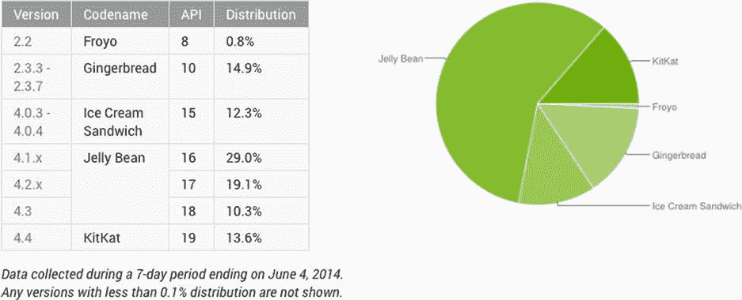
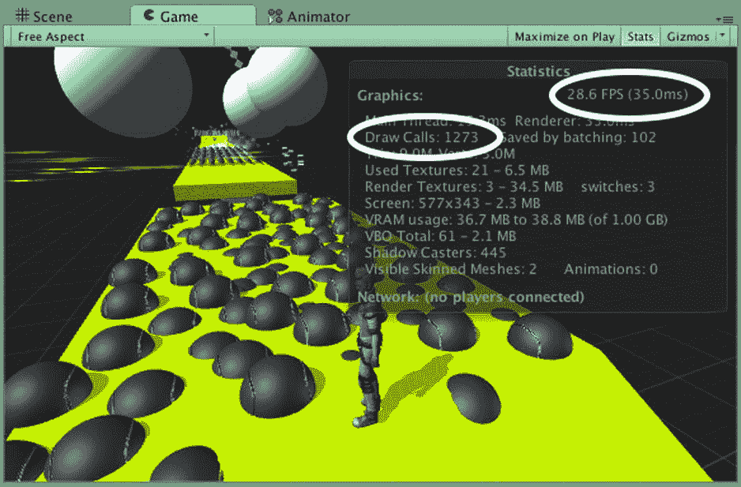
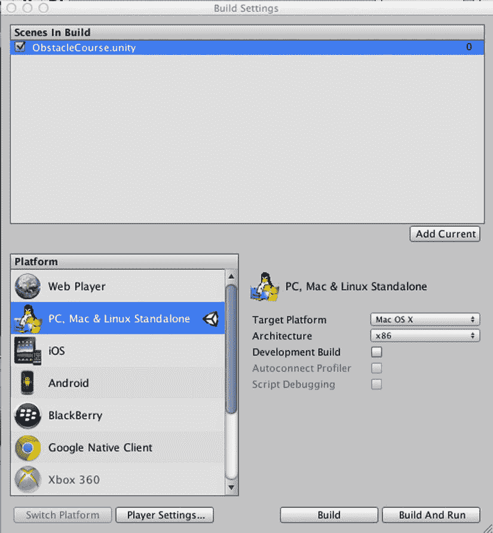
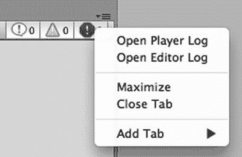
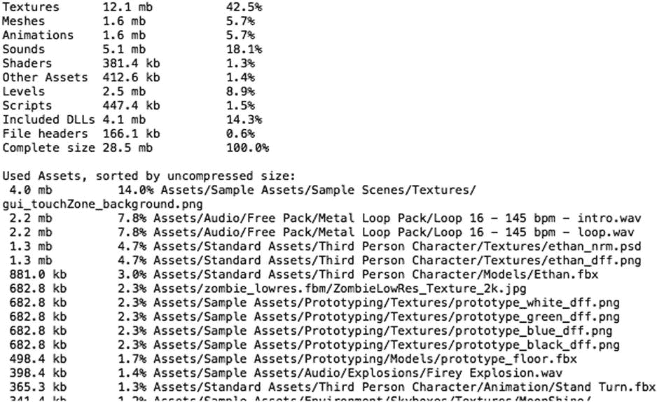

# 12. 优化你的游戏

优化是游戏开发中一个广泛的分支，如同动画一样，它可以成为一个独立的职业领域。简单来说，它是提升游戏运行效率的过程。至少听起来很简单。

每个目标平台在 CPU（中央处理器）和 GPU（图形处理器）的处理能力方面都存在限制。无论场景是由少量高精度模型还是大量低精度运动部件构成，场景越精细，对处理器的需求就越高。

当需求过高时，游戏性能就会受到影响：玩家会遇到加载时间过长、卡顿或其他游戏错误，最糟糕的是，游戏会崩溃。优化过程就是在维持游戏性能与图形质量之间做出的一系列决策或权衡。

## 目标性能

目标性能通常以期望的帧率或每秒帧数（fps）来表示。如第 4 章所述，帧率过低会破坏动画运动的错觉。虽然通常情况下，更高的帧率会带来更好的视觉体验，但需要每帧进行更多处理的复杂游戏，在可接受的 fps 目标范围的低端运行可能会更流畅。

主机和 PC 的处理能力远强于移动平台，因此我们以移动设备为例来探讨，因为它们限制最多。不同的移动平台具有不同的性能，同一平台不同版本的移动设备也会有所差异，通常较老的设备内存更小、处理器更慢。您必须在设计阶段早期就确定平台内的目标市场，这将反过来指导您选择目标帧率。

最流行的两大平台，Apple 和 Android，采用了不同的方法。Apple 是一个由 Apple 公司设计的闭源操作系统，运行在 Apple 制造的设备上。Android 是一个由 Google 设计的开源操作系统，被众多不同的设备制造商使用。当新版本操作系统发布时，旧设备能否支持新系统的功能取决于其处理能力。

Apple 在任何特定时间通常只有少数几款 iPhone 或 iPad 设备在市场上销售，其用户在几个月内采用操作系统升级的比例超过 90%。Android 用户拥有的设备来自众多不同制造商，在任何特定时间其性能各不相同。随着制造商不断推出新设备，而部分用户仍保留旧设备，Android 移动设备类别内的性能范围要广泛得多，特别是考虑到 Android 用户更新新版 Android 系统的采用率并不稳定（图 12-1），较旧的系统版本可能无法支持您希望在游戏中使用的某些功能。



图 12-1. 运行在特定 Android 版本上的设备相对数量

您必须根据希望覆盖的 Android 移动设备市场份额来考虑这些信息，这反过来将指导您设定目标性能帧率的位置。所有这些决策都应在游戏设计阶段早期完成。

## 追踪目标帧率

在 Unity 编辑器中，运行障碍赛场景。在游戏视图的顶部菜单中，你会找到一个“统计信息”按钮。点击它，一个包含各种性能统计数据的覆盖层将会出现，其中包括 FPS（图 12-2）。



图 12-2. 游戏视图顶部菜单中显示的统计信息

“Draw Calls”（绘制调用）统计数据更为详细，它指明了 CPU 需要渲染的内容数量。理解这一点很重要：一个游戏对象可能会因为其应用的每种效果（如像素光照、阴影和反射）而在每一帧中被多次渲染。通过仅在效果对游戏外观有显著贡献时才使用这些效果，从而减少使用量，可以降低绘制调用，这意味着 CPU 的工作量也因此减少。

### 设置目标帧率脚本

你可以使用一个简单的脚本来设置目标帧率。在项目面板中，打开 `Assets` ➤ `Scripts` 文件夹，并创建一个名为 `SetTargetFrameRate` 的新脚本。在 `MonoDevelop` 中打开它，并将代码编辑为以下内容：

```
#pragma strict

public var frameRate : int = 50;

function Awake () {
    Application.targetFrameRate = frameRate;
}
```

这段代码的解析如下：

`(1) public var frameRate : int = 50;`

声明一个类型为 `int` 的公有变量 `frameRate`，以便你可以从检视面板中调整它。

`(2) Application.targetFrameRate = frameRate;`

将 `Application` 类的 `targetFrameRate` 属性设置为 `frameRate` 所持有的值。

保存脚本。在 Unity 编辑器顶部菜单中，选择 `Game Object` ➤ `Create Empty`，并将其命名为 `TargetFrameRate`。挂载 `SetTargetFrameRate` 脚本，保存场景，然后运行。注意 FPS 并不会精确地保持在 50，甚至可能看起来没有效果。这是因为目标帧率不是一个绝对的限制。为了在统计信息中看到更明显的差异，将帧率改为 25，再次运行，你会看到统计窗口中的 FPS 在一个更接近 25 的范围内变化。

当你查阅脚本引用中的 `Application.targetFrameRate` 文档时，你会发现将其设置为 –1 是默认值，这会将网络播放器游戏的目标帧率设为 50–60 fps，并告知独立平台尽可能快地渲染。完成后不要忘记将帧率改回 50。

## 何时何地进行优化

在设计阶段做出的优化决策，很大程度上基于目标平台已知的限制。在开发过程中，遵循最佳实践建议可以避免因低效的开发技术而导致性能下降。除此之外，随着无数可能影响性能的细节汇集在一起，优化过程会根据游戏的独特特性变得非常动态。

## 设计阶段

在设计阶段所做的决策远不止选择目标帧率。在考虑游戏美术时，目标平台的能力也起着作用。一个普遍的做法是，模型使用的顶点数不应超过必要数量，但 CPU 渲染限制是基于场景中的所有内容，包括其他因素（如颜色、光照和阴影的使用），而不仅仅是单独某个模型。请参考目标平台的文档以了解具体细节。

移动设备通常无法处理超过 100,000 个顶点，而 PC 则可以处理数百万个。你可能需要为移动游戏选择比基于 PC 的游戏低得多的背景细节，以保留主要游戏对象模型的细节。

另一个移动设备的限制是用于下载的文件大小。在游戏设计中融入模型、纹理和材质的复用，有助于控制整体文件大小。

## 开发阶段

遵循“如果没坏，就别修它”这一历久弥新的格言，请记住优化的目的是维持你设定的游戏性能水平。当你的游戏从头到尾都能以此水平运行时，你的工作就完成了！

对玩家的视觉冲击是游戏体验的重要组成部分，这就是为什么游戏图形工具会深入到逐像素级别，并需要进行多次渲染以融入光照、反射、阴影等每一个细节。视觉图形并非唯一可能阻碍游戏性能的因素。物理、动画、音频等也可能造成性能瓶颈。

在构建游戏并进行迭代测试时，瓶颈可能会在明显的游戏条件下出现，例如当复杂模型进入视野时、在特定的动画序列期间，或者在使用高发射率的粒子系统时，最好直接针对这些问题进行处理。

如果瓶颈的原因不那么明显，Unity 有多种工具可以帮助你识别它。编辑器分析器是一个极好的工具，可用于在编辑器或测试设备上评估你的游戏，但它仅在专业版中可用。iOS 和 Android 平台有内置的分析器。尽管如此，你仍然可以从构建日志中获取关于游戏的有用信息。

## 创建构建日志

### 生成和查看构建日志

在 Unity 编辑器顶部菜单中，选择 `File` ➤ `Build Settings`（图 12-3）。将障碍赛场景从项目面板拖入“Scenes in Build”窗口。确保在平台窗口中选中了 `PC, Mac & Linux Standalone`，以便 Unity 为你正在构建的目标平台生成正确的文件类型。点击 `Build`，然后在提示时选择你想要保存文件的位置，并点击 `Save`。



图 12-3. 构建设置对话框

当 Unity 完成游戏构建后，你可以通过选择项目面板中的控制台选项卡来访问构建日志。找到右上角的下拉菜单图标，然后选择 `Open Editor Log`（图 12-4）。



图 12-4. 控制台下拉菜单

构建日志将出现在控制台应用程序窗口中。除了其他信息外，你可以找到一个构成游戏的资源类型列表及其相对大小（图 12-5）。



图 12-5. 构建日志中显示的信息

在其下方，你会找到一个“已使用资源”列表。加载时间受大小影响，而游戏玩家希望直接开始游玩。这意味着可以通过移除开发过程中在项目中积累的未使用资源来进行优化。移动设备用户在其设备上有更大的内存限制，以及其服务提供商指定的下载大小限制，因此应用大小是他们选择购买或下载你的游戏时的一个考虑因素。通过将“已使用资源”列表与你的 `Assets` 文件夹内容进行比较，你可以安全地移除任何未使用的资源。

## 脚本

本书多次通过提及良好的编码实践、高效代码和重构，间接地涉及了脚本优化。有多种技术可以用来优化你的代码。你可以将其中一些技术融入你的标准编码实践中，而其他示例则展示了在优化过程中，你可以采取的不同方法，直到达到目标性能。

## 静态类型与 `#pragma strict`

你一直遵循的一项实践，现在需要更详细的解释。

MonoDevelop 为你创建的每个脚本都以 `#pragma strict` 开头。这一行代码告诉编译器“严格”地解释后续代码，从而强制你使用静态类型，否则会抛出编译器错误。

静态类型是指在声明变量时指定其类型。在下面这行代码中，你显式地将 `myVariable` 声明为 `int` 类型：

```
var myVariable : int = 2;
```

你也可以这样声明变量：

```
var myVariable = 2;
```

Unity 会通过一种称为类型推断的方法，自动将其转换为静态类型代码。虽然这种能力可以编写更简洁的代码，但如果变量无法被类型推断，Unity 就会依赖动态类型。在动态类型中，Unity 必须根据赋予变量的值来“推断”其类型。“推断”需要时间，而耗费时间会影响游戏性能。坚持使用静态类型有助于提升性能，而 `#pragma strict` 则能确保你做到这一点。

## 缓存组件查找

这种脚本技术对于频繁使用的脚本尤其有效，但代价是代码量会稍多一些。`GetComponent()` 函数就是一个查找的例子。在游戏对象中查找组件需要时间，并影响性能。这里的思路是只查找一次引用，然后将该引用缓存或存储在私有变量中，以便后续在脚本中使用。换句话说，尽量避免在 `Update()` 或 `FixedUpdate()` 函数中使用 `GetComponent()`。你在自己的 `GoRagdoll` 脚本中就用到了这种技术：

```
#pragma strict

private var childRigidBodies : Rigidbody[];
private var childColliders : Collider[];
public var invincible : boolean = false;

function Start ()
{
    childRigidBodies = gameObject.GetComponentsInChildren.<Rigidbody>();
    childColliders = gameObject.GetComponentsInChildren.<Collider>();
}
...
```

布娃娃系统的刚体和碰撞体通过 `GetComponentsInChildren()` 函数查找找到，然后在 `Start()` 函数中分别赋值给各自的数组。

## 更多脚本优化替代方案

任何能减少或避免逐帧计算的地方都能提升性能。其中一些方法较为高级，这里不做详细说明，但当与特定项目相关时，你可以更深入地探索它们。

### 使用触发器

在 `LaunchProjectile` 脚本中，你通过使用 `Destroy()` 函数在实例化每个射弹 2 秒后将其销毁，减少了 Unity 需要追踪的射弹游戏对象的数量：

```
Destroy(projectileInstance, 2);
```

虽然这比任由射弹克隆体堆积要好，但 Unity 仍然需要追踪每个对象并检查其生命周期，直到达到 2 秒。`Destroy()` 函数的一种替代方案是使用触发器。首先，注释掉这行代码。

在你的障碍赛场景中，创建一个立方体游戏对象，并命名为 `DestroyProjectileTrigger`。将其变换位置设置为 (–12, 10.5, 47)，缩放设置为 (1, 3, 10)。移除网格过滤器和网格渲染器组件，这样你就只剩下一个简单的盒碰撞体。在盒碰撞体组件中勾选“是触发器”。

在项目面板的 `Assets ➤ Scripts` 文件夹中，创建一个名为 `DestroyProjectile` 的新脚本，并在 MonoDevelop 中打开。编辑代码如下：

```
#pragma strict

function OnTriggerEnter(other : Collider) {
    Destroy(other.gameObject);
}
```

将脚本附加到 `DestroyProjectileTrigger` 游戏对象上并保存场景。播放并观察射弹在进入触发器体积时消失。在后台，Unity 像以前一样实例化游戏对象，并由物理引擎处理其运动，但现在 Unity 无需再对该游戏对象进行其他计算，直到它进入触发器体积。

将触发器体积放置在紧邻高架轨道的位置，可以最大限度地缩短射弹的生命周期，从而更有效地提升游戏性能。将变换位置改为 (–4, 10.5, 47) 并播放。

射弹在轨道的远端消失，但原本仍在轨道上方的拖尾痕迹会立即消失，这看起来不如之前痕迹贯穿整个轨道时效果那么好。这是优化中涉及取舍的一个例子。哪个更重要？是拖尾的视觉效果，还是将触发器体积紧靠高架轨道所带来的效率提升？由你来决定。

此外，从游戏玩法角度来看，如果玩家角色跑动或跳跃进入它会发生什么？呃哦——这可不好。你从 `KillOnTrigger` 脚本中已经知道如何检查 `other` 的身份，因此如果你选择将触发器体积保持在玩家角色可触及的范围内，你可以实现一个解决方案：

```
#pragma strict

function OnTriggerEnter(other : Collider) {
    if (other.gameObject.name == "Projectile")
    {
        Destroy(other.gameObject);;
    }
}
```

你可能会想，玩家一开始为什么要从侧面跳下去。可能是意外，可能是他们在探索，也可能只是随便玩玩。在开发游戏时，除了考虑游戏对象“应该”做什么之外，还必须考虑它们还“可能”做什么，并采取适当措施来消除错误，就像你刚才做的那样。

### 对象池

随着你编程技能的不断提升，你将学到更高级的解决方案。对象池在优化射弹预制体方面更进了一步。实例化和销毁对象也会带来显著的计算开销。与其反复实例化和销毁游戏对象，不如创建一个游戏对象预制体的数组作为“池”，在需要时从中抽取，在不使用时归还。

### 协程

协程可以在某一帧暂停其执行，然后在下一帧恢复并继续执行，可以跨越任意数量的帧。当你在 `Update()` 或 `FixedUpdate()` 函数中调用另一个函数时，你调用的那个函数每帧都会从头到尾运行一遍。在 60fps 的帧率下，这意味着该函数每秒也被调用和执行 60 次。很多时候，你并不需要每帧都调用某个函数，尽管你可能希望它定期运行。相比之下，如果函数每十分之一秒调用一次——这对于许多游戏任务来说仍然足够快——那么每秒只需调用 10 次，调用次数减少了六倍。使用协程可以实现这种显著的效率提升。