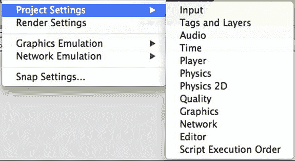
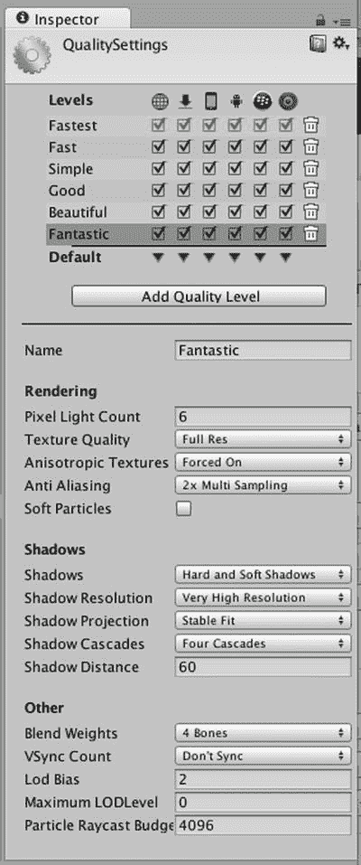
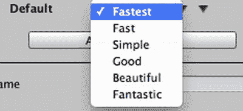
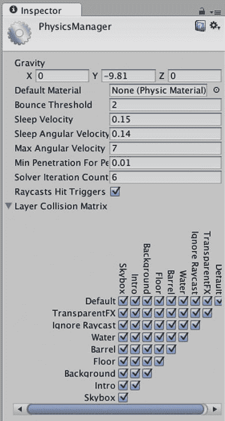

# 项目设置

一旦你最小化了各个性能瓶颈的影响，如果尚未达到目标游戏性能，你可以从项目全局的角度来处理更通用的优化决策点。

Unity 中用于优化的设置是全局设置，这意味着它们适用于整个项目（图 12-6）。你是否想要或需要调整任何特定类别的设置，取决于从目标性能、游戏本身、目标平台，到开发过程中出现的性能问题类型等各种因素。采取逻辑方法，首先调整那些能带来最大改变的设置。

*图 12-6. Unity 编辑器中的项目设置菜单 (Edit ➤ Project Settings)*

### 质量设置管理器

图形质量与渲染速度需要权衡：你选择的质量越高，渲染越复杂，帧率就越低。质量设置管理器允许你为各种目标平台（如网页播放器、独立平台、iPhone、Android、Blackberry 和 Google Native Client）选择不同的图形质量级别（图 12-7）。

*图 12-7. 项目设置*

绿色勾选标记表示默认设置。你可以通过其默认菜单，点击目标平台列中“默认”行的箭头来更改此设置（图 12-8）。

*图 12-8. 质量设置管理器中的默认菜单*

**名称**字段是为了方便你引用自己指定的特定质量设置组合。你可以通过“添加质量级别”按钮来添加新质量级别，或通过点击垃圾桶图标来删除它。

**逐像素光照**是一种为每个屏幕像素计算光照效果的渲染方法。**逐顶点光照**效率更高，因为它只计算模型顶点上的光照效果，模型表面的其余光照则根据这些值进行插值计算。

**逐像素光照**意味着光照对游戏对象的效果每帧都会计算，无论是像素光照还是顶点光照。如果一个网格被多个逐像素光照照亮，那么该网格会为每个光照渲染一次，这会迅速增加处理开销。

质量设置管理器中的**像素光数量**用于设置在标准渲染过程“前向渲染”中使用的像素光数量。建议不要让任何游戏对象被超过一个像素光照射，尤其是在移动设备上。

替代方案包括对静态游戏对象使用**光照贴图**，即预先计算游戏对象表面的亮度。你可以在 Unity 手册中找到光照贴图的详细步骤。最终结果是，游戏运行速度可以比仅使用动态光照快三倍。

继续介绍质量管理器设置，**纹理质量**全局设置分辨率，即针对整个项目。更高的分辨率需要更多处理能力。要实现更定制化的方法，你可以使用纹理导入设置为每个纹理指定分辨率。

**各向异性纹理**是指对纹理应用过滤过程以改变其外观。这通常用于平坦表面（如地面），使其在浅角度下看起来更好。

其余设置深入到光照和阴影的更多技术层面，其中一些需要 Unity Pro 版本才能使用。光照和阴影是实现出色视觉效果的关键，但它们在性能方面可能代价高昂。目前，以下要点足以概括：

-   质量设置可用于根据目标平台和纹理分辨率以及光照和阴影来优化图形质量。
-   使用光照贴图来烘焙静态光照。
-   限制游戏对象仅被一个逐像素光照照射，尤其是在移动设备上。

### 物理管理器

物理引擎内置了性能优化功能，例如“睡眠”。当一个 `rigidbody` 的移动和旋转低于某个阈值时，物理引擎会认为它已停止。在该 `rigidbody` 再次被移动（例如，被另一个力作用或与另一个游戏对象碰撞）之前，物理引擎不会浪费处理能力去更新它。

物理设置管理器中的“睡眠速度”和“睡眠角速度”属性值指定了“睡眠”阈值（图 12-9）。如有必要，你可以通过在脚本中使用 `rigidbody.WakeUp()` 函数来访问并唤醒一个 `rigidbody`。

*图 12-9. 项目设置*

提高物理计算效率的另一种方法是使用层。层是 Inspector 中的一个属性，用于按组对游戏对象进行分类。就像游戏对象可以有相同的标签一样，游戏对象也可以共享相同的层。物理管理器底部的碰撞矩阵用于选择场景中哪些层会与哪些其他层发生交互。只有处于相互交互的层中的游戏对象才能发生碰撞，从而减少处理负载。

处理需要碰撞体的复杂游戏对象时，一个标准做法是尽可能使用子基本碰撞体的集合，而不是网格碰撞体。网格碰撞体会占用大量处理能力，并且有局限性，例如无法注册与其他网格碰撞体的碰撞。你已经在用于布娃娃效果的原始碰撞体集合示例中看到了这种技术。

