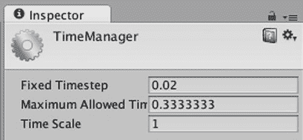

# 时间管理器

该管理器具有两项有助于物理优化的属性（图 12-10）。您已了解，在物理相关代码中应使用 `Fixed Timestep` 属性，因为物理计算依赖固定的时间间隔来生成逼真的游戏对象行为。您可以通过 `Fixed Timestep` 属性调整固定的时间间隔。此处的优化权衡在于：增大更新间隔可降低处理器的计算需求，但物理模拟的精度会相应下降。

图 12-10. 项目设置 - 时间管理器

`Maximum Allowed Timestep` 属性通过限制物理计算的最大耗时，也有助于维持固定的时间间隔。这样，即使在固定时间间隔内需要进行过多的固定更新，物理引擎也不会拖慢帧率。

