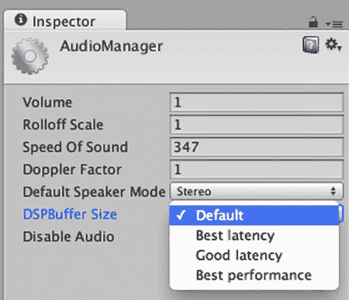

# 音频管理器

在音频管理器中，`DSPBuffer Size` 属性用于优化（图 12-11）。延迟是指声音播放前的滞后时间。各选项含义明确：`Best latency` 优先保证声音的快速响应而非性能，`Best performance` 优先保证音质而非低延迟，而 `Good latency` 则在延迟与性能之间取得平衡。

图 12-11. 项目设置

良好的音频使用实践包括：对较小的音效采用原生 WAV 或 AIFF 格式。这些文件已解压缩，运行时无需解码。与所有未使用的资源一样，项目开发阶段遗留的未用音频文件应及时删除。

