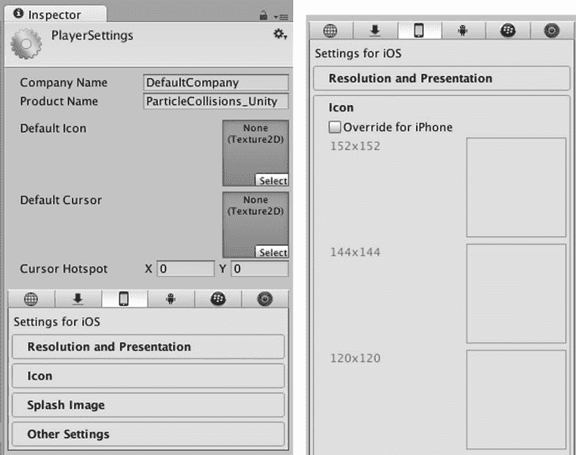

# 播放器设置管理器

最直接实用的跨平台设置位于首个区域（图 12-12）。其他区域则因目标平台而异，在着手调整前需要充分了解该平台的特性。

图 12-12. 项目设置 - 播放器设置管理器及展开的图标字段

此处包含游戏标题的产品名称，以及图标和启动画面的纹理字段。在添加图标纹理前，务必确认已选择正确的目标平台——每个平台都有各自的尺寸要求。若未使用正确尺寸，轻则显示异常，重则可能导致应用商店拒绝上架。