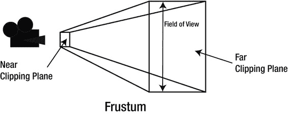
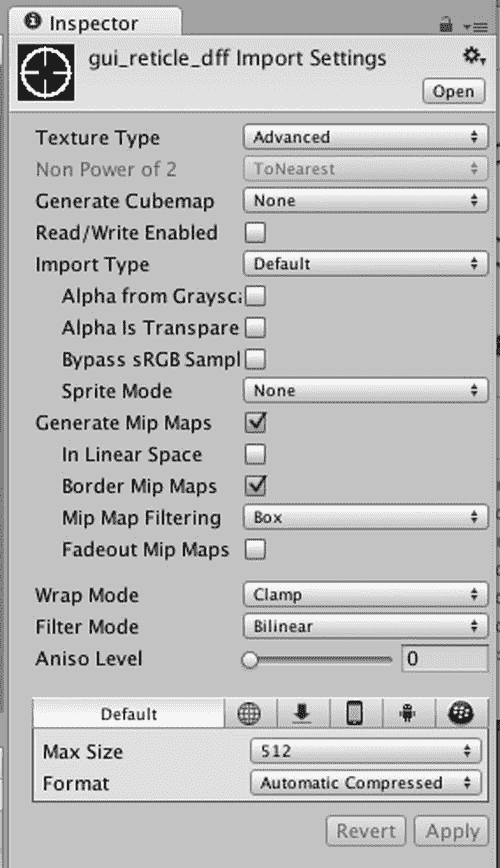

# 项目设置

可通过脚本访问项目设置管理器，并利用相应的类（如 `Physics`、`AudioSettings` 和 `PlayerSettings`）来修改其任何属性。所有详细信息（包括示例代码）均可在 Unity 脚本参考中找到。尽管这些是全局设置，但您可能会遇到需要在不同场景之间更改这些全局设置的情况。

## 更多图形优化

光照优化已在之前的质量设置管理器部分讨论过。摄像机、纹理、着色器、网格等所有归入图形总类的项目，均可通过微调来提升游戏性能。

## 摄像机

有若干优化策略可应用于摄像机。在第 3 章对摄像机组件的介绍中，您了解到只有位于摄像机视锥体（介于近裁剪面与远裁剪面之间）内的游戏对象才会被渲染（图 12-14），这种内置操作称为视锥体剔除。通过调整裁剪面，使其不覆盖超出所需的范围，可以最大限度地减少需要渲染的游戏对象数量。

图 12-14. 近裁剪面与远裁剪面定义了摄像机的渲染体积

本章前面讨论的图层功能，可与摄像机组件的 `Culling Mask` 属性结合使用，将渲染范围限制在指定图层中的游戏对象。或者，如果您需要对某一层对象进行更精细的控制而非全有或全无的渲染，可以在脚本中使用 `Camera.layerCullDistances()` 函数，为不同图层分配不同的剔除距离。

细节层次是 Unity 专业版独有的功能，可根据物体距离摄像机的远近来减少其渲染的三角形数量。需要渲染的三角形越少，处理器负载就越低。

## 纹理

良好的纹理使用实践始于基础规范。纹理尺寸应为 2 的幂次方，例如 2、4、8、16 等。宽度和高度不必相同。非 2 的幂次方尺寸会消耗更多内存，从而拖慢 GPU 速度。另一种优化方法是使用压缩纹理格式来减少内存占用。

通过调整纹理导入设置中的属性，可以实现进一步的优化。在项目面板中搜索 Textures 并选择一个纹理（如有需要，可临时将 `Texture Type` 改为 `Advanced`），即可在检视面板中查看这些属性（图 12-15）。

图 12-15. 检视面板中的高级纹理类型属性

在项目面板中选中纹理后，在检视面板中使用 `Max Size` 属性，将其减小到仍能保持所需细节质量的最小值。

Unity 可以为尺寸为 2 的幂次方的纹理生成较小的版本，并在游戏对象距离摄像机较远时，为较小的三角形使用这些版本。此过程称为 Mip 贴图，通过勾选 `Generate Mip Maps` 复选框启用。Mip 贴图会占用更多内存，但通常为了换取更好的性能，这种代价是值得的。此规则的例外情况是 UI 元素或 2D 游戏，因为这些纹理与摄像机的距离是固定的。

## 着色器

着色器是自定义程序，通常针对 GPU 编写，用于实现自定义视觉特效。虽然着色器主题超出本书范围，但如果您深入研究这一图形领域，可以在 Unity 文档中找到许多优化技巧。

