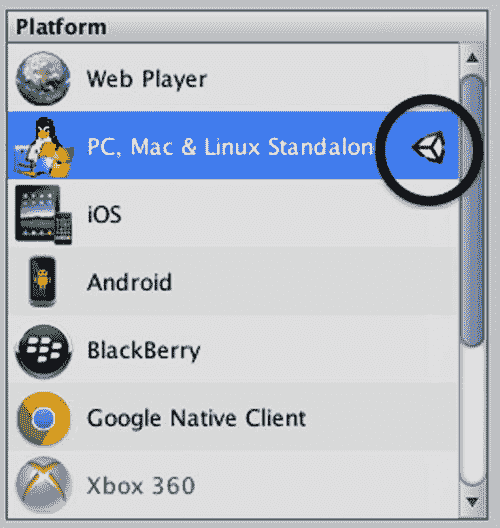
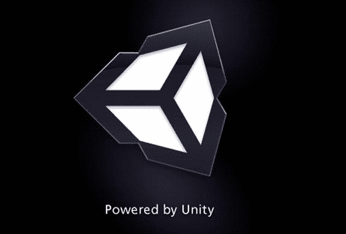
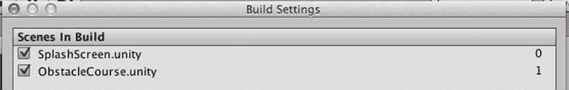
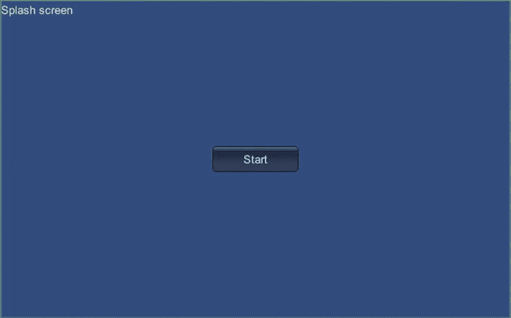

# 发布

如果你想在 Unity 编辑器之外查看游戏的效果，可以在开发过程中的任何时刻将其作为独立程序运行。在编辑器中打开“障碍赛”场景后，从顶部菜单选择“文件 ➤ 生成设置”，打开“生成设置”窗口，操作方式与你之前在本章生成构建日志时相同（图 12-15）。“障碍赛”场景仍会出现在“场景在构建中”部分，右侧索引为 0。

首先选择一个平台，本例中选择`PC, Mac & Linux Standalone`。请注意右侧（图 12-16）。如果未显示，请点击“切换平台”按钮。Unity 会对项目中特定于你所选平台的资源进行评估和处理，待所有内容为所选平台准备就绪后，Unity 徽标将出现在右侧。



图 12-16. Unity 徽标出现在所选目标平台右侧

现在你可以点击“生成”按钮，选择保存游戏独立版本的名称和位置，然后点击“保存”让 Unity 生成游戏。最终生成的游戏文件取决于构建目标。在 Mac 上你会得到一个应用包，在 Windows 上则会得到一个包含`.exe`文件的资源文件夹。你可以自行试玩，或者将这些文件分发出去分享你的游戏。现在就来试试你的新独立版本吧。

你首先会看到一个带有 Unity 徽标的黑屏（图 12-17）。虽然所有游戏都会以此作为默认的启动画面，但只有专业版用户才能更改它。



图 12-17. 独立游戏加载时首先出现 Unity 徽标

## 切换场景

即使是最简单的游戏也有启动画面，因此你需要知道如何使用。

返回 Unity 编辑器，保存“障碍赛”场景并保存项目。然后从顶部菜单选择“文件 ➤ 新建场景”来创建一个新场景。再次在顶部菜单中，选择“游戏对象 ➤ 创建空对象”，并将其命名为`GUI`。

在项目面板的“资产 ➤ 脚本”文件夹中，创建一个名为`SplashGUI`的新脚本，在 MonoDevelop 中打开它，并将代码编辑为以下内容：

```
#pragma strict

function OnGUI() {

        GUI.Label(Rect(0, 0, 125, 25), "Splash screen");

        if (GUI.Button (Rect (Screen.width/2 - 50, Screen.height/2 - 15, 100, 30), "Start")) {

                Application.LoadLevel(1);

        }

}
```

保存脚本，将其附加到`SplashGUI`游戏对象上，并将场景保存为`SplashScene`。你在第 11 章中使用过并创建了 GUI 标签和按钮。在这行代码中，数字 1 对应的是在“生成设置”屏幕中分配的索引：

```
Application.LoadLevel(1);
```

你希望启动画面排在第一位，因此它的索引应为 0，紧随其后的“障碍赛”场景索引为 1。

为此，在 Unity 编辑器顶部菜单中再次选择“文件 ➤ 生成设置”打开“生成设置”窗口。从项目面板的“资产 ➤ 场景”文件夹中，将`SplashScene`拖入“场景在构建中”部分。拖入后，它会被添加到“障碍赛”场景之后，并分配索引 1。只需点击并拖动列表中的任意项目到你想要的位置，即可重新排列它们（图 12-18）。



图 12-18. 在“生成设置”窗口中重新排序场景，使启动画面排在首位

点击“生成”，在提示时保存并替换旧的“障碍赛”构建版本。现在，当你运行独立版本时，Unity 徽标淡出后，启动画面场景就会出现（图 12-19）。



图 12-19. 启动画面场景自动出现

点击“开始”按钮，你就看到——障碍赛场景出现了。

## 总结

干得漂亮——你已经冲过终点线了！你可以微调游戏的性能，已经了解了用于场景切换的`Application.LoadLevel()`函数，并且发布了独立版本。

不要被优化涉及的大量细节吓倒；只需知道你有许多工具可以用来处理游戏性能问题。现在，一个好的起点是致力于遵循脚本编写的最佳实践，并遵循 Unity 文档中提供的一个便捷检查清单中收集的一些基本原则（表 12-1）：

表 12-1. 让游戏运行更快的简易检查清单，来自 Unity 脚本参考

| 以 PC 为目标时，保持每帧顶点数低于 20 万至 300 万，具体取决于目标 GPU。 |
| --- |
| 如果使用内置着色器，请从“移动”或“无光照”类别中选择。它们同样适用于非移动平台，但只是更复杂着色器的简化近似版本。 |
| 保持每场景的不同材质数量较少——在不同对象之间尽可能多地共享材质。 |
| 对所有非移动对象设置“静态”属性，以启用静态批处理等内部优化。 |
| 在非必要情况下不要使用像素光照——选择仅使用一个（最好是方向光）像素光照影响你的几何体。 |
| 在非必要情况下不要使用动态光照——改为选择烘焙光照。 |
| 尽可能使用压缩纹理格式，否则优先选择 16 位纹理而非 32 位。 |
| 在非必要情况下不要使用雾效。 |
| 学习遮挡剔除的优势，并在具有大量遮挡的复杂静态场景中使用它来减少可见几何体和绘制调用的数量。规划你的关卡以受益于遮挡剔除。 |
| 使用天空盒来“伪造”远处几何体。 |
| 使用像素着色器或纹理组合器来混合多个纹理，而不是采用多通道方法。 |
| 如果编写自定义着色器，始终使用尽可能小的浮点格式：`fixed/lowp`用于颜色、光照信息和法线。`half/mediump`用于纹理 UV 坐标。`float/highp`避免在像素着色器中使用，适用于顶点着色器中的位置计算。 |
| 尽量减少像素着色器中复杂的数学运算，如`pow`、`sin`、`cos`等。 |
| 选择每个片段使用更少的纹理。 |

除了硬件和编译器限制外，这些建议中的大部分更像是指导方针而非硬性规则。你可以选择不遵循本章中的某些建议，但这没问题。当你对游戏的性能感到满意时，你可以决定是否再花更多时间进行进一步的优化，因为这可能是一种收益递减的练习。

重要的是，你了解了提升性能的良好实践，并且知道在开发过程中遇到性能问题时，如何从文档中找到优化方面的帮助。

你现在已经掌握了使用 UnityScript 进行基础编程以及使用 Unity 编辑器的基本知识。这仅仅是更多乐趣和兴奋的开始。在下一章中，你将获得许多资源，继续你的游戏开发之旅，结识同行，并且最重要的是——享受制作游戏的乐趣。