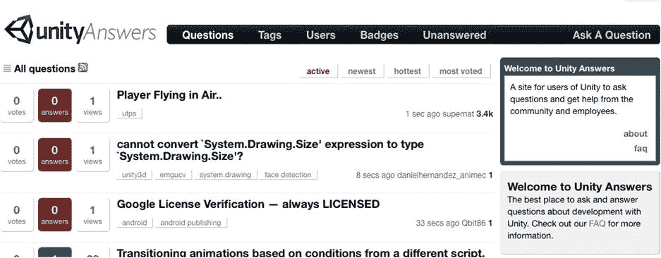
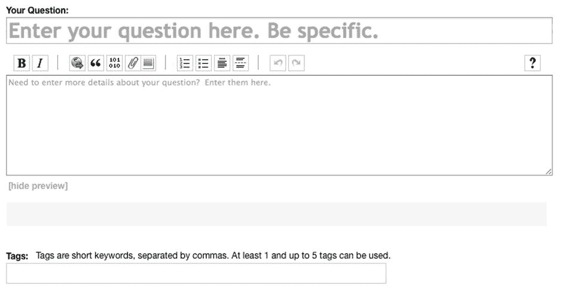
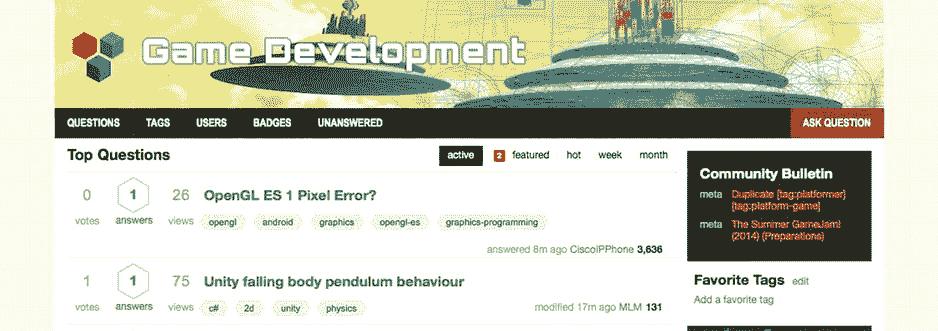
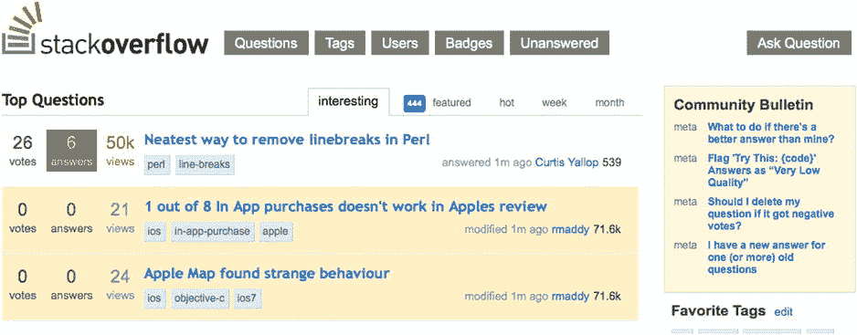
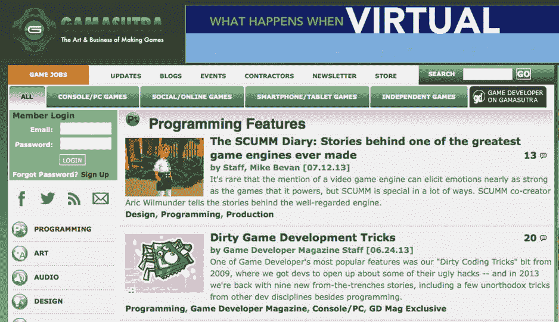

# 13. 下一步该怎么走

恭喜你——现在你已经掌握了 UnityScript 的基础知识。学习任何一门新语言，真正精通都需要时间，以及反复的练习、练习、再练习。像任何技术领域一样，游戏开发也在持续且快速地发展，这意味着将一部分编程时间用于学习，应该成为你游戏开发生涯中的标准环节。这对游戏开发者来说意味着什么？去制作更多的游戏吧！

本章提供了丰富的资源，包括从哪里获得特定技术问题的答案，如何与游戏开发社区建立联系，如何跟上最新动态，以及如何建立你的专业作品集。如果你尚未加入，本书的配套网站是[`www.learn-unityscript.com`](http://www.learn-unityscript.com/)，在那里你可以介绍自己、参与讨论、结识志同道合的游戏开发者、获得鼓励，以及分享你的游戏——尽情炫耀你的成果吧！

信息很容易铺天盖地，所以请将不断提升技能作为你的首要任务。这意味着要投入大量时间亲手实践 Unity。没有游戏创意？那就继续阅读，了解更多关于游戏开发大赛和竞赛的信息。探索特定平台，或者专注于深入学习游戏开发中某个吸引你的特定领域，比如动画或人工智能。

## 脚本编写及其他技术资源

在线论坛已成为全球游戏开发者聚集的主流场所，这一点毫不意外。论坛主要分为两类：纯技术论坛和讨论论坛。

纯技术论坛侧重于为实际项目解决问题，并具有特定的格式；而讨论论坛则可以包含任何与开发者相关的话题，包括最佳实践、新闻、公告、工作机会，或者仅仅是轻松的闲聊。

## 技术论坛

Unity 网站是 Unity 开发者首屈一指的资源。Unity Answers 是位于[`http://answers.unity3d.com`](http://answers.unity3d.com/)的技术论坛。图 13-1 展示了其布局：问题以帖子标题形式呈现，并附有关联的话题标签、问题被查看的次数、是否已有回答、原帖发布者是否已接受某个答案，以及来自开发者社区的投票（通常基于问题的质量和有用性）。

图 13-1. 在 Unity Answers 上发布的问题

虽然问题没有愚蠢之分，但使用论坛也有其礼仪。开发者社区通常很友好且乐于助人，但重点是帮助你学习，而不是替你编写脚本。技术论坛成员的立场是，在提问之前，你应该已经尽一切努力自己找到解决方案。最重要的是，这意味着你为自己的脚本编写了一些代码，并进行了初步研究，例如在 Unity 文档中自行搜索解决方案。如果你已经尽力而为但仍然卡住了，那么就该向 Unity Answers 求助了。

在提问之前，先搜索一下。留意搜索结果中类似问题附带的标签，它们或许能帮助你优化搜索。很可能同样的问题以前已经被问过，答案已经存在。

如果你找不到针对特定问题的解决方案，那么就该自己提问题了。一个好的问题应该非常具体，详细描述你尝试过的方法及结果，并包含一段实际的代码片段。使用超链接来引用你查阅过的文档并描述你的理解，同时引用论坛上你参考过解决方案的问题链接以及你的结果。通常，提出一个好问题的过程本身就能引导你自己找到答案。在提问表单的工具栏中，可以找到添加超链接、代码格式化、文件附件等功能（图 13-2）。

大多数论坛都提供积分或声望点数的累积机制，以及针对不同参与形式的有趣徽章。你可以通过提出好问题和给出好答案来获得积分。尽你所能去回答问题，即使你不觉得自己是专家。能够以易于理解的方式传达解决方案，不仅能让你因帮助他人而感到温暖，也能巩固你头脑中的概念，并增强你的信心。

图 13-2. Unity Answers 的提问表单

Stack Exchange 是一个庞大的开发者资源，包含多个论坛类别。你或许能猜到，位于[`http://gamedev.stackexchange.com`](http://gamedev.stackexchange.com/)的 GameDev 是为游戏开发者服务的。位于[`http://stackoverflow.com`](http://stackoverflow.com/)的 StackOverflow 则更侧重于纯粹的编程问题，对于关于游戏目标平台编码的问题可能很有帮助。

GameDev Stack 和 Stack Overflow 网站也采用社区评级的直接问答形式（图 13-3）。

图 13-3. Stack Exchange 论坛采用社区评级的问答形式

## 其他开发者论坛

另一个流行的游戏开发者资源是 Gamasutra。与编程相关的话题可以在[`www.gamasutra.com/category/programming`](http://www.gamasutra.com/category/programming)找到。它包含编程特写、编程动态、编程博客和编程职位等子类别（图 13-4）。Gamasutra 更像是博客形式，更适合帮助你了解游戏开发者社区的最新动态，而不是寻找具体的技术答案。

图 13-4. Gamasutra 的结构比纯技术论坛更非正式，话题也更广泛

虽然 Unity 已经跨越了成为大多数游戏开发者首选的门槛，但在这里你也会看到对其他游戏引擎的提及。开发者在游戏发布后撰写的“项目复盘”，分析开发和发布过程中哪些做对了、哪些做错了，这些内容提供了来自实战一线的极佳实践学习点。

