# 各平台专属开发者资源

各目标平台的制造商希望开发者能为其系统制作游戏，因此提供了大量开发者支持。至少他们会提供文档，但大多数平台也都拥有自己的类似论坛。通常，这些论坛会以某种组合形式提供技术文档、教程、技术论坛以及开发者社区论坛。

虽然大多数这类论坛都要求你创建一个用户账户，但具体要求差异很大。有些在注册时就需要提供合法的商业实体信息，例如纳税识别号，而另一些则在你准备发布游戏时才需要提供。有些论坛会收取费用，不过同样可能要到准备发布时才会涉及。没有一家论坛要求你必须购买硬件，但最佳实践并强烈建议在发布前，不仅要在虚拟模拟器上，还要在目标平台硬件上测试你的游戏。

以下是一些较为常见的网站：

- **索尼**：[`http://us.playstation.com/develop`](http://us.playstation.com/develop)（图 13-5）。如果你不在美国，索尼还为其他地区设有论坛，因此请花点时间快速搜索你所在地区的论坛。

  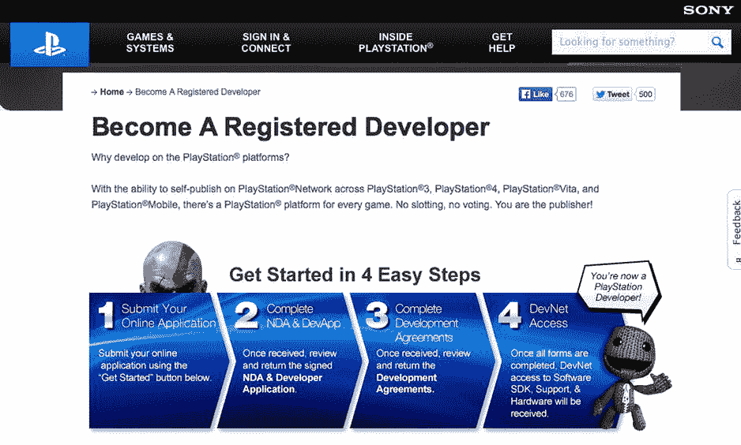

  图 13-5. 索尼 PlayStation 开发者注册

- **微软**：[`www.xbox.com/en-US/developers`](http://www.xbox.com/en-US/developers)（图 13-6）。这是 Xbox 开发者网站，但也涉及针对 Web、Kinect 以及 Windows 电脑、平板和手机的应用开发。

  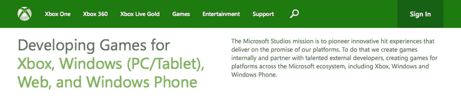

  图 13-6. 微软 Xbox 开发者注册，并提供其其他设备的更多信息

- **任天堂**：[`http://wiiu-developers.nintendo.com`](http://wiiu-developers.nintendo.com/)（图 13-7）。任天堂开发者网站上显著展示了其主机与 Unity 的兼容性。

  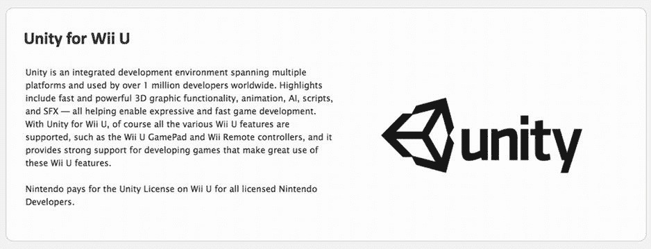

  图 13-7. 任天堂开发者网站展示对 Unity 的支持

- **苹果**：[`http://developer.apple.com`](http://developer.apple.com/)（图 13-8）。在其开发者网站内，苹果为 iOS 和 OS X 开发者设立了独立的论坛，但其软件开发工具 Xcode 则有一个通用论坛。

  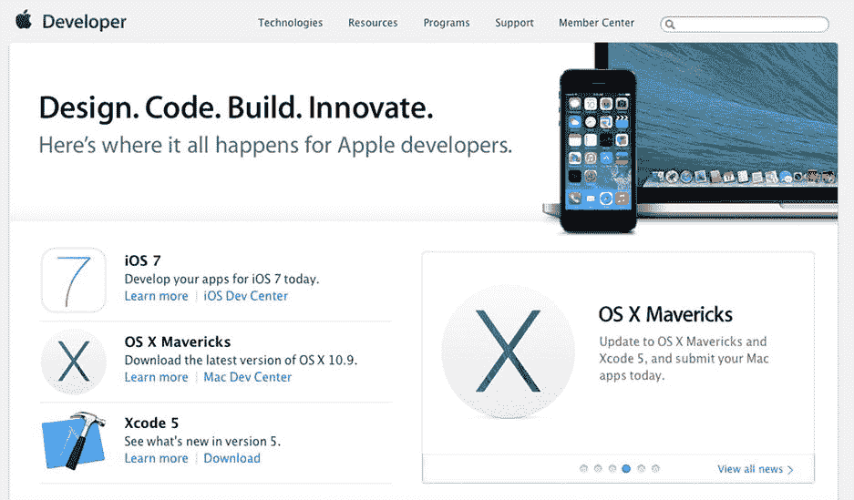

  图 13-8. 面向 Xcode 开发者的苹果核心网站

- **安卓**：[`http://developer.android.com`](http://developer.android.com/)（图 13-9）。安卓与苹果和微软在移动设备方面有所不同，因为它是谷歌发布的操作系统，并被多家不同的制造商使用，从而产生了各种基于安卓的开发者论坛。三星是国际市场上占主导地位的硬件制造商，并在 [`http://developer.samsung.com/forum/en`](http://developer.samsung.com/forum/en) 为其安卓开发者提供额外支持，以便特别利用其设备（从手机到电视和可穿戴技术）的功能。

  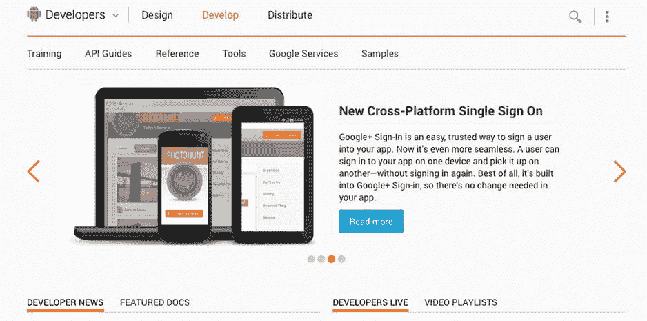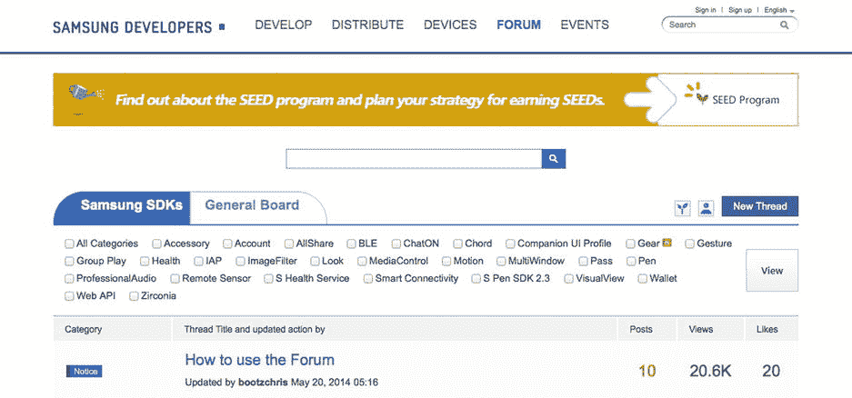

  图 13-9. 安卓及基于安卓的三星产品开发者网站

从市场营销的角度来看，为那些成熟且流行的游戏平台制作游戏，无疑能让你的投入获得最大回报。如果你对新兴技术感兴趣，或者只是想尝试一些不同的东西，还有其他一些不太知名的游戏平台也支持 Unity：

- **Sphero**：[`http://developer.gosphero.com`](http://developer.gosphero.com/)。Sphero 是一个机器人球类游戏平台，由安卓或 iOS 设备控制，它将真实世界的机器人动作与设备摄像头输入和图形用户界面显示整合成一个混合遥控/增强现实游戏环境——或者反过来，它也可以通过自身的传感器用作游戏控制器。插件是一种软件组件，能为已有的软件应用程序添加一个或多个新功能。Sphero 的 Unity 插件可直接通过 Unity 资源商店获取（图 13-10）。

  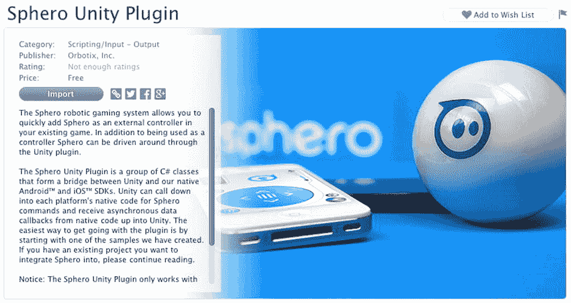

  图 13-10. Unity 资源商店中的 Sphero 插件

- 两个领先的增强现实软件开发工具包，Vuforia（网址为 [`http://developer.vuforia.com/resource/skd/unity`](http://developer.vuforia.com/resource/skd/unity)）和 Metaio（网址为 [`http://dev.metaio.com/sdk/getting-started/unity3d`](http://dev.metaio.com/sdk/getting-started/unity3d)）也支持 Unity，不过你需要直接访问它们各自的网站，而不是通过 Unity 资源商店（图 13-11）。

  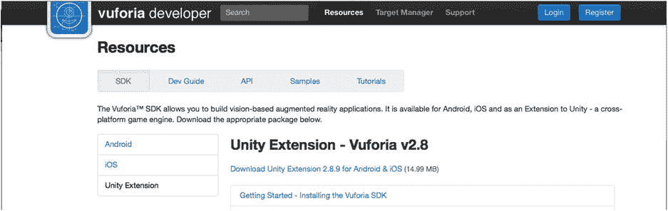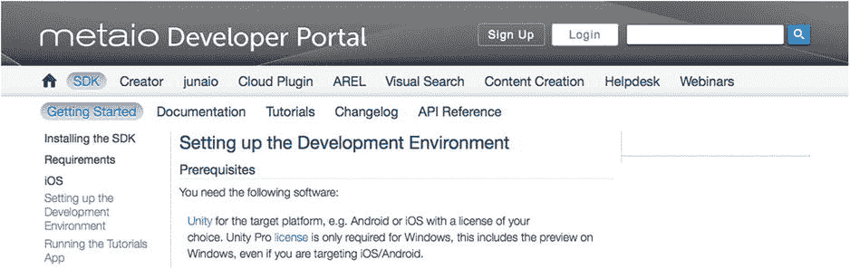

  图 13-11. 使用 Unity 创建基于 Vuforia 或 Metaio 的增强现实游戏

- **Leap Motion**：[`http://developer.leapmotion.com`](http://developer.leapmotion.com/)。Leap Motion 是一款运动检测控制器。开发者支持直接在其网站上提供。Unity 资源商店上可用的专有和独立创建的 Leap Motion 资产数量持续增长（图 13-12）。

  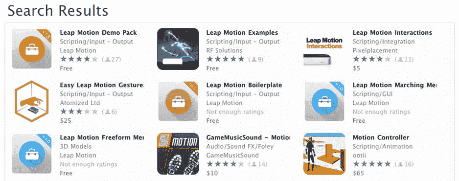

  图 13-12. Unity 资源商店上提供的 Leap Motion 控制器资产

- **Oculus Rift**：`http://developer/oculusvr.com/forums`。这款虚拟现实头显通过沉浸式视觉显示增强基于 Windows、Mac OS 或 Linux 系统的游戏体验，并能对玩家的头部运动做出响应（图 13-13）。

  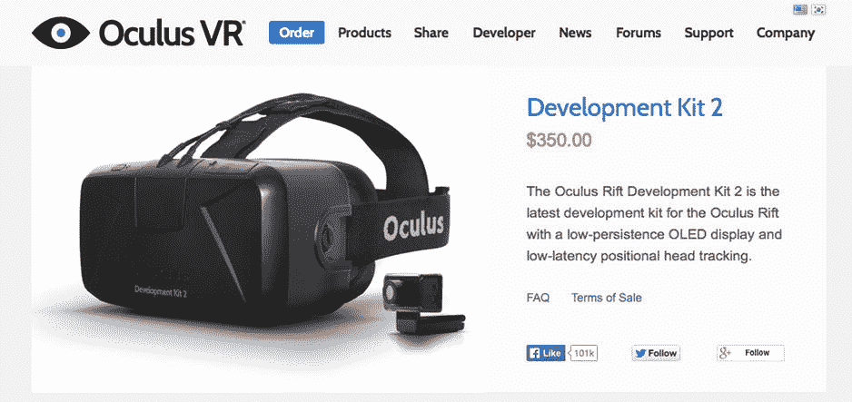

  图 13-13. Oculus Rift 头显和运动检测器

即使有如此众多的游戏开发者支持论坛，`Unity Answers` 仍然是你获取 Unity 游戏开发技术帮助的最佳首选。你可以根据需求，将搜索范围扩大到通用游戏开发和编程论坛，或者联系针对特定平台的开发者群体。随着你缩小兴趣范围并选定几个最喜爱的论坛，你肯定会在这个游戏开发者社区的任何一个角落找到友好的帮助。