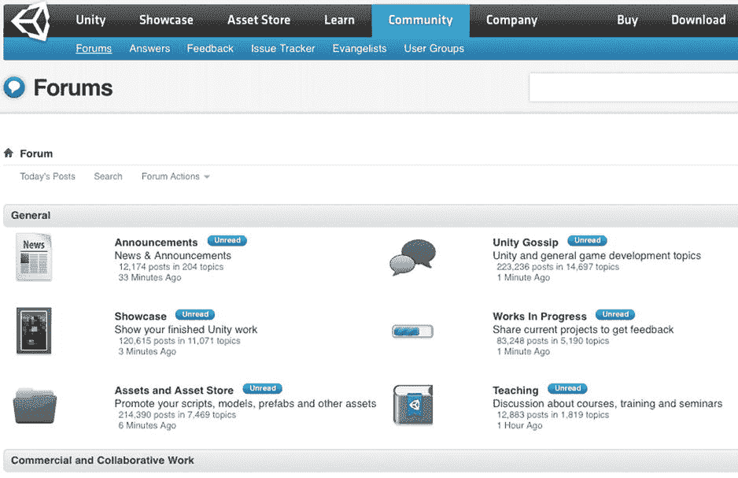
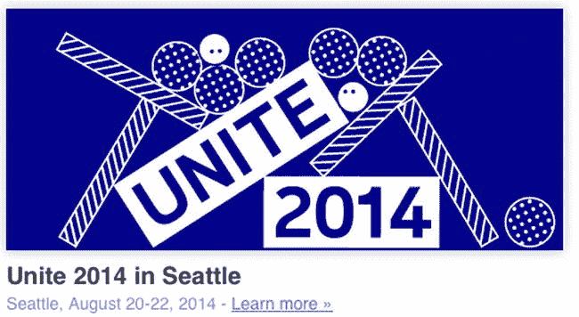
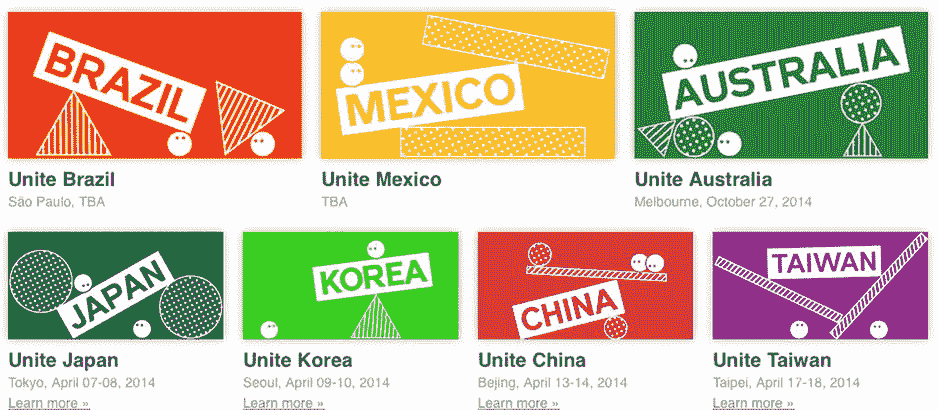

# 非正式团体、组织与聚会

Unity 开发者遍布各地，有许多场合可供你与新同行们相聚。不那么技术化的 Unity 论坛就位于 Unity 社区菜单中“答案”选项卡的旁边（见图 13-14）。

图 13-14. Unity 社区论坛

在这里，你可以与在线 Unity 开发者社区交流。如果你想线下见面，可以选择“用户组”选项卡来寻找本地小组。你会发现许多这类小组都列在 Meetup 上，该网站是一个中心化平台，用于寻找任何共同兴趣的本地人群。

如果在 Unity 用户组列表中看不到你所在地区的小组，不妨直接搜索 `www.meetup.com`。在这里，你可以找到较新、较小的本地 Unity 小组；如果没有找到，你可以将 Unity 游戏开发列为兴趣领域，这样当你的地区有小组成立时，你会收到通知。你甚至可以考虑自己创建一个。本地小组的活动形式多种多样，可以是纯粹的社交聚会、技术演示、针对小组成员项目的反馈会议、实践教程课程，或者成员感兴趣的任何内容。

## GDC（游戏开发者大会）

GDC（游戏开发者大会）是游戏开发行业的年度盛会，数以万计的游戏开发行业人士在此聚集。在这个大型聚会期间，会有讲座与教程、竞赛与奖项、工作坊、社交活动、派对等。所有详情可在 `www.gdconf.com` 找到。

## Unite 会议

Unity 有自己的年度会议，名为 Unite。Unite 每年在北美不同城市举办，并在全球设有其他地区性会场（见图 13-15）。在此，你会找到与 Unity 相关的所有内容：技术、艺术以及商业方面。有实践培训工作坊、行业资深人士的演讲，以及新功能和产品的预览。你无需达到一定经验水平或发布过游戏即可参加。事实上，在 Unite 开始之前，还有一个额外的 Unity 培训日，专为完全没有经验的人提供，让他们在主要会议开始前对 Unity 有一个入门了解。关于 Unite 和 Unity 培训日的更多信息，请访问 Unity3D 网站 `http://unity3D.com/unite`。

图 13-15. 2014 年 Unite 的主会场与地区会场

## IGDA（国际游戏开发者协会）

IGDA（国际游戏开发者协会）是一个大型的非营利专业组织，致力于为行业发声，并为会员提供全年赞助活动、折扣、教育网络研讨会等福利。其官方网站为 `www.igda.org`。