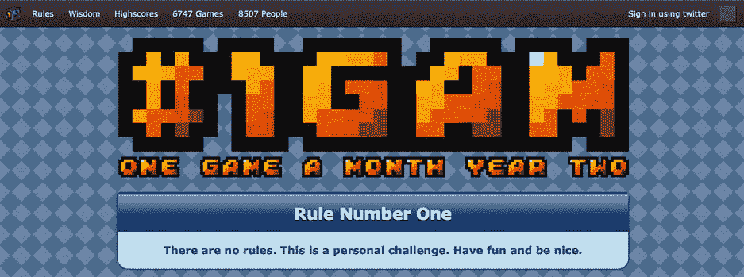

# 游戏开发限时挑战（Game Jams）

游戏开发限时挑战（Game Jams）是一种在超级有趣且高强度的环境中提升技能的绝佳方式。它们本质上是组织化的团体挑战，个人或团队必须在短时间内（通常为 24 到 48 小时）从零开始创作一个游戏。

团队在游戏开发限时挑战开始时由参与者组成。他们的目标是制作出一个可运行的游戏原型。该原型必须符合挑战的指导方针，这些方针可能会指定必须使用的主题或功能等。

参与者可以是任何参与游戏开发的人，包括程序员、美术师和游戏设计师，但熟练程度各不相同。无论你是多么新手，或者能参与多少小时，你总能找到自己能贡献的事情。像搜索素材或录制音效这样简单的事情也是有价值的贡献。有些挑战允许通过互联网参与，但挑战的真正意义在于聚在一起结交朋友并享受乐趣。

-   Global Game Jam：`http://globalgamejam.org`。每年一月举行的大型年度游戏开发限时挑战活动。这是一个在全世界数百个地点同步进行的协调活动。
-   Ludum Dare：`http://ludumdare.com`。每四个月举行一次的在线游戏开发限时挑战，包含两个并行的活动（竞赛组和挑战组）。竞赛组是两者中强度较大的，你必须独自工作，在 48 小时内根据主题创建所有游戏代码和资源。挑战组则更轻松，允许团队合作和复用现有资源，并给予 72 小时完成。
-   Nordic Game Jam：`http://nordicgamejam.org`。全球最大规模的游戏开发限时挑战之一，在丹麦举行。

如果大型活动令人生畏、不便参加或实在距离太远，可以尝试从“一月一游戏”开始：`http://onegameamonth.com`（见图 13-16）。它对所有人开放，但可能是最友好、最不吓人、最鼓舞人心的游戏开发限时挑战网站。活动在线进行，每月都有一个新挑战。

图 13-16. 一月一游戏：一个友好、低调的在线游戏开发限时挑战网站

如果你对某个限时挑战感兴趣，应该能在像 `http://gamejamcentral.com` 这样的网站上，或者通过简单的在线搜索，找到适合自己的挑战。

关于赞助活动的一句话：务必仔细阅读细则。通常，奖品仅仅是炫耀的资本，外加游戏开发限时挑战组织方提供的游戏推广奖励。有些挑战的规则可能包括将活动期间制作游戏的部分或全部权利转让，因此请务必了解相关要求。

