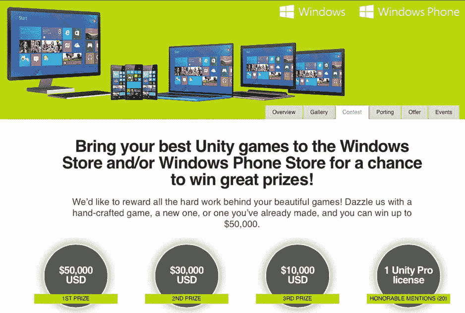

# 竞赛

竞赛通常由赞助方举办，并为获胜者提供奖品。与游戏开发冲刺活动类似，这些竞赛可以是本地或在线形式，奖品套餐有大有小，但通常截止日期为数月左右，因为主办方期望的是精良的最终产品，而非仓促拼凑的原型。高额现金奖励通常由公司赞助，以此激励开发者专注于制作利用其软件或硬件产品的游戏。奖品套餐可能包含免费许可证、额外推广机会以及其他有价值的赠品。

举例来说，在撰写本文时，Unity 与微软联合举办了一场面向 Windows 和 Windows Phone 平台的 Unity 游戏竞赛（图 13-17）。

图 13-17. 竞赛及其奖品示例

请密切关注 Unity、游戏平台制造商以及行业组织的活动网站，以获取竞赛公告信息。将搜索范围从“游戏开发者”扩大到“应用开发者”，因为许多应用竞赛都设有游戏类别。如果您居住在大都市区，请查询当地会议中心的日程表，关注电子游戏、电子产品及应用相关活动。竞赛结果通常会在活动上公布，因此请记住，竞赛规则的公布日期和作品提交截止日期将远早于实际活动举办时间。

请仔细阅读细则。了解截止日期、规则以及参与协议可能产生的后果。如果错过了截止日期，就无法获胜。如果不遵守规则，可能会被取消资格。如果不阅读细则，您根本无法预料会发生什么。我曾见过有人因参加竞赛而意外失去了其游戏的所有权。

以 Windows 商店为例，要符合竞赛资格，您的游戏必须在 2014 年 5 月 1 日至 2014 年 7 月 20 日期间发布于 Windows 商店，因此游戏的所有权毫无疑问仍属于您。另一方面，这也意味着您的游戏必须完成 Windows 商店的提交流程，这或许意味着您应该已经设立了您的商业实体。如果您习惯于在截止日期前几分钟才将刚完成的作业交给老板或教授，那么您的游戏很可能无法及时送到评委手中。