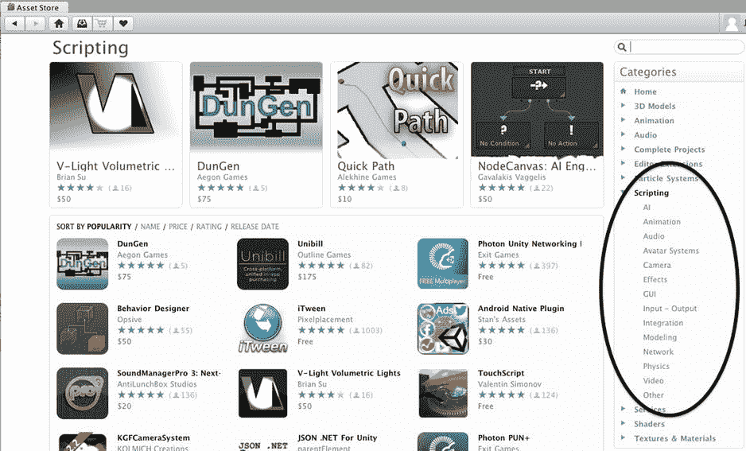

# 代码来源

您不会通过阅读词典来学习外语，也不会一口气从头到尾读完 Unity 文档来提升脚本编写技能。相反，您会在制作更多游戏的过程中编写更多脚本。

有大量的 Unity 脚本类可以充实您的知识库，但别担心——您会在实践中逐渐掌握。现在，您已经掌握了使用 UnityScript 编程的坚实基础，并且知道如何查阅文档以获取更详细的解释和示例代码片段。在实践中参考这些内容能巩固基本概念，而游戏的上下文则能让您更轻松地记住如何使用以及为何使用该类或方法。

同时，您既不必也不应一切从零开始。通常情况下，总有其他程序员尝试过解决您在自己游戏某方面遇到的类似问题，而他们的解决方案可供您使用。利用这些脚本能快速推进您的游戏开发，而学习任何新的 UnityScript 类或解决实际问题的不同方法，则能迅速提升您的技能水平。

脚本的一个来源是 Unity 资源商店。脚本也是资源，因此您会在这里找到大量涵盖众多子类别的脚本（图 13-18）。

图 13-18. 资源商店中可用的脚本资源类别

GitHub 是一个在线代码仓库集合，开发者在此分享与协作，它也是另一个存放开源代码的绝佳库。各种开发者论坛亦是针对特定问题的精准代码解决方案的资源平台，以及就解决问题的替代方案进行激烈辩论的场所。