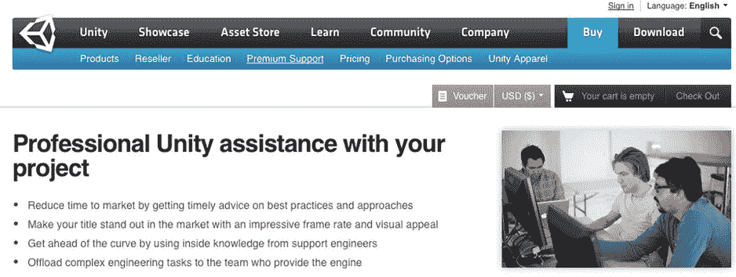
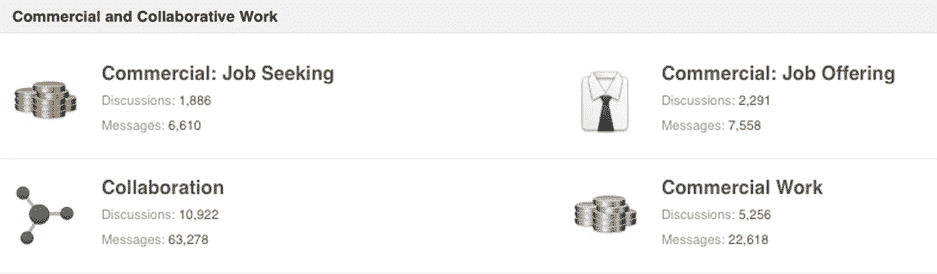

# 不止是爱好

如果你的目标是成为一名游戏开发从业者，那么思考如何构建作品集和简历永远都不嫌早。无论你是否接受过正规教育，潜在雇主都希望看到你具备哪些技能。即便你不清楚雇主的期望值，了解这些期望也能为你提供指引，帮助你精进开发技能，以满足行业标准。

## 作品集

简历与作品集的区别在于，简历是对你专业技能和教育背景的书面总结，而作品集则是你工作成果的实物展示，例如代码、演示程序，甚至是完整的游戏。

无论你是自学成才的编程者还是拥有学位，作品集都是进入游戏行业必不可少的敲门砖。事实上，在初级职位的要求中，你经常会看到“计算机科学学士学位或同等工作经验”这一条。如果你能通过作品集证明自己拥有他们寻找的能力，那么正规教育并非必需。无论哪种情况，作品集的内容都是相同的，唯一的区别在于，对于学生而言，课程作业中的项目应与独立项目区分开来。

作品集是你游戏开发工作中最佳样品的集合。说实话，你最初制作的几款游戏很可能不会获奖，但它们在其他方面意义重大。它们展示了你的技能，也体现了你学习能力和坚持完成项目的能力。

我是在一次针对开发者的聚会活动中，通过结识的一位朋友获得了第一份付费游戏开发工作。当时我的作品集并不多，但我为一家本地初创公司开发了几款小型移动生产力应用。他评价说：“这让我知道你能够完成并发布一个项目。”这句话让我很惊讶，因为我从未以这种方式思考过。

事实上，当时我们正在聊天，我向他展示了手机上的应用，我完全不知道他参加那次会议正是为了物色人选。我当时觉得自己技能和知识都还不足，因为我痛苦地意识到自己还有很多东西要学。那第一个项目后来发展成了第二个项目，我都成功完成了，并且在此过程中学到了很多东西。正如我提到的，鉴于视频游戏开发领域发展如此迅速，总有学不完的东西。

你的作品集里应该包含几个完整的游戏。“完整”意味着要包含启动画面；涵盖开始、暂停和退出游戏等基本功能的菜单；玩家选项；以及除了核心玩法之外，游戏与玩家交互的所有辅助功能。涵盖多种类型（2D 和 3D）的游戏，能展示你的深度和多样性。

你还可以准备功能演示：专注于特定功能的游戏片段，用以展示你在某一方面的技能，比如 AI 或特效。程序员并不被期望拥有专业级别的美术技能；因此才有了“程序员美术”这个术语，它指代那些用于演示游戏功能的、通常是质量较低的占位美术资源。话虽如此，还是要尽最大努力留下良好的第一印象。使用资源商店里的资源，或者与美术师合作来提升演示质量都是可以的，只是要确保注明那些并非你亲自创建的内容的来源。

既然你现在是一名游戏开发者，你的作品集必须包含源代码。当你查看初级职位招聘信息时，会看到如下所示的期望技能：

-   “按照要求的编码标准进行代码的设计、实现、测试、调试和维护。”
-   “测试、调试和扩展其他软件工程师的代码。”
-   “将现有技术移植到新平台。”

游戏开发是一项团队协作活动，你将与其他开发者共事，可能会接替前任开发者的工作，而其他人也会基于你的代码进行开发。组织有序、高效、易读的代码对专业开发者至关重要。如果你对某个游戏开发问题的绝妙解决方案深埋于凌乱、难懂的代码之中，潜在雇主是不会花时间去解读的。请记住，他们收到的求职咨询非常多，只有最优秀的才会获得进一步考察的机会。

## 网站

网站只是为公众提供访问你作品集的一种途径。虽然通过电子邮件发送作品集的`.zip`文件往往会导致一系列麻烦，比如文件可能永远无法被接收，或者目标收件人无法打开，但发送一个链接则简单直接。

无论你的目标是作为潜在员工还是自由职业者获得专业认可，你的网站也必须显得专业。不要掺杂个人博客或私人信息，但一定要让联系方式易于查找。

网站设计应简洁明快，让用户只需最少点击就能轻松访问你的演示作品，同时布局和背景图片也不应分散对演示内容本身的注意力。

## 量身定制你的展示内容

根据职位描述，定制你的作品集，重点展示与之最相关的演示内容。你的作品集应突出该职位所需的核心技能集。可以想象，除了通用的“玩法程序员”之外，各种初级职位之间存在差异，例如“多人游戏玩法程序员”、“图形程序员”或“工具程序员”。

研究一下这家公司及其产品。研究一下将对你进行面试的开发者，并熟悉他们的工作。游戏开发者都是超级发烧友。因此，你应该熟悉他们的游戏，并准备好讨论你喜欢玩哪些游戏。

## 获取诚恳的反馈

游戏开发者社区是打磨你游戏、获取反馈的极好来源，也能为你提供良好编码实践方面的指导。Unity 在 [`https://store.unity3d.com/products/support`](https://store.unity3d.com/products/support) 提供专业支持服务（图 13-19）。

图 13-19. Unity 提供针对美术、脚本编写、调试等方面的专业支持

我在一次创业合作中参与的第一个项目，对整个团队（全是新手）来说都是一次学习经历。当我们认为可以发布时，我们聘请了一位专业开发者来审查我们的工作。这是一次有趣的体验，既让我们对自己做得好的方面有了信心，又为我们需要改进的领域提供了快速、集中的学习途径，同时也显著缩短了发布审批时间。

请记住，当你看到同行开发者们为他们的项目征求反馈时，你也要给予回报：提供经过深思熟虑的详细评论，说明你认为哪些地方做得好，并尽可能地提出改进建议。

### 墨菲定律无处不在

墨菲定律指出：凡是可能出错的事，就一定会出错，而且会错得一塌糊涂。第一次参加重要面试时，我紧张得要命——一边反复练习精心准备的回答，一边攥着口袋里的幸运硬币等待叫号。面试进行到一半时，我衬衫的纽扣突然崩开，不偏不倚落在面试官的桌上。我们俩都惊恐地盯着这颗纽扣，陷入了片刻的死寂，随后我连忙抓住衬衫，他则抓起了手机。幸好他的秘书有安全别针，等我镇定下来后，面试才得以继续。我没有羞愧到无地自容，还成功进入了初选名单，尽管最终未能入选。经历过这次之后，后续的面试简直小菜一碟。

无论是求职咨询还是面试，务必准备好备用截图和视频，以备演示失败时使用（实际演示出问题的频率可能比你想象的更高，原因五花八门）。请记住：对方很忙，你的求职只是众多申请之一，你要让招聘方轻松看到你的能力。演示失败确实会发生，但优质的截图、视频以及你的源代码，都能为求职提供有力支持，或避免面试陷入尴尬的僵局。

这一点同样适用于个人作品集网站：除了可玩的演示版本外，也请准备好截图和游戏视频作为备选。

## 招聘平台

前面提到的大多数开发者在线社区都提供职业指导，许多还设有招聘板块，供雇主发布职位信息。即便你尚未准备好求职，关注招聘要求也能帮你明确学习方向。

Unity Technologies 在其官网 [`http://unity3d.com/company/jobs`](http://unity3d.com/company/jobs) 发布职位信息，同时也允许求职者和招聘方在社区论坛 [`http://forum.unity3d.com`](http://forum.unity3d.com/) 发布信息，其中包含为非商业项目寻找团队成员的板块（见图 13-20）。

图 13-20.

Unity 论坛商业及协作项目板块

Stackoverflow 设有 [`http://careers.stackoverflow.com`](http://careers.stackoverflow.com/) ，GitHub 有 [`http://jobs.github.com`](http://jobs.github.com/) ，Gamasutra 则有 [`http://jobs.gamasutra.com`](http://jobs.gamasutra.com/) 。各大游戏机制造商也在各自官网或其子公司（如索尼旗下的《最后生还者》开发商顽皮狗、动视旗下的暴雪等）发布招聘信息。此外还有独立游戏工作室，从 EA Games 这类 AAA 级大厂到本地初创团队，应有尽有。

还有许多面向开发者的职业网站，既有 CareerBuilder.com 这类综合平台，也有面向求职者和自由职业者的技术或在线领域专业站点，如 Startupers、Authentic Jobs 和 We Work Remotely。

对于自由职业者，[`www.freelancer.com`](http://www.freelancer.com/) 设有专门的 Unity3D 类别。其他自由职业平台如 Elance 和 oDesk，不仅提供项目竞标机会，还支持管理项目流程和处理付款。

资源商店（Asset Store）是脚本的优质来源，也是分享你个人脚本解决方案的场所。如果你觉得某个脚本特别实用且具有通用性，可以考虑提交到资源商店。这也能达到与你发布游戏作品集相同的目的——发布原创、已上架的作品。

## 总结

就是现在，你作为一位初出茅庐的游戏开发者，即将开启新世界的大门。从小处着手，循序渐进地巩固所学知识。不要一开始就想着那个需要 AAA 级工作室投入几十位开发者、耗资数百万美元并花费数年才能完成的梦想项目，那只会打击你的信心。无论你在游戏开发上的目标是什么，请享受旅程中的每一步，将每个小成就都视为胜利。

积极参与社区，尤其是 Unity 论坛、问答平台和维基。无论你偏爱 Facebook 还是其他平台，都很容易找到 Unity 和游戏开发者。Twitter 是开发者常用的交流方式，也是推广你游戏的好渠道。关注 `@unity3d` 了解 Unity 最新动态，你可以在 `@j9suvak` 找到我，我的 Twitter 关注列表里还有更多开发者。别害羞，快来加入吧。

欢迎来到欢乐的世界！

