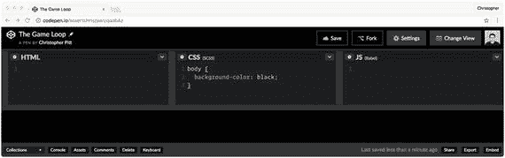
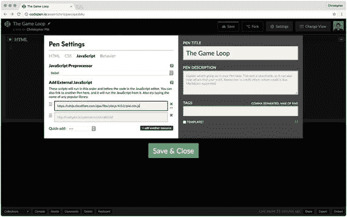
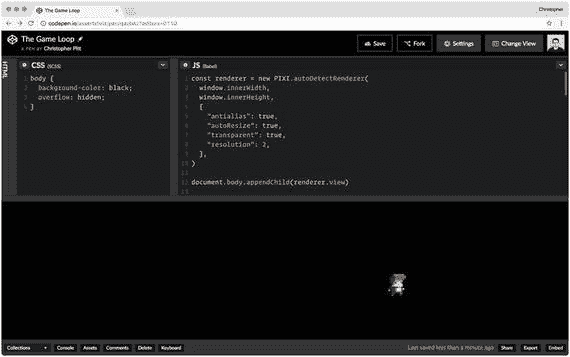

# 2. 游戏循环

游戏循环是每款游戏必不可少的部分。在本章中，我们将通过创建可靠的工作流程和环境来为我们的游戏搭建舞台。我们将看到一些有用的库，并渲染出我们的第一个游戏角色。这会很有趣！

## 为游戏搭建舞台

我们将使用最新的 JavaScript 标准和语言特性来构建游戏。通常，我会在这里展示如何创建一个 JavaScript 构建链，但我们将采取不同的做法……

在本书中，我们所有的编码工作都将在名为 CodePen 的托管服务中完成。它看起来就像图 2-1 中的代码。


图 2-1. CodePen

这种方法有几个好处：
1. 我们不需要涉及 JavaScript 构建链。它们具有主观性、脆弱性且容易分散注意力。
2. 我们可以免费使用 SCSS（增强样式表）。
3. 你无需进行任何设置即可开始与源代码交互。

我们将使用一个名为 PixiJS ([`www.pixijs.com`](http://www.pixijs.com)) 的 JavaScript 库。它是一个渲染库，能够平滑处理浏览器之间的不一致性。它既不是游戏引擎也不是物理引擎，因此我们仍需自行学习和编写这些方面的代码。PixiJS 只是让我们能够更快地进入这些主题。

我们使用的是 PixiJS `v4`。当你阅读本文时，很可能已经有更新的版本可用。概念应该是通用的，但语法可能已经发生了变化。

我们可以通过点击“设置”➤“JavaScript”，并将以下 URL 添加到 PixiJS CDN 脚本来将 PixiJS 添加到我们的 CodePen 中：[`https://cdnjs.cloudflare.com/ajax/libs/pixi.js/4.0.0/pixi.min.js`](https://cdnjs.cloudflare.com/ajax/libs/pixi.js/4.0.0/pixi.min.js)。这个过程如图 2-2 所示。


图 2-2. 将 PixiJS 添加到 CodePen

## 创建精灵

精灵是游戏中视觉对象的常用名称。我们可以在屏幕上移动它们（尽管它们通常负责自身移动）。我们可以与它们进行交互。

马里奥 ([`https://en.wikipedia.org/wiki/Mario`](https://en.wikipedia.org/wiki/Mario)) 是一个精灵，他行走的平台是精灵，背景中的云朵也是精灵。可以把精灵想象成设计文件中的切片，我们将其绘制在抽象数据结构之上。这些抽象数据结构具有位置，有时还具有速度。我们正是将这些游戏规则应用于这些抽象数据结构。它们就是我们的增强道具和敌人。

那么，我们如何创建它们呢？让我们从创建一个小型 PNG 图像开始。我们使用 PNG 是因为它允许我们使部分精灵纹理透明。如果你愿意，也可以使用 JPEG 图像来创建精灵。

然后，我们需要创建一个渲染器、一个舞台和一个精灵：

```javascript
const renderer = new PIXI.autoDetectRenderer(
window.innerWidth,
window.innerHeight,
{
"antialias": true,
"autoResize": true,
"transparent": true,
"resolution": 2,
},
)
document.body.appendChild(renderer.view)
const sprite = new PIXI.Sprite.fromImage(
"path/to/sprites/player-idle.png",
)
sprite.x = window.innerWidth / 2
sprite.y = window.innerHeight / 2
const stage = new PIXI.Container()
stage.addChild(sprite)
const animate = function() {
requestAnimationFrame(animate)
renderer.render(stage)
}
animate()
```

此代码来自 [`http://codepen.io/assertchris/pen/qaobAz`](http://codepen.io/assertchris/pen/qaobAz)。

好的，这里涉及的内容很多！让我们分步骤来看这段代码：
1. 我们创建一个渲染器。渲染器的作用是将 PixiJS 抽象（精灵、纹理等）转换为 canvas 或 WebGL 图形。我们不需要与它们交互，但必须有一个渲染器才能显示我们的 PixiJS 内容。我们告诉渲染器要占满浏览器窗口的整个宽度和高度。我们还告诉它对我们的图形进行抗锯齿处理，并将其提升到视网膜分辨率。我们让它拥有透明背景，并调整所有图形以适应屏幕。
2. 然后，我们使用之前创建的 PNG 图像创建一个新的 `PIXI.Sprite` 实例。默认情况下，它的位置是 `x = 0` 和 `y = 0`。我们可以将其定位到屏幕中心。我们必须创建一个根精灵容器（通常称为舞台），并将精灵附加到舞台上。这并没有听起来那么复杂。可以把它想象成 HTML 文档，它们有一个根 `html` 元素，我们将所有其他元素添加到其中。这是类似的事情。
3. 最后，我们创建一个动画函数，并确保渲染器渲染我们的舞台和精灵。我们使用 `requestAnimationFrame` 函数作为一种在不阻塞 JavaScript 线程的情况下进行渲染的方式。关于这一点，我们可以进行长时间的讨论。目前，只需要知道 `requestAnimationFrame` 每秒执行很多次就足够了。我们的游戏目标是每秒渲染 30 到 60 帧，同时在后台进行各种玩家和世界的计算。要实现这一切的顺畅运行，我们就需要使用这个函数。

# 游戏循环

游戏循环将控制我们游戏的流程。这是一个重复的过程：读取输入、计算状态变化、并将输出渲染到屏幕上。

到目前为止，我们已经搭建了很多脚手架，但所做的一切只是渲染一个静态图像。让我们让它动起来吧！首先，我们将创建一个 `Player` 类，这样我们就可以追踪玩家的位置了：

```
class Player {
constructor(sprite, x, y) {
this.sprite = sprite
this.x = x
this.y = y
this.sprite.x = this.x
this.sprite.y = this.y
}
animate(state) {
this.x += 5
if (this.x > window.innerWidth) {
this.x = 0
}
this.sprite.x = this.x
this.sprite.y = this.y
}
}
```

这段代码来自 [`codepen.io/assertchris/pen/qaobAz`](http://codepen.io/assertchris/pen/qaobAz)。

这就是 ES2015 及更高版本中 JavaScript 类的写法。`Player` 类有一个构造函数，我们用它来存储对精灵的引用，以及初始的 `x` 和 `y` 位置。

它还有一个 `animate` 方法，我们每秒会调用很多次。我们可以用这个方法来判断玩家是否需要改变位置或执行其他操作。在这个例子中，我们将精灵的 `x` 坐标稍微增加了一点。如果玩家/精灵移出了屏幕右侧，我们就把它移回屏幕左侧。

我们还必须改变创建精灵的方式：

```
const player = new Player(
sprite,
window.innerWidth / 2,
window.innerHeight / 2,
)
stage.addChild(sprite)
let state = {
"renderer": renderer,
"stage": stage,
}
const animate = function() {
requestAnimationFrame(animate)
player.animate(state)
renderer.render(stage)
}
```

这段代码来自 [`codepen.io/assertchris/pen/qaobAz`](http://codepen.io/assertchris/pen/qaobAz)。

现在我们开始看到游戏中的循环了。正如图 2-3 所示，我们每秒多次告诉我们的玩家去执行动画。玩家会根据一些内部逻辑进行调整，并更新其精灵。渲染器渲染输出，我们看到的就是一个流畅的动画。



图 2-3. 移动精灵

我们目前唯一缺少的就是输入，但我们很快就会讲到……

## 总结

在本章中，我们成功搭建了一个游戏环境（使用 CodePen）。我们简要介绍了 PixiJS，并了解了如何将玩家的精灵渲染到屏幕上。

我们还为玩家的精灵添加了动画，并学会了如何使用 `requestAnimationFrame` 函数。

花点时间为你的游戏寻找精灵图形。派生 (Fork) 这个 CodePen，并稍作自定义。感受一下创建和操控精灵的过程非常重要。这就是你游戏的开始！