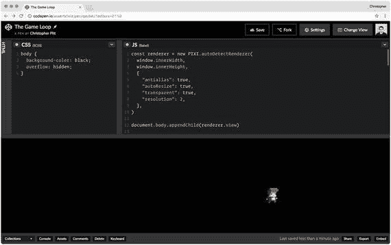

# 游戏循环

游戏循环将控制我们游戏的流程。这是一个重复的过程：读取输入、计算状态变化、并将输出渲染到屏幕上。

到目前为止，我们已经搭建了很多脚手架，但所做的一切只是渲染一个静态图像。让我们让它动起来吧！首先，我们将创建一个 `Player` 类，这样我们就可以追踪玩家的位置了：

```
class Player {
constructor(sprite, x, y) {
this.sprite = sprite
this.x = x
this.y = y
this.sprite.x = this.x
this.sprite.y = this.y
}
animate(state) {
this.x += 5
if (this.x > window.innerWidth) {
this.x = 0
}
this.sprite.x = this.x
this.sprite.y = this.y
}
}
```

这段代码来自 [`codepen.io/assertchris/pen/qaobAz`](http://codepen.io/assertchris/pen/qaobAz)。

这就是 ES2015 及更高版本中 JavaScript 类的写法。`Player` 类有一个构造函数，我们用它来存储对精灵的引用，以及初始的 `x` 和 `y` 位置。

它还有一个 `animate` 方法，我们每秒会调用很多次。我们可以用这个方法来判断玩家是否需要改变位置或执行其他操作。在这个例子中，我们将精灵的 `x` 坐标稍微增加了一点。如果玩家/精灵移出了屏幕右侧，我们就把它移回屏幕左侧。

我们还必须改变创建精灵的方式：

```
const player = new Player(
sprite,
window.innerWidth / 2,
window.innerHeight / 2,
)
stage.addChild(sprite)
let state = {
"renderer": renderer,
"stage": stage,
}
const animate = function() {
requestAnimationFrame(animate)
player.animate(state)
renderer.render(stage)
}
```

这段代码来自 [`codepen.io/assertchris/pen/qaobAz`](http://codepen.io/assertchris/pen/qaobAz)。

现在我们开始看到游戏中的循环了。正如图 2-3 所示，我们每秒多次告诉我们的玩家去执行动画。玩家会根据一些内部逻辑进行调整，并更新其精灵。渲染器渲染输出，我们看到的就是一个流畅的动画。



图 2-3. 移动精灵

我们目前唯一缺少的就是输入，但我们很快就会讲到……

## 总结

在本章中，我们成功搭建了一个游戏环境（使用 CodePen）。我们简要介绍了 PixiJS，并了解了如何将玩家的精灵渲染到屏幕上。

我们还为玩家的精灵添加了动画，并学会了如何使用 `requestAnimationFrame` 函数。

花点时间为你的游戏寻找精灵图形。派生 (Fork) 这个 CodePen，并稍作自定义。感受一下创建和操控精灵的过程非常重要。这就是你游戏的开始！

