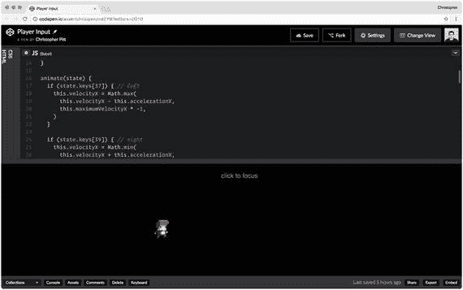

# 玩家输入

电影和游戏的区别是什么？玩家输入！事实上，这是游戏设计中非常关键的一环，以至于游戏往往是由它们如何处理玩家输入来定义的。

赛车游戏依赖于持续、微妙的输入。如果你将手指从键盘上抬起，或将脚从油门上移开，就会失去动力。如果你没有输入正确的按键组合，你的飞行模拟就会坠毁。

像我们正在构建的这种平台游戏，需要双手输入。通常键盘的右侧用于移动。通常键盘的左侧用于玩家动作，比如射击或开门。

也许你想设计一个像《泰拉瑞亚》（[`terraria.org`](https://terraria.org)）这样的平台游戏，它使用鼠标进行玩家操作和弹道瞄准。也许你想使用 `WASD` 键在屏幕上移动你的玩家。让我们开始吧！

## 检测输入

当我第一次尝试检测输入时，我试图为所有东西添加事件监听器。我尝试为玩家添加事件监听器，也为舞台添加事件监听器。啊……然后事情就失控了。

诀窍是在最高层级检测事件，并将其详细信息保存到一个游戏状态对象中。上一次我们创建了这种状态对象，并将其传递给了玩家的 `animate` 方法。让我们扩展一下那个状态：

```javascript
let state = {
"renderer": renderer,
"stage": stage,
"keys": {},
"clicks": {},
"mouse": {},
}
window.addEventListener("keydown", function(event) {
state.keys[event.keyCode] = true
})
window.addEventListener("keyup", function(event) {
state.keys[event.keyCode] = false
})
window.addEventListener("mousedown", function(event) {
state.clicks[event.which] = {
"clientX": event.clientX,
"clientY": event.clientY,
}
})
window.addEventListener("mouseup", function(event) {
state.clicks[event.which] = false
})
window.addEventListener("mousemove", function(event) {
state.mouse.clientX = event.clientX
state.mouse.clientY = event.clientY
})
```

这段代码来自 [`codepen.io/assertchris/pen/rrdZYB`](http://codepen.io/assertchris/pen/rrdZYB)。

我们开始时将渲染器和舞台添加到了游戏状态对象中。现在我们添加了 `keys`、`clicks` 和 `mouse` 属性，用于跟踪按键和鼠标移动。

**注意**

对于下一部分，我不得不调整 `index.html` 的 CSS，使画布绝对定位。这使得更精确地追踪鼠标移动成为可能。查看源代码以了解更改。

随着我们向游戏中添加更多对象，我们会将游戏状态对象传递给它们每一个。它们可以使用它来计算出当玩家与游戏交互时它们应该做什么。让我们移除当前的玩家移动，并添加由输入驱动的移动：

```javascript
animate(state) {
if (state.keys[37]) { // 左
this.x = Math.max(
0, this.x - 5
)
}
if (state.keys[39]) { // 右
this.x = Math.min(
window.innerWidth - 64, this.x + 5
)
}
if (state.clicks[1]) { // 左键点击
this.x = state.clicks[1].clientX
}
this.sprite.x = this.x
this.sprite.y = this.y
}
```

这段代码来自 [`codepen.io/assertchris/pen/rrdZYB`](http://codepen.io/assertchris/pen/rrdZYB)。

`animate` 方法的实际变化很小。我们检查两个方向键，如果玩家按下了其中一个，我们就进行移动。我们还检查玩家是否点击了鼠标，如果点击了，就立即移动。

**提示**

不必理会 `Math` 函数和魔法数字 `64`。这些只是为了阻止玩家精灵移出屏幕。当我们开始构建墙壁时，我们会移除这些东西……



图 3-1. 玩家输入

### 自然的角色移动

现在角色可以移动一点了。不过，感觉并不好。当我们松开方向键的瞬间，动作就戛然而止。游戏只有一种速度：慢速。

我们需要的是加速度，让角色能在特定方向上加速。当角色不再加速时，我们还需要一些摩擦力来使其减速。让我们加入这些功能：

```javascript
class Player {
constructor(sprite, x, y) {
this.sprite = sprite
this.x = x
this.y = y
this.velocityX = 0
this.maximumVelocityX = 8
this.accelerationX = 2
this.frictionX = 0.9
this.sprite.x = this.x
this.sprite.y = this.y
}
animate(state) {
if (state.keys[37]) { // 左键
this.velocityX = Math.max(
this.velocityX - this.accelerationX,
this.maximumVelocityX * -1
)
}
if (state.keys[39]) { // 右键
this.velocityX = Math.min(
this.velocityX + this.accelerationX,
this.maximumVelocityX
)
}
this.velocityX *= this.frictionX
this.x += this.velocityX
// if (state.clicks[1]) { // 左键点击
//   this.x = state.clicks[1].clientX
// }
this.sprite.x = this.x
this.sprite.y = this.y
}
}
```

这段代码来自 [`http://codepen.io/assertchris/pen/rrdZYB`](http://codepen.io/assertchris/pen/rrdZYB)。

慢着，别急！让我们一步步来回顾：

1.  我们创建了几个属性：速度、最大速度、加速度和摩擦力，并为它们设置了合理的默认值。你可以随意调整这些数值，直到理解每个属性的作用。

2.  我们现在可以追踪角色在任意方向上的加速度。如果按左方向键，角色就会向该方向加速。角色有一个最大加速度，以防止速度无限增加。

3.  如果没有某种反作用力，角色会持续朝同一方向移动。这就像在太空中，没有空气阻力或重力来抵消动量。我们将这种反作用力定义为摩擦力，并用速度乘以它。在没有加速度的情况下，这意味着动趋向于零。这样就呈现出角色停下来的效果。

## 总结

我们已经开始让游戏变得可交互了。现在可以按下方向键，看到角色的精灵在场景中平滑移动。

通过为精灵的移动添加加速和减速，我们也让游戏体验不那么突兀。这个逻辑将指导我们如何创建其他机制（比如重力）。

花点时间调整加速度属性，让你的角色精灵在游戏中移动起来感觉恰到好处。你也可以尝试将其他按键映射到左右动作上。