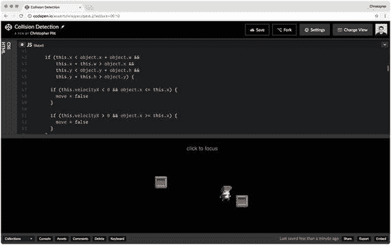

# 4. 碰撞检测

是时候讨论碰撞检测了。它影响着游戏中显而易见的元素，比如无法穿过的墙壁，无法掉下去的地板。它也影响着游戏中不太明显的元素，比如武器弹丸和检查点。

我们暂时还不会涉及重力，也不会探讨角色血量或重生。地板、弹丸和检查点都很有趣，但它们值得拥有独立的章节。在本章中，我们将创建不可穿越的物体。我们将学习如何判断两个物体是否占据同一个空间。

我花了一些时间研究这个话题。看起来有很多方法可以判断两个物体是否占据同一个空间。有些方法易于解释和实现。我们将研究这些方法。另一些方法则不那么简单，尽管如此，它们仍然很酷。

### 创建箱子

角色只是屏幕上同时存在的众多物体之一。我们的游戏是一个平台游戏，因此可以预见在任意时刻屏幕上至少会有一个平台。

平台有一些有趣的特性。有时它们允许角色穿过它们向下掉落。比如，当你站在一个平台上，同时按住下键并按下跳跃键。有些游戏将这一系列操作理解为你想穿过平台落下去。

类似地，有些游戏允许角色从平台底部向上跳跃穿过。这样可以在头顶没有平台间隙的情况下实现垂直移动。

有时平台甚至会移动！

平台是如此特殊，以至于我们将花几节内容来实现它们的不同行为。但现在，我们将专注于另一种常见的物体：通用的箱子。

把这个箱子视为平台的“祖先”。它可能共享平台的部分功能，但它存在的主要目的是让其他物体与它发生碰撞。尤其是像角色这样的物体。

我们要制作的箱子甚至可能看起来不像箱子。当实现重力时，我们需要一个宽而扁的箱子来防止角色掉出世界。我们也需要高而窄的箱子来阻止角色跑出地板边缘。我们将用它们来制作墙壁。我们甚至可能用箱子来制作箱子——那种大大的、木制的、“跳到我身上到达更高处吧”的箱子。

好了，不多说了。

```
class Box {
constructor(sprite, x, y, w, h) {
this.sprite = sprite
this.x = x
this.y = y
this.w = w
this.h = h
this.sprite.x = this.x
this.sprite.y = this.y
}
animate(state) {
this.sprite.x = this.x
this.sprite.y = this.y
}
}
```

这段代码来自 [`http://codepen.io/assertchris/pen/qaokJj`](http://codepen.io/assertchris/pen/qaokJj)。

为了制作这个类，我复制粘贴了 `Player` 类并删除了一堆东西。不过，我确实需要为它添加宽度和高度属性。我们稍后会讲到。

接下来，我们需要将这两个箱子添加到舞台上：

```
const playerSprite = new PIXI.Sprite.fromImage(
"path/to/sprites/player-idle.png",
)
const player = new Player(
playerSprite,
window.innerWidth / 2,
window.innerHeight / 2,
44,
56,
)
const blob1Sprite = new PIXI.Sprite.fromImage(
"path/to/sprites/blob-idle-1.png",
)
const blob1 = new Player(
blob1Sprite,
(window.innerWidth / 2) - 150,
(window.innerHeight / 2) - 35,
48,
48,
)
const blob2Sprite = new PIXI.Sprite.fromImage(
"path/to/sprites/blob-idle-2.png",
)
const blob2 = new Player(
blob2Sprite,
(window.innerWidth / 2) + 150,
(window.innerHeight / 2) + 35,
48,
48,
)
const stage = new PIXI.Container()
stage.addChild(playerSprite)
stage.addChild(blob1Sprite)
stage.addChild(blob2Sprite)
let state = {
"renderer": renderer,
"stage": stage,
"keys": {},
"clicks": {},
"mouse": {},
"objects": [
player,
blob1,
blob2,
],
}
```

这段代码来自 [`http://codepen.io/assertchris/pen/qaokJj`](http://codepen.io/assertchris/pen/qaokJj)。

这有点奇怪！我创建了两个新的 `Box` 实例，却把它们叫做 `blob`（软泥怪）。这是因为我马山要讨论……


## 检测圆形碰撞

我希望你为前几个方块创建圆形。我们首先要做的碰撞检测类型，就是针对圆形的。即使方块有宽度和高度而不是半径也没关系。除非你的平台游戏中有大量圆形，否则你不会经常用到这种碰撞检测方式。

让我们看看这种检测方式是如何工作的：

```
class Player {
  constructor(sprite, x, y, w, h) {
    this.sprite = sprite
    this.x = x
    this.y = y
    this.w = w
    this.h = h
    this.velocityX = 0
    this.maximumVelocityX = 8
    this.accelerationX = 2
    this.frictionX = 0.9
    this.sprite.x = this.x
    this.sprite.y = this.y
  }
  animate(state) {
    if (state.keys[37]) { // 左
      this.velocityX = Math.max(
        this.velocityX - this.accelerationX,
        this.maximumVelocityX * -1,
      )
    }
    if (state.keys[39]) { // 右
      this.velocityX = Math.min(
        this.velocityX + this.accelerationX,
        this.maximumVelocityX,
      );
    }
    this.velocityX *= this.frictionX
    let move = true
    state.objects.forEach((object) => {
      if (object === this) {
        return
      }
      var deltaX = this.x - object.x
      var deltaY = this.y - object.y
      var distance = Math.sqrt(
        deltaX * deltaX + deltaY * deltaY,
      );
      if (distance < (this.w / 2 + object.w / 2)) {
        if (this.velocityX > 0 && object.x >= this.x) {
          move = false
        }
        if (this.velocityX < 0 && object.x <= this.x) {
          move = false
        }
      }
    });
    if (move) {
      this.x += this.velocityX
    }
    this.sprite.x = this.x
    this.sprite.y = this.y
  }
}
```

这段代码来自 [`http://codepen.io/assertchris/pen/qaokJj`](http://codepen.io/assertchris/pen/qaokJj)。

我们首先需要定义宽度和高度。虽然我们假设玩家和方块都是圆形，但我们只需要将宽度的一半作为半径即可。

接下来，我们检查状态中的每个对象。我们可以忽略玩家对象，因为我们不需要知道它自身何时发生碰撞。不过，其他所有对象都需要检查。

当两个圆形的圆心之间的距离小于它们半径之和时，它们就会发生碰撞。它们的中点靠得太近，以至于其边界必然重叠。

我们快速检查一下玩家移动的方向是否与方块所在的方向一致。如果是这种情况，我们就阻止玩家向该方向移动。

试试看吧。看到非方块形状的物体相互阻挡是很有趣的。当然，要让这个简单的算法生效，所有物体都必须是完美的圆形。

## 检测矩形碰撞

检测矩形碰撞几乎和检测圆形碰撞一样简单。请继续把圆形图片换成方块图片。你甚至可以根据方块的方形特征调整精灵名称。

这一回，我们将玩家视为矩形。与使用半径不同，我们需要检查玩家矩形与任意方块之间是否存在空隙。这种检测方法称为**轴对齐边界框碰撞检测**（简称 AABB）。

如果没有空隙，并且玩家想要向方块所在的方向移动，我们就阻止这种情况发生：

```
let move = true
state.objects.forEach((object) => {
  if (object === this) {
    return
  }
  if (this.x < object.x + object.w &&
    this.x + this.w > object.x &&
    this.y < object.y + object.h &&
    this.y + this.h > object.y) {
    if (this.velocityX > 0 && object.x >= this.x) {
      move = false
    }
  }
})
if (move) {
  this.x += this.velocityX
}
```

这段代码来自 [`http://codepen.io/assertchris/pen/qaokJj`](http://codepen.io/assertchris/pen/qaokJj)

这些是检测碰撞的简单方法，但还有其他的方法。有一种方法使用基于投影的向量数学（`www.sevenson.com.au/actionscript/sat`）来确定重叠。另一种方法则检查多边形的每条线段，看是否有任何线段相交（[`http://stackoverflow.com/questions/9043805/test-if-two-lines-intersect-javascript-function`](http://stackoverflow.com/questions/9043805/test-if-two-lines-intersect-javascript-function)）。这可真够复杂的。

你甚至可以尝试让一组圆形相互碰撞。那可能很有趣。在图 4-1 中，我将让这个小角色在这些小方块中跑动一会儿……



**图 4-1.** 玩家与方块

## 总结

本章我们探讨了几种可用于检测玩家精灵与游戏中其他各种对象之间碰撞的方法。

花点时间重新排列方块和圆形，这样你就能初步感受你的第一个游戏关卡可能是什么样子了。

