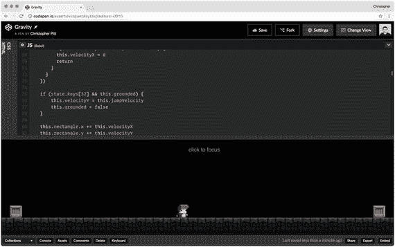

# 5. 重力

在本章中，我们将优化代码结构，并为我们的游戏添加重力效果。重力方面的大部分工作我们已经完成了，因此完成余下部分应该相对简单。


## 清理现有代码

我们需要清理一些内容！首先，将 `x`、`y`、`w`、`h`（位于 `Box` 和 `Player` 中）替换为 `PIXI.Rectangle`。这些属性不仅保留原有功能，还能以有趣的方式与 `PIXI` 的其他部分交互。

```
class Player {
constructor(sprite, rectangle) {
this.sprite = sprite
this.rectangle = rectangle
this.velocityX = 0
this.maximumVelocityX = 8
this.accelerationX = 2
this.frictionX = 0.9
}
animate(state) {
if (state.keys[37]) { // 左
this.velocityX = Math.max(
this.velocityX - this.accelerationX,
this.maximumVelocityX * -1,
)
}
if (state.keys[39]) { // 右
this.velocityX = Math.min(
this.velocityX + this.accelerationX,
this.maximumVelocityX,
);
}
this.velocityX *= this.frictionX
let move = true
state.objects.forEach((object) => {
if (object === this) {
return
}
const me = this.rectangle
const you = object.rectangle
if (me.x  you.x &&
me.y  you.y) {
if (this.velocityX  0 && you.x >= me.x) {
move = false
}
}
})
if (move) {
this.rectangle.x += this.velocityX
}
this.sprite.x = this.rectangle.x
this.sprite.y = this.rectangle.y
}
}
class Box {
constructor(sprite, rectangle) {
this.sprite = sprite
this.rectangle = rectangle
}
animate(state) {
this.sprite.x = this.rectangle.x
this.sprite.y = this.rectangle.y
}
}
```

此代码来自 [`http://codepen.io/assertchris/pen/ALyXKq`](http://codepen.io/assertchris/pen/ALyXKq)。

注意到我们删除了多少代码吗？比较逻辑虽然略显冗长，但一两个局部变量就足以解决。我还意识到可以将初始的 `x` 和 `y` 设置操作移至 `animate` 方法中。

接下来，我想将事件、渲染器和舞台逻辑封装到一个 `Game` 类中：

```
class Game {
constructor() {
this.state = {
"keys": {},
"clicks": {},
"mouse": {},
"objects": [],
}
this.animate = this.animate.bind(this)
}
get stage() {
if (!this._stage) {
this._stage = this.newStage()
}
return this._stage
}
set stage(stage) {
this._stage = stage
}
newStage() {
return new PIXI.Container()
}
get renderer() {
if (!this._renderer) {
this._renderer = this.newRenderer()
}
return this._renderer
}
set renderer(renderer) {
this._renderer = renderer
}
newRenderer() {
return new PIXI.autoDetectRenderer(
window.innerWidth,
window.innerHeight,
this.newRendererOptions(),
)
}
newRendererOptions() {
return {
"antialias": true,
"autoResize": true,
"transparent": true,
"resolution": 2,
}
}
animate() {
requestAnimationFrame(this.animate)
this.state.renderer = this.renderer
this.state.stage = this.stage
this.state.objects.forEach((object) => {
console.log(object)
object.animate(this.state)
})
this.renderer.render(this.stage)
}
addEventListenerTo(element) {
element.addEventListener("keydown", (event) => {
this.state.keys[event.keyCode] = true
})
element.addEventListener("keyup", (event) => {
this.state.keys[event.keyCode] = false
})
element.addEventListener("mousedown", (event) => {
this.state.clicks[event.which] = {
"clientX": event.clientX,
"clientY": event.clientY,
}
})
element.addEventListener("mouseup", (event) => {
this.state.clicks[event.which] = false
})
element.addEventListener("mousemove", (event) => {
this.state.mouse.clientX = event.clientX
this.state.mouse.clientY = event.clientY
})
}
addRendererTo(element) {
element.appendChild(this.renderer.view)
}
addObject(object) {
this.state.objects.push(object)
this.stage.addChild(object.sprite)
}
}
```

此代码来自 [`http://codepen.io/assertchris/pen/ALyXKq`](http://codepen.io/assertchris/pen/ALyXKq)。

请注意类中的 getter 和 setter。它们可以灵活地按需填充可选依赖项。如果需要，我们可以覆盖 `renderer` 和 `stage`，同时它们也提供了合理的默认值。

这里唯一显著的差异是：我们不再需要将精灵单独添加到舞台，而是与状态中的对象添加同步进行。

我对此有些犹豫。一方面，手动添加精灵到舞台能让逻辑更清晰；另一方面，我们是否会存在添加精灵（与对象绑定）却不添加对象的情况？我认为不会。

也许我们之后会回来修改这个设计。目前来看，它让代码更简洁了。让我们先添加之前用到的精灵：

```
const game = new Game()
game.addObject(
new Box(
new PIXI.Sprite.fromImage(
"path/to/sprites/box.png",
),
new PIXI.Rectangle(
(window.innerWidth / 2) - 150,
(window.innerHeight / 2) - 35,
44,
44,
),
),
)
game.addObject(
new Box(
new PIXI.Sprite.fromImage(
"path/to/sprites/box.png",
),
new PIXI.Rectangle(
(window.innerWidth / 2) + 150,
(window.innerHeight / 2) + 35,
44,
44,
),
),
)
game.addObject(
new Player(
new PIXI.Sprite.fromImage(
"path/to/sprites/player-idle.png",
),
new PIXI.Rectangle(
window.innerWidth / 2,
window.innerHeight / 2,
44,
56,
),
),
)
game.addEventListenerTo(window)
game.addRendererTo(document.body)
game.animate()
```

此代码来自 [`http://codepen.io/assertchris/pen/ALyXKq`](http://codepen.io/assertchris/pen/ALyXKq)。

看起来好多了！现在我们能充分控制每个游戏对象的起始位置。但你会发现，从第一帧之后，`animate` 方法就会接管控制权。重力、碰撞等机制将开始主导游戏进程。不过，这本来就是设计预期——现在这个文件给人的感觉也是如此。

此时，我们可以将事件和渲染器限定在更小范围的元素中，也可以从此处向游戏添加任意数量的对象。其他与游戏相关的逻辑都封装在 `Game` 类中；而玩家或盒子相关的逻辑则保留在各自的类中。整洁多了！


## 为世界添加重力

平台游戏之所以有趣，其中一个原因在于游戏中融入了适度的物理效果。首先，我们来添加墙壁和地面：

```
const game = new Game()
game.addObject (
new Box(
new PIXI.extras.TilingSprite.fromImage(
"path/to/sprites/floor-tile.png",
window.innerWidth,
64,
),
new PIXI.Rectangle(
0,
window.innerHeight - 64,
window.innerWidth,
64,
),
),
)
game.addObject(
new Box(
new PIXI.Sprite.fromImage(
"path/to/sprites/box.png",
),
new PIXI.Rectangle(
0 + 32,
window.innerHeight - 44 - 64,
44,
44,
),
),
)
game.addObject(
new Box(
new PIXI.Sprite.fromImage(
"path/to/sprites/box.png",
),
new PIXI.Rectangle(
window.innerWidth - 32 - 44,
window.innerHeight - 44 - 64,
44,
44,
),
),
)
game.addObject(
new Player(
new PIXI.Sprite.fromImage(
"path/to/sprites/player-idle.png",
),
new PIXI.Rectangle(
window.innerWidth / 2,
window.innerHeight / 2,
44,
56,
),
),
)
```

此代码来自 [`http://codepen.io/assertchris/pen/ALyXKq`](http://codepen.io/assertchris/pen/ALyXKq)。

在这里，我们添加了一个与整个场景同宽的地面。我使用了平铺纹理和 `new PIXI.extras.TilingSprite.fromImage` 来在场景中渲染它。我还移动了两个板条箱，以阻止玩家从地板边缘跑出去。它们的碰撞方式与之前相同。现在，我们来看看如何添加重力：

```
class Player {
constructor(sprite, rectangle) {
this.sprite = sprite
this.rectangle = rectangle
this.velocityX = 0
this.maximumVelocityX = 8
this.accelerationX = 2
this.frictionX = 0.9
this.velocityY = 0
this.maximumVelocityY = 30
this.accelerationY = 3
this.jumpVelocity = -30
this.isOnGround = false
}
animate(state) {
if (state.keys[37]) { // left
this.velocityX = Math.max(
this.velocityX - this.accelerationX,
this.maximumVelocityX * -1,
)
}
if (state.keys[39]) { // right
this.velocityX = Math.min(
this.velocityX + this.accelerationX,
this.maximumVelocityX,
)
}
this.velocityX *= this.frictionX
this.velocityY = Math.min(
this.velocityY + this.accelerationY,
this.maximumVelocityY,
)
state.objects.forEach((object) => {
if (object === this) {
return
}
var me = this.rectangle
var you = object.rectangle
if (me.x  you.x &&
me.y  you.y) {
if (this.velocityY > 0 && you.y >= me.y) {
this.velocityY = 0
return
}
if (this.velocityY  0 && you.x >= me.x) {
this.velocityX = 0
return
}
}
})
this.rectangle.x += this.velocityX
this.rectangle.y += this.velocityY
this.sprite.x = this.rectangle.x
this.sprite.y = this.rectangle.y
}
}
```

此代码来自 [`http://codepen.io/assertchris/pen/ALyXKq`](http://codepen.io/assertchris/pen/ALyXKq)。

我们首先创建一组属性，与之前追踪水平移动的属性相匹配。我们不需要垂直摩擦，因为这种细节在平台游戏中通常被省略。

我们还需要追踪垂直和水平碰撞。当玩家与平台/地面碰撞时，我们停止向下的速度。当撞到天花板时，我们用重力替换向上的速度。

## 允许玩家跳跃

跳跃其实就是短时间内逆转重力：

```
animate(state) {
if (state.keys[37]) { // left
this.velocityX = Math.max(
this.velocityX - this.accelerationX,
this.maximumVelocityX * -1,
)
}
if (state.keys[39]) { // right
this.velocityX = Math.min(
this.velocityX + this.accelerationX,
this.maximumVelocityX,
)
}
this.velocityX *= this.frictionX
this.velocityY = Math.min(
this.velocityY + this.accelerationY,
this.maximumVelocityY,
)
state.objects.forEach((object) => {
if (object === this) {
return
}
var me = this.rectangle
var you = object.rectangle
// ...snip
if (state.keys[32] && this.isOnGround) {
this.velocityY = this.jumpVelocity
this.isOnGround = false
}
this.rectangle.x += this.velocityX
this.rectangle.y += this.velocityY
this.sprite.x = this.rectangle.x
this.sprite.y = this.rectangle.y
}
```

此代码来自 [`http://codepen.io/assertchris/pen/ALyXKq`](http://codepen.io/assertchris/pen/ALyXKq)。

通过这段代码，我们将空格键映射为跳跃。我们将键盘检测放在碰撞检测之后，因为我们只希望玩家在站立于平台或地面上时才能跳跃。



**图 5-1.** 添加重力

现在，可以用盒子创建关卡，为其中一些盒子赋予可见纹理，并让玩家在其周围跳跃。花点时间制作一个关卡并在其中跳跃吧！

## 总结

在本章中，我们清理了游戏代码。每个部分现在都是独立、自包含的——从盒子到玩家再到游戏本身。这将使各个游戏对象更易于自行管理。

我们还创建了地面和基本墙壁（由板条箱构成），这样玩家就不会掉出世界。最后，我们增加了玩家跳跃的能力。现在，已经可以构建一个可穿越的关卡了！

