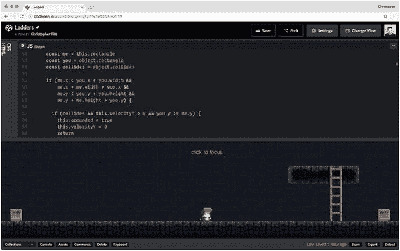

# 6. 梯子

如果玩家只能通过跳跃穿过间隙或跳跃到箱子上来向上移动，那将非常受限。不过，这些并非唯一选择。我们还需要了解电梯、楼梯和梯子。让我们从建造一个梯子开始吧！

## 创建我们的第一个梯子

让我们通过复制 `Box` 类来开始创建梯子：

```
class Ladder {
constructor(sprite, rectangle) {
this.sprite = sprite
this.rectangle = rectangle
}
animate(state) {
this.sprite.x = this.rectangle.x
this.sprite.y = this.rectangle.y
}
}
// ...later
game.addObject(
new Box(
new PIXI.Sprite.fromImage(
"path/to/sprites/platform.png",
),
new PIXI.Rectangle(
window.innerWidth - 400,
window.innerHeight - 64 - 200,
256,
64,
),
),
)
game.addObject(
new Ladder(
new PIXI.extras.TilingSprite.fromImage(
"path/to/sprites/ladder.png",
44,
200,
),
new PIXI.Rectangle(
window.innerWidth - 250,
window.innerHeight - 64 - 200,
44,
200,
),
),
)
```

此代码来自 [`http://codepen.io/assertchris/pen/jrzrPw`](http://codepen.io/assertchris/pen/jrzrPw)。

你需要制作 `ladder.png` 和 `platform.png` 图片。请确保在添加玩家之前将这些图片添加到游戏中，否则梯子精灵会出现在玩家精灵的前面。

你会注意到玩家会撞到梯子，就好像它是一个盒子一样。我们需要为盒子和梯子添加一些 getter 方法，以便碰撞检测可以决定它们是否仍彼此碰撞：

```
state.objects.forEach((object) => {
if (object === this) {
return
}
const me = this.rectangle
const you = object.rectangle
const collides = object.collides
if (me.x  you.x &&
me.y  you.y) {
if (collides && this.velocityY > 0 && you.y >= me.y) {
this.isOnGround = true
this.velocityY = 0
return
}
if (collides && this.velocityY  0 && you.x >= me.x) {
this.velocityX = 0
return
}
}
})
```

此代码来自 [`http://codepen.io/assertchris/pen/jrzrPw`](http://codepen.io/assertchris/pen/jrzrPw)。

我们为 `Box` 和 `Ladder` 赋予了 `collides` 属性，以便 `Player.animate` 可以忽略与玩家不应碰撞的对象的碰撞。如果我们要允许同一个游戏/关卡中存在多个玩家，那么我们也需要为 `Player` 添加一个 `collides` 属性。当然，除非我们希望多个玩家彼此碰撞。



**图 6-1.** 平台与梯子


## 允许玩家攀爬梯子

为了让玩家能够攀爬梯子，我们必须能够判断他们是否正在尝试攀爬。同时，我们还需要暂停重力和侧向移动，这样玩家就不会从梯子上掉下来或滑落：

```
class Player {
constructor(sprite, rectangle) {
this.sprite = sprite
this.rectangle = rectangle
this.velocityX = 0
this.maximumVelocityX = 8
this.accelerationX = 2
this.frictionX = 0.9
this.velocityY = 0
this.maximumVelocityY = 30
this.accelerationY = 3
this.jumpVelocity = -30
this.climbingSpeed = 10
this.isOnGround = false
this.isOnLadder = false
}
animate(state) {
if (state.keys[37]) { // 左
this.velocityX = Math.max(
this.velocityX - this.accelerationX,
this.maximumVelocityX * -1,
)
}
if (state.keys[39]) { // 右
this.velocityX = Math.min(
this.velocityX + this.accelerationX,
this.maximumVelocityX,
)
}
this.velocityX *= this.frictionX
this.velocityY = Math.min(
this.velocityY + this.accelerationY,
this.maximumVelocityY,
)
state.objects.forEach((object) => {
if (object === this) {
return
}
const me = this.rectangle
const you = object.rectangle
const collides = object.collides
if (me.x < you.x + you.width &&
me.x + me.width > you.x &&
me.y < you.y + you.height &&
me.y + me.height > you.y) {
if (object.constructor.name === "Ladder") {
if (state.keys[38] || state.keys[40]) {
this.isOnLadder = true
this.isOnGround = false
this.velocityY = 0
this.velocityX = 0
}
if (state.keys[38]) {
this.rectangle.y -= this.climbingSpeed
}
if (state.keys[40] &&
me.y + me.height < you.y + you.height) {
this.rectangle.y += this.climbingSpeed
}
}
// ...省略
}
})
if (state.keys[32] && this.isOnGround) {
this.velocityY = this.jumpVelocity
this.isOnGround = false
}
this.rectangle.x += this.velocityX
if (!this.isOnLadder) {
this.rectangle.y += this.velocityY
}
this.sprite.x = this.rectangle.x
this.sprite.y = this.rectangle.y
}
}
```

这段代码摘自 [`http://codepen.io/assertchris/pen/jrzrPw`](http://codepen.io/assertchris/pen/jrzrPw)。

在这段代码中，我们创建了一个 `isOnLadder` 变量，以便判断玩家是否静止地站在梯子上。在常规的碰撞检测过程中，我们记录玩家碰撞的对象是否为梯子。如果是，并且玩家按下了上箭头键，我们就让玩家开始攀爬。`isOnLadder` 仅在玩家按下上箭头键时被设置为 `true`，这也是我们一开始需要这个变量的原因。

然后，我们重置了玩家的速度以及与跳跃相关的属性。我们还直接修改了玩家的矩形位置。如果按下了上箭头键，我们就将玩家向上移动。

## 总结

在本章中，我们添加了梯子和固定平台。现在，我们的玩家可以跳跃和攀爬梯子来穿越关卡。这是 2D 平台游戏中两个基本元素。

在这一点上，你应该清楚你的游戏想要做成什么样子。我投入使用了很棒的角色包。你可以在 Graphic River（ [`https://graphicriver.net`](https://graphicriver.net) ）找到其他素材。

