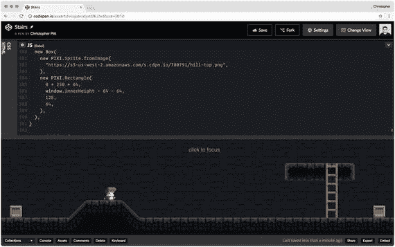

# 7. 楼梯

我们实现了跳跃和攀爬作为垂直穿越关卡的主要方式。这些动作很棒，但它们将关卡设计限制在了平台和梯子。让我们通过实现楼梯（或类似的爬坡动作）来扩展我们的设计选项。

对于这部分内容，我们需要创建更多的角色美术资源，并构建由多种角色类型组成的更复杂的方块。让我来解释我的意思……

## 构建斜坡

我已经创建了新的斜坡角色。我们还需要添加几个新的对象类型：贴花（`decal`）和斜坡（`slope`）。贴花将是一种非碰撞类型，而斜坡则可以通过玩家的碰撞检测算法来识别：

```
class LeftSlope {
get collides() {
return false
}
constructor(sprite, rectangle) {
this.sprite = sprite
this.rectangle = rectangle
}
animate(state) {
this.sprite.x = this.rectangle.x
this.sprite.y = this.rectangle.y
}
}
class RightSlope {
get collides() {
return false
}
constructor(sprite, rectangle) {
this.sprite = sprite
this.rectangle = rectangle
}
animate(state) {
this.sprite.x = this.rectangle.x
this.sprite.y = this.rectangle.y
}
}
class Decal {
get collides() {
return false
}
constructor(sprite, rectangle) {
this.sprite = sprite
this.rectangle = rectangle
}
animate(state) {
this.sprite.x = this.rectangle.x
this.sprite.y = this.rectangle.y
}
}
// ...稍后
game.addObject(
new LeftSlope(
new PIXI.Sprite.fromImage(
"path/to/sprites/slope-left.png",
),
new PIXI.Rectangle(
0 + 250,
window.innerHeight - 64 - 64 + 1,
64,
64,
),
),
)
game.addObject(
new RightSlope(
new PIXI.Sprite.fromImage(
"path/to/sprites/slope-right.png",
),
new PIXI.Rectangle(
0 + 250 + 64 + 128,
window.innerHeight - 64 - 64 + 1,
64,
64,
),
),
)
game.addObject(
new Decal(
new PIXI.Sprite.fromImage(
"path/to/sprites/hill-base.png",
),
new PIXI.Rectangle(
0 + 250,
window.innerHeight - 64 + 1,
128,
64,
),
),
)
game.addObject(
new Box(
new PIXI.Sprite.fromImage(
"path/to/sprites/hill-top.png",
),
new PIXI.Rectangle(
0 + 250 + 64,
window.innerHeight - 64 - 64 + 1,
128,
64,
),
),
)
```

这段代码摘自 [`http://codepen.io/assertchris/pen/dpmOEJ`](http://codepen.io/assertchris/pen/dpmOEJ)。

我们需要在地面之后添加这些对象，否则地面会遮挡它们。它们共同构成了一座小巧美观的小山丘。我们可以跳到它的顶部，但当我们试图在这些对象上攀爬或下降时，事情就开始变得棘手了。不过，它看起来还不错，如图 7-1 所示：



图 7-1. 小山丘

## 爬坡

为了让我们的玩家能够在斜坡上移动，我们需要再次调整碰撞检测算法：

```
if (me.x < you.x + you.width &&
me.x + me.width > you.x &&
me.y < you.y + you.height &&
me.y + me.height > you.y) {
if (object.constructor.name === "LeftSlope") {
const meCenter = Math.round(me.x + (me.width / 2))
const youRight = you.x + you.width
const youBottom = you.y + you.height
const highest = you.y - me.height
const lowest = youBottom - me.height
this.isOnGround = true
this.isOnSlope = true
me.y = lowest - (meCenter - you.x)
me.y = Math.max(me.y, highest)
me.y = Math.min(me.y, lowest)
if (me.y >= lowest || me.y <= highest) {
this.isOnSlope = false
}
return
}
if (object.constructor.name === "RightSlope") {
const meCenter = Math.round(me.x + (me.width / 2))
const youBottom = you.y + you.height
const highest = you.y - me.height
const lowest = youBottom - me.height
this.isOnGround = true
this.isOnSlope = true
me.y = lowest - (you.x + you.width - meCenter)
me.y = Math.max(me.y, highest)
me.y = Math.min(me.y, lowest)
if (me.y >= lowest || me.y <= highest) {
this.isOnSlope = false
}
return
}
if (collides && this.velocityY > 0 && you.y >= me.y) {
this.isOnGround = true
this.velocityY = 0
return
}
// ...剩余的碰撞检测代码
}
if (state.keys[32] && this.isOnGround) {
this.velocityY = this.jumpVelocity
this.isOnGround = false
this.isOnSlope = false
}
```

这段代码摘自 [`http://codepen.io/assertchris/pen/dpmOEJ`](http://codepen.io/assertchris/pen/dpmOEJ)。

如果玩家与 `LeftSlope` 碰撞，我们不会像处理方块那样进行碰撞处理。相反，我们会根据玩家在斜坡右侧的距离来减小玩家的 `y` 坐标（从而将角色向上移动）。换句话说，随着玩家的 `x` 增加，他们的 `y` 坐标会减少。

对于 `RightSlope`，我们只需交换 `x` 和 `y` 的关系，当玩家的 `x` 增加时，将他们向下移动。我们还希望玩家能够在斜坡上跳跃，所以需要将 `isOnGround` 设置为 `true`。

最后，如果玩家的底部边缘与斜坡的顶部边缘相同（或小于），我们将 `isOnSlope` 设置为 `false`，这样玩家就能在水平轴上正确移动了。

## 停留在地面之上

如果你一直在跟随代码操作，你可能已经注意到了一个奇怪的视觉错误。似乎玩家可以在碰撞检测阻止他们之前，部分地陷入地板之下。

我们可以通过在相应碰撞发生时重置玩家的 `y` 坐标来解决这个错误：

```
if (collides && this.velocityY > 0 && you.y >= me.y) {
    me.y = you.y - me.height + 1
    this.isOnGround = true
    this.velocityY = 0
    return
}
if (collides && this.velocityY < 0 && you.y + you.height >= me.y) {
    me.y = you.y + you.height
    this.velocityY = 0
    return
}
if (collides && this.velocityX > 0 && you.x >= me.x) {
    me.x = you.x - me.width
    this.velocityX = 0
    return
}
if (collides && this.velocityX < 0 && you.x <= me.x) {
    this.velocityX = 0
    return
}
```

这段代码摘自 `http://codepen.io/assertchris/pen/dpmOEJ`。

现在，当玩家撞到某物时，他们会立即被推回到边界之外。这将阻止玩家陷入地板。

## 总结

本章中，我们学习了如何制作角色无需跳跃即可行走的斜坡。这些概念可应用于古老城堡中楼梯的实现。

尝试创建属于你自己的楼梯吧。也许你的楼梯比我的更陡或更缓，你需要调整角色上升或下降的速度。