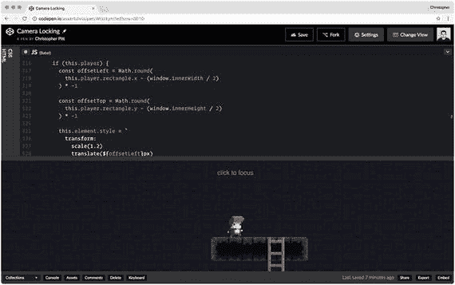

# 8. 摄像机锁定

目前为止，我们将关卡限制在浏览器窗口的尺寸内。这对于概念验证来说尚可接受，但真正的关卡需要比当前所能提供的更大空间。

我计划了几项措施来克服这一限制。首先，我们将把摄像机锁定到角色上，使其随角色移动而移动。然后，我们将扩大关卡的尺寸，使其能根据需要设定任意大小。

## 用包裹实现摄像机效果

PixiJS 并不支持任何用于渲染场景的自由移动摄像机，但我们并不需要它。我们无需移动渲染器或场景，而是将其包裹在一个 HTML 元素中并移动该元素。我们需要修改游戏的嵌入方式：

```
click to focus

.camera, .focus-target {
width: 100%;
height: 100%;
position: absolute;
top: 0;
left: 0;
}
.focus-target {
padding: 25px;
text-align: center;
}

game.addEventListenerTo(window)
game.addRendererTo(document.querySelector(".camera"))
game.animate()
```

以上代码来自 [`http://codepen.io/assertchris/pen/WGzkym`](http://codepen.io/assertchris/pen/WGzkym)。

我们首先创建一个占据整个屏幕空间的摄像机。然后，我们不将场景附加到 `document.body`，而是将其附加到 `.camera`。这使我们能够以有趣的方式变换 `.camera`：

```
animate() {
requestAnimationFrame(this.animate)
this.state.renderer = this.renderer
this.state.stage = this.stage
this.state.objects.forEach((object) => {
object.animate(this.state)
})
if (this.player) {
const offsetLeft = Math.round(
this.player.rectangle.x - (window.innerWidth / 2)
) * -1
const offsetTop = Math.round(
this.player.rectangle.y - (window.innerHeight / 2)
) * -1
this.element.style = `
transform:
scale(1.2)
translate(${offsetLeft}px)
translateY(${offsetTop}px)
`
}
this.renderer.render(this.stage)
}
// ... 稍后
const player = new Player(
new PIXI.Sprite.fromImage(
"path/to/sprites/player-idle.png",
),
new PIXI.Rectangle(
Math.round(window.innerWidth / 2),
Math.round(window.innerHeight / 2),
44,
56,
),
)
game.addObject(player)
game.player = player
```

以上代码来自 [`http://codepen.io/assertchris/pen/WGzkym`](http://codepen.io/assertchris/pen/WGzkym)。

我们需要稍微不同地创建 `player` 对象。不再直接将其添加到 `game`，而是将其声明为一个常量。我们仍然将其添加到 `game`，但同时将其赋值给一个属性。

这意味着我们可以在 `Game.animate` 内部引用它。我们获取角色的 `x` 和 `y` 坐标，然后减去屏幕一半的 `innerWidth` 和 `innerHeight`，使得角色大致位于屏幕中央。

然后我们使用 CSS 变换将 `.camera` 向左和向上移动我们刚计算出的数值。我们还可以将摄像机稍微放大，使画面看起来略有放大效果（见图 8-1）。由于这段代码位于 `Game.animate` 中，它会在每次角色渲染时更新，这意味着摄像机将随角色移动而移动。



**图 8-1.** 放大并锁定

## 扩大关卡

这引出了一个有趣的发现。当角色站在我的平台上然后跳跃时，他们会跳出渲染场景的顶部（并消失）。这是由于场景的固定高度（与窗口高度相同）所致。

为了解决这个问题，我们需要修改定义游戏尺寸以及在游戏内部放置对象的方式：

```
constructor(w, h) {
this.w = w
this.h = h
this.state = {
"keys": {},
"clicks": {},
"mouse": {},
"objects": [],
}
this.animate = this.animate.bind(this)
}
newRenderer() {
return new PIXI.autoDetectRenderer(
this.w, this.h, this.newRendererOptions(),
)
}
// ... 稍后
const width = window.innerWidth
const height = window.innerHeight + 200
const game = new Game(
width,
height,
)
game.addObject(
new Box(
new PIXI.extras.TilingSprite.fromImage(
"path/to/sprites/floor-tile.png",
width,
64,
),
new PIXI.Rectangle(
0,
height - 64,
width,
64,
),
),
)
// ... 其余对象定义
```

以上代码来自 [`http://codepen.io/assertchris/pen/WGzkym`](http://codepen.io/assertchris/pen/WGzkym)。

我们修改了 `Game` 构造函数以接受 `width` 和 `height` 参数。然后，我们不再到处使用 `window.innerWidth` 和 `window.innerHeight`，而是使用传递给 `game` 的相同宽度和高度。

到目前为止，我们都是相对于屏幕边缘添加游戏对象。这使得我们可以轻松更改宽度和高度，而无需重新定位所有游戏对象。现在，我们需要用 `width` 和 `height` 常量替换所有之前（全局）宽度和高度的实例。

唯一不删除全局引用的地方是我们刚添加的摄像机锁定代码。这些需要相对于窗口（而非整个关卡尺寸），因此它们可以保持不变。

## 总结

本章中，我们学习了如何将关卡扩展到窗口局限之外。现在我们可以将摄像机锁定到角色，从而创建错综复杂的迷宫和令人敬畏的城堡。

花点时间思考如何改进每个关卡的背景和边界，使其不像我的那样空旷。也许你可以创建动态背景来展现每个关卡的基调和位置。