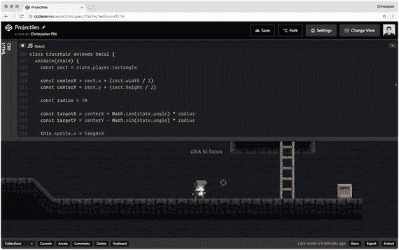

# 9. 抛射物

我们的游戏充满了键盘控制，但鼠标呢？本章将全面介绍抛射物：如何发射它们以及它们如何移动。

在本章中，我们将添加几个新的、流行的键盘控制（WASD），以及鼠标瞄准和射击。同时，我们还会添加一个自定义的瞄准准星。这会很有趣。


## 自定义准星

在显示自定义准星之前，我们需要一种方法来禁用默认鼠标光标。幸运的是，CSS 已经提供了这个机制：

```css
body {
background: url("path/to/sprites/background.png");
color: grey;
font-family: helvetica, arial;
font-size: 20px;
cursor: none;
}
```

这段代码来自 [`http://codepen.io/assertchris/pen/YGaYvy`](http://codepen.io/assertchris/pen/YGaYvy)。

只需在 `body` 中添加 `cursor: none`，就能从游戏画面中隐藏默认光标。接下来，我们将准星作为新的贴花添加进来：

```javascript
const crosshair = new Decal(
new PIXI.Sprite.fromImage(
"path/to/sprites/crosshair.png",
),
new PIXI.Rectangle(
0, 0, 18, 18,
),
)
game.addObject(crosshair)
game.crosshair = crosshair
```

这段代码来自 [`http://codepen.io/assertchris/pen/YGaYvy`](http://codepen.io/assertchris/pen/YGaYvy)。

现在可以在游戏画面的左上角看到该准星（请在浏览器窗口中缩小页面查看）。然而，这并非我们想要的位置。我们真正希望的是让它靠近玩家，但以玩家中心和鼠标光标之间的角度方向为准。

让我们捕获光标位置，并计算鼠标光标与玩家之间的角度：

```javascript
element.addEventListener("mousemove", (event) => {
this.state.mouse.clientX = event.clientX
this.state.mouse.clientY = event.clientY
const rect = this.player.rectangle
const centerX = (window.innerWidth / 2) + (rect.width / 2)
const centerY = (window.innerHeight / 2) + (rect.height / 2)
const deltaX = event.clientX - centerX
const deltaY = centerY - event.clientY
this.state.angle = Math.atan2(deltaY, deltaX)
})
```

这段代码来自 [`http://codepen.io/assertchris/pen/YGaYvy`](http://codepen.io/assertchris/pen/YGaYvy)。

这段代码有点难理解，但它所做的只是获取鼠标光标与玩家之间形成的三角形的宽度和高度。我们从该三角形计算出角度，并将其存储在游戏状态中。光标将使用这个角度（一旦我们将 `cursor = new Decal` 替换为 `cursor = new Cursor`）：

```javascript
class Ladder extends Box {
get collides() {
return false
}
}
class LeftSlope extends Box {
get collides() {
return false
}
}
class RightSlope extends Box {
get collides() {
return false
}
}
class Decal extends Box {
get collides() {
return false
}
}
class Crosshair extends Decal {
animate(state) {
const rect = state.player.rectangle
const centerX = rect.x + (rect.width / 2)
const centerY = rect.y + (rect.height / 2)
const radius = 70
const targetX = centerX + Math.cos(state.angle) * radius
const targetY = centerY - Math.sin(state.angle) * radius
this.sprite.x = targetX
this.sprite.y = targetY
}
}
```

这段代码来自 [`http://codepen.io/assertchris/pen/YGaYvy`](http://codepen.io/assertchris/pen/YGaYvy)。

在深入研究 `Crosshair.animate` 方法之前，请注意我是如何简化 `Ladder`、`LeftSlope`、`RightSlope` 和 `Decal` 的定义的？我们可以使用 `extends` 关键字来继承 `Box` 的行为。

> **注意**：继承并不总能带来良好的代码架构，但在这种简单情况下，它对我们很适用。

使用我们计算出的角度（在 `mousemove` 事件监听器中），我们计算出准星需要渲染的位置（见图 9-1）。



**图 9-1.** 固定准星

## 自定义按键

到目前为止，我们一直用方向键移动玩家。如果只需要使用键盘，这样没问题，但我们刚刚加入了鼠标瞄准。让我们在 `Player.animate` 中添加流行的 WASD 移动键：

```javascript
animate(state) {
if (state.keys[37] || state.keys[65]) { // 向左
this.velocityX = Math.max(
this.velocityX - this.accelerationX,
this.maximumVelocityX * -1,
)
}
if (state.keys[39] || state.keys[68]) { // 向右
this.velocityX = Math.min(
this.velocityX + this.accelerationX,
this.maximumVelocityX,
)
}
// ...速度计算
state.objects.forEach((object) => {
if (object === this) {
return
}
const me = this.rectangle
const you = object.rectangle
const collides = object.collides
if (me.x < you.x + you.width &&
me.x + me.width > you.x &&
me.y < you.y + you.height &&
me.y + me.height > you.y) {
if (object.constructor.name === "Ladder") {
if (state.keys[38] || state.keys[40] ||
state.keys[87] || state.keys[83]) {
this.isOnLadder = true
this.isOnGround = false
this.velocityY = 0
this.velocityX = 0
}
if (state.keys[38] || state.keys[87]) {
this.rectangle.y -= this.climbingSpeed
}
if (state.keys[40] || state.keys[83] &&
me.y + me.height < you.y + you.height) {
this.rectangle.y += this.climbingSpeed
}
if (me.y <= you.x - me.height) {
this.isOnLadder = false
}
return
}
// ...剩余碰撞检测
}
})
// ...剩余计算
}
```

这段代码来自 [`http://codepen.io/assertchris/pen/YGaYvy`](http://codepen.io/assertchris/pen/YGaYvy)。

我们添加了 `state.keys[65]` 和 `state.keys[68]` 作为左右移动的替代键。此外，为了在梯子上上下移动，我们还添加了 `state.keys[87]` 和 `state.keys[83]`。


## 射击

最后，我们来增加向准星方向射击的功能。为此，我们需要创建另一种类型的对象：

```
class Bullet extends Decal {
animate(state) {
const rect = state.player.rectangle
this.x = this.x || rect.x + rect.width
this.y = this.y || rect.y + (rect.height / 2)
this.angle = this.angle || state.angle
this.rotation = this.rotation || state.rotation
this.radius = this.radius || 0
this.radius += 15
const targetX = this.x + Math.cos(this.angle) * this.radius
const targetY = this.y - Math.sin(this.angle) * this.radius
this.sprite.x = targetX
this.sprite.y = targetY
this.sprite.rotation = this.rotation
}
}
```

此代码来自 [`http://codepen.io/assertchris/pen/YGaYvy`](http://codepen.io/assertchris/pen/YGaYvy)。

`Bullet` 的动画方式与大多数其他对象类型不同，它会在每次时钟滴答时修改自身状态。`this.x = this.x || something` 这种模式对于一次性初始化值非常有用。重要的是，我们只在子弹发射时存储 `x`、`y`、`angle` 和 `rotation` 等属性，否则当我们移动玩家或准星时，这些值会持续变化。

`radius` 从玩家前方开始，并沿着子弹发射时准星的方向增加。我们还需旋转子弹精灵，使其与角度匹配。这要求我们在鼠标事件监听器中同时存储 `rotation` 和 `angle`。此外，当鼠标点击时，我们还需创建新的子弹：

```
element.addEventListener("mousedown", (event) => {
this.state.clicks[event.which] = {
"clientX": event.clientX,
"clientY": event.clientY,
}
if (event.button === 0) { // 左键点击
const rect = this.player.rectangle
const bullet = new Bullet(
new PIXI.Sprite.fromImage(
"path/to/sprites/bullet.png",
),
new PIXI.Rectangle(
rect.x + rect.width, rect.y, 8, 8,
),
)
this.addObject(bullet)
setTimeout(() => {
this.removeObject(bullet)
}, 250)
}
})
element.addEventListener("mousemove", (event) => {
this.state.mouse.clientX = event.clientX
this.state.mouse.clientY = event.clientY
const rect = this.player.rectangle
const centerX = (window.innerWidth / 2) + (rect.width / 2)
const centerY = (window.innerHeight / 2) + (rect.height / 2)
const deltaX = event.clientX - centerX
const deltaY = centerY - event.clientY
const rotationX = event.clientX - centerX
const rotationY = event.clientY - centerY
this.state.angle = Math.atan2(deltaY, deltaX)
this.state.rotation = Math.atan2(rotationY, rotationX)
})
// ...其余的事件监听器
```

此代码来自 [`http://codepen.io/assertchris/pen/YGaYvy`](http://codepen.io/assertchris/pen/YGaYvy)。

计算 `rotation` 的方式与计算 `angle` 类似，但我们将垂直轴翻转了。当玩家点击时，我们创建一个新的 `bullet`（位于玩家前方）并将其添加到游戏中。

`250` 毫秒后，我们会移除子弹。这样做是为了确保子弹在不再需要时不会拖慢动画循环。我们需要在 `Game` 类中添加 `removeObject` 方法：

```
removeObject(object) {
this.state.objects = this.state.objects.filter(
function(next) {
return next !== object
}
)
this.stage.removeChild(object.sprite)
}
```

此代码来自 [`http://codepen.io/assertchris/pen/YGaYvy`](http://codepen.io/assertchris/pen/YGaYvy)。

在下一章创建可供射击的怪物时，我们将探讨更多的抛射体行为。

## 总结

在本章中，我们探讨了创建自定义光标和发射抛射体的方法。我们发现了一些有用的三角学知识，用于将准星约束在玩家周围的一定半径内，并进一步将子弹推出该半径范围。

请尝试调整抛射体的速度和外观。也许你正在构建一款中世纪游戏，你的抛射体是魔法箭矢。也可以考虑增加垂直加速度，让子弹飞行一段距离后落向地面。

