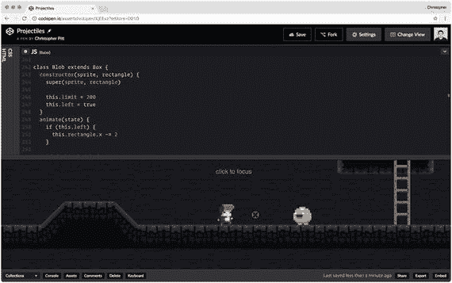

# 10. 怪物

如果玩家独自闯荡整个游戏，那该有多无聊？我们现在需要的是无脑的怪物（或者你喜欢叫它们斑点也行）来巡逻，并/或以其他方式给英雄的前进之路制造麻烦。

## 巡逻的斑点

在本章中，我们将添加巡逻的斑点，这意味着我们需要另一个类来封装它们的逻辑：

```
class Blob extends Box {
constructor(sprite, rectangle) {
super(sprite, rectangle)
this.limit = 200
this.left = true
}
animate(state) {
if (this.left) {
this.rectangle.x -= 2
}
if (!this.left) {
this.rectangle.x += 2
}
this.limit -= 2
if (this.limit <= 0) {
this.left = !this.left
this.limit = 200
}
this.sprite.x = this.rectangle.x
this.sprite.y = this.rectangle.y
}
}
```

此代码来自 [`http://codepen.io/assertchris/pen/XjEExz`](http://codepen.io/assertchris/pen/XjEExz)。

这次我们在构造函数中设置了一些属性。我们仍然希望应用父类构造函数，因此我们调用了 `super`，并提供了预期的 `sprite` 和 `rectangle` 参数。

然后，在 `animate` 方法中，我们将斑点向左或向右移动 `2` 像素（取决于斑点是否正在向左移动）。一旦斑点朝同一方向移动了 `200` 像素，我们就让它转身（并重置朝另一方向移动的 `200` 像素）。

我们应该在关卡中放置几个这样的斑点：

```
game.addObject(
new Blob(
new PIXI.Sprite.fromImage(
"path/to/sprites/blob-idle-1.png",
),
new PIXI.Rectangle(
width - 450,
height - 64 - 48,
48,
48,
),
),
)
```

此代码来自 [`http://codepen.io/assertchris/pen/XjEExz`](http://codepen.io/assertchris/pen/XjEExz)。

这段代码会将斑点放置在玩家起始位置旁边，如图 10-1 所示（至少在我的关卡中是如此）。看着它来回移动，甚至让玩家跳上它的头顶，非常有趣。



图 10-1. 巡逻的斑点

## 射击怪物

在上一章中，我们为玩家增加了发射抛射体的能力。现在让我们通过在子弹本身上添加一些碰撞检测来应用这些能力：

```
class Bullet extends Decal {
animate(state) {
const rect = state.player.rectangle
this.x = this.x || rect.x + rect.width
this.y = this.y || rect.y + (rect.height / 2)
this.angle = this.angle || state.angle
this.rotation = this.rotation || state.rotation
this.radius = this.radius || 0
this.radius += 10
const targetX = this.x + Math.cos(this.angle) * this.radius
const targetY = this.y - Math.sin(this.angle) * this.radius
this.rectangle.x = targetX
this.rectangle.y = targetY
this.sprite.x = targetX
this.sprite.y = targetY
this.sprite.rotation = this.rotation
state.objects.forEach((object) => {
if (object === this) {
return
}
const me = this.rectangle
const you = object.rectangle
if (me.x  you.x &&
me.y  you.y) {
if (object.constructor.name === "Blob") {
state.game.removeObject(object)
state.game.removeObject(this)
}
}
})
}
}
```

此代码来自 [`http://codepen.io/assertchris/pen/XjEExz`](http://codepen.io/assertchris/pen/XjEExz)。

这个碰撞检测逻辑类似于我们在 `Player` 类中做的第一次尝试。我们不需要检查斜坡或梯子之类的东西。我们只关心子弹是否与斑点碰撞。如果是，则将两者都从游戏中移除。

> **注意：** 我还稍微降低了子弹速度。尽管设想玩家几乎能追上高速子弹并不太现实，但这样游戏体验会更好一些。

虽然如果斑点的生命值持续减少会更优雅，但我们稍后会重新讨论这个话题。

## 总结

在本章中，我们向游戏添加了一种简单的怪物。我们还让我们的子弹具备了消灭这些怪物的能力。它们虽然不是最聪明（甚至最耐打）的怪物，但这是一个开始。

这正是你可以发挥创造力的地方。如果你给怪物的移动增加重力效果会怎样？或者让它们在玩家靠近之前保持静止？如果它们能反击呢？