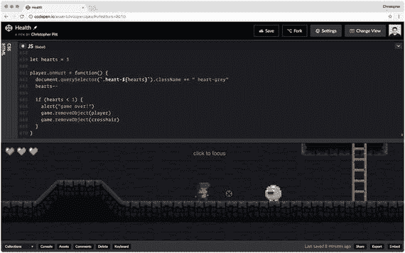

# 11. 生命值

我玩过的游戏中，很少有因第一个失误就立即失败的。通常，最终失败前会有一段很长的铺垫。索尼克（ [`https://en.wikipedia.org/wiki/Sonic_the_Hedgehog`](https://en.wikipedia.org/wiki/Sonic_the_Hedgehog) ）会失去他的金环，马里奥会失去他的能力。

本章的目标是让我们实现一个生命值系统，让玩家有机会犯错并从中学习。

## 承受伤害

（到目前为止，在我们的游戏中）玩家只有一种方式会失败：从关卡边缘跳下。然而，这并非一个真实的失败条件，因为精心设计的关卡会通过布局确保玩家永远无法到达关卡边界之外。

在制定生命值损失的细节之前，我们需要引入另一种机制来触发生命值损失。在这里，我们将引入一种机制：当玩家与史莱姆接触时，会损失生命值（并短暂失去控制）。

首先，我们需要在 `Player.animate` 中增加更多的碰撞检测逻辑：

```
if (object.constructor.name === "Blob" && !this.invulnerable) {
if (this.velocityX >= 0) {
this.velocityX = -10
} else {
this.velocityX = 10
}
this.velocityY *= -1
this.invulnerable = true
this.sprite.alpha = 0.5
setTimeout(() => {
this.invulnerable = false
this.sprite.alpha = 1
}, 2000)
if (typeof this.onHurt === "function") {
this.onHurt.apply(this)
}
}
```

这段代码来自 [`http://codepen.io/assertchris/pen/qaoyPo`](http://codepen.io/assertchris/pen/qaoyPo) 。

之前，我们在 `Bullet.animate` 中添加了针对 `Blob` 的碰撞检测。现在，我们将其添加到 `Player.animate`，这样当玩家与 `Blob` 接触时就会“受到伤害”。

**注意：** 我在这里及之前硬编码了很多东西。你可以自由地将硬编码的值抽象出来，但我选择不在每个实例中都这样做，以节省时间并保持简单。例如，你可以完全移除 `alpha` 逻辑，并通过构造函数提供 `invulnerable` 的持续时间。

现在，当玩家与史莱姆碰撞时，玩家会被向后上方弹开。玩家还会进入无敌状态，这意味着在 `2000` 毫秒内不会损失所有生命值。既然我们有了伤害玩家的方法，接下来就该处理它了。

## 显示生命值

注意到 `onHurt` 那段代码了吗？我不想将显示玩家当前生命值的界面更改硬编码。通过调用用户提供的函数，我们可以将该行为外包给创建玩家的代码。

虽然试图将所有内容都塞进 PixiJS 模型很诱人，但我们是在 Web 环境中编码。我们不通过 PixiJS 渲染器和场景来渲染玩家的生命值，而是使用 HTML 和 CSS 来显示生命条。而且，由于我们有办法通过 `onHurt` 将内部伤害行为与外部环境联系起来，这应该不会太难。

让我们创建所需的 HTML 元素：

```
click to focus

.camera, .hud, .focus-target {
width: 100%;
height: 100%;
position: absolute;
top: 0;
left: 0;
}
.hud {
.heart {
width: 32px;
height: 28px;
background-image: url("path/to/sprites/heart-red.png");
position: absolute;
top: 15px;
}
.heart-1 {
left: 15px;
}
.heart-2 {
left: 57px;
}
.heart-3 {
left: 99px;
}
.heart-grey {
background-image: url("path/to/sprites/heart-grey.png");
}
}
```

这段代码来自 [`http://codepen.io/assertchris/pen/qaoyPo`](http://codepen.io/assertchris/pen/qaoyPo) 。

这个标记在屏幕左上角添加了三颗红心。当玩家受伤时，我们将它们逐一变为灰色：

```
let hearts = 3
player.onHurt = function() {
document.querySelector(".heart-" + hearts)
.className += " heart-grey"
hearts--
if (hearts < 1) {
alert("game over!")
game.removeObject(player)
game.removeObject(crosshair)
}
}
```

这段代码来自 [`http://codepen.io/assertchris/pen/qaoyPo`](http://codepen.io/assertchris/pen/qaoyPo) 。

这比我最初预想的要简单得多。每次调用 `onHurt` 函数时，我们都会获取与剩余心数对应的元素，并将其变为灰色，如图 11-1 所示（这要归功于我们之前添加的 `.heart-grey` 类）。



**图 11-1.** 承受伤害

如果玩家用完了最后一颗心，我们会弹出一个警告（尽管将其设计成样式化的“游戏结束”消息可能会更好），并从游戏中移除玩家和准星。

## 本章小结

在本章中，我们添加了第一种合理的玩家失败方式。既然存在了危险，游戏体验应该会更加有趣。

我们还创建了一种将内部事件（如玩家受伤）与外部行为联系起来的方法。你不必在玩家受伤时就将其淘汰。你可以尝试将他们传送回关卡起点，或降低他们的能力。选择权在你手中。

