# Android 计算平台简介

如今，计算资源比以往任何时候都更容易获取。手持设备已转变为计算平台。无论是手机还是平板电脑，移动设备如今在通用计算方面的能力之强，使其正成为*真正*的个人电脑（PC）。所有传统 PC 制造商都在基于 Android 操作系统生产各种形态的设备。操作系统、计算平台、编程语言和开发框架之间的竞争正在转移并重新应用于移动设备。

我们还看到移动编程的激增，越来越多的 IT 应用开始提供对应的移动版本。在本书中，我们将向您展示如何利用您的 Java 技能，为运行在谷歌 Android 平台（[`http://developer.android.com/index.html`](http://developer.android.com/index)）上的设备编写程序，这是一个面向移动和平板开发的开放源码平台。

**注意：** 我们对 Android 感到兴奋，因为它是一个基于 Java 的先进平台，在框架设计中引入了许多新的范式（即使是在移动平台的限制下）。

在本章中，我们将概述 Android 及其 SDK，简要介绍关键软件包，介绍每章将要涵盖的内容，向您展示如何利用 Android 源码，并强调为 Android 平台编程的优势。

### 新型个人电脑的新平台

Android 平台秉持手持设备通用计算的思想。它是一个全面的平台，其特点在于基于 Linux 的操作系统堆栈，用于管理设备、内存和进程。Android 的 Java 库涵盖了电话、视频、语音、图形、连接、用户界面编程以及设备的其他许多方面。

**注意：** 尽管是为移动和平板设备构建的，但 Android 平台展现出全功能桌面框架的特性。谷歌通过一个名为 Android SDK 的软件开发工具包（SDK）将这些框架开放给 Java 程序员。当您使用 Android SDK 时，您很少会觉得自己是在为移动设备编程，因为您可以访问在台式机或服务器上使用的大多数类库——包括一个关系型数据库。

Android SDK 支持大部分 Java 平台标准版（Java SE），但抽象窗口工具包（AWT）和 Swing 除外。取代 AWT 和 Swing 的，是 Android SDK 自己*广泛而现代化的 UI 框架*。由于您是用 Java 编写应用程序，您可能会认为需要一个负责解释运行时 Java 字节码的 Java 虚拟机（JVM）。JVM 通常提供必要的优化，帮助 Java 达到与 C 和 C++等编译型语言相媲美的性能水平。Android 提供了自己的优化型 JVM 来运行编译后的 Java 类文件，以应对手持设备在内存、处理器速度和功耗等方面的限制。这个虚拟机被称为 Dalvik VM，我们将在后面的章节“深入探讨 Dalvik VM”中探讨。

**注意：** Java 编程语言的熟悉性和简洁性，加上 Android 庞大的类库，使得 Android 成为一个极具吸引力的编程平台。

图 1-1 提供了 Android 软件堆栈的概览。（我们将在“理解 Android 软件堆栈”一节中提供更多细节。）

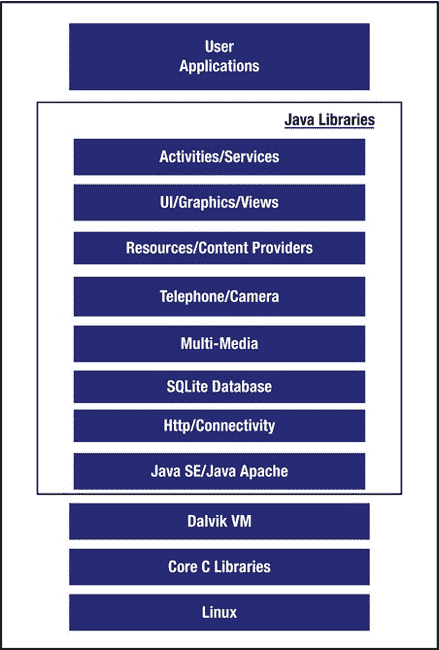

***图 1-1.** Android 软件堆栈的高层视图*

### Android 的早期历史

手机使用多种操作系统，例如塞班 OS、微软 Windows Phone OS、移动 Linux、iPhone OS（基于 Mac OS X）、Moblin（英特尔出品）以及许多其他专有操作系统。到目前为止，还没有哪个操作系统成为事实上的标准。用于开发移动应用的可用 API 和环境限制太多，与桌面框架相比似乎远远落后。相比之下，Android 平台承诺了开放性、低廉成本、开源代码，更重要的是，一个高端、一体化、一致的开发框架。

谷歌于 2005 年收购了初创公司 Android Inc.，开始了 Android 平台的开发（参见图 1-2）。Android Inc.的关键人物包括安迪·鲁宾、里奇·迈纳、尼克·西尔斯和克里斯·怀特。

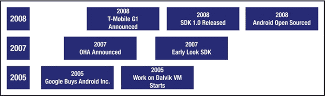

***图 1-2.** Android 早期时间线*

Android SDK 于 2007 年 11 月首次作为“早期预览”版本发布。2008 年 9 月，T-Mobile 宣布推出 T-Mobile G1，这是第一款基于 Android 平台的智能手机。自那以后，我们看到了 SDK 2.0、3.0，现在又有了 4.0，大约每年发布一个版本。运行 Android 的设备起初只是涓涓细流，但现在已是汹涌潮流。

Android 的关键架构目标之一是允许应用程序之间相互交互并复用彼此的组件。这种复用不仅适用于服务，也适用于数据和用户界面（UI）。

Android 凭借其完善的功能，能够利用网络资源提供的云计算模型，并通过手机上本地数据存储来增强这种体验，因而很早就吸引了追随者并保持了开发者的势头。Android 在手机上对关系型数据库的支持也在其早期采用中发挥了作用。

在 1.0 和 1.1 版本（2008 年）中，Android 不支持软键盘，要求设备配备物理按键。Android 于 2009 年 4 月发布了 1.5 SDK，解决了这个问题，同时还带来了许多其他功能，例如高级媒体录制能力、小部件和动态文件夹。

2009 年 9 月，Android 操作系统 1.6 版本发布，一个月内又推出了 Android 2.0，这促使大量 Android 设备在 2009 年圣诞季涌入市场。该版本引入了高级搜索功能和文本转语音功能。

在 Android 2.3 中，重要的功能包括管理员远程擦除安全数据、在弱光条件下使用摄像头和视频、Wi-Fi 热点、显著的性能改进、改进的蓝牙功能、可选地将应用安装到 SD 卡、支持 OpenGL ES 2.0、备份改进、搜索可用性改进、用于信用卡处理的近场通信支持、大幅改进的动作和传感器支持（类似 Wii）、视频聊天以及改进的 Market。

Android 3.0 专注于平板设备以及更强大的双核处理器，如 NVIDIA Tegra 2。此版本的主要功能包括支持使用更大的屏幕。引入了一个名为“碎片”（Fragments）的重要新概念。碎片贯穿于 3.0 的使用体验之中。引入了更多类似桌面的功能，如操作栏和拖放。主屏幕小部件得到了显著增强，并且提供了更多 UI 控件。在 3D 领域，OpenGL 通过 Renderscript 得到了增强，进一步补充了 ES 2.0。这为平板电脑带来了令人兴奋的引入。

然而，3.0 的体验仅限于平板电脑。在 3.0 发布时，Android 的 2.x 分支继续服务于手机，而 3.x 分支服务于平板电脑。从 4.0 开始，Android 合并了这些分支，形成了一个统一的 SDK。对于手机用户来说，主要的 UI 差异在于，平板的体验也被带到了手机上。

4.0 用户体验的关键方面如下：


```markdown
*   一种名为`Roboto`的新字体，可在高密度屏幕上提供清晰度。
*   一种在主页上将应用组织到文件夹中的更好方法。
*   能够将应用和文件夹拖入始终位于设备底部的收藏夹栏。
*   基于设备类型的通知优化。对于小型设备，它们显示在顶部；对于大型设备，它们显示在底部系统栏中。
*   可调整大小、可滚动的窗口小部件。
*   多种解锁屏幕的方式。
*   拼写检查器。
*   改进的语音输入，带有“连续说话”选项。
*   更多用于管理网络数据使用量的控件。
*   增强的联系人应用程序，带有类似于社交网络的个人资料。
*   对日历应用程序的增强。
*   更好的相机应用：连续对焦、零快门延迟、人脸检测、点击对焦以及照片编辑器。
*   图片和视频的实时特效，用于实现有趣的效果。
*   一种快速截取和分享屏幕截图的方法。
*   快两倍的浏览器性能。
*   改进的电子邮件。
*   一个用于基于 NFC 共享的新概念，称为 Android Beam。
*   支持`Wi-Fi Direct`以促进 P2P 服务。
*   蓝牙健康设备配置文件。

开发者对 4.0 支持的关键方面包括：

*   基于对象（包括视图）属性变化的革新动画
*   修正了 3.0 版本中基于列表的窗口小部件行为的固定数量问题
*   更加成熟的操作栏，集成了搜索功能
*   支持多种移动标准：高级音频分发配置文件（`A2DP`：使用外部扬声器的能力）、实时传输协议（`RTP`：通过 IP 流式传输音频/视频）、媒体传输协议（`MTP`）、图片传输协议（`PTP`：用于连接计算机下载照片和媒体）以及蓝牙耳机配置文件（`HSP`）
*   全设备加密
*   数字版权管理（`DRM`）
*   加密存储和密码
*   涉及个人资料的社交 API
*   增强的日历 API
*   语音邮件 API

#### 深入探究 Dalvik 虚拟机

作为 Android 的一部分，谷歌投入了大量时间来思考如何针对低功耗手持设备优化设计。手持设备在内存和速度方面落后其桌面同类产品八到十年。它们的计算能力也有限。因此，对手机端的性能要求非常严格，要求手机设计者优化一切。如果你查看 Android 中的软件包列表，你会发现它们功能齐全且广泛。

这些问题促使谷歌在许多方面重新审视标准的 JVM 实现。谷歌实现此 JVM 的关键人物是 Dan Bornstein，他编写了 Dalvik 虚拟机——Dalvik 是冰岛一个城镇的名称。Dalvik 虚拟机获取生成的 Java 类文件，并将它们合并到一个或多个 Dalvik 可执行（`.dex`）文件中。Dalvik 虚拟机的目标是尽一切可能优化 JVM，以节省空间、提高性能和延长电池寿命。

由于 Dalvik 虚拟机，Android 中的最终可执行代码不是基于 Java 字节码，而是基于`.dex`文件。这意味着你不能直接执行 Java 字节码；你必须从 Java 类文件开始，然后将它们转换为可链接的`.dex`文件。

#### 理解 Android 软件栈

到目前为止，我们已经介绍了 Android 的历史及其优化特性，包括 Dalvik 虚拟机，并且我们已经暗示了可用的 Java 编程栈。在本节中，我们将介绍 Android 的开发方面。图 1–3 从开发者的角度展示了 Android 软件栈。

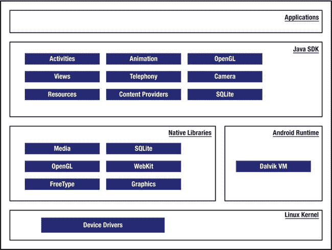

***图 1–3.** 详细的 Android SDK 软件栈*

Android 平台的核心是 Linux 内核，负责设备驱动程序、资源访问、电源管理和其它操作系统职责。提供的设备驱动程序包括：显示、相机、键盘、Wi-Fi、闪存、音频和进程间通信（`IPC`）。尽管核心是 Linux，但在诸如摩托罗拉 Droid 这样的 Android 设备上，绝大多数（如果不是全部）应用程序都是用 Java 开发的，并通过 Dalvik 虚拟机运行。

位于内核之上的下一层是许多 C/C++库，例如`OpenGL`、`WebKit`、`FreeType`、安全套接字层（`SSL`）、C 运行时库（`libc`）、`SQLite`和媒体库。基于伯克利软件发行版（`BSD`）的系统 C 库已针对基于嵌入式 Linux 的设备进行了调整（大小大约减半）。媒体库基于 PacketVideo（[`www.packetvideo.com`](http://www.packetvideo.com/)）的`OpenCORE`。这些库负责音频和视频格式的录制与回放。一个名为`Surface Manager`的库控制对显示系统的访问，并支持 2D 和 3D。

**注意：** 这些核心库可能会发生变化，因为它们都是 Android 的内部实现细节，并未直接暴露给发布的 Android API。我们指出这些核心库只是为了让你了解 Android 底层架构的本质。有关更新和未来的见解，请参考 Android 开发者网站。

`WebKit`库负责浏览器支持；它与支持谷歌 Chrome 和苹果 Safari 的是同一个库。`FreeType`库负责字体支持。`SQLite`（[`www.sqlite.org/`](http://www.sqlite.org/)）是一个设备本身可用的关系数据库。`SQLite`也是一个独立的关系数据库开源项目，与 Android 没有直接关联。你也可以获取并使用为`SQLite`设计的工具来处理 Android 数据库。

大多数应用程序框架通过 Dalvik 虚拟机访问这些核心库，Dalvik 虚拟机是通往 Android 平台的门户。正如我们在前几节中指出的，Dalvik 经过优化，可以运行多个虚拟机实例。当 Java 应用程序访问这些核心库时，每个应用程序都会获得自己的虚拟机实例。

Android Java API 的主要库包括：电话、资源、位置、UI、内容提供者（数据）和包管理器（安装、安全等）。程序员在此 Java API 之上开发最终用户应用程序。设备上的一些最终用户应用程序示例包括：主页、联系人、电话和浏览器。

Android 还支持一个名为`Skia`的自定义谷歌 2D 图形库，它用 C 和 C++编写。`Skia`也构成了谷歌 Chrome 浏览器的核心。然而，Android 中的 3D API 基于来自 Khronos Group（[`www.khronos.org`](http://www.khronos.org)）的`OpenGL ES`实现。`OpenGL ES`包含针对嵌入式系统优化的`OpenGL`子集。

从媒体角度来看，Android 平台支持最常见的音频、视频和图片格式。从无线角度来看，Android 拥有支持蓝牙、EDGE、3G、Wi-Fi 和全球移动通信系统（`GSM`）电话功能的 API，具体取决于硬件。

#### 使用 Android SDK 开发最终用户应用程序

在本节中，我们将向你介绍你将在 Android 上开发最终用户应用程序时使用的高级 Android Java API。我们将简要讨论 Android 模拟器、Android 基础组件、UI 编程、服务、媒体、电话功能、动画等。
```


#### Android 模拟器

Android SDK 附带一个名为 Android Development Tools (ADT) 的 Eclipse 插件。您将使用此集成开发环境（IDE）来开发、调试和测试您的 Java 应用程序。（我们将在第 2 章中深入介绍 ADT。）您也可以不使用 ADT，而是改用命令行工具来使用 Android SDK。这两种方法都支持一个模拟器，您可以使用它来运行、调试和测试您的应用程序。您甚至不需要真实设备就能完成 90% 的应用程序开发。功能齐全的 Android 模拟器模仿了大多数设备功能。模拟器的局限性包括 USB 连接、摄像头和视频捕获、耳机、电池模拟、蓝牙、Wi-Fi、NFC 以及 OpenGL ES 2.0。

Android 模拟器通过一种名为 QEMU 的开源“处理器模拟器”技术来完成其工作，该技术由 Fabrice Bellard 开发（[`http://wiki.qemu.org/Index.html`](http://wiki.qemu.org/Index.html)）。这种技术允许在一个操作系统之上模拟另一个操作系统，而与处理器无关。QEMU 允许在 CPU 级别进行模拟。

在 Android 模拟器中，处理器基于 Advanced RISC Machine (ARM)。ARM 是一种基于精简指令集计算 (RISC) 的 32 位微处理器架构，通过减少指令集中的指令数量来实现设计简单性和速度。模拟器在此模拟处理器上运行 Android 版本的 Linux。

ARM 广泛用于手持设备和其他对低功耗非常重要的嵌入式电子产品。大部分移动市场都使用基于此架构的处理器。

您可以在 Android SDK 文档中找到关于模拟器的更多详细信息，网址为 [`http://developer.android.com/guide/developing/tools/emulator.html`](http://developer.android.com/guide/developing/tools/emulator.html)。

#### Android UI

Android 使用一个类似于其他基于桌面的、功能齐全的 UI 框架。事实上，它在本质上更现代且更具异步性。如果您将传统的基于 C 的 Microsoft Windows API 视为第一代，将基于 C++ 的 Microsoft Foundation Classes (MFC) 视为第二代，那么 Android UI 本质上是一个第四代 UI 框架。基于 Java 的 Swing UI 框架将是第三代，它引入了远超 MFC 的设计灵活性。Android UI、JavaFX、Microsoft Silverlight 和 Mozilla XML User Interface Language (XUL) 都属于这种新型的第四代 UI 框架，其 UI 是声明式的且独立于主题。

**注意：** 在 Android 中，即使用于编程的设备可能是手持设备，您也使用现代用户界面范例进行编程。

Android UI 编程涉及在 XML 文件中声明界面。然后，您将这些 XML 视图定义作为窗口加载到 UI 应用程序中。这与基于 HTML 的网页非常相似。与 HTML 中一样，您通过其 ID 查找（获取）各个控件，并使用 Java 代码对其进行操作。

即使是 Android 应用程序中的菜单也是从 XML 文件中加载的。Android 中的屏幕或窗口通常被称为 *activity*，它包含用户完成逻辑操作单元所需的多个视图。*视图* 是 Android 的基本 UI 构建块，您可以进一步将它们组合成称为 *视图组* 的复合视图。

视图在内部使用了熟悉的画布、绘制和用户交互概念。托管这些包含视图和视图组的复合视图的 Activity 是 Android 中可替换的逻辑 UI 组件。

Android 3.0 引入了一个名为 *片段* 的新 UI 概念，允许开发者将视图和功能分块以在平板电脑上显示。平板电脑提供了足够的屏幕空间用于多窗格 Activity，而片段则为这些窗格提供了抽象。

Android 框架的关键概念之一是 Activity 窗口的生命周期管理。建立了协议，以便 Android 可以在用户隐藏、恢复、停止和关闭 Activity 窗口时管理状态。您将在第 2 章中了解这些基本概念，同时还会介绍如何设置 Android 开发环境。

#### Android 基础组件

Android UI 框架以及 Android 的许多其他部分，都依赖于一个名为 *intent* 的新概念。Intent 是一种用于在 Android 中调用组件的进程内和进程间机制。

Android 中的组件是一段具有明确定义生命周期的代码。表示 Android 应用程序中窗口的 Activity 是一个组件。在 Android 进程中运行并为其他客户端提供服务的是一个组件。响应事件而唤醒的接收器是 Android 中组件的另一个例子。

在满足调用组件这一主要需求的同时，Intent 表现出的特性与窗口消息、动作、发布-订阅模型和进程间通信的特性相似。以下是使用`Intent`类调用或启动 Web 浏览器的示例：

```java
public static void invokeWebBrowser(Activity activity)
{
    Intent intent = new Intent(Intent.ACTION_VIEW);
    intent.setData(Uri.parse("http://www.google.com"));
    activity.startActivity(intent);
}
```

在此示例中，通过 Intent，我们请求 Android 启动一个合适的窗口来显示网站内容。根据设备上安装的浏览器列表，Android 将选择一个合适的浏览器来显示该网站。您将在第 5 章中了解更多关于 Intent 的内容。

Android 对 *资源* 提供了广泛支持，这些资源包括字符串和位图等内容，以及一些不太熟悉的项目，如基于 XML 的视图（类似于 HTML 的布局）定义。Android 框架以一种新颖的方式使用资源，使其使用变得简单、直观和方便。以下是一个示例，其中资源 ID 是为 XML 文件中定义的资源自动生成的：

```java
public final class R {
    //所有字符串资源的常量将在此处自动生成
    public static final class string {
        public static final int hello=0x7f070000;
    }
    //所有图像文件将在此处生成唯一 ID
    public static final class drawable {
        public static final int myanimation=0x7f020001;
        public static final int numbers19=0x7f02000e;
    }
    //视图 ID 根据其名称自动生成
    public static final class id {
        public static final int textViewId1=0x7f080003;
    }
    //以下两个文件（类似 html）定义布局
    //根据各自子目录中的文件名自动生成。
    public static final class layout {
        public static final int frame_animations_layout=0x7f030001;
        public static final int main=0x7f030002;
    }
}
```

此类中的每个自动生成的 ID 对应于 XML 文件中的一个元素或整个文件本身。在您想要使用这些 XML 定义的任何地方，您都将使用这些生成的 ID。当涉及到根据区域设置、设备大小等特化资源时，这种间接引用非常有帮助。（第 3 章更详细地介绍了`R.java`文件和资源。）

Android 中的另一个新概念是 *内容提供者*。内容提供者是对数据源的抽象，使其看起来像是 RESTful 服务的提供者和消费者。底层的 SQLite 数据库使内容提供者这一功能成为应用程序开发者的强大工具。我们将在第 4 章中介绍内容提供者。在第 3 章、第 4 章和第 5 章中，我们将讨论 Intent、资源和内容提供者如何促进 Android 平台的开放性。


### 高级 UI 概念

XML 页面布局定义（类似于 HTML 网页）在描述 Android UI 方面起着至关重要的作用。我们来看一个例子，看看 Android 布局 XML 文件是如何为一个包含文本视图的简单布局做到这一点的：

```
<?xml version="1.0" encoding="utf-8"?>
<!-- 将其放置在 /res/layout/sample_page1.xml -->
<!-- 将自动生成一个名为：R.layout.sample_page1 的 id -->
<LinearLayout ..some basic attributes..>
<TextView android:id="@+id/textViewId"  
    android:layout_width="fill_parent"
    android:layout_height="wrap_content"
    android:text="@string/hello"
    />
</LinearLayout>
```

你将使用为此 XML 文件生成的 ID，将此布局加载到 Activity 窗口中。（我们将在第 6 章中介绍这个过程。）Android 还广泛支持菜单（更多内容详见第 7 章），从标准菜单到上下文菜单。你会发现 Android 中的菜单使用起来很方便，因为它们也是作为 XML 文件加载的，并且这些菜单的资源 ID 是自动生成的。以下是在 XML 文件中声明菜单的方法：

```
<menu >
    <!-- 此组使用默认类别。 -->
    <group android:id="@+id/menuGroup_Main">
        <item android:id="@+id/menu_clear"
            android:orderInCategory="10"
            android:title="clear" />
        <item android:id="@+id/menu_show_browser"
            android:orderInCategory="5"
            android:title="show browser" />
    </group>
</menu>
```

Android 支持对话框，并且 Android 中的所有对话框都是异步的。这些异步对话框给习惯了某些窗口框架中同步模式对话框的开发人员带来了特殊的挑战。我们将在第 7 章中讨论菜单，并在第 9 章中讨论对话框。

Android 提供了对动画的广泛支持。实现动画有三种基本方式。你可以进行逐帧动画。或者，你可以通过更改视图变换矩阵（位置、缩放、旋转和透明度）来提供补间动画。或者，你也可以通过更改对象的属性来做补间动画。基于属性的动画是在 3.0 中引入的，是实现动画最灵活且推荐的方式。所有这些动画都将在第 21 章中介绍。

此外，Android 允许你在 XML 资源文件中定义这些动画。看看这个例子，其中一系列编号的图片以逐帧动画的形式播放：

```
<animation-list
        android:oneshot="false">
    <item android:drawable="@drawable/numbers11" android:duration="50" />
   ……
    <item android:drawable="@drawable/numbers19" android:duration="50" />
 </animation-list>
```

Android 还通过实现 OpenGL ES 1.0 和 2.0 标准来支持 3D 图形。OpenGL ES 和 OpenGL 一样，是一个基于 C 语言的扁平化 API。而 Android SDK 由于是基于 Java 的编程 API，需要利用 Java 绑定来访问 OpenGL ES。Java ME 已经通过 Java 规范请求（JSR）239 为 OpenGL ES 定义了这种绑定，Android 在其实现中使用了相同的 Java 绑定来对接 OpenGL ES。如果你不熟悉 OpenGL 编程，学习曲线会比较陡峭。由于篇幅限制，我们无法在本书第四版中涵盖 OpenGL 的内容。不过，在我们的第三版中，有超过 100 页的相关内容。

Android 有许多围绕主屏幕的 *信息触手可及* 概念。首先是*实时文件夹*。使用实时文件夹，你可以将一组项目作为文件夹发布到主屏幕上。该集合的内容会随着底层数据的变化而变化。这种变化的数据可以来自设备本地，也可以来自互联网。由于篇幅限制，我们无法在本书第四版中涵盖实时文件夹的内容。不过，第三版中包含了广泛的介绍。

第二个基于主屏幕的概念是*主屏幕小部件*。主屏幕小部件用于使用 UI 小部件在主屏幕上绘制信息。这些信息可以按固定时间间隔更新。例如，你的电子邮件存储中的电子邮件数量。我们在第 25 章中介绍主屏幕小部件。主屏幕小部件在 3.0 中得到了增强，增加了列表视图，当底层数据发生变化时，这些列表视图可以更新。这些增强功能在第 26 章中介绍。

*集成的 Android 搜索*是第三个基于主屏幕的概念。使用集成搜索，你可以在设备本地以及整个互联网上搜索内容。Android 搜索的功能不止于此，它还允许你通过搜索控件触发命令。由于篇幅限制，我们无法在本书第四版中涵盖搜索 API 的内容。不过，第三版中包含了相关介绍。

Android 还支持触摸屏和基于手指在设备上移动的手势。Android 允许你将屏幕上的任意随机运动录制为命名手势。然后，应用程序可以使用此手势来指示特定的操作。我们在第 27 章中介绍触摸屏和手势。

传感器现在已成为移动体验中重要的一部分。我们在第 29 章中介绍传感器。

移动设备所需的另一项必要创新是其配置的动态特性。例如，很容易将手持设备在纵向和横向查看模式之间切换。或者你可以将手持设备对接以变成笔记本电脑。Android 3.0 引入了一个名为“片段”的概念来有效处理这些变化。第 8 章专门介绍片段，而第 12 章则讨论如何处理配置变更。

我们还在第 10 章中介绍了操作栏的 3.0 特性（该特性在 4.0 中得到了极大增强）。操作栏使得 Android 能够与桌面菜单栏范式相媲美。

拖放功能是在 3.0 中为平板电脑引入的。此功能现在也可用于手机。我们在第 28 章中介绍拖放功能。

手持设备完全能够感知基于云的环境。为了进行服务器端 HTTP 调用，理解线程模型以避免“应用程序无响应”消息至关重要。我们在第 18 章中介绍可用于异步处理的机制。

在 Android SDK 之外，还有许多独立的创新正在发生，使得开发变得既令人兴奋又简单。一些例子包括 XML/VM、PhoneGap 和 Titanium。Titanium 允许你使用 HTML 技术来为基于 WebKit 的 Android 浏览器编程。我们在本书第二版中介绍了 Titanium。然而，由于时间和篇幅限制，我们不在本版中介绍 Titanium。

### Android 服务组件

安全性是 Android 平台的基础组成部分。在 Android 中，安全贯穿应用程序生命周期的所有阶段——从设计阶段的策略考量到运行时的边界检查。我们在第 14 章中介绍安全性和权限。

在第 15 章中，我们将向你展示如何在 Android 中构建和使用服务，特别是 HTTP 服务。本章还将涵盖进程间通信（同一设备上应用程序之间的通信）。

基于位置的服务是 Android SDK 中另一个更令人兴奋的组件。SDK 的这一部分为应用程序开发者提供了用于显示和操作地图，以及获取实时设备位置信息的 API。我们将在第 22 章中详细介绍这些概念。


  
#### Android 媒体与电话组件  

Android 提供了涵盖音频、视频和电话组件的 API。第 23 章将介绍电话 API，而音频和视频 API 将在第 24 章中详细讲解。  

从 Android 2.0 开始，Android 内置了 Pico 文本转语音引擎。由于篇幅限制，本书第四版未能包含文本转语音的相关内容，第三版则已涵盖文本转语音 API。  

最后同样重要的是，Android 通过创建一个定义应用程序包的 XML 文件，将这些概念整合到一个应用中。该文件被称为应用的 *清单文件*（`AndroidManifest.xml`）。示例如下：  

```
<?xml version="1.0" encoding="utf-8"?>
<manifest
      package="com.ai.android.HelloWorld"
      android:versionCode="1"
      android:versionName="1.0.0">
    <application android:icon="@drawable/icon" android:label="@string/app_name">
        <activity android:name=".HelloWorld"
                  android:label="@string/app_name">
            <intent-filter>
                <action android:name="android.intent.action.MAIN" />
                <category android:name="android.intent.category.LAUNCHER" />
            </intent-filter>
        </activity>
    </application>
</manifest>
```

Android 清单文件用于定义 Activity、注册服务和内容提供者，以及声明权限。随着本书各章节的深入，我们将逐一介绍清单文件的详细信息。  

#### Android Java 包  

快速了解 Android 平台的一种方式是查看 Java 包的结构。由于 Android 与标准 JDK 发行版存在差异，了解哪些功能被支持、哪些不被支持至关重要。以下是 Android SDK 中包含的重要包的简要说明：  


`android.app`：实现了 Android 的应用程序模型。主要类包括代表启动和停止语义的 `Application`，以及大量与活动相关的类、片段、控件、对话框、提醒和通知。我们在本书中会用到其中的大部分类。

`android.app.admin`：提供了让企业管理员等人员控制设备的能力。

`android.accounts`：提供了用于管理 Google、Facebook 等账户的类。主要类是 `AccountManager` 和 `Account`。我们在第 30 章讨论联系人 API 时会简要介绍这个 API。

`android.animation`：包含了所有新的属性动画类。这些类在第 21 章中有详尽的介绍。

`android.app.backup`：为应用程序提供了在用户更换设备时备份和恢复数据的钩子。

`android.appwidget`：提供了主屏幕小部件的功能。当我们讨论主屏幕小部件（包括基于列表的小部件）时，第 25 章和第 26 章会详细涵盖这个包。

`android.bluetooth`：提供了大量用于处理蓝牙功能的类。主要类包括 `BluetoothAdapter`、`BluetoothDevice`、`BluetoothSocket`、`BluetoothServerSocket` 和 `BluetoothClass`。你可以使用 `BluetoothAdapter` 来控制本地安装的蓝牙适配器。例如，你可以启用、禁用它，并启动发现过程。`BluetoothDevice` 代表你正在连接的远程蓝牙设备。两个蓝牙套接字用于在设备之间建立通信。蓝牙类代表你正在连接的蓝牙设备类型。

`android.content`：实现了内容提供者的概念。内容提供者抽象了来自数据存储的数据访问。这个包还实现了关于意图和 Android 统一资源标识符（URI）的核心思想。这些类在第 4 章中有介绍。

`android.content.pm`：实现了与包管理器相关的类。包管理器了解权限、已安装的包、已安装的提供者、已安装的服务、已安装的组件（如活动）以及已安装的应用程序。

`android.content.res`：提供了对资源文件（结构化和非结构化）的访问。主要类是 `AssetManager`（用于非结构化资源）和 `Resources`。这个包中的一些类在第 3 章中有介绍。

`android.database`：实现了抽象数据库的概念。主要接口是 `Cursor` 接口。这个包中的一些类在第 4 章中有介绍。

`android.database.sqlite`：使用 SQLite 作为物理数据库来实现 `android.database` 包中的概念。主要类是 `SQLiteCursor`、`SQLiteDatabase`、`SQLiteQuery`、`SQLiteQueryBuilder` 和 `SQLiteStatement`。不过，你大部分交互会使用来自抽象的 `android.database` 包中的类。

`android.drm`：与数字版权管理相关的类。

`android.gesture`：包含了处理用户定义手势所需的所有类和接口。主要类是 `Gesture`、`GestureLibrary`、`GestureOverlayView`、`GestureStore`、`GestureStroke` 和 `GesturePoint`。一个 `Gesture` 是 `GestureStrokes` 和 `GesturePoints` 的集合。手势被收集在 `GestureLibrary` 中。手势库存储在 `GestureStore` 中。手势有名称，以便被识别为操作。这个包中的一些类在第 27 章中有介绍。

`android.graphics`：包含 `Bitmap`、`Canvas`、`Camera`、`Color`、`Matrix`、`Movie`、`Paint`、`Path`、`Rasterizer`、`Shader`、`SweepGradient` 和 `TypeFace` 这些类。

`android.graphics.drawable`：实现了绘图协议和背景图像，并允许 drawable 对象的动画。

`android.graphics.drawable.shapes`：实现了形状，包括 `ArcShape`、`OvalShape`、`PathShape`、`RectShape` 和 `RoundRectShape`。

`android.hardware`：实现了与物理相机相关的类。`Camera` 代表硬件相机，而 `android.graphics.Camera` 代表一个与物理相机完全无关的图形概念。

`android.hardware.usb`：让你能够从 Android 与 USB 设备通信。

`android.location`：包含 `Address`、`GeoCoder`、`Location`、`LocationManager` 和 `LocationProvider` 这些类。`Address` 类代表简化的可扩展地址语言（XAL）。`GeoCoder` 允许你根据一个地址获取经纬度坐标，反之亦然。`Location` 代表经纬度。这个包中的一些类在第 22 章中有介绍。

`android.media`：包含 `MediaPlayer`、`MediaRecorder`、`Ringtone`、`AudioManager` 和 `FaceDetector` 这些类。支持流式传输的 `MediaPlayer` 用于播放音频和视频。`MediaRecorder` 用于录制音频和视频。`Ringtone` 类用于播放可以用作铃声和通知的短音片段。`AudioManager` 负责音量控制。你可以使用 `FaceDetector` 来检测位图中的人脸。这个包中的一些类在第 24 章中有介绍。

`android.media.audiofx`：提供音频效果。

`android.media.effect`：提供视频效果。

`android.mtp`：提供了与相机和音乐设备交互的能力。

`android.net`：实现了基本的套接字级网络 API。主要类包括 `Uri`、`ConnectivityManager`、`LocalSocket` 和 `LocalServerSocket`。这里还值得一提的是，Android 在浏览器级别和网络级别都支持 HTTPS。Android 的浏览器也支持 JavaScript。

`android.net.rtp`：支持流式传输协议。

`android.net.sip`：提供对 VOIP 的支持。

`android.net.wifi`：管理 Wi-Fi 连接。主要类包括 `WifiManager` 和 `WifiConfiguration`。`WifiManager` 负责列出已配置的网络和当前活动的 Wi-Fi 网络。

`android.net.wifi.p2p`：支持通过 Wi-Fi Direct 的 P2P 网络。

`android.nfc`：让你与近距离设备交互，以实现非接触式商务，例如在销售柜台处理信用卡。

`android.opengl`：包含围绕 OpenGL ES 1.0 和 2.0 操作的实用类。OpenGL ES 的主要类在从 JSR 239 借用的一组不同的包中实现。这些包是 `javax.microedition.khronos.opengles`、`javax.microedition.khronos.egl` 和 `javax.microedition.khronos.nio`。这些包是 Khronos 用 C 和 C++ 实现的 OpenGL ES 的轻量级封装。

`android.os`：代表通过 Java 编程语言可访问的 OS 服务。一些重要的类包括 `BatteryManager`、`Binder`、`FileObserver`、`Handler`、`Looper` 和 `PowerManager`。`Binder` 是一个允许进程间通信的类。`FileObserver` 监控文件的变化。你使用 `Handler` 类在消息线程上运行任务，使用 `Looper` 运行消息线程。

`android.preference`：允许应用程序让用户以统一的方式管理该应用程序的偏好设置。主要类是 `PreferenceActivity`、`PreferenceScreen` 以及各种偏好派生类，如 `CheckBoxPreference` 和 `SharedPreferences`。这个包中的一些类在第 13 章和第 25 章中有介绍。

`android.provider`：包含一组遵循 `android.content.ContentProvider` 接口的预构建内容提供者。这些内容提供者包括 `Contacts`、`MediaStore`、`Browser` 和 `Settings`。这组接口和类存储了底层数据结构的元数据。我们在第 30 章中会涵盖联系人提供者包中的许多类。

`android.sax`：包含一组高效的 XML 简单 API（SAX）解析工具类。主要类包括 `Element`、`RootElement` 以及一系列 `ElementListener` 接口。

`android.speech.*`：提供将文本转换为语音的支持。主要类是 `TextToSpeech`。你将能够获取文本，并要求此类的实例将要说的文本排队。例如，你可以访问许多回调来监控语音何时结束。Android 使用来自 SVOX 的 Pico 文本转语音（TTS）引擎。

`android.telephony`：包含 `CellLocation`、`PhoneNumberUtils` 和 `TelephonyManager` 这些类。`TelephonyManager` 让你能够确定小区位置、电话号码、网络运营商名称、网络类型、手机类型和用户识别模块（SIM）序列号。这个包中的一些类在第 23 章中有介绍。

`android.telephony.gsm`：允许你根据蜂窝基站收集小区位置，并包含负责 SMS 消息的类。这个包之所以被称为 GSM，是因为全球移动通信系统是最初定义 SMS 数据消息标准的技术。

`android.telephony.cdma`：提供对 CDMA 电话的支持。

`android.test`、`android.test.mock`、`android.test.suitebuilder`：支持为 Android 应用程序编写单元测试的包。

`android.text`：包含文本处理类。

`android.text.method`：提供用于为各种控件输入文本的类。

`android.text.style`：提供多种用于文本跨度的样式机制。

`android.utils`：包含 `Log`、`DebugUtils`、`TimeUtils` 和 `Xml` 这些类。

`android.view`：包含 `Menu`、`View` 和 `ViewGroup` 这些类，以及一系列监听器和回调。

`android.view.animation`：提供对补间动画的支持。主要类包括 `Animation`、一系列用于动画的插值器，以及一组特定的动画器类，包括 `AlphaAnimation`、`ScaleAnimation`、`TranslationAnimation` 和 `RotationAnimation`。这个包中的一些类在第 21 章中有介绍。

`android.view.inputmethod`：实现了输入法框架架构。

`android.webkit`：包含代表 Web 浏览器的类。主要类包括 `WebView`、`CacheManager` 和 `CookieManager`。

`android.widget`：包含所有通常派生自 `View` 类的 UI 控件。主要小部件包括 `Button`、`Checkbox`、`Chronometer`、`AnalogClock`、`DatePicker`、`DigitalClock`、`EditText`、`ListView`、`FrameLayout`、`GridView`、`ImageButton`、`MediaController`、`ProgressBar`、`RadioButton`、`RadioGroup`、`RatingButton`、`Scroller`、`ScrollView`、`Spinner`、`TabWidget`、`TextView`、`TimePicker`、`VideoView` 和 `ZoomButton`。

`com.google.android.maps`：包含 `MapView`、`MapController` 和 `MapActivity` 这些类，本质上是使用 Google 地图所需的类。


以下是一些关键的 Android 专用包。从这份列表中，你可以看出 Android 核心平台的深度。

**注意：** 总体而言，Android Java API 包含了超过 50 个包和超过 1000 个类，并且每个新版本都在持续增长。

此外，Android 在 `java.*` 命名空间中提供了大量包。这些包包括：`awt.font`、`beans`、`io`、`lang`、`lang.annotation`、`lang.ref`、`lang.reflect`、`math`、`net`、`nio`、`nio.channels`、`nio.channels.spi`、`nio.charset`、`security`、`security.acl`、`security.cert`、`security.interfaces`、`security.spec`、`sql`、`text`、`util`、`util.concurrent`、`util.concurrent.atomic`、`util.concurrent.locks`、`util.jar`、`util.logging`、`util.prefs`、`util.regex` 和 `util.zip`。

Android 还附带了来自 `javax` 命名空间的以下包：`crypto`、`crypto.spec`、`microedition.khronos.egl`、`microedition.khronos.opengles`、`net`、`net.ssl`、`security.auth`、`security.auth.callback`、`security.auth.login`、`security.auth.x500`、`security.cert`、`sql`、`xml` 和 `xmlparsers`。

除此之外，它还包含来自 `org.apache.http.*` 的大量包，以及 `org.json`、`org.w3c.dom`、`org.xml.sax`、`org.xml.sax.ext`、`org.xml.sax.helpers`、`org.xmlpull.v1` 和 `org.xmlpull.v1.sax2`。这些众多的包共同构成了一个丰富的计算平台，用于为手持设备编写应用程序。

### 充分利用 Android 源代码

Android 文档在某些地方略显不足。Android 源代码可以用来填补这些空白。

Android 及其所有项目的源代码均由 Git 源代码控制系统管理。Git ([`http://git-scm.com/`](http://git-scm.com/)) 是一个开源的源代码控制系统，旨在快速方便地处理大型和小型项目。Linux 内核和 Ruby on Rails 项目也依赖 `git` 进行版本控制。

Android 源代码分发的详细信息发布在 [`http://source.android.com`](http://source.android.com)。这些代码大约在 2008 年 10 月以开源形式提供。开放手机联盟的目标之一就是让 Android 成为一个免费且完全可定制的移动平台。

#### 在线浏览 Android 源代码

在 Android 4.0 之前，Android 源代码分发位于 [`http://android.git.kernel.org/`](http://android.git.kernel.org/)。现在 Android 托管在自己的 Git 站点上，地址为 [`https://android.googlesource.com`](https://android.googlesource.com)。但是，在撰写本文时，该网站无法在线浏览。网上有些帖子表示在线浏览功能可能很快就会提供。

另一个经常用来在线浏览 Android 源代码的网站是：

`www.google.com/codesearch/p?hl=en#uX1GffpyOZk/core/java/android/`

然而，有传言称 Code Search 项目可能正在关闭。即使没有关闭，该网站也尚未搜索 Android 4.0 的代码。例如，我们无法在此处找到新的联系人 API。

另一个有用的网站是：

`www.grepcode.com/search/?query=google+android&entity=project`

这里似乎有 Android 4.01 的分支。

我们希望这两个网站都能持续提供最新的发布版本，以便您可以在线浏览源代码。

#### 使用 Git 下载 Android 源代码

如果以上所有方法都行不通，您可能必须在计算机上安装 `git` 并自行下载源代码。如果您使用的是 Linux 发行版，可以按照 [`http://source.android.com`](http://source.android.com) 上的说明获取最新源代码。

如果您使用的是 Windows 平台，这将是一个挑战。您需要先安装 `git`，然后使用它来获取所需的 Android 包。

**注意：** 我们关于使用 `git` 下载 Android 的研究笔记可以在 [`http://androidbook.com/item/3919`](http://androidbook.com/item/3919) 找到。

##### 安装 Git

使用以下 URL 在 Windows 上安装 `msysGit` 包：

`http://code.google.com/p/msysgit/downloads/list`

安装完成后，您将看到一个名为 `C:\git` 的目录（假设您已将其安装在 `c:\` 下）。

##### 测试 Git 安装

关键目录是 `C:\git\bin`。要检查它是否正常工作，您可以使用以下命令克隆一个公共仓库：

`git clone git://git.kernel.org/pub/scm/git/git.git`

这会将仓库克隆到您的本地驱动器。

##### 下载 Android 仓库

运行以下命令来发现有多少个 Android Git 仓库：

`git clone https://android.googlesource.com/platform/manifest.git`

这将下载一个名为 `manifest` 的目录。查找一个名为 `manifest\default.xml` 的文件。

该文件将包含许多 Android 仓库的名称。以下是该文件中的几行内容：

```
  <project path="frameworks/base"
            name="platform/frameworks/base" />
  <project path="frameworks/compile/libbcc"
              name="platform/frameworks/compile/libbcc" />
```

您可以在 [`http://androidbook.com/item/3920`](http://androidbook.com/item/3920) 查看 4.0 版本的完整文件内容，我们已将该文件内容发布在那里，方便您快速查阅。请记住，它可能不是最新的信息。

现在，您可以使用以下命令获取基础的 `android.jar` 源代码：

`git clone https://android.googlesource.com/platform/frameworks/base.git`

使用同样的逻辑，您可以通过输入以下命令获取联系人提供者包：

`git clone https://android.googlesource.com/platform/packages/providers/ContactsProvider`

### 本书中的示例项目

在本书中，您会看到许多可运行的示例项目。每章末尾都有一个“参考资料”部分，其中包含下载该章示例项目的 URL。所有这些示例项目都可以通过以下地址访问：

`http://androidbook.com/proandroid4/projects`

如果您在下载或编译这些项目时遇到任何问题，请通过电子邮件联系我们：`satya.komatineni@gmail.com` 或 `davemac327@gmail.com`。

我们会不断用学到的新知识更新 `androidbook.com` 支持站点。如果我们的努力能进一步促进您的学习，那将是非常值得的。

### 总结

在本章中，我们旨在激发您对 Android 的好奇心。如果您是一名 Java 程序员，您将有一个绝佳的机会从这个令人兴奋、功能强大且通用的计算平台中获益。欢迎您继续阅读本书的其余部分，以系统而深入地理解 Android SDK。

## 第 2 章

好的，作为一名高级文档工程师和翻译员，我将遵循您提供的注意事项和示例，将给定的英文文本翻译成中文。


## 搭建你的开发环境

上一章概述了 Android 的历史，并暗示了本书后续章节将要涉及的概念。此时此刻，你可能已经迫不及待地想要动手写一些代码了。首先，你将了解使用 Android 软件开发工具包（SDK）构建应用程序所需的条件，并搭建你的开发环境。接着，你将逐步完成一个“Hello World！”应用程序。然后，本章会解释 Android 应用程序的生命周期，最后讨论如何使用 Android 虚拟设备（AVD）以及在实际设备上运行你的应用程序。

要构建 Android 应用程序，你需要 Java SE 开发工具包（JDK）、Android SDK 和一个开发环境。严格来说，你可以使用原始文本编辑器来开发应用程序，但在本书中，你将使用广泛使用的 Eclipse IDE。Android SDK 需要 JDK 5 或 JDK 6（示例中使用的是 JDK 6）以及 Eclipse 3.5 或更高版本（本书使用 Eclipse 3.5，也称为 Galileo，以及 3.6，也称为 Helios）。

**注意：** 在编写本书时，Java 7 已经可用，但尚不受 Android SDK 支持。最新的 Eclipse 版本（3.7，亦称 Indigo）也已经可用，但 Android 历来在最新的 Eclipse 上表现不太稳定。请在此处查看系统需求以获取最新信息：[`http://developer.android.com/sdk/requirements.html`](http://developer.android.com/sdk/requirements.html)。

Android SDK 兼容 Windows（Windows XP、Windows Vista 和 Windows 7）、Mac OS X（仅限 Intel）和 Linux（仅限 Intel）。在硬件方面，你需要一台 Intel 机器，性能越强越好。

为了使开发更便捷，你可能会用到 Android 开发工具（ADT）。ADT 是一个 Eclipse 插件，支持使用 Eclipse IDE 构建 Android 应用程序。

Android SDK 由两个主要部分组成：工具和包。当你首次安装 SDK 时，你得到的只是基础工具。这些是帮助你开发应用程序的可执行文件和支持文件。而包则是特定于某个 Android 版本（称为*平台*）或某个平台特定附加组件的文件。平台包括 Android 1.5 到 4.0。附加组件包括 Google Maps API、Market License Validator，甚至还有供应商提供的组件，如三星的 Galaxy Tab 附加组件。安装 SDK 后，你需使用其中一个工具来下载并设置平台和附加组件。让我们开始吧！

### 搭建你的环境

要构建 Android 应用程序，你需要建立一个开发环境。在本节中，你将逐步完成下载 JDK 6、Eclipse IDE、Android SDK（工具和包）和 ADT 的过程。你还需要配置 Eclipse 以构建 Android 应用程序。Google 提供了一个页面来描述安装过程（[`http://developer.android.com/sdk/installing.html`](http://developer.android.com/sdk/installing.html)），但正如你将看到的，它遗漏了一些关键步骤。

#### 下载 JDK 6

你首先需要的是 Java SE 开发工具包。Android SDK 需要 JDK 5 或更高版本；我们使用 JDK 6 开发了示例。对于 Windows，请从 Oracle 网站（[`http://www.oracle.com/technetwork/java/javase/downloads/index.html`](http://www.oracle.com/technetwork/java/javase/downloads/index.html)）下载 JDK 6 并安装。你只需要 JDK，不需要捆绑包。对于 Mac OS X，请从 Apple 网站（[`http://developer.apple.com/java/download/`](http://developer.apple.com/java/download/)）下载 JDK，选择适用于你特定 Mac OS 版本的文件并安装。你需要免费注册为 Apple 开发者才能获得 JDK，并且在进入下载页面后，你需要点击右侧的 Java 链接。要为 Linux 安装 JDK，请打开一个终端窗口并尝试以下命令：

`sudo apt-get install sun-java6-jdk`

这应该会安装 JDK 及其所有依赖项，例如 Java 运行时环境（JRE）。如果没有安装成功，这可能意味着你需要添加一个新的软件源，然后再次尝试该命令。网页 [`https://help.ubuntu.com/community/Repositories/Ubuntu`](https://help.ubuntu.com/community/Repositories/Ubuntu) 解释了软件源以及如何添加与第三方软件的连接。具体过程因你使用的 Linux 版本而异。完成这些操作后，请重试该命令。

随着 Ubuntu 10.04（Lucid Lynx）的推出，Ubuntu 建议使用 OpenJDK 代替 Oracle/Sun JDK。要安装 OpenJDK，请尝试以下命令：

`sudo apt-get install openjdk-6-jdk`

如果未找到，请按照前面的说明设置第三方软件，然后再次运行该命令。JDK 所依赖的所有包都会自动为你添加。可以同时安装 OpenJDK 和 Oracle/Sun JDK。要在 Ubuntu 上切换已安装的 Java 版本中的活跃 Java，请在 shell 提示符下运行此命令：

`sudo update-alternatives --config java`

然后选择你希望设为默认的 Java。

现在你已经安装了 Java JDK，是时候设置 `JAVA_HOME` 环境变量，使其指向 JDK 安装文件夹了。在 Windows XP 机器上，选择“开始” “我的电脑”，右键单击，选择“属性”，选择“高级”选项卡，然后单击“环境变量”。单击“新建”添加变量，或如果变量已存在则单击“编辑”进行修改。`JAVA_HOME` 的值类似于 `C:\Program Files\Java\jdk1.6.0_27`。

对于 Windows Vista 和 Windows 7，进入“环境变量”屏幕的步骤略有不同。选择“开始” “计算机”，右键单击，选择“属性”，单击“高级系统设置”链接，然后单击“环境变量”。之后，按照与 Windows XP 相同的说明来更改 `JAVA_HOME` 环境变量。

对于 Mac OS X，你需要在家目录的 `.bashrc` 文件中设置 `JAVA_HOME`。编辑或创建 `.bashrc` 文件，并添加如下所示的一行：

`export JAVA_HOME=path_to_JDK_directory`

其中 `path_to_JDK_directory` 很可能为 `/Library/Java/Home`。对于 Linux，请编辑你的 `.bashrc` 文件并添加类似于 Mac OS X 的一行，区别在于你的 Java 路径可能类似于 `/usr/lib/jvm/java-6-sun` 或 `/usr/lib/jvm/java-6-openjdk`。

#### 下载 Eclipse 3.6

安装 JDK 后，你可以下载适用于 Java 开发者的 Eclipse IDE。（你不需要 Java EE 版本；它也能用，但体积大得多，并且包含本书不需要的内容。）本书中的示例使用 Eclipse 3.6（在 Windows 环境下）。你可以从 `www.eclipse.org/downloads/` 下载所有版本的 Eclipse。

Eclipse 发行版是一个 `.zip` 文件，可以解压到几乎任何位置。在 Windows 上，最简单的解压位置是 `C:\`，这会产生一个 `C:\eclipse` 文件夹，你可以在其中找到 `eclipse.exe`。对于 Mac OS X，你可以解压到 `Applications`。对于 Linux，你可以解压到家目录，或让管理员将 Eclipse 放在可以访问的公共位置。在所有平台上，Eclipse 可执行文件都在 `eclipse` 文件夹中。你也可以使用 Linux 的“软件中心”来查找和安装 Eclipse（用于添加新应用程序），但这可能不会提供最新版本。

当你首次启动 Eclipse 时，它会要求你提供一个工作空间的位置。为简单起见，你可以选择一个简单的位置，例如 `C:\android` 或家目录下的某个目录。如果你与他人共用计算机，应该将工作空间文件夹放在家目录下的某个位置。


#### 下载 Android SDK

要构建 Android 应用程序，你需要 Android SDK。如前所述，SDK 附带基础工具；然后你需要下载所需或想要使用的软件包部分。SDK 的工具部分包含一个模拟器，因此你无需使用搭载 Android 操作系统的移动设备即可开发 Android 应用程序。它还附带一个设置实用程序，允许你安装想要下载的软件包。

你可以从 [`http://developer.android.com/sdk`](http://developer.android.com/sdk) 下载 Android SDK。它以一个 `.zip` 文件的形式提供，类似于 Eclipse 的分发方式，因此你需要将其解压到合适的位置。对于 Windows，将文件解压到方便的位置（我们使用的是 `C:` 盘），之后你会得到一个类似于 `C:\android-sdk-windows` 的文件夹，其中包含如 图 2-1 所示的文件。对于 Mac OS X 和 Linux，你可以将文件解压到你的主目录。请注意，Mac OS X 和 Linux 没有 SDK Manager 可执行文件；在 Mac OS X 和 Linux 中，SDK Manager 的等效操作是运行 `tools/android` 程序。

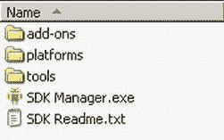

**图 2-1.** *Android SDK 的基础内容*

另一种方法（仅适用于 Windows）是下载安装程序 EXE 而不是 zip 文件，然后运行该安装程序可执行文件。此可执行文件会检查 Java JDK，为你解压嵌入的文件，并运行 SDK Manager 程序以帮助你完成其余下载项的设置。

无论是通过 Windows 安装程序还是通过执行 SDK Manager，接下来你都应该安装一些软件包。当你首次安装 Android SDK 时，它不会附带任何平台版本（即 Android 版本）。安装平台非常简单。启动 SDK Manager 后，你会看到已安装的内容以及可安装的内容，如 图 2-2 所示。你必须添加 Android SDK Tools 和 Platform-tools，环境才能正常工作。因为你很快会用到它，所以至少添加 Android 1.6 SDK Platform。

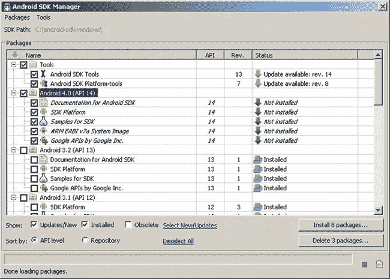

**图 2-2** *向 Android SDK 添加软件包*

点击“Install”按钮。你需要为每个要安装的项目点击“Accept”（或点击“Accept All”），然后点击“Install”。然后 Android 会下载你的软件包和平台以供使用。Google APIs 是用于开发使用 Google Maps 的应用程序的附加组件。你随时可以回来添加更多软件包。

##### 更新你的 PATH 环境变量

Android SDK 带有一个 `tools` 目录，你需要将其添加到 PATH 中。你还需要将刚刚安装的 `platform-tools` 目录添加到 PATH 中。现在就来添加它们，或者如果你正在升级，请确保它们正确无误。同时，你还可以添加一个 JDK bin 目录，这会让之后的操作更简便。

对于 Windows，返回“环境变量”窗口。编辑 PATH 变量，在末尾添加一个分号（`;`），然后跟上 Android SDK tools 文件夹的路径，再跟一个分号，接着是 Android SDK platform-tools 文件夹的路径，再跟一个分号，最后是 `%JAVA_HOME%\bin`。完成后点击“确定”。对于 Mac OS X 和 Linux，编辑你的 `.bashrc` 文件，将 Android SDK tools 目录路径添加到你的 PATH 变量中，同时添加 Android SDK `platform-tools` 目录和 `$JAVA_HOME/bin` 目录。类似以下命令适用于 Linux：

```
export PATH=$PATH:$HOME/android-sdk-linux_x86/tools:$HOME/android-sdk-linux_x86/platform-tools:$JAVA_HOME/bin
```

请确保指向 Android SDK tools 目录的 PATH 组件与你特定的设置相符。

#### 工具窗口

在本书的后续部分，有时你需要执行命令行实用程序。这些程序是 JDK 或 Android SDK 的一部分。通过将这些目录添加到 PATH 中，你无需指定完整路径名即可执行它们，但你需要启动一个*工具窗口*来运行它们（后续章节会提及此工具窗口）。在 Windows 中创建工具窗口最简单的方法是选择“开始”“运行”，输入 `cmd`，然后点击“确定”。对于 Mac OS X，在 Finder 的“Applications”文件夹中或 Dock（如果存在）中选择“终端”。对于 Linux，从“应用程序”“附件”菜单中选择“终端”。

稍后你可能需要知道工作站的 IP 地址。在 Windows 中查找时，启动一个工具窗口并输入命令 `ipconfig`。结果中包含一个 IPv4（或类似名称）条目，旁边列出了你的 IP 地址。IP 地址看起来像这样：192.168.1.25。对于 Mac OS X 和 Linux，启动一个工具窗口并使用命令 `ifconfig`。你可以在标签 `inet addr` 旁边找到你的 IP 地址。

你可能会看到一个名为 localhost 或 lo 的网络连接；该网络连接的 IP 地址是 127.0.0.1。这是一个操作系统使用的特殊网络连接，与工作站 IP 地址不同。请查找另一个不同的数字作为工作站的 IP 地址。


### 安装安卓开发工具（ADT）

现在你需要安装 `ADT`，这是一个帮助构建安卓应用的 Eclipse 插件。具体来说，`ADT` 与 Eclipse 集成，为你提供创建、测试和调试安卓应用的功能。你需要使用 Eclipse 中的“安装新软件”功能来进行安装。（升级 `ADT` 的说明将在本节稍后给出。）首先，启动 Eclipse IDE 并按照以下步骤操作：

1.  选择 **帮助**  **安装新软件**。
2.  选择 **工作台** 字段，输入
    [`https://dl-ssl.google.com/android/eclipse/`](https://dl-ssl.google.com/android/eclipse/)
    并按回车键。Eclipse 连接该站点并填充列表，如图 2-3 所示。
3.  你应该会看到一个名为 **开发者工具** 的条目，包含四个子节点：**Android DDMS**、**Android Development Tools**、**Android Hierarchy Viewer** 和 **Android Traceview**。选中父节点 **开发者工具**，确保子节点也已被选中，然后点击 **下一步** 按钮。你看到的版本可能比这些更新，这没问题。你可能还会看到其他工具。这些工具将在第 11 章中进一步解释。
4.  Eclipse 会要求你确认要安装的工具。点击 **下一步**。
5.  系统会要求你查看 `ADT` 以及安装 `ADT` 所需工具的许可协议。查看许可协议，点击 **我接受**，然后点击 **完成** 按钮。

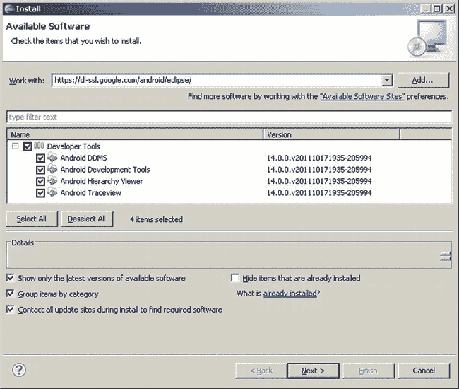

**图 2-3.** *使用 Eclipse 的“安装新软件”功能安装 ADT*

Eclipse 会下载开发者工具并进行安装。你需要重启 Eclipse，以便新插件在 IDE 中显示。

如果你在 Eclipse 中已经安装了旧版本的 `ADT`，请转到 Eclipse 的 **帮助** 菜单，选择 **检查更新**。你应该会看到新版本的 `ADT`，然后可以按照安装说明操作，从第 3 步继续。

**注意：** 如果你正在升级 `ADT`，可能不会在要升级的工具列表中看到其中一些工具。如果没看到它们，那么在升级完 `ADT` 的其余部分后，请转到 **安装新软件**，并从 **工作台** 菜单中选择 [`https://dl-ssl.google.com/android/eclipse/`](https://dl-ssl.google.com/android/eclipse/)。中间窗口应显示其他可供安装的工具。

让 `ADT` 在 Eclipse 中正常工作的最后一步是将其指向 Android SDK。在 Eclipse 中，选择 **窗口** **首选项**。 （在 Mac OS X 上，**首选项** 位于 **Eclipse** 菜单下。）在 **首选项** 对话框中，选择 **Android** 节点，并将 **SDK 位置** 字段设置为 Android SDK 的路径（参见图 2-4），然后点击 **应用** 按钮。请注意，你可能会看到一个对话框，询问是否要向 Google 发送有关 Android SDK 的使用统计信息；这取决于你自行决定。

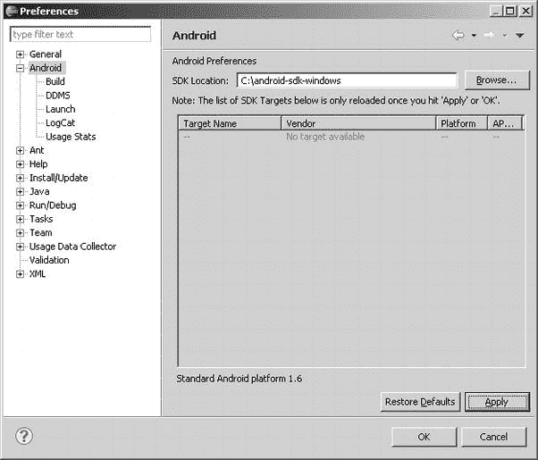

**图 2-4.** *将 ADT 指向 Android SDK*

你可能还想在 **Android**  **构建** 页面上进行另一项首选项更改。如果你希望文件保存更快，则应勾选 **跳过打包** 选项。默认情况下，`ADT` 每次构建时都会为应用启动做好准备。通过勾选此选项（参见图 2-5），打包和索引只会在真正需要时发生。

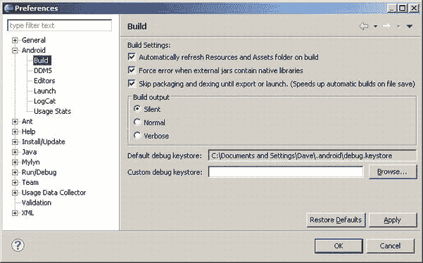

**图 2-5.** *加快构建速度*

在 Eclipse 中，你可以启动 SDK 管理器。为此，请选择 **窗口**  **Android SDK 管理器**。你应该会看到与图 2-2 相同的窗口。

你已经为第一个安卓应用做好了准备——但首先，你必须简要了解安卓应用的基本概念。

### 学习基本组件

每个应用框架都有一些关键组件，开发者在开始编写基于该框架的应用之前需要了解这些组件。例如，你需要了解 JavaServer Pages（`JSP`）和 servlet 才能编写 Java 2 平台企业版（`J2EE`）应用。同样，在为安卓构建应用时，你需要了解视图、活动、片段、意图、内容提供者、服务和 `AndroidManifest.xml` 文件。这里简要介绍这些基本概念，并在整本书中更详细地探讨它们。

#### 视图

`视图` 是构成用户界面基本构建块的用户界面（`UI`）元素。一个 `视图` 可以是一个按钮、一个标签、一个文本字段或许多其他 `UI` 元素。如果你熟悉 `J2EE` 和 Swing 中的 `视图`，那么你就能理解安卓中的 `视图`。`视图` 也可以用作其他 `视图` 的容器，这意味着 `UI` 中通常存在一个 `视图` 的层次结构。最终，你看到的一切都是一个 `视图`。

#### 活动

一个 `活动` 是一个 `UI` 概念，通常代表应用中的单个屏幕。它通常包含一个或多个 `视图`，但也可以不包含。`活动` 顾名思义——它是帮助用户做某件事的东西，可能是查看数据、创建数据或编辑数据。大多数安卓应用内部都有多个活动。

#### 片段

当屏幕很大时，在单个 `活动` 中管理其所有功能会变得困难。`片段` 类似于子活动，一个 `活动` 可以在屏幕上同时显示一个或多个 `片段`。当屏幕很小时，一个 `活动` 更可能只包含一个 `片段`，而这个 `片段` 可以是较大屏幕中使用的同一个。

#### 意图

`意图` 泛泛地定义了执行某项工作的“意图”。`意图` 封装了几个概念，因此理解它们的最佳方式是查看它们的使用示例。你可以使用 `意图` 执行以下任务：

*   广播一条消息。
*   启动一个服务。
*   启动一个活动。
*   显示一个网页或联系人列表。
*   拨打一个电话号码或接听一个电话。

`意图` 并不总是由你的应用发起的——系统也会使用它们来通知你的应用特定事件（例如收到一条短信）。

`意图` 可以是显式的或隐式的。如果你只是简单地说要显示一个 `URL`，系统会决定哪个组件来完成这个意图。你也可以提供关于应由什么处理这个意图的具体信息。`意图` 将动作和动作处理器松散地耦合在一起。

#### 内容提供者

设备上的移动应用之间的数据共享很常见。因此，安卓为应用定义了一种标准机制来共享数据（例如联系人列表），而无需暴露底层存储、结构和实现。通过内容提供者，你可以公开你的数据，并让你的应用使用来自其他应用的数据。

#### 服务

安卓中的 `服务` 类似于你在 Windows 或其他平台中看到的服务——它们是可以在后台长时间运行的进程。安卓定义了两类服务：本地服务和远程服务。本地服务是只有托管该服务的应用才能访问的组件。相反，远程服务是旨在供设备上运行的其他应用远程访问的服务。

`服务` 的一个例子是电子邮件应用用来轮询新消息的组件。如果该 `服务` 不被设备上运行的其他应用使用，则这种 `服务` 可能是本地服务。如果多个应用使用该 `服务`，则它被实现为远程服务。

#### AndroidManifest.xml

`AndroidManifest.xml` 类似于 `J2EE` 世界中的 `web.xml` 文件，它定义了应用的内容和行为。例如，它列出了应用的活动和服务，以及应用运行所需的权限和功能。


### Android 虚拟设备

Android 虚拟设备（AVD）允许开发者在无需连接真实 Android 设备（通常是手机或平板电脑）的情况下测试应用程序。AVD 可以通过多种配置进行创建，以模拟不同类型的真实设备。

### Hello World

现在，你已经准备好构建第一个 Android 应用程序。首先构建一个简单的“Hello World！”程序。按照以下步骤创建应用程序的骨架：

1. 启动 Eclipse，选择文件  新建  项目。在“新建项目”对话框中，选择 Android，然后点击“下一步”。你会看到“新建 Android 项目”对话框，如图 2 – 6 所示。（Eclipse 可能已将“Android 项目”添加到“新建”菜单中，因此如果有的话，可以直接使用。工具栏上还有一个“新建 Android 项目”按钮。）

   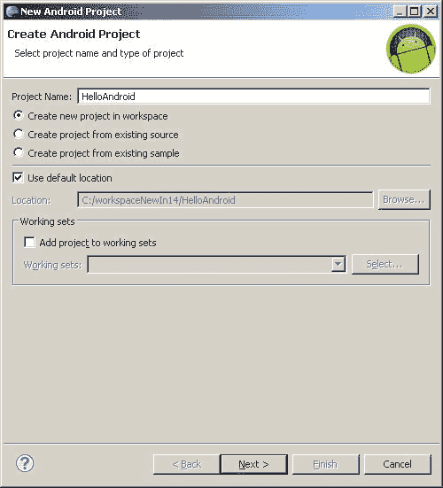

   **图 2–6.** *使用新建项目向导创建 Android 应用程序*

2. 如图 2–6 所示，输入 **HelloAndroid** 作为项目名称。你需要将此项目与在 Eclipse 中创建的其他项目区分开来，因此，当你查看 Eclipse 环境中的所有项目时，选择一个对你有意义的名称。另外请注意，项目的默认位置源自 Eclipse 工作区位置。新建项目向导会将新应用程序的名称附加到工作区位置。在这种情况下，如果你的 Eclipse 工作区是 `c:\android`，那么你的新项目位于 `c:\android\HelloAndroid\`。

3. 暂时不修改“位置”部分，因为你希望在工作区的默认位置创建一个新项目。点击“下一步”。

4. 下一个窗口显示可用的构建目标。选择 Android 1.6。这是你作为应用程序基础的 Android 版本。你可以在更高版本的 Android（例如 2.1 和 2.3.3）上运行应用程序；但 Android 1.6 具备你所需要的一切功能，因此选择它作为目标。通常，最好选择尽可能低的版本号，因为这可以最大化能够运行你应用程序的设备数量。点击“下一步”进入最后一个向导窗口。

5. 输入 **Hello Android** 作为应用程序名称。此名称将随应用程序图标一起显示在应用程序的标题栏和应用程序列表中。它应该具有描述性，但不宜过长。

6. 使用 `com.androidbook.hello` 作为包名。你的应用程序必须有一个基础包名，这就是它。此包名将用作应用程序的标识符，并且在所有应用程序中必须是唯一的。因此，最好以你拥有的域名开头来命名包名。如果你没有域名，请发挥创意，确保你的包名不会被其他人使用。但是，不要使用以 `com.google`、`com.android`、`android` 或 `com.example` 开头的包名，因为这些域名被 Google 限制使用，你将无法将应用程序上传到 Android Market。

7. 输入 **HelloActivity** 作为创建 Activity 名称。你这是在告诉 Android，当应用程序启动时应启动此 Activity。你的应用程序中可能还有其他 Activity，但这个 Activity 是应用程序启动时用户首先看到的界面。

8. Min SDK Version 的值为 4，意味着你的应用程序需要 Android 1.6 或更高版本。技术上，你可以指定一个低于构建目标值的 Min SDK Version。如果你的应用程序调用了旧版 Android 中不存在的功能，你需要妥善处理这种情况，但这可以做到。

9. 点击“完成”按钮，这将指示 ADT 为你生成项目骨架。现在，打开 `src` 文件夹下的 `HelloActivity.java` 文件，并按如下方式修改 `onCreate()` 方法：

   ```
   /** 当 Activity 首次创建时被调用。 */
       @Override
       public void onCreate(Bundle savedInstanceState) {
           super.onCreate(savedInstanceState);
           /** 创建一个 TextView 并写入 Hello World! */
           TextView tv = new TextView(this);
           tv.setText("Hello World!");
           /** 将内容视图设置为 TextView */
           setContentView(tv);
      }
   ```

   你可能需要向代码中添加一条 `import android.widget.TextView;` 语句，以消除 Eclipse 报告的错误。保存 `HelloActivity.java` 文件。

要运行该应用程序，你需要创建一个 Eclipse 启动配置，并且需要一个虚拟设备来运行它。我们快速浏览这些步骤，稍后再详细介绍 AVD。按照以下步骤创建 Eclipse 启动配置：

1. 选择运行  运行配置。

2. 在“运行配置”对话框中，双击左窗格中的“Android 应用程序”。向导会插入一个名为“新配置”的新配置。

3. 将配置重命名为 **RunHelloWorld**。

4. 点击“浏览”按钮，然后选择 HelloAndroid 项目。

5. 将“启动操作”设置为“启动默认 Activity”。对话框应如图 2–7 所示。

   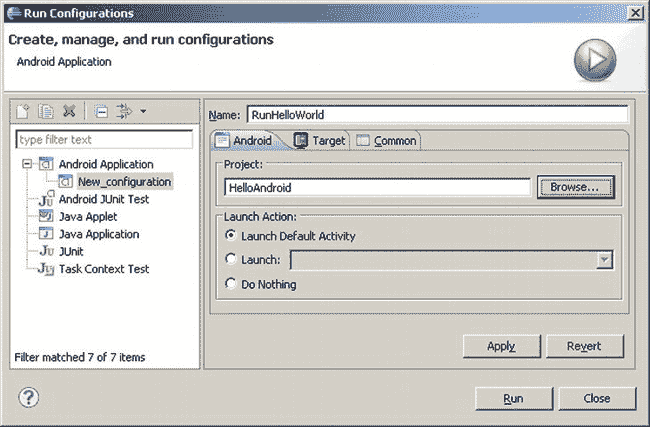

   **图 2–7.** *配置 Eclipse 启动配置以运行“Hello World！”应用程序*

6. 点击“应用”，然后点击“运行”。你几乎快完成了！Eclipse 已准备好运行你的应用程序，但它需要一个设备来运行它。如图 2–8 所示，系统会警告你未找到兼容的目标，并询问你是否要创建一个。点击“是”。

   

   **图 2–8.** *有关目标的错误消息提示，并询问是否创建新的 AVD*

7. 系统会显示一个窗口，其中列出了现有的 AVD（见图 2–9）。你需要添加一个适用于新应用程序的 AVD。点击“新建”按钮。

   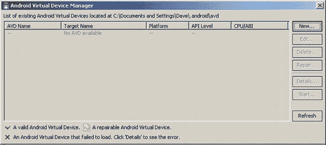

   **图 2–9.** *现有的 Android 虚拟设备*

8. 如图 2–10 所示填写“创建 AVD”表单。将名称设置为 Gingerbread，为目标选择 Android 2.3.3 - API 级别 10（或其他版本），将 SD 卡大小设置为 10（代表 10MB），启用快照，并使用默认皮肤。点击“创建 AVD”。管理器可能会确认成功创建了你的 AVD。点击右上角的 X 关闭 AVD 管理器窗口。

   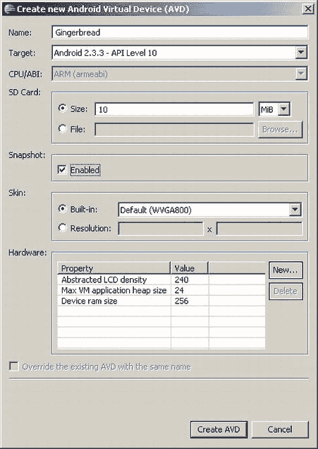

   **图 2–10.** *配置 Android 虚拟设备*

   **注意：** 你为 AVD 选择了较新版本的 SDK，但你的应用程序也可以在旧版本上运行。这是可以的，因为带有较新 SDK 的 AVD 可以运行需要旧版 SDK 的应用程序。当然，反之则不成立：需要新版 SDK 功能的应用程序无法在带有旧版 SDK 的 AVD 上运行。

9. 从底部列表中选择你的新 AVD。请注意，你可能需要点击“刷新”按钮才能使任何新的 AVD 显示在列表中。点击“确定”按钮。

10. Eclipse 将启动模拟器，并运行你的第一个 Android 应用程序（见图 2–11）！


**注：**模拟器可能需要一些时间来模拟设备的启动过程。启动完成后，您通常会看到一个锁定屏幕。点击菜单按钮或拖动解锁图像来解锁 AVD。解锁后，您应该会看到`HelloAndroidApp`在模拟器中运行，如图 2-11 所示。请注意，模拟器在启动过程中会在后台启动其他应用程序，因此您可能会不时看到警告或错误消息。如果出现这种情况，通常可以将其关闭，让模拟器继续启动过程。例如，如果运行模拟器时看到类似“`application abc`未响应”的消息，您可以等待应用程序启动，或者直接让模拟器强制关闭该应用程序。一般来说，您应该等待并让模拟器正常启动。

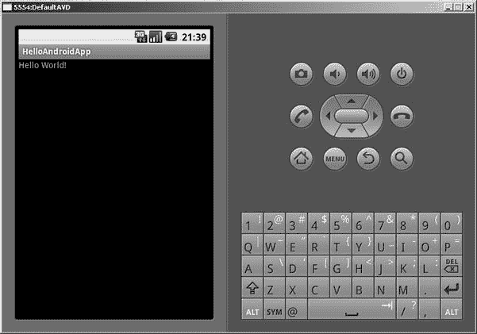

**图 2-11.** *HelloAndroidApp 在模拟器中运行*

现在您已经知道如何创建新的 Android 应用程序并在模拟器中运行它了。接下来，您将更深入地了解 AVD，以及如何部署到真实设备上。

### Android 虚拟设备

AVD 代表一种设备配置。例如，您可以创建一个 AVD，代表一台运行 SDK 1.5 版本、配备 32MB SD 卡的老旧 Android 设备。其思路是，您创建自己将要支持的 AVD，然后在开发和测试应用程序时将模拟器指向其中一个 AVD。指定（和更改）要使用的 AVD 非常容易，这使使用各种配置进行测试变得轻而易举。前面您已经看到了如何使用 Eclipse 创建 AVD。您可以在 Eclipse 中选择 Window  AVD Manager 来创建更多 AVD。您也可以使用命令行创建 AVD。具体方法如下。

要创建一个 AVD，您需要使用位于`tools`目录（`c:\android-sdk-windows\tools\`）下的批处理文件`android`。`android`允许您创建新的 AVD 并管理现有的 AVD。例如，您可以查看现有的 AVD、移动 AVD 等。通过运行`android -help`可以查看使用`android`的可用选项。现在，我们只创建一个 AVD。

默认情况下，AVD 存储在您的主目录（所有平台）下一个名为`.android\AVD`的文件夹中。如果您刚刚为“Hello World!”应用程序创建了一个 AVD，那么可以在此处找到它。如果您想在其他位置存储或操作 AVD，也可以这样做。对于本例，让我们创建一个用于存储 AVD 镜像的文件夹，例如`c:\avd\`。下一步是在工具窗口中使用以下命令列出可用的 Android 目标：

```
android list target
```

此命令的输出是所有已安装 Android 版本的列表，列表中的每个项目都有一个 ID。再次使用工具窗口，输入以下命令（使用适合您工作站的路径来存储 AVD 文件，并根据您安装的 SDK 平台目标，为`-t` ID 参数使用适当的值）：

```
android create avd -n CupcakeMaps -t 2 -c 16M -p c:\avd\CupcakeMaps\
```

传递给批处理文件的参数列在表 2-1 中。

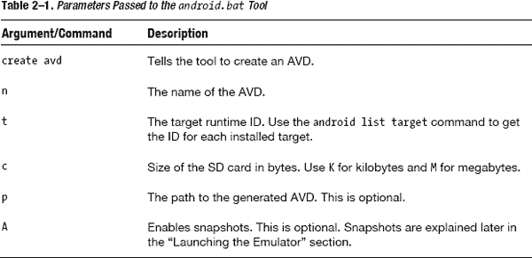

执行上述命令会生成一个 AVD；您应该会看到类似图 2-12 所示的输出。请注意，当您运行`create avd`命令时，系统会询问您是否要创建自定义硬件配置文件。此时请回答 no，但要知道，回答 yes 会提示您为 AVD 配置许多选项，例如屏幕尺寸、摄像头是否存在等。

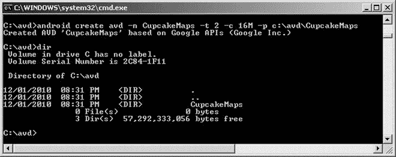

**图 2-12.** *创建 AVD 将产生如下`android.bat`输出。*

即使您使用`android.bat`程序为`CupcakeMaps`指定了备用位置，在您主目录的`.android/AVD`文件夹下仍然会有一个`CupcakeMaps.ini`文件。这是一件好事，因为如果您返回 Eclipse 并选择 Window  AVD Manager，您将看到所有 AVD。在 Eclipse 中运行 Android 应用程序时，您可以访问其中任何一个。

再看一下图 2-2。每个 Android 版本都有一个 API 级别。Android 1.6 的 API 级别为 4，Android 2.1 的 API 级别为 7。这些 API 级别编号并不对应于`android create avd`命令用于`-t`参数的目标 ID。您始终需要使用`android list target`命令来获取`android create avd`命令所需的适当目标 ID 值。

### 在真实设备上运行

测试 Android 应用程序的最佳方式是将其运行在真实设备上。任何商用 Android 设备在连接到您的工作站时都应该可以工作，但您可能需要做一些设置工作。如果您使用的是 Mac，只需通过 USB 线缆插入设备即可，无需其他操作。然后，在设备本身上，依次选择 Settings  Applications  Development，并启用 USB 调试。在 Linux 上，您可能需要创建或修改此文件：`/etc/udev/rules.d/51-android.rules`。我们将此文件的一份副本与项目文件一起放在了我们的网站上；将其复制到正确的目录，并根据您的机器适当修改用户名和组值。然后，当您插入 Android 设备时，它将被识别。接下来，在设备上启用 USB 调试。

对于 Windows，您需要处理 USB 驱动程序。Google 在 Android 包中提供了一些驱动程序，这些驱动程序位于 Android SDK 目录的`usb_driver`子目录下。其他设备供应商也会为您提供驱动程序，因此请在他们的网站上查找。当您设置好驱动程序后，在设备上启用 USB 调试，一切就绪了。

现在设备已连接到您的工作站，当您尝试启动一个应用程序时，它要么直接在设备上启动，要么（如果您有模拟器在运行或连接了其他设备）会打开一个窗口，您可以在其中选择要启动到的设备或模拟器。如果没有，请尝试编辑您的运行配置以手动选择目标。


### 探索 Android 应用的结构

尽管 Android 应用的大小和复杂程度可能千差万别，但它们的结构却十分相似。图 2–13 展示了您刚刚构建的“Hello World!”应用的结构。

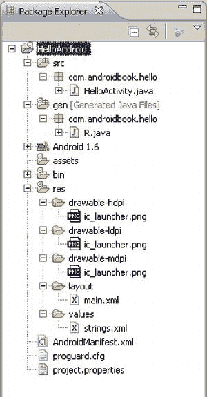

**图 2–13** *“Hello World!”应用的结构*

Android 应用包含一些必需的和可选的工件。表 2–2 总结了 Android 应用的各个元素。

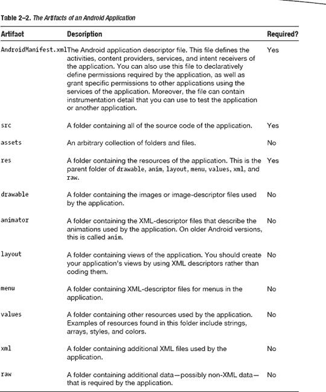

从表 2–2 可以看出，Android 应用主要由三部分组成：应用描述文件、各种资源集合以及应用的源代码。如果暂时忽略 `AndroidManifest.xml` 文件，您可以用一种简单的方式来理解 Android 应用：用代码实现业务逻辑，而其他所有内容都属于资源。这种基本结构与 J2EE 应用的基本结构类似，资源对应于 JSP，业务逻辑对应于 Servlet，而 `AndroidManifest.xml` 文件则对应于 `web.xml` 文件。

您还可以将 J2EE 的开发模型与 Android 的开发模型进行比较。在 J2EE 中，构建视图的理念是使用标记语言来构建。Android 也采用了这种方法，尽管 Android 中的标记是 XML。这种方法的好处在于，您无需在代码中硬编码应用的视图；您只需通过编辑标记语言即可修改应用的外观和感觉。

此外，还需要注意几个关于资源的限制。首先，Android 仅支持 `res` 下预定义文件夹内的文件线性列表。例如，它不支持在 `layout` 文件夹（或 `res` 下的其他文件夹）中嵌套子文件夹。其次，`assets` 文件夹与 `res` 下的 `raw` 文件夹有一些相似之处。这两个文件夹都可以包含原始文件，但 `raw` 中的文件被视为资源，而 `assets` 中的文件则不是。因此，`raw` 中的文件可以被本地化、通过资源 ID 访问等。而 `assets` 文件夹的内容则被视为通用内容，使用时不受资源约束和支持。请注意，由于 `assets` 文件夹的内容不被视为资源，您可以在该文件夹中放置任意层次的文件夹和文件。（第 3 章 会更详细地讨论资源。）

**注意** 您可能已经注意到，Android 中大量使用了 XML。您知道 XML 是一种臃肿的数据格式，因此这就引出了一个问题：当目标设备资源有限时，依赖 XML 是否合理？事实上，您在开发过程中创建的 XML 最终会通过 Android 资源打包工具（AAPT）编译为二进制文件。因此，当您的应用安装到设备上时，设备上的文件是以二进制形式存储的。在运行时需要该文件时，会以其二进制形式读取，而不会转换回 XML。这使您两全其美——既可以使用 XML 进行开发，又无需担心占用设备上的宝贵资源。

### 审视应用生命周期

Android 应用的生命周期由系统根据用户需求、可用资源等因素严格管理。例如，用户可能想启动一个网络浏览器，但最终由系统决定是否启动该应用。尽管系统是最终管理者，但它会遵循一些明确且合乎逻辑的准则来决定一个应用是否可以被加载、暂停或停止。如果用户当前正在使用某个活动（Activity），系统会给予该应用很高的优先级。

相反地，如果一个活动不可见，并且系统判定必须关闭某个应用以释放资源，它会关闭优先级较低的应用。

这与基于 Web 的 J2EE 应用的生命周期形成对比。J2EE 应用受到其运行容器的松散管理。例如，J2EE 容器可以在某个应用闲置超过预定时间后，将其从内存中移除。但容器通常不会根据负载和/或可用资源将应用移入或移出内存。J2EE 容器通常拥有足够的资源来同时运行大量应用。而 Android 的资源更加有限，因此 Android 必须对应用拥有更强的控制力和主导权。

**注意** Android 在独立进程中运行每个应用，每个进程都拥有自己的虚拟机。这提供了一个受保护的内存环境。通过将应用隔离到单独的进程中，系统可以控制哪个应用应获得更高的优先级。例如，一个正在执行 CPU 密集型任务的进程无法阻止来电。

应用生命周期的概念是合乎逻辑的，但 Android 应用的一个基本方面却使事情变得复杂。具体来说，Android 应用架构是以组件和集成为导向的。这带来了丰富的用户体验、无缝复用和便捷的应用集成，但也为应用生命周期管理器带来了复杂的任务。

让我们考虑一个典型场景。用户正在通电话，需要打开一封电子邮件来回答一个问题。用户进入主屏幕，打开邮件应用，打开该邮件，点击邮件中的链接，并通过阅读网页上的股票报价来回答朋友的问题。这个场景涉及四个应用：主屏幕应用、通话应用、邮件应用和浏览器应用。当用户从一个应用导航到另一个应用时，体验是无缝的。然而在后台，系统正在保存和恢复应用的状态。例如，当用户点击邮件中的链接时，系统会先保存正在运行的邮件活动（Activity）的元数据，然后启动浏览器应用的活动来加载 URL。事实上，系统在启动另一个活动之前，会保存任何当前活动的元数据，以便之后能够返回到该活动（例如，当用户回退时）。如果内存成为问题，系统必须关闭正在运行某个活动的进程，并在必要时恢复它。

Android 对应用及其组件的生命周期非常敏感。因此，您需要理解并处理生命周期事件，以构建稳定的应用。运行您 Android 应用及其组件的进程会经历各种生命周期事件，Android 提供了您可以通过实现来处理状态变化的回调方法。首先，您应该熟悉一个活动的各种生命周期回调方法（参见代码清单 2–1）。

***代码清单 2–1.** *活动的生命周期方法*

```
protected void onCreate(Bundle savedInstanceState);
protected void onStart();
protected void onRestart();
protected void onResume();
protected void onPause();
protected void onStop();
protected void onDestroy();
```


`清单 2–1` 展示了 Android 在 Activity 生命周期中调用的生命周期方法列表。为了确保实现稳定的应用程序，理解系统何时调用每个方法非常重要。请注意，您不需要对所有方法都做出响应。但如果需要响应，请确保也调用父类版本。`图 2–14` 显示了状态之间的转换。

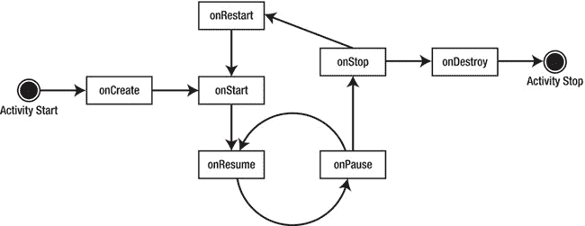

**图 2–14.** *Activity 的状态转换*

系统可以根据当前发生的其他事件来启动和停止您的 Activity。当 Activity 被新创建时，Android 会调用 `onCreate()` 方法。`onCreate()` 之后总是跟着调用 `onStart()`，但 `onStart()` 并不总是由 `onCreate()` 调用触发，因为如果您的应用程序曾被停止，`onStart()` 也可能被调用。当 `onStart()` 被调用时，您的 Activity 对用户还不可见，但即将可见。`onResume()` 在 `onStart()` 之后被调用，此时 Activity 处于前台并可被用户访问。此时，用户可以开始与您的 Activity 交互。

当用户决定切换到另一个 Activity 时，系统会调用您的 Activity 的 `onPause()` 方法。在 `onPause()` 之后，您可以预期 `onResume()` 或 `onStop()` 会被调用。例如，如果用户将您的 Activity 带回前台，则会调用 `onResume()`。如果您的 Activity 对用户变为不可见，则会调用 `onStop()`。如果在 `onStop()` 被调用后，您的 Activity 被带回前台，则会调用 `onRestart()`。如果您的 Activity 位于 Activity 栈中但对用户不可见，并且系统决定终止您的 Activity，则会调用 `onDestroy()`。

上述描述的 Activity 状态模型看起来很复杂，但您不需要处理所有可能的情况。您主要处理 `onCreate()`、`onResume()` 和 `onPause()`。您通过 `onCreate()` 为您的 Activity 创建用户界面。在此方法中，您将数据绑定到控件，并为您的 UI 组件连接事件处理器。在 `onPause()` 中，您需要将关键数据持久化到应用程序的数据存储中：这是系统终止您的应用程序之前，最后一个可以被安全调用的方法。`onStop()` 和 `onDestroy()` 不保证一定会被调用，因此不要依赖这些方法处理关键逻辑。

从以上讨论中能学到什么？系统管理着您的应用程序，并且可以在任何时间启动、停止或恢复某个应用程序组件。尽管系统控制着您的组件，但它们并非完全与您的应用程序隔离运行。换句话说，如果系统启动了您应用程序中的某个 Activity，您可以指望在该 Activity 中拥有一个应用程序上下文。

到目前为止，您已经涵盖了创建新 Android 应用程序、在模拟器中运行 Android 应用程序、Android 应用程序的基本结构以及许多 Android 应用程序中常见的几个特性。但是，您还没有看到如何解决 Android 应用程序中出现的问题。本章的最后一部分将讨论简单的调试。

### 简单调试

Android SDK 包含了一系列可用于调试的工具。这些工具已集成到 Eclipse IDE 中（请参见 图 2–15 的简要示例）。

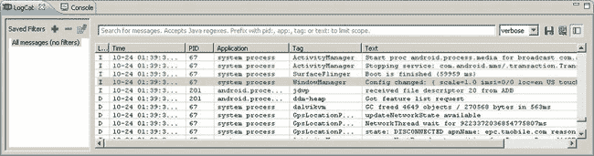

**图 2–15.** *在构建 Android 应用程序时可以使用的调试工具*

在整个 Android 开发过程中，您会经常使用的一个工具是 `LogCat`。此工具显示您通过 `android.util.Log`、`System.out.println` 等发出的日志消息。尽管 `System.out.println` 也能工作，并且其消息会显示在 `LogCat` 窗口中，但从您的应用程序中记录消息时，应使用 `android.util.Log` 类。该类定义了您熟悉的提示、警告和错误方法，您可以利用这些方法在 `LogCat` 窗口中进行过滤，以便只查看您关注的信息。这是一个 `Log` 命令的示例：

`Log.v("string TAG", "This is my verbose message to write to the log");`

此示例展示了 `Log` 类的静态 `v()` 方法，但还有其他用于不同严重级别的方法。最好为要记录的消息使用合适的调用级别，通常不建议在打算部署到生产环境的应用程序中保留详细调用。请记住，日志记录会消耗内存和 CPU 资源。

`LogCat` 特别方便的一点是，您不仅可以在模拟器中运行应用程序时查看日志消息，还可以在工作站上连接了处于调试模式的真实设备时查看日志消息。实际上，日志消息会被存储，以至于您甚至可以从记录日志消息时已断开的设备中检索到最新的消息。当您将设备连接到工作站并打开 `LogCat` 视图时，您会看到最近数百条消息。第 11 章 将涵盖更高级的调试。

#### 启动模拟器

之前您已经了解了如何从 Eclipse 的项目中启动模拟器。大多数情况下，您应该先启动模拟器，然后再在正在运行的模拟器中部署和测试您的应用程序。要随时启动模拟器，首先通过运行 Android SDK 的 `tools` 目录中的 `android` 程序或通过 Eclipse 的 `Window` 菜单进入 AVD Manager。进入 Manager 后，从列表中选择所需的 AVD，然后单击 `Start`。

当您单击 `Start` 按钮时，会打开“启动选项”对话框（参见 图 2–16）。这允许您缩放模拟器窗口的大小，并更改启动和关闭选项。当您使用中、小屏幕设备（如手机）的 AVD 时，通常可以使用默认屏幕尺寸。但对于大屏幕和超大屏幕尺寸（例如平板电脑），默认屏幕尺寸可能无法在工作站的屏幕上完美适配。如果出现这种情况，您可以启用“按实际尺寸缩放显示”并输入一个值。此标签有些误导，因为平板电脑的屏幕密度可能与您的工作站不同，并且模拟器无法完美匹配模拟器窗口在您屏幕上的实际物理尺寸。例如，在我们的工作站屏幕上，模拟一个 10 英寸屏幕的 Honeycomb 平板电脑时，10 英寸的“真实尺寸”对应约 0.64 的缩放比例，并且工作站屏幕上的实际尺寸略大于 10 英寸。请根据您的屏幕尺寸和屏幕密度选择适合您的值。

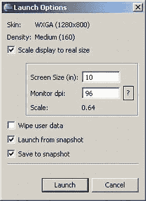

**图 2–16.** *启动选项对话框*

您还可以在“启动选项”对话框中处理快照。退出模拟器时保存到快照会导致稍长的延迟。顾名思义，您将模拟器的当前状态写入到一个快照映像文件中，该文件可以在下次启动时使用，以避免经历完整的 Android 启动序列。如果存在快照，启动速度会快得多，这使得保存时的延迟非常值得——您基本上可以从上次离开的地方继续。

如果您想从头开始全新的启动，可以选择“清除用户数据”。您也可以取消选择“从快照启动”以保留用户数据并经历完整的启动序列。或者，您可以创建一个自己喜欢的快照，并*仅*启用“从快照启动”选项；这会反复重用该快照，因此启动速度快，关闭速度也快，因为每次退出时不会创建新的快照映像文件。快照映像文件存储在与 AVD 其他映像文件相同的目录中。如果您在创建 AVD 时未启用快照，您可以随时编辑该 AVD 并在那里启用它们。


### 小结

本章涵盖以下主题，帮助您为 Android 开发做好准备：

*   下载并安装 JDK、Eclipse 和 Android SDK
*   如何修改您的 `PATH` 变量并启动工具窗口
*   安装 Android 开发工具（ADT），以及如何在拥有旧版本时进行更新
*   视图、活动、片段、意图、内容提供程序、服务和 `AndroidManifest.xml` 文件的基本概念
*   安卓虚拟设备（AVD），可用于在您没有设备（或没有特定测试设备）时测试应用
*   构建一个“Hello World!”应用并将其部署到模拟器
*   初始化任何应用的基本要求（项目名称、Android 目标、应用名称、包名、主活动、最低 SDK 版本）
*   运行配置的位置以及如何更改它们
*   创建 AVD 的命令行方法
*   将真实设备连接到工作站并在其上运行您的新应用
*   Android 应用的内部结构以及活动的生命周期
*   `LogCat`，以及如何在其中查找应用发送的内部消息
*   启动模拟器时可用的选项，例如快照和调整屏幕显示大小

### 面试问题

请回答以下问题以巩固您对本章节的理解：

1.  为 Android 开发需要 JRE 还是 JDK？
2.  是否可以不使用 Eclipse 进行 Android 开发？
3.  Android SDK 下的 `tools` 和 `platform-tools` 目录有什么区别？
4.  Android 中的视图是什么？
5.  意图又是什么？
6.  判断正误：应用的构建目标必须与最低 SDK 版本相同。为什么是或为什么不是？
7.  为应用选择包名时必须采取哪些预防措施？
8.  什么是 AVD？它有什么用途？
9.  什么是 AVD 快照？如何使用它？
10. 应用所需的 MP3 文件应存储在哪个源文件夹中？
11. 应用图标文件应放在哪里？
12. 活动看到的第一个生命周期回调是什么？
13. 活动看到的最后一个生命周期回调是什么？
14. 用于从您的应用写入日志消息的类是什么？
15. 可用于写入日志消息的所有方法有哪些，它们之间有什么不同？

## 第 3 章

## 理解 Android 资源

在 第 2 章 中，我们向您概述了 Android 应用，并快速了解了一些其底层概念。您还了解了 Android SDK、Eclipse Android 开发工具（ADT），以及如何在由 Android 虚拟设备（AVD）标识的模拟器上运行您的应用。

在本章及接下来的几章中，我们将深入探讨 Android SDK 的基础知识。这些基础知识包括资源、内容提供程序和意图。

Android 依赖于以声明方式定义 UI 组件的资源。这种声明式方法与 HTML 使用声明式标签定义其 UI 的方式并无太大不同。从这个意义上说，Android 在 UI 开发方法上是具有前瞻性的。Android 还允许对这些资源进行样式化和本地化。本章涵盖了 Android 中可用的各种资源。

### 理解资源

资源在 Android 架构中扮演着关键角色。Android 中的资源是绑定到可执行应用的文件（如音乐文件或描述窗口布局的文件）或值（如对话框的标题）。这些文件与值以这样一种方式绑定到可执行文件：您可以在不重新编译应用的情况下更改它们或提供替代方案。

常见的资源示例包括字符串、颜色、位图和布局。资源允许您使用其 ID 来代替在应用中硬编码字符串。这种间接方式让您可以更改字符串资源的文本，而无需更改源代码。

Android 中有许多、许多资源类型。让我们从一种非常常见的资源——字符串——开始对资源的讨论。


### 字符串资源

Android 允许你在一个或多个 XML 资源文件中定义字符串。这些包含字符串资源定义的 XML 文件位于 `/res/values` 子目录下。XML 文件的名称是任意的，不过通常你会看到文件名为 `strings.xml`。代码清单 3-1 展示了一个字符串资源文件的示例。

**代码清单 3-1.** `strings.xml` 示例

```
<?xml version="1.0" encoding="utf-8"?>
<resources>
    <string name="hello">hello</string>
    <string name="app_name">hello appname</string>
</resources>
```

**注意：** 在某些 Eclipse 版本中，`<resources>` 节点需要使用 `xmlns` 规范进行限定。只要存在 `xmlns`，它指向什么似乎并不重要。以下两种变体都是可行的：

```
<resources >
```

以及

```
<resources >
```

即使是文件的第一行（表明它是具有特定编码的 XML 文件）也是可选的。即使没有这一行，Android 也能正常运行。

当此文件被创建或更新时，Eclipse ADT 插件会自动在你的应用程序根包中创建或更新一个名为 `R.java` 的 Java 类，其中包含为两个指定字符串资源生成的唯一 ID。请注意以下示例中 `R.java` 文件的位置。这是某个项目（例如 MyProject）的高级目录结构：

```
\MyProject
   \src
         \com\mycompany\android\my-root-package
         \com\mycompany\android\my-root-package\another-package
   \gen
\com\mycompany\android\my-root-package\R.java
   \assets
   \res
   \AndroidManifest.xml
...等
```

**注意：** 无论资源文件有多少个，都只有一个 `R.java` 文件。

对于 代码清单 3-1 中的字符串资源文件，更新后的 `R.java` 文件包含了 代码清单 3-2 中的条目。

**代码清单 3-2.** `R.java` 示例

```
package com.mycompany.android.my-root-package;
public final class R {
   ...其他取决于项目和应用的条目

    public static final class string
   {
      ...其他取决于项目和应用的条目

public static final int hello=0x7f040000;
        public static final int app_name=0x7f040001;

      ...其他取决于项目和应用的条目
    }
   ...其他取决于项目和应用的条目
}
```

首先请注意，`R.java` 如何在根包中定义了一个顶层类：`public static final class R`。在这个 `R` 的外部类中，Android 定义了一个内部类 `static final class string`。`R.java` 创建这个内部静态类作为一个命名空间，用于保存字符串资源 ID。

用变量名 `hello` 和 `app_name` 定义的两个 `static final int` 就是代表相应字符串资源的资源 ID。你可以通过以下代码结构在源代码中的任何位置使用这些资源 ID：

```
R.string.hello
```

生成的 ID 指向的是 `int` 类型而非 `string` 类型。大多数接受字符串的方法也接受这些资源标识符作为输入。Android 会在必要时将这些 `int` 解析为 `string`。

大多数示例应用程序将所有字符串定义在一个 `strings.xml` 文件中仅仅是一种惯例。只要 XML 文件的结构看起来像 代码清单 3-1 所示，并且文件位于 `/res/values` 子目录下，Android 可以接受任意数量的此类文件。

这个文件的结构很容易理解。根节点 `<resources>` 后跟一个或多个 `<string>` 子元素。每个 `<string>` 元素或节点都有一个名为 `name` 的属性，该属性最终会成为 `R.java` 中的 `id` 属性。

为了证明该子目录下允许存在多个字符串资源文件，你可以在同一子目录下放置另一个文件，内容如下，并将其命名为 `strings1.xml`（参见 代码清单 3-3）。

**代码清单 3-3.** 额外 `strings.xml` 文件示例

```
<?xml version="1.0" encoding="utf-8"?>
<resources>
    <string name="hello1">hello 1</string>
    <string name="app_name1">hello appname 1</string>
</resources>
```

Eclipse ADT 插件会在编译时验证这些 ID 的唯一性，并将它们作为两个附加常量放入 `R.java` 中：`R.string.hello1` 和 `R.string.app_name1`。


### 布局资源

在 Android 中，屏幕视图通常作为资源从 XML 文件中加载。这与描述网页内容和布局的 HTML 文件非常相似。这些 XML 文件被称为布局资源。*布局资源*是 Android UI 编程中使用的关键资源。请参考代码清单 3-4 中的代码片段，这是一个 Android Activity 的示例。

**代码清单 3-4.** *使用布局文件*

```java
public class HelloWorldActivity extends Activity
{
    @Override
    public void onCreate(Bundle savedInstanceState)
    {
        super.onCreate(savedInstanceState);
        setContentView(R.layout.main);
        TextView tv = (TextView)this.findViewById(R.id.text1);
        tv.setText("Try this text instead");
    }
    ...
}
```

`setContentView(R.layout.main)` 这行代码表明存在一个名为 `R.layout` 的静态类，在该类中，有一个名为 `main`（整型）的常量，它指向由 XML 布局资源文件定义的 `View`。该 XML 文件名为 `main.xml`，需要放置在资源目录的 `layout` 子目录中。换句话说，这行语句要求程序员创建 `/res/layout/main.xml` 文件，并将必要的布局定义放入该文件中。`main.xml` 布局文件的内容可能如代码清单 3-5 所示。

**代码清单 3-5.** *`main.xml` 布局文件示例*

```xml
<?xml version="1.0" encoding="utf-8"?>
<LinearLayout
    android:orientation="vertical"
    android:layout_width="fill_parent"
    android:layout_height="fill_parent"
    >
    <TextView    android:id="@+id/text1"
    android:layout_width="fill_parent"
    android:layout_height="wrap_content"
    android:text="@string/hello"
    />
    <Button    android:id="@+id/b1"
    android:layout_width="fill_parent"
    android:layout_height="wrap_content"
    android:text="@string/hello"
    />
</LinearLayout>
```

代码清单 3-5 中的布局文件定义了一个名为 `LinearLayout` 的根节点，其中包含一个 `TextView` 后跟一个 `Button`。`LinearLayout` 会垂直或水平地排列其子元素——在此示例中为垂直排列。

你需要为每个屏幕（或 Activity）定义一个单独的布局文件。更准确地说，每个布局都需要一个专用文件。如果你要绘制两个屏幕，可能需要两个布局文件，例如 `/res/layout/screen1_layout.xml` 和 `/res/layout/screen2_layout.xml`。

**注意：** `/res/layout/` 子目录中的每个文件都会根据文件名（不包括扩展名）生成一个唯一的常量。对于布局，重要的是文件的数量；而对于字符串资源，重要的是文件*内部*单个字符串资源的数量。

例如，如果 `/res/layout/` 目录下有两个名为 `file1.xml` 和 `file2.xml` 的文件，那么在 `R.java` 中，你将拥有如代码清单 3-6 所示的条目。

**代码清单 3-6.** *多个布局文件的多个常量*

```java
public static final class layout {
  .... any other files
    public static final int file1=0x7f030000;
    public static final int file2=0x7f030001;
}
```

这些布局文件中定义的视图（例如 `TextView`，见代码清单 3-5）可以通过 `R.java` 中生成的资源 ID 在 Java 代码中访问：

```java
TextView tv = (TextView)this.findViewById(R.id.text1);
tv.setText("Try this text instead");
```

在这个例子中，你通过 `Activity` 类的 `findViewById` 方法定位 `TextView`。常量 `R.id.text1` 对应于为 `TextView` 定义的 ID。布局文件中 `TextView` 的 ID 如下所示：

```xml
<TextView android:id="@+id/text1"
..
</TextView>
```

`id` 属性的值表示，常量 `text1` 用于在该 Activity 所拥有的其他视图中唯一标识此视图。`@+id/text1` 中的加号（`+`）表示如果 `text1` 这个 ID 尚不存在，则会创建它。这种资源 ID 语法还有其他内容，我们接下来会看到。

### 资源引用语法

无论资源类型如何（目前介绍了字符串和布局两种），所有 Android 资源在 Java 源代码中都是通过其 ID 来标识（或引用）的。在 XML 文件中为资源分配 ID 所使用的语法被称为*资源引用语法*。这种语法不仅限于分配 ID：它也是一种标识任何资源（如字符串、布局文件或图像）的方式。

这种定位资源或引用现有资源的通用方法与 ID 是如何关联的呢？事实证明，ID 是像字符串一样作为资源被跟踪的数值。想象一下你的项目持有一个数字池。你可以从池中取出一个数字并将其分配给一个控件。

让我们先进一步研究一下资源引用结构。该资源引用具有以下形式结构：

`@[package:]type/name`

其中 `type` 对应于 `R.java` 中可用的资源类型命名空间，其中一些如下：

*   `R.drawable`
*   `R.id`
*   `R.layout`
*   `R.string`
*   `R.attr`
*   `R.plural`
*   `R.array`

XML 资源引用语法中对应的类型如下：

*   `drawable`
*   `id`
*   `layout`
*   `string`
*   `attr`
*   `plurals`
*   `string-array`

资源引用 `@[package:]type/name` 中的 `name` 部分是赋予该资源的名称（例如代码清单 3-5 中的 `text1`）；它也在 `R.java` 中表示为一个 `int` 常量。

如果在语法 `@[package:]type/name` 中未指定包名，则 `type/name` 对将根据本地资源和应用程序本地的 `R.java` 包进行解析。

如果指定了 `android:type/name`，则将使用包 `android` 进行引用解析，具体通过 `android.R.java` 文件。你可以使用任何 Java 包名替换 `package` 占位符，以定位正确的 `R.java` 文件来解析引用。

现在让我们回到代码清单 3-5 中 ID 分配给控件的方式。ID 被视为资源。按照这个逻辑，当你编写

```xml
<TextView android:id="@+id/text1" ..../>
```

时，你是在说：“获取一个由类型 `id` 和值 `text1` 标识的资源，并将其分配给这个 `TextView` 实例。” `+` 表示如果 `text1` 这个 `id` 未定义为资源，则用一个唯一的数字来定义它。

基于此信息，让我们分析几个 ID 示例。在阅读代码清单 3-7 时，请注意 ID `android:id` 的左侧（即 `android:id` 本身）不属于语法的一部分。`android:id` 只是你如何将 ID 分配给像 `TextView` 这样的控件的方式。

**代码清单 3-7.** *探索资源引用语法*

```xml
<TextView  android:id="text">
// 编译错误，因为 id 不接受原始文本字符串。
// 此外，它也不是有效的资源引用语法。

<TextView  android:id="@text">
// 错误的语法。@text 缺少类型名称。
// 它应该是 @id/text、@+id/text 或 @string/string1。
// 然而，这里的 string 类型虽然是有效的资源引用，但却是无效的。
// 这是因为左侧需要的是 "id" 而不是 "string"。
// 你将得到一个错误："No Resource type specified"。

<TextView  android:id="@id/text">
// 错误: No Resource found that matches id "text"
// 除非你事先已经将 "text" 定义为一个 ID

<TextView  android:id="@android:id/text">
// 错误: Resource is not public
// 表明在 android.R.id 中没有这样的 id。
// 当然，如果 Android 的 R.java 定义了此名称的 id，这将是有效的。

<TextView  android:id="@+id/text">
// 成功: 在本地包的 R.java 中创建了一个名为 "text" 的 id
```


好的，作为高级文档工程师和翻译员，我将严格按照您提供的注意事项和示例，将以下英文文本翻译成中文。


在语法`"@+id/text"`中，`+`号具有特殊含义。它告诉 Android：ID `text`可能尚不存在，如果确实如此，则创建一个新的 ID 并将其命名为`text`。我们不知道在资源引用语法中，除了 ID 上下文之外，还有哪里会使用`+`。这很有道理，因为你不能假设某个字符串资源是在未明确指定其内容的情况下创建的。系统无法像创建唯一数字那样自动创建该资源。

ID 与资源引用语法之间的这种联系常常是混淆的根源。要消除这种混淆，请记住一点：ID 是作为资源来指定的。

### 为后续使用自定义资源 ID

分配 ID 的通用模式要么是创建一个新的 ID，要么是使用 Android 包创建的 ID。然而，也可以预先创建 ID，并在你自己的包中后续使用。再次强调，这源于 ID 是资源这一事实。如果它们是资源，就应该允许被预定义并可供后续使用。

`<TextView android:id="@+id/text">`这一行（如清单 3–7 所示）表明：如果名为`text`的 ID 已存在，则使用它；如果该 ID 不存在，则创建一个新的。那么，像`text`这样的 ID 何时可能已经存在于`R.java`中以供重用呢？

你可能倾向于将`R.id.text`这样的常量放入`R.java`，但`R.java`是不可编辑的。即使它是可编辑的，每当`/res/*`子目录中的内容发生更改、添加或删除时，它都会被重新生成。

解决方案是使用名为`item`的资源标签来定义一个不依附于任何特定资源的 ID。清单 3–8 展示了一个示例。

**清单 3–8.** *预定义一个 ID*
```
<resources>
<item type="id" name="text"/>
</resources>
```

`type`指的是资源类型——在本例中是`id`。一旦此 ID 就位，清单 3–9 中的`View`定义就能正常工作。

**清单 3–9.** *重用预定义的 ID*
```
<TextView android:id="@id/text">
..
</TextView>
```

### 已编译与未编译的 Android 资源

Android 主要通过两种类型的文件来支持资源：XML 文件和原始文件（例如包括图像、音频和视频）。你已经看到，在某些情况下，资源被定义为 XML 文件中的值（例如字符串），而有时整个 XML 文件就是一个资源（例如布局资源文件）。

在 XML 文件集合中作进一步区分，你会发现两种类型：一种被编译为二进制格式，另一种则按原样复制到设备上。你目前看到的示例——字符串资源 XML 文件和布局资源 XML 文件——在成为可安装包的一部分之前会被编译成二进制格式。这些 XML 文件具有预定义的格式，其中 XML 节点可以被转换为 ID。

你还可以选择一些 XML 文件，使其拥有自己自由的格式结构；这些文件不会被解释，但会生成资源 ID（`resource type: xml`）。然而，你确实希望将它们编译为二进制格式，并享受本地化的便利。为此，你可以将这些 XML 文件放置在`/res/xml/`子目录中，以使其被编译成二进制格式。在这种情况下，你需要使用 Android 提供的 XML 读取器来读取 XML 节点。

但是，如果你将文件（包括 XML 文件）放置在`/res/raw/`目录中，它们则不会被编译成二进制格式。然而，因为它是资源，Android 会通过`R.java`生成一个 ID。原始文件的资源类型是`raw`。因此，你可以通过`R.raw.some-filename-minus-extension`访问这些文件的标识。你必须使用显式的基于流的 API 来读取这些文件。音频和视频文件就属于此类。

**注意：** 由于`raw`目录是`/res/*`层级结构的一部分，即便是这些原始的音频和视频文件，也能像所有其他资源一样利用本地化和 ID 生成功能。

正如我们在上一章的表 2-1 中提到的，资源文件根据其类型被存放在不同的子目录中。以下是`/res`文件夹中一些重要的子目录及其托管的资源类型：

*   `anim`：已编译的动画文件
*   `drawable`：位图
*   `layout`：UI 和视图定义
*   `values`：数组、颜色、尺寸、字符串和样式
*   `xml`：已编译的任意 XML 文件
*   `raw`：未编译的原始文件

Android 资源打包工具（AAPT）中的资源编译器会编译除`raw`资源之外的所有资源，并将它们放入最终的`.apk`文件中。该文件包含了 Android 应用程序的代码和资源，对应于 Java 的`.jar`文件（`apk`代表 Android 包）。`.apk`文件就是安装到设备上的文件。

**注意：** 尽管 XML 资源解析器允许像`hello-string`这样的资源名称，但你在`R.java`中会看到编译时错误。你可以通过将资源重命名为`hello_string`（用下划线替换连字符）来解决这个问题。

### 列举关键的 Android 资源

既然你已经了解了资源的基础知识，现在让我们列举一些 Android 支持的其他关键资源、它们的 XML 表示以及在 Java 代码中的使用方式。（你可以将本节作为为每种资源编写资源文件时的快速参考。）首先，快速浏览一下表 3–1 中资源的类型及其用途。

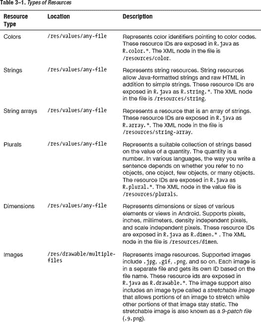

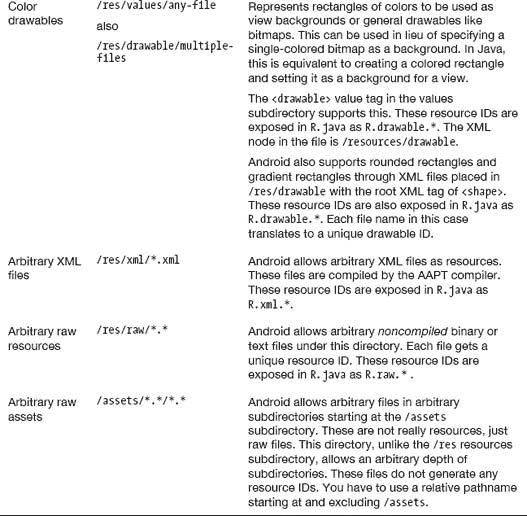

表中指定的每种资源都将在后续章节中通过 XML 和 Java 代码片段进行详细说明。

**注意：** 从 ID 生成的性质来看，似乎——尽管我们还没有在任何官方资料中看到——如果 XML 文件不在`/res/values`子目录中，就会根据文件名生成 ID。如果它们在`values`子目录中，则仅查看文件的内容来生成 ID。

#### 字符串数组

你可以在`/res/values`子目录下的任何文件中将字符串数组指定为资源。为此，你需要使用一个名为`string-array`的 XML 节点。这个节点与`string`资源节点一样，是`resources`的子节点。清单 3–10 是在资源文件中指定数组的一个示例。

**清单 3–10.** *指定字符串数组*
```
<resources ....>
......Other resources
<string-array name="test_array">
    <item>one</item>
    <item>two</item>
    <item>three</item>
</string-array>
......Other resources
</resources>
```

一旦你有了这个`string-array`资源定义，就可以像清单 3–11 所示，在 Java 代码中检索这个数组。

**清单 3–11.** *指定字符串数组*
```
//Get access to Resources object from an Activity
Resources res = your-activity.getResources();
String strings[] = res.getStringArray(R.array.test_array);

//Print strings
for (String s: strings)
{
    Log.d("example", s);
}
```


### 复数资源

资源 `plurals` 是一组字符串，这些字符串用于表达数值数量的不同方式，例如巢中有多少颗蛋。考虑以下示例：

`There is 1 egg.`
`There are 2 eggs.`
`There are 0 eggs.`
`There are 100 eggs.`

请注意，对于数字 2、0 和 100，句子是相同的，但数字 1 对应的句子不同。Android 允许你将这种变化表示为 `plurals` 资源。清单 3–12 展示了如何在资源文件中根据数量表示这两种变化。

**清单 3–12.** 指定字符串数组

```
<resources...>
<plurals name="eggs_in_a_nest_text">
    <item quantity="one">There is 1 egg</item>
    <item quantity="other">There are %d eggs</item>
</plurals>
</resources>
```

这两种变化在同一个复数下被表示为两个不同的字符串。现在，你可以使用清单 3–13 中的 Java 代码，根据给定数量使用此复数资源来打印字符串。`getQuantityString()` 方法的第一个参数是 `plurals` 资源 ID。第二个参数选择要使用的字符串。当数量值为 1 时，直接使用该字符串。当数量值不为 1 时，必须提供第三个参数，其值将替换 `%d` 的位置。如果在 `plurals` 资源中使用了格式化字符串，则必须始终提供至少三个参数。第二个参数可能会令人困惑；该参数的唯一区别在于其值是 1 还是非 1。

**清单 3–13.** 指定字符串数组

```
Resources res = your-activity.getResources();
String s1 = res.getQuantityString(R.plurals.eggs_in_a_nest_text, 0,0);
String s2 = res.getQuantityString(R.plurals.eggs_in_a_nest_text, 1,1);
String s3 = res.getQuantityString(R.plurals.eggs_in_a_nest_text, 2,2);
String s4 = res.getQuantityString(R.plurals.eggs_in_a_nest_text, 10,10);
```

根据此代码，每个数量都会得到一个适合其复数形式的恰当字符串。

然而，上述 `<item>` 节点的 `quantity` 属性还有哪些其他可能的值？我们强烈建议你阅读 Android 源代码发行版中的 `Resources.java` 和 `PluralRules.java` 的源代码，以真正理解这一点。本章末尾“资源”部分的链接中有这些源文件的摘录。

关键在于，对于 `en`（英语）语言区域，唯一可能的两个值是`"one"`和`"other"`。对于除 `cs`（捷克语）之外的所有其他语言也是如此，在捷克语中，值分别是`"one"`（用于 1）、`"few"`（用于 2 到 4），以及用于其余情况的`"other"`。

### 关于字符串资源的更多内容

我们在前面的章节简要介绍了字符串资源。现在让我们重新审视它们，以提供更多细节，包括 HTML 字符串以及如何在字符串资源中替换变量。

**注意：** 大多数 UI 框架都支持字符串资源。然而，与其他 UI 框架不同，Android 提供了通过 `R.java` 快速将 ID 与字符串资源关联起来的能力，因此在 Android 中将字符串用作资源要容易得多。

我们首先来看如何在 XML 资源文件中定义普通字符串、带引号的字符串、HTML 字符串和可替换字符串（参见清单 3–14）。

**清单 3–14.** 定义字符串资源的 XML 语法

```
<resources>
    <string name="simple_string">simple string</string>
    <string name="quoted_string">"quoted 'xyz' string"</string>
    <string name="double_quoted_string">\"double quotes\"</string>
    <string name="java_format_string">
           hello %2$s Java format string. %1$s again
     </string>
     <string name="tagged_string">
         Hello <b><i>Slanted Android</i></b>, You are bold.
     </string>
</resources>
```

这个 XML 字符串资源文件需要放在 `/res/values` 子目录中。文件名可以任意。

请注意，带引号的字符串需要转义或放在备用引号中。字符串定义也允许使用标准的 Java 字符串格式化序列。

Android 还允许在 `<string>` 节点内使用子 XML 元素，例如 `<b>`、`<i>` 以及其他简单的文本格式化 HTML。你可以使用这种复合 HTML 字符串在文本视图（text view）绘制之前对文本进行样式设置。

清单 3–15 中的 Java 示例说明了每种用法。

**清单 3–15.** 在 Java 代码中使用字符串资源

```
//Read a simple string and set it in a text view
String simpleString = activity.getString(R.string.simple_string);
textView.setText(simpleString);

//Read a quoted string and set it in a text view
String quotedString = activity.getString(R.string.quoted_string);
textView.setText(quotedString);

//Read a double quoted string and set it in a text view
String doubleQuotedString = activity.getString(R.string.double_quoted_string);
textView.setText(doubleQuotedString);

//Read a Java format string
String javaFormatString = activity.getString(R.string.java_format_string);
//Convert the formatted string by passing in arguments
String substitutedString = String.format(javaFormatString, "Hello" , "Android");
//set the output in a text view
textView.setText(substitutedString);

//Read an html string from the resource and set it in a text view
String htmlTaggedString = activity.getString(R.string.tagged_string);
//Convert it to a text span so that it can be set in a text view
//android.text.Html class allows painting of "html" strings
//This is strictly an Android class and does not support all html tags
Spanned textSpan = android.text.Html.fromHtml(htmlTaggedString);
//Set it in a text view
textView.setText(textSpan);
```

一旦你将字符串定义为资源，就可以在 XML 布局定义中直接为 `TextView` 等视图设置这些字符串。清单 3–16 展示了一个示例，其中将 HTML 字符串设置为 `TextView` 的文本内容。

**清单 3–16.** 在 XML 中使用字符串资源

```
<TextView android:layout_width="fill_parent"
          android:layout_height="wrap_content"
          android:gravity="center_horizontal"
          android:text="@string/tagged_string"/>
```

`TextView` 会自动识别此字符串为 HTML 字符串，并相应地处理其格式。这非常有用，因为你可以作为布局的一部分，快速在视图中设置具有吸引力的文本。


### 颜色资源

与字符串资源类似，您可以使用引用标识符来间接引用颜色。这样做可以让 Android 实现颜色本地化和主题应用。在资源文件中定义并标识颜色后，您可以通过其 ID 在 Java 代码中访问它们。字符串资源 ID 位于 `<your-package>.R.string` 命名空间下，而颜色资源 ID 则位于 `<your-package>.R.color` 命名空间下。

Android 还在其自身的资源文件中定义了一组基础颜色。因此，这些 ID 可以通过 Android 的 `android.R.color` 命名空间进行访问。查看以下网址，了解 `android.R.color` 命名空间中可用的颜色常量：

`http://code.google.com/android/reference/android/R.color.html`

代码清单 3–17 提供了一些在 XML 资源文件中指定颜色的示例。

**代码清单 3–17.** *定义颜色资源的 XML 语法*

```
<resources>
    <color name="red">#f00</color>
    <color name="blue">#0000ff</color>
    <color name="green">#f0f0</color>
    <color name="main_back_ground_color">#ffffff00</color>
</resources>
```

代码清单 3–17 中的条目必须放在 `/res/values` 子目录下的一个文件中。文件名称可以是任意的，这意味着您可以选择任何文件名。Android 会读取所有文件，然后处理它们并查找如 `resources` 和 `color` 等单个节点，以确定各个 ID。

代码清单 3–18 展示了在 Java 代码中使用颜色资源的示例。

**代码清单 3–18.** *Java 代码中的颜色资源*

```
int mainBackGroundColor
     =  activity.getResources.getColor(R.color.main_back_ground_color);
```

代码清单 3–19 展示了如何在视图定义中使用颜色资源。

**代码清单 3–19.** *在视图定义中使用颜色*

```
<TextView android:layout_width="fill_parent"
          android:layout_height="wrap_content"
          android:textColor="@color/red"
          android:text="Sample Text to Show Red Color"/>
```

### 尺寸资源

像素、英寸和点都是可以用于 XML 布局或 Java 代码的尺寸示例。您可以使用这些尺寸资源来样式化和本地化 Android UI，而无需更改源代码。

代码清单 3–20 展示了如何在 XML 中使用尺寸资源。

**代码清单 3–20.** *定义尺寸资源的 XML 语法*

```
<resources>
    <dimen name="mysize_in_pixels">1px</dimen>
    <dimen name="mysize_in_dp">5dp</dimen>
    <dimen name="medium_size">100sp</dimen>
</resources>
```

您可以使用以下任一单位来指定尺寸：

*   `px`: 像素
*   `in`: 英寸
*   `mm`: 毫米
*   `pt`: 点
*   `dp`: 基于 160dpi（每英寸像素密度）屏幕的密度无关像素（尺寸会根据屏幕密度调整）
*   `sp`: 缩放无关像素（允许用户调整大小的尺寸；对字体使用很有帮助）

在 Java 中，您需要访问 `Resources` 对象实例来获取一个尺寸。您可以通过在 `activity` 对象上调用 `getResources` 来实现（参见代码清单 3–21）。一旦获得 `Resources` 对象，您就可以使用尺寸 ID 请求它定位该尺寸（同样参见代码清单 3–21）。

**代码清单 3–21.** *在 Java 代码中使用尺寸资源*

```
float dimen = activity.getResources().getDimension(R.dimen.mysize_in_pixels);
```

**注意：** Java 方法调用使用的是 `Dimension`（完整拼写），而 `R.java` 命名空间使用缩写版本 `dimen` 来表示 *dimension*。

与 Java 中类似，在 XML 中用于尺寸的资源引用使用 `dimen`，而不是完整的单词 *dimension*（参见代码清单 3–22）。

**代码清单 3–22.** *在 XML 中使用尺寸资源*

```
<TextView android:layout_width="fill_parent"
          android:layout_height="wrap_content"
          android:textSize="@dimen/medium_size"/>
```

### 图像资源

Android 会为放置在 `/res/drawable` 子目录下的图像文件生成资源 ID。支持的图像类型包括 `.gif`、`.jpg` 和 `.png`。此目录中的每个图像文件都会根据其基本文件名生成唯一的 ID。例如，如果图像文件名为 `sample_image.jpg`，则生成的资源 ID 为 `R.drawable.sample_image`。

**警告：** 如果两个文件的基本文件名相同，会导致错误。此外，`/res/drawable` 下的子目录会被忽略。放置在这些子目录下的任何文件都不会被读取。

您可以在其他 XML 布局定义中引用 `/res/drawable` 中可用的图像，如代码清单 3–23 所示。

**代码清单 3–23.** *在 XML 中使用图像资源*

```
<Button
      android:id="@+id/button1"
      android:layout_width="fill_parent"
      android:layout_height="wrap_content"
      android:text="Dial"
      android:background="@drawable/sample_image"
/>
```

您也可以通过 Java 以编程方式检索图像，并将其设置为按钮等 UI 对象的背景（参见代码清单 3–24）。

**代码清单 3–24.** *在 Java 中使用图像资源*

```
//调用 getDrawable 获取图像
BitmapDrawable d = activity.getResources().getDrawable(R.drawable.sample_image);

//然后可以使用该 drawable 设置背景
button.setBackgroundDrawable(d);

//或者可以直接通过资源 ID 设置背景
button.setBackgroundResource(R.drawable.sample_image);
```

**注意：** 这些设置背景的方法可以一直追溯到 `View` 类。因此，大多数 UI 控件都支持设置背景。

Android 还支持一种特殊类型的图像，称为*可拉伸图像*。这是一种 `.png` 图像，其中部分图像可以被指定为静态区域和可拉伸区域。Android 提供了一个名为 Draw 9-patch 的工具来指定这些区域（您可以在 [`http://developer.android.com/guide/developing/tools/draw9patch.html`](http://developer.android.com/guide/developing/tools/draw9patch.html) 阅读更多相关信息）。

一旦准备好 `.png` 图像，您就可以像使用其他任何图像一样使用它。当用作按钮背景时，它会非常有用，因为按钮需要拉伸自身以适应文本。


### 颜色可绘制资源

在 Android 中，图像是一种可绘制资源。Android 还支持另一种称为*颜色可绘制资源*的可绘制资源；它本质上是一个彩色矩形。

**注意：** Android 文档似乎暗示可以实现圆角，但我们未能成功创建。我们提供了另一种替代方法。文档还暗示其实例化的 Java 类是 `PaintDrawable`，但代码返回的是 `ColorDrawable`。

要定义这些彩色矩形之一，你可以在 `/res/values` 子目录下的任何 XML 文件中，通过名为 `drawable` 的节点名称定义一个 XML 元素。清单 3–25 展示了一些颜色可绘制资源的示例。

**清单 3–25.** *定义颜色可绘制资源的 XML 语法*

```
<resources>
    <drawable name="red_rectangle">#f00</drawable>
    <drawable name="blue_rectangle">#0000ff</drawable>
    <drawable name="green_rectangle">#f0f0</drawable>
</resources>
```

清单 3–26 和 3–27 分别展示了如何在 Java 和 XML 中使用颜色可绘制资源。

**清单 3–26.** *在 Java 代码中使用颜色可绘制资源*

```
// 获取一个可绘制对象
ColorDrawable redDrawable = (ColorDrawable) activity.getResources().getDrawable(R.drawable.red_rectangle);

// 将其设置为文本视图的背景
textView.setBackgroundDrawable(redDrawable);
```

**清单 3–27.** *在 XML 代码中使用颜色可绘制资源*

```
<TextView android:layout_width="fill_parent"
          android:layout_height="wrap_content"
          android:textAlign="center"
          android:background="@drawable/red_rectangle"/>
```

要在你的 `Drawable` 中实现圆角，你可以使用当前未记录在案的 `<shape>` 标签。但是，此标签需要单独存放在 `/res/drawable` 目录下的一个文件中。清单 3–28 展示了如何在名为 `/res/drawable/my_rounded_rectangle.xml` 的文件中使用 `<shape>` 标签定义一个圆角矩形。

**清单 3–28.** *定义圆角矩形*

```
<shape >
    <solid android:color="#f0600000"/>
    <stroke android:width="3dp" color="#ffff8080"/>
    <corners android:radius="13dp" />
    <padding android:left="10dp" android:top="10dp"
        android:right="10dp" android:bottom="10dp" />
</shape>
```

然后，你可以像 清单 3–29 所示，将此可绘制资源用作之前文本视图示例的背景。

**清单 3–29.** *从 Java 代码使用可绘制对象*

```
// 获取一个可绘制对象
GradientDrawable roundedRectangle = (GradientDrawable) activity.getResources().getDrawable(R.drawable.my_rounded_rectangle);

// 将其设置为文本视图的背景
textView.setBackgroundDrawable(roundedRectangle);
```

**注意：** 不**需要**将返回的基础 `Drawable` 强制转换为 `GradientDrawable`，但这样做是为了向你展示此 `<shape>` 标签会变成一个 `GradientDrawable`。此信息很重要，因为你可以查阅此类的 Java API 文档，以了解它所定义的 XML 标签。

最终，`drawable` 子目录中的位图图像会被解析为 `BitmapDrawable` 类。一个可绘制资源值，例如 清单 3–29 中的某个矩形，会被解析为 `ColorDrawable`。包含 `<shape>` 标签的 XML 文件会被解析为 `GradientDrawable`。

### 使用任意的 XML 资源文件

除了到目前为止描述的结构化资源之外，Android 还允许将任意 XML 文件作为资源。这种方法将使用资源的优势扩展到了任意 XML 文件。首先，这种方法提供了一种基于生成的资源 ID 来快速引用这些文件的方式。其次，这种方法允许你对这些资源 XML 文件进行本地化。第三，你可以高效地在设备上编译和存储这些 XML 文件。

需要以这种方式读取的 XML 文件存储在 `/res/xml` 子目录下。清单 3–30 是一个名为 `/res/xml/test.xml` 的示例 XML 文件。

**清单 3–30.** *示例 XML 文件*

```
<rootelem1>
   <subelem1>
      Hello World from an xml sub element
   </subelem1>
</rootelem1>
```

与处理其他 Android XML 资源文件一样，AAPT 在将此 XML 文件放入应用程序包之前会对其编译。如果你想解析这些文件，你需要使用 `XmlPullParser` 的一个实例。你可以使用 清单 3–31 中的代码，在任何上下文（包括 `activity`）中获取 `XmlPullParser` 实现的实例。

**清单 3–31.** *读取 XML 文件*

```
Resources res = activity.getResources();
XmlResourceParser xpp = res.getXml(R.xml.test);
```

返回的 `XmlResourceParser` 是 `XmlPullParser` 的一个实例，并且它也实现了 `java.util.AttributeSet`。清单 3–32 展示了一个更完整的代码片段，用于读取 `test.xml` 文件。

**清单 3–32.** *使用 `XmlPullParser`*

```
private String getEventsFromAnXMLFile(Activity activity)
throws XmlPullParserException, IOException
{
   StringBuffer sb = new StringBuffer();
   Resources res = activity.getResources();
   XmlResourceParser xpp = res.getXml(R.xml.test);

   xpp.next();
   int eventType = xpp.getEventType();
    while (eventType != XmlPullParser.END_DOCUMENT)
    {
        if(eventType == XmlPullParser.START_DOCUMENT)
        {
           sb.append("******Start document");
        }
        else if(eventType == XmlPullParser.START_TAG)
        {
           sb.append("\nStart tag "+xpp.getName());
        }
        else if(eventType == XmlPullParser.END_TAG)
        {
           sb.append("\nEnd tag "+xpp.getName());
        }
        else if(eventType == XmlPullParser.TEXT)
        {
           sb.append("\nText "+xpp.getText());
        }
        eventType = xpp.next();
    }//eof-while
    sb.append("\n******End document");
    return sb.toString();
}//eof-function
```

在 清单 3–32 中，你可以看到如何获取 `XmlPullParser`，如何使用 `XmlPullParser` 遍历 XML 文档中的 XML 元素，以及如何使用 `XmlPullParser` 的附加方法来访问 XML 元素的详细信息。如果你想运行此代码，你必须如前所示创建一个 XML 文件，并从任何菜单项或按钮点击中调用 `getEventsFromAnXMLFile` 函数。它会返回一个字符串，你可以使用 `Log.d` 调试方法将其打印到日志流中。


### 使用原始资源

Android 除了允许任意 XML 文件外，也支持原始文件。这些资源放置在 `/res/raw` 目录下，是诸如音频、视频或需要本地化并通过资源 ID 引用的文本文件等原始文件。与放置在 `/res/xml` 中的 XML 文件不同，这些文件不会被编译，而是按原样移动到应用包中。不过，每个文件都会在 `R.java` 中生成一个标识符。如果你将一个文本文件放置在 `/res/raw/test.txt`，就可以使用代码清单 3–33 中的代码读取该文件。

**代码清单 3–33.** *读取原始资源*

```
String getStringFromRawFile(Activity activity)
   throws IOException
   {
      Resources r = activity.getResources();
      InputStream is = r.openRawResource(R.raw.test);
      String myText = convertStreamToString(is);
      is.close();
      return myText;
   }

   String convertStreamToString(InputStream is)
   throws IOException
   {
      ByteArrayOutputStream baos = new ByteArrayOutputStream();
      int i = is.read();
      while (i != -1)
      {
         baos.write(i);
         i = is.read();
      }
      return baos.toString();
   }
```

**注意：** 如果文件名（不含扩展名）重复，Eclipse ADT 插件会生成编译错误。对于所有基于文件生成的资源 ID，情况都是如此。

### 使用 Assets（资源文件）

Android 提供了另一个目录，你可以在其中存放要包含在包中的文件：`/assets`。它与 `/res` 处于同一层级，意味着它不是 `/res` 的子目录。`/assets` 中的文件不会在 `R.java` 中生成 ID；你必须指定文件路径来读取它们。文件路径是从 `/assets` 开始的相对路径。你可以使用 `AssetManager` 类来访问这些文件，如代码清单 3–34 所示。

**代码清单 3–34.** *读取 Asset 文件*

```
//注意：代码中未展示异常处理
String getStringFromAssetFile(Activity activity)
{
    AssetManager am = activity.getAssets();
    InputStream is = am.open("test.txt");
    String s = convertStreamToString(is);
    is.close();
    return s;
}
```

### 回顾资源目录结构

总之，代码清单 3–35 快速展示了资源目录的整体结构。

**代码清单 3–35.** *资源目录*

```
/res/values/strings.xml
           /colors.xml
           /dimens.xml
           /attrs.xml
           /styles.xml
    /drawable/*.png
             /*.jpg
             /*.gif
             /*.9.png
    /anim/*.xml
    /layout/*.xml
    /raw/*.*
    /xml/*.xml
/assets/*.*/*.*
```

**注意：** 由于不在 `/res` 目录下，只有 `/assets` 目录可以包含任意深度的子目录列表。其他所有目录都只能在该目录的层级包含文件，不能更深。这就是 `R.java` 为这些文件生成标识符的方式。

### 资源配置变更

资源有助于本地化。例如，你可以让一个字符串值根据用户的语言区域而变化。Android 资源将此概念推广到设备的任何配置，语言只是其中一种配置选项。配置变更的另一个例子是设备从垂直方向旋转到水平方向。垂直模式称为*竖屏模式*，水平模式称为*横屏模式*。

Android 允许你根据布局模式，为相同的资源 ID 选择不同的布局集。Android 通过为每种配置使用不同的目录来实现这一点。代码清单 3–36 展示了一个例子。

**代码清单 3–36.** *备选资源目录*

```
\res\layout\main_layout.xml
\res\layout-port\main_layout.xml
\res\layout-land\main_layout.xml
```

尽管这里有三个独立的布局文件，但它们都只在 `R.java` 中生成一个布局 ID。这个 ID 如下所示：

`R.layout.main_layout`

然而，当你检索与此布局 ID 对应的布局时，会得到适用于该设备布局的适当布局。

在此示例中，目录扩展名 `-port` 和 `-land` 被称为*配置限定符*。这些限定符是*不区分大小写*的，并且通过连字符（`-`）与资源目录名称分隔。你在这些配置限定符目录中指定的资源称为*备选资源*。未带配置限定符的资源目录中的资源称为*默认资源*。

下面列出了大部分可用的配置限定符。请注意，新的 API 可能会添加新的限定符。请参阅参考资料部分中的 URL，查看最新的资源限定符集合：

*   `mccAAA`：`AAA` 是移动国家代码。
*   `mncAAA`：`AAA` 是运营商/网络代码。
*   `en-rUS`：语言和区域。
*   `sw<N>dp`、`w<N>dp`、`h<N>dp`：最小宽度、可用宽度、可用高度（自 API 13 起）。
*   `small`、`normal`、`large`、`xlarge`：屏幕尺寸。
*   `long`、`notlong`：屏幕类型。
*   `port`、`land`：竖屏或横屏。
*   `car`、`desk`：底座类型。
*   `night`、`notnight`：夜间或日间。
*   `ldpi`、`mdpi`、`hdpi`、`xhdpi`、`nodpi`、`tvdpi`：屏幕密度。
*   `notouch`、`stylus`、`finger`：屏幕类型。
*   `keysexposed`、`keyssoft`、`keyshidden`：键盘类型。
*   `nokeys`、`qwerty`、`12key`：按键数量。
*   `navexposed`、`navhidden`：导航键隐藏或暴露。
*   `nonav`、`dpad`、`trackball`、`wheel`：导航设备类型。
*   `v3`、`v4`、`v7`：API 级别。

使用这些限定符，你可以拥有如代码清单 3–37 所示的资源目录。

**代码清单 3–37.** *其他备选资源目录*

```
\res\layout-mcc312-mnc222-en-rUS
\res\layout-ldpi
\res\layout-hdpi
\res\layout-car
```

你可以通过导航到设备上的“自定义区域”应用程序来发现当前的区域设置。此应用程序的导航路径为：主页  应用程序列表  自定义区域。

给定一个资源 ID，Android 会使用算法选择正确的资源。你可以参考“参考 URL”部分中的 URL 来了解更多关于这些规则的信息，但让我们先了解几条经验法则。

首要规则是，前面列出的限定符是按优先级顺序排列的。考虑代码清单 3–38 中的目录。

**代码清单 3–38.** *布局文件变体*

```
\res\layout\main_layout.xml
\res\layout-port\main_layout.xml
\res\layout-en\main_layout.xml
```


在 Listing 3–38 中，布局文件`main_layout.xml`有两个额外的变体：一个用于语言的变体，一个用于布局模式的变体。现在，让我们检查一下，如果你在竖屏模式下查看设备，会选取哪个布局文件。即使你处于竖屏模式，Android 仍会从`layout-en`目录中选取布局，因为在配置限定符列表中，语言变体的优先级高于方向变体。本章“参考 URL”一节中提到的 SDK 链接列出了所有配置限定符及其优先级顺序。

让我们通过尝试几个字符串资源来进一步了解优先级规则。请注意，字符串资源基于单个 ID，而布局资源则是基于文件的。为了测试字符串资源的配置限定符优先级，我们设计了五个资源 ID，它们可以参与以下变体：`default`、`en`、`en_us`、`port`和`en_port`。这五个资源 ID 如下：

*   `teststring_all`：此 ID 存在于`values`目录的所有变体中，包括默认变体。
*   `testport_port`：此 ID 存在于默认变体和仅`-port`变体中。
*   `t1_enport`：此 ID 存在于默认变体以及`-en`和`-port`变体中。
*   `t1_1_en_port`：此 ID 存在于默认变体和仅`-en-port`变体中。
*   `t2`：此 ID 仅存在于默认变体中。

Listing 3–39 展示了`values`目录的所有变体。

**Listing 3–39.** **基于配置的字符串变体**

```
// values/strings.xml
<resources >
  <string name="teststring_all">teststring in root</string>
  <string name="testport_port">testport-port</string>
  <string name="t1_enport">t1 in root</string>
  <string name="t1_1_en_port">t1_1 in root</string>
  <string name="t2">t2 in root</string>
</resources>

// values-en/strings_en.xml
<resources >
  <string name="teststring_all">teststring-en</string>
  <string name="t1_enport">t1_en</string>
  <string name="t1_1_en_port">t1_1_en</string>
</resources>

// values-en-rUS/strings_en_us.xml
<resources >
  <string name="teststring_all">test-en-us</string>
</resources>

// values-port/strings_port.xml
<resources >
  <string name="teststring_all">test-en-us-port</string>
  <string name="testport_port">testport-port</string>
  <string name="t1_enport">t1_port</string>
  <string name="t1_1_en_port">t1_1_port</string>
</resources>

// values-en-port/strings_en_port.xml
<resources >
  <string name="teststring_all">test-en-port</string>
  <string name="t1_1_en_port">t1_1_en_port</string>
</resources>
```

Listing 3–40 展示了这些内容对应的`R.java`文件。

**Listing 3–40.** **支持字符串变体的`R.java`**

```
public static final class string {
    public static final int teststring_all=0x7f050000;
    public static final int testport_port=0x7f050004;
    public static final int t1_enport=0x7f050001;
    public static final int t1_1_en_port=0x7f050002;
    public static final int t2=0x7f050003;
}
```

显而易见，尽管你定义了大量的字符串，但只生成了五个字符串资源 ID。如果你检索这些字符串值，每个字符串检索的行为如下所述（我们测试的配置是`en_US`和竖屏模式）：

*   `teststring_all`：此 ID 存在于`values`目录的所有五个变体中。因为它存在于所有变体中，所以会从`values-en-rUS`目录中选取该变体。根据优先级规则，特定语言会覆盖默认变体、`en`变体、`port`变体和`en-port`变体。
*   `testport_port`：此 ID 存在于默认变体和仅`-port`变体中。因为它不存在于任何以`-en`开头的值目录中，所以`-port`变体的优先级高于默认变体，因此会从`-port`变体中选取值。如果它存在于某个`-en`变体中，则会从那里选取值。
*   `t1_enport`：此 ID 存在于三个变体中：默认变体、`-en`变体和`-port`变体。因为它同时存在于`-en`和`-port`变体中，所以会从`-en`变体中选取值。
*   `t1_1_en_port`：此 ID 存在于四个变体中：默认变体、`-port`变体、`-en`变体和`-en-port`变体。因为它可在`-en-port`变体中找到，所以会从`-en-port`变体中选取它，忽略默认变体、`-en`变体和`-port`变体。
*   `t2`：此 ID 仅存在于默认变体中，因此从默认变体中选取值。

Android SDK 有一个更详细的算法，你可以进一步阅读。不过，本节中的示例已经向你展示了其核心思想。关键在于认识到一个变体相对于另一个变体的优先级。下面的参考章节提供了此 SDK 链接的 URL，还提供了用于下载本章可导入项目的 URL；你可以使用此项目来试验这些配置变体。

### 参考 URL

在学习 Android 资源时，你可能希望手头保留以下参考 URL。除了 URL 之外，我们还列出了每个 URL 能让你获得的信息：

*   [`http://developer.android.com/guide/topics/resources/index.html`](http://developer.android.com/guide/topics/resources/index.html)：资源文档的路线图。
*   [`http://developer.android.com/guide/topics/resources/available-resources.html`](http://developer.android.com/guide/topics/resources/available-resources.html)：Android 各种类型资源的文档。
*   [`http://developer.android.com/guide/topics/resources/providing-resources.html#AlternativeResources`](http://developer.android.com/guide/topics/resources/providing-resources.html#AlternativeResources)：最新 Android SDK 提供的各种配置限定符列表。
*   [`http://developer.android.com/guide/practices/screens_support.html`](http://developer.android.com/guide/practices/screens_support.html)：关于如何为多种屏幕尺寸设计 Android 应用程序的指南。
*   [`http://developer.android.com/reference/android/content/res/Resources.html`](http://developer.android.com/reference/android/content/res/Resources.html)：用于读取资源的各种可用方法。
*   [`http://developer.android.com/reference/android/R.html`](http://developer.android.com/reference/android/R.html)：核心 Android 平台定义的资源。
*   [`www.androidbook.com/item/3542`](http://www.androidbook.com/item/3542)：我们关于复数、字符串数组和备用资源的研究，以及指向其他参考资料的链接。
*   `androidbook.com/proandroid4/projects`：可下载的 Eclipse 项目 URL，该项目演示了本章中的许多概念。文件名是`ProAndroid4_Ch03_TestResources.zip`。

### 总结

让我们通过快速列举到目前为止你学到的关于资源的知识来结束本章：

*   你了解了 Android 中支持的资源类型。
*   你知道了如何在 XML 文件中创建资源。
*   你学习了资源 ID 是如何生成的，以及如何在 Java 代码中使用它们。
*   你了解到资源 ID 生成是一种便捷的方案，它简化了 Android 中的资源使用。
*   你学习了如何处理 XML 资源、原始资源和资产。
*   你简要了解了备用资源。
*   你看到了如何定义和使用复数及字符串数组。
*   你学习了资源引用语法。


### 面试题

你可以使用以下问题作为指南，来巩固你对本章的理解：

1.  你能说出多少种资源类型？
2.  什么是 `R.java`？
3.  为什么 `R.java` 在处理资源时如此便利？
4.  资源引用语法与为 UI 控件分配 ID 之间有什么联系？
5.  生成资源 ID 时会用到文件扩展名吗？
6.  如果两个基于文件的资源仅扩展名不同，会发生什么？
7.  什么是原始资源（raw）和 XML 资源，它们与 assets（资源文件夹）有何不同？
8.  你能对 XML 资源进行本地化吗？
9.  你能对 assets 进行本地化吗？
10. 你能写出并解释资源引用语法吗？
11. 你可以预声明控件的 ID 吗？如果可以，为什么？
12. 使用哪个 XML 节点来创建 ID？
13. 如果你将文件放入 XML 和 raw 目录中，Android 是否会通过 `R.java` 为这些文件生成 ID？
14. Android 会为 asset 目录中的文件生成 ID 吗？
15. 在 `plurals`（复数）资源中，`one` 和 `other` 的含义是什么？
16. 你能在字符串资源中使用 HTML 字符串吗？
17. 如何在文本视图中显示 HTML 字符串？
18. 如何将一个矩形定义为可绘制对象？
19. 如何使用形状（shape）可绘制对象？
20. 你使用哪个类来读取 `/res/xml` 目录中的 XML 文件？
21. 在 Android 中处理 XML 文件的主要类是什么？
22. `AssetManager` 类是什么，你如何获取它？
23. `Resources` 类是什么，你如何获取它的实例？
24. 你能在 `assets` 文件夹下创建任意子目录吗？
25. 你可以在 `/res/xml` 资源文件夹下创建子目录吗？
26. 什么是资源配置限定符？

至此，让我们将注意力转向下一章的内容提供者。

---

## 第 4 章

## 理解内容提供者

Android 使用一种称为*内容提供者*的概念来将数据抽象为服务。内容提供者的这个想法使得数据源看起来像是支持 REST 的数据提供者，例如网站。从这个意义上说，内容提供者是数据的封装器。Android 设备上的 SQLite 数据库就是一个可以封装到内容提供者中的数据源示例。

**注意：** REST 代表表述性状态转移。当你在 Web 浏览器中输入一个 URL，Web 服务器以 HTML 作为响应时，你实际上已经在 Web 服务器上执行了一个基于 REST 的“查询”操作。REST 通常也与（SOAP——简单对象访问协议）Web 服务进行对比。你可以在以下维基百科条目中阅读更多关于 REST 的内容：[`http://en.wikipedia.org/wiki/Representational_State_Transfer`](http://en.wikipedia.org/wiki/Representational_State_Transfer)。

要从内容提供者检索数据或向内容提供者保存数据，你需要使用一组类似 REST 的 URI。例如，如果你要从一个封装了图书数据库的内容提供者中检索一组图书，你需要使用如下 URI：

`content://com.android.book.BookProvider/books`

要从该图书数据库中检索一本特定的书（第 23 本），你需要使用如下 URI：

`content://com.android.book.BookProvider/books/23`

你将在本章中看到这些 URI 如何对应到底层的数据库访问机制。设备上的任何应用程序都可以利用这些 URI 来访问和操作数据。因此，内容提供者在应用程序之间共享数据方面扮演着重要角色。

严格来说，内容提供者的职责更多地在于封装机制而非数据访问机制。你需要一个实际的数据访问机制，例如 SQLite 或网络访问，才能访问到底层的数据源。因此，仅当你希望对外共享数据或在应用程序之间共享数据时，才需要内容提供者这一抽象层。对于内部数据访问，应用程序可以使用任何它认为合适的数据存储/访问机制，例如：

-   *SharedPreferences*：一组你可以持久化以存储应用程序偏好的键/值对。
-   *文件*：应用程序内部的文件，你可以将其存储在可移除的存储介质上。
-   *SQLite*：SQLite 数据库，每个数据库对于创建它的包来说是私有的。
-   *网络*：一种允许你通过 HTTP 服务从外部检索或存储数据的机制。

**注意：** 尽管 Android 允许使用多种数据访问机制，但本章重点介绍 SQLite 和内容提供者抽象，因为内容提供者是数据共享的基础，与其他 UI 框架相比，这在 Android 框架中要普遍得多。我们将在第 11 章中介绍网络方法，并在第 9 章中介绍偏好设置机制。

### 探索 Android 内置的内容提供者

Android 带有许多内置的内容提供者，这些提供者在 SDK 的 `android.provider` Java 包中有文档说明。你可以在此处查看这些提供者的列表：

`http://developer.android.com/reference/android/provider/package-summary.html`

这些提供者包括，例如，联系人（Contacts）和媒体存储（Media Store）。这些 SQLite 数据库通常具有 `.db` 扩展名，并且只能从实现包内部访问。任何在该包之外的访问都必须通过内容提供者接口进行。


#### 在模拟器和可用设备上探索数据库

由于 Android 中的许多内容提供程序都使用 SQLite 数据库（`www.sqlite.org/`），您可以使用 Android 和 SQLite 提供的工具来检查这些数据库。其中许多工具位于 `\android-sdk-install-directory\tools` 子目录中；其他工具位于 `\android-sdk-install-directory\platform-tools` 中。

**注意：** 请参考第 2 章，了解如何在不同操作系统中定位 `tools` 目录和调用命令窗口。与其余大部分章节一样，本章主要在 Windows 平台上给出示例。在本节中，我们将使用多个命令行工具，您可以重点关注可执行文件或批处理文件的名称，而无需过多关注工具所在的目录。我们已在第 2 章 中介绍了如何在各种平台上设置工具目录的路径。

Android 使用一个名为 Android 调试桥（`adb`）的命令行工具，其位置如下：

`platform-tools\adb.exe`

`adb` 是 Android 工具包中的一种特殊工具，大多数其他工具通过它来访问设备。但是，您必须让模拟器正在运行或有 Android 设备已连接，`adb` 才能正常工作。您可以在命令行中输入以下命令来查看是否有正在运行的设备或模拟器：

`adb devices`

如果模拟器没有运行，您可以在命令行中输入以下命令来启动它：

`emulator.exe @avdname`

参数 `@avdname` 是 Android 虚拟设备（AVD）的名称。（第 2 章介绍了 Android 虚拟设备的必要性以及如何在第 2 章 中创建它们。）要查看您已有的虚拟设备，可以运行以下命令：

`android list avd`

此命令将列出所有可用的 AVD。如果您已经通过 Eclipse Android 开发工具（ADT）开发并运行过任何 Android 应用程序，那么您已经至少配置了一个虚拟设备。上述命令至少会列出这一个。

以下是 `list` 命令的一些输出示例。（根据您的 `tools` 目录位置以及 Android 版本，以下输出内容的路径或版本号可能会有所不同，例如 `i:\android`。）

```
I:\android\tools>android list avd
Available Android Virtual Devices:
    Name: avd
    Path: I:\android\tools\..\avds\avd3
  Target: Google APIs (Google Inc.)
          Based on Android 1.5 (API level 3)
    Skin: HVGA
  Sdcard: 32M
---------
    Name: titanium
    Path: C:\Documents and Settings\Satya\.android\avd\titanium.avd
  Target: Android 1.5 (API level 3)
    Skin: HVGA
```

如上所述，AVD 的详细信息在第 2 章有介绍。

您也可以通过 Eclipse ADT 插件启动模拟器。当您选择在模拟器中运行或调试某个程序时，这会自动发生。模拟器启动并运行后，您可以通过输入以下命令再次测试以获取正在运行的设备列表：

`adb devices`

现在您应该会看到类似如下的输出：

```
List of devices attached
emulator-5554 device
```

您可以在命令行中输入以下命令来查看可以通过 `adb` 运行的众多选项和命令：

`adb help`

您也可以访问以下网址了解 `adb` 的许多运行时选项：[`http://developer.android.com/guide/developing/tools/adb.html`](http://developer.android.com/guide/developing/tools/adb.html)。

您可以使用 `adb` 在连接的设备上打开一个 shell，方法是输入：

`adb shell`

**注意：** 此 shell 是一个 Unix `ash`，但命令集有限。例如，您可以执行 `ls`，但 `find`、`grep` 和 `awk` 在该 shell 中不可用。

您可以在 shell 提示符下输入以下内容来查看 shell 中可用的命令集：

`#ls /system/bin`

`#` 符号是 shell 的提示符。为简洁起见，在以下示例中我们将省略此提示符。要查看根级目录和文件的列表，您可以在 shell 中输入：

`ls -l`

您需要访问此目录才能查看数据库列表：

`ls /data/data`

此目录包含设备上已安装的软件包列表。让我们通过探索 `com.android.providers.contacts` 软件包来查看一个示例：

`ls /data/data/com.android.providers.contacts/databases`

这将列出一个名为 `contacts.db` 的数据库文件，这是一个 SQLite 数据库。（该文件和路径仍然取决于设备和版本。）

**注意：** 在 Android 中，数据库可能是在首次访问时创建的。这意味着如果您从未访问过联系人应用程序，您可能看不到此文件。

如果包含的 `ash` 中有 `find` 命令，您可以查找所有 `*.db` 文件。但仅靠 `ls` 无法很好地做到这一点。您能做到的最接近的操作是：

`ls -R /data/data/*/databases`

使用此命令，您会注意到 Android 发行版中有以下数据库（再次提醒，请谨慎：根据您的版本，此列表可能有所不同）：

```
alarms.db
contacts.db
downloads.db
internal.db
settings.db
mmssms.db
telephony.db
```

您可以在 `adb` shell 中通过对其中一个数据库调用 `sqlite3` 来操作它，请输入：

`sqlite3 /data/data/com.android.providers.contacts/databases/contacts.db`

您可以通过输入以下内容退出 `sqlite3`：

`sqlite>.exit`

请注意，`adb` 的提示符是 `#`，而 `sqlite3` 的提示符是 `sqlite>`。您可以通过访问 `www.sqlite.org/sqlite.html` 来了解各种 `sqlite3` 命令。不过，我们将在下面列出一些重要的命令，这样您就不必去访问网页了。您可以通过输入以下命令来查看表列表：

`sqlite> .tables`

此命令是以下内容的快捷方式：

```
SELECT name FROM sqlite_master
WHERE type IN ('table','view') AND name NOT LIKE 'sqlite_%'
UNION ALL
SELECT name FROM sqlite_temp_master
WHERE type IN ('table','view')
ORDER BY 1
```

您可能已经猜到，`sqlite_master` 表是一个主表，用于跟踪数据库中的表和视图。以下命令行会打印出 `contacts.db` 中名为 `people` 的表的 `create` 语句：

`.schema people`

这是在 SQLite 中获取表列名的一种方法。它还会打印出列数据类型。在使用内容提供程序时，您应留意这些列类型，因为访问方法依赖于它们。

然而，仅仅为了了解列名及其类型而手动解析这条长长的 `create` 语句是非常繁琐的。有一种变通方法：您可以将 `contacts.db` 拉取到本地计算机上，然后使用任何适用于 SQLite 版本 3 的 GUI 工具来检查该数据库。您可以从操作系统命令提示符中发出以下命令来拉取 `contacts.db` 文件：

`adb pull /data/data/com.android.providers.contacts/databases/contacts.db` 
`c:/somelocaldir/contacts.db`

我们使用了免费下载的 Sqliteman（[`http://sqliteman.com/`](http://sqliteman.com/)），这是一个适用于 SQLite 数据库的 GUI 工具，运行起来似乎没有问题。我们遇到了几次崩溃，但除此之外，发现该工具完全可以用于探索 Android SQLite 数据库。


### SQLite 快速入门

以下示例 SQL 语句可帮助你快速浏览 SQLite 数据库：

```
//设置工具中显示的列标题
sqlite>.headers on

//从表中选择所有行
select * from table1;

//统计表中的行数
select count(*) from table1;

//选择特定的列集
select col1, col2 from table1;

//选择列中的不重复值
select distinct col1 from table1;

//统计不重复值的数量
select count(col1) from (select distinct col1  from table1);

//分组
select count(*), col1 from table1 group by col1;

//常规内连接
select * from table1 t1, table2 t2
where t1.col1 = t2.col1;

//左外连接
//返回 t1 中的所有数据，即使 t2 中没有匹配行
select * from table t1 left outer join table2 t2
on t1.col1 = t2.col1
where ....
```

### 内容提供者的架构

现在你已经知道如何通过 Android 和 SQLite 工具探索现有的内容提供者。接下来，我们将考察内容提供者的一些架构元素，以及这些内容提供者如何与行业中其他数据访问抽象相关联。

总体而言，内容提供者方法与以下行业抽象有相似之处：

- 网站
- REST
- Web 服务
- 存储过程

设备上的每个内容提供者都像网站一样，通过一个字符串（类似于域名，但称为*授权标识*）向系统注册自己。这个唯一标识的字符串构成了该内容提供者所能提供的一组 URI 的基础。这无异于一个拥有域名的网站通过许多 URL 来公开其文档或内容。

这个授权标识的注册发生在 `AndroidManifest.xml` 文件中。以下是在 `AndroidManifest.xml` 中注册提供者的两个示例：

```
<provider android:name="SomeProvider"
        android:authorities="com.your-company.SomeProvider" />

<provider android:name="NotePadProvider"
   android:authorities="com.google.provider.NotePad"
/>
```

授权标识对于内容提供者来说就像域名。鉴于上述授权标识的注册，这些提供者将受理以该授权标识前缀开头的 URL：

```
content://com.your-company.SomeProvider/
content://com.google.provider.NotePad/
```

你会看到，内容提供者就像一个网站，拥有一个作为起始 URL 的基础域名。

**注意：** Android 提供的提供者可能不包含完整的授权标识名称。目前建议仅对第三方内容提供者使用完整名称。这就是为什么你有时会看到内容提供者使用像 `contacts` 这样的简单单词来引用，而不是 `com.google.android.contacts`（对于第三方提供者而言）。

内容提供者也提供类似 REST 的 URL 来检索或操作数据。对于上述注册，在 `NotePadProvider` 数据库中，用于标识笔记目录或集合的 URI 是：

```
content://com.google.provider.NotePad/Notes
```

用于标识特定笔记的 URI 是：

```
content://com.google.provider.NotePad/Notes/#
```

其中 `#` 是特定笔记的 `id`。以下是一些数据提供者可能接受的 URI 示例：

```
content://media/internal/images
content://media/external/images
content://contacts/people/
content://contacts/people/23
```

请注意，这些提供者的媒体（`content://media`）和联系人（`content://contacts`）没有完整的结构。这是因为它们不是第三方提供者，而是由 Android 控制的。

内容提供者也展现出 Web 服务的特性。内容提供者通过其 URI，将内部数据作为服务公开。然而，内容提供者 URL 的输出并非像基于 SOAP 的 Web 服务调用那样是类型化的数据。这种输出更像是来自 JDBC 语句的结果集。即使如此，与 JDBC 的相似之处也只是概念上的。我们不想给人留下这与 JDBC 的 `ResultSet` 相同的印象。

调用者需要了解返回的行和列的结构。此外，正如你将在本章“Android MIME 类型的结构”部分所见，内容提供者有一个内置机制，允许你确定此 URI 所代表数据的多用途互联网邮件扩展（MIME）类型。

除了类似于网站、REST 和 Web 服务之外，内容提供者的 URI 还类似于数据库中存储过程的名称。存储过程提供基于服务的底层关系数据访问方式。URI 与存储过程相似，因为对内容提供者进行的 URI 调用会返回一个游标。然而，内容提供者与存储过程的不同之处在于，内容提供者中服务调用的输入通常嵌入在 URI 本身中。

我们提供这些比较是为了让你了解内容提供者更广泛的应用范围。

### Android 内容 URI 的结构

我们将内容提供者比作网站，因为它能响应传入的 URI。因此，要从内容提供者检索数据，你只需调用一个 URI。然而，在内容提供者的情况下，检索到的数据以行和列集的形式呈现，由一个 Android `cursor` 对象表示。在此背景下，我们将考察可用于检索数据的 URI 结构。

Android 中的内容 URI 看起来与 HTTP URI 类似，区别在于它们以 `content` 开头，并且具有通用形式：

```
content://*/*/*
```

或

```
content://authority-name/path-segment1/path-segment2/etc…
```

以下是一个示例 URI，用于标识笔记数据库中编号为 23 的笔记：

```
content://com.google.provider.NotePad/notes/23
```

在 `content:` 之后，URI 包含授权标识的唯一标识符，用于在提供者注册表中定位该提供者。在上述示例中，`com.google.provider.NotePad` 是 URI 的授权标识部分。

`/notes/23` 是 URI 的路径部分，每个提供者都各不相同。路径部分中的 `notes` 和 `23` 被称为*路径段*。提供者有责任记录并解释 URI 的路径部分和路径段。

内容提供者的开发者通常通过在提供者实现 Java 包的 Java 类或 Java 接口中声明常量来完成这一点。此外，路径的第一部分可能指向一个对象集合。例如，`/notes` 表示笔记的集合或目录，而 `/23` 指向一个具体的笔记项。

给定这个 URI，提供者应检索出该 URI 所标识的行。提供者还应能够使用任何状态变更方法（`insert`、`update` 或 `delete`）来更改此 URI 处的内容。


### Android MIME 类型结构

正如网站会针对特定 URL 返回 MIME 类型（这允许浏览器调用正确的程序来查看内容），内容提供者还有一项额外职责，即为给定的 URI 返回 MIME 类型。这为数据的查看方式提供了灵活性。知道数据类型后，你可能会有多个程序知晓如何处理该数据。例如，如果你硬盘上有一个文本文件，会有许多编辑器能够显示该文本文件。根据操作系统的不同，它甚至可能让你选择使用哪个编辑器。

MIME 类型在 Android 中的工作方式与在 HTTP 中类似。你向提供者询问它所支持的特定 URI 的 MIME 类型，提供者会返回一个由两部分组成的字符串，该字符串根据标准 Web MIME 约定标识其 MIME 类型。你可以在以下位置找到 MIME 类型标准：

`http://tools.ietf.org/html/rfc2046`

根据 MIME 类型规范，一个 MIME 类型包含两部分：主类型和子类型。以下是一些广为人知的 MIME 类型对的示例：

`text/html`
`text/css`
`text/xml`
`text/vnd.curl`
`application/pdf`
`application/rtf`
`application/vnd.ms-excel`

你可以在互联网号码分配机构（IANA）网站上查看注册的主类型和子类型的完整列表：

`http://www.iana.org/assignments/media-types/`

已注册的主要内容类型有：

`application`
`audio`
`example`
`image`
`message`
`model`
`multipart`
`text`
`video`

这些主要类型中的每一种都有子类型。但如果供应商拥有专有数据格式，子类型名称会以 `vnd` 开头。例如，Microsoft Excel 电子表格由子类型 `vnd.ms-excel` 标识，而 `pdf` 被视为非供应商标准，并且这样表示时不带任何供应商特定的前缀。

有些子类型以 `x-` 开头；这些是非标准的子类型，无需注册。它们被视为两个协作代理之间双边定义的私有值。以下是一些示例：

`application/x-tar`
`audio/x-aiff`
`video/x-msvideo`

Android 遵循类似的约定来定义 MIME 类型。Android MIME 类型中的 `vnd` 表示这些主类型和子类型是非标准的、供应商特定的形式。为了提供唯一性，Android 进一步使用类似于域规范的多个部分来区分主类型和子类型。此外，每种内容类型的 Android MIME 类型有两种形式：一种用于单个记录，另一种用于多条记录。

对于单个记录，MIME 类型如下所示：

`vnd.android.cursor.item/vnd.yourcompanyname.contenttype`

对于记录或行的集合，MIME 类型如下所示：

`vnd.android.cursor.dir/vnd.yourcompanyname.contenttype`

这里有几个示例：

```
// 一条笔记
vnd.android.cursor.item/vnd.google.note
```

```
// 笔记的集合或目录
vnd.android.cursor.dir/vnd.google.note
```

**注意：** 这里的含义是 Android 原生地识别项目目录和单个项目。作为程序员，你的灵活性仅限于子类型。例如，列表控件之类的东西依赖于从游标返回的内容作为这些 MIME 主类型之一。

MIME 类型在 Android 中广泛使用，尤其是在意图中，系统会根据数据的 MIME 类型来确定要调用哪个活动。MIME 类型总是通过内容提供者从其 URI 派生而来。在处理 MIME 类型时，你需要牢记三点：

- 主类型和子类型对于它们所代表的内容必须是唯一的。正如所指出的，主类型在很大程度上是为你决定好的。它主要是一个项目目录或单个项目。在 Android 的上下文中，这些可能不像你想象的那么开放。
- 如果主类型和子类型不是标准的（在谈到特定记录时通常如此），则需要在它们前面加上 `vnd`。
- 它们通常根据你的特定需求进行命名空间划分。

为了重申这一点，通过 Android `游标` 返回的项目集合的主要 MIME 类型应始终为 `vnd.android.cursor.dir`，而通过 Android `游标` 检索到的单个项目的主要 MIME 类型应为 `vnd.android.cursor.item`。在子类型方面，你有更多的回旋余地，例如 `vnd.google.note`；在 `vnd.` 部分之后，你可以自由地将其子类型设置为任何你想要的。


### 使用 URI 读取数据

现在你知道，要从内容提供者检索数据，需要使用该内容提供者提供的 URI。由于内容提供者定义的 URI 对该提供者是唯一的，因此记录这些 URI 并让程序员能够查看和调用它们非常重要。Android 自带的提供者通过定义代表这些 URI 字符串的常量来实现这一点。

请考虑 Android SDK 中辅助类定义的这三个 URI：

`MediaStore.Images.Media.INTERNAL_CONTENT_URI`
`MediaStore.Images.Media.EXTERNAL_CONTENT_URI`
`ContactsContract.Contacts.CONTENT_URI`

对应的文本 URI 字符串如下：

`content://media/internal/images`
`content://media/external/images`
`content://com.android.contacts/contacts/`

给定这些 URI，从联系人提供者检索单行人员记录的代码如下所示：

```
Uri peopleBaseUri = ContactsContract.Contacts.CONTENT_URI;
Uri myPersonUri = Uri.withAppendedPath(peopleBaseUri, "23");

//查询这条记录。
//managedQuery 是 Activity 类的一个方法
Cursor cur = managedQuery(myPersonUri, null, null, null);
```

请注意 `ContactsContract.Contacts.CONTENT_URI` 是如何在 `Contacts` 类中被预定义为常量的。我们将变量命名为 `peopleBaseUri`，以表明如果你的目的是查找人员，则需要使用联系人内容 URI。当然，如果你从概念上将人员视为联系人，也可以将此变量命名为 `contactsBaseUri`。

**注意：** 请参考第 30 章以更详细地了解联系人内容提供者。另请注意，联系人 API 及其相关常量可能会随每个 API 版本而更改。本章已使用 Android 2.2（API 8）及更高版本进行测试。

在这个例子中，代码获取根 URI，向其添加一个特定的人员 ID，然后调用 `managedQuery` 方法。

作为针对此 URI 进行查询的一部分，可以指定排序顺序、要选择的列以及 `where` 子句。在此示例中，这些附加参数均设置为 `null`。

**注意：** 内容提供者应通过实现一组接口或将列名列为常量来列出其支持的列。但是，为列定义常量的类或接口还应通过列命名约定、注释或文档来明确列的类型，因为目前没有正式的方法通过常量来指示列的类型。

列表 4–1 展示了如何基于前面的示例，从联系人内容提供者中检索具有特定列列表的游标。

**列表 4–1.** *从内容提供者检索游标*

```
//使用此接口查看常量
import ContactsContract.Contacts;
...
// 指定要返回哪些列的数组。
string[] projection = new string[] {
    Contacts._ID,
    Contacts.DISPLAY_NAME_PRIMARY
};

Uri mContactsUri = ContactsContract.Contacts.CONTENT_URI;  

// 检索查询的最佳方式；返回一个托管的查询。
Cursor managedCursor = managedQuery( mContactsUri,
                        projection, //要返回哪些列。
                        null,       // WHERE 子句
                        Contacts.DISPLAY_NAME_PRIMARY + " ASC"); // 排序子句。
```

请注意，`projection` 仅仅是一个表示列名的字符串数组。因此，除非你知道这些列是什么，否则你会发现很难创建 `projection`。你应该在与提供 URI 相同的类中查找这些列名，此例中就是 `Contacts` 类。你可以通过查看 `android.provider.ContactsContract.Contacts` 类的 SDK 文档（可从以下网址获取）来详细了解每个列：

`http://developer.android.com/reference/android/provider/ContactsContract.Contacts.html`

让我们重新审视返回的 `cursor`：它包含零条或多条记录。列名、顺序和类型是提供者特定的。但是，返回的每一行都有一个名为 `_id` 的默认列，代表该行的唯一标识符。

### 使用 Android 游标

以下是关于 Android 游标的一些要点：

- 游标是行的集合。
- 在读取任何数据之前，你需要使用 `moveToFirst()`，因为游标起始位置在第一行之前。
- 你需要知道列名。
- 你需要知道列类型。
- 所有字段访问方法都基于列号，因此你必须先将列名转换为列号。
- 游标是随机的（可以向前、向后移动，也可以跳转）。
- 由于游标是随机的，你可以询问它的行数。

Android 游标有许多方法允许你对其进行导航。列表 4–2 展示了如何检查游标是否为空，以及当游标不为空时如何逐行遍历游标。

**列表 4–2.** *使用 `while` 循环遍历游标*

```
if (cur.moveToFirst() == false)
{
   //没有行，游标为空
   return;
}

//游标已指向第一行
//让我们访问几个列
int nameColumnIndex = cur.getColumnIndex(Contacts.DISPLAY_NAME_PRIMARY);
String name = cur.getString(nameColumnIndex);

//现在我们来看看如何循环遍历游标

while(cur.moveToNext())
{
   //游标移动成功
   //访问字段
}
```

列表 4–2 开头的假设是游标位于第一行之前。为了将游标定位到第一行，我们在游标对象上使用 `moveToFirst()` 方法。如果游标为空，此方法返回 `false`。然后我们重复使用 `moveToNext()` 方法来遍历游标。

为了帮助你了解游标的位置，Android 提供了以下方法：

`isBeforeFirst()`
`isAfterLast()`
`isClosed()`

使用这些方法，你也可以像列表 4–3 那样使用 `for` 循环来遍历游标，而不是使用列表 4–2 中的 `while` 循环。

**列表 4–3.** *使用 for 循环遍历游标*

```
//在 for 循环外部先获取你的索引
int nameColumn = cur.getColumnIndex(Contacts.DISPLAY_NAME_PRIMARY);

//现在基于列索引遍历游标
for(cur.moveToFirst();!cur.isAfterLast();cur.moveToNext())
{
   String name = cur.getString(nameColumn);
}
```

列的索引顺序似乎有点随意。因此，我们建议你先从游标中显式获取索引，以避免意外。要查找游标中的行数，Android 在游标对象上提供了一个名为 `getCount()` 的方法。

### 使用 where 子句

内容提供者提供了两种传递 `where` 子句的方式：

- 通过 URI
- 通过结合使用 `string` 子句和一组可替换的字符串数组参数

我们将通过一些示例代码来介绍这两种方法。


#### 通过 URI 传递 where 子句

假设你想从 Google 笔记数据库中检索 ID 为 23 的笔记。你会使用代码清单 4-4 中的代码来获取一个包含一条记录的游标，该记录对应 notes 表中的第 23 行。

**代码清单 4-4.** *通过 URI 传递 SQL where 子句*

```java
Activity someActivity;
//..初始化 someActivity
String noteUri = "content://com.google.provider.NotePad/notes/23";
Cursor managedCursor = someActivity.managedQuery( noteUri,
                        projection, //要返回的列
                        null,       // WHERE 子句
                        null); // ORDER BY 子句
```

我们将 `managedQuery` 方法的 `where` 子句参数设为 `null`，因为在这种情况下，我们假设笔记提供程序足够智能，能够识别出我们想要的笔记的 `id`。这个 `id` 嵌入在 URI 本身中。我们将 URI 作为传递 `where` 子句的载体。当你看笔记提供程序如何实现相应的查询方法时，这一点就变得很明显了。以下是该查询方法的一段代码片段：

```java
//从类似 content://.../notes/23 的传入 URI 中检索笔记 ID
int noteId = uri.getPathSegments().get(1);

//请求查询构建器构建查询
//指定表名
queryBuilder.setTables(NOTES_TABLE_NAME);

//使用 noteId 来添加 where 子句
queryBuilder.appendWhere(Notes._ID + "=" + noteId);
```

注意笔记的 ID 是如何从 URI 中提取的。表示传入参数 `uri` 的 `Uri` 类有一个方法，用于提取 URI 中根路径 `content://com.google.provider.NotePad` 之后的部分。这些部分被称为*路径段（path segments）*；它们是位于 `/` 分隔符之间的字符串，例如 `/seg1/seg3/seg4/`，并且按其位置进行索引。对于这里的 URI，第一个路径段就是 23。然后，我们使用这个 ID 23 来追加到为 `QueryBuilder` 类指定的 `where` 子句中。最终，等效的 select 语句将为：

```sql
select * from notes where _id = 23
```

**注意：** `Uri` 和 `UriMatcher` 类用于识别 URI 并从其中提取参数。（我们将在“使用 UriMatcher 识别 URI”一节中进一步介绍 `UriMatcher`。）`SQLiteQueryBuilder` 是 `android.database.sqlite` 中的一个辅助类，它允许你构建将由 `SQLiteDatabase` 在 SQLite 数据库实例上执行的 SQL 查询。

### 使用显式 where 子句

现在你已经了解了如何使用 URI 发送 `where` 子句，接下来考虑 Android 允许我们发送显式列列表及其对应值作为 `where` 子句的另一种方法。为了探索这一点，让我们再次看看我们在代码清单 4-4 中使用的 `Activity` 类的 `managedQuery` 方法。以下是它的签名：

```java
public final Cursor managedQuery(Uri uri,
   String[] projection,
   String selection,
   String[] selectionArgs,
   String sortOrder)
```

注意名为 `selection` 的参数，其类型为 `String`。这个选择字符串代表一个过滤器（本质上是一个 `where` 子句），用于声明要返回哪些行，其格式为 SQL `where` 子句（不包含 `WHERE` 本身）。传递 `null` 将返回给定 URI 的所有行。在选择字符串中，你可以包含 `?`，这些 `?` 将被 `selectionArgs` 中的值按它们在 selection 中出现的顺序替换。这些值将作为 `String` 类型绑定。

由于你有两种指定 `where` 子句的方法，你可能会发现很难确定提供程序是如何使用这些 `where` 子句的，以及如果同时使用两个 `where` 子句，哪个 `where` 子句优先。

例如，你可以使用以下任意一种方法查询 ID 为 23 的笔记：

```java
//URI 方法
managedQuery("content://com.google.provider.NotePad/notes/23"
,null
,null
,null
,null);
```

或者

```java
//显式 where 子句
managedQuery("content://com.google.provider.NotePad/notes"
,null
,"_id=?"
,new String[] {23}
,null);
```

惯例是尽可能通过 URI 使用 `where` 子句，并将显式选项作为特殊情况使用。

### 插入记录

到目前为止，我们已经讨论了如何使用 URI 从内容提供程序检索数据。现在，让我们将注意力转向插入、更新和删除操作。

**注意：** 在解释内容提供程序时，到目前为止，我们使用了 Google 教程提供的记事本应用程序作为原型示例。但是，并不需要完全熟悉那个应用程序。即使你没有看过该应用程序，也应该能够理解这些示例。不过，我们将在本章后面部分为你提供一个示例提供程序的完整代码。

Android 使用一个名为 `android.content.ContentValues` 的类来保存待插入的单条记录的值。`ContentValues` 是一个键/值对字典，非常类似于列名及其值。插入记录的步骤是：先将记录填充到 `ContentValues` 中，然后请求 `android.content.ContentResolver` 使用 URI 插入该记录。

**注意：** 你需要定位到 `ContentResolver`，因为在这个抽象层面上，你不是在请求数据库插入记录；而是在请求将记录插入到由 URI 标识的提供程序中。`ContentResolver` 负责将 URI 引用解析到正确的提供程序，然后将 `ContentValues` 对象传递给该特定的提供程序。

以下是准备插入操作时，将单行笔记填充到 `ContentValues` 中的示例：

```java
ContentValues values = new ContentValues();
values.put("title", "新笔记");
values.put("note","这是一条新笔记");

//values 对象现在已准备好插入
```

你可以通过向 `Activity` 类请求来获取 `ContentResolver` 的引用：

```java
ContentResolver contentResolver = activity.getContentResolver();
```

现在，你只需要一个 URI 来告诉 `ContentResolver` 插入该行。这些 URI 在与 `Notes` 表对应的类中定义。在记事本示例中，该 URI 为：

```java
Notepad.Notes.CONTENT_URI
```

我们可以使用这个 URI 和我们已经拥有的 `ContentValues` 来调用插入该行的方法：

```java
Uri uri = contentResolver.insert(Notepad.Notes.CONTENT_URI, values);
```

此调用返回一个指向新插入记录的 URI。返回的 URI 将匹配以下结构：

```java
Notepad.Notes.CONTENT_URI/new_id
```


#### 向内容提供程序添加文件

有时，你可能需要将文件存储在数据库中。通常的做法是将文件保存到磁盘，然后更新数据库中指向该文件名的记录。

Android 采用此协议并通过定义保存和检索这些文件的特定程序来自动化该过程。Android 使用一种约定，即在对保留列名 `_data` 的记录中保存对文件名的引用。

当在表中插入一条记录时，Android 会向调用者返回一个 URI。一旦你使用此机制保存了记录，你还需要接着将文件保存到该位置。为此，Android 允许 `ContentResolver` 获取数据库记录的 URI，并返回一个可写的输出流。在后台，Android 会分配一个内部文件，并将该文件名的引用存储在 `_data` 字段中。

如果你要扩展记事本示例以便为给定笔记存储图像，你可以创建一个名为 `_data` 的附加列，并首先执行插入操作以获取一个 URI。以下代码演示了此协议的这一部分：

```
ContentValues values = new ContentValues();
values.put("title", "新笔记");
values.put("note","这是一条新笔记");

//使用内容解析器插入记录
ContentResolver contentResolver = activity.getContentResolver();
Uri newUri = contentResolver.insert(Notepad.Notes.CONTENT_URI, values);
```

一旦你获得了记录的 URI，以下代码请求 `ContentResolver` 获取对文件输出流的引用：

```
....
//直接使用内容解析器获取输出流
//ContentResolver 隐藏了对 _data 字段的访问，该字段存储了实际的文件引用。
OutputStream outStream = activity.getContentResolver().openOutputStream(newUri);
someSourceBitmap.compress(Bitmap.CompressFormat.JPEG, 50, outStream);
outStream.close();
```

然后，代码使用该输出流进行写入。

#### 更新与删除

到目前为止，我们已经讨论了查询和插入操作；更新和删除操作相对直接。执行更新类似于执行插入，其中更改的列值通过 `ContentValues` 对象传递。以下是 `ContentResolver` 对象上 `update` 方法的签名：

```
int numberOfRowsUpdated =
activity.getContentResolver().update(
    Uri uri,
    ContentValues values,
    String whereClause,
    String[] selectionArgs )
```

`whereClause` 参数用于将更新约束到相关的行。类似地，`delete` 方法的签名是：

```
int numberOfRowsDeleted =
activity.getContentResolver().delete(
    Uri uri,
    String whereClause,
    String[] selectionArgs )
```

显然，`delete` 方法不需要 `ContentValues` 参数，因为在删除记录时你无需指定要删除的列。

几乎所有来自 `managedQuery` 和 `ContentResolver` 的调用最终都定向到 `provider` 类。了解提供程序如何实现这些方法中的每一个，足以让我们了解客户端如何使用这些方法。在下一节中，我们将从头开始介绍一个示例内容提供程序的实现：名为 `BookProvider`。

### 实现内容提供程序

我们已经讨论了如何与内容提供程序交互以获取数据，但尚未讨论如何编写内容提供程序。要编写内容提供程序，你必须继承 `android.content.ContentProvider` 并实现以下关键方法：

- `query`
- `insert`
- `update`
- `delete`
- `getType`

在实现它们之前，你还需要设置一些内容。我们将通过描述你需要采取的步骤来说明内容提供程序实现的所有细节：

1.  规划你的数据库、URI、列名等，并创建一个元数据类，为所有这些元数据元素定义常量。
2.  继承抽象类 `ContentProvider`。
3.  实现这些方法：`query`、`insert`、`update`、`delete` 和 `getType`。
4.  在清单文件中注册提供程序。

#### 规划数据库

为了探索这个主题，我们将创建一个包含书籍集合的数据库。该书籍数据库只包含一个名为 `books` 的表，其列名为 `name`、`isbn` 和 `author`。这些列名属于元数据。你将在 Java 类中定义这类相关元数据。这个承载元数据的 Java 类 `BookProviderMetaData` 如**列表 4–5** 所示。该元数据类的一些关键元素已突出显示。

**列表 4–5.** *为数据库定义元数据：BookProviderMetaData 类*

```
public class BookProviderMetaData
{
    public static final String AUTHORITY = "com.androidbook.provider.BookProvider";

    public static final String DATABASE_NAME = "book.db";
    public static final int DATABASE_VERSION = 1;
    public static final String BOOKS_TABLE_NAME = "books";

    private BookProviderMetaData() {}

    //描述 BookTable 的内部类
    public static final class BookTableMetaData implements BaseColumns
    {
        private BookTableMetaData() {}
        public static final String TABLE_NAME = "books";

        //URI 和 MIME 类型定义
        public static final Uri CONTENT_URI =
                          Uri.parse("content://" + AUTHORITY + "/books");

        public static final String CONTENT_TYPE =
                         "vnd.android.cursor.dir/vnd.androidbook.book";

        public static final String CONTENT_ITEM_TYPE =
                        "vnd.android.cursor.item/vnd.androidbook.book";

        public static final String DEFAULT_SORT_ORDER = "modified DESC";

        //附加列从这里开始。
        //字符串类型
        public static final String BOOK_NAME = "name";

        //字符串类型
        public static final String BOOK_ISBN = "isbn";

        //字符串类型
        public static final String BOOK_AUTHOR = "author";

        //来自 System.currentTimeMillis() 的整数
        public static final String CREATED_DATE = "created";

        //来自 System.currentTimeMillis() 的整数
        public static final String MODIFIED_DATE = "modified";
    }
}
```

这个 `BookProviderMetaData` 类首先将其授权定义为 `com.androidbook.provider.BookProvider`。我们将使用这个字符串在 Android 清单文件中注册提供程序。该字符串构成了用于此提供程序的 URI 的前半部分。

然后，该类继续将其唯一的一个表 (`books`) 定义为一个内部类 `BookTableMetaData`。`BookTableMetaData` 类接着定义一个用于标识书籍集合的 URI。鉴于上一段中的授权，书籍集合的 URI 将如下所示：

```
content://com.androidbook.provider.BookProvider/books
```

该 URI 由常量

`BookProviderMetaData.BookTableMetaData.CONTENT_URI`

表示。

`BookTableMetaData` 类接着定义书籍集合和单本书籍的 MIME 类型。提供程序实现将使用这些常量来返回传入 URI 的 MIME 类型。

然后，`BookTableMetaData` 定义列集合：`name`、`isbn`、`author`、`created`（创建日期）和 `modified`（最后更新日期）。

**注意：** 你应该通过代码中的注释来指明列的数据类型。

元数据类 `BookTableMetaData` 还继承了 `BaseColumns` 类，该类提供了标准的 `_id` 字段，表示行 ID。有了这些元数据定义，我们就可以着手实现提供程序了。


### 扩展 ContentProvider

实现我们的 `BookProvider` 示例内容提供程序需要扩展 `ContentProvider` 类，并重写 `onCreate()` 来创建数据库，然后实现 `query()`、`insert()`、`update()`、`delete()` 和 `getType()` 方法。本节介绍数据库的设置和创建，后续几节将分别介绍 `query()`、`insert()`、`update()`、`delete()` 和 `getType()` 这些独立的方法。代码清单 4-6 提供了该类的完整源代码。该类的重要子节已高亮显示。

查询方法需要指定需要返回的列集合。这类似于 `SELECT` 子句，它需要列名以及它们的 `AS` 别名（有时称为 *同义词*）。Android 使用一个 `Map` 对象（称为 `projection map`）来表示这些列名及其同义词。我们需要设置这个映射，以便稍后在查询方法的实现中使用它。在提供程序实现的代码中（参见代码清单 4-6），你将看到这部分在“投影映射设置”中预先完成。

我们将实现的大多数方法都将 URI 作为输入。尽管此内容提供程序能够响应的所有 URI 都以相同的模式开头，但 URI 的尾部会有所不同——就像网站一样。每个 URI 虽然开头相同，但必须不同才能标识不同的数据或文档。下面是一个例子：

```
Uri1: content://com.androidbook.provider.BookProvider/books
Uri2: content://com.androidbook.provider.BookProvider/books/12
```

图书提供程序需要区分这些 URI。这是一个简单的情况。如果我们的图书提供程序容纳了更多对象而不仅仅是图书，那么就会有更多的 URI 来标识这些对象。

提供程序实现需要一种机制来区分不同的 URI；Android 为此目的使用了一个名为 `UriMatcher` 的类。因此，我们需要设置这个对象，使其包含我们所有的 URI 变体。你将在代码清单 4-6 中创建投影映射的片段之后看到这些代码。我们将在“使用 UriMatcher 识别 URI”一节中进一步解释 `UriMatcher` 类。

然后，代码清单 4-6 中的代码重写了 `onCreate()` 方法来促进数据库的创建。然后，源代码实现了 `insert()`、`query()`、`update()`、`getType()` 和 `delete()` 方法。所有这些代码都列在一个清单中，但我们将在单独的小节中解释每个方面。

### 代码清单 4-6. 实现 BookProvider 内容提供程序

```
public class BookProvider extends ContentProvider
{
    //日志辅助标签。对提供程序没有特殊意义。
    private static final String TAG = "BookProvider";

    //设置投影映射
    //投影映射类似于 sql 语句中的 "as"（列别名）结构，
    //可以用来重命名列。
    private static HashMap<String, String> sBooksProjectionMap;
    static
    {
        sBooksProjectionMap = new HashMap<String, String>();
        sBooksProjectionMap.put(BookTableMetaData._ID,
                                BookTableMetaData._ID);

        //名称，isbn，作者
        sBooksProjectionMap.put(BookTableMetaData.BOOK_NAME,
                                BookTableMetaData.BOOK_NAME);
        sBooksProjectionMap.put(BookTableMetaData.BOOK_ISBN,
                                BookTableMetaData.BOOK_ISBN);
        sBooksProjectionMap.put(BookTableMetaData.BOOK_AUTHOR,
                                BookTableMetaData.BOOK_AUTHOR);

        //创建日期，修改日期
        sBooksProjectionMap.put(BookTableMetaData.CREATED_DATE,
                                BookTableMetaData.CREATED_DATE);
        sBooksProjectionMap.put(BookTableMetaData.MODIFIED_DATE,
                                BookTableMetaData.MODIFIED_DATE);
    }

    //设置 URI
    //提供一种机制来识别所有传入的 URI 模式。
    private static final UriMatcher sUriMatcher;
    private static final int INCOMING_BOOK_COLLECTION_URI_INDICATOR = 1;
    private static final int INCOMING_SINGLE_BOOK_URI_INDICATOR = 2;
    static {
        sUriMatcher = new UriMatcher(UriMatcher.NO_MATCH);
        sUriMatcher.addURI(BookProviderMetaData.AUTHORITY, "books",
                          INCOMING_BOOK_COLLECTION_URI_INDICATOR);
        sUriMatcher.addURI(BookProviderMetaData.AUTHORITY, "books/#",
                          INCOMING_SINGLE_BOOK_URI_INDICATOR);
    }

    /**
     * 设置/创建数据库
     * 此类用于帮助打开、创建和升级数据库文件。
     */
    private static class DatabaseHelper extends SQLiteOpenHelper {

        DatabaseHelper(Context context) {
            super(context,
                BookProviderMetaData.DATABASE_NAME,
                null,
                BookProviderMetaData.DATABASE_VERSION);
        }

        @Override
        public void onCreate(SQLiteDatabase db)
        {
            Log.d(TAG,"内部 oncreate 被调用");
            db.execSQL("CREATE TABLE " + BookTableMetaData.TABLE_NAME + " ("
                    + BookTableMetaData._ID + " INTEGER PRIMARY KEY,"
                    + BookTableMetaData.BOOK_NAME + " TEXT,"
                    + BookTableMetaData.BOOK_ISBN + " TEXT,"
                    + BookTableMetaData.BOOK_AUTHOR + " TEXT,"
                    + BookTableMetaData.CREATED_DATE + " INTEGER,"
                    + BookTableMetaData.MODIFIED_DATE + " INTEGER"
                    + ");");
        }

        @Override
        public void onUpgrade(SQLiteDatabase db, int oldVersion, int newVersion)
        {
            Log.d(TAG,"内部 onupgrade 被调用");
            Log.w(TAG, "正在将数据库从版本 "
                    + oldVersion + " 升级到 "
                    + newVersion + "，这将销毁所有旧数据");
            db.execSQL("DROP TABLE IF EXISTS " +
                     BookTableMetaData.TABLE_NAME);
            onCreate(db);
        }
    }

    private DatabaseHelper mOpenHelper;

    //组件创建回调
    @Override
    public boolean onCreate()
    {
        Log.d(TAG,"主 onCreate 被调用");
        mOpenHelper = new DatabaseHelper(getContext());
        return true;
    }

    @Override
    public Cursor query(Uri uri, String[] projection, String selection,
            String[] selectionArgs,  String sortOrder)
    {
        SQLiteQueryBuilder qb = new SQLiteQueryBuilder();

        switch (sUriMatcher.match(uri)) {
        case INCOMING_BOOK_COLLECTION_URI_INDICATOR:
            qb.setTables(BookTableMetaData.TABLE_NAME);
            qb.setProjectionMap(sBooksProjectionMap);
            break;

        case INCOMING_SINGLE_BOOK_URI_INDICATOR:
            qb.setTables(BookTableMetaData.TABLE_NAME);
            qb.setProjectionMap(sBooksProjectionMap);
            qb.appendWhere(BookTableMetaData._ID + "="
                        + uri.getPathSegments().get(1));
            break;

        default:
            throw new IllegalArgumentException("未知 URI " + uri);
        }

        // 如果未指定排序顺序，则使用默认排序
        String orderBy;
        if (TextUtils.isEmpty(sortOrder)) {
            orderBy = BookTableMetaData.DEFAULT_SORT_ORDER;
        } else {
            orderBy = sortOrder;
        }
```


```java
// Get the database and run the query
SQLiteDatabase db = mOpenHelper.getReadableDatabase();
Cursor c = qb.query(db, projection, selection,
                   selectionArgs, null, null, orderBy);

//example of getting a count
int i = c.getCount();

// Tell the cursor what uri to watch,
// so it knows when its source data changes
c.setNotificationUri(getContext().getContentResolver(), uri);
return c;
}

@Override
public String getType(Uri uri)
{
    switch (sUriMatcher.match(uri)) {
    case INCOMING_BOOK_COLLECTION_URI_INDICATOR:
        return BookTableMetaData.CONTENT_TYPE;

    case INCOMING_SINGLE_BOOK_URI_INDICATOR:
        return BookTableMetaData.CONTENT_ITEM_TYPE;

    default:
        throw new IllegalArgumentException("Unknown URI " + uri);
    }
}

@Override
public Uri insert(Uri uri, ContentValues initialValues)
{
    // Validate the requested uri
    if (sUriMatcher.match(uri)
            != INCOMING_BOOK_COLLECTION_URI_INDICATOR)
    {
        throw new IllegalArgumentException("Unknown URI " + uri);
    }

    ContentValues values;
    if (initialValues != null) {
        values = new ContentValues(initialValues);
    } else {
        values = new ContentValues();
    }

    Long now = Long.valueOf(System.currentTimeMillis());

    // Make sure that the fields are all set
    if (values.containsKey(BookTableMetaData.CREATED_DATE) == false)
    {
        values.put(BookTableMetaData.CREATED_DATE, now);
    }

    if (values.containsKey(BookTableMetaData.MODIFIED_DATE) == false)
    {
        values.put(BookTableMetaData.MODIFIED_DATE, now);
    }

    if (values.containsKey(BookTableMetaData.BOOK_NAME) == false)
    {
        throw new SQLException(
           "Failed to insert row because Book Name is needed " + uri);
    }

    if (values.containsKey(BookTableMetaData.BOOK_ISBN) == false) {
        values.put(BookTableMetaData.BOOK_ISBN, "Unknown ISBN");
    }
    if (values.containsKey(BookTableMetaData.BOOK_AUTHOR) == false) {
        values.put(BookTableMetaData.BOOK_AUTHOR, "Unknown Author");
    }

    SQLiteDatabase db = mOpenHelper.getWritableDatabase();
    long rowId = db.insert(BookTableMetaData.TABLE_NAME,
            BookTableMetaData.BOOK_NAME, values);
    if (rowId > 0) {
        Uri insertedBookUri =
            ContentUris.withAppendedId(
                    BookTableMetaData.CONTENT_URI, rowId);
        getContext()
           .getContentResolver()
                .notifyChange(insertedBookUri, null);

        return insertedBookUri;
    }

    throw new SQLException("Failed to insert row into " + uri);
}

@Override
public int delete(Uri uri, String where, String[] whereArgs)
{
    SQLiteDatabase db = mOpenHelper.getWritableDatabase();
    int count;
    switch (sUriMatcher.match(uri)) {
    case INCOMING_BOOK_COLLECTION_URI_INDICATOR:
        count = db.delete(BookTableMetaData.TABLE_NAME,
                where, whereArgs);
        break;

    case INCOMING_SINGLE_BOOK_URI_INDICATOR:
        String rowId = uri.getPathSegments().get(1);
        count = db.delete(BookTableMetaData.TABLE_NAME,
                BookTableMetaData._ID + "=" + rowId
                + (!TextUtils.isEmpty(where) ? " AND (" + where + ')' : ""),
                whereArgs);
        break;

    default:
        throw new IllegalArgumentException("Unknown URI " + uri);
    }

    getContext().getContentResolver().notifyChange(uri, null);
    return count;
}

@Override
public int update(Uri uri, ContentValues values,
        String where, String[] whereArgs)
{
    SQLiteDatabase db = mOpenHelper.getWritableDatabase();
    int count;
    switch (sUriMatcher.match(uri)) {
    case INCOMING_BOOK_COLLECTION_URI_INDICATOR:
        count = db.update(BookTableMetaData.TABLE_NAME,
                values, where, whereArgs);
        break;

    case INCOMING_SINGLE_BOOK_URI_INDICATOR:
        String rowId = uri.getPathSegments().get(1);
        count = db.update(BookTableMetaData.TABLE_NAME,
                values, BookTableMetaData._ID + "=" + rowId
                + (!TextUtils.isEmpty(where) ? " AND (" + where + ')' : ""),
                whereArgs);
        break;

    default:
        throw new IllegalArgumentException("Unknown URI " + uri);
    }

    getContext().getContentResolver().notifyChange(uri, null);
    return count;
}
```

### 履行 MIME 类型契约

`BookProvider` 内容提供程序还必须实现 `getType()` 方法，以便为给定的 URI 返回 MIME 类型。与内容提供程序的许多其他方法一样，此方法会根据传入的 URI 进行重载。因此，`getType()` 方法的首要任务是区分 URI 的类型：它是一个书籍集合还是单本书？

正如我们在上一节中指出的，我们将使用 `UriMatcher` 来解析此 URI 类型。根据此 URI，`BookTableMetaData` 类已定义了要为每个 URI 返回的 MIME 类型常量。你可以在清单 4–6 中查看此方法的实现。

### 实现查询方法

内容提供程序中的 `query` 方法负责根据传入的 URI 和 `where` 子句返回一个行集合。

与其他方法一样，`query` 方法使用 `UriMatcher` 来识别 URI 类型。如果 URI 类型是单项类型，则该方法像这样从传入的 URI 中检索书籍 ID：

1.  它使用 `getPathSegments()` 提取路径段。
2.  它索引到 URI 中以获取第一个路径段，该路径段恰好是书籍 ID。

然后，`query` 方法使用我们在清单 4–6 中预先创建的 `projection`s 来标识返回列。最后，`query` 将游标返回给调用者。在整个过程中，`query` 方法使用 `SQLiteQueryBuilder` 对象来制定和执行查询（参见清单 4–6）。

### 实现插入方法

内容提供程序中的 `insert` 方法负责将记录插入到底层数据库中，然后返回一个指向新创建记录的 URI。

与其他方法一样，`insert` 使用 `UriMatcher` 来识别 URI 类型。代码首先检查 URI 是否指示了正确的集合类型 URI。如果不是，代码会抛出一个异常（参见清单 4–6）。

然后，代码验证可选和必填的列参数。对于某些缺失的列，代码可以替换为默认值。

接下来，代码使用 `SQLiteDatabase` 对象插入新记录并返回新插入的 ID。最后，代码使用从数据库返回的 ID 构造新的 URI。


#### 实现更新方法

内容提供程序中的 `update` 方法负责根据传入的列值以及 `where` 子句来更新一条或多条记录。`update` 方法随后会返回过程中更新的行数。

与其他方法类似，`update` 使用 `UriMatcher` 来识别 URI 类型。如果 URI 类型是集合，则直接传递 `where` 子句以影响尽可能多的记录。如果 URI 类型是单条记录类型，则从 URI 中提取图书 ID，并将其作为额外的 `where` 子句指定。最后，代码返回更新的记录数（参见清单 4-6）。另请注意，`notifyChange` 方法如何让你能够向外界宣告该 URI 处的数据已发生变化。在 `insert` 方法中，当插入一条记录时，你也可以通过声明“`…/books`”已更改来实现同样的效果。

#### 实现删除方法

内容提供程序中的 `delete` 方法负责根据传入的 `where` 子句来删除一条或多条记录。`delete` 方法随后会返回过程中删除的行数。

与其他方法类似，`delete` 使用 `UriMatcher` 来识别 URI 类型。如果 URI 类型是集合类型，则直接传递 `where` 子句以便删除尽可能多的记录。如果 `where` 子句为 `null`，则会删除所有记录。如果 URI 类型是单条记录类型，则从 URI 中提取图书 ID，并将其作为额外的 `where` 子句指定。最后，代码返回删除的记录数（参见清单 4-6）。

#### 使用 UriMatcher 识别 URI

我们已经多次提到 `UriMatcher` 类；现在来深入了解一下。内容提供程序中的几乎所有方法都针对 URI 进行了重载。例如，无论你是要检索单本书还是一个图书列表，都会调用相同的 `query()` 方法。具体由该方法来判断请求的是哪种 URI 类型。Android 的 `UriMatcher` 工具类能帮助你识别 URI 类型。

其工作原理如下：你告诉一个 `UriMatcher` 实例预期要匹配哪些 URI 模式，并为每个模式关联一个唯一编号。一旦这些模式注册完毕，你就可以询问 `UriMatcher`，传入的 URI 是否匹配某个特定模式。

如前所述，我们的 `BookProvider` 内容提供程序有两个 URI 模式：一个用于图书集合，另一个用于单本书。清单 4-7 中的代码使用 `UriMatcher` 注册了这两种模式。它将 `1` 分配给图书集合，将 `2` 分配给单本书（URI 模式本身在 `books` 表的元数据中定义）。

**清单 4-7.** *使用 `UriMatcher` 注册 URI 模式*

```
private static final UriMatcher sUriMatcher;
//为每种 URI 类型定义 ID
private static final int INCOMING_BOOK_COLLECTION_URI_INDICATOR = 1;
private static final int INCOMING_SINGLE_BOOK_URI_INDICATOR = 2;

static {
    sUriMatcher = new UriMatcher(UriMatcher.NO_MATCH);
    //为图书注册模式
    sUriMatcher.addURI(BookProviderMetaData.AUTHORITY
                         , "books"
                         , INCOMING_BOOK_COLLECTION_URI_INDICATOR);
    //为单本书注册模式
    sUriMatcher.addURI(BookProviderMetaData.AUTHORITY
                            , "books/#",
                            INCOMING_SINGLE_BOOK_URI_INDICATOR);
}
```

注册完成后，你就可以看到 `UriMatcher` 在查询方法实现中的作用：

```
switch (sUriMatcher.match(uri)) {
   case INCOMING_BOOK_COLLECTION_URI_INDICATOR:
   ......
   case INCOMING_SINGLE_BOOK_URI_INDICATOR:
   ......
   default:
      throw new IllegalArgumentException("Unknown URI " + uri);
}
```

请注意，`match` 方法返回的是之前注册的相同编号。`UriMatcher` 的构造函数接受一个整数，用于表示根 URI。如果 URL 上既没有路径段也没有权限标识，`UriMatcher` 会返回这个数字。当模式不匹配时，`UriMatcher` 也会返回 `NO_MATCH`。你可以构造一个不带根匹配码的 `UriMatcher`；在这种情况下，Android 会在内部将 `UriMatcher` 初始化为 `NO_MATCH`。因此，清单 4-7 中的代码也可以写成如下形式：

```
static {
        sUriMatcher = new UriMatcher();
        sUriMatcher.addURI(BookProviderMetaData.AUTHORITY
                                 , "books"
                                 , INCOMING_BOOK_COLLECTION_URI_INDICATOR);

        sUriMatcher.addURI(BookProviderMetaData.AUTHORITY
                                , "books/#",
                                INCOMING_SINGLE_BOOK_URI_INDICATOR);
}
```

#### 使用投影映射

内容提供程序充当抽象列集与数据库中真实列集之间的中介，然而这些列集可能不同。在构建查询时，你必须在客户端指定的 `where` 子句列与真实的数据库列之间建立映射。你可以借助 `SQLiteQueryBuilder` 类来设置这个*投影映射*。

以下是 Android SDK 文档关于 `QueryBuilder` 类中 `public void setProjectionMap(Map columnMap)` 映射方法的描述：

> 设置查询的投影映射。投影映射将调用者传入查询的列名映射到数据库列名。这对于重命名列以及在进行连接操作时消除列名歧义非常有用。例如，你可以将“name”映射为“people.name”。如果设置了投影映射，它必须包含用户可能请求的所有列名，即使键和值相同。

以下是我们的 `BookProvider` 内容提供程序设置投影映射的方式：

```
sBooksProjectionMap = new HashMap<String, String>();
sBooksProjectionMap.put(BookTableMetaData._ID, BookTableMetaData._ID);

//名称，ISBN，作者
sBooksProjectionMap.put(BookTableMetaData.BOOK_NAME
                                               , BookTableMetaData.BOOK_NAME);
sBooksProjectionMap.put(BookTableMetaData.BOOK_ISBN
                                              , BookTableMetaData.BOOK_ISBN);
sBooksProjectionMap.put(BookTableMetaData.BOOK_AUTHOR
                                              , BookTableMetaData.BOOK_AUTHOR);

//创建日期，修改日期
sBooksProjectionMap.put(BookTableMetaData.CREATED_DATE
                                               , BookTableMetaData.CREATED_DATE);
sBooksProjectionMap.put(BookTableMetaData.MODIFIED_DATE
                                                , BookTableMetaData.MODIFIED_DATE);
```

然后，查询构建器像这样使用变量 `sBooksProjectionMap`：

```
queryBuilder.setTables(BookTableMetaData.TABLE_NAME);
queryBuilder.setProjectionMap(sBooksProjectionMap);
```

#### 注册提供程序

最后，你必须使用 清单 4-8 中的标签结构，在 `AndroidManifest.xml` 文件中注册内容提供程序。

**清单 4-8.** *注册提供程序*

```
<provider android:name=".BookProvider"
   android:authorities="com.androidbook.provider.BookProvider"/>
```


### 使用图书提供程序

现在我们已经有了一个图书提供程序，接下来将向您展示调用该提供程序的示例代码。示例代码包括添加图书、删除图书、获取图书数量，以及最终显示所有图书。

请注意，这些都是示例项目中的代码片段，由于需要额外的依赖文件，因此无法直接编译。但我们认为，这些示例代码对于演示我们所探讨的概念非常有价值。

在本章末尾，我们提供了可下载示例项目的链接，您可以在自己的 Eclipse 环境中使用它进行编译和测试。

#### 添加图书

清单 4–9 中的代码向图书数据库中插入一本新书。

**清单 4–9.** *使用提供程序进行插入操作*

```java
public void addBook(Context context)
{
    String tag = "Exercise BookProvider";
    Log.d(tag,"Adding a book");
    ContentValues cv = new ContentValues();
    cv.put(BookProviderMetaData.BookTableMetaData.BOOK_NAME, "book1");
    cv.put(BookProviderMetaData.BookTableMetaData.BOOK_ISBN, "isbn-1");
    cv.put(BookProviderMetaData.BookTableMetaData.BOOK_AUTHOR, "author-1");

    ContentResolver cr = context.getContentResolver();
    Uri uri = BookProviderMetaData.BookTableMetaData.CONTENT_URI;
    Log.d(tag,"book insert uri:" + uri);
    Uri insertedUri = cr.insert(uri, cv);
    Log.d(tag,"inserted uri:" + insertedUri);
}
```

#### 删除图书

清单 4–10 中的代码从图书数据库中删除最后一条记录。有关 清单 4–10 中 `getCount()` 方法的工作原理，请参见 清单 4–11 的示例。

**清单 4–10.** *使用提供程序进行删除操作*

```java
public void removeBook(Context context)
{
    String tag = "Exercise BookProvider";
    int i = getCount(context); //参见清单 4-11 中的 getCount 函数
    ContentResolver cr = context.getContentResolver();
    Uri uri = BookProviderMetaData.BookTableMetaData.CONTENT_URI;
    Uri delUri = Uri.withAppendedPath(uri, Integer.toString(i));
    Log.d(tag, "Del Uri:" + delUri);
    cr.delete(delUri, null, null);
    Log.d(tag, "New count:" + getCount(context));
}
```

请注意，这只是演示如何使用 URI 进行删除操作的简单示例。获取最后一个 URI 的算法并非在所有情况下都有效。不过，如果您添加了五条记录并逐个从末尾删除，它应该可以正常工作。在实际应用中，您可能希望将记录显示在列表中，并让用户选择要删除的记录，这样您就能知道该记录的准确 URI。

#### 获取图书数量

清单 4–11 中的代码获取数据库游标，并统计游标中的记录数量。

**清单 4–11.** *统计表中的记录数*

```java
private int getCount(Context context)
{
    Uri uri = BookProviderMetaData.BookTableMetaData.CONTENT_URI;
    Activity a = (Activity)context;
    Cursor c = a.managedQuery(uri,
            null, //投影
            null, //选择字符串
            null, //选择参数字符串数组
            null); //排序顺序
    int numberOfRecords = c.getCount();
    c.close();
    return numberOfRecords;
}
```

#### 显示图书列表

清单 4–12 中的代码检索图书数据库中的所有记录。

**清单 4–12.** *显示图书列表*

```java
public void showBooks(Context context)
{
    String tag = "Exercise BookProvider";
    Uri uri = BookProviderMetaData.BookTableMetaData.CONTENT_URI;
    Activity a = (Activity)context;
    Cursor c = a.managedQuery(uri,
            null, //投影
            null, //选择字符串
            null, //选择参数字符串数组
            null); //排序顺序

    int iname = c.getColumnIndex(
        BookProviderMetaData.BookTableMetaData.BOOK_NAME);

    int iisbn = c.getColumnIndex(
        BookProviderMetaData.BookTableMetaData.BOOK_ISBN);
    int iauthor = c.getColumnIndex(
         BookProviderMetaData.BookTableMetaData.BOOK_AUTHOR);

    //报告索引
    Log.d(tag,"name,isbn,author:" + iname + iisbn + iauthor);

    //基于索引遍历行
    for(c.moveToFirst();!c.isAfterLast();c.moveToNext())
    {
        //获取值
        String id = c.getString(1);
        String name = c.getString(iname);
        String isbn = c.getString(iisbn);
        String author = c.getString(iauthor);

        //报告或记录行
        StringBuffer cbuf = new StringBuffer(id);
        cbuf.append(",").append(name);
        cbuf.append(",").append(isbn);
        cbuf.append(",").append(author);
        Log.d(tag, cbuf.toString());
    }

    //报告已读取的行数
    int numberOfRecords = c.getCount();
    Log.d(tag,"Num of Records:" + numberOfRecords);

    //关闭游标
    //理想情况下，这应该在
    //finally 块中完成。
    c.close();
}
```

### 参考资料

以下是一些额外的 Android 资源，可帮助您理解本章所涵盖的主题：

*   [`http://developer.android.com/guide/topics/providers/content-providers.html`](http://developer.android.com/guide/topics/providers/content-providers.html)：关于内容提供程序的 Android 文档。
*   [`http://developer.android.com/reference/android/content/ContentProvider.html`](http://developer.android.com/reference/android/content/ContentProvider.html)：`ContentProvider` 的 API 描述，您可以在此了解 `ContentProvider` 的约定。
*   [`http://developer.android.com/reference/android/content/UriMatcher.html`](http://developer.android.com/reference/android/content/UriMatcher.html)：有助于理解 `UriMatcher` 的信息。
*   [`http://developer.android.com/reference/android/database/Cursor.html`](http://developer.android.com/reference/android/database/Cursor.html)：帮助您直接从内容提供程序或数据库读取数据的信息。
*   [`www.sqlite.org/sqlite.html`](http://www.sqlite.org/sqlite.html)：SQLite 的主页，您可以在此了解更多关于 SQLite 的信息，并下载可用于处理 SQLite 数据库的工具。
*   `androidbook.com/proandroid4/projects`：可通过此 URL 访问本章的可下载测试项目。zip 文件的名称为 `ProAndroid4_Ch04_TestProvider.zip`。

### 本章小结

在本章中，您学习了以下内容：

*   什么是内容提供程序
*   如何发现现有的内容提供程序数据库
*   内容 URI、MIME 类型和内容提供程序的性质
*   如何使用 SQLite 构建响应 URI 的提供程序
*   如何跨进程边界向各种应用程序公开数据
*   如何编写新的内容提供程序
*   如何访问现有的内容提供程序
*   如何使用 `URIMatcher` 辅助实现内容提供程序


### 面试问题

以下问题将帮助你巩固本章所学的关于内容提供者的知识：

1.  内容提供者与网站有何相似之处？
2.  你能列举一些系统内置的内容提供者吗？
3.  使用`adb`工具可以做什么？
4.  什么是`AVD`？
5.  如何列出可用的`AVD`？
6.  Android 中有哪些有用的命令行工具？
7.  内容提供者的数据库存放在何处？
8.  探索内容提供者数据库的好方法是什么？
9.  内容提供者的`authority`属性是什么？
10. 内容提供者的 authority 是否可以缩写？
11. 什么是 MIME 类型？它们与内容提供者有何关联？
12. 程序员如何发现访问内容提供者的 URI？
13. 如何使用内容提供者 URI 访问数据？
14. 如何为内容提供者查询提供`where`子句？
15. 如何遍历游标？
16. `ContentValues`类的作用是什么？
17. `ContentResolver`类的作用是什么？
18. 在内容提供者中保存文件的协议是什么？
19. `URIMatcher`是如何工作的？它有什么用途？

## 第 5 章

## 理解 Intent

Android 引入了一个称为 *intent* 的概念来调用组件。Android 的组件列表包括 Activity（UI 组件）、Service（后台代码）、Broadcast Receiver（响应广播消息的代码）和 Content Provider（抽象数据的代码）。

### Android Intent 基础

虽然 intent 很容易被理解为一种调用组件的机制，但 Android 将多个想法融入了 *intent* 的概念中。你可以使用 intent 从你的应用程序中调用外部应用程序。你可以使用 intent 从你的应用程序中调用内部或外部组件。你可以使用 intent 引发事件，以便其他人能以类似于发布-订阅模型的方式响应。你还可以使用 intent 设置闹钟。

**注意：** 什么是 intent？简单的回答可能是：intent 是一个动作及其相关的数据载荷。

在最简单的层面上，intent 是一个你可以告诉 Android 去执行（或 *调用*）的动作。Android 调用的动作取决于为该动作注册了哪些内容。假设你编写了以下 Activity：

```
public class BasicViewActivity extends Activity
{
    @Override
    public void onCreate(Bundle savedInstanceState)
    {
        super.onCreate(savedInstanceState);
        setContentView(R.layout.some_view);
    }
}//eof-class
```

布局 `some_view` 需要指向 `/res/layout` 目录中一个有效的布局文件。然后，Android 允许你将该 Activity 注册到应用程序的清单文件中，使其可供其他应用程序调用。注册代码如下所示：

```
<activity android:name=".BasicViewActivity"
          android:label="Basic View Tests">
  <intent-filter>
   <action android:name="com.androidbook.intent.action.ShowBasicView"/>
   <category android:name="android.intent.category.DEFAULT" />
  </intent-filter>
</activity>
```

此处的注册不仅涉及一个 Activity，还涉及一个可用于调用该 Activity 的动作。Activity 的设计者通常会为这个动作选择一个名称，并将其指定为该 Activity 的 intent filter 的一部分。随着本章内容的深入，你将有机会了解更多关于这些 intent filter 的知识。

既然你已经指定了 Activity 及其与动作的注册关系，你就可以使用 intent 来调用这个 `BasicViewActivity`：

```
public static void invokeMyApplication(Activity parentActivity)
{
String actionName="com.androidbook.intent.action.ShowBasicView";
   Intent intent = new Intent(actionName);
   parentActivity.startActivity(intent);
}
```

**注意：** 动作名称的一般约定是 `<your-package-name>.intent.action.YOUR_ACTION_NAME`。

一旦 `BasicViewActivity` 被调用，它就能够发现是哪个 intent 调用了它。以下是重写后的 `BasicViewActivity` 代码，用于获取调用它的 intent：

```
public class BasicViewActivity extends Activity
{
    @Override
    public void onCreate(Bundle savedInstanceState)
    {
        super.onCreate(savedInstanceState);
        setContentView(R.layout.some_view);
        Intent intent = this.getIntent();
        if (intent == null)
        {
            Log.d("test tag", "This activity is invoked without an intent");
        }
    }
}//eof-class
```


### Android 中可用的 Intent

你可以通过调用 Android 自带的一些应用程序来测试运行 Intent。位于 [`http://developer.android.com/guide/appendix/g-app-intents.html`](http://developer.android.com/guide/appendix/g-app-intents.html) 的页面记录了部分可用的 Google 应用程序及其调用的 Intent。

 **注意：** 此列表可能因 Android 版本而异。

可用的应用程序集可能包括以下内容：

*   用于打开浏览器窗口的浏览器应用
*   用于拨打电话号码的应用
*   用于显示电话拨号器，让用户通过界面输入号码并拨打电话的应用
*   用于在给定经纬度坐标处显示世界地图的地图应用
*   能够显示 Google 街景的详细地图应用

代码清单 5-1 中的代码展示了如何通过它们公开的 Intent 来调用这些应用程序。

**代码清单 5-1.** *练习 Android 预置应用*

```
public class IntentsUtils
{
    public static void invokeWebBrowser(Activity activity)
    {
       Intent intent = new Intent(Intent.ACTION_VIEW);
       intent.setData(Uri.parse("http://www.google.com"));
       activity.startActivity(intent);
    }
    public static void invokeWebSearch(Activity activity)
    {
       Intent intent = new Intent(Intent.ACTION_WEB_SEARCH);
       intent.setData(Uri.parse("http://www.google.com"));
       activity.startActivity(intent);
    }
    public static void dial(Activity activity)
    {
       Intent intent = new Intent(Intent.ACTION_DIAL);
       activity.startActivity(intent);
    }

    public static void call(Activity activity)
    {
       Intent intent = new Intent(Intent.ACTION_CALL);
       intent.setData(Uri.parse("tel:555–555–5555"));
       activity.startActivity(intent);
    }
    public static void showMapAtLatLong(Activity activity)
    {
       Intent intent = new Intent(Intent.ACTION_VIEW);
       //geo:lat,long?z=zoomlevel&q=question-string
       intent.setData(Uri.parse("geo:0,0?z=4&q=business+near+city"));
       activity.startActivity(intent);
    }

    public static void tryOneOfThese(Activity activity)
    {
       IntentsUtils.invokeWebBrowser(activity);
    }
}
```

只要你有一个简单的 Activity，并通过菜单项调用 `tryOneOfThese(activity)`，你就可以执行这段代码。创建一个简单的菜单很容易（见代码清单 5-2）。

**代码清单 5-2.** *创建简单菜单的测试框架*

```
public class MainActivity extends Activity
{
   public void onCreate(Bundle savedInstanceState)   {
      super.onCreate(savedInstanceState);

      TextView tv = new TextView(this);
      tv.setText("Hello, Android. Say hello");
      setContentView(tv);
   }
   @Override
   public boolean onCreateOptionsMenu(Menu menu)    {
      super.onCreateOptionsMenu(menu);
      int base=Menu.FIRST; // value is 1
      MenuItem item1 = menu.add(base,base,base,"Test");
      return true;
   }

   @Override
   public boolean onOptionsItemSelected(MenuItem item)   {
      if (item.getItemId() == 1)       {
         IntentUtils.tryOneOfThese(this);
      }
      else {
        return super.onOptionsItemSelected(item);
      }
      return true;
   }
}
```

 **注意：** 请参阅第 2 章了解如何基于这些文件创建 Android 项目，以及如何编译和运行它。你也可以阅读第 7 章的前面部分，查看更多关于菜单的示例代码。或者，你可以使用本章末尾提供的网址下载专门为本章节准备的 Eclipse 示例项目。不过，当你下载示例代码时，这个基础 Activity 可能会稍有不同，但概念保持不变。在下载的示例中，我们还从 XML 文件加载了菜单。

### 探索 Intent 的构成

深入理解 Intent 的另一个可靠方法是查看 Intent 对象包含的内容。一个 Intent 包含动作、数据（由数据 URI 表示）、额外的数据元素键值对，以及一个明确的类名（称为*组件名*）。只要 Intent 至少包含其中一项，其他几乎所有部分都是可选的。我们将依次探讨这些部分。

 **注意：** 当 Intent 带有组件名时，它被称为*显式* Intent。当 Intent 不包含组件名，而依赖于动作和数据等其他部分时，它被称为*隐式* Intent。在本章后续内容中，你将看到这两种 Intent 之间存在细微差别。

#### Intent 与数据 URI

到目前为止，我们介绍了最简单的 Intent，即我们只需要一个动作名。代码清单 5-1 中的 `ACTION_DIAL` 活动就是其中之一；要调用拨号器，该清单中我们只需要拨号器的动作，不需要其他内容：

```
public static void dial(Activity activity)
{
   Intent intent = new Intent(Intent.ACTION_DIAL);
   activity.startActivity(intent);
}
```

与 `ACTION_DIAL` 不同，用于拨打指定电话号码的 `ACTION_CALL` Intent（同样参考代码清单 5-1）接受一个名为 `Data` 的额外参数。此参数指向一个 URI，而该 URI 又指向电话号码：

```
public static void call(Activity activity)
{
   Intent intent = new Intent(Intent.ACTION_CALL);
   intent.setData(Uri.parse("tel:555–555–5555"));
   activity.startActivity(intent);
}
```

Intent 的动作部分是一个字符串或字符串常量，通常以 Java 包名作为前缀。

Intent 的数据部分并非实际数据，而是指向数据的指针。此数据部分是一个表示 URI 的字符串。Intent 的 URI 可以包含可作为数据推断的参数，就像网站的 URL 一样。

此 URI 的格式可能因该动作调用的每个 Activity 而异。在本例中，`CALL` 动作决定了它期望何种数据 URI。它从 URI 中提取了电话号码。

 **注意：** 被调用的 Activity 也可以将 URI 用作数据源的指针，从数据源中提取数据并使用该数据。对于音频、视频和图像等媒体，就是这种情况。


### 通用操作

`Intent.ACTION_CALL` 和 `Intent.ACTION_DIAL` 这些操作很容易让我们错误地认为每个操作与其所调用的组件之间存在一一对应的关系。为了反驳这一点，我们来看一个来自清单 5–1 中 `IntentUtils` 代码的反例：

```
public static void invokeWebBrowser(Activity activity)
{
   Intent intent = new Intent(Intent.ACTION_VIEW);
   intent.setData(Uri.parse("http://www.google.com"));
   activity.startActivity(intent);
}
```

请注意，这里操作只是简单地声明为 `ACTION_VIEW`。Android 如何知道应该调用哪个 Activity 来响应这样一个通用的操作名称呢？在这些情况下，Android 不仅依赖通用的操作名称，还依赖 URI 的特性。Android 会查看 URI 的协议（scheme），这里恰好是 `http`，然后询问所有已注册的 Activity，看哪些能理解这个协议。接着，它会进一步询问哪些能够处理 `VIEW` 操作，然后调用该 Activity。要使这一切正常工作，浏览器 Activity 应该已经针对 `http` 数据协议注册了一个 `VIEW` 意图。该意图声明在清单文件中可能如下所示：

```
<activity......>
<intent-filter>
          <action android:name="android.intent.action.VIEW" />
         <data android:scheme="http"/>
         <data android:scheme="https"/>
</intent-filter>
</activity>
```

你可以通过查看 [`http://developer.android.com/guide/topics/manifest/data-element.html`](http://developer.android.com/guide/topics/manifest/data-element.html) 上关于意图过滤器 `data` 元素的 XML 定义，来了解 `data` 节点更多允许的属性。意图过滤器 `data` XML 子节点的子元素或属性包括以下这些：

`host`
`mimeType`
`path`
`pathPattern`
`pathPrefix`
`port`
`scheme`

`mimeType` 是一个你经常会用到的属性。例如，下面这个用于显示笔记列表的 Activity 的意图过滤器，将 MIME 类型指定为一个笔记目录：

```
<intent-filter>
   <action android:name="android.intent.action.VIEW" />
   <data android:mimeType="vnd.android.cursor.dir/vnd.google.note" />
</intent-filter>
```

这个意图过滤器声明可以理解为：“调用此 Activity 来查看一个笔记集合。”

另一方面，显示单个笔记的屏幕，其意图过滤器使用了一个表示单个笔记项的 MIME 类型：

```
<intent-filter>
   <action android:name="android.intent.action.VIEW" />
   <data android:mimeType="vnd.android.cursor.item/vnd.google.note" />
</intent-filter>
```

这个意图过滤器声明可以理解为：“调用此 Activity 来查看单个笔记。”

### 使用额外信息

除了操作和数据这两个主要属性之外，意图还可以包含一个称为 *extras* 的额外属性。Extra 可以向接收意图的组件提供更多信息。额外数据以键/值对的形式存在：键名通常以包名开头，而值可以是任何基本数据类型，也可以是任意对象，只要它实现了 `android.os.Parcelable` 接口。这些额外信息由一个名为 `android.os.Bundle` 的 Android 类来表示。

`Intent` 类中以下两个方法提供了对额外 `Bundle` 的访问：

```
//从 Intent 中获取 Bundle
Bundle extraBundle = intent.getExtras();

// 在 intent 中放入一个 bundle
Bundle anotherBundle = new Bundle();

// 用键/值对填充 bundle
...
// 然后设置 bundle 到 Intent 上
intent.putExtras(anotherBundle);
```

`getExtras` 很直观：它返回 intent 所携带的 `Bundle`。`putExtras` 会检查 intent 当前是否有一个 bundle。如果 intent 已经有一个 bundle，`putExtras` 会将新 bundle 中的额外键值对转移到现有的 bundle 中。如果 bundle 不存在，`putExtras` 会创建一个，并将新 bundle 中的键值对复制到创建的 bundle 中。

 **注意：** `putExtras` 会复制传入的 bundle，而不是直接引用它。所以如果你之后修改了传入的 bundle，并不会改变 intent 内部的 bundle。

你可以使用多种方法向 bundle 添加基本类型。以下是一些将简单数据类型添加到额外数据中的方法：

`putExtra(String name, boolean value);`
`putExtra(String name, int value);`
`putExtra(String name, double value);`
`putExtra(String name, String value);`

下面是一些不那么简单的 extras 方法：

```
// 简单数组支持
putExtra(String name, int[] values);
putExtra(String name, float[] values);

// 可序列化对象
putExtra(String name, Serializable value);

// Parcelable 支持
putExtra(String name, Parcelable value);

// 在给定的键下添加另一个 bundle
// Bundle 中的 Bundle
putExtra(String name, Bundle value);

// 从另一个 intent 添加 bundle
// Bundle 的副本
putExtra(String name, Intent anotherIntent);

// 显式 ArrayList 支持
putIntegerArrayListExtra(String name, ArrayList arrayList);
putParcelableArrayListExtra(String name, ArrayList arrayList);
putStringArrayListExtra(String name, ArrayList arrayList);
```

在接收端，以 `get` 开头的方法会根据键名从额外的 bundle 中检索信息。

`Intent` 类定义了与某些操作关联的额外键字符串。你可以在 [`http://developer.android.com/reference/android/content/Intent.html#EXTRA_ALARM_COUNT`](http://developer.android.com/reference/android/content/Intent.html#EXTRA_ALARM_COUNT) 上找到许多这些额外信息键常量。

让我们考虑一下该 URL 中列出的、与发送电子邮件相关的几个示例 extra：

*   `EXTRA_EMAIL`：你将使用此字符串键来保存一组电子邮件地址。该键的值为 `android.intent.extra.EMAIL`。它应指向一个包含文本形式电子邮件地址的字符串数组。
*   `EXTRA_SUBJECT`：你将使用此键来保存电子邮件的主题。该键的值为 `android.intent.extra.SUBJECT`。该键应指向一个提供主题的字符串。


### 使用组件直接调用 Activity

你已经看到了几种使用 Intent 启动 Activity 的方式。你看到了一个显式操作启动 Activity，也看到了一个通用操作借助数据 URI 启动 Activity。Android 还提供了一种更直接的方式来启动 Activity：你可以指定 Activity 的 `ComponentName`，它是围绕对象包名和类名的一个抽象。`Intent` 类提供了多种方法来指定组件：

- `setComponent(ComponentName name);`
- `setClassName(String packageName, String classNameInThatPackage);`
- `setClassName(Context context, String classNameInThatContext);`
- `setClass(Context context, Class classObjectInThatContext);`

归根结底，它们都是调用同一个方法的快捷方式：

`setComponent(ComponentName name);`

`ComponentName` 将包名和类名封装在一起。例如，以下代码调用了模拟器中自带的 `contacts` Activity：

```
Intent intent = new Intent();
intent.setComponent(new ComponentName(
    "com.android.contacts"
    ,"com.android.contacts.DialContactsEntryActivity");
startActivity(intent);
```

请注意，包名和类名都是完全限定的，并在传递给 `Intent` 类之前依次用于构造 `ComponentName`。

你也可以直接使用类名，而无需构造 `ComponentName`。再次考虑 `BasicViewActivity` 代码片段：

```
public class BasicViewActivity extends Activity
{
    @Override
    public void onCreate(Bundle savedInstanceState)
    {
        super.onCreate(savedInstanceState);
        setContentView(R.layout.some_view);
    }
}//eof-class
```

基于此，你可以使用以下代码来启动这个 Activity：

```
Intent directIntent = new Intent(activity, BasicViewActivity.class);
activity.start(directIntent);
```

然而，如果你希望任何类型的 Intent 都能启动一个 Activity，你应该像这样在 `AndroidManifest.xml` 文件中注册该 Activity：

```
<activity android:name=".BasicViewActivity"
          android:label="Test Activity">
```

 **注意：** 通过类名或名称直接调用 Activity 时，不需要 Intent 过滤器。如前所述，这种类型的 Intent 被称为*显式 Intent*。由于显式 Intent 指定了要调用的完全限定的 Android 组件，因此在调用该组件时会忽略该 Intent 的其他部分。

### 理解 Intent 类别

你可以将 Activity 分类，以便根据类别名称搜索它们。例如，在启动时，Android 会查找其类别标记为 `CATEGORY_LAUNCHER` 的 Activity。然后它会选取这些 Activity 的名称和图标，并将它们放置在主页屏幕上以供启动。

另一个例子：Android 会查找标记为 `CATEGORY_HOME` 的 Activity，以在启动时显示主屏幕。类似地，`CATEGORY_GADGET` 将一个 Activity 标记为适合嵌入或在另一个 Activity 中重用。

类似 `CATEGORY_LAUNCHER` 这样的类别的字符串格式遵循 `category` 定义约定：

```
android.intent.category.LAUNCHER
```

你需要了解这些用于 `category` 定义的文本字符串，因为 Activity 会在 `AndroidManifest.xml` 文件中将它们的类别注册为 Activity 过滤器定义的一部分。以下是一个示例：

```
<activity android:name=".HelloWorldActivity"
          android:label="@string/app_name">
    <intent-filter>
        <action android:name="android.intent.action.MAIN" />
        <category android:name="android.intent.category.LAUNCHER" />
    </intent-filter>
</activity>
```

 **注意：** Activity 可能具有某些能力来限制或启用它们，例如是否可以将它们嵌入到父 Activity 中。这些类型的 Activity 特征通过类别声明。

让我们快速浏览一些预定义的 Android 类别及其使用方法（参见表 5–1）。

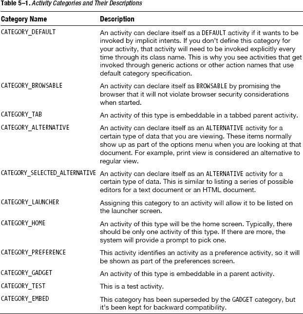

你可以在以下针对 `Intent` 类的 Android SDK 网址中阅读这些 Activity 类别的详细信息：
[`http://developer.android.com/android/reference/android/content/Intent.html#CATEGORY_ALTERNATIVE`](http://developer.android.com/android/reference/android/content/Intent.html#CATEGORY_ALTERNATIVE)。

当你使用 Intent 启动 Activity 时，可以通过指定类别来选择要启动的 Activity 类型。或者，你可以搜索匹配某个类别的 Activity。以下是一个检索与 `CATEGORY_LAUNCHER` 类别相匹配的主 Activity 集合的示例：

```
Intent mainIntent = new Intent(Intent.ACTION_MAIN, null);
mainIntent.addCategory(Intent.CATEGORY_LAUNCHER);
PackageManager pm = getPackageManager();
List<ResolveInfo> list = pm.queryIntentActivities(mainIntent, 0);
```

`PackageManager` 是一个关键类，它允许你发现匹配特定 Intent 的 Activity，而无需调用它们。你可以遍历接收到的 Activity，并根据 `ResolveInfo` API 按需调用它们。以下是前面代码的扩展，它遍历 Activity 列表，并在匹配某个名称时调用其中一个 Activity。在代码中，我们使用了一个任意名称进行测试：

```
for(ResolveInfo ri: list)
{
    //ri.activityInfo.
    Log.d("test",ri.toString());
    String packagename = ri.activityInfo.packageName;
    String classname = ri.activityInfo.name;
    Log.d("test", packagename + ":" + classname);
    if (classname.equals("com.ai.androidbook.resources.TestActivity"))
    {
        Intent ni = new Intent();
        ni.setClassName(packagename,classname);
        activity.startActivity(ni);
    }
}
```

你也可以完全基于 Intent 类别（例如 `CATEGORY_LAUNCHER`）来启动 Activity：

```
public static void invokeAMainApp(Activity activity)
{
   Intent mainIntent = new Intent(Intent.ACTION_MAIN, null);
   mainIntent.addCategory(Intent.CATEGORY_LAUNCHER);
   activity.startActivity(mainIntent);
}
```

会有多个 Activity 匹配该 Intent，那么 Android 会选择哪一个？为了解决这个问题，Android 会显示一个“完成操作使用”对话框，列出所有可能的 Activity，供你选择其中一个运行。

以下是使用 Intent 前往主页的另一个示例：

```
//前往主屏幕
Intent mainIntent = new Intent(Intent.ACTION_MAIN, null);
mainIntent.addCategory(Intent.CATEGORY_HOME);
startActivity(mainIntent);
```

如果你不想使用 Android 的默认主页，你可以编写自己的主页，并将该 Activity 声明为 `HOME` 类别。在这种情况下，由于现在注册了多个主屏 Activity，上述代码将为你提供一个选项来打开你的主屏 Activity：

```
//用你的主屏替换默认主屏
<intent-filter>
   <action android:value="android.intent.action.MAIN" />
   <category android:value="android.intent.category.HOME"/>
   <category android:value="android.intent.category.DEFAULT" />
</intent-filter>
```


### 将 Intent 解析为其组件的规则

到目前为止，我们已经讨论了关于 `Intent` 的许多方面。总结一下，我们谈到了动作、数据 URI、额外数据，最后是类别。基于这些方面，Android 使用多种策略，根据 Intent 过滤器将 `Intent` 与其目标 Activity 进行匹配。

层级结构的顶端是附加到 `Intent` 上的组件名称。如果设置了此名称，则该 `Intent` 被称为*显式 Intent*。对于显式 `Intent`，只有组件名称重要；`Intent` 的其他所有方面或属性都被忽略。当 `Intent` 上没有组件名称时，该 `Intent` 被称为*隐式 Intent*。用于解析隐式 `Intent` 目标的规则有很多。

基本规则是：传入 `Intent` 的动作、类别和数据特性*必须*与 Intent 过滤器中指定的特性*匹配*（或存在）。与 `Intent` 不同，一个 Intent 过滤器可以指定多个动作、类别和数据属性。这意味着同一个 Intent 过滤器可以满足多个 `Intent`，也就是说一个 Activity 可以响应许多 `Intent`。但是，“匹配”的含义在动作、数据属性和类别之间有所不同。让我们看看隐式 `Intent` 每个部分的匹配标准。

#### 动作

如果 `Intent` 上有一个动作，那么 Intent 过滤器必须将该动作作为其动作列表的一部分，或者不定义任何动作。因此，如果 Intent 过滤器*没有定义动作*，则该 Intent 过滤器*匹配*任何传入的 `Intent` 动作。

如果在 Intent 过滤器中指定了一个或多个动作，则至少有一个动作必须与传入 `Intent` 的动作匹配。

#### 数据

如果 Intent 过滤器中未指定任何数据特性，则它不会匹配任何携带任何数据或数据属性的传入 `Intent`。这意味着它只会寻找那些根本没有指定数据的 `Intent`。

（过滤器中）缺少数据和缺少动作的作用是相反的。如果过滤器中没有动作，则一切皆匹配。如果过滤器中没有数据，则 `Intent` 中的每一点数据都是不匹配的。

#### 数据类型

要使数据类型匹配，传入 `Intent` 的数据类型必须是 Intent 过滤器中指定的数据类型之一。`Intent` 中的数据类型必须存在于 Intent 过滤器中。

传入 `Intent` 的数据类型通过以下两种方式之一确定。首先，如果数据 URI 是 `content:` 或 `file:` URI，则内容提供者或 Android 会确定其类型。第二种方式是查看 `Intent` 的显式数据类型。为此，传入的 `Intent` 不应设置数据 URI，因为当在 `Intent` 上调用 `setType` 时，这会自动处理。

Android 还允许其 MIME 类型规范使用星号（`*`）作为子类型，以涵盖所有可能的子类型。

此外，数据类型是区分大小写的。

#### 数据方案

要使数据方案匹配，传入 `Intent` 的数据方案必须是 Intent 过滤器中指定的方案之一。换句话说，传入的数据方案必须存在于 Intent 过滤器中。

传入 `Intent` 的方案是数据 URI 的第一部分。在 `Intent` 上，没有设置方案的方法。它纯粹是从类似 `http://www.somesite.com/somepath` 的 `Intent` 数据 URI 派生出来的。

如果传入 `Intent` URI 的数据方案是 `content:` 或 `file:`，则无论 Intent 过滤器的方案、域和路径如何，都被视为匹配。根据 SDK 的说法，这是因为每个组件都应该知道如何从 `content` 或 `file` URL 读取数据，这些 URL 本质上是本地的。换句话说，所有组件都应该支持这两种类型的 URL。

方案也是区分大小写的。

#### 数据授权

如果过滤器中没有授权，则对于任何传入的数据 URI 授权（或域名）都是匹配的。如果在过滤器中指定了授权——例如 `www.somesite.com`——那么一个方案和一个授权必须与传入 `Intent` 的数据 URI 匹配。

例如，如果我们在 Intent 过滤器中指定 `www.somesite.com` 作为授权，方案指定为 `https`，那么该 `Intent` 将无法匹配 `http://www.somesite.com/somepath`，因为 `http` 没有被指示为受支持的方案。

授权也是区分大小写的。

#### 数据路径

Intent 过滤器中没有数据路径意味着匹配任何传入数据 URI 的路径。如果在过滤器中指定了路径——例如 `somepath`——那么一个方案、一个授权和一个数据路径必须与传入 `Intent` 的数据 URI 匹配。

换句话说，方案、授权和路径协同工作以验证传入的 `Intent` URI，例如 `http://www.somesite.com/somepath`。所以 `path`、`authority` 和 `scheme` 不是孤立地工作，而是协同工作。

路径也是区分大小写的。

#### Intent 类别

传入 `Intent` 中的每个类别都必须存在于过滤器类别列表中。过滤器中有更多的类别是可以的。如果一个过滤器*没有任何类别*，它将*只匹配一个没有提及任何类别*的 `Intent`。

然而，有一个陷阱。Android 将所有传递给 `startActivity()` 的*隐式* `Intent` 视为至少包含一个类别：`android.intent.category.DEFAULT`。`startActivity()` 中的代码将只搜索那些为传入的隐式 `Intent` 定义了 `DEFAULT` 类别的 Activity。因此，每个希望通过隐式 `Intent` 被调用的 Activity 都必须在其过滤器中包含默认类别。

即使一个 Activity 在其 Intent 过滤器中没有默认类别，如果你知道它的显式组件名称，你仍然可以像启动器那样启动它。如果你在没有将默认类别作为搜索条件的情况下自行显式搜索匹配的 `Intent`，你也可以通过这种方式启动这些 Activity。

从这个意义上说，这个 `DEFAULT` 类别是 `startActivity()` 实现的人为产物，而不是过滤器的固有行为。

还有一个额外的问题，因为 Android 声明，如果 Activity 仅打算从启动器屏幕调用，则 `DEFAULT` 类别是不必要的。因此，这些 Activity 通常只在其过滤器中包含 `MAIN` 和 `LAUNCHER` 类别。但是，也可以选择为这些 Activity 指定 `DEFAULT` 类别。


### 练习使用 `ACTION_PICK`

到目前为止，我们所练习的 Intent 或操作，主要是调用其他 Activity，而不期望返回结果。现在让我们来看一个更复杂一点的操作，它在被调用后会返回一个值。`ACTION_PICK` 就是这样一个通用操作。

`ACTION_PICK` 的用途是启动一个显示项目列表的 Activity。该 Activity 应允许用户从列表中选择一个项目。一旦用户选择了项目，Activity 应将所选项目的 URI 返回给调用者。这使得 UI 的功能可以被复用来选择特定类型的项目。

你应该使用指向 Android 内容游标的 MIME 类型来指示要选择的项目集合。该 URI 的 MIME 类型应类似于以下内容：

`vnd.android.cursor.dir/vnd.google.note`

Activity 负责根据 URI 从内容提供者中检索数据。这也是数据应尽可能封装到内容提供者中的原因。

对于像这样返回数据的操作，我们不能使用 `startActivity()`，因为 `startActivity()` 不返回结果。`startActivity()` 无法返回结果，因为它会在单独的线程中将新 Activity 作为模态对话框打开，并让主线程处理事件。换句话说，`startActivity()` 是一个异步调用，没有任何回调来指示被调用 Activity 中发生的事情。如果你想要返回数据，可以使用 `startActivity()` 的一个变体，名为 `startActivityForResult()`，它带有回调。

让我们看看 `Activity` 类中 `startActivityForResult()` 方法的签名：

`public void startActivityForResult(Intent intent, int requestCode)`

此方法启动一个你希望从中获得结果的 Activity。当该 Activity 退出时，源 Activity 的 `onActivityResult()` 方法会被调用，并传入给定的 `requestCode`。此回调方法的签名是：

`protected void onActivityResult(int requestCode, int resultCode, Intent data)`

`requestCode` 是你传入 `startActivityForResult()` 方法的参数。`resultCode` 可以是 `RESULT_OK`、`RESULT_CANCELED` 或自定义代码。自定义代码应以 `RESULT_FIRST_USER` 开始。`Intent` 参数包含被调用 Activity 想要返回的任何附加数据。对于 `ACTION_PICK` 的情况，Intent 中返回的数据指向单个项目的数据 URI。

代码清单 5–3 演示了如何调用一个返回结果的 Activity。

 **注意：** 代码清单 5–3 中的代码假定你已经安装了 Android SDK 发行版中的 NotePad 示例项目。如果你尚未在 SDK 中安装 NotePad 示例，我们在本章末尾提供了一个链接，指导你如何下载它。

**代码清单 5–3.** *调用操作后返回数据*

```
public class SomeActivity extends Activity
{
.....
.....
public static void invokePick(Activity activity)
{
  Intent pickIntent = new Intent(Intent.ACTION_PICK);
  int requestCode = 1;
  pickIntent.setData(Uri.parse(
     "content://com.google.provider.NotePad/notes"));
  activity.startActivityForResult(pickIntent, requestCode);
}

protected void onActivityResult(int requestCode
    ,int resultCode
    ,Intent outputIntent)
{
  //这是为了通知父类（Activity）
  //被调用的 Activity 已完成，基类
  //可以进行必要的清理工作
  super.onActivityResult(requestCode, resultCode, outputIntent);
  parseResult(this, requestCode, resultCode, outputIntent);
}
public static void parseResult(Activity activity
    , int requestCode
    , int resultCode
    , Intent outputIntent)
{
    if (requestCode != 1)
    {
     Log.d("Test", "Some one else called this. not us");
             return;
    }
    if (resultCode != Activity.RESULT_OK)
    {
      Log.d(Test, "Result code is not ok:" + resultCode);
               return;
    }
    Log.d("Test", "Result code is ok:" + resultCode);
    Uri selectedUri = outputIntent.getData();
    Log.d("Test", "The output uri:" + selectedUri.toString());

    //继续显示笔记
    outputIntent.setAction(Intent.ACTION_VIEW);
    startActivity(outputIntent);
}
```

常量 `RESULT_OK`、`RESULT_CANCELED` 和 `RESULT_FIRST_USER` 都定义在 `Activity` 类中。这些常量的数值如下：

```
RESULT_OK = -1;
RESULT_CANCELED = 0;
RESULT_FIRST_USER = 1;
```

要使 `PICK` 功能正常工作，响应方中的实现代码应明确处理 `PICK` 的需求。让我们看看这在 Google 示例 NotePad 应用程序中是如何完成的。当在项目列表中选中某个项目时，会检查启动该 Activity 的 Intent 是否为 `PICK` Intent。如果是，则数据 URI 会被设置到一个新的 Intent 中，并通过 `setResult()` 返回：

```
@Override
protected void onListItemClick(ListView l, View v, int position, long id) {
    Uri uri = ContentUris.withAppendedId(getIntent().getData(), id);

    String action = getIntent().getAction();
    if (Intent.ACTION_PICK.equals(action) ||
              Intent.ACTION_GET_CONTENT.equals(action))
   {
        // 调用者正在等待我们返回用户选择的笔记。
        // 他们已点击了其中一个，现在返回它。
        setResult(RESULT_OK, new Intent().setData(uri));
    } else {
        // 启动 Activity 以查看/编辑当前选中的项目
        startActivity(new Intent(Intent.ACTION_EDIT, uri));
    }
}
```


### 执行 GET_CONTENT 操作

`ACTION_GET_CONTENT` 与 `ACTION_PICK` 类似。在使用 `ACTION_PICK` 时，你需要指定一个指向项目集合（例如笔记集合）的 URI。你期望该操作从集合中选取一个笔记并将其返回给调用者。而使用 `ACTION_GET_CONTENT` 时，你向 Android 表明你需要一个特定 MIME 类型的项目。Android 会搜索那些能够创建此类项目或能够从符合该 MIME 类型的现有项目集合中进行选择的活动。

使用 `ACTION_GET_CONTENT`，你可以通过以下代码从 NotePad 应用支持的笔记集合中选取一个笔记：

```java
public static void invokeGetContent(Activity activity)
{
      Intent pickIntent = new Intent(Intent.ACTION_GET_CONTENT);
      int requestCode = 2;
      pickIntent.setType("vnd.android.cursor.item/vnd.google.note");
      activity.startActivityForResult(pickIntent, requestCode);
}
```

请注意，这里的 intent 类型被设置为单个笔记的 MIME 类型。这与以下代码片段中的 `ACTION_PICK` 形成对比，后者的输入是一个数据 URI：

```java
public static void invokePick(Activity activity)
{
  Intent pickIntent = new Intent(Intent.ACTION_PICK);
  int requestCode = 1;
  pickIntent.setData(Uri.parse(
     "content://com.google.provider.NotePad/notes"));
  activity.startActivityForResult(pickIntent, requestCode);
}
```

为了让一个活动能够响应 `ACTION_GET_CONTENT`，该活动必须注册一个意图过滤器，表明它可以提供该 MIME 类型的项目。以下是 SDK 中 NotePad 应用的实现方式：

```xml
<activity android:name="NotesList" android:label="@string/title_notes_list">
......
<intent-filter>
    <action android:name="android.intent.action.GET_CONTENT" />
    <category android:name="android.intent.category.DEFAULT" />
    <data android:mimeType="vnd.android.cursor.item/vnd.google.note" />
      </intent-filter>
......
</activity>
```

响应 `onActivityResult()` 的其他代码与之前的 `ACTION_PICK` 示例完全相同。如果有多个活动可以返回相同的 MIME 类型，Android 会显示选择器对话框，让你选择一个活动。

### 介绍待定 Intent

Android 有一种 intent 的变体，称为 *待定 intent*。在这种变体中，Android 允许组件将 intent 存储在一个位置以供将来使用，并可以在之后再次调用。例如，在闹钟管理器中，你希望在闹钟响起时启动一个服务。Android 通过围绕一个普通的对应 intent 创建一个包装后的待定 intent 并将其存储起来来实现这一点，这样即使调用进程终止，该 intent 仍然可以被分发到其目标。在创建待定 intent 时，Android 会存储关于原始进程的足够信息，以便在分发或调用时能够检查安全凭证。

让我们看看如何创建一个待定 intent：

```java
Intent regularIntent;
PendingIntent pi = PendingIntent.getActivity(context, 0, regularIntent,...);
```

 **注意：** `PendingIntent.getActivity()` 方法的第二个参数被称为 `requestCode`，在本例中我们将其设置为 0。当两个底层 intent 相同时，这个参数用于区分这两个待定 intent。这一点在第 20 章中讨论得更为详细，我们在那里将结合闹钟管理器来介绍待定 intent。

关于 `PendingActivity.getActivity()` 这个方法命名，有几个奇怪的地方。activity 在这里的作用是什么？为什么我们创建待定 intent 时不使用 `create`，而是使用 `get`？

要理解第一点，我们需要深入探讨一下普通 intent 的用法。一个普通 intent 可以用来启动一个 activity、一个服务，或者调用一个广播接收器。（你将在本书后面学习到服务和广播接收器。）使用 intent 调用这些不同类型的组件，其性质是不同的。为了适应这一点，Android 的上下文（`Activity` 的超类）提供了三种不同的方法：

- `startActivty(intent)`
- `startService(intent)`
- `sendBroadcast(intent)`

考虑到这些变体，如果我们要存储一个 intent 以供以后重用，Android 如何知道是启动 activity、启动服务，还是通过广播启动广播接收器呢？这就是为什么在创建待定 intent 时，我们必须明确指定创建它的目的，这也解释了以下三种独立的方法：

- `PendingIntent.getActivity(context, 0, intent, ...)`
- `PendingIntent.getService(context, 0, intent, ...)`
- `PendingIntent.getBroadcast(context, 0, intent, ...)`

现在来解释“get”这部分。Android 会存储 intent 并重用它们。如果你两次请求使用同一个 intent 对象创建待定 intent，你将得到同一个待定 intent。看一下 `PendingIntent.getActivity()` 方法的完整签名，这一点就更清楚了：

```java
PendingIntent.getActivity(Context context, //原始上下文
     int requestCode, //1,2, 3, 等
     Intent intent, //原始 intent
     int flags ) //标志
```

如果你的目标是获得一个不同的待定 intent 副本，你必须提供一个不同的 `requestCode`。我们在第 20 章中介绍闹钟管理器时会更详细地解释这一需求。如果两个 intent 的内部部分匹配（除了额外的 bundle 外），则它们被视为相同。允许额外的 bundle 不同，这不会影响 intent 的唯一性。如果你希望在两个其他方面相同的底层 intent 之间强制实现唯一性，你可以改变请求代码参数的值。这将使得待定 intent 变得唯一，即使底层 intent 并不唯一。

这些标志指示如果已存在一个待定 intent 时该如何处理——是否返回 null、覆盖 extras 等等。有关可能标志的更多详细信息，请参阅以下网址：

`http://developer.android.com/reference/android/app/PendingIntent.html`

通常，你可以为 `requestCode` 和标志传递 0，以获得默认行为。


### 资源

以下是一些有助于加深本章内容理解的实用链接：

- [`http://developer.android.com/reference/android/content/Intent.html`](http://developer.android.com/reference/android/content/Intent.html)：意图概览，包括众所周知的动作、附加数据等。
- [`http://developer.android.com/guide/appendix/g-app-intents.html`](http://developer.android.com/guide/appendix/g-app-intents.html)：列出了针对一系列 Google 应用的意图。在这里，你将了解如何调用浏览器、地图、拨号器和谷歌街景。
- [`http://developer.android.com/reference/android/content/IntentFilter.html`](http://developer.android.com/reference/android/content/IntentFilter.html)：介绍意图过滤器，在注册意图过滤器时非常有用。
- [`http://developer.android.com/guide/topics/intents/intents-filters.html`](http://developer.android.com/guide/topics/intents/intents-filters.html)：深入探讨意图过滤器的解析规则。
- [`http://developer.android.com/resources/samples/get.html`](http://developer.android.com/resources/samples/get.html)：可下载 NotePad 应用示例代码的网址。你需要加载这个示例项目来测试某些意图。
- [`http://developer.android.com/resources/samples/NotePad/index.html`](http://developer.android.com/resources/samples/NotePad/index.html)：NotePad 应用的在线源代码。
- [`www.openintents.org/`](http://www.openintents.org/)：一个旨在收集各厂商开放意图的网站项目。
- [`www.androidbook.com/proandroid4/projects`](http://www.androidbook.com/proandroid4/projects)：本章的可下载测试项目可在此网址获取。ZIP 文件名为 `ProAndroid4_ch05_TestIntents.zip`。

### 摘要

本章涵盖了关于意图的以下内容：

- 隐式意图是动作、数据 URI 以及作为附加数据传递的显式数据的集合。
- 显式意图是直接与类名相关联的意图，不考虑其前述部分中提到的隐式组成部分。
- 你使用意图来调用 Android 中的 Activity 或其他组件。
- 诸如 Activity 之类的组件通过意图过滤器声明它们想要响应的意图。
- 意图与意图过滤器之间的解析规则。
- 如何使用意图启动 Activity。
- 如何启动返回结果的 Activity。
- 意图类别的作用。
- 默认类别的细微差别。
- 什么是待定意图以及如何使用它们。
- 待定意图的独特性。
- 如何使用 `PICK` 和 `GET_CONTENT` 动作。

### 面试问题

1.  如何使用意图调用 Activity？
2.  什么是显式意图和隐式意图？
3.  意图由哪些组成部分构成？
4.  如何通过意图将数据发送到接收组件？
5.  你能说出 Android 应用中的主要组件吗？
6.  意图的数据部分是否直接包含数据？
7.  意图的动作部分是否应直接引用一个 Activity 或组件？
8.  当在意图中显式指定类名时，意图的哪些其他部分会被考虑？
9.  `action.MAIN` 的含义是什么？
10. 如果你在意图过滤器中未指定动作，是否意味着你的 Activity 可以响应所有动作？
11. 如果你在意图过滤器中未指定数据，你会匹配哪种类型的意图？
12. 为什么有必要在意图过滤器中为你的 Activity 设置一个默认类别？
13. 你的启动器 Activity 是否需要默认类别？
14. 如何调用一个可以向调用者返回结果的 Activity？
15. 调用 Activity 最快的方式是什么？
16. `action_pick` 和 `action_get_content` 之间有什么区别？

## 第 6 章

## 构建用户界面与使用控件

到目前为止，我们已经介绍了 Android 的基础知识，但尚未涉及用户界面（UI）。在本章中，我们将讨论用户界面和控件。我们首先讨论 Android 中 UI 开发的总体理念，然后描述 Android SDK 随附的许多 UI 控件。这些是构建你将创建的界面的基本元素。我们还将讨论视图适配器和布局管理器。视图适配器用于向显示数据集（无论这些数据来自数组、数据库还是其他数据源）的控件提供数据。顾名思义，布局管理器负责管理控件在屏幕上的位置。在此过程中，我们还将介绍样式和主题，它们有助于封装控件外观属性，以便于设置和维护。

到本章结束时，你将扎实掌握如何将 UI 控件布局到屏幕中，并为其填充数据。

### Android 中的 UI 开发

Android 中的 UI 开发很有趣。之所以有趣，是因为它相对容易。借助 Android，我们拥有一个易于理解的框架，配备了一套数量有限的即用控件。可用的屏幕区域通常有限。Android 还处理了通常与设计和构建高质量 UI 相关的许多繁重工作。这一点，再加上用户通常只想执行一个特定操作，使我们能够轻松构建良好的 UI，以提供良好的用户体验。

Android SDK 附带了许多控件，你可以使用它们为应用程序构建 UI。与其他 SDK 类似，Android SDK 提供文本字段、按钮、列表、网格等。此外，Android 还提供了一系列适用于移动设备的控件。

常见控件的核心是两个类：`android.view.View` 和 `android.view.ViewGroup`。正如第一个类的名称所示，`View` 类代表一个通用的 `View` 对象。Android 中的常见控件最终都继承自 `View` 类。`ViewGroup` 也是一个视图，但它还包含其他视图。`ViewGroup` 是一系列布局类的基类。与 Swing 类似，Android 使用*布局*的概念来管理控件在容器视图中的布局方式。使用布局，正如我们将看到的，可以让我们轻松控制 UI 中控件的位置和方向。

你可以从几种方法中选择在 Android 中构建 UI。你可以完全在代码中构建 UI。你也可以在 XML 中定义 UI。你甚至可以结合使用两者——在 XML 中定义 UI，然后在代码中引用并修改它。为了演示这一点，在本章中，我们将使用这三种方法中的每一种来构建一个简单的 UI。

在我们开始之前，让我们定义一些术语。在本书和其他 Android 文献中，你会在关于 UI 开发的讨论中看到术语 *视图*、*控件*、*微件*、*容器*和*布局*。如果你是 Android 编程或 UI 开发的新手，可能不熟悉这些术语。在开始之前，我们简要描述一下它们（请参见表 6–1）。

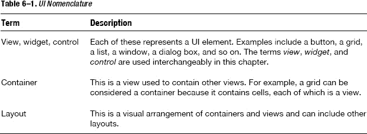

图 6–1 显示了我们即将构建的应用程序的截图。截图旁边是该应用程序中控件和容器的布局层次结构。

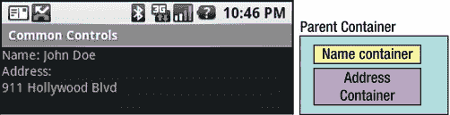

**图 6–1.** *Activity 的 UI 和布局*

在讨论示例程序时，我们将参考这个布局层次结构。现在，请知道该应用程序只有一个 Activity。该 Activity 的 UI 由三个容器组成：一个包含人名，一个包含地址，以及一个作为子容器外部父容器的容器。


#### 完全通过代码构建 UI

第一个示例代码清单 6–1 演示了如何完全通过代码构建 UI。要尝试此示例，请创建一个带名为 `MainActivity` 的 Activity 的新 Android 项目，然后将代码清单 6–1 中的代码复制到你的 `MainActivity` 类中。

**注意：** 我们将在本章末尾提供一个 URL，你可以通过它下载本章的项目文件。这样，你可以直接将这些项目导入 Eclipse，而无需复制粘贴代码。

**代码清单 6–1.** *完全通过代码创建简单的用户界面*

```
package com.androidbook.controls;
import android.app.Activity;
import android.os.Bundle;
import android.view.ViewGroup.LayoutParams;
import android.widget.LinearLayout;
import android.widget.TextView;
public class MainActivity extends Activity
{
    private LinearLayout nameContainer;

    private LinearLayout addressContainer;

    private LinearLayout parentContainer;

    /** 当 Activity 首次创建时调用。 */
    @Override
    public void onCreate(Bundle savedInstanceState)
    {
        super.onCreate(savedInstanceState);

        createNameContainer();

        createAddressContainer();

        createParentContainer();

        setContentView(parentContainer);
    }

    private void createNameContainer()
    {
        nameContainer = new LinearLayout(this);

        nameContainer.setLayoutParams(new LayoutParams(LayoutParams.FILL_PARENT,
                LayoutParams.WRAP_CONTENT));
        nameContainer.setOrientation(LinearLayout.HORIZONTAL);

        TextView nameLbl = new TextView(this);
        nameLbl.setText("姓名：");

        TextView nameValue = new TextView(this);
        nameValue.setText("张三");

        nameContainer.addView(nameLbl);
        nameContainer.addView(nameValue);
    }

    private void createAddressContainer()
    {
        addressContainer = new LinearLayout(this);

        addressContainer.setLayoutParams(new LayoutParams(LayoutParams.FILL_PARENT,
                LayoutParams.WRAP_CONTENT));
        addressContainer.setOrientation(LinearLayout.VERTICAL);

        TextView addrLbl = new TextView(this);
        addrLbl.setText("地址：");

        TextView addrValue = new TextView(this);
        addrValue.setText("好莱坞大道 911 号");

        addressContainer.addView(addrLbl);
        addressContainer.addView(addrValue);
    }

    private void createParentContainer()
    {
        parentContainer = new LinearLayout(this);

        parentContainer.setLayoutParams(new LayoutParams(LayoutParams.FILL_PARENT,
                LayoutParams.FILL_PARENT));
        parentContainer.setOrientation(LinearLayout.VERTICAL);

        parentContainer.addView(nameContainer);
        parentContainer.addView(addressContainer);
    }
}
```

如代码清单 6–1 所示，该 Activity 包含三个 `LinearLayout` 对象。正如我们之前提到的，布局对象包含在屏幕部分区域定位子元素的逻辑。例如，`LinearLayout` 知道如何垂直或水平排列控件。布局对象可以包含任何类型的视图（View），甚至可以包含其他布局。

`nameContainer` 对象包含两个 `TextView` 控件：一个用于标签`姓名：`，另一个用于保存实际姓名（例如张三）。`addressContainer` 也包含两个 `TextView` 控件。这两个容器的区别在于：`nameContainer` 是水平布局，而 `addressContainer` 是垂直布局。这两个容器都位于 Activity 的根视图 `parentContainer` 内部。构建容器后，Activity 通过调用 `setContentView(parentContainer)` 将视图内容设置为根视图。当需要渲染 Activity 的 UI 时，根视图会被调用以渲染自身。然后根视图调用其子视图进行渲染，子控件再调用它们的子视图，依此类推，直到整个 UI 渲染完成。

如代码清单 6–1 所示，我们有多个 `LinearLayout` 控件。其中两个是垂直布局，一个是水平布局。`nameContainer` 是水平布局，这意味着两个 `TextView` 控件会水平并排显示。`addressContainer` 是垂直布局，这意味着两个 `TextView` 控件会上下堆叠。`parentContainer` 也是垂直布局，因此 `nameContainer` 出现在 `addressContainer` 上方。请注意 `addressContainer` 和 `parentContainer` 这两个垂直布局容器之间的细微差别。`parentContainer` 设置为占据屏幕的全部宽度和高度：

```
parentContainer.setLayoutParams(new LayoutParams(LayoutParams.FILL_PARENT,
        LayoutParams.FILL_PARENT));
```

而 `addressContainer` 则垂直方向自适应内容：

```
addressContainer.setLayoutParams(new LayoutParams(LayoutParams.FILL_PARENT,
        LayoutParams.WRAP_CONTENT));
```

换句话说，`WRAP_CONTENT` 表示视图在该维度上仅占用所需的空间，不超过父视图允许的范围。对于 `addressContainer` 而言，这意味着该容器会垂直占据两行高度，因为它只需要这么多。


#### 完全在 XML 中构建用户界面

现在让我们用 XML 构建相同的用户界面（参见代码清单 6–2）。回顾第 3 章的内容，XML 布局文件存储在资源（`/res/`）目录下的 `layout` 文件夹中。要尝试这个示例，请在 Eclipse 中创建一个新的 Android 项目。默认情况下，你会得到一个名为 `main.xml` 的 XML 布局文件，位于 `res/layout` 文件夹下。双击 `main.xml` 查看其内容。Eclipse 会为你的布局文件显示一个可视化编辑器。在视图顶部可能会显示类似 “Hello World, MainActivity!” 的字符串。点击视图底部的 `main.xml` 标签，即可查看 `main.xml` 文件的 XML 代码。其中会显示一个 `LinearLayout` 和一个 `TextView` 控件。使用布局标签或 `main.xml` 标签（或两者同时使用），在 `main.xml` 文件中重新创建代码清单 6–2 的内容。然后保存文件。

**代码清单 6–2.** *完全在 XML 中创建用户界面*

```
<?xml version="1.0" encoding="utf-8"?>
<LinearLayout
    android:orientation="vertical" android:layout_width="fill_parent"
    android:layout_height="fill_parent">
    <!-- 姓名容器 -->
    <LinearLayout
        android:orientation="horizontal" android:layout_width="fill_parent"
        android:layout_height="wrap_content">

            <TextView  android:layout_width="wrap_content"
        android:layout_height="wrap_content" android:text="姓名:" />

            <TextView android:layout_width="wrap_content"
        android:layout_height="wrap_content" android:text="张三" />

    </LinearLayout>

    <!-- 地址容器 -->
    <LinearLayout
        android:orientation="vertical" android:layout_width="fill_parent"
        android:layout_height="wrap_content">

            <TextView android:layout_width="fill_parent"
        android:layout_height="wrap_content" android:text="地址:" />

            <TextView android:layout_width="fill_parent"
        android:layout_height="wrap_content" android:text="好莱坞大道 911 号" />
    </LinearLayout>

</LinearLayout>
```

在你的新项目的 `src` 目录下，有一个默认的 `.java` 文件，其中包含一个 `Activity` 类定义。双击该文件查看其内容。请注意 `setContentView(R.layout.main)` 这条语句。代码清单 6–2 中展示的 XML 代码片段，结合对 `setContentView(R.layout.main)` 的调用，会渲染出与之前完全用代码生成的相同的用户界面。该 XML 文件一目了然，但请注意我们定义了三个容器视图。第一个 `LinearLayout` 相当于我们的父容器。该容器通过设置相应属性 `android:orientation="vertical"` 将方向设为垂直。父容器包含两个 `LinearLayout` 容器，分别代表 `nameContainer` 和 `addressContainer`。

运行此应用程序将产生与之前示例应用程序相同的用户界面。标签和值将如图 6–1 所示显示。

#### 在 XML 中结合代码构建用户界面

代码清单 6–2 是一个刻意构造的示例。在 XML 布局中对 `TextView` 控件的值进行硬编码没有任何意义。理想情况下，我们应该在 XML 中设计用户界面，然后从代码中引用这些控件。这种方法使我们能够将动态数据绑定到设计时定义的控件上。事实上，这也是推荐的做法。在 XML 中构建布局，然后使用代码填充动态数据，是相当容易的。

代码清单 6–3 展示了相同的用户界面，但使用了略有不同的 XML 代码。该 XML 为 `TextView` 控件分配了 ID，以便我们可以在代码中引用它们。

**代码清单 6–3.** *在 XML 中使用 ID 创建用户界面*

```
<?xml version="1.0" encoding="utf-8"?>
<LinearLayout
    android:orientation="vertical" android:layout_width="fill_parent"
    android:layout_height="fill_parent">
    <!-- 姓名容器 -->
    <LinearLayout
        android:orientation="horizontal" android:layout_width="fill_parent"
        android:layout_height="wrap_content">

            <TextView android:layout_width="wrap_content"
        android:layout_height="wrap_content" android:text="@string/name_text" />

            <TextView android:id="@+id/nameValue"
        android:layout_width="wrap_content" android:layout_height="wrap_content" />

</LinearLayout>

    <!-- 地址容器 -->
    <LinearLayout
        android:orientation="vertical" android:layout_width="fill_parent"
        android:layout_height="wrap_content">

            <TextView android:layout_width="fill_parent"
        android:layout_height="wrap_content" android:text="@string/addr_text" />

            <TextView android:id="@+id/addrValue"
        android:layout_width="fill_parent" android:layout_height="wrap_content" />
    </LinearLayout>

</LinearLayout>
```

除了为想要通过代码填充内容的 `TextView` 控件添加 ID 之外，我们还有一些标签 `TextView` 控件，它们的内容来自字符串资源文件。这些是没有 ID 但带有 `android:text` 属性的 `TextView`。正如第 3 章中提到的，这些 `TextView` 的实际字符串将来自 `/res/values` 文件夹中的 `strings.xml` 文件。代码清单 6–4 展示了我们的 `strings.xml` 文件可能的样子。

**代码清单 6–4.** *用于代码清单 6–3 的`strings.xml` 文件*

```
<?xml version="1.0" encoding="utf-8"?>
<resources>
    <string name="app_name">公共控件</string>
    <string name="name_text">姓名:</string>
    <string name="addr_text">地址:</string>
</resources>
```

代码清单 6–5 中的代码演示了如何获取对 XML 中定义的控件的引用以设置其属性。你可以将此代码放入 Activity 的 `onCreate()` 方法中。

**代码清单 6–5.** *在运行时引用资源中的控件*

```
setContentView(R.layout.main);

TextView nameValue = (TextView)findViewById(R.id.nameValue);
nameValue.setText("张三");
TextView addrValue = (TextView)findViewById(R.id.addrValue);
addrValue.setText("好莱坞大道 911 号");
```

代码清单 6–5 中的代码非常直接，但请注意，我们在调用 `findViewById()` 之前先通过 `setContentView(R.layout.main)` 加载了资源——如果视图尚未加载，我们就无法获取对它们的引用。

Android 的开发者们做得非常出色，几乎控件的每一个方面都可以通过 XML 或代码进行设置。通常，最好在 XML 布局文件中设置控件的属性，而不是使用代码。然而，很多时候你仍需要使用代码，例如设置要显示给用户的值。


### FILL_PARENT 与 MATCH_PARENT

常量 `FILL_PARENT` 已在 Android 2.2 中被弃用，并替换为 `MATCH_PARENT`。但这纯粹是名称上的更改。该常量的值仍然是 -1。同样，在 XML 布局中，`fill_parent` 也被替换为 `match_parent`。那么你应该使用哪个值呢？实际上，你可以直接使用值 -1，而不用 `FILL_PARENT` 或 `MATCH_PARENT`，这也完全可行。不过，这样可读性不高，而且你无法在 XML 布局中使用无名称的等效值。有一个更好的方法。

根据你的应用需要使用哪些 Android API，你可以选择针对 Android 2.2 之前的版本构建应用，依赖前向兼容性；或者针对 Android 2.2 及更高版本构建应用，并将 `minSdkVersion` 设置为你应用支持的最低 Android 版本。例如，如果你只需要 Android 1.6 中已有的 API，那么就针对 Android 1.6 构建，并使用 `FILL_PARENT` 和 `fill_parent`。你的应用应该能在包括 2.2 及更高版本在内的所有后续 Android 版本中正常运行。如果你需要使用 Android 2.2 或更高版本的 API，那就针对该版本构建，使用 `MATCH_PARENT` 和 `match_parent`，并将 `minSdkVersion` 设置为一个更低的版本：例如 `4`（对应 Android 1.6）。你仍然可以将基于 Android 2.2 构建的应用部署到更早的 Android 版本上，但你必须谨慎处理那些在早期 Android SDK 中不存在的类和/或方法。有一些方法可以解决这个问题，比如使用反射或创建包装类来处理不同 Android 版本之间的差异。我们将在第 12 章中深入探讨这些高级主题。

### 理解 Android 的常用控件

现在我们将开始讨论 Android SDK 中的常用控件。我们首先介绍文本控件，然后介绍按钮、复选框、单选按钮、列表、网格、日期和时间控件，以及地图视图控件。我们还会谈到布局控件。

#### 文本控件

文本控件很可能是你在 Android 中会接触到的第一类控件。Android 提供了一套完整但不复杂的文本控件。在本节中，我们将讨论 `TextView`、`EditText`、`AutoCompleteTextView` 和 `MultiCompleteTextView` 控件。图 6–2 展示了这些控件的实际效果。

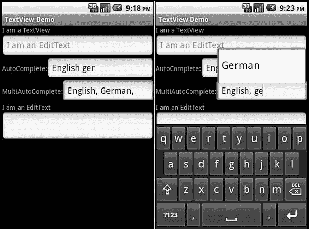

**图 6–2.** *Android 中的文本控件*

##### TextView

你已经在代码清单 6–3 中看到了一个简单的 `TextView` 控件的 XML 定义，以及在代码清单 6–4 中看到了如何在代码中处理 `TextView`。注意我们如何在 XML 中指定 ID、宽度、高度和文本值，以及如何使用 `setText()` 方法设置值。`TextView` 控件能够显示文本，但不允许编辑。这可能会让你认为该控件本质上只是一个静态标签。事实并非如此。`TextView` 控件有一些有趣的属性，使其非常实用。例如，如果你知道 `TextView` 的内容将包含网址或电子邮件地址，你可以将 `autoLink` 属性设置为 `email|web`，控件就会自动查找并高亮显示所有电子邮件地址和网址。而且，当用户点击这些高亮项之一时，系统会自动启动电子邮件应用并填入该地址，或者用该网址启动浏览器。在 XML 中，这个属性应放在 `TextView` 标签内，看起来像这样：

```
<TextView   ...     android:autoLink="email|web"    ...    />
```

你可以指定一组以竖线分隔的值，包括 `web`、`email`、`phone` 或 `map`，或者使用 `none`（默认值）或 `all`。如果你想在代码中设置 `autoLink` 行为而不是使用 XML，相应的方法调用是 `setAutoLinkMask()`。你需要传入一个 `int` 值，表示类似之前的值的组合，例如 `Linkify.EMAIL_ADDRESSES|Linkify.WEB_ADDRESSES`。为了实现此功能，`TextView` 使用了 `android.text.util.Linkify` 类。代码清单 6–6 展示了在代码中实现自动链接的示例。

**代码清单 6–6.** *在 TextView 中对文本使用 Linkify*

```
TextView tv =(TextView)this.findViewById(R.id.tv);
tv.setAutoLinkMask(Linkify.ALL);
tv.setText("请访问我的网站 http://www.androidbook.com
或发邮件至 davemac327@gmail.com。");
```

请注意，我们在设置文本之前先设置了 `TextView` 的自动链接选项。这一点很重要，因为如果在设置文本之后再设置自动链接选项，它不会影响已有的文本。由于我们使用代码为文本添加超链接，代码清单 6–6 中 `TextView` 的 XML 不需要任何特殊属性，可以像下面这样简单：

```
<TextView android:id="@+id/tv" android:layout_width="wrap_content"
  android:layout_height="wrap_content"/>
```

如果你愿意，你也可以调用 `Linkify` 类的静态方法 `addLinks()`，按需查找并添加链接到任何 `TextView` 或任何 `Spannable` 的内容中。除了使用 `setAutoLinkMask()`，我们还可以在*设置文本之后*执行以下操作：

```
Linkify.addLinks(tv, Linkify.ALL);
```

点击链接会触发该操作对应的默认 Intent。例如，点击网址会启动浏览器并打开该网址。点击电话号码会启动拨号程序，以此类推。`Linkify` 类可以直接执行这些工作。

`Linkify` 还能检测您想要查找的自定义模式，判断它们是否匹配你需要设为可点击的内容，并设置如何触发 Intent，从而使点击转化为某种操作。我们在此不深入讨论这些细节，但你需要知道这些功能是可以实现的。

`TextView` 还有许多其他特性值得探索，从字体属性到 `minLines` 和 `maxLines` 等等。这些特性都比较直观，建议你自行尝试，看看如何利用它们。不过需要记住的是，`TextView` 类中的某些功能并不适用于只读字段，这些功能是为 `TextView` 的子类准备的，我们接下来将介绍其中一个子类。


##### `EditText`

`EditText`控件是`TextView`的子类。顾名思义，`EditText`控件允许文本编辑。`EditText`虽然不如互联网上常见的文本编辑控件强大，但 Android 设备的用户通常不会编写文档——他们最多只会输入几段文字。因此，该类具有有限但合适的功能，甚至可能会让你感到惊讶。例如，`EditText`最重要的属性之一是`inputType`。你可以将`inputType`属性设置为`textAutoCorrect`，让控件纠正常见的拼写错误。你可以将其设置为`textCapWords`，让控件将单词首字母大写。其他选项则只接受电话号码或密码。

有一些较旧且现已弃用的方式来指定首字母大写、多行文本和其他功能。如果这些是在没有`inputType`属性的情况下指定的，它们仍然可以被读取；但如果指定了`inputType`，这些较旧的属性将被忽略。

`EditText`控件以前的默认行为是在一行上显示文本，并根据需要扩展。换句话说，如果用户输入超过第一行，则会显示另一行，依此类推。但是，你可以通过将`singleLine`属性设置为`true`来强制用户单行输入。在这种情况下，用户必须继续在同一行上输入。对于`inputType`，如果你不指定`textMultiLine`，`EditText`将默认为仅单行。因此，如果你想要旧的多行输入默认行为，则需要将`inputType`指定为`textMultiLine`。

`EditText`的一个优秀功能是你可以指定提示文本。该文本会以略微淡化的方式显示，并在用户开始输入文本时立即消失。提示的目的是让用户知道该字段中期望输入的内容，而无需用户选择并擦除默认文本。在 XML 中，此属性是`android:hint="your hint text here"`或`android:hint="@string/your_hint_name"`，其中`your_hint_name`是要在`/res/values/strings.xml`中找到的字符串资源名称。在代码中，你可以调用`setHint()`方法，并传入`CharSequence`或资源 ID。

##### `AutoCompleteTextView`

`AutoCompleteTextView`控件是一个具有自动完成功能的`TextView`。换句话说，当用户在`TextView`中输入时，控件可以显示建议供选择。清单 6–7 演示了使用 XML 和相应代码的`AutoCompleteTextView`控件。

**清单 6–7.** *使用 AutoCompleteTextView 控件*

```xml
<AutoCompleteTextView android:id="@+id/actv"
    android:layout_width="fill_parent"  android:layout_height="wrap_content" />
```

```java
AutoCompleteTextView actv = (AutoCompleteTextView) this.findViewById(R.id.actv);

ArrayAdapter<String> aa = new ArrayAdapter<String>(this,
                android.R.layout.simple_dropdown_item_1line,
                new String[] {"English", "Hebrew", "Hindi", "Spanish",
                "German", "Greek" });

actv.setAdapter(aa);
```

清单 6–7 中显示的`AutoCompleteTextView`控件会向用户推荐一种语言。例如，如果用户输入`en`，控件会建议 English。如果用户输入`gr`，控件会推荐 Greek，以此类推。

如果你使用过建议控件或类似的自动完成控件，你就会知道这类控件由两部分组成：一个文本视图控件和一个用于显示建议的控件。这就是基本概念。要使用此类控件，你需要创建控件、创建建议列表、将建议列表告知控件，并且可能还需要告知控件如何显示建议。或者，你也可以为建议创建第二个控件，然后将两个控件关联起来。

Android 简化了这一过程，从清单 6–7 中可以明显看出。要使用`AutoCompleteTextView`，你可以在布局文件中定义该控件，并在 Activity 中引用它。然后，你创建一个包含建议的适配器类，并定义将显示建议的控件 ID（在本例中，是一个简单的列表项）。在清单 6–7 中，`ArrayAdapter`的第二个参数告诉适配器使用一个简单的列表项来显示建议。最后一步是使用`setAdapter()`方法将适配器与`AutoCompleteTextView`关联起来。暂时不用担心适配器；我们将在本章后面部分介绍它们。

##### `MultiAutoCompleteTextView`

如果你使用过`AutoCompleteTextView`控件，就会知道该控件仅对文本视图中的**全部**文本提供建议。换句话说，如果你输入一个句子，你不会得到每个单词的建议。这就是`MultiAutoCompleteTextView`的用武之地。你可以使用`MultiAutoCompleteTextView`在用户输入时提供建议。例如，图 6–2 显示用户键入了单词`English`，后跟一个逗号，然后键入了`Ge`，这时控件建议了 German。如果用户继续输入，控件将提供更多建议。

使用`MultiAutoCompleteTextView`与使用`AutoCompleteTextView`类似。不同之处在于，你必须告诉控件从哪里开始重新提供建议。例如，在图 6–2 中，你可以看到控件可以在句子开头以及识别到逗号之后提供建议。`MultiAutoCompleteTextView`控件要求你提供一个标记器（tokenizer），它可以解析句子并告知控件是否需要重新开始建议。清单 6–8 演示了使用 XML 和 Java 代码的`MultiAutoCompleteTextView`控件。

**清单 6–8.** *使用 MultiAutoCompleteTextView 控件*

```xml
<MultiAutoCompleteTextView android:id="@+id/mactv"
    android:layout_width="fill_parent"  android:layout_height="wrap_content" />
```

```java
MultiAutoCompleteTextView mactv = (MultiAutoCompleteTextView) this
                .findViewById(R.id.mactv);
ArrayAdapter<String> aa2 = new ArrayAdapter<String>(this,
                android.R.layout.simple_dropdown_item_1line,
new String[] {"English", "Hebrew", "Hindi", "Spanish", "German", "Greek" });

mactv.setAdapter(aa2);

mactv.setTokenizer(new MultiAutoCompleteTextView.CommaTokenizer());
```

清单 6–7 和 6–8 之间唯一显著的区别在于使用了`MultiAutoCompleteTextView`以及调用了`setTokenizer()`方法。由于本例中使用了`CommaTokenizer`，当在`EditText`字段中输入逗号后，该字段将再次使用字符串数组提供建议。输入的其他任何字符都不会触发该字段提供建议。所以，即使你输入了`French Spani`，部分单词`Spani`也不会触发建议，因为它没有跟在逗号后面。Android 还提供了另一个用于电子邮件地址的标记器，叫做`Rfc822Tokenizer`。如果你愿意，也可以随时创建自己的标记器。

### Button 控件

按钮在任何小部件工具包中都很常见，Android 也不例外。Android 提供了典型的按钮集以及一些额外的功能。在本节中，我们将讨论三种类型的按钮控件：基本按钮、图像按钮和开关按钮。图 6–3 展示了包含这些控件的用户界面。最上面的按钮是基本按钮，中间的按钮是图像按钮，最后一个是开关按钮。

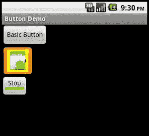

**图 6–3.** *Android 按钮控件*

让我们从基本按钮开始。


#### 按钮控件

Android 中的基本按钮类是 `android.widget.Button`。这种按钮除了用于处理点击事件之外，并没有太多特别之处。代码清单 6–9 展示了 `Button` 控件的 XML 布局片段，以及我们可能要在 Activity 的 `onCreate()` 方法中设置的一些 Java 代码。我们的基本按钮将类似于图 6–3 中顶部的按钮。

**代码清单 6–9.** *处理按钮上的点击事件*

```
<Button android:id="@+id/button1"
    android:text="@string/basicBtnLabel"
    android:layout_width="fill_parent"
    android:layout_height="wrap_content" />
```

```
Button button1 = (Button)this.findViewById(R.id.button1);
button1.setOnClickListener(new OnClickListener()
{
     public void onClick(View v)
     {
        Intent intent = new Intent(Intent.ACTION_VIEW,
                                Uri.parse("http://www.androidbook.com"));
        startActivity(intent);
     }
});
```

代码清单 6–9 展示了如何注册按钮点击事件。通过使用 `OnClickListener` 调用 `setOnClickListener()` 方法来注册点击事件。在代码清单 6–9 中，动态创建了一个匿名监听器来处理 `button1` 的点击事件。当按钮被点击时，会调用监听器的 `onClick()` 方法，在本例中，它会启动浏览器访问我们的网站。

自 Android SDK 1.6 起，有一种更简单的方法来为按钮设置点击处理器。代码清单 6–10 显示了一个 `Button` 的 XML，其中为处理器指定了一个属性，以及作为点击处理器的 Java 代码。

**代码清单 6–10.** *设置按钮的点击处理器*

```
<Button   ...    android:onClick="myClickHandler"    ...  />
```

```
    public void myClickHandler(View target) {
        switch(target.getId()) {
        case R.id.button1:
        ...
```

处理器方法被调用时，`target` 参数会被设置为代表被点击按钮的 `View` 对象。注意点击处理器方法中的 `switch` 语句是如何使用按钮的资源 ID 来选择要执行的逻辑的。使用这种方法意味着你无需在代码中显式创建每个 `Button` 对象，并且可以在多个按钮之间复用同一个方法。这使代码更易于理解和维护。这种方法也适用于其他按钮类型。

#### ImageButton 控件

Android 通过 `android.widget.ImageButton` 提供了图片按钮。使用图片按钮与使用基本按钮类似（参见代码清单 6–11）。我们的图片按钮将类似于图 6–3 中中间的按钮。

**代码清单 6–11.** *使用 `ImageButton`*

```
<ImageButton android:id="@+id/imageButton2"
    android:layout_width="wrap_content" android:layout_height="wrap_content"
    android:onClick="myClickHandler"
    android:src="@drawable/icon"  />
```

```
ImageButton imageButton2 = (ImageButton)this.findViewById(R.id.imageButton2);
imageButton2.setImageResource(R.drawable.icon);
```

这里我们在 XML 中创建了图片按钮，并从可绘制资源中设置了按钮的图片。按钮的图片文件必须存在于 `/res/drawable` 目录下。在我们的例子中，只是简单地复用了 Android 图标作为按钮图片。我们还在代码清单 6–11 中展示了如何通过调用按钮的 `setImageResource()` 方法并传入资源 ID，来动态设置按钮的图片。请注意，你只需执行其中一种方式，无需同时在 XML 文件和代码中指定按钮图片。

图片按钮的一个不错特性是，你可以为按钮指定透明背景。这样就会得到一个可点击的图片，它像按钮一样工作，但外观可以随心所欲。只需为图片按钮设置 `android:background="@null"` 即可。

由于你的图片可能与标准按钮截然不同，你可以自定义按钮在 UI 中使用的另外两种状态下的外观。除了正常显示外，按钮可以拥有焦点（focus），也可以被按下（pressed）。拥有**焦点**仅仅意味着按钮当前是事件的目标。例如，你可以使用键盘或方向键上的箭头键将焦点引导到按钮上。**按下**则意味着按钮在被按下后、用户松开之前，其外观会发生变化。为了告诉 Android 按钮的三个状态分别对应哪张图片，我们设置了一个选择器。这是一个简单的 XML 文件，位于项目的 `/res/drawable` 文件夹中。这有点违反直觉，因为它是一个 XML 文件而不是图片文件，但选择器文件必须放在那里。选择器文件的内容将类似于代码清单 6–12。

**代码清单 6–12.** *在 ImageButton 中使用选择器*

```
<?xml version="1.0" encoding="utf-8"?>
    <selector >
     <item android:state_pressed="true"
           android:drawable="@drawable/button_pressed" /> <!-- 按下 -->
     <item android:state_focused="true"
           android:drawable="@drawable/button_focused" /> <!-- 聚焦 -->
     <item android:drawable="@drawable/icon" /> <!-- 默认 -->
    </selector>
```

关于选择器文件，有几点需要注意。首先，不要像在 values XML 文件中那样指定 `<resources>` 标签。其次，按钮图片的顺序很重要。Android 会按顺序测试选择器中的每个项目，看是否匹配。因此，你希望正常图片放在最后，这样只有按钮既未被按下也未获得焦点时才会使用它。如果正常图片被列在第一位，那么即使按钮被按下或获得焦点，它也会始终匹配并被选中。当然，你引用的可绘制资源必须存在于 `/res/drawables` 文件夹中。在布局 XML 文件中定义按钮时，你需要将 `android:src` 属性设置为选择器 XML 文件，就像它是一个普通可绘制资源一样，如下所示：

```
<Button   ...    android:src="@drawable/imagebuttonselector"    ...   />
```

#### ToggleButton 控件

`ToggleButton` 控件，类似于复选框或单选按钮，是一个双状态按钮。此按钮可以处于“开”或“关”状态。如图 6–3 所示，`ToggleButton` 的默认行为是在“开”状态下显示绿色条，在“关”状态下显示灰色条。此外，默认行为还会将按钮的文本设置为“开”（On）或“关”（Off）。如果“开/关”不适用于你的应用程序，你可以修改 `ToggleButton` 的文本。例如，如果你有一个希望通过 `ToggleButton` 启动和停止的后台进程，你可以使用 `android:textOn` 和 `android:textOff` 属性将按钮文本设置为“停止”和“运行”。

代码清单 6–13 展示了一个示例。我们的切换按钮是图 6–3 中底部的按钮，它处于“开”位置，因此按钮上的标签显示为“停止”。

**代码清单 6–13.** *Android 的 `ToggleButton`*

```
<ToggleButton android:id="@+id/cctglBtn"
        android:layout_width="wrap_content"
        android:layout_height="wrap_content"  
        android:text="Toggle Button"
        android:textOn="Stop"  
        android:textOff="Run"/>
```

由于 `ToggleButton` 将开和关文本作为单独的属性，因此 `ToggleButton` 的 `android:text` 属性实际上并未被使用。该属性存在是因为它是继承自 `TextView` 的，但在这种情况下，你无需使用它。


#### `CheckBox` 控件

`CheckBox` 控件是另一种双状态按钮，允许用户切换其状态。不同之处在于，在许多情况下，用户并不将其视为可立即触发操作的按钮。然而，从 Android 的角度来看，它仍然是一个按钮，你可以对复选框执行任何可以对按钮执行的操作。

在 Android 中，你可以通过创建 `android.widget.CheckBox` 的实例来创建复选框。请参见清单 6–14 和图 6–4。

**清单 6–14.** *创建复选框*

```
<LinearLayout
        android:orientation="vertical" android:layout_width="fill_parent"
        android:layout_height="fill_parent">

<CheckBox android:id="@+id/chickenCB"  android:text="Chicken" android:checked="true"
    android:layout_width="wrap_content" android:layout_height="wrap_content" />

<CheckBox android:id="@+id/fishCB"  android:text="Fish"
    android:layout_width="wrap_content" android:layout_height="wrap_content" />

<CheckBox android:id="@+id/steakCB"  android:text="Steak" android:checked="true"
    android:layout_width="wrap_content" android:layout_height="wrap_content" />

</LinearLayout>
```

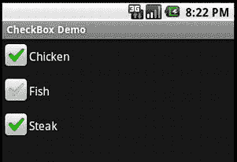

**图 6–4.** *使用 `CheckBox` 控件*

你可以通过调用 `setChecked()` 或 `toggle()` 来管理复选框的状态。你可以通过调用 `isChecked()` 来获取其状态。

如果你需要在复选框被选中或取消选中时实现特定逻辑，你可以通过调用 `setOnCheckedChangeListener()` 并传入 `OnCheckedChangeListener` 接口的实现来注册 `on-checked` 事件。然后，你需要实现 `onCheckedChanged()` 方法，该方法将在复选框被选中或取消选中时被调用。清单 6–15 展示了一些处理 `CheckBox` 的代码。

**清单 6–15.** *在代码中使用复选框*

```
public class CheckBoxActivity extends Activity {
        /** Called when the activity is first created. */
        @Override
        public void onCreate(Bundle savedInstanceState) {
            super.onCreate(savedInstanceState);
            setContentView(R.layout.checkbox);

            CheckBox fishCB = (CheckBox)findViewById(R.id.fishCB);

            if(fishCB.isChecked())
                fishCB.toggle();     // flips the checkbox to unchecked if it was checked

            fishCB.setOnCheckedChangeListener(
                        new CompoundButton.OnCheckedChangeListener() {

                @Override
                public void onCheckedChanged(CompoundButton arg0, boolean isChecked) {
                    Log.v("CheckBoxActivity", "The fish checkbox is now "
                            + (isChecked?"checked":"not checked"));
                }});
        }
}
```

设置 `OnCheckedChangeListener` 的好处在于，你会直接接收到 `CheckBox` 按钮的新状态。你也可以像使用基本按钮那样使用 `OnClickListener` 技术。当调用 `onClick()` 方法时，你需要通过适当的类型转换来获取按钮的新状态，然后在其上调用 `isChecked()`。清单 6–16 展示了如果我们为 `CheckBox` 按钮的 XML 定义添加了 `android:onClick="myClickHandler"`，代码可能的样子。

**清单 6–16.** *在代码中使用复选框（结合 `android:onClick`）*

```
public void myClickHandler(View view) {
    switch(view.getId()) {
    case R.id.steakCB:
        Log.v("CheckBoxActivity", "The steak checkbox is now " +
                (((CheckBox)view).isChecked()?"checked":"not checked"));
    }
}
```

#### `RadioButton` 控件

`RadioButton` 控件是任何 UI 工具包中不可或缺的一部分。单选按钮为用户提供多个选项，并强制他们选择单个项目。为了强制实现这种单选模型，单选按钮通常属于一个组，并且每个组在任意时刻只能有一个项目被选中。

要在 Android 中创建一组单选按钮，首先创建一个 `RadioGroup`，然后向该组中添加单选按钮。清单 6–17 和图 6–5 展示了一个示例。

**清单 6–17.** *使用 Android `RadioButton` 组件*

```
<LinearLayout
        android:orientation="vertical" android:layout_width="fill_parent"
        android:layout_height="fill_parent">

<RadioGroup     android:id="@+id/rBtnGrp" android:layout_width="wrap_content"
            android:layout_height="wrap_content"  android:orientation="vertical" >

    <RadioButton     android:id="@+id/chRBtn" android:text="Chicken"
            android:layout_width="wrap_content"  android:layout_height="wrap_content"/>

    <RadioButton  android:id="@+id/fishRBtn" android:text="Fish" android:checked="true"
            android:layout_width="wrap_content"  android:layout_height="wrap_content"/>

    <RadioButton android:id="@+id/stkRBtn" android:text="Steak"
            android:layout_width="wrap_content"  android:layout_height="wrap_content"/>

</RadioGroup>

</LinearLayout>
```

在 Android 中，你可以使用 `android.widget.RadioGroup` 实现单选按钮组，使用 `android.widget.RadioButton` 实现单选按钮。

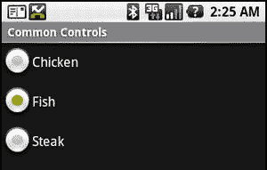

**图 6–5.** *使用单选按钮*

请注意，单选按钮组中的单选按钮默认情况下初始状态是未选中的，尽管你可以在 XML 定义中将其中一个设置为选中状态，就像我们在清单 6–17 中对“Fish”所做的那样。要以编程方式将其中一个单选按钮设置为选中状态，你可以获取对该单选按钮的引用并调用 `setChecked()`：

```
RadioButton steakBtn = (RadioButton)this.findViewById(R.id.stkRBtn);
steakBtn.setChecked(true);
```

你也可以使用 `toggle()` 方法来切换单选按钮的状态。与 `CheckBox` 控件类似，如果你调用 `setOnCheckedChangeListener()` 并传入 `OnCheckedChangeListener` 接口的实现，你会收到 `on-checked` 或 `on-unchecked` 事件的通知。不过，这里有一个细微的区别。这是一个与之前不同的类。这次，从技术上讲，它是 `RadioGroup.OnCheckedChangeListener` 类，而之前是 `CompoundButton.OnCheckedChangeListener` 类。

`RadioGroup` 也可以包含除单选按钮之外的其他视图。例如，清单 6–18 在最后一个单选按钮之后添加了一个 `TextView`。另外请注意，第一个单选按钮 (`anotherRadBtn`) 位于此单选按钮组之外。

**清单 6–18.** *包含不止`RadioButton`的`RadioGroup`*

```
<LinearLayout
        android:orientation="vertical"  android:layout_width="fill_parent"
        android:layout_height="fill_parent">

<RadioButton android:id="@+id/anotherRadBtn"  android:text="Outside"
            android:layout_width="wrap_content"  android:layout_height="wrap_content"/>

<RadioGroup android:id="@+id/radGrp"
android:layout_width="wrap_content"  android:layout_height="wrap_content">

     <RadioButton android:id="@+id/chRBtn"  android:text="Chicken"
            android:layout_width="wrap_content"  android:layout_height="wrap_content"/>

     <RadioButton android:id="@+id/fishRBtn"  android:text="Fish"    
            android:layout_width="wrap_content"  android:layout_height="wrap_content"/>

     <RadioButton android:id="@+id/stkRBtn"  android:text="Steak"
            android:layout_width="wrap_content"  android:layout_height="wrap_content"/>

     <TextView android:text="My Favorite"
            android:layout_width="wrap_content"  android:layout_height="wrap_content"/>
```


### RadioGroup 操作

`</RadioGroup>`
`</LinearLayout>`

Listing 6–18 展示了在单选按钮组中可以包含非`RadioButton`控件。同时需要注意的是，单选按钮组只能对其容器内的单选按钮强制单选。也就是说，ID 为`anotherRadBtn`的单选按钮将不会受到 Listing 6–18 中所示单选按钮组的影响，因为它不是该组的子元素。

你可以通过编程方式操作`RadioGroup`。例如，可以获取对单选按钮组的引用并添加一个单选按钮（或其他类型的控件）。Listing 6–19 演示了这一概念。

**Listing 6–19.** *在代码中向`RadioGroup`添加`RadioButton`*

```
RadioGroup radGrp = (RadioGroup)findViewById(R.id.radGrp);
RadioButton newRadioBtn = new RadioButton(this);
newRadioBtn.setText("Pork");
radGrp.addView(newRadioBtn);
```

一旦用户选中了单选按钮组中的某个单选按钮，就无法通过再次单击来取消选中。清除单选按钮组中所有单选按钮的唯一方法是调用`RadioGroup`上的`clearCheck()`方法。

当然，你可能希望利用`RadioGroup`实现一些有趣的功能。你可能不想轮询每个`RadioButton`来判断它是否被选中。幸运的是，`RadioGroup`提供了多种方法来帮助你。我们通过 Listing 6–20 来演示这些方法。此代码对应的 XML 见 Listing 6–18。

**Listing 6–20.** *以编程方式使用 RadioGroup*

```
public class RadioGroupActivity extends Activity {
        protected static final String TAG = "RadioGroupActivity";

        /** Called when the activity is first created. */
        @Override
        public void onCreate(Bundle savedInstanceState) {
            super.onCreate(savedInstanceState);
            setContentView(R.layout.radiogroup);

            RadioGroup radGrp = (RadioGroup)findViewById(R.id.radGrp);

            int checkedRadioButtonId = radGrp.getCheckedRadioButtonId();

            radGrp.setOnCheckedChangeListener(new RadioGroup.OnCheckedChangeListener() {
                @Override
                public void onCheckedChanged(RadioGroup arg0, int id) {
                    switch(id) {
                    case -1:
                        Log.v(TAG, "Choices cleared!");
                        break;
                    case R.id.chRBtn:
                        Log.v(TAG, "Chose Chicken");
                        break;
                    case R.id.fishRBtn:
                        Log.v(TAG, "Chose Fish");
                        break;
                    case R.id.stkRBtn:
                        Log.v(TAG, "Chose Steak");
                        break;
                    default:
                        Log.v(TAG, "Huh?");
                        break;
                    }
                }});
        }
}
```

我们可以随时使用`getCheckedRadioButtonId()`获取当前选中的`RadioButton`，该方法返回选中项的资源 ID，如果没有任何项被选中（可能没有默认选项且用户尚未做出选择），则返回–1。我们在前面的`onCreate()`方法中展示了这一点，但实际上，你应当在合适的时机使用它来读取用户当前的选择。我们还可以设置一个监听器，在用户选择某个`RadioButton`时立即得到通知。注意，`onCheckedChanged()`方法接收一个`RadioGroup`参数，这允许你为多个`RadioGroup`使用同一个`OnCheckedChangeListener`。你可能已经注意到了 switch 选项中的–1 情况。这种情况也会在通过代码调用`clearCheck()`清除`RadioGroup`时发生。

### ImageView 控件

我们尚未介绍的基本控件之一是`ImageView`控件。它用于显示图像，图像可以来自文件、内容提供者或资源（如 drawable）。你甚至可以只指定一种颜色，`ImageView`将显示该颜色。Listing 6–21 展示了一些`ImageView`在 XML 中的示例，以及如何创建`ImageView`的相关代码。

**Listing 6–21.** *XML 和代码中的`ImageView`*

```
<ImageView android:id="@+id/image1"
  android:layout_width="wrap_content"  android:layout_height="wrap_content"
  android:src="@drawable/icon" />

<ImageView android:id="@+id/image2"
  android:layout_width="125dip"  android:layout_height="25dip"
  android:src="#555555" />

<ImageView android:id="@+id/image3"
  android:layout_width="wrap_content"  android:layout_height="wrap_content" />

<ImageView android:id="@+id/image4"
  android:layout_width="wrap_content"  android:layout_height="wrap_content"
  android:src="@drawable/manatee02"
  android:scaleType="centerInside"
  android:maxWidth="35dip"  android:maxHeight="50dip"
  />

  ImageView imgView = (ImageView)findViewById(R.id.image3);

  imgView.setImageResource( R.drawable.icon );

  imgView.setImageBitmap(BitmapFactory.decodeResource(
              this.getResources(), R.drawable.manatee14) );

  imgView.setImageDrawable(
              Drawable.createFromPath("/mnt/sdcard/dave2.jpg") );

  imgView.setImageURI(Uri.parse("file://mnt/sdcard/dave2.jpg"));
```

在这个示例中，我们在 XML 中定义了四个图像。第一个只是我们应用程序的图标。第二个是一个灰色条，宽度大于高度。第三个定义没有在 XML 中指定图像源，但我们为其关联了一个 ID（`image3`），以便在代码中使用该 ID 来设置图像。第四个图像是我们的另一个 drawable 图像文件，我们不仅指定了图像文件的来源，还设置了图像在屏幕上的最大尺寸，并定义了当图像超过最大尺寸时的处理方式。在这种情况下，我们告诉`ImageView`对图像进行居中缩放，使其适应我们指定的大小。

在 Listing 6–21 的 Java 代码中，我们展示了设置`image3`图像的几种方法。首先，我们当然需要通过资源 ID 找到`ImageView`的引用。第一个设置方法`setImageResource()`直接使用图像的资源 ID 来定位图像文件，为我们的`ImageView`提供图像。第二个设置方法使用`BitmapFactory`将图像资源读入`Bitmap`对象，然后将`ImageView`设置为该`Bitmap`。请注意，在将`Bitmap`应用到`ImageView`之前，我们可以对其做一些修改，但在本例中，我们直接使用了原图。此外，`BitmapFactory`有几种创建`Bitmap`的方法，包括从字节数组和`InputStream`创建。你可以使用`InputStream`方法从 Web 服务器读取图像，创建`Bitmap`图像，然后设置`ImageView`。

第三种设置方法使用`Drawable`作为图像源。在此例中，我们展示了图像来源是 SD 卡。你需要将某种图像文件以正确的名称放在 SD 卡上，才能使此方法生效。与`BitmapFactory`类似，`Drawable`类有几种不同的构造`Drawable`的方法，包括从 XML 流构造。

最后一个设置方法接受图像文件的 URI，并将其用作图像源。对于这最后一个调用，不要认为你可以使用任何图像 URI 作为源。此方法实际上仅用于设备上的本地图像，而不是可能通过 HTTP 找到的图像。要将基于互联网的图像用作`ImageView`的源，你很可能需要使用`BitmapFactory`和`InputStream`。


### 日期与时间控件

日期和时间控件在许多窗口工具集中都很常见。Android 提供了多种基于日期和时间的控件，本部分将讨论其中几种。具体来说，我们将介绍 `DatePicker`、`TimePicker`、`DigitalClock` 和 `AnalogClock` 控件。

#### `DatePicker` 和 `TimePicker` 控件

顾名思义，你可以使用 `DatePicker` 控件选择日期，使用 `TimePicker` 控件选取时间。代码清单 6-22 和 图 6-6 展示了这些控件的示例。

**代码清单 6-22.** *XML 中的 `DatePicker` 和 `TimePicker` 控件*

```
<LinearLayout
        android:orientation="vertical"
        android:layout_width="fill_parent"
        android:layout_height="fill_parent">

  <TextView android:id="@+id/dateDefault"
    android:layout_width="fill_parent" android:layout_height="wrap_content" />

  <DatePicker android:id="@+id/datePicker"
    android:layout_width="wrap_content" android:layout_height="wrap_content" />

  <TextView android:id="@+id/timeDefault"
    android:layout_width="fill_parent" android:layout_height="wrap_content" />

  <TimePicker android:id="@+id/timePicker"
    android:layout_width="wrap_content" android:layout_height="wrap_content" />

</LinearLayout>
```

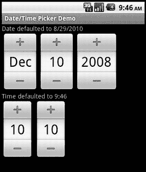

**图 6-6.** *`DatePicker` 和 `TimePicker` 的用户界面*

如果你查看 XML 布局，会发现定义这些控件很简单。与 Android 工具集中的任何其他控件一样，你可以通过编程方式访问这些控件以进行初始化或从中检索数据。例如，你可以像代码清单 6-23 所示那样初始化这些控件。

**代码清单 6-23.** *分别使用日期和时间初始化 `DatePicker` 和 `TimePicker`*

```
    public void onCreate(Bundle savedInstanceState) {
        super.onCreate(savedInstanceState);
        setContentView(R.layout.datetimepicker);

        TextView dateDefault = (TextView)findViewById(R.id.dateDefault);
        TextView timeDefault = (TextView)findViewById(R.id.timeDefault);

        DatePicker dp = (DatePicker)this.findViewById(R.id.datePicker);
        // 月份（而且只有月份）是从零开始的。显示时需要加 1。
        dateDefault.setText("日期默认为 " + (dp.getMonth() + 1) + "/" +
                dp.getDayOfMonth() + "/" + dp.getYear());
        // 这里，从 12 月 (12) 中减去 1 以将其设置为 12 月
        dp.init(2008, 11, 10, null);

        TimePicker tp = (TimePicker)this.findViewById(R.id.timePicker);

        java.util.Formatter timeF = new java.util.Formatter();
        timeF.format("时间默认为 %d:%02d", tp.getCurrentHour(),
                        tp.getCurrentMinute());
        timeDefault.setText(timeF.toString());

        tp.setIs24HourView(true);
        tp.setCurrentHour(new Integer(10));
        tp.setCurrentMinute(new Integer(10));
    }
}
```

代码清单 6-23 将 `DatePicker` 的日期设置为 2008 年 12 月 10 日。请注意，对于月份，内部值是从零开始的，这意味着一月是 0，十二月是 11。对于 `TimePicker`，小时和分钟数被设置为 10。另请注意，此控件支持 24 小时制视图。如果你未设置这些控件的值，默认值将是设备当前的日期和时间。

最后，请注意 Android 提供了这些控件的模态窗口版本，例如 `DatePickerDialog` 和 `TimePickerDialog`。如果你想向用户显示控件并强制用户做出选择，这些控件非常有用。我们将在第 8 章中更详细地介绍对话框。

#### `DigitalClock` 和 `AnalogClock` 控件

Android 还提供了 `DigitalClock` 和 `AnalogClock` 控件（参见图 6-7）。


**图 6-7.** *使用 `AnalogClock` 和 `DigitalClock`*

如图所示，数字时钟除了小时和分钟外，还支持秒显示。Android 中的模拟时钟是一个双指针时钟，一个指针指示小时，另一个指针指示分钟。要将它们添加到布局中，请使用如代码清单 6-24 所示的 XML。

**代码清单 6-24.** *在 XML 中添加 `DigitalClock` 或 `AnalogClock`*

```
<DigitalClock
  android:layout_width="wrap_content" android:layout_height="wrap_content" />

<AnalogClock
  android:layout_width="wrap_content" android:layout_height="wrap_content" />
```

这两个控件实际上仅用于显示当前时间，它们不允许你修改日期或时间。换句话说，它们是功能仅限于显示当前时间的控件。因此，如果你想更改日期或时间，则需要使用 `DatePicker`/`TimePicker` 或 `DatePickerDialog`/`TimePickerDialog`。不过，这两个时钟的优点是它们会自动更新，无需你做任何操作。也就是说，`DigitalClock` 中的秒数会自然流逝，`AnalogClock` 的指针会自行转动，而我们无需额外处理。

### `MapView` 控件

`com.google.android.maps.MapView` 控件可以显示地图。你可以通过 XML 布局或代码来实例化此控件，但使用它的 Activity 必须扩展 `MapActivity`。`MapActivity` 负责处理加载地图的多线程请求、执行缓存等操作。

代码清单 6-25 展示了 `MapView` 的实例化示例。

**代码清单 6-25.** *通过 XML 布局创建 `MapView` 控件*

```
<LinearLayout
        android:orientation="vertical" android:layout_width="fill_parent"
        android:layout_height="fill_parent">

    <com.google.android.maps.MapView
        android:layout_width="fill_parent"
        android:layout_height="fill_parent"
        android:enabled="true"
        android:clickable="true"
        android:apiKey="myAPIKey"
        />

</LinearLayout>
```

我们将在第 17 章讨论基于位置的服务时，详细讨论 `MapView` 控件。届时你也会学习如何获取自己的地图 API 密钥。

### 理解适配器

在详细讨论 Android 的列表控件之前，我们需要谈谈适配器。列表控件用于显示数据集合。但 Android 并未使用单一类型的控件来同时管理显示和数据，而是将这两项职责分离到列表控件和适配器中。列表控件是扩展了 `android.widget.AdapterView` 的类，包括 `ListView`、`GridView`、`Spinner` 和 `Gallery`（参见图 6-8）。

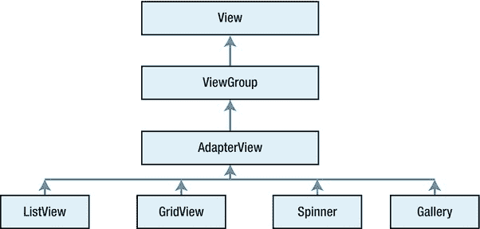

**图 6-8.** *`AdapterView` 类层次结构*

`AdapterView` 本身扩展了 `android.widget.ViewGroup`，这意味着 `ListView`、`GridView` 等是容器控件。换句话说，列表控件包含子视图的集合。适配器的目的是管理 `AdapterView` 的数据，并为其提供子视图。让我们通过研究 `SimpleCursorAdapter` 来了解其工作原理。


#### 认识 `SimpleCursorAdapter`

`SimpleCursorAdapter` 如图 6–9 所示。

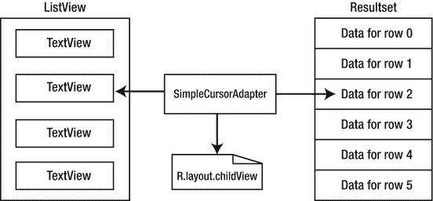

**图 6–9.** *`SimpleCursorAdapter`*

这是一张非常重要的理解图。左侧是 `AdapterView`；在此示例中，它是一个由多个 `TextView` 子视图构成的 `ListView`。右侧是数据；在本例中，它表示为来自内容提供程序查询结果的若干数据行。

为了将数据行映射到 `ListView`，`SimpleCursorAdapter` 需要一个子布局资源 ID。该子布局必须描述右侧应显示在左侧的每个数据元素的布局。这里的布局与我们为活动编写的布局类似，但它只需指定 `ListView` 中单行的布局。例如，如果从联系人内容提供程序获得了一组结果信息，并且只想在 `ListView` 中显示每个联系人姓名，则需要提供一个布局来描述姓名字段的外观。如果希望在 `ListView` 的每一行中同时显示姓名和来自结果集的图像，则布局必须说明如何显示姓名和图像。

这并不意味着你必须为结果集中的每个字段都提供布局规范，也不意味着你必须在结果集中为 `ListView` 每一行要包含的每个元素都准备一个数据。例如，稍后我们将展示如何在 `ListView` 中添加复选框用于选择行，而这些复选框无需通过结果集中的数据来设置。我们还将展示如何访问结果集中不属于 `ListView` 部分的数据。尽管我们刚刚只讨论了 `ListViews`、`TextView`s、游标和结果集，但请记住，适配器的概念远比这更通用。左侧可以是一个画廊，右侧可以是一个简单的图像数组。但为了简化问题，我们暂先更详细地了解 `SimpleCursorAdapter`。

`SimpleCursorAdapter` 的构造函数如下所示：

`SimpleCursorAdapter(Context context, int childLayout, Cursor c, String[] from, int[] to)`

此适配器将游标中的一行转换为容器控件的子视图。子视图的定义由 XML 资源（`childLayout` 参数）指定。请注意，由于游标中的一行可能包含多列，你需要通过指定列名数组（使用 `from` 参数）来告知 `SimpleCursorAdapter` 要选择该行中的哪些列。

同样，因为你选择的每一列都必须映射到布局中的一个 `View`，所以必须在 `to` 参数中指定这些视图的 ID。所选择的列与显示该列数据的 `View` 之间存在一一对应的映射关系，因此 `from` 和 `to` 参数数组必须具有相同数量的元素。如前所述，子视图可以包含其他类型的视图，不一定是 `TextView`。例如，你可以使用 `ImageView`。

`ListView` 与我们的适配器之间存在着紧密的协作关系。当 `ListView` 想要显示一行数据时，它会调用适配器的 `getView()` 方法，并传入位置参数以指定要显示的数据行。适配器通过使用其构造函数中设置的布局构建相应的子视图，并从结果集中提取相应记录的数据来响应。因此，`ListView` 无需处理数据在适配器端如何存在；它只需要根据需求调用子视图即可。这是一个关键点，因为这意味着 `ListView` 不一定需要为每一行数据都创建子视图。它实际上只需要拥有足够显示在显示窗口中的子视图数量。如果只显示十行，从技术上讲，即使结果集中有数百条记录，`ListView` 也只需要实例化十个子布局。实际上，实例化的子布局数量会超过十个，因为 Android 通常会预留一些额外的子布局，以便更快地将新行显示出来。你应该得出的结论是：`ListView` 管理的子视图是可以被回收利用的。稍后我们将对此进行更多讨论。

图 6–9 揭示了使用适配器的一些灵活性。由于列表控件使用了适配器，你可以根据数据和子视图替换使用各种类型的适配器。例如，如果你不打算从内容提供程序或数据库中填充 `AdapterView`，则不必使用 `SimpleCursorAdapter`。你可以选择一种更“简单”的适配器——`ArrayAdapter`。


#### 认识 `ArrayAdapter`

`ArrayAdapter` 是 Android 中最简单的适配器。它专门针对列表控件，并假设列表项（子视图）由 `TextView` 控件表示。创建一个新的 `ArrayAdapter` 可以像下面这样简单：

```
ArrayAdapter<String> adapter = new ArrayAdapter<String>(this,
                android.R.layout.simple_list_item_1,
                new string[]{"Dave","Satya","Dylan"});
```

我们仍然需要传入上下文（`this`）和 `childLayout` 资源 ID。但这次我们不再传入数据字段规范组成的 `from` 数组，而是直接传入一个字符串数组作为实际数据。我们不需要传入游标或 `View` 资源 ID 组成的 `to` 数组。这样做的假设是：我们的子布局只包含一个 `TextView`，而 `ArrayAdapter` 会将其作为数据数组中字符串的目标显示位置。

现在我们介绍一个关于 `childLayout` 资源 ID 的便捷技巧。我们无需为列表项创建自己的布局文件，而是可以直接利用 Android 中预定义的布局。请注意，子布局资源 ID 的前缀是 `android.`。Android 不会在本地的 `/res` 目录中查找，而是会去自己的资源目录中查找。你可以通过导航到 Android SDK 文件夹，然后在 `platforms/<android-version>/data/res/layout` 路径下找到该文件夹。在那里，你会找到 `simple_list_item_1.xml`，可以看到它定义了一个简单的 `TextView`。这个 `TextView` 正是我们的 `ArrayAdapter` 用来创建视图（在其 `getView()` 方法中）并传递给 `ListView` 的。你可以随意浏览这些文件夹，找到适用于各种场景的预定义布局。我们稍后会用到更多这样的布局。

`ArrayAdapter` 还有其他构造方法。如果 `childLayout` 不是一个简单的 `TextView`，你可以传入行布局的资源 ID，再加上用于接收数据的 `TextView` 的资源 ID。当你没有现成的字符串数组可以传入时，可以使用 `createFromResource()` 方法。代码清单 6-26 展示了一个为 Spinner 创建 `ArrayAdapter` 的例子。

**代码清单 6-26.** *从字符串资源文件创建 `ArrayAdapter`*

```
<Spinner android:id="@+id/spinner"
    android:layout_width="wrap_content"  android:layout_height="wrap_content" />

Spinner spinner = (Spinner) findViewById(R.id.spinner);

ArrayAdapter<CharSequence> adapter = ArrayAdapter.createFromResource(this,
        R.array.planets, android.R.layout.simple_spinner_item);

adapter.setDropDownViewResource(android.R.layout.simple_spinner_dropdown_item);

spinner.setAdapter(adapter);

<?xml version="1.0" encoding="utf-8"?>
<!-- 此文件位于 /res/values/planets.xml -->
<resources>
  <string-array name="planets">
    <item>水星</item>
    <item>金星</item>
    <item>地球</item>
    <item>火星</item>
    <item>木星</item>
    <item>土星</item>
    <item>天王星</item>
    <item>海王星</item>
  </string-array>
</resources>
```

代码清单 6-26 包含三个部分。第一部分是 Spinner 的 XML 布局。第二部分是 Java 代码，展示了如何创建一个数据源定义在字符串资源文件中的 `ArrayAdapter`。使用这种方法，你不仅可以将列表内容外部化到 XML 文件中，还可以使用本地化的版本。我们稍后会详细介绍 Spinner，但现在你只需要知道，Spinner 有一个用于显示当前选中值的视图，以及一个用于显示可供选择值的列表视图。它基本上就是一个下拉菜单。代码清单 6-26 的第三部分是名为 `/res/values/planets.xml` 的 XML 资源文件，它被读取用来初始化 `ArrayAdapter`。

值得一提的是，`ArrayAdapter` 允许对底层数据进行动态修改。例如，`add()` 方法会在数组末尾追加一个新值。`insert()` 方法会在数组中的指定位置添加一个新值。而 `remove()` 方法会从数组中移除一个对象。你也可以调用 `sort()` 方法来对数组重新排序。当然，完成这些操作后，数据数组会与 `ListView` 不同步，这时你需要调用适配器的 `notifyDataSetChanged()` 方法。该方法将使 `ListView` 与适配器重新同步。

以下列表总结了 Android 提供的适配器：

- `ArrayAdapter<T>`：这是一个基于任意对象泛型数组的适配器。它旨在与 `ListView` 配合使用。
- `CursorAdapter`：此适配器也用于 `ListView`，它通过游标为列表提供数据。
- `SimpleAdapter`：顾名思义，这是一个简单的适配器。它通常用于使用静态数据（可能来自资源）填充列表。
- `ResourceCursorAdapter`：此适配器继承自 `CursorAdapter`，并知道如何从资源创建视图。
- `SimpleCursorAdapter`：此适配器继承自 `ResourceCursorAdapter`，并根据游标中的列创建 `TextView`/`ImageView` 视图。这些视图在资源中定义。

我们已经介绍了足够多的适配器知识，接下来可以开始展示一些使用适配器和列表控件（也称为 `AdapterView`）的实际例子了。让我们开始吧。

### 在 AdapterView 中使用适配器

既然你已经了解了适配器，现在是时候让它们为我们工作了，为列表控件提供数据。在本节中，我们将首先介绍基本的列表控件——`ListView`。然后，我们将描述如何创建你自己的自定义适配器，最后，我们将介绍其他类型的列表控件：`GridView`、Spinner 和 Gallery。

#### 基本列表控件：`ListView`

`ListView` 控件垂直显示项目列表。也就是说，如果我们有一个待查看的项目列表，且项目数量超出了当前屏幕显示范围，我们可以滚动来查看其余项目。通常，使用 `ListView` 的方法是编写一个继承自 `android.app.ListActivity` 的新 Activity。`ListActivity` 包含一个 `ListView`，你可以通过调用 `setListAdapter()` 方法来为 `ListView` 设置数据。

正如我们之前所述，适配器将列表控件与数据连接起来，并帮助为列表控件准备子视图。`ListView` 中的项目可以被点击以执行即时操作，也可以被选中以便后续对选中的项目集合进行操作。我们将从一个非常简单的例子开始，然后逐步添加功能。


##### 在 ListView 中显示值

图 6–10 展示了最简形式的 `ListView` 控件。


**图 6–10.** *使用 `ListView` 控件*

在本练习中，我们将用 `ListView` 填满整个屏幕，因此甚至无需在主布局 XML 文件中指定 `ListView`。代码清单 6–27 展示了 `ListActivity` 的 Java 代码。

**代码清单 6–27.** *向 `ListView` 添加条目*

```
public class ListViewActivity extends ListActivity
{
    @Override
    protected void onCreate(Bundle savedInstanceState)
    {
        super.onCreate(savedInstanceState);

        Cursor c = managedQuery(Contacts.CONTENT_URI,
                        null, null, null, Contacts.DISPLAY_NAME + " ASC");

        String[] cols = new String[] {Contacts.DISPLAY_NAME};
        int[]    views = new int[]   {android.R.id.text1};

        SimpleCursorAdapter adapter = new SimpleCursorAdapter(this,
                        android.R.layout.simple_list_item_1,
                        c, cols, views);
        this.setListAdapter(adapter);
    }
}
```

代码清单 6–27 创建了一个 `ListView` 控件，并用设备上的联系人列表填充它。在我们的示例中，我们查询设备以获取联系人列表。为演示目的，我们选择了 Contacts 中的所有字段（使用 `managedQuery()` 方法中的第一个 null 参数），并按 `Contacts.DISPLAY_NAME` 字段进行排序（使用 `managedQuery()` 方法中的最后一个参数）。然后，我们创建一个投影（`cols`）来选择 `ListView` 中仅显示的联系人姓名——投影定义了我们感兴趣的列。接着，我们提供相应的资源 ID 数组（`views`），将姓名列（`Contacts.DISPLAY_NAME`）映射到 `TextView` 控件（`android.R.id.text1`）。之后，我们创建了一个光标适配器并设置列表的适配器。适配器类能够智能地从数据源中提取行，并取出每个联系人的名称以填充 UI。

要使它正常工作，我们还需要做一件事。由于此演示正在访问手机的通讯录数据库，我们需要请求相应的权限。此安全主题将在第 14 章中更详细地介绍，因此现在我们将仅引导您完成 `ListView` 的显示。双击本项目的 `AndroidManifest.xml` 文件，然后点击“权限”标签页。点击“添加”按钮，选择“使用权限”，然后点击“确定”。向下滚动名称列表，直到找到 `android.permission.READ_CONTACTS`。您的 Eclipse 窗口应类似于图 6–11 所示。然后保存 `AndroidManifest.xml` 文件。现在您可以在模拟器中运行此应用程序。在此示例应用程序中显示任何姓名之前，您可能需要使用联系人应用程序添加一些联系人。

您会注意到 `onCreate()` 方法没有设置 Activity 的内容视图。相反，由于基类 `ListActivity` 已经包含了一个 `ListView`，因此它只需为 `ListView` 提供数据即可。我们在这个示例中使用了一些快捷方式，首先是利用 `ListActivity` 提供了主布局。我们还使用了 Android 提供的布局作为子视图（资源 ID `android.R.layout.simple_list_item_1`），其中包含 Android 提供的 `TextView`（资源 ID `android.R.id.text1`）。总而言之，设置起来相当简单。

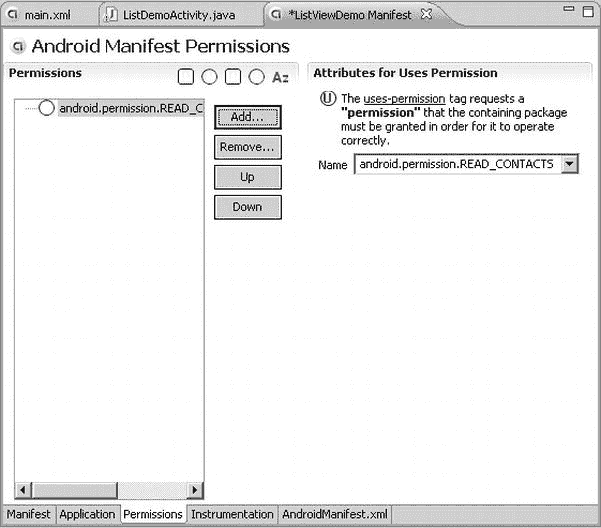

**图 6–11.** *修改 `AndroidManifest.xml` 以使我们的应用程序运行*

##### ListView 中的可点击项

当然，当您运行此示例时，您会看到可以上下滚动列表来查看所有联系人姓名，但仅此而已。如果我们想对这个示例做一些更有趣的事情，比如当用户点击 `ListView` 中的某个条目时启动联系人应用程序，该怎么办？代码清单 6–28 展示了对我们示例的修改，以接受用户输入。

**代码清单 6–28.** *在 `ListView` 上接受用户输入*

```
public class ListViewActivity2 extends ListActivity implements OnItemClickListener
{
    @Override
    protected void onCreate(Bundle savedInstanceState)
    {
        super.onCreate(savedInstanceState);

        ListView lv = getListView();

        Cursor c = managedQuery(Contacts.CONTENT_URI,
                null, null, null, Contacts.DISPLAY_NAME + " ASC");

        String[] cols = new String[] {Contacts.DISPLAY_NAME};
        int[]   views = new int[]   {android.R.id.text1};

        SimpleCursorAdapter adapter = new SimpleCursorAdapter(this,
                android.R.layout.simple_list_item_1,
                c, cols, views);
        this.setListAdapter(adapter);
        lv.setOnItemClickListener(this);
    }

    @Override
    public void onItemClick(AdapterView<?> adView, View target, int position, long id) {
        Log.v("ListViewActivity", "in onItemClick with " + ((TextView) target).getText() +
                ". Position = " + position + ". Id = " + id);
        Uri selectedPerson = ContentUris.withAppendedId(
                Contacts.CONTENT_URI, id);
        Intent intent = new Intent(Intent.ACTION_VIEW, selectedPerson);
        startActivity(intent);
    }
}
```

我们的 Activity 现在实现了 `OnItemClickListener` 接口，这意味着当用户在 `ListView` 中点击某个内容时，我们将收到回调。正如在 `onItemClick()` 方法中所见，我们获得了关于所点击内容的许多信息，包括接收点击的视图、所点击条目在 `ListView` 中的位置，以及根据适配器得到的条目 ID。由于我们知道 `ListView` 由 `TextView` 组成，因此我们假设接收到的是 `TextView` 并相应地进行类型转换，然后调用 `getText()` 方法来获取联系人姓名。位置值表示此条目在 `ListView` 中所有条目列表中的相对位置，且从零开始。因此，列表中的第一个条目位于位置 0。

ID 值完全取决于适配器和数据源。在我们的示例中，我们恰好查询的是 Contacts 内容提供者，因此根据该适配器，ID 就是来自内容提供者的记录的 `_ID`。但在其他情况下，您的数据源可能并非来自内容提供者，因此您不应认为总可以像本例中那样创建 URI。如果我们使用的是从资源 XML 文件中读取值的 `ArrayAdapter`，那么赋予我们的 ID 很可能就是数据数组中的位置值，实际上可能与位置值完全相同。

之前讨论 `ArrayAdapter` 时，我们提到了 `notifyDataSetChanged()` 方法，该方法可以在数据发生变化时让适配器更新 `ListView`。在当前示例中尝试这个实验。点击一个联系人，这应该会启动联系人应用程序。现在，编辑该联系人，更改其姓名；点击“完成”，然后点击“返回”按钮，回到我们的示例应用程序。您应该会看到 `ListView` 中该联系人的姓名已自动更新。是不是很酷？通过 `SimpleCursorAdapter` 和 Contacts 内容提供者，我们的 `ListView` 已被自动更新。然而，对于 `ArrayAdapter`，您需要自行调用 `notifyDataSetChanged()` 方法。


### 使用 `ListView` 添加其他控件

刚才的操作相当简单。我们生成了一个包含联系人姓名的自定义 `ListView`，点击姓名即可为所选人员启动“联系人”应用。但如果我们想先选择一批姓名，然后对这组人执行某些操作，该怎么办？在下一个示例应用中，我们将修改列表项的布局以包含复选框，并会在用户界面中添加一个按钮，用于对选中的子集项目执行操作。

如果你希望在主布局中添加其他控件，可以自行提供布局 XML 文件，放入一个 `ListView`，并添加其他所需控件。例如，你可以在用户界面的 `ListView` 下方添加一个按钮，用于对选中的项目提交操作，如图 6–12 所示。

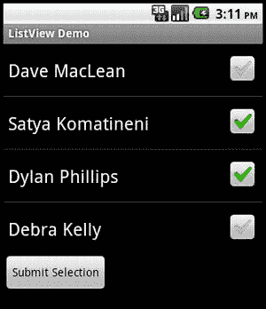

**图 6–12.** 一个附加按钮，允许用户提交选中的项目

本例的主布局如代码清单 6–29 所示，其中包含了该活动的 UI 定义——`ListView` 和 `Button`。

**代码清单 6–29.** 重写 `ListActivity` 引用的 `ListView`

```
<?xml version="1.0" encoding="utf-8"?>
<!-- 该文件位于 /res/layout/list.xml -->
<LinearLayout
    android:orientation="vertical"
    android:layout_width="fill_parent"  android:layout_height="fill_parent">

    <ListView android:id="@android:id/list"
            android:layout_width="fill_parent"  android:layout_height="0dip"
            android:layout_weight="1" />

    <Button android:id="@+id/btn" android:onClick="doClick"
           android:layout_width="wrap_content"  android:layout_height="wrap_content"
           android:text="提交选择" />

</LinearLayout>
```

请注意为 `ListView` 指定的 ID。我们必须使用 `@android:id/list`，因为 `ListActivity` 期望在我们的布局中找到一个具有此名称的 `ListView`。如果我们依赖 `ListActivity` 为自动创建的默认 `ListView`，它也会具有这个 ID。

另一点需要注意是我们在 `LinearLayout` 中指定 `ListView` 高度的方式。我们希望无论 `ListView` 中有多少项，按钮始终显示在屏幕上，并且不希望用户滚动到页面底部才能找到按钮。为此，我们将 `layout_height` 设为 0，然后使用 `layout_weight` 表示该控件应占据父容器的所有可用空间。这一技巧既为按钮留出了空间，又保留了滚动 `ListView` 的能力。我们将在本章稍后部分详细讨论布局和权重。

活动的实现代码如代码清单 6–30 所示。

**代码清单 6–30.** 从 `ListActivity` 读取用户输入

```
public class ListViewActivity3 extends ListActivity
{
    private static final String TAG = "ListViewActivity3";
    private ListView lv = null;
    private Cursor cursor = null;
    private int idCol = -1;
    private int nameCol = -1;
    private int timesContactedCol = -1;

    @Override
    protected void onCreate(Bundle savedInstanceState)
    {
        super.onCreate(savedInstanceState);
        setContentView(R.layout.list);

        lv = getListView();

        cursor = managedQuery(Contacts.CONTENT_URI,
                        null, null, null, Contacts.DISPLAY_NAME + " ASC");

        String[] cols = new String[]{Contacts.DISPLAY_NAME};
        idCol = cursor.getColumnIndex(Contacts._ID);
        nameCol = cursor.getColumnIndex(Contacts.DISPLAY_NAME);
        timesContactedCol = cursor.getColumnIndex(Contacts.TIMES_CONTACTED);

        int[] views = new int[]{android.R.id.text1};

        SimpleCursorAdapter adapter = new SimpleCursorAdapter(this,
                android.R.layout.simple_list_item_multiple_choice,
                cursor, cols, views);

        this.setListAdapter(adapter);

        lv.setChoiceMode(ListView.CHOICE_MODE_MULTIPLE);
    }

    public void doClick(View view) {
        int count=lv.getCount();
        SparseBooleanArray viewItems = lv.getCheckedItemPositions();
        for(int i=0; i<count; i++) {
            if(viewItems.get(i)) {
                // CursorWrapper cw = (CursorWrapper) lv.getItemAtPosition(i);
                cursor.moveToPosition(i);
                long id = cursor.getLong(idCol);
                String name = cursor.getString(nameCol);
                int timesContacted = cursor.getInt(timesContactedCol);
                Log.v(TAG, name + " 已选中。联系次数 = " + timesContacted +
                        "。位置 = " + i + "。ID = " + id);
            }
        }
    }
}
```

现在，我们又回到了调用 `setContentView()` 来设置活动 UI 的情况。在设置适配器时，我们传入了另一个 Android 提供的用于 `ListView` 行项目的视图（`android.R.layout.simple_list_item_multiple_choice`），这会使每一行包含一个 `TextView` 和一个 `CheckBox`。如果你查看这个布局文件内部，会看到另一个 `TextView` 的子类，名为 `CheckedTextView`。这种特殊类型的 `TextView` 专为与 `ListView` 配合使用而设计。看吧，我们早就说过 Android 布局文件夹里有一些有趣的东西！你会注意到 `CheckedTextView` 的 ID 是 `text1`，这正是我们需要传递给 `SimpleCursorAdapter` 构造函数中 views 数组的值。

因为我们希望用户能够选择行，所以将选择模式设置为 `CHOICE_MODE_MULTIPLE`。默认情况下，选择模式是 `CHOICE_MODE_NONE`。另一个可能的取值是 `CHOICE_MODE_SINGLE`。如果你想在本例中使用单选模式，则需要改用不同的布局，很可能是 `android.R.layout.simple_list_item_single_choice`。

在本例中，我们实现了一个基本按钮，它会调用活动的 `doClick()` 方法。为简单起见，我们只想将用户勾选的项目名称输出到 LogCat。好消息是解决方案相当简单；坏消息是 Android 已经演变，最佳方案取决于你针对的是哪个 Android 版本。我们这里展示的 `ListView` 解决方案自 Android 1 以来一直有效（尽管我们在按钮回调中采用了 Android 1.6 的快捷方式）。也就是说，`getCheckedItemPositions()` 方法虽然旧但依然可用。其返回值是一个数组，可以告诉你某个项目是否被选中。因此，我们遍历该数组。如果 `ListView` 中对应的行被选中，`viewItems.get(i)` 将返回 true。我们的数据可通过游标访问。所以，我们不在 `ListView` 中查找数据，而是在游标中查找数据。`ListView` 会告诉我们在适配器中的哪个位置进行查找。

当我们从 `ListView` 获取到一个已被选中的位置编号时，可以使用游标的 `moveToPosition()` 方法来准备读取数据。还有一个方法功能几乎相同，即 `ListView` 的 `getItemAtPosition()` 方法。在我们的例子中，`getItemAtPosition()` 返回的对象实际上是一个 `CursorWrapper` 对象。正如我们之前所说，在其他情况下，我们可能会得到其他类型的对象。这里之所以会得到 `CursorWrapper`，仅仅是因为我们正在与内容提供程序打交道。你必须了解你的数据源和适配器，才能知道会得到什么结果。


然后我们可以使用 `Cursor`（或者如果之前选择了 `CursorWrapper`）来检索与 `ListView` 行相关联的数据。请注意，在我们的示例中，即使我们从未将备注映射到 `ListView`，我们也能检索到联系人的姓名和备注。当我们为适配器设置游标时，我们选择了所有可用字段。在实践中，你并不需要所有字段，因此应将查询限制为仅查询将要使用的字段。但在这个案例中，我们查询的字段数量超过了在 `ListView` 中显示所需的数量，这样我们就可以在按钮回调中轻松访问其他字段。

#### 从 `ListView` 读取选中项的另一种方法

Android 1.6 引入了另一种从 `ListView` 检索选中行列表的方法：`getCheckItemIds()`。随后，在 Android 2.2 中，该方法被弃用，并替换为 `getCheckedItemIds()`。虽然名称变化细微，但使用该方法的方式基本相同。此外，在 Android 2.2 中，处理联系人的方式也发生了变化。在我们的下一个示例中，我们将使用 Android 2.2 的功能来展示示例的可能实现。列表 6–31 展示了 Java 代码。对于 `list.xml` 的 XML 布局，我们可以继续使用列表 6–29 中的文件。

**列表 6–31.** *从 `ListActivity` 读取用户输入的另一种方法*

```
public class ListViewActivity4 extends ListActivity
{
    private static final String TAG = "ListViewActivity4";
    private SimpleCursorAdapter adapter = null;
    private ListView lv = null;

    @Override
    protected void onCreate(Bundle savedInstanceState)
    {
        super.onCreate(savedInstanceState);
        setContentView(R.layout.list);

        lv = getListView();

        String[] projection = new String[] {Contacts._ID,
                Contacts.DISPLAY_NAME};
        Cursor c = managedQuery(Contacts.CONTENT_URI,
                        projection, null, null, Contacts.DISPLAY_NAME);

        String[] cols = new String[] {Contacts.DISPLAY_NAME};
        int[]    views = new int[]       {android.R.id.text1};

        adapter = new SimpleCursorAdapter(this,
                android.R.layout.simple_list_item_multiple_choice,
                c, cols, views);

        this.setListAdapter(adapter);

        lv.setChoiceMode(ListView.CHOICE_MODE_MULTIPLE);
    }

    public void doClick(View view) {
        if(!adapter.hasStableIds()) {
            Log.v(TAG, "Data is not stable");
            return;
        }
        long[] viewItems = lv.getCheckedItemIds();
        for(int i=0; i<viewItems.length; i++) {
            Uri selectedPerson = ContentUris.withAppendedId(
                    Contacts.CONTENT_URI, viewItems[i]);

            Log.v(TAG, selectedPerson.toString() + " is checked.");
        }
    }
}
```

在这个示例应用中，当我们点击按钮时，回调函数会调用 `getCheckedItemIds()` 方法。而在上一个示例中，我们得到的是 `ListView` 中被选中项的位置数组。这一次，我们得到的是适配器中那些在 `ListView` 里被选中的记录的 ID 数组。我们现在可以绕过 `ListView` 和游标，因为这些 ID 可以与内容提供者一起使用，从而执行我们想要的任何操作。在我们的示例中，我们只是构建了一个 URI，该 URI 代表来自联系人内容提供者的特定记录，并将该 URI 写入 LogCat。我们本可以直接使用内容提供者对数据进行操作。这种技术同样适用于旧版联系人内容提供者和 Android 1.6 的 `getCheckItemIds()` 方法。

在这个示例中，我们另一个不同的做法是，在创建游标时只选择了少数几个列。这是常规做法，因为你不想读取不必要的数据。从该示例中需要指出的最后一点是，`getCheckedItemIds()` 方法要求适配器中的底层数据是稳定的。因此，强烈建议在调用 `ListView` 的 `getCheckedItemIds()` 之前，先调用适配器的 `hasStableIds()`。在我们的示例中，我们走了一条捷径，仅记录事实并返回。实际上，你需要执行更智能的操作，例如，可能启动一个后台线程进行重试，并显示一个对话框指示正在处理。

我们已经向你展示了如何在多种场景下使用 `ListView`。我们展示了适配器为支持 `ListView` 承担了大量工作。接下来，我们将从 `GridView` 开始，介绍其他类型的列表控件。


#### `GridView` 控件

大多数小部件工具包都提供了一种或多种基于网格的控件。Android 有一个 `GridView` 控件，它可以以网格的形式显示数据。请注意，虽然我们在此处使用了*数据*这一术语，但网格的内容可以是文本、图像等。

`GridView` 控件以网格形式显示信息。`GridView` 的使用模式是在 XML 布局中定义网格（参见清单 6–32），然后使用 `android.widget.ListAdapter` 将数据绑定到网格。别忘了在 `AndroidManifest.xml` 文件中添加 `uses-permission` 标签，以使此示例生效。

**清单 6–32.** *XML 布局中 `GridView` 的定义及关联的 Java 代码*

```
<?xml version="1.0" encoding="utf-8"?>
<!-- 此文件位于 /res/layout/gridview.xml -->
<GridView
    android:id="@+id/gridview"
    android:layout_width="fill_parent"
    android:layout_height="fill_parent"
    android:padding="10px"
    android:verticalSpacing="10px"
    android:horizontalSpacing="10px"
    android:numColumns="auto_fit"
    android:columnWidth="100px"
    android:stretchMode="columnWidth"
    android:gravity="center"
    />
```

```
public class GridViewActivity extends Activity
{
    @Override
    protected void onCreate(Bundle savedInstanceState)
    {
        super.onCreate(savedInstanceState);
        setContentView(R.layout.gridview);

        GridView gv = (GridView)findViewById(R.id.gridview);

        Cursor c = managedQuery(Contacts.CONTENT_URI,
                        null, null, null, Contacts.DISPLAY_NAME);

        String[] cols = new String[] {Contacts.DISPLAY_NAME};
        int[]    views = new int[]      {android.R.id.text1};

        SimpleCursorAdapter adapter = new SimpleCursorAdapter(this,
                android.R.layout.simple_list_item_1,
                c, cols, views);

        gv.setAdapter(adapter);
    }
}
```

清单 6–32 在 XML 布局中定义了一个简单的 `GridView`。然后将该网格加载到 Activity 的内容视图中。生成的用户界面如图 6–13 所示。


**图 6–13.** *填充了联系人信息的 `GridView`*

图 6–13 中显示的网格展示了设备上联系人的姓名。我们决定显示一个包含联系人姓名的 `TextView`，但你也可以轻松生成一个填充了图像或其他控件的网格。我们再次利用了 Android 中预定义的布局。事实上，这个示例与清单 6–27 非常相似，但有几个重要的区别。首先，我们的 `GridViewActivity` 继承自 `Activity`，而不是 `ListActivity`。其次，我们必须调用 `setContentView()` 来为我们的 `GridView` 设置布局；没有可用的默认视图。最后，要设置适配器，我们在 `GridView` 对象上调用 `setAdapter()`，而不是在 `Activity` 上调用 `setListAdapter()`。

你肯定已经注意到，网格使用的适配器是一个 `ListAdapter`。列表通常是一维的，而网格是二维的。因此我们可以得出结论，网格实际上显示的是面向列表的数据。事实证明，列表是按行显示的。也就是说，列表先填充第一行，然后第二行，以此类推。

和之前一样，我们有一个列表控件，它与适配器协同工作来处理数据管理和子视图的生成。我们之前使用的相同技术同样适用于 `GridView`。不过有一个例外与选择相关：无法像我们在清单 6–30 中那样在 `GridView` 中指定多项选择。

#### `Spinner` 控件

`Spinner` 控件类似于下拉菜单。它通常用于从相对较短的选择列表中进行选择。如果选项列表太长而无法完全显示，系统会自动为你添加一个滚动条。你可以通过 XML 布局实例化一个 `Spinner`，如下所示：

```
<Spinner
    android:id="@+id/spinner"  android:prompt="@string/spinnerprompt"
    android:layout_width="wrap_content"  android:layout_height="wrap_content" />
```

虽然从技术上讲，spinner 是一个列表控件，但它对你来说更像是一个简单的 `TextView` 控件。换句话说，当 spinner 处于静止状态时，只会显示一个值。spinner 的目的是允许用户从一组预设值中进行选择：当用户点击小箭头时，会显示一个列表，用户可以选择一个新值。填充此列表的方式与其他列表控件相同：使用适配器。

由于 spinner 通常像下拉菜单一样使用，因此常见做法是让适配器从资源文件中获取列表选项。展示如何使用资源文件设置 spinner 的示例见清单 6–33。请注意名为 `android:prompt` 的新属性，它用于在列表顶部设置提示文字，供用户选择。我们的 spinner 提示的实际文本位于 `/res/values/strings.xml` 文件中。正如你所料，`Spinner` 类也提供了在代码中设置提示的方法。

**清单 6–33.** *从资源文件创建 Spinner 的代码*

```
public class SpinnerActivity extends Activity {
    /** 当 Activity 首次被创建时调用。 */
    @Override
    public void onCreate(Bundle savedInstanceState) {
        super.onCreate(savedInstanceState);
        setContentView(R.layout.spinner);

        Spinner spinner = (Spinner)findViewById(R.id.spinner);

        ArrayAdapter<CharSequence> adapter = ArrayAdapter.createFromResource(this,
                R.array.planets, android.R.layout.simple_spinner_item);

        adapter.setDropDownViewResource(android.R.layout.simple_spinner_dropdown_item);

        spinner.setAdapter(adapter);
    }
}
```

你可能还记得在清单 6–26 中看到过 `planets.xml` 文件。在这个示例中，我们展示了如何创建一个 `Spinner` 控件；适配器被设置好然后关联到 spinner。实际效果请参见图 6–14。

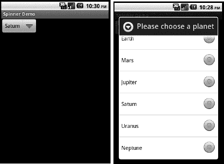

**图 6–14.** *用于选择行星的 Spinner*

与我们之前的列表控件的一个不同之处在于，使用 spinner 时需要处理一个额外的布局。图 6–14 的左侧显示了 spinner 的正常模式，即显示当前选中项。在这种情况下，当前选中项是土星。在该词旁边有一个向下箭头，表示此控件是一个 spinner，可以用来弹出一个列表以选择不同的值。第一个布局作为参数传递给 `ArrayAdapter.createFromResource()` 方法，定义了 spinner 在正常模式下的外观。图 6–14 的右侧展示了 spinner 处于弹出列表模式，等待用户选择新值。此列表的布局通过 `setDropDownViewResource()` 方法设置。同样在这个例子中，我们使用了 Android 提供的布局来满足这两种需求，因此如果你想查看这两种布局的定义，可以访问 Android 的 `res/layout` 文件夹。当然，你也可以为它们指定自己的布局定义，以达到你想要的效果。


### Gallery 控件

`Gallery` 控件是一个可水平滚动的列表控件，其焦点始终位于列表中央。在触摸模式下，该控件通常用作照片画廊。你可以通过 XML 布局或代码来实例化一个 `Gallery`：

```
<Gallery
    android:id="@+id/gallery"
    android:layout_width="fill_parent"
    android:layout_height="wrap_content"
/>
```

`Gallery` 控件通常用于显示图片，因此你的适配器很可能需要专门针对图片进行定制。我们将在下一节关于自定义适配器的内容中展示一个自定义图片适配器的示例。从视觉上看，`Gallery` 控件的外观如图 6-15 所示。


**图 6-15.** *显示海牛图片的画廊*

### 创建自定义适配器

Android 中的标准适配器易于使用，但存在一些局限性。为解决此问题，Android 提供了一个名为 `BaseAdapter` 的抽象类，当需要自定义适配器时，你可以对其进行扩展。如果你有特殊的数据管理需求，或者希望更精细地控制子视图的显示方式，就可以使用自定义适配器。此外，你也可以通过使用缓存技术来提升性能，从而使用自定义适配器。接下来，我们将展示如何构建一个自定义适配器。

代码清单 6-34 展示了自定义适配器的 XML 布局和 Java 代码可能呈现的样子。在本示例中，我们的适配器将处理海牛图片，因此我们将其命名为 `ManateeAdapter`。我们还将在一个 Activity 中创建该适配器。

**代码清单 6-34.** *我们的自定义适配器：`ManateeAdapter`*

```
<?xml version="1.0" encoding="utf-8"?>
<!-- 该文件位于 /res/layout/gridviewcustom.xml -->
<GridView
    android:id="@+id/gridview"
    android:layout_width="fill_parent"
    android:layout_height="fill_parent"
    android:padding="10dip"
    android:verticalSpacing="10dip"
    android:horizontalSpacing="10dip"
    android:numColumns="auto_fit"
    android:gravity="center"
    />
```

```
public class GridViewCustomAdapter extends Activity
{
    @Override
    protected void onCreate(Bundle savedInstanceState)
    {
        super.onCreate(savedInstanceState);
        setContentView(R.layout.gridviewcustom);

        GridView gv = (GridView)findViewById(R.id.gridview);

        ManateeAdapter adapter = new ManateeAdapter(this);

        gv.setAdapter(adapter);
    }

    public static class ManateeAdapter extends BaseAdapter {
        private static final String TAG = "ManateeAdapter";
        private static int convertViewCounter = 0;
        private Context mContext;
        private LayoutInflater mInflater;

        static class ViewHolder {
            ImageView image;
        }

        private int[] manatees = {
                R.drawable.manatee00, R.drawable.manatee01, R.drawable.manatee02,
                R.drawable.manatee03, R.drawable.manatee04, R.drawable.manatee05,
                R.drawable.manatee06, R.drawable.manatee07, R.drawable.manatee08,
                R.drawable.manatee09, R.drawable.manatee10, R.drawable.manatee11,
                R.drawable.manatee12, R.drawable.manatee13, R.drawable.manatee14,
                R.drawable.manatee15, R.drawable.manatee16, R.drawable.manatee17,
                R.drawable.manatee18, R.drawable.manatee19, R.drawable.manatee20,
                R.drawable.manatee21, R.drawable.manatee22, R.drawable.manatee23,
                R.drawable.manatee24, R.drawable.manatee25, R.drawable.manatee26,
                R.drawable.manatee27, R.drawable.manatee28, R.drawable.manatee29,
                R.drawable.manatee30, R.drawable.manatee31, R.drawable.manatee32,
                R.drawable.manatee33 };

        private Bitmap[] manateeImages = new Bitmap[manatees.length];
        private Bitmap[] manateeThumbs = new Bitmap[manatees.length];

        public ManateeAdapter(Context context) {
            Log.v(TAG, "Constructing ManateeAdapter");
            this.mContext = context;
            mInflater = LayoutInflater.from(context);

            for(int i=0; i<manatees.length; i++) {
                manateeImages[i] = BitmapFactory.decodeResource(
                        context.getResources(), manatees[i]);
                manateeThumbs[i] = Bitmap.createScaledBitmap(manateeImages[i],
                        100, 100, false);
            }
        }

        @Override
        public int getCount() {
            Log.v(TAG, "in getCount()");
            return manatees.length;
        }

        public int getViewTypeCount() {
            Log.v(TAG, "in getViewTypeCount()");
            return 1;
        }
```


```java
public int getItemViewType(int position) {
    Log.v(TAG, "in getItemViewType() for position " + position);
    return 0;
}

@Override
public View getView(int position, View convertView, ViewGroup parent) {
    ViewHolder holder;

    Log.v(TAG, "in getView for position " + position +
            ", convertView is " +
            ((convertView == null)?"null":"being recycled"));

    if (convertView == null) {
        convertView = mInflater.inflate(R.layout.gridimage, null);
        convertViewCounter++;
        Log.v(TAG, convertViewCounter + " convertViews have been created");

        holder = new ViewHolder();
        holder.image = (ImageView) convertView.findViewById(R.id.gridImageView);

        convertView.setTag(holder);
    } else {
        holder = (ViewHolder) convertView.getTag();
    }

    holder.image.setImageBitmap( manateeThumbs[position] );

    return convertView;
}

@Override
public Object getItem(int position) {
    Log.v(TAG, "in getItem() for position " + position);
    return manateeImages[position];
}

@Override
public long getItemId(int position) {
    Log.v(TAG, "in getItemId() for position " + position);
    return position;
}
```

当你运行这个应用程序时，你应该会看到一个显示效果，如图 6–16 所示。

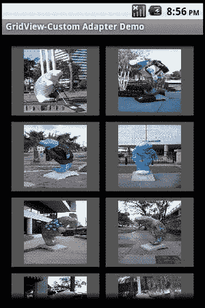

**图 6–16.** *一个展示海牛图像的 `GridView`*

这个例子虽然看起来相对简单，但有很多值得解释的地方。我们先从 `Activity` 类开始，它与本章这一小节中我们一直在使用的类非常相似。主布局来自 `gridviewcustom.xml`，其中只包含一个 `GridView` 定义。我们需要从布局内部获取对 `GridView` 的引用，因此我们定义并设置了 `gv`。我们实例化了 `ManateeAdapter`，将上下文传递给它，并将适配器设置到 `GridView` 上。到目前为止，这都是非常标准的操作，不过你已经注意到，我们的自定义适配器在创建时使用的参数远少于预定义的适配器。这主要是因为我们对这个特定适配器拥有完全的控制权，并且它仅用于这个应用程序。如果我们要让这个适配器更加通用，很可能会设置更多参数。但让我们继续往下看。

适配器内部的工作是管理向 Android `View` 对象传递数据。列表控件（此处为 `GridView`）会使用这些 `View` 对象。数据来自某个数据源。在之前的例子中，数据通过传递给适配器的游标对象传入。而在我们这个自定义示例中，适配器完全了解数据及其来源。列表控件会询问信息，以便知道如何构建用户界面。当列表控件有不再需要的视图时，它也会友好地将这些视图传入以进行回收。一开始你可能觉得适配器必须知道如何构建视图有些奇怪，但最终，这一切都是合理的。

当我们实例化自定义适配器 `ManateeAdapter` 时，通常的做法是将上下文传入，并由适配器保存它。在需要时能够使用上下文通常非常有用。我们希望适配器做的第二件事是持有 `inflater`（布局填充器）。这有助于在需要创建新视图返回给列表控件时提高性能。适配器中典型的第三件事是创建一个 `ViewHolder` 对象，用于容纳我们正在管理的数据所对应的 `View` 对象。在这个例子中，我们只存储了一个 `ImageView`，但如果需要处理额外的字段，我们会把它们添加到 `ViewHolder` 的定义中。例如，如果有一个 `ListView`，每一行包含一个 `ImageView` 和两个 `TextView`，那么我们的 `ViewHolder` 就会包含一个 `ImageView` 和两个 `TextView`。

由于我们在这个适配器中处理的是海牛图像，我们在构造时设置了一个资源 ID 数组来创建位图。我们还定义了一个位图数组作为我们的数据列表。

从 `ManateeAdapter` 的构造函数可以看出，我们保存了上下文，创建并持有 `inflater`，然后遍历图像资源 ID 并构建一个位图数组。这个位图数组就是我们的数据。

正如你之前所学，设置适配器会导致我们的 `GridView` 调用适配器上的方法来设置自身，以便显示数据。例如，`gv` 会调用适配器的 `getCount()` 方法来确定有多少个对象需要显示。它还会调用 `getViewTypeCount()` 方法来确定 `GridView` 中可以显示多少种不同类型的视图。在这个示例中，我们将此值设为 1。然而，如果我们有一个 `ListView` 并且希望在常规数据行之间放置分隔符，那么我们将有两种类型的视图，并且需要从 `getViewTypeCount()` 方法返回 2。你可以根据需要设置任意多种不同的视图类型，只要正确地从这个方法返回对应的计数即可。与此方法相关的还有 `getItemViewType()`。我们刚刚提到可以从适配器返回多种类型的视图，但为了简单起见，`getItemViewType()` 只需要返回一个整数值，来指明数据中某个特定位置对应的是哪种视图类型。因此，如果我们有两种类型的视图需要返回，`getItemViewType()` 就需要返回 0 或 1 来指示具体类型。如果我们有三种类型的视图，这个方法需要返回 0、1 或 2。

如果我们的适配器在 `ListView` 中处理分隔符，它必须将这些分隔符视为数据。这意味着数据中有一个位置被分隔符占据。当列表控件调用 `getView()` 来获取该位置对应的视图时，`getView()` 需要返回一个分隔符视图，而不是常规的数据视图。并且当在 `getItemViewType()` 中被问及该位置的视图类型时，我们需要返回我们预先决定对应于该视图类型的整数值。如果你使用了分隔符，另一件你应该做的事是实现 `isEnabled()` 方法。对于列表项，该方法应返回 `true`；对于分隔符，应返回 `false`，因为分隔符不应被选中或点击。

`ManateeAdapter` 中最有趣的方法是 `getView()` 方法调用。一旦 `gv` 确定了有多少项可用，它就开始请求数据。现在，我们来谈谈视图回收。列表控件只能在屏幕上显示尽可能多的子视图。这意味着没有必要为适配器中的每一份数据都调用 `getView()`；只为能够显示的项数调用 `getView()` 才是合理的。当 `gv` 从适配器获取子视图时，它正在确定屏幕上能容纳多少个视图。当屏幕被子视图填满时，`gv` 就会停止调用 `getView()`。


如果你在启动这个示例应用后查看 `LogCat`，你会看到各种调用，但你也会发现 `getView()` 在所有图片请求完成之前就停止了调用。如果你开始在 `GridView` 中上下滚动，你会在 `LogCat` 中看到更多对 `getView()` 的调用，并且你会注意到，一旦我们创建了一定数量的子视图，`getView()` 被调用时 `convertView` 会被设置为某个非空值。这意味着我们现在正在回收子视图——这对性能非常有利。

如果我们在 `getView()` 中从 `gv` 获取到一个非空的 `convertView` 值，这意味着 `gv` 正在回收该视图。通过重用传入的视图，我们避免了填充 XML 布局，也避免了查找 `ImageView`。通过将一个 `ViewHolder` 对象与我们返回的 `View` 关联，我们可以更快地在下一次视图被回传时完成回收。在 `getView()` 中，我们只需重新获取 `ViewHolder` 并将正确的数据分配到视图中。

对于这个示例，我们想展示的是，放入视图中的数据并不一定与数据源中的完全一致。`createScaledBitmap()` 方法会为显示目的创建一个更小版本的数据。关键在于，我们的列表控件不会调用 `getItem()` 方法。如果用户对列表控件执行操作，我们的其他代码会调用该方法来对数据进行处理。再次强调，对于任何适配器，理解其行为非常重要。你不一定非要依赖适配器中由 `getView()` 创建的列表控件视图中的数据。有时，你需要调用适配器的 `getItem()` 方法来获取实际要操作的数据。而有时，就像我们在之前的 `ListView` 示例中所做的那样，你可能希望从游标中获取数据。这完全取决于适配器以及数据的最终来源。尽管我们在示例中使用了 `createScaledBitmap()` 方法，但 Android 2.2 引入了另一个在这里可能很有用的类：`ThumbnailUtils`。这个类提供了一些从位图和视频生成缩略图的静态方法。

这个示例中还有最后一点需要指出，即 `getItemId()` 方法的调用。在我们之前使用 `ListView` 和联系人的示例中，项目 ID 是来自内容提供者的 `_ID` 值。对于这个示例，我们并不需要除位置之外的其他值作为项目 ID。项目 ID 的作用是提供一种机制，使数据可以独立于其位置被引用。当数据存在于该适配器之外时（就像我们的联系人那样），这一点尤其重要。当我们能像处理海牛图片那样直接控制数据，并且知道如何在应用中获取实际数据时，一个常见的简化做法就是直接将位置作为项目 ID。在我们的案例中尤其如此，因为我们甚至不允许添加或删除数据。

### Android 中的其他控件

Android 中有许多控件可供使用。我们到目前为止已经介绍了相当多，更多的内容将在后续章节中介绍（例如第 22 章中的 `MapView`，以及第 24 章中的 `VideoView` 和 `MediaController`）。你会发现，其他控件由于都继承自 `View`，与我们这里介绍的有许多共同之处。现在，我们仅提几个你可能想自行深入探索的控件。

`ScrollView` 是一个用于设置带有垂直滚动条的 `View` 容器的控件。当你内容太多无法在一屏内显示时，这非常有用。关于如何使用它，请参阅本章的“参考资料”部分中 Romain Guy 博客文章的链接。

`ProgressBar` 和 `RatingBar` 控件类似于滑块。前者用于直观显示某些操作的进度（例如文件下载或音乐播放），后者则用于显示星级评分。

`Chronometer` 控件是一个正向计时的计时器。如果你想显示倒计时，可以使用 `CountDownTimer` 类，但它不是一个 `View` 类。

Android 4.0 中新增了 `Switch` 控件，它的功能类似于 `ToggleButton`，但在视觉上呈现左右滑动样式。同样在 4.0 中新增的还有 `Space` 视图，这是一个轻量级视图，可用于在布局中更轻松地在其他视图之间创建间距。

`WebView` 是一个非常特殊的用于显示 HTML 的视图。它的功能远不止于此，包括处理 Cookie 和 JavaScript，以及与应用程序中的 Java 代码进行交互。但是，在你在应用程序中实现一个 Web 浏览器之前，你应该仔细考虑调用设备上的 Web 浏览器，让它来完成所有繁重的工作。

至此，本章对控件的介绍就结束了。接下来，我们将讨论用于修改控件外观和感觉的样式与主题，然后介绍用于在屏幕上排列控件的布局。

### 样式和主题

Android 提供了多种方式来改变应用程序中视图的样式。我们首先介绍在字符串中使用标记标签，然后介绍如何使用 spannable 来更改文本的特定视觉属性。但是，如果你想使用一个通用规范来控制多个视图或整个 Activity 或应用程序的外观，该怎么办呢？我们将讨论 Android 样式和主题，向你展示如何操作。


#### 使用样式

有时候，你可能想要高亮或设置`View`内容的样式。你可以通过静态或动态方式来实现。静态方式下，你可以直接在字符串资源中对字符串应用标记，如下所示：

`<string name="styledText"><i>静态</i>样式在<b>TextView</b>中。</string>`

然后你可以在 XML 或代码中引用它。请注意，字符串资源中可以使用以下 HTML 标签：`<i>`（斜体）、`<b>`（粗体）和`<u>`（下划线），以及`<sup>`（上标）、`<sub>`（下标）、`<strike>`（删除线）、`<big>`（放大）、`<small>`（缩小）和`<monospace>`（等宽字体）。你甚至可以嵌套使用它们，例如，实现小号上标。这不仅适用于`TextView`，也适用于其他视图，比如按钮。图 6-17 展示了使用本节中的多个示例后，样式化和主题化文本的效果。


**图 6-17.** *样式和主题示例*

以编程方式设置`TextView`控件内容的样式需要额外一些工作，但提供了更大的灵活性（参见代码清单 6-35），因为你可以在运行时设置样式。不过，这种灵活性只能应用于`Spannable`对象，而`EditText`通常以这种方式管理内部文本，但`TextView`默认不使用`Spannable`。`Spannable`本质上是一个可以应用样式的`String`。要让`TextView`将文本存储为`Spannable`，你可以这样调用`setText()`：

`tv.setText("这段文本存储在 Spannable 中", TextView.BufferType.SPANNABLE);`

然后，当你调用`tv.getText()`时，会得到一个`Spannable`对象。

如代码清单 6-35 所示，你可以获取`EditText`的内容（作为`Spannable`对象），然后为部分文本设置样式。该清单中的代码将文本样式设置为粗体和斜体，并将背景设置为红色。你可以像之前描述 HTML 标签那样使用所有的样式选项，甚至更多。

**代码清单 6-35.** *动态为`EditText`内容应用样式*

```
EditText et =(EditText)this.findViewById(R.id.et);
et.setText("动态设置 EditText 内容的样式");
Spannable spn = (Spannable) et.getText();
spn.setSpan(new BackgroundColorSpan(Color.RED), 0, 7,
             Spannable.SPAN_EXCLUSIVE_EXCLUSIVE);
spn.setSpan(new StyleSpan(android.graphics.Typeface.BOLD_ITALIC),
             0, 7, Spannable.SPAN_EXCLUSIVE_EXCLUSIVE);
```

这两种样式化技术只作用于它们所应用的单个视图。Android 提供了一种样式机制来定义可在多个视图间复用的通用样式，同时还提供了一种主题机制，该机制基本上可以将一个样式应用于整个 Activity 或整个应用程序。首先，我们需要讨论样式。

***样式*** 是`View`属性的集合，它被赋予一个名称，这样你可以通过名称引用该集合，并将该样式按名称分配给视图。例如，代码清单 6-36 展示了一个保存在`/res/values`目录下的资源 XML 文件，我们可以将其用于所有错误消息。

**代码清单 6-36.** *定义一个可在多个视图中使用的样式*

```
<?xml version="1.0" encoding="utf-8"?>
<resources>
    <style name="ErrorText">
        <item name="android:layout_width">fill_parent</item>
        <item name="android:layout_height">wrap_content</item>
        <item name="android:textColor">#FF0000</item>
        <item name="android:typeface">monospace</item>
    </style>
</resources>
```

这里定义了视图的大小以及字体颜色（红色）和字体样式。请注意，`item`标签的`name`属性就是我们布局 XML 文件中使用的 XML 属性名称，而`item`标签的值不再需要双引号。现在，我们可以为错误`TextView`使用此样式，如代码清单 6-37 所示。

**代码清单 6-37.** *在视图中使用样式*

```
<TextView  android:id="@+id/errorText"
    style="@style/ErrorText"
    android:text="目前没有错误"
    />
```

需要注意的是，在此`View`定义中，样式的属性名称不以`android:`开头。请留意这一点，因为似乎除了样式之外，其他所有属性都使用`android:`前缀。当应用程序中有许多视图共享同一样式时，在一个地方更改该样式会简单得多；你只需修改这一个资源文件中的样式属性即可。当然，你可以为各种控件创建许多不同的样式。例如，按钮可以共享一种通用样式，而菜单中的文本则可以共享另一种不同的通用样式。

样式的一个非常好的方面是你可以建立它们的层次结构。我们可以基于`ErrorText`样式定义一个新的样式，用于表示非常严重的错误消息。代码清单 6-38 展示了这可能的样子。

**代码清单 6-38.** *从父样式中定义新样式*

```
<?xml version="1.0" encoding="utf-8"?>
<resources>
    <style name="ErrorText.Danger" >
        <item name="android:textStyle">bold</item>
    </style>
</resources>
```

这个示例表明，我们可以简单地通过使用父样式名称作为新样式名称的前缀来命名我们的子样式。因此，`ErrorText.Danger`是`ErrorText`的子样式，并继承了父样式的所有属性。然后它添加了一个新的`textStyle`属性。这个过程可以重复多次，从而创建一整套样式树。

与适配器布局的情况类似，Android 也提供了大量的样式供我们使用。要指定一个 Android 提供的样式，请使用如下语法：

`style="@android:style/TextAppearance"`

此样式设置了 Android 中文本的默认样式。要找到主控的 Android `styles.xml`文件，请访问`Android SDK/platforms/<android-version>/data/res/values/`文件夹。在此文件中，你会发现许多现成的样式可供使用或扩展。关于扩展 Android 提供的样式，这里有一个注意事项：之前使用前缀的方法不适用于 Android 提供的样式。相反，你必须使用`style`标签的`parent`属性，如下所示：

```
<style name="CustomTextAppearance" parent="@android:style/TextAppearance">
    <item  ... 在此处添加你的扩展内容 ...    />
</style>
```

你不必总是将整个样式应用到你的视图上。你也可以选择只借用样式的一部分。例如，如果你想将`TextView`中的文本颜色设置为系统样式颜色，可以执行以下操作：

```
<EditText id="@+id/et2"
    android:layout_width="fill_parent"  android:layout_height="wrap_content"
    android:textColor="?android:textColorSecondary"
    android:text="@string/hello_world" />
```

请注意，在这个例子中，`textColor`属性的值以`?`字符开头，而不是`@`字符。使用`?`字符是为了让 Android 知道要在当前主题中查找样式值。因为我们看到了`?android`，所以我们要在 Android 系统主题中查找此样式值。


#### 使用主题

样式的一个问题是，你需要为每个希望应用样式的视图定义添加 `style="@style/..."` 属性规范。如果你有一些希望在整个 Activity 或整个应用中应用的样式元素，则应使用主题。*主题*本质上就是广泛应用的样式；但在定义主题方面，它与样式完全相同。事实上，主题和样式相当可互换：你可以将主题扩展为样式，或将样式作为主题引用。通常，只有名称能提示某个样式是打算用作样式还是主题。

要为 Activity 或应用指定主题，你可以在项目的 `AndroidManifest.xml` 文件中的 `<activity>` 或 `<application>` 标签内添加一个属性。代码可能如下所示：

```
<activity android:theme="@style/MyActivityTheme">
<application android:theme="@style/MyApplicationTheme">
<application android:theme="@android:style/Theme.NoTitleBar">
```

你可以在与 Android 提供的样式相同的文件夹中找到 Android 提供的主题，主题位于名为 `themes.xml` 的文件中。查看主题文件内部时，你会看到大量定义的样式，其名称以 `Theme` 开头。你还会注意到，在 Android 提供的主题和样式内部，存在大量的扩展操作，这就是为什么你会看到诸如 `Theme.Dialog.AppError` 这样的样式名称。

至此，我们对 Android 控件集的讨论就结束了。正如我们在本章开头提到的，在 Android 中构建 UI 需要掌握两件事：控件集和布局管理器。在下一节中，我们将讨论 Android 布局管理器。

### 理解布局管理器

Android 提供了一组充当视图容器的视图类。这些容器类被称为*布局*（或*布局管理器*），每种布局都实现了特定的策略来管理其子视图的大小和位置。例如，`LinearLayout` 类将其子视图水平或垂直地逐一排列。所有布局管理器都派生自 `View` 类，因此你可以将布局管理器相互嵌套。

Android SDK 附带的布局管理器定义在表 6-2 中。

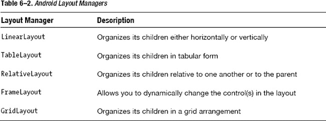

我们将在后续章节中讨论这些布局管理器。名为 `AbsoluteLayout` 的布局管理器已被弃用，本书将不再介绍。

#### LinearLayout 布局管理器

`LinearLayout` 布局管理器是最基础的。该布局管理器根据 `orientation` 属性的值，将其子视图水平或垂直地组织起来。到目前为止，我们已经在多个示例中使用了 `LinearLayout`。列表 6-39 展示了一个水平配置的 `LinearLayout`。

**列表 6-39.** *水平配置的 LinearLayout*

```
<LinearLayout
    android:orientation="horizontal"
    android:layout_width="fill_parent"  android:layout_height="wrap_content">

    <!-- 在此处添加子视图 -->

</LinearLayout>
```

你可以通过将 `orientation` 的值设置为 `vertical` 来创建一个垂直方向的 `LinearLayout`。由于布局管理器可以嵌套，例如，你可以构建一个包含多个水平布局管理器的垂直布局管理器，以创建一个填充表单，其中每一行都有一个标签和一个 `EditText` 控件相邻。每一行都是其自己的水平布局，但所有行作为一个集合则按垂直方向组织。

##### 理解 Weight 和 Gravity

`orientation` 属性是 `LinearLayout` 布局管理器识别的第一个重要属性。其他可能影响子控件大小和位置的重要属性是 weight 和 gravity。

你可以使用 *weight* 来为控件分配相对于容器中其他控件的大小重要性。假设一个容器有三个控件：一个的 weight 为 1，而其他两个的 weight 为 0。在这种情况下，weight 等于 1 的控件将消耗容器中的空白空间。*Gravity* 本质上是对齐。例如，如果你希望将标签的文本向右对齐，你可以将其 gravity 设置为 `right`。`gravity` 的可能值有很多，包括 `left`、`center`、`right`、`top`、`bottom`、`center_vertical`、`clip_horizontal` 等。有关这些值以及其他 gravity 值的详细信息，请参阅“参考资料”部分的网页。

 **注意：** 布局管理器扩展了 `android.widget.ViewGroup`，许多基于控件的容器类（例如 `ListView`）也是如此。尽管布局管理器和基于控件的容器扩展了相同的类，但布局管理器类严格处理控件的大小和位置，而不处理与子控件的用户交互。例如，比较 `LinearLayout` 和 `ListView` 控件。在屏幕上，它们看起来很相似，因为两者都可以垂直组织子视图。但 `ListView` 控件提供了供用户进行选择的 API，而 `LinearLayout` 则没有。换句话说，基于控件的容器（`ListView`）支持用户与容器中的项目进行交互，而布局管理器（`LinearLayout`）仅处理大小和定位。

现在让我们看一个涉及 weight 和 gravity 属性的示例（参见图 6-18）。

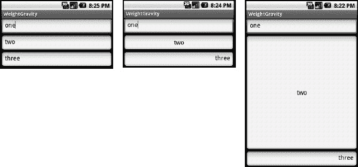

**图 6-18.** *使用 `LinearLayout` 布局管理器*

图 6-18 显示了三个利用 `LinearLayout` 的 UI，它们具有不同的 weight 和 gravity 设置。左侧的 UI 使用了 weight 和 gravity 的默认设置。第一个 UI 的 XML 布局如列表 6-40 所示。

**列表 6-40.** *在 LinearLayout 中垂直排列的三个文本字段，使用默认的 Weight 和 Gravity 值*

```
<LinearLayout
    android:orientation="vertical" android:layout_width="fill_parent"
    android:layout_height="fill_parent">

    <EditText android:layout_width="fill_parent"
        android:layout_height="wrap_content"
        android:text="one"/>
    <EditText android:layout_width="fill_parent"
        android:layout_height="wrap_content"
        android:text="two"/>
    <EditText android:layout_width="fill_parent"
        android:layout_height="wrap_content"
        android:text="three"/>
</LinearLayout>
```

图 6-18 中间的 UI 使用了 weight 的默认值，但将容器中控件的 `android:gravity` 分别设置为 `left`、`center` 和 `right`。最后一个示例将中间组件的 `android:layout_weight` 属性设置为 1.0，并将其他两个组件保留为默认值 0.0（参见列表 6-41）。通过将中间组件的 weight 属性设置为 1.0，而将其他两个组件的 weight 属性保留为 0.0，我们指定了中间组件应占据容器中所有剩余的空白空间，而其他两个组件应保持其理想大小。

类似地，如果你希望容器中三个控件中的两个共享剩余的空白空间，你可以将这两个控件的 weight 设置为 1.0，并将第三个控件的 weight 设置为 0.0。最后，如果你希望三个组件均匀地共享空间，你可以将所有组件的 weight 值都设置为 1.0。这样做将使每个文本字段均匀扩展。


##### **清单 6–41.** *配置了权重的 `LinearLayout`*

```
<LinearLayout
    android:orientation="vertical" android:layout_width="fill_parent"
    android:layout_height="fill_parent">

    <EditText android:layout_width="fill_parent" android:layout_weight="0.0"
    android:layout_height="wrap_content" android:text="one"
    android:gravity="left"/>

    <EditText android:layout_width="fill_parent" android:layout_weight="1.0"
    android:layout_height="wrap_content" android:text="two"
    android:gravity="center"/>

    <EditText android:layout_width="fill_parent" android:layout_weight="0.0"
    android:layout_height="wrap_content" android:text="three"
    android:gravity="right"
    />
</LinearLayout>
```

##### `android:gravity` 与 `android:layout_gravity` 的区别

请注意，Android 定义了两个相似的 gravity 属性：`android:gravity` 和 `android:layout_gravity`。它们的区别如下：`android:gravity` 是视图自身使用的设置，而 `android:layout_gravity` 由容器（`android.view.ViewGroup`）使用。例如，你可以将 `android:gravity` 设置为 `center`，使 `EditText` 中的文本在控件内居中显示。同样地，你可以通过设置 `android:layout_gravity="right"` 将 `EditText` 对齐到 `LinearLayout`（容器）的最右侧。请参见 图 6–19 和 清单 6–42。


**图 6–19.** *应用 gravity 设置*

**清单 6–42.** *理解 `android:gravity` 与 `android:layout_gravity` 的区别*

```
<LinearLayout
    android:orientation="vertical" android:layout_width="fill_parent"
    android:layout_height="fill_parent">

    <EditText android:layout_width="wrap_content" android:gravity="center"
    android:layout_height="wrap_content" android:text="one"
 android:layout_gravity="right"/>
</LinearLayout>
```

如 图 6–19 所示，文本在 `EditText` 中居中显示，而该 `EditText` 则对齐到 `LinearLayout` 的右侧。

#### `TableLayout` 布局管理器

`TableLayout` 布局管理器是 `LinearLayout` 的扩展。该布局管理器将其子控件组织成行和列。清单 6–43 展示了一个示例。

**清单 6–43.** *一个简单的 `TableLayout`*

```
<?xml version="1.0" encoding="utf-8"?>
<TableLayout
    android:layout_width="fill_parent"  android:layout_height="fill_parent">

  <TableRow>
    <TextView android:text="名字："
        android:layout_width="wrap_content"  android:layout_height="wrap_content" />

    <EditText android:text="埃德加"
        android:layout_width="wrap_content"  android:layout_height="wrap_content" />
  </TableRow>

  <TableRow>
    <TextView android:text="姓氏："
        android:layout_width="wrap_content"  android:layout_height="wrap_content" />

    <EditText android:text="爱伦·坡"
        android:layout_width="wrap_content"  android:layout_height="wrap_content" />
  </TableRow>

</TableLayout>
```

要使用此布局管理器，你需要创建一个 `TableLayout` 实例，并在其中放置 `TableRow` 元素。这些 `TableRow` 元素包含表格的控件。清单 6–43 对应的 UI 如 图 6–20 所示。

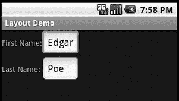

**图 6–20.** *`TableLayout` 布局管理器*

由于 `TableLayout` 的内容是按行而非按列定义的，因此 Android 通过查找拥有最多单元格的行来确定表格的列数。例如，清单 6–44 创建了一个两行的表格，其中一行有两个单元格，另一行有三个单元格（参见 图 6–21）。在这种情况下，Android 会创建一个两行三列的表格。第一行的最后一列是一个空单元格。

**清单 6–44.** *一个不规则表格定义*

```
<TableLayout
    android:layout_width="fill_parent"  android:layout_height="fill_parent">

  <TableRow>
    <TextView android:text="名字："
        android:layout_width="wrap_content"  android:layout_height="wrap_content" />

    <EditText android:text="埃德加"
        android:layout_width="wrap_content"  android:layout_height="wrap_content" />
  </TableRow>

  <TableRow>
    <TextView android:text="姓氏："
        android:layout_width="wrap_content"  android:layout_height="wrap_content" />

    <EditText android:text="艾伦"
        android:layout_width="wrap_content"  android:layout_height="wrap_content" />

    <EditText android:text="坡"
        android:layout_width="wrap_content"  android:layout_height="wrap_content" />
  </TableRow>

</TableLayout>
```

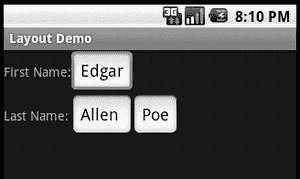

**图 6–21.** *一个不规则的 `TableLayout`*

在 清单 6–43 和 清单 6–44 中，我们使用 `TableRow` 元素填充了 `TableLayout`。虽然这是常规用法，但你也可以将任何 `android.widget.View` 作为表格的子视图放置。例如，清单 6–45 创建了一个表格，其第一行是一个 `EditText`（参见 图 6–22）。

**清单 6–45.** *使用 `EditText` 代替 `TableRow`*

```
<?xml version="1.0" encoding="utf-8"?>
<TableLayout
    android:layout_width="fill_parent"  android:layout_height="fill_parent"
    android:stretchColumns="0,1,2" >

  <EditText android:text="全名："
        android:layout_width="wrap_content"  android:layout_height="wrap_content" />

  <TableRow>
    <TextView android:text="埃德加"
        android:layout_width="wrap_content"  android:layout_height="wrap_content" />

    <TextView android:text="艾伦"
        android:layout_width="wrap_content"  android:layout_height="wrap_content" />

    <TextView android:text="坡"
        android:layout_width="wrap_content"  android:layout_height="wrap_content" />
  </TableRow>

</TableLayout>
```

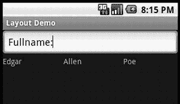


**图 6–22.** 作为 `TableLayout` 子元素的 `EditText`

清单 6–45 的用户界面显示在图 6–22 中。请注意，即使我们在 XML 布局中没有指定，`EditText` 也占据了屏幕的整个宽度。这是因为 `TableLayout` 的子元素总是横跨整行。换句话说，`TableLayout` 的子元素可以指定 `android:layout_width="wrap_content"`（就像我们对 `EditText` 所做的那样），但这不会影响实际布局——它们会被强制采用 `fill_parent`。不过，它们可以设置 `android:layout_height`。

由于表格的内容在设计时并不总是已知，`TableLayout` 提供了几个属性来帮助控制表格的布局。例如，清单 6–45 将 `TableLayout` 上的 `android:stretchColumns` 属性设置为 `"0,1,2"`。这向 `TableLayout` 发出提示：列 0、1 和 2 可以根据表格内容的需要进行拉伸。如果我们在清单 6–45 中没有使用 `stretchColumns`，就会看到 `"EdgarAllenPoe"` 被挤在一起。从技术上讲，第二行占据了整个宽度，但如果没有 `stretchColumns`，三个 `TextView` 就不会分散排列。

类似地，你可以设置 `android:shrinkColumns`，以便在其它列需要更多空间时，将某一列或多列的内容换行。你也可以设置 `android:collapseColumns` 使某些列不可见。请注意，列采用从零开始的索引方案进行标识。

`TableLayout` 还提供了 `android:layout_span`。你可以使用此属性让一个单元格跨越多列。该字段类似于 HTML 的 `colspan` 属性。

有时，你可能还需要在单元格或控件的内容之间提供间距。Android SDK 通过 `android:padding` 及其同类属性支持这一点。`android:padding` 让你可以控制视图外部边界与其内容之间的空间（参见清单 6–46）。

**清单 6–46.** *使用 `android:padding`*

```
<LinearLayout
    android:orientation="vertical" android:layout_width="fill_parent"
    android:layout_height="fill_parent">

    <EditText android:text="one"
    android:layout_width="wrap_content"  android:layout_height="wrap_content"
    android:padding="40px" />
</LinearLayout>
```

清单 6–46 将内边距设置为 `40px`。这在 `EditText` 控件的外部边界与其内部显示的文本之间创建了 40 像素的空白区域。图 6–23 展示了同一个 `EditText` 的两个不同内边距值。左侧的用户界面未设置任何内边距，右侧的用户界面设置了 `android:padding="40px"`。

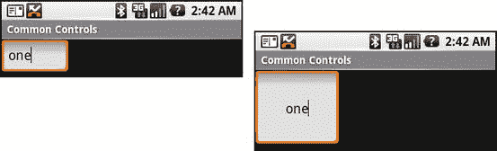

**图 6–23.** *使用内边距*

`android:padding` 为所有边设置内边距：左、右、上、下。你可以通过使用 `android:leftPadding`、`android:rightPadding`、`android:topPadding` 和 `android:bottomPadding` 来控制每一侧的内边距。

Android 还定义了 `android:layout_margin`，它与 `android:padding` 类似。实际上，`android:padding` / `android:layout_margin` 类似于 `android:gravity` / `android:layout_gravity`，但前者针对视图，后者针对容器。

最后，内边距值始终设置为尺寸类型，通常是 `dp`、`px` 或 `sp`。我们在第 3 章中介绍了尺寸类型。

#### RelativeLayout 布局管理器

另一个有趣的布局管理器是 `RelativeLayout`。顾名思义，此布局管理器实现了一种策略，即容器中的控件相对于容器或容器中的另一个控件进行布局。清单 6–47 和图 6–24 展示了一个示例。

**清单 6–47.** *使用 `RelativeLayout` 布局管理器*

```
<RelativeLayout
        android:layout_width="fill_parent"
        android:layout_height="wrap_content">

    <TextView android:id="@+id/userNameLbl"
        android:layout_width="fill_parent"  android:layout_height="wrap_content"
        android:text="Username: "
        android:layout_alignParentTop="true" />

    <EditText android:id="@+id/userNameText"
        android:layout_width="fill_parent"  android:layout_height="wrap_content"
        android:layout_toRightOf="@id/userNameLbl" />

    <TextView android:id="@+id/pwdLbl"
        android:layout_width="wrap_content"  android:layout_height="wrap_content"
        android:layout_below="@id/userNameText"
        android:text="Password: " />

    <EditText android:id="@+id/pwdText"
        android:layout_width="fill_parent"  android:layout_height="wrap_content"
        android:layout_toRightOf="@id/pwdLbl"
        android:layout_below="@id/userNameText" />

    <TextView android:id="@+id/pwdCriteria"
        android:layout_width="fill_parent"  android:layout_height="wrap_content"
        android:layout_below="@id/pwdText"
        android:text="Password Criteria... " />

    <TextView android:id="@+id/disclaimerLbl"
        android:layout_width="fill_parent"  android:layout_height="wrap_content"
        android:layout_alignParentBottom="true"
        android:text="Use at your own risk... " />

</RelativeLayout>
```

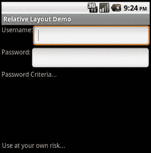

**图 6–24.** *使用 `RelativeLayout` 布局管理器布局的用户界面*

如图所示，该用户界面看起来像一个简单的登录表单。用户名标签固定在容器顶部，因为我们设置了 `android:layout_alignParentTop` 为 `true`。类似地，用户名输入框位于用户名标签下方，因为我们设置了 `android:layout_below`。密码标签出现在用户名标签下方，密码输入框出现在密码标签下方。免责声明标签固定在容器底部，因为我们设置了 `android:layout_alignParentBottom` 为 `true`。

除了这三个布局属性之外，你还可以指定 `layout_above`、`layout_toRightOf`、`layout_toLeftOf`、`layout_centerInParent` 等更多属性。由于 `RelativeLayout` 的简洁性，使用它非常有趣。事实上，一旦你开始使用它，它就会成为你最喜欢的布局管理器——你会发现自己反复使用它。

##### ADT 对设计 RelativeLayouts 的支持

随着用于 Eclipse 的 Android 开发工具（ADT）的发展，越来越多的功能变得可用。早期，布局的视觉编辑器并不太好。但最近它好多了。特别是，该工具使用 `RelativeLayout` 以可视方式布局用户界面的能力有了很大改善。如果你使用 `RelativeLayout`，绝对应该检查一下 Eclipse 中的这个工具。


#### `FrameLayout` 布局管理器

我们迄今为止讨论过的布局管理器实现了多种布局策略。换句话说，每种布局管理器都有其特定的方式来在屏幕上定位和定向其子视图。使用这些布局管理器，你可以在同一屏幕上放置多个控件，每个控件占据屏幕的一部分。Android 还提供了一种主要用于显示单个项目的布局管理器：`FrameLayout`。你主要使用这个实用布局类来动态显示单个视图，但你可以用它填充多个项目，设置其中一个可见，而其他项目不可见。代码清单 6–48 演示了如何使用 `FrameLayout`。

**代码清单 6–48.** *填充 `FrameLayout`*

```
<?xml version="1.0" encoding="utf-8"?>
<FrameLayout
    android:id="@+id/frmLayout"
    android:layout_width="fill_parent"  android:layout_height="fill_parent">

     <ImageView
        android:id="@+id/oneImgView" android:src="@drawable/one"
        android:scaleType="fitCenter"
        android:layout_width="fill_parent"  android:layout_height="fill_parent"/>
    <ImageView
        android:id="@+id/twoImgView" android:src="@drawable/two"
        android:scaleType="fitCenter"
        android:layout_width="fill_parent"  android:layout_height="fill_parent"
        android:visibility="gone" />

</FrameLayout>

public class FrameLayoutActivity extends Activity{
    private ImageView one = null;
    private ImageView two = null;
    @Override
    protected void onCreate(Bundle savedInstanceState) {
        super.onCreate(savedInstanceState);
        setContentView(R.layout.listing6_48);

        one = (ImageView)findViewById(R.id.oneImgView);
        two = (ImageView)findViewById(R.id.twoImgView);

        one.setOnClickListener(new OnClickListener(){

            public void onClick(View view) {
                two.setVisibility(View.VISIBLE);

                view.setVisibility(View.GONE);
            }});

        two.setOnClickListener(new OnClickListener(){

            public void onClick(View view) {
                one.setVisibility(View.VISIBLE);

                view.setVisibility(View.GONE);
            }});
    }
}
```

代码清单 6–48 展示了布局文件以及 Activity 的 `onCreate()` 方法。该演示的思路是在 `FrameLayout` 中加载两个 `ImageView` 对象，但同一时间只让其中一个 `ImageView` 对象可见。在用户界面中，当用户点击可见的图像时，我们隐藏一个图像并显示另一个图像。

现在更仔细地看一下代码清单 6–48，从布局开始。可以看到我们定义了一个包含两个 `ImageView` 对象（`ImageView` 是一个知道如何显示图像的控件）的 `FrameLayout`。请注意，第二个 `ImageView` 的可见性被设置为 `gone`，从而使该控件不可见。现在，看一下 `onCreate()` 方法。在 `onCreate()` 方法中，我们为 `ImageView` 对象注册了点击事件的监听器。在点击处理程序中，我们隐藏一个 `ImageView` 并显示另一个。

正如我们之前所说，当你需要动态地将视图的内容设置为单个控件时，通常会使用 `FrameLayout`。尽管这是常规做法，但该控件可以接受多个子视图，正如我们所演示的那样。代码清单 6–48 向布局中添加了两个控件，但一次只让其中一个控件可见。然而，`FrameLayout` 并不强制你一次只能有一个控件可见。如果你向布局中添加了多个控件，`FrameLayout` 会简单地将这些控件堆叠起来，一个叠在另一个上面，最后一个控件位于最上层。这可以创建出有趣的用户界面。例如，图 6–25 展示了一个包含两个可见 `ImageView` 对象的 `FrameLayout` 控件。你可以看到控件是堆叠的，并且顶部的控件部分覆盖了它后面的图像。


**图 6–25.** *包含两个 `ImageView` 对象的 `FrameLayout`*

`FrameLayout` 的另一个有趣方面是，如果你向布局中添加了多个控件，布局的大小将根据容器中最大的项目来计算。在图 6–25 中，顶部的图像实际上比它后面的图像小得多，但由于布局的大小是根据最大的控件计算的，因此顶部的图像被拉伸了。

另外请注意，如果将一个或多个控件初始时设置为不可见并放入 `FrameLayout` 中，你可能需要考虑在你的 `FrameLayout` 上使用 `setMeasureAllChildren(true)`。因为最大的子视图决定了布局的大小，如果最大的子视图一开始是不可见的，你就会遇到问题：当它变得可见时，它只能部分可见。为了确保所有项目都能正确渲染，请调用 `setMeasureAllChildren()` 并向其传递 `true` 值。`FrameLayout` 对应的 XML 属性是 `android:measureAllChildren="true"`。

#### `GridLayout` 布局管理器

Android 4.0 引入了一种名为 `GridLayout` 的新布局管理器。正如你可能期望的那样，它以行和列的网格模式来布局视图，有点像 `TableLayout`。然而，它比 `TableLayout` 更容易使用。使用 `GridLayout`，你可以为视图指定行和列的值，它就会出现在网格中的该位置。这意味着你不需要为每个单元格都指定一个视图，只需要为那些你想要放置视图的单元格指定即可。视图可以跨越多个网格单元格。你甚至可以将多个视图放入同一个网格单元格中。

在布局视图时，你不能使用 weight 属性，因为它不适用于 `GridLayout` 的子视图。你可以改用 `layout_gravity` 属性。可以用于 `GridLayout` 子视图的其他有趣属性包括 `layout_column` 和 `layout_columnSpan`，分别用于指定最左侧的列以及视图占用的列数。类似地，还有 `layout_row` 和 `layout_rowSpan` 属性。有趣的是，你不需要为 `GridLayout` 的子视图指定 `layout_height` 和 `layout_width`；它们默认为 `WRAP_CONTENT`。


### 针对不同设备配置自定义布局

到目前为止，你已经非常清楚 Android 提供了大量布局管理器来帮助你构建用户界面。如果你尝试过我们讨论过的布局管理器，就会知道可以通过多种方式组合这些布局管理器，以获得你想要的外观和体验。但即使有这么多布局管理器，构建用户界面并将其调整到位仍是一项挑战。对于移动设备尤其如此。移动设备的用户和制造商变得越来越复杂，这使开发者的工作更具挑战性。

其中一项挑战是为在不同屏幕配置下显示的应用构建 UI。例如，如果你的应用在竖屏模式与横屏模式下显示，你的 UI 会是什么样子？如果你还未遇到过这种情况，现在你的大脑可能已经在飞速运转，思考如何处理这种常见场景。有趣且幸运的是，Android 为这种用例提供了一些支持。

其工作原理如下：在构建布局时，Android 会根据设备的配置从特定文件夹中查找并加载布局。设备可以处于三种配置之一：竖屏、横屏或方形（方形很少见）。为了为不同配置提供不同的布局，你需要为每种配置创建特定的文件夹，Android 将从中加载合适的布局。如你所知，默认布局文件夹位于 `res/layout`。为了支持竖屏显示，创建一个名为 `res/layout-port` 的文件夹。对于横屏，创建一个名为 `res/layout-land` 的文件夹。对于方形，创建一个名为 `res/layout-square` 的文件夹。

这时有个好问题：“有了这三个文件夹，我还需要默认布局文件夹（`res/layout`）吗？” 一般来说，是的。Android 的资源解析逻辑会首先查找配置特定的目录。如果 Android 在那里没有找到资源，它会转到默认布局目录。因此，你应该将默认布局定义放在 `res/layout` 中，而将自定义版本放在特定配置的文件夹中。

另一个技巧是在布局文件中使用 `<include />` 标签。这允许你创建公共的布局代码块（例如，在默认布局目录中），并将它们包含在 `layout-port` 和 `layout-land` 中定义的布局里。一个 `include` 标签可能看起来像这样：

`<include layout="@layout/common_chunk1" />`

如果 `include` 的概念让你感兴趣，你还应该查看 Android API 中的 `<merge />` 标签和 `ViewStub` 类。这些类让你在组织布局时拥有更大的灵活性，并且无需重复视图。

请注意，Android SDK 没有提供任何 API 让你以编程方式指定加载哪种配置——系统只是根据设备配置自动选择文件夹。不过，你可以在代码中设置设备的方向，例如，使用以下代码：

```
import android.content.pm.ActivityInfo;
...
setRequestedOrientation(ActivityInfo.SCREEN_ORIENTATION_LANDSCAPE);
```

这将强制你的应用在设备上以横屏模式显示。继续在你之前的某个项目中尝试一下。将这段代码添加到某个 Activity 的 `onCreate()` 方法中，在模拟器中运行它，然后侧着脑袋查看你的应用。

布局并非唯一受配置驱动的资源，在查找要使用的资源时，还会考虑设备配置的其他限定符。`res` 文件夹的全部内容都可以为每种配置提供变体。例如，要为每种配置加载不同的可绘制对象，除了默认的 `drawable` 文件夹外，还要创建 `drawable-port`、`drawable-land` 和 `drawable-square` 文件夹。请记住，在你的代码中，你仍然只使用 `R.resource_type.name` 来引用资源，而不带任何限定符。例如，如果你在几个不同的限定资源目录中有许多 `main.xml` 布局文件的不同变体，你的代码仍将引用 `R.layout.main`。Android 会负责为你找到合适的 `main.xml`。

关于更多资源基础，你可以参考第 3 章。我们将在第 12 章中更详细地介绍配置变更这一概念。至此，我们关于构建 UI 的讨论就结束了。

### 总结

让我们快速列举一下你在本章学到的关于构建用户界面的内容，以此作为本章的结尾：

* XML 资源如何定义 UI 外观，以及代码如何填充数据
* 三种主要的布局类型及其使用时机
* Android 支持的视图以及如何通过 XML 和代码定义它们
* 主要的列表控件以及如何使用适配器填充数据
* 可用于从一组公共资源管理应用外观和体验的样式和主题

### 面试问题

你可以使用以下问题作为指南，测试你对本章内容的理解。

**1.**  `TextView` 能否接收用户的键入输入？

**2.**  何时应该在 `EditText` 字段中使用 `Spannable`？

**3.**  如何在按下和释放操作期间自定义 `ImageButton` 的外观？

**4.**  适配器是否总是需要从内容提供者获取数据？

**5.**  `ListView` 能否包含多个视图？

**6.**  `ListView` 是否必须始终包含至少一个 `TextView`？

**7.**  什么定义了 `ListView` 项的布局，你可以在哪里找到它？

**8.**  `Spinner` 与其他列表控件有何不同？

**9.**  为了以行列格式显示数据库表中的姓名列表，使用 `TableLayout` 还是 `GridView` 更好？

**10.** 何时在用户界面中使用 `AbsoluteLayout`？

**11.** `android:layout_weight` 有什么作用？

**12.** `android:gravity` 和 `android:layout_gravity` 有什么区别？

**13.** 是否可能强制 Activity 以特定方向显示？

**14.** 在哪个布局管理器中使用 `android:layout_toRightOf`？

**15.** 在什么情况下，列表适配器中的 ID 与位置的数值相同？

在下一章中，我们将进一步深入用户界面开发——我们将讨论菜单。

