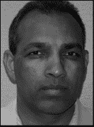

## 关于作者

 **萨提亚·科马蒂内尼**（`satyakomatineni.com`）拥有超过 20 年的编程经验，曾就职于多家大小型企业。他已发表 30 多篇关于使用`Java`、`.NET`和数据库技术进行网络开发的文章。他经常在行业会议上就创新技术发表演讲，并定期为`Java.net`的博客供稿。他是`AspireWeb`（`satyakomatineni.com/aspire`）的作者，这是一款面向`Java`网络开发的简化全能型开源工具；同时他也是`Aspire Knowledge Central`（`www.knowledgefolders.com`）的创建者，这是一个以个人效率与发布为核心的开源个人网络操作系统。萨提亚还是多项小企业创新研究（SBIR）计划的贡献成员。他获得了安得拉大学（维沙卡帕特南）的电气工程学士学位，以及印度理工学院（新德里）的电气工程硕士学位。

 **戴夫·麦克莱恩**是一名软件工程师和架构师，目前居住和工作在佛罗里达州奥兰多。自 1980 年以来，他使用多种语言进行编程，开发的解决方案涵盖机器人自动化系统、数据仓库、网络自助服务应用以及 EDI 事务处理器。戴夫曾任职于佛罗里达蓝十字蓝盾公司、太阳微系统公司、IBM、天宝导航公司、通用汽车公司以及几家小公司。他毕业于加拿大滑铁卢大学，获得系统工程设计学位。访问他的博客：`http://davemac327.blogspot.com`，或通过`davemac327@gmail.com`联系他。
