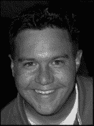

## 关于技术审校

**埃里克·弗朗肖姆**在 13 岁时拥有了他的第一台电脑——Thomson TO7，并被通过编写代码就能在显示器上移动物体的能力深深吸引。从法国一所信息技术领域的工程师学院毕业后，他前往硅谷中心进行了为期 16 个月的实习。从那时起，他从未停止学习和编码，从 DSP 上的汇编编程起步，逐步深入系统（Symbian、BREW、Android）和不同层级，在法语、英语、西班牙语、德语和葡萄牙语之外，将`C`、`C++`、`Java`、`JavaScript`和`PHP`加入了技能栈。现在他任职于 PacketVideo，构建了 BREW 上 Verizon V CAST 视频点播产品的第一个版本，以及 PacketVideo 的首款 Android 应用，用于将手机上的视频和音乐投射到电视上（Twonky）。在不使用不同语言交流时，埃里克会练习太鼓（日本鼓艺）、周游世界，并品尝配着杏仁饼干的浓缩咖啡。可以通过`eric_franchomme@yahoo.com`联系他。

**迈克尔·阮**是来自硅谷的一名软件开发人员。他拥有超过 10 年的软件开发经验，从小型办公应用到企业级应用，使用多种不同的语言和工具。最近，他参与了为医疗保健专业人员开发的 iOS、Android 及其他平台移动应用项目。他目前与妻子朱莉和两个可爱的小女儿居住在圣何塞。他把大量空闲时间都用于陪伴家人。他还参与了一些移动领域的小型项目开发，其中之一是名为`Wagic`的流行集换式卡牌游戏变体。

 **迪伦·菲利普斯**是一名软件工程师和架构师，在过去 10 年里一直从事移动领域的工作。他拥有从`J2ME`到`.NET Compact Framework`再到`Android`的广泛经验，对广大消费者广泛采用各种 Android 设备所带来的机遇感到无比兴奋。可以通过`mykoan@hotmail.com`、Twitter 上的`@mykoan`联系他，或者在全国各地的越南河粉店吃午饭时找到他。

**卡里姆·瓦雷拉**是 Wilshire Media Group 的一名国际平台工程师，拥有超过八年的移动应用开发经验。卡里姆目前是 Android Muve Music 项目的工程师。此前，他是 AT&T 移动技术开发者支持团队的 Android 支持负责人，专注于`Android`、`Java ME`和`U-verse Enabled`技术。在移动时代初期，卡里姆在移动游戏行业担任过多种职务，涵盖质量保证、构建工程、移植工程及网络工程。他还是 Java Verified 和统一测试倡议（Unified Testing Initiative）的董事会成员，这些行业统一组织致力于提升移动应用的质量和可用性；同时他也是 App 开发者大会顾问委员会的成员。他拥有加州大学的计算机科学学士学位，目前正在佛罗里达大学攻读 MBA 学位。
