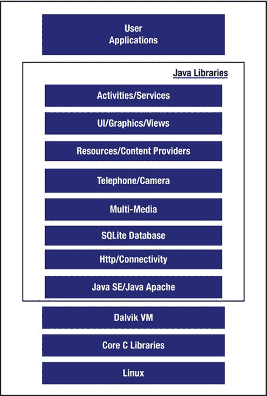
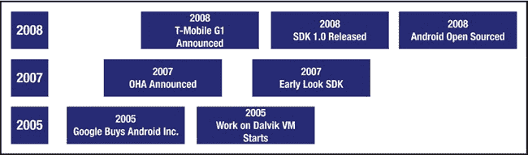
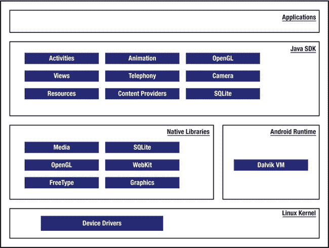

## 第 1 章

# Android 计算平台简介

如今，计算资源比以往任何时候都更容易获取。手持设备已转变为计算平台。无论是手机还是平板电脑，移动设备如今在通用计算方面的能力之强，使其正成为`真正`的个人电脑（PC）。所有传统 PC 制造商都在基于 Android 操作系统生产各种形态的设备。操作系统、计算平台、编程语言和开发框架之间的竞争正在转移并重新应用于移动设备。

我们还看到移动编程的激增，越来越多的 IT 应用开始提供对应的移动版本。在本书中，我们将向您展示如何利用您的 Java 技能，为运行在谷歌 Android 平台（[`http://developer.android.com/index.html`](http://developer.android.com/index)）上的设备编写程序，这是一个面向移动和平板开发的开放源码平台。

**注意：** 我们对 Android 感到兴奋，因为它是一个基于 Java 的先进平台，在框架设计中引入了许多新的范式（即使是在移动平台的限制下）。

在本章中，我们将概述 Android 及其 `SDK`，简要介绍关键软件包，介绍每章将要涵盖的内容，向您展示如何利用 Android 源码，并强调为 Android 平台编程的优势。

## 新型个人电脑的新平台

Android 平台秉持手持设备通用计算的思想。它是一个全面的平台，其特点在于基于 Linux 的操作系统堆栈，用于管理设备、内存和进程。Android 的 Java 库涵盖了电话、视频、语音、图形、连接、用户界面编程以及设备的其他许多方面。

**注意：** 尽管是为移动和平板设备构建的，但 Android 平台展现出全功能桌面框架的特性。谷歌通过一个名为 `Android SDK` 的软件开发工具包（SDK）将这些框架开放给 Java 程序员。当您使用 `Android SDK` 时，您很少会觉得自己是在为移动设备编程，因为您可以访问在台式机或服务器上使用的大多数类库——包括一个关系型数据库。

`Android SDK` 支持大部分 `Java` 平台标准版（`Java SE`），但抽象窗口工具包（`AWT`）和 `Swing` 除外。取代 `AWT` 和 `Swing` 的，是 `Android SDK` 自己`广泛而现代化的 UI 框架`。由于您是用 `Java` 编写应用程序，您可能会认为需要一个负责解释运行时 `Java` 字节码的 `Java` 虚拟机（`JVM`）。`JVM` 通常提供必要的优化，帮助 `Java` 达到与 `C` 和 `C++`等编译型语言相媲美的性能水平。Android 提供了自己的优化型 `JVM` 来运行编译后的 `Java` 类文件，以应对手持设备在内存、处理器速度和功耗等方面的限制。这个虚拟机被称为 `Dalvik VM`，我们将在后面的章节“深入探讨 `Dalvik VM`”中探讨。

**注意：** `Java` 编程语言的熟悉性和简洁性，加上 Android 庞大的类库，使得 Android 成为一个极具吸引力的编程平台。

图 1-1 提供了 Android 软件堆栈的概览。（我们将在“理解 Android 软件堆栈”一节中提供更多细节。）



***图 1-1.** Android 软件堆栈的高层视图*

## Android 的早期历史

手机使用多种操作系统，例如塞班 OS、微软 Windows Phone OS、移动 Linux、iPhone OS（基于 Mac OS X）、Moblin（英特尔出品）以及许多其他专有操作系统。到目前为止，还没有哪个操作系统成为事实上的标准。用于开发移动应用的可用 API 和环境限制太多，与桌面框架相比似乎远远落后。相比之下，Android 平台承诺了开放性、低廉成本、开源代码，更重要的是，一个高端、一体化、一致的开发框架。

谷歌于 2005 年收购了初创公司 `Android Inc.`，开始了 Android 平台的开发（参见图 1-2）。`Android Inc.`的关键人物包括安迪·鲁宾、里奇·迈纳、尼克·西尔斯和克里斯·怀特。



***图 1-2.** Android 早期时间线*

`Android SDK` 于 2007 年 11 月首次作为“早期预览”版本发布。2008 年 9 月，`T-Mobile` 宣布推出 `T-Mobile G1`，这是第一款基于 Android 平台的智能手机。自那以后，我们看到了 `SDK 2.0`、`3.0`，现在又有了 `4.0`，大约每年发布一个版本。运行 Android 的设备起初只是涓涓细流，但现在已是汹涌潮流。

Android 的关键架构目标之一是允许应用程序之间相互交互并复用彼此的组件。这种复用不仅适用于服务，也适用于数据和用户界面（UI）。

Android 凭借其完善的功能，能够利用网络资源提供的云计算模型，并通过手机上本地数据存储来增强这种体验，因而很早就吸引了追随者并保持了开发者的势头。Android 在手机上对关系型数据库的支持也在其早期采用中发挥了作用。

在 `1.0` 和 `1.1` 版本（2008 年）中，Android 不支持软键盘，要求设备配备物理按键。Android 于 2009 年 4 月发布了 `1.5 SDK`，解决了这个问题，同时还带来了许多其他功能，例如高级媒体录制能力、小部件和动态文件夹。

2009 年 9 月，Android 操作系统 `1.6` 版本发布，一个月内又推出了 Android `2.0`，这促使大量 Android 设备在 2009 年圣诞季涌入市场。该版本引入了高级搜索功能和文本转语音功能。

在 Android `2.3` 中，重要的功能包括管理员远程擦除安全数据、在弱光条件下使用摄像头和视频、Wi-Fi 热点、显著的性能改进、改进的蓝牙功能、可选地将应用安装到 SD 卡、支持 `OpenGL ES 2.0`、备份改进、搜索可用性改进、用于信用卡处理的近场通信支持、大幅改进的动作和传感器支持（类似 Wii）、视频聊天以及改进的 Market。

Android `3.0` 专注于平板设备以及更强大的双核处理器，如 `NVIDIA Tegra 2`。此版本的主要功能包括支持使用更大的屏幕。引入了一个名为“碎片”（Fragments）的重要新概念。碎片贯穿于 `3.0` 的使用体验之中。引入了更多类似桌面的功能，如操作栏和拖放。主屏幕小部件得到了显著增强，并且提供了更多 UI 控件。在 3D 领域，`OpenGL` 通过 `Renderscript` 得到了增强，进一步补充了 `ES 2.0`。这为平板电脑带来了令人兴奋的引入。

然而，`3.0` 的体验仅限于平板电脑。在 `3.0` 发布时，Android 的 `2.x` 分支继续服务于手机，而 `3.x` 分支服务于平板电脑。从 `4.0` 开始，Android 合并了这些分支，形成了一个统一的 `SDK`。对于手机用户来说，主要的 UI 差异在于，平板的体验也被带到了手机上。

`4.0` 用户体验的关键方面如下：

## Android 4.0 新特性

*   一种名为`Roboto`的新字体，可在高密度屏幕上提供清晰度。
*   一种在主页上将应用组织到文件夹中的更好方法。
*   能够将应用和文件夹拖入始终位于设备底部的收藏夹栏。
*   基于设备类型的通知优化。对于小型设备，它们显示在顶部；对于大型设备，它们显示在底部系统栏中。
*   可调整大小、可滚动的窗口小部件。
*   多种解锁屏幕的方式。
*   拼写检查器。
*   改进的语音输入，带有“连续说话”选项。
*   更多用于管理网络数据使用量的控件。
*   增强的联系人应用程序，带有类似于社交网络的个人资料。
*   对日历应用程序的增强。
*   更好的相机应用：连续对焦、零快门延迟、人脸检测、点击对焦以及照片编辑器。
*   图片和视频的实时特效，用于实现有趣的效果。
*   一种快速截取和分享屏幕截图的方法。
*   快两倍的浏览器性能。
*   改进的电子邮件。
*   一个用于基于 NFC 共享的新概念，称为 Android Beam。
*   支持`Wi-Fi Direct`以促进 P2P 服务。
*   蓝牙健康设备配置文件。

## 开发者对 4.0 支持的关键方面

*   基于对象（包括视图）属性变化的革新动画
*   修正了 3.0 版本中基于列表的窗口小部件行为的固定数量问题
*   更加成熟的操作栏，集成了搜索功能
*   支持多种移动标准：高级音频分发配置文件（`A2DP`：使用外部扬声器的能力）、实时传输协议（`RTP`：通过 IP 流式传输音频/视频）、媒体传输协议（`MTP`）、图片传输协议（`PTP`：用于连接计算机下载照片和媒体）以及蓝牙耳机配置文件（`HSP`）
*   全设备加密
*   数字版权管理（`DRM`）
*   加密存储和密码
*   涉及个人资料的社交 API
*   增强的日历 API
*   语音邮件 API

## 深入探究 Dalvik 虚拟机

作为 Android 的一部分，谷歌投入了大量时间来思考如何针对低功耗手持设备优化设计。手持设备在内存和速度方面落后其桌面同类产品八到十年。它们的计算能力也有限。因此，对手机端的性能要求非常严格，要求手机设计者优化一切。如果你查看 Android 中的软件包列表，你会发现它们功能齐全且广泛。

这些问题促使谷歌在许多方面重新审视标准的 JVM 实现。谷歌实现此 JVM 的关键人物是 Dan Bornstein，他编写了 Dalvik 虚拟机——Dalvik 是冰岛一个城镇的名称。Dalvik 虚拟机获取生成的 Java 类文件，并将它们合并到一个或多个 Dalvik 可执行（`.dex`）文件中。Dalvik 虚拟机的目标是尽一切可能优化 JVM，以节省空间、提高性能和延长电池寿命。

由于 Dalvik 虚拟机，Android 中的最终可执行代码不是基于 Java 字节码，而是基于`.dex`文件。这意味着你不能直接执行 Java 字节码；你必须从 Java 类文件开始，然后将它们转换为可链接的`.dex`文件。

## 理解 Android 软件栈

到目前为止，我们已经介绍了 Android 的历史及其优化特性，包括 Dalvik 虚拟机，并且我们已经暗示了可用的 Java 编程栈。在本节中，我们将介绍 Android 的开发方面。图 1–3 从开发者的角度展示了 Android 软件栈。



***图 1–3.** 详细的 Android SDK 软件栈*

Android 平台的核心是 Linux 内核，负责设备驱动程序、资源访问、电源管理和其它操作系统职责。提供的设备驱动程序包括：显示、相机、键盘、Wi-Fi、闪存、音频和进程间通信（`IPC`）。尽管核心是 Linux，但在诸如摩托罗拉 Droid 这样的 Android 设备上，绝大多数（如果不是全部）应用程序都是用 Java 开发的，并通过 Dalvik 虚拟机运行。

位于内核之上的下一层是许多 C/C++库，例如`OpenGL`、`WebKit`、`FreeType`、安全套接字层（`SSL`）、C 运行时库（`libc`）、`SQLite`和媒体库。基于伯克利软件发行版（`BSD`）的系统 C 库已针对基于嵌入式 Linux 的设备进行了调整（大小大约减半）。媒体库基于 PacketVideo（[`www.packetvideo.com`](http://www.packetvideo.com/)）的`OpenCORE`。这些库负责音频和视频格式的录制与回放。一个名为`Surface Manager`的库控制对显示系统的访问，并支持 2D 和 3D。

**注意：** 这些核心库可能会发生变化，因为它们都是 Android 的内部实现细节，并未直接暴露给发布的 Android API。我们指出这些核心库只是为了让你了解 Android 底层架构的本质。有关更新和未来的见解，请参考 Android 开发者网站。

`WebKit`库负责浏览器支持；它与支持谷歌 Chrome 和苹果 Safari 的是同一个库。`FreeType`库负责字体支持。`SQLite`（[`www.sqlite.org/`](http://www.sqlite.org/)）是一个设备本身可用的关系数据库。`SQLite`也是一个独立的关系数据库开源项目，与 Android 没有直接关联。你也可以获取并使用为`SQLite`设计的工具来处理 Android 数据库。

大多数应用程序框架通过 Dalvik 虚拟机访问这些核心库，Dalvik 虚拟机是通往 Android 平台的门户。正如我们在前几节中指出的，Dalvik 经过优化，可以运行多个虚拟机实例。当 Java 应用程序访问这些核心库时，每个应用程序都会获得自己的虚拟机实例。

Android Java API 的主要库包括：电话、资源、位置、UI、内容提供者（数据）和包管理器（安装、安全等）。程序员在此 Java API 之上开发最终用户应用程序。设备上的一些最终用户应用程序示例包括：主页、联系人、电话和浏览器。

Android 还支持一个名为`Skia`的自定义谷歌 2D 图形库，它用 C 和 C++编写。`Skia`也构成了谷歌 Chrome 浏览器的核心。然而，Android 中的 3D API 基于来自 Khronos Group（[`www.khronos.org`](http://www.khronos.org)）的`OpenGL ES`实现。`OpenGL ES`包含针对嵌入式系统优化的`OpenGL`子集。

从媒体角度来看，Android 平台支持最常见的音频、视频和图片格式。从无线角度来看，Android 拥有支持蓝牙、EDGE、3G、Wi-Fi 和全球移动通信系统（`GSM`）电话功能的 API，具体取决于硬件。

## 使用 Android SDK 开发最终用户应用程序

在本节中，我们将向你介绍你将在 Android 上开发最终用户应用程序时使用的高级 Android Java API。我们将简要讨论 Android 模拟器、Android 基础组件、UI 编程、服务、媒体、电话功能、动画等。

### Android 模拟器

Android SDK 附带一个名为 Android Development Tools (ADT) 的 Eclipse 插件。您将使用此集成开发环境（IDE）来开发、调试和测试您的 Java 应用程序。（我们将在第 2 章中深入介绍 ADT。）您也可以不使用 ADT，而是改用命令行工具来使用 Android SDK。这两种方法都支持一个模拟器，您可以使用它来运行、调试和测试您的应用程序。您甚至不需要真实设备就能完成 90% 的应用程序开发。功能齐全的 Android 模拟器模仿了大多数设备功能。模拟器的局限性包括 USB 连接、摄像头和视频捕获、耳机、电池模拟、蓝牙、Wi-Fi、NFC 以及 OpenGL ES 2.0。

Android 模拟器通过一种名为 QEMU 的开源“处理器模拟器”技术来完成其工作，该技术由 Fabrice Bellard 开发（[`http://wiki.qemu.org/Index.html`](http://wiki.qemu.org/Index.html)）。这种技术允许在一个操作系统之上模拟另一个操作系统，而与处理器无关。QEMU 允许在 CPU 级别进行模拟。

在 Android 模拟器中，处理器基于 Advanced RISC Machine (ARM)。ARM 是一种基于精简指令集计算 (RISC) 的 32 位微处理器架构，通过减少指令集中的指令数量来实现设计简单性和速度。模拟器在此模拟处理器上运行 Android 版本的 Linux。

ARM 广泛用于手持设备和其他对低功耗非常重要的嵌入式电子产品。大部分移动市场都使用基于此架构的处理器。

您可以在 Android SDK 文档中找到关于模拟器的更多详细信息，网址为 [`http://developer.android.com/guide/developing/tools/emulator.html`](http://developer.android.com/guide/developing/tools/emulator.html)。

#### Android UI

Android 使用一个类似于其他基于桌面的、功能齐全的 UI 框架。事实上，它在本质上更现代且更具异步性。如果您将传统的基于 C 的 Microsoft Windows API 视为第一代，将基于 C++ 的 Microsoft Foundation Classes (MFC) 视为第二代，那么 Android UI 本质上是一个第四代 UI 框架。基于 Java 的 Swing UI 框架将是第三代，它引入了远超 MFC 的设计灵活性。Android UI、JavaFX、Microsoft Silverlight 和 Mozilla XML User Interface Language (XUL) 都属于这种新型的第四代 UI 框架，其 UI 是声明式的且独立于主题。

**注意：** 在 Android 中，即使用于编程的设备可能是手持设备，您也使用现代用户界面范例进行编程。

Android UI 编程涉及在 XML 文件中声明界面。然后，您将这些 XML 视图定义作为窗口加载到 UI 应用程序中。这与基于 HTML 的网页非常相似。与 HTML 中一样，您通过其 ID 查找（获取）各个控件，并使用 Java 代码对其进行操作。

即使是 Android 应用程序中的菜单也是从 XML 文件中加载的。Android 中的屏幕或窗口通常被称为 `activity`，它包含用户完成逻辑操作单元所需的多个视图。`视图` 是 Android 的基本 UI 构建块，您可以进一步将它们组合成称为 `视图组` 的复合视图。

视图在内部使用了熟悉的画布、绘制和用户交互概念。托管这些包含视图和视图组的复合视图的 Activity 是 Android 中可替换的逻辑 UI 组件。

Android 3.0 引入了一个名为 `片段` 的新 UI 概念，允许开发者将视图和功能分块以在平板电脑上显示。平板电脑提供了足够的屏幕空间用于多窗格 Activity，而片段则为这些窗格提供了抽象。

Android 框架的关键概念之一是 Activity 窗口的生命周期管理。建立了协议，以便 Android 可以在用户隐藏、恢复、停止和关闭 Activity 窗口时管理状态。您将在第 2 章中了解这些基本概念，同时还会介绍如何设置 Android 开发环境。

#### Android 基础组件

Android UI 框架以及 Android 的许多其他部分，都依赖于一个名为 `intent` 的新概念。Intent 是一种用于在 Android 中调用组件的进程内和进程间机制。

Android 中的组件是一段具有明确定义生命周期的代码。表示 Android 应用程序中窗口的 Activity 是一个组件。在 Android 进程中运行并为其他客户端提供服务的是一个组件。响应事件而唤醒的接收器是 Android 中组件的另一个例子。

在满足调用组件这一主要需求的同时，Intent 表现出的特性与窗口消息、动作、发布-订阅模型和进程间通信的特性相似。以下是使用`Intent`类调用或启动 Web 浏览器的示例：

```java
public static void invokeWebBrowser(Activity activity)
{
    Intent intent = new Intent(Intent.ACTION_VIEW);
    intent.setData(Uri.parse("http://www.google.com"));
    activity.startActivity(intent);
}
```

在此示例中，通过 Intent，我们请求 Android 启动一个合适的窗口来显示网站内容。根据设备上安装的浏览器列表，Android 将选择一个合适的浏览器来显示该网站。您将在第 5 章中了解更多关于 Intent 的内容。

Android 对 `资源` 提供了广泛支持，这些资源包括字符串和位图等内容，以及一些不太熟悉的项目，如基于 XML 的视图（类似于 HTML 的布局）定义。Android 框架以一种新颖的方式使用资源，使其使用变得简单、直观和方便。以下是一个示例，其中资源 ID 是为 XML 文件中定义的资源自动生成的：

```java
public final class R {
    //所有字符串资源的常量将在此处自动生成
    public static final class string {
        public static final int hello=0x7f070000;
    }
    //所有图像文件将在此处生成唯一 ID
    public static final class drawable {
        public static final int myanimation=0x7f020001;
        public static final int numbers19=0x7f02000e;
    }
    //视图 ID 根据其名称自动生成
    public static final class id {
        public static final int textViewId1=0x7f080003;
    }
    //以下两个文件（类似 html）定义布局
    //根据各自子目录中的文件名自动生成。
    public static final class layout {
        public static final int frame_animations_layout=0x7f030001;
        public static final int main=0x7f030002;
    }
}
```

此类中的每个自动生成的 ID 对应于 XML 文件中的一个元素或整个文件本身。在您想要使用这些 XML 定义的任何地方，您都将使用这些生成的 ID。当涉及到根据区域设置、设备大小等特化资源时，这种间接引用非常有帮助。（第 3 章更详细地介绍了`R.java`文件和资源。）

Android 中的另一个新概念是 `内容提供者`。内容提供者是对数据源的抽象，使其看起来像是 RESTful 服务的提供者和消费者。底层的 SQLite 数据库使内容提供者这一功能成为应用程序开发者的强大工具。我们将在第 4 章中介绍内容提供者。在第 3 章、第 4 章和第 5 章中，我们将讨论 Intent、资源和内容提供者如何促进 Android 平台的开放性。

### 高级 UI 概念

XML 页面布局定义（类似于 HTML 网页）在描述 Android UI 方面起着至关重要的作用。我们来看一个例子，看看 Android 布局 XML 文件是如何为一个包含文本视图的简单布局做到这一点的：

```
<?xml version="1.0" encoding="utf-8"?>
<!-- 将其放置在 /res/layout/sample_page1.xml -->
<!-- 将自动生成一个名为：R.layout.sample_page1 的 id -->
<LinearLayout ..some basic attributes..>
<TextView android:id="@+id/textViewId"  
    android:layout_width="fill_parent"
    android:layout_height="wrap_content"
    android:text="@string/hello"
    />
</LinearLayout>
```

你将使用为此 XML 文件生成的 ID，将此布局加载到 Activity 窗口中。（我们将在第 6 章中介绍这个过程。）Android 还广泛支持菜单（更多内容详见第 7 章），从标准菜单到上下文菜单。你会发现 Android 中的菜单使用起来很方便，因为它们也是作为 XML 文件加载的，并且这些菜单的资源 ID 是自动生成的。以下是在 XML 文件中声明菜单的方法：

```
<menu >
    <!-- 此组使用默认类别。 -->
    <group android:id="@+id/menuGroup_Main">
        <item android:id="@+id/menu_clear"
            android:orderInCategory="10"
            android:title="clear" />
        <item android:id="@+id/menu_show_browser"
            android:orderInCategory="5"
            android:title="show browser" />
    </group>
</menu>
```

Android 支持对话框，并且 Android 中的所有对话框都是异步的。这些异步对话框给习惯了某些窗口框架中同步模式对话框的开发人员带来了特殊的挑战。我们将在第 7 章中讨论菜单，并在第 9 章中讨论对话框。

# Android 功能概述

Android 提供了对动画的广泛支持。实现动画有三种基本方式。你可以进行逐帧动画。或者，你可以通过更改视图变换矩阵（位置、缩放、旋转和透明度）来提供补间动画。或者，你也可以通过更改对象的属性来做补间动画。基于属性的动画是在 3.0 中引入的，是实现动画最灵活且推荐的方式。所有这些动画都将在第 21 章中介绍。

此外，Android 允许你在 XML 资源文件中定义这些动画。看看这个例子，其中一系列编号的图片以逐帧动画的形式播放：

```xml
<animation-list
        android:oneshot="false">
    <item android:drawable="@drawable/numbers11" android:duration="50" />
   ……
    <item android:drawable="@drawable/numbers19" android:duration="50" />
 </animation-list>
```

Android 还通过实现 OpenGL ES 1.0 和 2.0 标准来支持 3D 图形。OpenGL ES 和 OpenGL 一样，是一个基于 C 语言的扁平化 API。而 Android SDK 由于是基于 Java 的编程 API，需要利用 Java 绑定来访问 OpenGL ES。Java ME 已经通过 Java 规范请求（JSR）239 为 OpenGL ES 定义了这种绑定，Android 在其实现中使用了相同的 Java 绑定来对接 OpenGL ES。如果你不熟悉 OpenGL 编程，学习曲线会比较陡峭。由于篇幅限制，我们无法在本书第四版中涵盖 OpenGL 的内容。不过，在我们的第三版中，有超过 100 页的相关内容。

## 主屏幕概念

Android 有许多围绕主屏幕的“信息触手可及”概念。

### 实时文件夹

首先是“实时文件夹”。使用实时文件夹，你可以将一组项目作为文件夹发布到主屏幕上。该集合的内容会随着底层数据的变化而变化。这种变化的数据可以来自设备本地，也可以来自互联网。由于篇幅限制，我们无法在本书第四版中涵盖实时文件夹的内容。不过，第三版中包含了广泛的介绍。

### 主屏幕小部件

第二个基于主屏幕的概念是“主屏幕小部件”。主屏幕小部件用于使用 UI 小部件在主屏幕上绘制信息。这些信息可以按固定时间间隔更新。例如，你的电子邮件存储中的电子邮件数量。我们在第 25 章中介绍主屏幕小部件。主屏幕小部件在 3.0 中得到了增强，增加了列表视图，当底层数据发生变化时，这些列表视图可以更新。这些增强功能在第 26 章中介绍。

### 集成的 Android 搜索

“集成的 Android 搜索”是第三个基于主屏幕的概念。使用集成搜索，你可以在设备本地以及整个互联网上搜索内容。Android 搜索的功能不止于此，它还允许你通过搜索控件触发命令。由于篇幅限制，我们无法在本书第四版中涵盖搜索 API 的内容。不过，第三版中包含了相关介绍。

## 其他核心功能

### 触摸屏与手势

Android 还支持触摸屏和基于手指在设备上移动的手势。Android 允许你将屏幕上的任意随机运动录制为命名手势。然后，应用程序可以使用此手势来指示特定的操作。我们在第 27 章中介绍触摸屏和手势。

### 传感器

传感器现在已成为移动体验中重要的一部分。我们在第 29 章中介绍传感器。

### 配置动态性与片段

移动设备所需的另一项必要创新是其配置的动态特性。例如，很容易将手持设备在纵向和横向查看模式之间切换。或者你可以将手持设备对接以变成笔记本电脑。Android 3.0 引入了一个名为“片段”的概念来有效处理这些变化。第 8 章专门介绍片段，而第 12 章则讨论如何处理配置变更。

### 操作栏

我们还在第 10 章中介绍了操作栏的 3.0 特性（该特性在 4.0 中得到了极大增强）。操作栏使得 Android 能够与桌面菜单栏范式相媲美。

### 拖放功能

拖放功能是在 3.0 中为平板电脑引入的。此功能现在也可用于手机。我们在第 28 章中介绍拖放功能。

### 异步处理与云环境

手持设备完全能够感知基于云的环境。为了进行服务器端 HTTP 调用，理解线程模型以避免“应用程序无响应”消息至关重要。我们在第 18 章中介绍可用于异步处理的机制。

### 第三方创新

在 Android SDK 之外，还有许多独立的创新正在发生，使得开发变得既令人兴奋又简单。一些例子包括 XML/VM、PhoneGap 和 Titanium。Titanium 允许你使用 HTML 技术来为基于 WebKit 的 Android 浏览器编程。我们在本书第二版中介绍了 Titanium。然而，由于时间和篇幅限制，我们不在本版中介绍 Titanium。

## Android 服务组件

安全性是 Android 平台的基础组成部分。在 Android 中，安全贯穿应用程序生命周期的所有阶段——从设计阶段的策略考量到运行时的边界检查。我们在第 14 章中介绍安全性和权限。

在第 15 章中，我们将向你展示如何在 Android 中构建和使用服务，特别是 HTTP 服务。本章还将涵盖进程间通信（同一设备上应用程序之间的通信）。

基于位置的服务是 Android SDK 中另一个更令人兴奋的组件。SDK 的这一部分为应用程序开发者提供了用于显示和操作地图，以及获取实时设备位置信息的 API。我们将在第 22 章中详细介绍这些概念。

## Android 媒体与电话组件

Android 提供了涵盖音频、视频和电话组件的 API。第 23 章将介绍电话 API，而音频和视频 API 将在第 24 章中详细讲解。

从 Android 2.0 开始，Android 内置了 Pico 文本转语音引擎。由于篇幅限制，本书第四版未能包含文本转语音的相关内容，第三版则已涵盖文本转语音 API。

## 应用清单文件

最后同样重要的是，Android 通过创建一个定义应用程序包的 XML 文件，将这些概念整合到一个应用中。该文件被称为应用的“清单文件”（`AndroidManifest.xml`）。示例如下：

```xml
<?xml version="1.0" encoding="utf-8"?>
<manifest
      package="com.ai.android.HelloWorld"
      android:versionCode="1"
      android:versionName="1.0.0">
    <application android:icon="@drawable/icon" android:label="@string/app_name">
        <activity android:name=".HelloWorld"
                  android:label="@string/app_name">
            <intent-filter>
                <action android:name="android.intent.action.MAIN" />
                <category android:name="android.intent.category.LAUNCHER" />
            </intent-filter>
        </activity>
    </application>
</manifest>
```

Android 清单文件用于定义 Activity、注册服务和内容提供者，以及声明权限。随着本书各章节的深入，我们将逐一介绍清单文件的详细信息。

## Android Java 包

快速了解 Android 平台的一种方式是查看 Java 包的结构。由于 Android 与标准 JDK 发行版存在差异，了解哪些功能被支持、哪些不被支持至关重要。以下是 Android SDK 中包含的重要包的简要说明：

- `android.app`：实现了 Android 的应用程序模型。主要类包括代表启动和停止语义的 `Application`，以及大量与活动相关的类、片段、控件、对话框、提醒和通知。我们在本书中会用到其中的大部分类。
- `android.app.admin`：提供了让企业管理员等人员控制设备的能力。
- `android.accounts`：提供了用于管理 Google、Facebook 等账户的类。主要类是 `AccountManager` 和 `Account`。我们在第 30 章讨论联系人 API 时会简要介绍这个 API。
- `android.animation`：包含了所有新的属性动画类。这些类在第 21 章中有详尽的介绍。
- `android.app.backup`：为应用程序提供了在用户更换设备时备份和恢复数据的钩子。
- `android.appwidget`：提供了主屏幕小部件的功能。当我们讨论主屏幕小部件（包括基于列表的小部件）时，第 25 章和第 26 章会详细涵盖这个包。

# Android 包概述

## `android.bluetooth`
提供了大量用于处理蓝牙功能的类。主要类包括 `BluetoothAdapter`、`BluetoothDevice`、`BluetoothSocket`、`BluetoothServerSocket` 和 `BluetoothClass`。你可以使用 `BluetoothAdapter` 来控制本地安装的蓝牙适配器。例如，你可以启用、禁用它，并启动发现过程。`BluetoothDevice` 代表你正在连接的远程蓝牙设备。两个蓝牙套接字用于在设备之间建立通信。蓝牙类代表你正在连接的蓝牙设备类型。

## `android.content`
实现了内容提供者的概念。内容提供者抽象了来自数据存储的数据访问。这个包还实现了关于意图和 Android 统一资源标识符（URI）的核心思想。这些类在第 4 章中有介绍。

## `android.content.pm`
实现了与包管理器相关的类。包管理器了解权限、已安装的包、已安装的提供者、已安装的服务、已安装的组件（如活动）以及已安装的应用程序。

## `android.content.res`
提供了对资源文件（结构化和非结构化）的访问。主要类是 `AssetManager`（用于非结构化资源）和 `Resources`。这个包中的一些类在第 3 章中有介绍。

## `android.database`
实现了抽象数据库的概念。主要接口是 `Cursor` 接口。这个包中的一些类在第 4 章中有介绍。

## `android.database.sqlite`
使用 SQLite 作为物理数据库来实现 `android.database` 包中的概念。主要类是 `SQLiteCursor`、`SQLiteDatabase`、`SQLiteQuery`、`SQLiteQueryBuilder` 和 `SQLiteStatement`。不过，你大部分交互会使用来自抽象的 `android.database` 包中的类。

## `android.drm`
与数字版权管理相关的类。

## `android.gesture`
包含了处理用户定义手势所需的所有类和接口。主要类是 `Gesture`、`GestureLibrary`、`GestureOverlayView`、`GestureStore`、`GestureStroke` 和 `GesturePoint`。一个 `Gesture` 是 `GestureStrokes` 和 `GesturePoints` 的集合。手势被收集在 `GestureLibrary` 中。手势库存储在 `GestureStore` 中。手势有名称，以便被识别为操作。这个包中的一些类在第 27 章中有介绍。

## `android.graphics`
包含 `Bitmap`、`Canvas`、`Camera`、`Color`、`Matrix`、`Movie`、`Paint`、`Path`、`Rasterizer`、`Shader`、`SweepGradient` 和 `TypeFace` 这些类。

## `android.graphics.drawable`
实现了绘图协议和背景图像，并允许 drawable 对象的动画。

## `android.graphics.drawable.shapes`
实现了形状，包括 `ArcShape`、`OvalShape`、`PathShape`、`RectShape` 和 `RoundRectShape`。

## `android.hardware`
实现了与物理相机相关的类。`Camera` 代表硬件相机，而 `android.graphics.Camera` 代表一个与物理相机完全无关的图形概念。

## `android.hardware.usb`
让你能够从 Android 与 USB 设备通信。

## `android.location`
包含 `Address`、`GeoCoder`、`Location`、`LocationManager` 和 `LocationProvider` 这些类。`Address` 类代表简化的可扩展地址语言（XAL）。`GeoCoder` 允许你根据一个地址获取经纬度坐标，反之亦然。`Location` 代表经纬度。这个包中的一些类在第 22 章中有介绍。

## `android.media`
包含 `MediaPlayer`、`MediaRecorder`、`Ringtone`、`AudioManager` 和 `FaceDetector` 这些类。支持流式传输的 `MediaPlayer` 用于播放音频和视频。`MediaRecorder` 用于录制音频和视频。`Ringtone` 类用于播放可以用作铃声和通知的短音片段。`AudioManager` 负责音量控制。你可以使用 `FaceDetector` 来检测位图中的人脸。这个包中的一些类在第 24 章中有介绍。

## `android.media.audiofx`
提供音频效果。

## `android.media.effect`
提供视频效果。

## `android.mtp`
提供了与相机和音乐设备交互的能力。

## `android.net`
实现了基本的套接字级网络 API。主要类包括 `Uri`、`ConnectivityManager`、`LocalSocket` 和 `LocalServerSocket`。这里还值得一提的是，Android 在浏览器级别和网络级别都支持 HTTPS。Android 的浏览器也支持 JavaScript。

## `android.net.rtp`
支持流式传输协议。

## `android.net.sip`
提供对 VOIP 的支持。

## `android.net.wifi`
管理 Wi-Fi 连接。主要类包括 `WifiManager` 和 `WifiConfiguration`。`WifiManager` 负责列出已配置的网络和当前活动的 Wi-Fi 网络。

## `android.net.wifi.p2p`
支持通过 Wi-Fi Direct 的 P2P 网络。

## `android.nfc`
让你与近距离设备交互，以实现非接触式商务，例如在销售柜台处理信用卡。

## `android.opengl`
包含围绕 OpenGL ES 1.0 和 2.0 操作的实用类。OpenGL ES 的主要类在从 JSR 239 借用的一组不同的包中实现。这些包是 `javax.microedition.khronos.opengles`、`javax.microedition.khronos.egl` 和 `javax.microedition.khronos.nio`。这些包是 Khronos 用 C 和 C++ 实现的 OpenGL ES 的轻量级封装。

## `android.os`
代表通过 Java 编程语言可访问的 OS 服务。一些重要的类包括 `BatteryManager`、`Binder`、`FileObserver`、`Handler`、`Looper` 和 `PowerManager`。`Binder` 是一个允许进程间通信的类。`FileObserver` 监控文件的变化。你使用 `Handler` 类在消息线程上运行任务，使用 `Looper` 运行消息线程。

## `android.preference`
允许应用程序让用户以统一的方式管理该应用程序的偏好设置。主要类是 `PreferenceActivity`、`PreferenceScreen` 以及各种偏好派生类，如 `CheckBoxPreference` 和 `SharedPreferences`。这个包中的一些类在第 13 章和第 25 章中有介绍。

## `android.provider`
包含一组遵循 `android.content.ContentProvider` 接口的预构建内容提供者。这些内容提供者包括 `Contacts`、`MediaStore`、`Browser` 和 `Settings`。这组接口和类存储了底层数据结构的元数据。我们在第 30 章中会涵盖联系人提供者包中的许多类。

## `android.sax`
包含一组高效的 XML 简单 API（SAX）解析工具类。主要类包括 `Element`、`RootElement` 以及一系列 `ElementListener` 接口。

## `android.speech.*`
提供将文本转换为语音的支持。主要类是 `TextToSpeech`。你将能够获取文本，并要求此类的实例将要说的文本排队。例如，你可以访问许多回调来监控语音何时结束。Android 使用来自 SVOX 的 Pico 文本转语音（TTS）引擎。

## `android.telephony`
包含 `CellLocation`、`PhoneNumberUtils` 和 `TelephonyManager` 这些类。`TelephonyManager` 让你能够确定小区位置、电话号码、网络运营商名称、网络类型、手机类型和用户识别模块（SIM）序列号。这个包中的一些类在第 23 章中有介绍。

## `android.telephony.gsm`
允许你根据蜂窝基站收集小区位置，并包含负责 SMS 消息的类。这个包之所以被称为 GSM，是因为全球移动通信系统是最初定义 SMS 数据消息标准的技术。

### 充分利用 Android 源代码

Android 文档在某些地方略显不足。Android 源代码可以用来填补这些空白。

Android 及其所有项目的源代码均由 Git 源代码控制系统管理。Git ([`http://git-scm.com/`](http://git-scm.com/)) 是一个开源的源代码控制系统，旨在快速方便地处理大型和小型项目。Linux 内核和 Ruby on Rails 项目也依赖 `git` 进行版本控制。

Android 源代码分发的详细信息发布在 [`http://source.android.com`](http://source.android.com)。这些代码大约在 2008 年 10 月以开源形式提供。开放手机联盟的目标之一就是让 Android 成为一个免费且完全可定制的移动平台。

#### 在线浏览 Android 源代码

在 Android 4.0 之前，Android 源代码分发位于 [`http://android.git.kernel.org/`](http://android.git.kernel.org/)。现在 Android 托管在自己的 Git 站点上，地址为 [`https://android.googlesource.com`](https://android.googlesource.com)。但是，在撰写本文时，该网站无法在线浏览。网上有些帖子表示在线浏览功能可能很快就会提供。

另一个经常用来在线浏览 Android 源代码的网站是：

`www.google.com/codesearch/p?hl=en#uX1GffpyOZk/core/java/android/`

然而，有传言称 Code Search 项目可能正在关闭。即使没有关闭，该网站也尚未搜索 Android 4.0 的代码。例如，我们无法在此处找到新的联系人 API。

另一个有用的网站是：

`www.grepcode.com/search/?query=google+android&entity=project`

这里似乎有 Android 4.01 的分支。

我们希望这两个网站都能持续提供最新的发布版本，以便您可以在线浏览源代码。

#### 使用 Git 下载 Android 源代码

如果以上所有方法都行不通，您可能必须在计算机上安装 `git` 并自行下载源代码。如果您使用的是 Linux 发行版，可以按照 [`http://source.android.com`](http://source.android.com) 上的说明获取最新源代码。

如果您使用的是 Windows 平台，这将是一个挑战。您需要先安装 `git`，然后使用它来获取所需的 Android 包。

**注意：** 我们关于使用 `git` 下载 Android 的研究笔记可以在 [`http://androidbook.com/item/3919`](http://androidbook.com/item/3919) 找到。

##### 安装 Git

使用以下 URL 在 Windows 上安装 `msysGit` 包：

`http://code.google.com/p/msysgit/downloads/list`

安装完成后，您将看到一个名为 `C:\git` 的目录（假设您已将其安装在 `c:\` 下）。

##### 测试 Git 安装

关键目录是 `C:\git\bin`。要检查它是否正常工作，您可以使用以下命令克隆一个公共仓库：

```
git clone git://git.kernel.org/pub/scm/git/git.git
```

这会将仓库克隆到您的本地驱动器。

##### 下载 Android 仓库

运行以下命令来发现有多少个 Android Git 仓库：

```
git clone https://android.googlesource.com/platform/manifest.git
```

这将下载一个名为 `manifest` 的目录。查找一个名为 `manifest\default.xml` 的文件。

该文件将包含许多 Android 仓库的名称。以下是该文件中的几行内容：

---

`android.telephony.cdma`：提供对 CDMA 电话的支持。

`android.test`、`android.test.mock`、`android.test.suitebuilder`：支持为 Android 应用程序编写单元测试的包。

`android.text`：包含文本处理类。

`android.text.method`：提供用于为各种控件输入文本的类。

`android.text.style`：提供多种用于文本跨度的样式机制。

`android.utils`：包含 `Log`、`DebugUtils`、`TimeUtils` 和 `Xml` 这些类。

`android.view`：包含 `Menu`、`View` 和 `ViewGroup` 这些类，以及一系列监听器和回调。

`android.view.animation`：提供对补间动画的支持。主要类包括 `Animation`、一系列用于动画的插值器，以及一组特定的动画器类，包括 `AlphaAnimation`、`ScaleAnimation`、`TranslationAnimation` 和 `RotationAnimation`。这个包中的一些类在第 21 章中有介绍。

`android.view.inputmethod`：实现了输入法框架架构。

`android.webkit`：包含代表 Web 浏览器的类。主要类包括 `WebView`、`CacheManager` 和 `CookieManager`。

`android.widget`：包含所有通常派生自 `View` 类的 UI 控件。主要小部件包括 `Button`、`Checkbox`、`Chronometer`、`AnalogClock`、`DatePicker`、`DigitalClock`、`EditText`、`ListView`、`FrameLayout`、`GridView`、`ImageButton`、`MediaController`、`ProgressBar`、`RadioButton`、`RadioGroup`、`RatingButton`、`Scroller`、`ScrollView`、`Spinner`、`TabWidget`、`TextView`、`TimePicker`、`VideoView` 和 `ZoomButton`。

`com.google.android.maps`：包含 `MapView`、`MapController` 和 `MapActivity` 这些类，本质上是使用 Google 地图所需的类。

以下是一些关键的 Android 专用包。从这份列表中，你可以看出 Android 核心平台的深度。

**注意：** 总体而言，Android Java API 包含了超过 50 个包和超过 1000 个类，并且每个新版本都在持续增长。

此外，Android 在 `java.*` 命名空间中提供了大量包。这些包包括：`awt.font`、`beans`、`io`、`lang`、`lang.annotation`、`lang.ref`、`lang.reflect`、`math`、`net`、`nio`、`nio.channels`、`nio.channels.spi`、`nio.charset`、`security`、`security.acl`、`security.cert`、`security.interfaces`、`security.spec`、`sql`、`text`、`util`、`util.concurrent`、`util.concurrent.atomic`、`util.concurrent.locks`、`util.jar`、`util.logging`、`util.prefs`、`util.regex` 和 `util.zip`。

Android 还附带了来自 `javax` 命名空间的以下包：`crypto`、`crypto.spec`、`microedition.khronos.egl`、`microedition.khronos.opengles`、`net`、`net.ssl`、`security.auth`、`security.auth.callback`、`security.auth.login`、`security.auth.x500`、`security.cert`、`sql`、`xml` 和 `xmlparsers`。

除此之外，它还包含来自 `org.apache.http.*` 的大量包，以及 `org.json`、`org.w3c.dom`、`org.xml.sax`、`org.xml.sax.ext`、`org.xml.sax.helpers`、`org.xmlpull.v1` 和 `org.xmlpull.v1.sax2`。这些众多的包共同构成了一个丰富的计算平台，用于为手持设备编写应用程序。
