## 第 2 章

### 搭建你的开发环境

上一章概述了 Android 的历史，并暗示了本书后续章节将要涉及的概念。此时此刻，你可能已经迫不及待地想要动手写一些代码了。首先，你将了解使用 Android 软件开发工具包（SDK）构建应用程序所需的条件，并搭建你的开发环境。接着，你将逐步完成一个“Hello World！”应用程序。然后，本章会解释 Android 应用程序的生命周期，最后讨论如何使用 Android 虚拟设备（AVD）以及在实际设备上运行你的应用程序。

要构建 Android 应用程序，你需要 Java SE 开发工具包（JDK）、Android SDK 和一个开发环境。严格来说，你可以使用原始文本编辑器来开发应用程序，但在本书中，你将使用广泛使用的 Eclipse IDE。Android SDK 需要 JDK 5 或 JDK 6（示例中使用的是 JDK 6）以及 Eclipse 3.5 或更高版本（本书使用 Eclipse 3.5，也称为 Galileo，以及 3.6，也称为 Helios）。

**注意：** 在编写本书时，Java 7 已经可用，但尚不受 Android SDK 支持。最新的 Eclipse 版本（3.7，亦称 Indigo）也已经可用，但 Android 历来在最新的 Eclipse 上表现不太稳定。请在此处查看系统需求以获取最新信息：[`http://developer.android.com/sdk/requirements.html`](http://developer.android.com/sdk/requirements.html)。

Android SDK 兼容 Windows（Windows XP、Windows Vista 和 Windows 7）、Mac OS X（仅限 Intel）和 Linux（仅限 Intel）。在硬件方面，你需要一台 Intel 机器，性能越强越好。

为了使开发更便捷，你可能会用到 Android 开发工具（ADT）。ADT 是一个 Eclipse 插件，支持使用 Eclipse IDE 构建 Android 应用程序。

Android SDK 由两个主要部分组成：工具和包。当你首次安装 SDK 时，你得到的只是基础工具。这些是帮助你开发应用程序的可执行文件和支持文件。而包则是特定于某个 Android 版本（称为*平台*）或某个平台特定附加组件的文件。平台包括 Android 1.5 到 4.0。附加组件包括 Google Maps API、Market License Validator，甚至还有供应商提供的组件，如三星的 Galaxy Tab 附加组件。安装 SDK 后，你需使用其中一个工具来下载并设置平台和附加组件。让我们开始吧！

### 搭建你的环境

要构建 Android 应用程序，你需要建立一个开发环境。在本节中，你将逐步完成下载 JDK 6、Eclipse IDE、Android SDK（工具和包）和 ADT 的过程。你还需要配置 Eclipse 以构建 Android 应用程序。Google 提供了一个页面来描述安装过程（[`http://developer.android.com/sdk/installing.html`](http://developer.android.com/sdk/installing.html)），但正如你将看到的，它遗漏了一些关键步骤。

#### 下载 JDK 6

你首先需要的是 Java SE 开发工具包。Android SDK 需要 JDK 5 或更高版本；我们使用 JDK 6 开发了示例。对于 Windows，请从 Oracle 网站（[`http://www.oracle.com/technetwork/java/javase/downloads/index.html`](http://www.oracle.com/technetwork/java/javase/downloads/index.html)）下载 JDK 6 并安装。你只需要 JDK，不需要捆绑包。对于 Mac OS X，请从 Apple 网站（[`http://developer.apple.com/java/download/`](http://developer.apple.com/java/download/)）下载 JDK，选择适用于你特定 Mac OS 版本的文件并安装。你需要免费注册为 Apple 开发者才能获得 JDK，并且在进入下载页面后，你需要点击右侧的 Java 链接。要为 Linux 安装 JDK，请打开一个终端窗口并尝试以下命令：

`sudo apt-get install sun-java6-jdk`

这应该会安装 JDK 及其所有依赖项，例如 Java 运行时环境（JRE）。如果没有安装成功，这可能意味着你需要添加一个新的软件源，然后再次尝试该命令。网页 [`https://help.ubuntu.com/community/Repositories/Ubuntu`](https://help.ubuntu.com/community/Repositories/Ubuntu) 解释了软件源以及如何添加与第三方软件的连接。具体过程因你使用的 Linux 版本而异。完成这些操作后，请重试该命令。

随着 Ubuntu 10.04（Lucid Lynx）的推出，Ubuntu 建议使用 OpenJDK 代替 Oracle/Sun JDK。要安装 OpenJDK，请尝试以下命令：

`sudo apt-get install openjdk-6-jdk`

如果未找到，请按照前面的说明设置第三方软件，然后再次运行该命令。JDK 所依赖的所有包都会自动为你添加。可以同时安装 OpenJDK 和 Oracle/Sun JDK。要在 Ubuntu 上切换已安装的 Java 版本中的活跃 Java，请在 shell 提示符下运行此命令：

`sudo update-alternatives --config java`

然后选择你希望设为默认的 Java。

现在你已经安装了 Java JDK，是时候设置 `JAVA_HOME` 环境变量，使其指向 JDK 安装文件夹了。在 Windows XP 机器上，选择“开始” “我的电脑”，右键单击，选择“属性”，选择“高级”选项卡，然后单击“环境变量”。单击“新建”添加变量，或如果变量已存在则单击“编辑”进行修改。`JAVA_HOME` 的值类似于 `C:\Program Files\Java\jdk1.6.0_27`。

## 环境变量设置

对于 Windows Vista 和 Windows 7，进入“环境变量”屏幕的步骤略有不同。选择“开始” “计算机”，右键单击，选择“属性”，单击“高级系统设置”链接，然后单击“环境变量”。之后，按照与 Windows XP 相同的说明来更改 `JAVA_HOME` 环境变量。

对于 Mac OS X，你需要在家目录的 `.bashrc` 文件中设置 `JAVA_HOME`。编辑或创建 `.bashrc` 文件，并添加如下所示的一行：

```
export JAVA_HOME=path_to_JDK_directory
```

其中 `path_to_JDK_directory` 很可能为 `/Library/Java/Home`。对于 Linux，请编辑你的 `.bashrc` 文件并添加类似于 Mac OS X 的一行，区别在于你的 Java 路径可能类似于 `/usr/lib/jvm/java-6-sun` 或 `/usr/lib/jvm/java-6-openjdk`。

## 下载 Eclipse 3.6

安装 JDK 后，你可以下载适用于 Java 开发者的 Eclipse IDE。（你不需要 Java EE 版本；它也能用，但体积大得多，并且包含本书不需要的内容。）本书中的示例使用 Eclipse 3.6（在 Windows 环境下）。你可以从 `www.eclipse.org/downloads/` 下载所有版本的 Eclipse。

Eclipse 发行版是一个 `.zip` 文件，可以解压到几乎任何位置。在 Windows 上，最简单的解压位置是 `C:\`，这会产生一个 `C:\eclipse` 文件夹，你可以在其中找到 `eclipse.exe`。对于 Mac OS X，你可以解压到 `Applications`。对于 Linux，你可以解压到家目录，或让管理员将 Eclipse 放在可以访问的公共位置。在所有平台上，Eclipse 可执行文件都在 `eclipse` 文件夹中。你也可以使用 Linux 的“软件中心”来查找和安装 Eclipse（用于添加新应用程序），但这可能不会提供最新版本。

当你首次启动 Eclipse 时，它会要求你提供一个工作空间的位置。为简单起见，你可以选择一个简单的位置，例如 `C:\android` 或家目录下的某个目录。如果你与他人共用计算机，应该将工作空间文件夹放在家目录下的某个位置。

## 下载 Android SDK

要构建 Android 应用程序，你需要 Android SDK。如前所述，SDK 附带基础工具；然后你需要下载所需或想要使用的软件包部分。SDK 的工具部分包含一个模拟器，因此你无需使用搭载 Android 操作系统的移动设备即可开发 Android 应用程序。它还附带一个设置实用程序，允许你安装想要下载的软件包。

你可以从 [`http://developer.android.com/sdk`](http://developer.android.com/sdk) 下载 Android SDK。它以一个 `.zip` 文件的形式提供，类似于 Eclipse 的分发方式，因此你需要将其解压到合适的位置。对于 Windows，将文件解压到方便的位置（我们使用的是 `C:` 盘），之后你会得到一个类似于 `C:\android-sdk-windows` 的文件夹，其中包含如 图 2-1 所示的文件。对于 Mac OS X 和 Linux，你可以将文件解压到你的主目录。请注意，Mac OS X 和 Linux 没有 SDK Manager 可执行文件；在 Mac OS X 和 Linux 中，SDK Manager 的等效操作是运行 `tools/android` 程序。

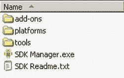

**图 2-1.** *Android SDK 的基础内容*

另一种方法（仅适用于 Windows）是下载安装程序 EXE 而不是 zip 文件，然后运行该安装程序可执行文件。此可执行文件会检查 Java JDK，为你解压嵌入的文件，并运行 SDK Manager 程序以帮助你完成其余下载项的设置。

无论是通过 Windows 安装程序还是通过执行 SDK Manager，接下来你都应该安装一些软件包。当你首次安装 Android SDK 时，它不会附带任何平台版本（即 Android 版本）。安装平台非常简单。启动 SDK Manager 后，你会看到已安装的内容以及可安装的内容，如 图 2-2 所示。你必须添加 Android SDK Tools 和 Platform-tools，环境才能正常工作。因为你很快会用到它，所以至少添加 Android 1.6 SDK Platform。

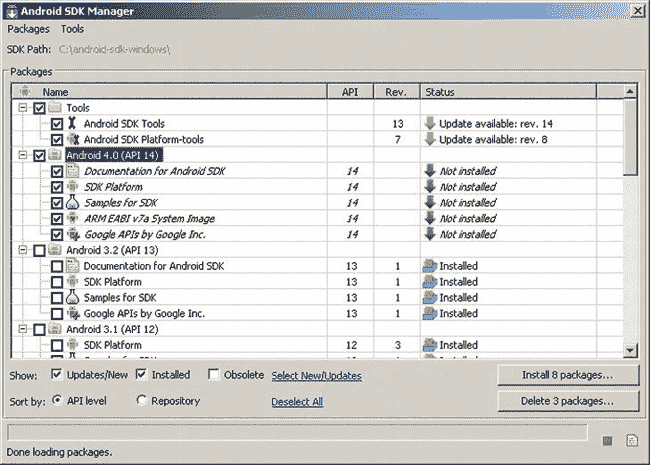

**图 2-2** *向 Android SDK 添加软件包*

点击“Install”按钮。你需要为每个要安装的项目点击“Accept”（或点击“Accept All”），然后点击“Install”。然后 Android 会下载你的软件包和平台以供使用。Google APIs 是用于开发使用 Google Maps 的应用程序的附加组件。你随时可以回来添加更多软件包。

### 更新你的 PATH 环境变量

Android SDK 带有一个 `tools` 目录，你需要将其添加到 PATH 中。你还需要将刚刚安装的 `platform-tools` 目录添加到 PATH 中。现在就来添加它们，或者如果你正在升级，请确保它们正确无误。同时，你还可以添加一个 JDK bin 目录，这会让之后的操作更简便。

对于 Windows，返回“环境变量”窗口。编辑 PATH 变量，在末尾添加一个分号（`;`），然后跟上 Android SDK tools 文件夹的路径，再跟一个分号，接着是 Android SDK platform-tools 文件夹的路径，再跟一个分号，最后是 `%JAVA_HOME%\bin`。完成后点击“确定”。对于 Mac OS X 和 Linux，编辑你的 `.bashrc` 文件，将 Android SDK tools 目录路径添加到你的 PATH 变量中，同时添加 Android SDK `platform-tools` 目录和 `$JAVA_HOME/bin` 目录。类似以下命令适用于 Linux：

```
export PATH=$PATH:$HOME/android-sdk-linux_x86/tools:$HOME/android-sdk-linux_x86/platform-tools:$JAVA_HOME/bin
```

请确保指向 Android SDK tools 目录的 PATH 组件与你特定的设置相符。

### 工具窗口

在本书的后续部分，有时你需要执行命令行实用程序。这些程序是 JDK 或 Android SDK 的一部分。通过将这些目录添加到 PATH 中，你无需指定完整路径名即可执行它们，但你需要启动一个*工具窗口*来运行它们（后续章节会提及此工具窗口）。在 Windows 中创建工具窗口最简单的方法是选择“开始”“运行”，输入 `cmd`，然后点击“确定”。对于 Mac OS X，在 Finder 的“Applications”文件夹中或 Dock（如果存在）中选择“终端”。对于 Linux，从“应用程序”“附件”菜单中选择“终端”。

稍后你可能需要知道工作站的 IP 地址。在 Windows 中查找时，启动一个工具窗口并输入命令 `ipconfig`。结果中包含一个 IPv4（或类似名称）条目，旁边列出了你的 IP 地址。IP 地址看起来像这样：192.168.1.25。对于 Mac OS X 和 Linux，启动一个工具窗口并使用命令 `ifconfig`。你可以在标签 `inet addr` 旁边找到你的 IP 地址。

你可能会看到一个名为 localhost 或 lo 的网络连接；该网络连接的 IP 地址是 127.0.0.1。这是一个操作系统使用的特殊网络连接，与工作站 IP 地址不同。请查找另一个不同的数字作为工作站的 IP 地址。

## 安装安卓开发工具（ADT）

现在你需要安装 `ADT`，这是一个帮助构建安卓应用的 Eclipse 插件。具体来说，`ADT` 与 Eclipse 集成，为你提供创建、测试和调试安卓应用的功能。你需要使用 Eclipse 中的“安装新软件”功能来进行安装。（升级 `ADT` 的说明将在本节稍后给出。）首先，启动 Eclipse IDE 并按照以下步骤操作：

1.  选择 **帮助**  **安装新软件**。

2.  选择 **工作台** 字段，输入

    [`https://dl-ssl.google.com/android/eclipse/`](https://dl-ssl.google.com/android/eclipse/)

    并按回车键。Eclipse 连接该站点并填充列表，如图 2-3 所示。

3.  你应该会看到一个名为 `开发者工具` 的条目，包含四个子节点：`Android DDMS`、`Android Development Tools`、`Android Hierarchy Viewer` 和 `Android Traceview`。选中父节点 `开发者工具`，确保子节点也已被选中，然后点击 `下一步` 按钮。你看到的版本可能比这些更新，这没问题。你可能还会看到其他工具。这些工具将在第 11 章中进一步解释。

4.  Eclipse 会要求你确认要安装的工具。点击 `下一步`。

5.  系统会要求你查看 `ADT` 以及安装 `ADT` 所需工具的许可协议。查看许可协议，点击 `我接受`，然后点击 `完成` 按钮。

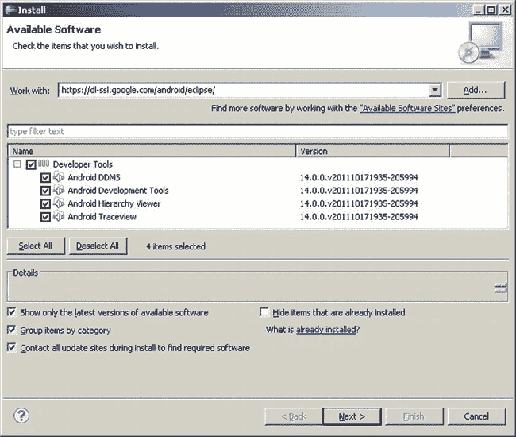

图 2-3. 使用 Eclipse 的“安装新软件”功能安装 ADT

Eclipse 会下载开发者工具并进行安装。你需要重启 Eclipse，以便新插件在 IDE 中显示。

如果你在 Eclipse 中已经安装了旧版本的 `ADT`，请转到 Eclipse 的 `帮助` 菜单，选择 `检查更新`。你应该会看到新版本的 `ADT`，然后可以按照安装说明操作，从第 3 步继续。

**注意：** 如果你正在升级 `ADT`，可能不会在要升级的工具列表中看到其中一些工具。如果没看到它们，那么在升级完 `ADT` 的其余部分后，请转到 `安装新软件`，并从 `工作台` 菜单中选择 `https://dl-ssl.google.com/android/eclipse/`。中间窗口应显示其他可供安装的工具。

让 `ADT` 在 Eclipse 中正常工作的最后一步是将其指向 Android SDK。在 Eclipse 中，选择 `窗口` > `首选项`。 （在 Mac OS X 上，`首选项` 位于 `Eclipse` 菜单下。）在 `首选项` 对话框中，选择 `Android` 节点，并将 `SDK 位置` 字段设置为 Android SDK 的路径（参见图 2-4），然后点击 `应用` 按钮。请注意，你可能会看到一个对话框，询问是否要向 Google 发送有关 Android SDK 的使用统计信息；这取决于你自行决定。

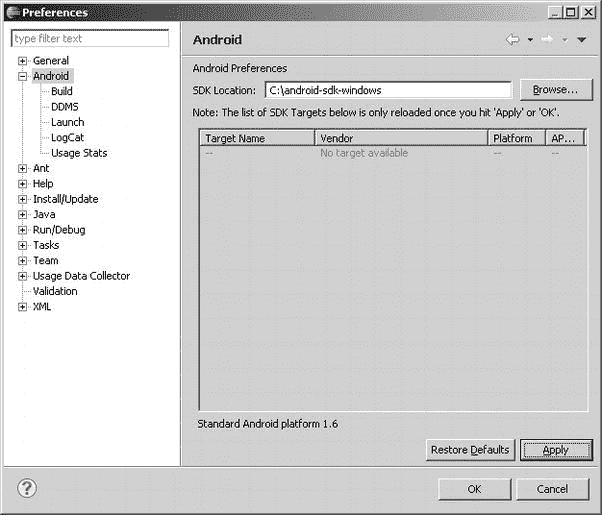

图 2-4. 将 ADT 指向 Android SDK

你可能还想在 `Android`  `构建` 页面上进行另一项首选项更改。如果你希望文件保存更快，则应勾选 `跳过打包` 选项。默认情况下，`ADT` 每次构建时都会为应用启动做好准备。通过勾选此选项（参见图 2-5），打包和索引只会在真正需要时发生。

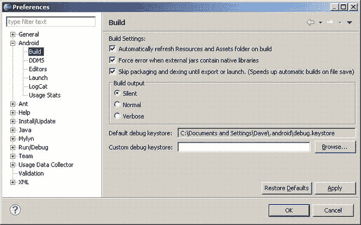

图 2-5. 加快构建速度

在 Eclipse 中，你可以启动 SDK 管理器。为此，请选择 `窗口`  `Android SDK 管理器`。你应该会看到与图 2-2 相同的窗口。

你已经为第一个安卓应用做好了准备——但首先，你必须简要了解安卓应用的基本概念。

### 学习基本组件

每个应用框架都有一些关键组件，开发者在开始编写基于该框架的应用之前需要了解这些组件。例如，你需要了解 JavaServer Pages（`JSP`）和 servlet 才能编写 Java 2 平台企业版（`J2EE`）应用。同样，在为安卓构建应用时，你需要了解视图、活动、片段、意图、内容提供者、服务和 `AndroidManifest.xml` 文件。这里简要介绍这些基本概念，并在整本书中更详细地探讨它们。

#### 视图

`视图` 是构成用户界面基本构建块的用户界面（`UI`）元素。一个 `视图` 可以是一个按钮、一个标签、一个文本字段或许多其他 `UI` 元素。如果你熟悉 `J2EE` 和 Swing 中的 `视图`，那么你就能理解安卓中的 `视图`。`视图` 也可以用作其他 `视图` 的容器，这意味着 `UI` 中通常存在一个 `视图` 的层次结构。最终，你看到的一切都是一个 `视图`。

#### 活动

一个 `活动` 是一个 `UI` 概念，通常代表应用中的单个屏幕。它通常包含一个或多个 `视图`，但也可以不包含。`活动` 顾名思义——它是帮助用户做某件事的东西，可能是查看数据、创建数据或编辑数据。大多数安卓应用内部都有多个活动。

#### 片段

当屏幕很大时，在单个 `活动` 中管理其所有功能会变得困难。`片段` 类似于子活动，一个 `活动` 可以在屏幕上同时显示一个或多个 `片段`。当屏幕很小时，一个 `活动` 更可能只包含一个 `片段`，而这个 `片段` 可以是较大屏幕中使用的同一个。

#### 意图

`意图` 泛泛地定义了执行某项工作的“意图”。`意图` 封装了几个概念，因此理解它们的最佳方式是查看它们的使用示例。你可以使用 `意图` 执行以下任务：

*   广播一条消息。

*   启动一个服务。

*   启动一个活动。

*   显示一个网页或联系人列表。

*   拨打一个电话号码或接听一个电话。

`意图` 并不总是由你的应用发起的——系统也会使用它们来通知你的应用特定事件（例如收到一条短信）。

`意图` 可以是显式的或隐式的。如果你只是简单地说要显示一个 `URL`，系统会决定哪个组件来完成这个意图。你也可以提供关于应由什么处理这个意图的具体信息。`意图` 将动作和动作处理器松散地耦合在一起。

#### 内容提供者

设备上的移动应用之间的数据共享很常见。因此，安卓为应用定义了一种标准机制来共享数据（例如联系人列表），而无需暴露底层存储、结构和实现。通过内容提供者，你可以公开你的数据，并让你的应用使用来自其他应用的数据。

#### 服务

安卓中的 `服务` 类似于你在 Windows 或其他平台中看到的服务——它们是可以在后台长时间运行的进程。安卓定义了两类服务：本地服务和远程服务。本地服务是只有托管该服务的应用才能访问的组件。相反，远程服务是旨在供设备上运行的其他应用远程访问的服务。

`服务` 的一个例子是电子邮件应用用来轮询新消息的组件。如果该 `服务` 不被设备上运行的其他应用使用，则这种 `服务` 可能是本地服务。如果多个应用使用该 `服务`，则它被实现为远程服务。

#### AndroidManifest.xml

`AndroidManifest.xml` 类似于 `J2EE` 世界中的 `web.xml` 文件，它定义了应用的内容和行为。例如，它列出了应用的活动和服务，以及应用运行所需的权限和功能。

### Android 虚拟设备

Android 虚拟设备（AVD）允许开发者在无需连接真实 Android 设备（通常是手机或平板电脑）的情况下测试应用程序。AVD 可以通过多种配置进行创建，以模拟不同类型的真实设备。

### Hello World

现在，你已经准备好构建第一个 Android 应用程序。首先构建一个简单的“Hello World！”程序。按照以下步骤创建应用程序的骨架：

1.  启动 Eclipse，选择文件  新建  项目。在“新建项目”对话框中，选择 Android，然后点击“下一步”。你会看到“新建 Android 项目”对话框，如图 2 – 6 所示。（Eclipse 可能已将“Android 项目”添加到“新建”菜单中，因此如果有的话，可以直接使用。工具栏上还有一个“新建 Android 项目”按钮。）

    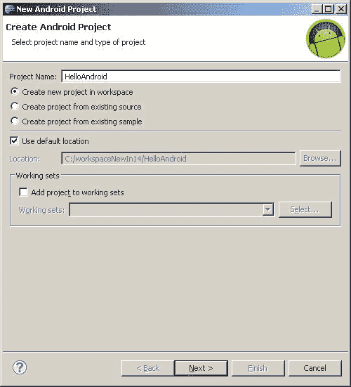

    图 2–6. 使用新建项目向导创建 Android 应用程序

2.  如图 2–6 所示，输入 `HelloAndroid` 作为项目名称。你需要将此项目与在 Eclipse 中创建的其他项目区分开来，因此，当你查看 Eclipse 环境中的所有项目时，选择一个对你有意义的名称。另外请注意，项目的默认位置源自 Eclipse 工作区位置。新建项目向导会将新应用程序的名称附加到工作区位置。在这种情况下，如果你的 Eclipse 工作区是 `c:\android`，那么你的新项目位于 `c:\android\HelloAndroid\`。

3.  暂时不修改“位置”部分，因为你希望在工作区的默认位置创建一个新项目。点击“下一步”。

## 创建 Android 应用程序

4.  下一个窗口显示可用的构建目标。选择 `Android 1.6`。这是你作为应用程序基础的 Android 版本。你可以在更高版本的 Android（例如 2.1 和 2.3.3）上运行应用程序；但 `Android 1.6` 具备你所需要的一切功能，因此选择它作为目标。通常，最好选择尽可能低的版本号，因为这可以最大化能够运行你应用程序的设备数量。点击“下一步”进入最后一个向导窗口。

5.  输入 `Hello Android` 作为应用程序名称。此名称将随应用程序图标一起显示在应用程序的标题栏和应用程序列表中。它应该具有描述性，但不宜过长。

6.  使用 `com.androidbook.hello` 作为包名。你的应用程序必须有一个基础包名，这就是它。此包名将用作应用程序的标识符，并且在所有应用程序中必须是唯一的。因此，最好以你拥有的域名开头来命名包名。如果你没有域名，请发挥创意，确保你的包名不会被其他人使用。但是，不要使用以 `com.google`、`com.android`、`android` 或 `com.example` 开头的包名，因为这些域名被 Google 限制使用，你将无法将应用程序上传到 Android Market。

7.  输入 `HelloActivity` 作为创建 Activity 名称。你这是在告诉 Android，当应用程序启动时应启动此 Activity。你的应用程序中可能还有其他 Activity，但这个 Activity 是应用程序启动时用户首先看到的界面。

8.  `Min SDK Version` 的值为 4，意味着你的应用程序需要 `Android 1.6` 或更高版本。技术上，你可以指定一个低于构建目标值的 `Min SDK Version`。如果你的应用程序调用了旧版 Android 中不存在的功能，你需要妥善处理这种情况，但这可以做到。

9.  点击“完成”按钮，这将指示 ADT 为你生成项目骨架。现在，打开 `src` 文件夹下的 `HelloActivity.java` 文件，并按如下方式修改 `onCreate()` 方法：

    ```
    /** 当 Activity 首次创建时被调用。 */
        @Override
        public void onCreate(Bundle savedInstanceState) {
            super.onCreate(savedInstanceState);
            /** 创建一个 TextView 并写入 Hello World! */
            TextView tv = new TextView(this);
            tv.setText("Hello World!");
            /** 将内容视图设置为 TextView */
            setContentView(tv);
       }
    ```

    你可能需要向代码中添加一条 `import android.widget.TextView;` 语句，以消除 Eclipse 报告的错误。保存 `HelloActivity.java` 文件。

## 运行应用程序

要运行该应用程序，你需要创建一个 Eclipse 启动配置，并且需要一个虚拟设备来运行它。我们快速浏览这些步骤，稍后再详细介绍 AVD。按照以下步骤创建 Eclipse 启动配置：

1.  选择运行  运行配置。

2.  在“运行配置”对话框中，双击左窗格中的“Android 应用程序”。向导会插入一个名为“新配置”的新配置。

3.  将配置重命名为 `RunHelloWorld`。

4.  点击“浏览”按钮，然后选择 `HelloAndroid` 项目。

5.  将“启动操作”设置为“启动默认 Activity”。对话框应如图 2–7 所示。

    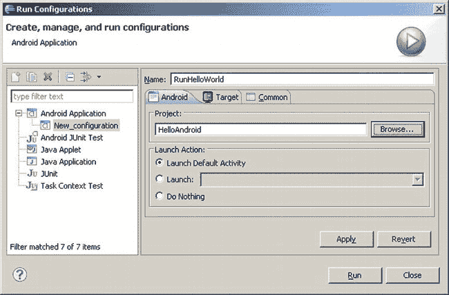

    **图 2–7.** *配置 Eclipse 启动配置以运行“Hello World！”应用程序*

6.  点击“应用”，然后点击“运行”。你几乎快完成了！Eclipse 已准备好运行你的应用程序，但它需要一个设备来运行它。如图 2–8 所示，系统会警告你未找到兼容的目标，并询问你是否要创建一个。点击“是”。

    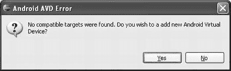

    **图 2–8.** *有关目标的错误消息提示，并询问是否创建新的 AVD*

7.  系统会显示一个窗口，其中列出了现有的 AVD（见图 2–9）。你需要添加一个适用于新应用程序的 AVD。点击“新建”按钮。

    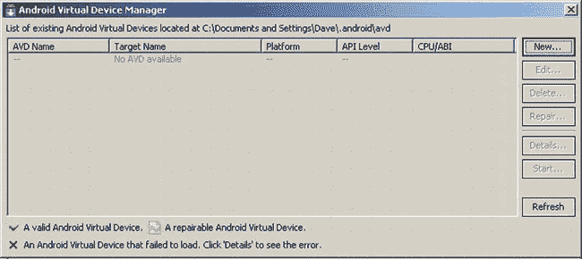

    **图 2–9.** *现有的 Android 虚拟设备*

8.  如图 2–10 所示填写“创建 AVD”表单。将名称设置为 `Gingerbread`，为目标选择 `Android 2.3.3 - API 级别 10`（或其他版本），将 SD 卡大小设置为 10（代表 10MB），启用快照，并使用默认皮肤。点击“创建 AVD”。管理器可能会确认成功创建了你的 AVD。点击右上角的 X 关闭 AVD 管理器窗口。

    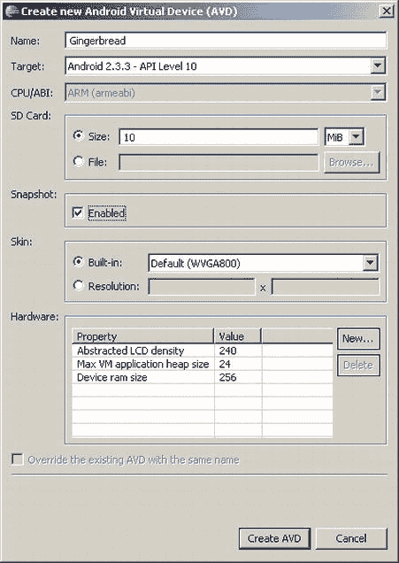

    **图 2–10.** *配置 Android 虚拟设备*

    **注意：** 你为 AVD 选择了较新版本的 SDK，但你的应用程序也可以在旧版本上运行。这是可以的，因为带有较新 SDK 的 AVD 可以运行需要旧版 SDK 的应用程序。当然，反之则不成立：需要新版 SDK 功能的应用程序无法在带有旧版 SDK 的 AVD 上运行。

9.  从底部列表中选择你的新 AVD。请注意，你可能需要点击“刷新”按钮才能使任何新的 AVD 显示在列表中。点击“确定”按钮。

10. Eclipse 将启动模拟器，并运行你的第一个 Android 应用程序（见图 2–11）！

**注：** 模拟器可能需要一些时间来模拟设备的启动过程。启动完成后，您通常会看到一个锁定屏幕。点击菜单按钮或拖动解锁图像来解锁 AVD。解锁后，您应该会看到 `HelloAndroidApp` 在模拟器中运行，如图 2-11 所示。请注意，模拟器在启动过程中会在后台启动其他应用程序，因此您可能会不时看到警告或错误消息。如果出现这种情况，通常可以将其关闭，让模拟器继续启动过程。例如，如果运行模拟器时看到类似“`application abc` 未响应”的消息，您可以等待应用程序启动，或者直接让模拟器强制关闭该应用程序。一般来说，您应该等待并让模拟器正常启动。

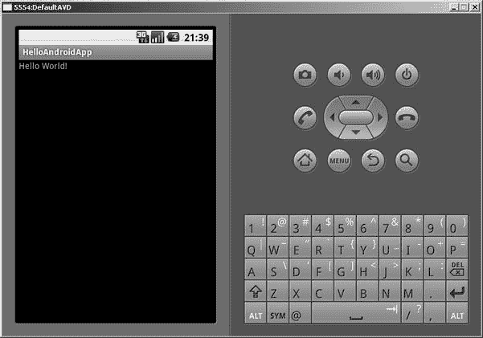

**图 2-11.** *HelloAndroidApp 在模拟器中运行*

现在您已经知道如何创建新的 Android 应用程序并在模拟器中运行它了。接下来，您将更深入地了解 AVD，以及如何部署到真实设备上。

### Android 虚拟设备

AVD 代表一种设备配置。例如，您可以创建一个 AVD，代表一台运行 SDK 1.5 版本、配备 32MB SD 卡的老旧 Android 设备。其思路是，您创建自己将要支持的 AVD，然后在开发和测试应用程序时将模拟器指向其中一个 AVD。指定（和更改）要使用的 AVD 非常容易，这使使用各种配置进行测试变得轻而易举。前面您已经看到了如何使用 Eclipse 创建 AVD。您可以在 Eclipse 中选择 Window  AVD Manager 来创建更多 AVD。您也可以使用命令行创建 AVD。具体方法如下。

要创建一个 AVD，您需要使用位于 `tools` 目录（`c:\android-sdk-windows\tools\`）下的批处理文件 `android`。`android` 允许您创建新的 AVD 并管理现有的 AVD。例如，您可以查看现有的 AVD、移动 AVD 等。通过运行 `android -help` 可以查看使用 `android` 的可用选项。现在，我们只创建一个 AVD。

默认情况下，AVD 存储在您的主目录（所有平台）下一个名为 `.android\AVD` 的文件夹中。如果您刚刚为“Hello World!”应用程序创建了一个 AVD，那么可以在此处找到它。如果您想在其他位置存储或操作 AVD，也可以这样做。对于本例，让我们创建一个用于存储 AVD 镜像的文件夹，例如 `c:\avd\`。下一步是在工具窗口中使用以下命令列出可用的 Android 目标：

```
android list target
```

此命令的输出是所有已安装 Android 版本的列表，列表中的每个项目都有一个 ID。再次使用工具窗口，输入以下命令（使用适合您工作站的路径来存储 AVD 文件，并根据您安装的 SDK 平台目标，为 `-t` ID 参数使用适当的值）：

```
android create avd -n CupcakeMaps -t 2 -c 16M -p c:\avd\CupcakeMaps\
```

传递给批处理文件的参数列在表 2-1 中。

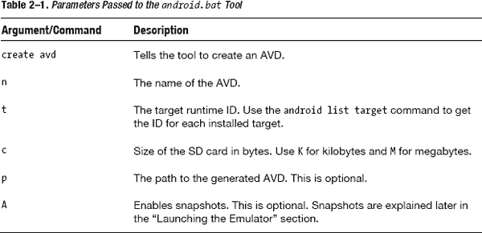

### 创建AVD

执行上述命令会生成一个 AVD；您应该会看到类似图 2-12 所示的输出。请注意，当您运行`create avd`命令时，系统会询问您是否要创建自定义硬件配置文件。此时请回答 no，但要知道，回答 yes 会提示您为 AVD 配置许多选项，例如屏幕尺寸、摄像头是否存在等。

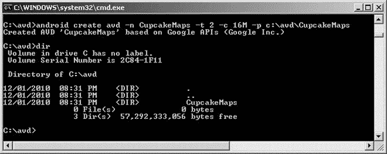

**图 2-12.** 创建 AVD 将产生如下`android.bat`输出。

即使您使用`android.bat`程序为`CupcakeMaps`指定了备用位置，在您主目录的`.android/AVD`文件夹下仍然会有一个`CupcakeMaps.ini`文件。这是一件好事，因为如果您返回 Eclipse 并选择 Window  AVD Manager，您将看到所有 AVD。在 Eclipse 中运行 Android 应用程序时，您可以访问其中任何一个。

再看一下图 2-2。每个 Android 版本都有一个 API 级别。Android 1.6 的 API 级别为 4，Android 2.1 的 API 级别为 7。这些 API 级别编号并不对应于`android create avd`命令用于`-t`参数的目标 ID。您始终需要使用`android list target`命令来获取`android create avd`命令所需的适当目标 ID 值。

### 在真实设备上运行

测试 Android 应用程序的最佳方式是将其运行在真实设备上。任何商用 Android 设备在连接到您的工作站时都应该可以工作，但您可能需要做一些设置工作。如果您使用的是 Mac，只需通过 USB 线缆插入设备即可，无需其他操作。然后，在设备本身上，依次选择 Settings  Applications  Development，并启用 USB 调试。在 Linux 上，您可能需要创建或修改此文件：`/etc/udev/rules.d/51-android.rules`。我们将此文件的一份副本与项目文件一起放在了我们的网站上；将其复制到正确的目录，并根据您的机器适当修改用户名和组值。然后，当您插入 Android 设备时，它将被识别。接下来，在设备上启用 USB 调试。

对于 Windows，您需要处理 USB 驱动程序。Google 在 Android 包中提供了一些驱动程序，这些驱动程序位于 Android SDK 目录的`usb_driver`子目录下。其他设备供应商也会为您提供驱动程序，因此请在他们的网站上查找。当您设置好驱动程序后，在设备上启用 USB 调试，一切就绪了。

现在设备已连接到您的工作站，当您尝试启动一个应用程序时，它要么直接在设备上启动，要么（如果您有模拟器在运行或连接了其他设备）会打开一个窗口，您可以在其中选择要启动到的设备或模拟器。如果没有，请尝试编辑您的运行配置以手动选择目标。

### 探索 Android 应用的结构

尽管 Android 应用的大小和复杂程度可能千差万别，但它们的结构却十分相似。图 2–13 展示了您刚刚构建的“Hello World!”应用的结构。

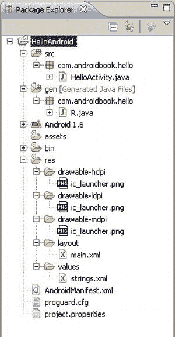

**图 2–13** “Hello World!”应用的结构

Android 应用包含一些必需的和可选的工件。表 2–2 总结了 Android 应用的各个元素。

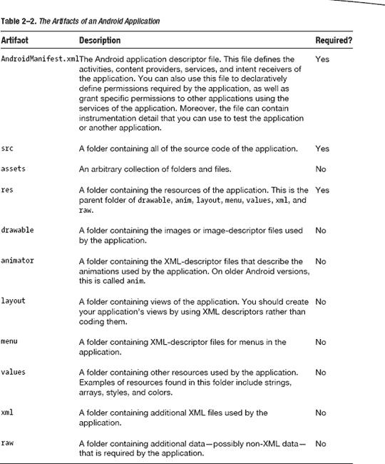

从表 2–2 可以看出，Android 应用主要由三部分组成：应用描述文件、各种资源集合以及应用的源代码。如果暂时忽略 `AndroidManifest.xml` 文件，您可以用一种简单的方式来理解 Android 应用：用代码实现业务逻辑，而其他所有内容都属于资源。这种基本结构与 J2EE 应用的基本结构类似，资源对应于 JSP，业务逻辑对应于 Servlet，而 `AndroidManifest.xml` 文件则对应于 `web.xml` 文件。

您还可以将 J2EE 的开发模型与 Android 的开发模型进行比较。在 J2EE 中，构建视图的理念是使用标记语言来构建。Android 也采用了这种方法，尽管 Android 中的标记是 XML。这种方法的好处在于，您无需在代码中硬编码应用的视图；您只需通过编辑标记语言即可修改应用的外观和感觉。

此外，还需要注意几个关于资源的限制。首先，Android 仅支持 `res` 下预定义文件夹内的文件线性列表。例如，它不支持在 `layout` 文件夹（或 `res` 下的其他文件夹）中嵌套子文件夹。其次，`assets` 文件夹与 `res` 下的 `raw` 文件夹有一些相似之处。这两个文件夹都可以包含原始文件，但 `raw` 中的文件被视为资源，而 `assets` 中的文件则不是。因此，`raw` 中的文件可以被本地化、通过资源 ID 访问等。而 `assets` 文件夹的内容则被视为通用内容，使用时不受资源约束和支持。请注意，由于 `assets` 文件夹的内容不被视为资源，您可以在该文件夹中放置任意层次的文件夹和文件。（第 3 章 会更详细地讨论资源。）

**注意** 您可能已经注意到，Android 中大量使用了 XML。您知道 XML 是一种臃肿的数据格式，因此这就引出了一个问题：当目标设备资源有限时，依赖 XML 是否合理？事实上，您在开发过程中创建的 XML 最终会通过 Android 资源打包工具（`AAPT`）编译为二进制文件。因此，当您的应用安装到设备上时，设备上的文件是以二进制形式存储的。在运行时需要该文件时，会以其二进制形式读取，而不会转换回 XML。这使您两全其美——既可以使用 XML 进行开发，又无需担心占用设备上的宝贵资源。

### 审视应用生命周期

Android 应用的生命周期由系统根据用户需求、可用资源等因素严格管理。例如，用户可能想启动一个网络浏览器，但最终由系统决定是否启动该应用。尽管系统是最终管理者，但它会遵循一些明确且合乎逻辑的准则来决定一个应用是否可以被加载、暂停或停止。如果用户当前正在使用某个活动（Activity），系统会给予该应用很高的优先级。

相反地，如果一个活动不可见，并且系统判定必须关闭某个应用以释放资源，它会关闭优先级较低的应用。

这与基于 Web 的 J2EE 应用的生命周期形成对比。J2EE 应用受到其运行容器的松散管理。例如，J2EE 容器可以在某个应用闲置超过预定时间后，将其从内存中移除。但容器通常不会根据负载和/或可用资源将应用移入或移出内存。J2EE 容器通常拥有足够的资源来同时运行大量应用。而 Android 的资源更加有限，因此 Android 必须对应用拥有更强的控制力和主导权。

**注意** Android 在独立进程中运行每个应用，每个进程都拥有自己的虚拟机。这提供了一个受保护的内存环境。通过将应用隔离到单独的进程中，系统可以控制哪个应用应获得更高的优先级。例如，一个正在执行 CPU 密集型任务的进程无法阻止来电。

应用生命周期的概念是合乎逻辑的，但 Android 应用的一个基本方面却使事情变得复杂。具体来说，Android 应用架构是以组件和集成为导向的。这带来了丰富的用户体验、无缝复用和便捷的应用集成，但也为应用生命周期管理器带来了复杂的任务。

让我们考虑一个典型场景。用户正在通电话，需要打开一封电子邮件来回答一个问题。用户进入主屏幕，打开邮件应用，打开该邮件，点击邮件中的链接，并通过阅读网页上的股票报价来回答朋友的问题。这个场景涉及四个应用：主屏幕应用、通话应用、邮件应用和浏览器应用。当用户从一个应用导航到另一个应用时，体验是无缝的。然而在后台，系统正在保存和恢复应用的状态。例如，当用户点击邮件中的链接时，系统会先保存正在运行的邮件活动（Activity）的元数据，然后启动浏览器应用的活动来加载 URL。事实上，系统在启动另一个活动之前，会保存任何当前活动的元数据，以便之后能够返回到该活动（例如，当用户回退时）。如果内存成为问题，系统必须关闭正在运行某个活动的进程，并在必要时恢复它。

Android 对应用及其组件的生命周期非常敏感。因此，您需要理解并处理生命周期事件，以构建稳定的应用。运行您 Android 应用及其组件的进程会经历各种生命周期事件，Android 提供了您可以通过实现来处理状态变化的回调方法。首先，您应该熟悉一个活动的各种生命周期回调方法（参见代码清单 2–1）。

**代码清单 2–1.** 活动的生命周期方法

```
protected void onCreate(Bundle savedInstanceState);
protected void onStart();
protected void onRestart();
protected void onResume();
protected void onPause();
protected void onStop();
protected void onDestroy();
```

`清单 2–1` 展示了 Android 在 Activity 生命周期中调用的生命周期方法列表。为了确保实现稳定的应用程序，理解系统何时调用每个方法非常重要。请注意，您不需要对所有方法都做出响应。但如果需要响应，请确保也调用父类版本。`图 2–14` 显示了状态之间的转换。

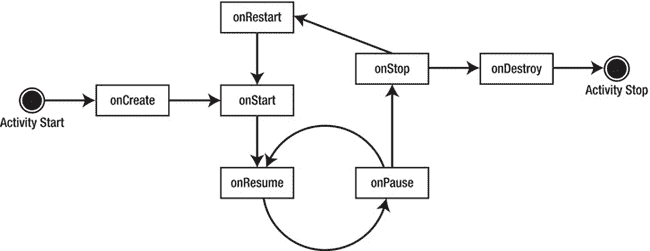

**图 2–14.** *Activity 的状态转换*

系统可以根据当前发生的其他事件来启动和停止您的 Activity。当 Activity 被新创建时，Android 会调用 `onCreate()` 方法。`onCreate()` 之后总是跟着调用 `onStart()`，但 `onStart()` 并不总是由 `onCreate()` 调用触发，因为如果您的应用程序曾被停止，`onStart()` 也可能被调用。当 `onStart()` 被调用时，您的 Activity 对用户还不可见，但即将可见。`onResume()` 在 `onStart()` 之后被调用，此时 Activity 处于前台并可被用户访问。此时，用户可以开始与您的 Activity 交互。

当用户决定切换到另一个 Activity 时，系统会调用您的 Activity 的 `onPause()` 方法。在 `onPause()` 之后，您可以预期 `onResume()` 或 `onStop()` 会被调用。例如，如果用户将您的 Activity 带回前台，则会调用 `onResume()`。如果您的 Activity 对用户变为不可见，则会调用 `onStop()`。如果在 `onStop()` 被调用后，您的 Activity 被带回前台，则会调用 `onRestart()`。如果您的 Activity 位于 Activity 栈中但对用户不可见，并且系统决定终止您的 Activity，则会调用 `onDestroy()`。

上述描述的 Activity 状态模型看起来很复杂，但您不需要处理所有可能的情况。您主要处理 `onCreate()`、`onResume()` 和 `onPause()`。您通过 `onCreate()` 为您的 Activity 创建用户界面。在此方法中，您将数据绑定到控件，并为您的 UI 组件连接事件处理器。在 `onPause()` 中，您需要将关键数据持久化到应用程序的数据存储中：这是系统终止您的应用程序之前，最后一个可以被安全调用的方法。`onStop()` 和 `onDestroy()` 不保证一定会被调用，因此不要依赖这些方法处理关键逻辑。

从以上讨论中能学到什么？系统管理着您的应用程序，并且可以在任何时间启动、停止或恢复某个应用程序组件。尽管系统控制着您的组件，但它们并非完全与您的应用程序隔离运行。换句话说，如果系统启动了您应用程序中的某个 Activity，您可以指望在该 Activity 中拥有一个应用程序上下文。

到目前为止，您已经涵盖了创建新 Android 应用程序、在模拟器中运行 Android 应用程序、Android 应用程序的基本结构以及许多 Android 应用程序中常见的几个特性。但是，您还没有看到如何解决 Android 应用程序中出现的问题。本章的最后一部分将讨论简单的调试。

### 简单调试

Android SDK 包含了一系列可用于调试的工具。这些工具已集成到 Eclipse IDE 中（请参见 图 2–15 的简要示例）。

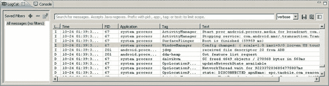

**图 2–15.** *在构建 Android 应用程序时可以使用的调试工具*

在整个 Android 开发过程中，您会经常使用的一个工具是 `LogCat`。此工具显示您通过 `android.util.Log`、`System.out.println` 等发出的日志消息。尽管 `System.out.println` 也能工作，并且其消息会显示在 `LogCat` 窗口中，但从您的应用程序中记录消息时，应使用 `android.util.Log` 类。该类定义了您熟悉的提示、警告和错误方法，您可以利用这些方法在 `LogCat` 窗口中进行过滤，以便只查看您关注的信息。这是一个 `Log` 命令的示例：

```
Log.v("string TAG", "This is my verbose message to write to the log");
```

此示例展示了 `Log` 类的静态 `v()` 方法，但还有其他用于不同严重级别的方法。最好为要记录的消息使用合适的调用级别，通常不建议在打算部署到生产环境的应用程序中保留详细调用。请记住，日志记录会消耗内存和 CPU 资源。

`LogCat` 特别方便的一点是，您不仅可以在模拟器中运行应用程序时查看日志消息，还可以在工作站上连接了处于调试模式的真实设备时查看日志消息。实际上，日志消息会被存储，以至于您甚至可以从记录日志消息时已断开的设备中检索到最新的消息。当您将设备连接到工作站并打开 `LogCat` 视图时，您会看到最近数百条消息。第 11 章 将涵盖更高级的调试。

#### 启动模拟器

之前您已经了解了如何从 Eclipse 的项目中启动模拟器。大多数情况下，您应该先启动模拟器，然后再在正在运行的模拟器中部署和测试您的应用程序。要随时启动模拟器，首先通过运行 Android SDK 的 `tools` 目录中的 `android` 程序或通过 Eclipse 的 `Window` 菜单进入 AVD Manager。进入 Manager 后，从列表中选择所需的 AVD，然后单击 `Start`。

当您单击 `Start` 按钮时，会打开“启动选项”对话框（参见 图 2–16）。这允许您缩放模拟器窗口的大小，并更改启动和关闭选项。当您使用中、小屏幕设备（如手机）的 AVD 时，通常可以使用默认屏幕尺寸。但对于大屏幕和超大屏幕尺寸（例如平板电脑），默认屏幕尺寸可能无法在工作站的屏幕上完美适配。如果出现这种情况，您可以启用“按实际尺寸缩放显示”并输入一个值。此标签有些误导，因为平板电脑的屏幕密度可能与您的工作站不同，并且模拟器无法完美匹配模拟器窗口在您屏幕上的实际物理尺寸。例如，在我们的工作站屏幕上，模拟一个 10 英寸屏幕的 Honeycomb 平板电脑时，10 英寸的“真实尺寸”对应约 0.64 的缩放比例，并且工作站屏幕上的实际尺寸略大于 10 英寸。请根据您的屏幕尺寸和屏幕密度选择适合您的值。

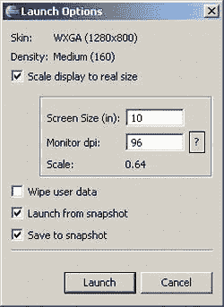

**图 2–16.** *启动选项对话框*

您还可以在“启动选项”对话框中处理快照。退出模拟器时保存到快照会导致稍长的延迟。顾名思义，您将模拟器的当前状态写入到一个快照映像文件中，该文件可以在下次启动时使用，以避免经历完整的 Android 启动序列。如果存在快照，启动速度会快得多，这使得保存时的延迟非常值得——您基本上可以从上次离开的地方继续。

如果您想从头开始全新的启动，可以选择“清除用户数据”。您也可以取消选择“从快照启动”以保留用户数据并经历完整的启动序列。或者，您可以创建一个自己喜欢的快照，并*仅*启用“从快照启动”选项；这会反复重用该快照，因此启动速度快，关闭速度也快，因为每次退出时不会创建新的快照映像文件。快照映像文件存储在与 AVD 其他映像文件相同的目录中。如果您在创建 AVD 时未启用快照，您可以随时编辑该 AVD 并在那里启用它们。

### 小结

本章涵盖以下主题，帮助您为 Android 开发做好准备：

*   下载并安装 JDK、Eclipse 和 Android SDK

*   如何修改您的 `PATH` 变量并启动工具窗口

*   安装 Android 开发工具（ADT），以及如何在拥有旧版本时进行更新

*   视图、活动、片段、意图、内容提供程序、服务和 `AndroidManifest.xml` 文件的基本概念

*   安卓虚拟设备（AVD），可用于在您没有设备（或没有特定测试设备）时测试应用

*   构建一个“Hello World!”应用并将其部署到模拟器

*   初始化任何应用的基本要求（项目名称、Android 目标、应用名称、包名、主活动、最低 SDK 版本）

*   运行配置的位置以及如何更改它们

*   创建 AVD 的命令行方法

*   将真实设备连接到工作站并在其上运行您的新应用

*   Android 应用的内部结构以及活动的生命周期

*   `LogCat`，以及如何在其中查找应用发送的内部消息

*   启动模拟器时可用的选项，例如快照和调整屏幕显示大小

### 面试问题

请回答以下问题以巩固您对本章节的理解：

1.  为 Android 开发需要 JRE 还是 JDK？

2.  是否可以不使用 Eclipse 进行 Android 开发？

3.  Android SDK 下的 `tools` 和 `platform-tools` 目录有什么区别？

4.  Android 中的视图是什么？

5.  意图又是什么？

6.  判断正误：应用的构建目标必须与最低 SDK 版本相同。为什么是或为什么不是？

7.  为应用选择包名时必须采取哪些预防措施？
