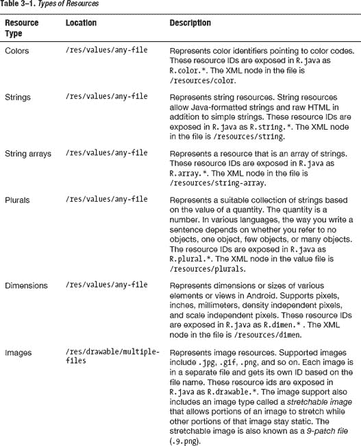
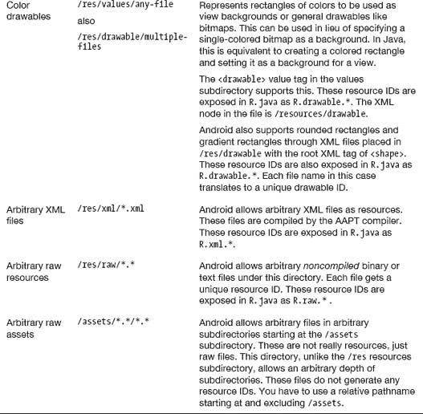

# 第 3 章 理解 Android 资源

8.  什么是 `AVD`？它有什么用途？

9.  什么是 `AVD` 快照？如何使用它？

10. 应用所需的 MP3 文件应存储在哪个源文件夹中？

11. 应用图标文件应放在哪里？

12. 活动看到的第一个生命周期回调是什么？

13. 活动看到的最后一个生命周期回调是什么？

14. 用于从您的应用写入日志消息的类是什么？

15. 可用于写入日志消息的所有方法有哪些，它们之间有什么不同？

在 第 2 章 中，我们向您概述了 Android 应用，并快速了解了一些其底层概念。您还了解了 Android SDK、Eclipse Android 开发工具（`ADT`），以及如何在由 Android 虚拟设备（`AVD`）标识的模拟器上运行您的应用。

在本章及接下来的几章中，我们将深入探讨 Android SDK 的基础知识。这些基础知识包括资源、内容提供程序和意图。

Android 依赖于以声明方式定义 UI 组件的资源。这种声明式方法与 HTML 使用声明式标签定义其 UI 的方式并无太大不同。从这个意义上说，Android 在 UI 开发方法上是具有前瞻性的。Android 还允许对这些资源进行样式化和本地化。本章涵盖了 Android 中可用的各种资源。

### 理解资源

资源在 Android 架构中扮演着关键角色。Android 中的资源是绑定到可执行应用的文件（如音乐文件或描述窗口布局的文件）或值（如对话框的标题）。这些文件与值以这样一种方式绑定到可执行文件：您可以在不重新编译应用的情况下更改它们或提供替代方案。

常见的资源示例包括字符串、颜色、位图和布局。资源允许您使用其 ID 来代替在应用中硬编码字符串。这种间接方式让您可以更改字符串资源的文本，而无需更改源代码。

Android 中有许多、许多资源类型。让我们从一种非常常见的资源——字符串——开始对资源的讨论。

### 字符串资源

Android 允许你在一个或多个 XML 资源文件中定义字符串。这些包含字符串资源定义的 XML 文件位于 `/res/values` 子目录下。XML 文件的名称是任意的，不过通常你会看到文件名为 `strings.xml`。代码清单 3-1 展示了一个字符串资源文件的示例。

代码清单 3-1. `strings.xml` 示例

```xml
<?xml version="1.0" encoding="utf-8"?>
<resources>
    <string name="hello">hello</string>
    <string name="app_name">hello appname</string>
</resources>
```

注意： 在某些 Eclipse 版本中，`<resources>` 节点需要使用 `xmlns` 规范进行限定。只要存在 `xmlns`，它指向什么似乎并不重要。以下两种变体都是可行的：

```xml
<resources >
```

以及

```xml
<resources >
```

即使是文件的第一行（表明它是具有特定编码的 XML 文件）也是可选的。即使没有这一行，Android 也能正常运行。

当此文件被创建或更新时，Eclipse `ADT` 插件会自动在你的应用程序根包中创建或更新一个名为 `R.java` 的 Java 类，其中包含为两个指定字符串资源生成的唯一 ID。请注意以下示例中 `R.java` 文件的位置。这是某个项目（例如 `MyProject`）的高级目录结构：

```
\MyProject
   \src
         \com\mycompany\android\my-root-package
         \com\mycompany\android\my-root-package\another-package
   \gen
\com\mycompany\android\my-root-package\R.java
   \assets
   \res
   \AndroidManifest.xml
...等
```

注意： 无论资源文件有多少个，都只有一个 `R.java` 文件。

对于 代码清单 3-1 中的字符串资源文件，更新后的 `R.java` 文件包含了 代码清单 3-2 中的条目。

代码清单 3-2. `R.java` 示例

```java
package com.mycompany.android.my-root-package;
public final class R {
   ...其他取决于项目和应用的条目

    public static final class string
   {
      ...其他取决于项目和应用的条目

public static final int hello=0x7f040000;
        public static final int app_name=0x7f040001;

      ...其他取决于项目和应用的条目
    }
   ...其他取决于项目和应用的条目
}
```

首先请注意，`R.java` 如何在根包中定义了一个顶层类：`public static final class R`。在这个 `R` 的外部类中，Android 定义了一个内部类 `static final class string`。`R.java` 创建这个内部静态类作为一个命名空间，用于保存字符串资源 ID。

用变量名 `hello` 和 `app_name` 定义的两个 `static final int` 就是代表相应字符串资源的资源 ID。你可以通过以下代码结构在源代码中的任何位置使用这些资源 ID：

```
R.string.hello
```

生成的 ID 指向的是 `int` 类型而非 `string` 类型。大多数接受字符串的方法也接受这些资源标识符作为输入。Android 会在必要时将这些 `int` 解析为 `string`。

大多数示例应用程序将所有字符串定义在一个 `strings.xml` 文件中仅仅是一种惯例。只要 XML 文件的结构看起来像 代码清单 3-1 所示，并且文件位于 `/res/values` 子目录下，Android 可以接受任意数量的此类文件。

这个文件的结构很容易理解。根节点 `<resources>` 后跟一个或多个 `<string>` 子元素。每个 `<string>` 元素或节点都有一个名为 `name` 的属性，该属性最终会成为 `R.java` 中的 `id` 属性。

为了证明该子目录下允许存在多个字符串资源文件，你可以在同一子目录下放置另一个文件，内容如下，并将其命名为 `strings1.xml`（参见 代码清单 3-3）。

代码清单 3-3. 额外 `strings.xml` 文件示例

```xml
<?xml version="1.0" encoding="utf-8"?>
<resources>
    <string name="hello1">hello 1</string>
    <string name="app_name1">hello appname 1</string>
</resources>
```

Eclipse `ADT` 插件会在编译时验证这些 ID 的唯一性，并将它们作为两个附加常量放入 `R.java` 中：`R.string.hello1` 和 `R.string.app_name1`。

### 布局资源

在 Android 中，屏幕视图通常作为资源从 XML 文件中加载。这与描述网页内容和布局的 HTML 文件非常相似。这些 XML 文件被称为布局资源。*布局资源*是 Android UI 编程中使用的关键资源。请参考代码清单 3-4 中的代码片段，这是一个 Android Activity 的示例。

代码清单 3-4. 使用布局文件

```java
public class HelloWorldActivity extends Activity
{
    @Override
    public void onCreate(Bundle savedInstanceState)
    {
        super.onCreate(savedInstanceState);
        setContentView(R.layout.main);
        TextView tv = (TextView)this.findViewById(R.id.text1);
        tv.setText("Try this text instead");
    }
    ...
}
```

`setContentView(R.layout.main)` 这行代码表明存在一个名为 `R.layout` 的静态类，在该类中，有一个名为 `main`（整型）的常量，它指向由 XML 布局资源文件定义的 `View`。该 XML 文件名为 `main.xml`，需要放置在资源目录的 `layout` 子目录中。换句话说，这行语句要求程序员创建 `/res/layout/main.xml` 文件，并将必要的布局定义放入该文件中。`main.xml` 布局文件的内容可能如代码清单 3-5 所示。

**代码清单 3-5.** `main.xml` 布局文件示例

```xml
<?xml version="1.0" encoding="utf-8"?>
<LinearLayout
    android:orientation="vertical"
    android:layout_width="fill_parent"
    android:layout_height="fill_parent"
    >
    <TextView    android:id="@+id/text1"
    android:layout_width="fill_parent"
    android:layout_height="wrap_content"
    android:text="@string/hello"
    />
    <Button    android:id="@+id/b1"
    android:layout_width="fill_parent"
    android:layout_height="wrap_content"
    android:text="@string/hello"
    />
</LinearLayout>
```

代码清单 3-5 中的布局文件定义了一个名为 `LinearLayout` 的根节点，其中包含一个 `TextView` 后跟一个 `Button`。`LinearLayout` 会垂直或水平地排列其子元素——在此示例中为垂直排列。

你需要为每个屏幕（或 `Activity`）定义一个单独的布局文件。更准确地说，每个布局都需要一个专用文件。如果你要绘制两个屏幕，可能需要两个布局文件，例如 `/res/layout/screen1_layout.xml` 和 `/res/layout/screen2_layout.xml`。

**注意：** `/res/layout/` 子目录中的每个文件都会根据文件名（不包括扩展名）生成一个唯一的常量。对于布局，重要的是文件的数量；而对于字符串资源，重要的是文件*内部*单个字符串资源的数量。

例如，如果 `/res/layout/` 目录下有两个名为 `file1.xml` 和 `file2.xml` 的文件，那么在 `R.java` 中，你将拥有如代码清单 3-6 所示的条目。

**代码清单 3-6.** 多个布局文件的多个常量

```java
public static final class layout {
  .... any other files
    public static final int file1=0x7f030000;
    public static final int file2=0x7f030001;
}
```

这些布局文件中定义的视图（例如 `TextView`，见代码清单 3-5）可以通过 `R.java` 中生成的资源 ID 在 Java 代码中访问：

```java
TextView tv = (TextView)this.findViewById(R.id.text1);
tv.setText("Try this text instead");
```

在这个例子中，你通过 `Activity` 类的 `findViewById` 方法定位 `TextView`。常量 `R.id.text1` 对应于为 `TextView` 定义的 ID。布局文件中 `TextView` 的 ID 如下所示：

```xml
<TextView android:id="@+id/text1"
..
</TextView>
```

`id` 属性的值表示，常量 `text1` 用于在该 `Activity` 所拥有的其他视图中唯一标识此视图。`@+id/text1` 中的加号（`+`）表示如果 `text1` 这个 ID 尚不存在，则会创建它。这种资源 ID 语法还有其他内容，我们接下来会看到。

### 资源引用语法

无论资源类型如何（目前介绍了字符串和布局两种），所有 Android 资源在 Java 源代码中都是通过其 ID 来标识（或引用）的。在 XML 文件中为资源分配 ID 所使用的语法被称为*资源引用语法*。这种语法不仅限于分配 ID：它也是一种标识任何资源（如字符串、布局文件或图像）的方式。

这种定位资源或引用现有资源的通用方法与 ID 是如何关联的呢？事实证明，ID 是像字符串一样作为资源被跟踪的数值。想象一下你的项目持有一个数字池。你可以从池中取出一个数字并将其分配给一个控件。

让我们先进一步研究一下资源引用结构。该资源引用具有以下形式结构：

`@[package:]type/name`

其中 `type` 对应于 `R.java` 中可用的资源类型命名空间，其中一些如下：

*   `R.drawable`

*   `R.id`

*   `R.layout`

*   `R.string`

*   `R.attr`

*   `R.plural`

*   `R.array`

XML 资源引用语法中对应的类型如下：

*   `drawable`

*   `id`

*   `layout`

*   `string`

*   `attr`

*   `plurals`

*   `string-array`

资源引用 `@[package:]type/name` 中的 `name` 部分是赋予该资源的名称（例如代码清单 3-5 中的 `text1`）；它也在 `R.java` 中表示为一个 `int` 常量。

如果在语法 `@[package:]type/name` 中未指定包名，则 `type/name` 对将根据本地资源和应用程序本地的 `R.java` 包进行解析。

如果指定了 `android:type/name`，则将使用包 `android` 进行引用解析，具体通过 `android.R.java` 文件。你可以使用任何 Java 包名替换 `package` 占位符，以定位正确的 `R.java` 文件来解析引用。

现在让我们回到代码清单 3-5 中 ID 分配给控件的方式。ID 被视为资源。按照这个逻辑，当你编写

```xml
<TextView android:id="@+id/text1" ..../>
```

时，你是在说：“获取一个由类型 `id` 和值 `text1` 标识的资源，并将其分配给这个 `TextView` 实例。” `+` 表示如果 `text1` 这个 `id` 未定义为资源，则用一个唯一的数字来定义它。

基于此信息，让我们分析几个 ID 示例。在阅读代码清单 3-7 时，请注意 ID `android:id` 的左侧（即 `android:id` 本身）不属于语法的一部分。`android:id` 只是你如何将 ID 分配给像 `TextView` 这样的控件的方式。

**代码清单 3-7.** 探索资源引用语法

```xml
<TextView  android:id="text">
// 编译错误，因为 id 不接受原始文本字符串。
// 此外，它也不是有效的资源引用语法。

<TextView  android:id="@text">
// 错误的语法。@text 缺少类型名称。
// 它应该是 @id/text、@+id/text 或 @string/string1。
// 然而，这里的 string 类型虽然是有效的资源引用，但却是无效的。
// 这是因为左侧需要的是 "id" 而不是 "string"。
// 你将得到一个错误："No Resource type specified"。

<TextView  android:id="@id/text">
// 错误: No Resource found that matches id "text"
// 除非你事先已经将 "text" 定义为一个 ID

<TextView  android:id="@android:id/text">
// 错误: Resource is not public
// 表明在 android.R.id 中没有这样的 id。
// 当然，如果 Android 的 R.java 定义了此名称的 id，这将是有效的。

<TextView  android:id="@+id/text">
// 成功: 在本地包的 R.java 中创建了一个名为 "text" 的 id
```

在语法`"@+id/text"`中，`+`号具有特殊含义。它告诉 Android：ID `text`可能尚不存在，如果确实如此，则创建一个新的 ID 并将其命名为`text`。我们不知道在资源引用语法中，除了 ID 上下文之外，还有哪里会使用`+`。这很有道理，因为你不能假设某个字符串资源是在未明确指定其内容的情况下创建的。系统无法像创建唯一数字那样自动创建该资源。

ID 与资源引用语法之间的这种联系常常是混淆的根源。要消除这种混淆，请记住一点：ID 是作为资源来指定的。

### 为后续使用自定义资源 ID

分配 ID 的通用模式要么是创建一个新的 ID，要么是使用 Android 包创建的 ID。然而，也可以预先创建 ID，并在你自己的包中后续使用。再次强调，这源于 ID 是资源这一事实。如果它们是资源，就应该允许被预定义并可供后续使用。

`<TextView android:id="@+id/text">`这一行（如清单 3–7 所示）表明：如果名为`text`的 ID 已存在，则使用它；如果该 ID 不存在，则创建一个新的。那么，像`text`这样的 ID 何时可能已经存在于`R.java`中以供重用呢？

你可能倾向于将`R.id.text`这样的常量放入`R.java`，但`R.java`是不可编辑的。即使它是可编辑的，每当`/res/*`子目录中的内容发生更改、添加或删除时，它都会被重新生成。

解决方案是使用名为`item`的资源标签来定义一个不依附于任何特定资源的 ID。清单 3–8 展示了一个示例。

清单 3–8. 预定义一个 ID

```xml
<resources>
<item type="id" name="text"/>
</resources>
```

`type`指的是资源类型——在本例中是`id`。一旦此 ID 就位，清单 3–9 中的`View`定义就能正常工作。

清单 3–9. 重用预定义的 ID

```xml
<TextView android:id="@id/text">
..
</TextView>
```

### 已编译与未编译的 Android 资源

Android 主要通过两种类型的文件来支持资源：XML 文件和原始文件（例如包括图像、音频和视频）。你已经看到，在某些情况下，资源被定义为 XML 文件中的值（例如字符串），而有时整个 XML 文件就是一个资源（例如布局资源文件）。

在 XML 文件集合中作进一步区分，你会发现两种类型：一种被编译为二进制格式，另一种则按原样复制到设备上。你目前看到的示例——字符串资源 XML 文件和布局资源 XML 文件——在成为可安装包的一部分之前会被编译成二进制格式。这些 XML 文件具有预定义的格式，其中 XML 节点可以被转换为 ID。

你还可以选择一些 XML 文件，使其拥有自己自由的格式结构；这些文件不会被解释，但会生成资源 ID（`resource type: xml`）。然而，你确实希望将它们编译为二进制格式，并享受本地化的便利。为此，你可以将这些 XML 文件放置在`/res/xml/`子目录中，以使其被编译成二进制格式。在这种情况下，你需要使用 Android 提供的 XML 读取器来读取 XML 节点。

但是，如果你将文件（包括 XML 文件）放置在`/res/raw/`目录中，它们则不会被编译成二进制格式。然而，因为它是资源，Android 会通过`R.java`生成一个 ID。原始文件的资源类型是`raw`。因此，你可以通过`R.raw.some-filename-minus-extension`访问这些文件的标识。你必须使用显式的基于流的 API 来读取这些文件。音频和视频文件就属于此类。

**注意：** 由于`raw`目录是`/res/*`层级结构的一部分，即便是这些原始的音频和视频文件，也能像所有其他资源一样利用本地化和 ID 生成功能。

正如我们在上一章的表 2-1 中提到的，资源文件根据其类型被存放在不同的子目录中。以下是`/res`文件夹中一些重要的子目录及其托管的资源类型：

*   `anim`：已编译的动画文件
*   `drawable`：位图
*   `layout`：UI 和视图定义
*   `values`：数组、颜色、尺寸、字符串和样式
*   `xml`：已编译的任意 XML 文件
*   `raw`：未编译的原始文件

Android 资源打包工具（`AAPT`）中的资源编译器会编译除`raw`资源之外的所有资源，并将它们放入最终的`.apk`文件中。该文件包含了 Android 应用程序的代码和资源，对应于 Java 的`.jar`文件（`apk`代表 Android 包）。`.apk`文件就是安装到设备上的文件。

**注意：** 尽管 XML 资源解析器允许像`hello-string`这样的资源名称，但你在`R.java`中会看到编译时错误。你可以通过将资源重命名为`hello_string`（用下划线替换连字符）来解决这个问题。

### 列举关键的 Android 资源

既然你已经了解了资源的基础知识，现在让我们列举一些 Android 支持的其他关键资源、它们的 XML 表示以及在 Java 代码中的使用方式。（你可以将本节作为为每种资源编写资源文件时的快速参考。）首先，快速浏览一下表 3–1 中资源的类型及其用途。





表中指定的每种资源都将在后续章节中通过 XML 和 Java 代码片段进行详细说明。

**注意：** 从 ID 生成的性质来看，似乎——尽管我们还没有在任何官方资料中看到——如果 XML 文件不在`/res/values`子目录中，就会根据文件名生成 ID。如果它们在`values`子目录中，则仅查看文件的内容来生成 ID。

### 字符串数组

你可以在`/res/values`子目录下的任何文件中将字符串数组指定为资源。为此，你需要使用一个名为`string-array`的 XML 节点。这个节点与`string`资源节点一样，是`resources`的子节点。清单 3–10 是在资源文件中指定数组的一个示例。

清单 3–10. 指定字符串数组

```xml
<resources ....>
......Other resources
<string-array name="test_array">
    <item>one</item>
    <item>two</item>
    <item>three</item>
</string-array>
......Other resources
</resources>
```

一旦你有了这个`string-array`资源定义，就可以像清单 3–11 所示，在 Java 代码中检索这个数组。

清单 3–11. 指定字符串数组

```java
//Get access to Resources object from an Activity
Resources res = your-activity.getResources();
String strings[] = res.getStringArray(R.array.test_array);

//Print strings
for (String s: strings)
{
    Log.d("example", s);
}
```

### 复数资源

资源 `plurals` 是一组字符串，这些字符串用于表达数值数量的不同方式，例如巢中有多少颗蛋。考虑以下示例：

`There is 1 egg.`

`There are 2 eggs.`

`There are 0 eggs.`

`There are 100 eggs.`

请注意，对于数字 2、0 和 100，句子是相同的，但数字 1 对应的句子不同。Android 允许你将这种变化表示为 `plurals` 资源。清单 3–12 展示了如何在资源文件中根据数量表示这两种变化。

清单 3–12. 指定字符串数组

```xml
<resources...>
<plurals name="eggs_in_a_nest_text">
    <item quantity="one">There is 1 egg</item>
    <item quantity="other">There are %d eggs</item>
</plurals>
</resources>
```

这两种变化在同一个复数下被表示为两个不同的字符串。现在，你可以使用清单 3–13 中的 Java 代码，根据给定数量使用此复数资源来打印字符串。`getQuantityString()` 方法的第一个参数是 `plurals` 资源 ID。第二个参数选择要使用的字符串。当数量值为 1 时，直接使用该字符串。当数量值不为 1 时，必须提供第三个参数，其值将替换 `%d` 的位置。如果在 `plurals` 资源中使用了格式化字符串，则必须始终提供至少三个参数。第二个参数可能会令人困惑；该参数的唯一区别在于其值是 1 还是非 1。

清单 3–13. 指定字符串数组

# Android 资源详解

```
Resources res = your-activity.getResources();
String s1 = res.getQuantityString(R.plurals.eggs_in_a_nest_text, 0,0);
String s2 = res.getQuantityString(R.plurals.eggs_in_a_nest_text, 1,1);
String s3 = res.getQuantityString(R.plurals.eggs_in_a_nest_text, 2,2);
String s4 = res.getQuantityString(R.plurals.eggs_in_a_nest_text, 10,10);
```

根据此代码，每个数量都会得到一个适合其复数形式的恰当字符串。

然而，上述 `<item>` 节点的 `quantity` 属性还有哪些其他可能的值？我们强烈建议你阅读 Android 源代码发行版中的 `Resources.java` 和 `PluralRules.java` 的源代码，以真正理解这一点。本章末尾“资源”部分的链接中有这些源文件的摘录。

关键在于，对于 `en`（英语）语言区域，唯一可能的两个值是`"one"`和`"other"`。对于除 `cs`（捷克语）之外的所有其他语言也是如此，在捷克语中，值分别是`"one"`（用于 1）、`"few"`（用于 2 到 4），以及用于其余情况的`"other"`。

### 关于字符串资源的更多内容

我们在前面的章节简要介绍了字符串资源。现在让我们重新审视它们，以提供更多细节，包括 HTML 字符串以及如何在字符串资源中替换变量。

**注意：** 大多数 UI 框架都支持字符串资源。然而，与其他 UI 框架不同，Android 提供了通过 `R.java` 快速将 ID 与字符串资源关联起来的能力，因此在 Android 中将字符串用作资源要容易得多。

我们首先来看如何在 XML 资源文件中定义普通字符串、带引号的字符串、HTML 字符串和可替换字符串（参见清单 3–14）。

清单 3–14. 定义字符串资源的 XML 语法

```
<resources>
    <string name="simple_string">simple string</string>
    <string name="quoted_string">"quoted 'xyz' string"</string>
    <string name="double_quoted_string">\"double quotes\"</string>
    <string name="java_format_string">
           hello %2$s Java format string. %1$s again
     </string>
     <string name="tagged_string">
         Hello <b><i>Slanted Android</i></b>, You are bold.
     </string>
</resources>
```

这个 XML 字符串资源文件需要放在 `/res/values` 子目录中。文件名可以任意。

请注意，带引号的字符串需要转义或放在备用引号中。字符串定义也允许使用标准的 Java 字符串格式化序列。

Android 还允许在 `<string>` 节点内使用子 XML 元素，例如 `<b>`、`<i>` 以及其他简单的文本格式化 HTML。你可以使用这种复合 HTML 字符串在文本视图（text view）绘制之前对文本进行样式设置。

清单 3–15 中的 Java 示例说明了每种用法。

清单 3–15. 在 Java 代码中使用字符串资源

```
//Read a simple string and set it in a text view
String simpleString = activity.getString(R.string.simple_string);
textView.setText(simpleString);

//Read a quoted string and set it in a text view
String quotedString = activity.getString(R.string.quoted_string);
textView.setText(quotedString);

//Read a double quoted string and set it in a text view
String doubleQuotedString = activity.getString(R.string.double_quoted_string);
textView.setText(doubleQuotedString);

//Read a Java format string
String javaFormatString = activity.getString(R.string.java_format_string);
//Convert the formatted string by passing in arguments
String substitutedString = String.format(javaFormatString, "Hello" , "Android");
//set the output in a text view
textView.setText(substitutedString);

//Read an html string from the resource and set it in a text view
String htmlTaggedString = activity.getString(R.string.tagged_string);
//Convert it to a text span so that it can be set in a text view
//android.text.Html class allows painting of "html" strings
//This is strictly an Android class and does not support all html tags
Spanned textSpan = android.text.Html.fromHtml(htmlTaggedString);
//Set it in a text view
textView.setText(textSpan);
```

一旦你将字符串定义为资源，就可以在 XML 布局定义中直接为 `TextView` 等视图设置这些字符串。清单 3–16 展示了一个示例，其中将 HTML 字符串设置为 `TextView` 的文本内容。

清单 3–16. 在 XML 中使用字符串资源

```
<TextView android:layout_width="fill_parent"
          android:layout_height="wrap_content"
          android:gravity="center_horizontal"
          android:text="@string/tagged_string"/>
```

`TextView` 会自动识别此字符串为 HTML 字符串，并相应地处理其格式。这非常有用，因为你可以作为布局的一部分，快速在视图中设置具有吸引力的文本。

### 颜色资源

与字符串资源类似，您可以使用引用标识符来间接引用颜色。这样做可以让 Android 实现颜色本地化和主题应用。在资源文件中定义并标识颜色后，您可以通过其 ID 在 Java 代码中访问它们。字符串资源 ID 位于 `<your-package>.R.string` 命名空间下，而颜色资源 ID 则位于 `<your-package>.R.color` 命名空间下。

Android 还在其自身的资源文件中定义了一组基础颜色。因此，这些 ID 可以通过 Android 的 `android.R.color` 命名空间进行访问。查看以下网址，了解 `android.R.color` 命名空间中可用的颜色常量：

`http://code.google.com/android/reference/android/R.color.html`

代码清单 3–17 提供了一些在 XML 资源文件中指定颜色的示例。

代码清单 3–17. 定义颜色资源的 XML 语法

```
<resources>
    <color name="red">#f00</color>
    <color name="blue">#0000ff</color>
    <color name="green">#f0f0</color>
    <color name="main_back_ground_color">#ffffff00</color>
</resources>
```

# Android 资源管理

代码清单 3–17 中的条目必须放在 `/res/values` 子目录下的一个文件中。文件名称可以是任意的，这意味着您可以选择任何文件名。Android 会读取所有文件，然后处理它们并查找如 `resources` 和 `color` 等单个节点，以确定各个 ID。

代码清单 3–18 展示了在 Java 代码中使用颜色资源的示例。

`代码清单 3–18. Java 代码中的颜色资源`

```
int mainBackGroundColor
     =  activity.getResources.getColor(R.color.main_back_ground_color);
```

代码清单 3–19 展示了如何在视图定义中使用颜色资源。

`代码清单 3–19. 在视图定义中使用颜色`

```
<TextView android:layout_width="fill_parent"
          android:layout_height="wrap_content"
          android:textColor="@color/red"
          android:text="Sample Text to Show Red Color"/>
```

## 尺寸资源

像素、英寸和点都是可以用于 XML 布局或 Java 代码的尺寸示例。您可以使用这些尺寸资源来样式化和本地化 Android UI，而无需更改源代码。

代码清单 3–20 展示了如何在 XML 中使用尺寸资源。

`代码清单 3–20. 定义尺寸资源的 XML 语法`

```
<resources>
    <dimen name="mysize_in_pixels">1px</dimen>
    <dimen name="mysize_in_dp">5dp</dimen>
    <dimen name="medium_size">100sp</dimen>
</resources>
```

您可以使用以下任一单位来指定尺寸：

*   `px`: 像素
*   `in`: 英寸
*   `mm`: 毫米
*   `pt`: 点
*   `dp`: 基于 160dpi（每英寸像素密度）屏幕的密度无关像素（尺寸会根据屏幕密度调整）
*   `sp`: 缩放无关像素（允许用户调整大小的尺寸；对字体使用很有帮助）

在 Java 中，您需要访问 `Resources` 对象实例来获取一个尺寸。您可以通过在 `activity` 对象上调用 `getResources` 来实现（参见代码清单 3–21）。一旦获得 `Resources` 对象，您就可以使用尺寸 ID 请求它定位该尺寸（同样参见代码清单 3–21）。

`代码清单 3–21. 在 Java 代码中使用尺寸资源`

```
float dimen = activity.getResources().getDimension(R.dimen.mysize_in_pixels);
```

**注意：** Java 方法调用使用的是 `Dimension`（完整拼写），而 `R.java` 命名空间使用缩写版本 `dimen` 来表示 *dimension*。

与 Java 中类似，在 XML 中用于尺寸的资源引用使用 `dimen`，而不是完整的单词 *dimension*（参见代码清单 3–22）。

`代码清单 3–22. 在 XML 中使用尺寸资源`

```
<TextView android:layout_width="fill_parent"
          android:layout_height="wrap_content"
          android:textSize="@dimen/medium_size"/>
```

## 图像资源

Android 会为放置在 `/res/drawable` 子目录下的图像文件生成资源 ID。支持的图像类型包括 `.gif`、`.jpg` 和 `.png`。此目录中的每个图像文件都会根据其基本文件名生成唯一的 ID。例如，如果图像文件名为 `sample_image.jpg`，则生成的资源 ID 为 `R.drawable.sample_image`。

**警告：** 如果两个文件的基本文件名相同，会导致错误。此外，`/res/drawable` 下的子目录会被忽略。放置在这些子目录下的任何文件都不会被读取。

您可以在其他 XML 布局定义中引用 `/res/drawable` 中可用的图像，如代码清单 3–23 所示。

`代码清单 3–23. 在 XML 中使用图像资源`

```
<Button
      android:id="@+id/button1"
      android:layout_width="fill_parent"
      android:layout_height="wrap_content"
      android:text="Dial"
      android:background="@drawable/sample_image"
/>
```

您也可以通过 Java 以编程方式检索图像，并将其设置为按钮等 UI 对象的背景（参见代码清单 3–24）。

`代码清单 3–24. 在 Java 中使用图像资源`

```
//调用 getDrawable 获取图像
BitmapDrawable d = activity.getResources().getDrawable(R.drawable.sample_image);

//然后可以使用该 drawable 设置背景
button.setBackgroundDrawable(d);

//或者可以直接通过资源 ID 设置背景
button.setBackgroundResource(R.drawable.sample_image);
```

**注意：** 这些设置背景的方法可以一直追溯到 `View` 类。因此，大多数 UI 控件都支持设置背景。

Android 还支持一种特殊类型的图像，称为*可拉伸图像*。这是一种 `.png` 图像，其中部分图像可以被指定为静态区域和可拉伸区域。Android 提供了一个名为 `Draw 9-patch` 的工具来指定这些区域（您可以在 `http://developer.android.com/guide/developing/tools/draw9patch.html` 阅读更多相关信息）。

一旦准备好 `.png` 图像，您就可以像使用其他任何图像一样使用它。当用作按钮背景时，它会非常有用，因为按钮需要拉伸自身以适应文本。

## 颜色可绘制资源

在 Android 中，图像是一种可绘制资源。Android 还支持另一种称为*颜色可绘制资源*的可绘制资源；它本质上是一个彩色矩形。

**注意：** Android 文档似乎暗示可以实现圆角，但我们未能成功创建。我们提供了另一种替代方法。文档还暗示其实例化的 Java 类是 `PaintDrawable`，但代码返回的是 `ColorDrawable`。

要定义这些彩色矩形之一，你可以在 `/res/values` 子目录下的任何 XML 文件中，通过名为 `drawable` 的节点名称定义一个 XML 元素。清单 3–25 展示了一些颜色可绘制资源的示例。

`清单 3–25. 定义颜色可绘制资源的 XML 语法`

```
<resources>
    <drawable name="red_rectangle">#f00</drawable>
    <drawable name="blue_rectangle">#0000ff</drawable>
    <drawable name="green_rectangle">#f0f0</drawable>
</resources>
```

清单 3–26 和 3–27 分别展示了如何在 Java 和 XML 中使用颜色可绘制资源。

`清单 3–26. 在 Java 代码中使用颜色可绘制资源`

```
// 获取一个可绘制对象
ColorDrawable redDrawable = (ColorDrawable) activity.getResources().getDrawable(R.drawable.red_rectangle);

// 将其设置为文本视图的背景
textView.setBackgroundDrawable(redDrawable);
```

`清单 3–27. 在 XML 代码中使用颜色可绘制资源`

# Drawable资源的使用

要在你的 `Drawable` 中实现圆角，你可以使用当前未记录在案的 `<shape>` 标签。但是，此标签需要单独存放在 `/res/drawable` 目录下的一个文件中。清单 3–28 展示了如何在名为 `/res/drawable/my_rounded_rectangle.xml` 的文件中使用 `<shape>` 标签定义一个圆角矩形。

**清单 3–28.** 定义圆角矩形

```xml
<shape >
    <solid android:color="#f0600000"/>
    <stroke android:width="3dp" color="#ffff8080"/>
    <corners android:radius="13dp" />
    <padding android:left="10dp" android:top="10dp"
        android:right="10dp" android:bottom="10dp" />
</shape>
```

然后，你可以像清单 3–29 所示，将此可绘制资源用作之前文本视图示例的背景。

**清单 3–29.** 从 Java 代码使用可绘制对象

```java
// 获取一个可绘制对象
GradientDrawable roundedRectangle = (GradientDrawable) activity.getResources().getDrawable(R.drawable.my_rounded_rectangle);

// 将其设置为文本视图的背景
textView.setBackgroundDrawable(roundedRectangle);
```

**注意：** 不需要将返回的基础 `Drawable` 强制转换为 `GradientDrawable`，但这样做是为了向你展示此 `<shape>` 标签会变成一个 `GradientDrawable`。此信息很重要，因为你可以查阅此类的 Java API 文档，以了解它所定义的 XML 标签。

最终，`drawable` 子目录中的位图图像会被解析为 `BitmapDrawable` 类。一个可绘制资源值，例如清单 3–29 中的某个矩形，会被解析为 `ColorDrawable`。包含 `<shape>` 标签的 XML 文件会被解析为 `GradientDrawable`。

### 使用任意的 XML 资源文件

除了到目前为止描述的结构化资源之外，Android 还允许将任意 XML 文件作为资源。这种方法将使用资源的优势扩展到了任意 XML 文件。首先，这种方法提供了一种基于生成的资源 ID 来快速引用这些文件的方式。其次，这种方法允许你对这些资源 XML 文件进行本地化。第三，你可以高效地在设备上编译和存储这些 XML 文件。

需要以这种方式读取的 XML 文件存储在 `/res/xml` 子目录下。清单 3–30 是一个名为 `/res/xml/test.xml` 的示例 XML 文件。

**清单 3–30.** 示例 XML 文件

```xml
<rootelem1>
   <subelem1>
      Hello World from an xml sub element
   </subelem1>
</rootelem1>
```

与处理其他 Android XML 资源文件一样，AAPT 在将此 XML 文件放入应用程序包之前会对其编译。如果你想解析这些文件，你需要使用 `XmlPullParser` 的一个实例。你可以使用清单 3–31 中的代码，在任何上下文（包括 `activity`）中获取 `XmlPullParser` 实现的实例。

**清单 3–31.** 读取 XML 文件

```java
Resources res = activity.getResources();
XmlResourceParser xpp = res.getXml(R.xml.test);
```

返回的 `XmlResourceParser` 是 `XmlPullParser` 的一个实例，并且它也实现了 `java.util.AttributeSet`。清单 3–32 展示了一个更完整的代码片段，用于读取 `test.xml` 文件。

**清单 3–32.** 使用 `XmlPullParser`

```java
private String getEventsFromAnXMLFile(Activity activity)
throws XmlPullParserException, IOException
{
   StringBuffer sb = new StringBuffer();
   Resources res = activity.getResources();
   XmlResourceParser xpp = res.getXml(R.xml.test);

   xpp.next();
   int eventType = xpp.getEventType();
    while (eventType != XmlPullParser.END_DOCUMENT)
    {
        if(eventType == XmlPullParser.START_DOCUMENT)
        {
           sb.append("******Start document");
        }
        else if(eventType == XmlPullParser.START_TAG)
        {
           sb.append("\nStart tag "+xpp.getName());
        }
        else if(eventType == XmlPullParser.END_TAG)
        {
           sb.append("\nEnd tag "+xpp.getName());
        }
        else if(eventType == XmlPullParser.TEXT)
        {
           sb.append("\nText "+xpp.getText());
        }
        eventType = xpp.next();
    }//eof-while
    sb.append("\n******End document");
    return sb.toString();
}//eof-function
```

在清单 3–32 中，你可以看到如何获取 `XmlPullParser`，如何使用 `XmlPullParser` 遍历 XML 文档中的 XML 元素，以及如何使用 `XmlPullParser` 的附加方法来访问 XML 元素的详细信息。如果你想运行此代码，你必须如前所示创建一个 XML 文件，并从任何菜单项或按钮点击中调用 `getEventsFromAnXMLFile` 函数。它会返回一个字符串，你可以使用 `Log.d` 调试方法将其打印到日志流中。

### 使用原始资源

Android 除了允许任意 XML 文件外，也支持原始文件。这些资源放置在 `/res/raw` 目录下，是诸如音频、视频或需要本地化并通过资源 ID 引用的文本文件等原始文件。与放置在 `/res/xml` 中的 XML 文件不同，这些文件不会被编译，而是按原样移动到应用包中。不过，每个文件都会在 `R.java` 中生成一个标识符。如果你将一个文本文件放置在 `/res/raw/test.txt`，就可以使用代码清单 3–33 中的代码读取该文件。

**代码清单 3–33.** 读取原始资源

```java
InputStream is = getResources().openRawResource(R.raw.test);
// 然后使用 is 读取文件内容
```

## 使用 Assets（资源文件）

Android 提供了另一个目录，你可以在其中存放要包含在包中的文件：`/assets`。它与 `/res` 处于同一层级，意味着它不是 `/res` 的子目录。`/assets` 中的文件不会在 `R.java` 中生成 ID；你必须指定文件路径来读取它们。文件路径是从 `/assets` 开始的相对路径。你可以使用 `AssetManager` 类来访问这些文件，如代码清单 3–34 所示。

**代码清单 3–34.** *读取 Asset 文件*

```
//注意：代码中未展示异常处理
String getStringFromAssetFile(Activity activity)
{
    AssetManager am = activity.getAssets();
    InputStream is = am.open("test.txt");
    String s = convertStreamToString(is);
    is.close();
    return s;
}
```

**注意：** 如果文件名（不含扩展名）重复，Eclipse ADT 插件会生成编译错误。对于所有基于文件生成的资源 ID，情况都是如此。

## 回顾资源目录结构

总之，代码清单 3–35 快速展示了资源目录的整体结构。

**代码清单 3–35.** *资源目录*

```
/res/values/strings.xml
           /colors.xml
           /dimens.xml
           /attrs.xml
           /styles.xml
    /drawable/*.png
             /*.jpg
             /*.gif
             /*.9.png
    /anim/*.xml
    /layout/*.xml
    /raw/*.*
    /xml/*.xml
/assets/*.*/*.*
```

**注意：** 由于不在 `/res` 目录下，只有 `/assets` 目录可以包含任意深度的子目录列表。其他所有目录都只能在该目录的层级包含文件，不能更深。这就是 `R.java` 为这些文件生成标识符的方式。

## 资源配置变更

资源有助于本地化。例如，你可以让一个字符串值根据用户的语言区域而变化。Android 资源将此概念推广到设备的任何配置，语言只是其中一种配置选项。配置变更的另一个例子是设备从垂直方向旋转到水平方向。垂直模式称为*竖屏模式*，水平模式称为*横屏模式*。

Android 允许你根据布局模式，为相同的资源 ID 选择不同的布局集。Android 通过为每种配置使用不同的目录来实现这一点。代码清单 3–36 展示了一个例子。

**代码清单 3–36.** *备选资源目录*

```
\res\layout\main_layout.xml
\res\layout-port\main_layout.xml
\res\layout-land\main_layout.xml
```

尽管这里有三个独立的布局文件，但它们都只在 `R.java` 中生成一个布局 ID。这个 ID 如下所示：

`R.layout.main_layout`

然而，当你检索与此布局 ID 对应的布局时，会得到适用于该设备布局的适当布局。

在此示例中，目录扩展名 `-port` 和 `-land` 被称为*配置限定符*。这些限定符是*不区分大小写*的，并且通过连字符（`-`）与资源目录名称分隔。你在这些配置限定符目录中指定的资源称为*备选资源*。未带配置限定符的资源目录中的资源称为*默认资源*。

下面列出了大部分可用的配置限定符。请注意，新的 API 可能会添加新的限定符。请参阅参考资料部分中的 URL，查看最新的资源限定符集合：

*   `mccAAA`：`AAA` 是移动国家代码。

*   `mncAAA`：`AAA` 是运营商/网络代码。

*   `en-rUS`：语言和区域。

*   `sw<N>dp`、`w<N>dp`、`h<N>dp`：最小宽度、可用宽度、可用高度（自 API 13 起）。

*   `small`、`normal`、`large`、`xlarge`：屏幕尺寸。

*   `long`、`notlong`：屏幕类型。

*   `port`、`land`：竖屏或横屏。

*   `car`、`desk`：底座类型。

*   `night`、`notnight`：夜间或日间。

*   `ldpi`、`mdpi`、`hdpi`、`xhdpi`、`nodpi`、`tvdpi`：屏幕密度。

*   `notouch`、`stylus`、`finger`：屏幕类型。

*   `keysexposed`、`keyssoft`、`keyshidden`：键盘类型。

*   `nokeys`、`qwerty`、`12key`：按键数量。

*   `navexposed`、`navhidden`：导航键隐藏或暴露。

*   `nonav`、`dpad`、`trackball`、`wheel`：导航设备类型。

*   `v3`、`v4`、`v7`：API 级别。

使用这些限定符，你可以拥有如代码清单 3–37 所示的资源目录。

**代码清单 3–37.** *其他备选资源目录*

```
\res\layout-mcc312-mnc222-en-rUS
\res\layout-ldpi
\res\layout-hdpi
\res\layout-car
```

你可以通过导航到设备上的“自定义区域”应用程序来发现当前的区域设置。此应用程序的导航路径为：主页  应用程序列表  自定义区域。

给定一个资源 ID，Android 会使用算法选择正确的资源。你可以参考“参考 URL”部分中的 URL 来了解更多关于这些规则的信息，但让我们先了解几条经验法则。

首要规则是，前面列出的限定符是按优先级顺序排列的。考虑代码清单 3–38 中的目录。

**代码清单 3–38.** *布局文件变体*

```
\res\layout\main_layout.xml
\res\layout-port\main_layout.xml
\res\layout-en\main_layout.xml
```

在 Listing 3–38 中，布局文件`main_layout.xml`有两个额外的变体：一个用于语言的变体，一个用于布局模式的变体。现在，让我们检查一下，如果你在竖屏模式下查看设备，会选取哪个布局文件。即使你处于竖屏模式，Android 仍会从`layout-en`目录中选取布局，因为在配置限定符列表中，语言变体的优先级高于方向变体。本章“参考 URL”一节中提到的 SDK 链接列出了所有配置限定符及其优先级顺序。

让我们通过尝试几个字符串资源来进一步了解优先级规则。请注意，字符串资源基于单个 ID，而布局资源则是基于文件的。为了测试字符串资源的配置限定符优先级，我们设计了五个资源 ID，它们可以参与以下变体：`default`、`en`、`en_us`、`port`和`en_port`。这五个资源 ID 如下：

*   `teststring_all`：此 ID 存在于`values`目录的所有变体中，包括默认变体。

*   `testport_port`：此 ID 存在于默认变体和仅`-port`变体中。

*   `t1_enport`：此 ID 存在于默认变体以及`-en`和`-port`变体中。

*   `t1_1_en_port`：此 ID 存在于默认变体和仅`-en-port`变体中。

*   `t2`：此 ID 仅存在于默认变体中。

Listing 3–39 展示了`values`目录的所有变体。

```
String getStringFromRawFile(Activity activity)
   throws IOException
   {
      Resources r = activity.getResources();
      InputStream is = r.openRawResource(R.raw.test);
      String myText = convertStreamToString(is);
      is.close();
      return myText;
   }

   String convertStreamToString(InputStream is)
   throws IOException
   {
      ByteArrayOutputStream baos = new ByteArrayOutputStream();
      int i = is.read();
      while (i != -1)
      {
         baos.write(i);
         i = is.read();
      }
      return baos.toString();
   }
```

### Listing 3–39. 基于配置的字符串变体

```
// values/strings.xml
<resources >
  <string name="teststring_all">teststring in root</string>
  <string name="testport_port">testport-port</string>
  <string name="t1_enport">t1 in root</string>
  <string name="t1_1_en_port">t1_1 in root</string>
  <string name="t2">t2 in root</string>
</resources>

// values-en/strings_en.xml
<resources >
  <string name="teststring_all">teststring-en</string>
  <string name="t1_enport">t1_en</string>
  <string name="t1_1_en_port">t1_1_en</string>
</resources>

// values-en-rUS/strings_en_us.xml
<resources >
  <string name="teststring_all">test-en-us</string>
</resources>

// values-port/strings_port.xml
<resources >
  <string name="teststring_all">test-en-us-port</string>
  <string name="testport_port">testport-port</string>
  <string name="t1_enport">t1_port</string>
  <string name="t1_1_en_port">t1_1_port</string>
</resources>

// values-en-port/strings_en_port.xml
<resources >
  <string name="teststring_all">test-en-port</string>
  <string name="t1_1_en_port">t1_1_en_port</string>
</resources>
```

Listing 3–40 展示了这些内容对应的`R.java`文件。

### Listing 3–40. 支持字符串变体的`R.java`

```
public static final class string {
    public static final int teststring_all=0x7f050000;
    public static final int testport_port=0x7f050004;
    public static final int t1_enport=0x7f050001;
    public static final int t1_1_en_port=0x7f050002;
    public static final int t2=0x7f050003;
}
```

显而易见，尽管你定义了大量的字符串，但只生成了五个字符串资源 ID。如果你检索这些字符串值，每个字符串检索的行为如下所述（我们测试的配置是`en_US`和竖屏模式）：

*   `teststring_all`：此 ID 存在于`values`目录的所有五个变体中。因为它存在于所有变体中，所以会从`values-en-rUS`目录中选取该变体。根据优先级规则，特定语言会覆盖默认变体、`en`变体、`port`变体和`en-port`变体。
*   `testport_port`：此 ID 存在于默认变体和仅`-port`变体中。因为它不存在于任何以`-en`开头的值目录中，所以`-port`变体的优先级高于默认变体，因此会从`-port`变体中选取值。如果它存在于某个`-en`变体中，则会从那里选取值。
*   `t1_enport`：此 ID 存在于三个变体中：默认变体、`-en`变体和`-port`变体。因为它同时存在于`-en`和`-port`变体中，所以会从`-en`变体中选取值。
*   `t1_1_en_port`：此 ID 存在于四个变体中：默认变体、`-port`变体、`-en`变体和`-en-port`变体。因为它可在`-en-port`变体中找到，所以会从`-en-port`变体中选取它，忽略默认变体、`-en`变体和`-port`变体。
*   `t2`：此 ID 仅存在于默认变体中，因此从默认变体中选取值。

Android SDK 有一个更详细的算法，你可以进一步阅读。不过，本节中的示例已经向你展示了其核心思想。关键在于认识到一个变体相对于另一个变体的优先级。下面的参考章节提供了此 SDK 链接的 URL，还提供了用于下载本章可导入项目的 URL；你可以使用此项目来试验这些配置变体。

### 参考 URL

在学习 Android 资源时，你可能希望手头保留以下参考 URL。除了 URL 之外，我们还列出了每个 URL 能让你获得的信息：

*   [`http://developer.android.com/guide/topics/resources/index.html`](http://developer.android.com/guide/topics/resources/index.html)：资源文档的路线图。
*   [`http://developer.android.com/guide/topics/resources/available-resources.html`](http://developer.android.com/guide/topics/resources/available-resources.html)：Android 各种类型资源的文档。
*   [`http://developer.android.com/guide/topics/resources/providing-resources.html#AlternativeResources`](http://developer.android.com/guide/topics/resources/providing-resources.html#AlternativeResources)：最新 Android SDK 提供的各种配置限定符列表。
*   [`http://developer.android.com/guide/practices/screens_support.html`](http://developer.android.com/guide/practices/screens_support.html)：关于如何为多种屏幕尺寸设计 Android 应用程序的指南。
*   [`http://developer.android.com/reference/android/content/res/Resources.html`](http://developer.android.com/reference/android/content/res/Resources.html)：用于读取资源的各种可用方法。
*   [`http://developer.android.com/reference/android/R.html`](http://developer.android.com/reference/android/R.html)：核心 Android 平台定义的资源。
*   [`www.androidbook.com/item/3542`](http://www.androidbook.com/item/3542)：我们关于复数、字符串数组和备用资源的研究，以及指向其他参考资料的链接。
*   `androidbook.com/proandroid4/projects`：可下载的 Eclipse 项目 URL，该项目演示了本章中的许多概念。文件名是`ProAndroid4_Ch03_TestResources.zip`。

### 总结

让我们通过快速列举到目前为止你学到的关于资源的知识来结束本章：

*   你了解了 Android 中支持的资源类型。
*   你知道了如何在 `XML` 文件中创建资源。
*   你学习了资源 ID 是如何生成的，以及如何在 `Java` 代码中使用它们。
*   你了解到资源 ID 生成是一种便捷的方案，它简化了 Android 中的资源使用。
*   你学习了如何处理 `XML` 资源、原始资源和资产。
*   你简要了解了备用资源。
*   你看到了如何定义和使用复数及字符串数组。
*   你学习了资源引用语法。

### 面试题

你可以使用以下问题作为指南，来巩固你对本章的理解：

1.  你能说出多少种资源类型？
2.  什么是 `R.java`？
3.  为什么 `R.java` 在处理资源时如此便利？

# 4. 资源引用语法与为 UI 控件分配 ID 之间有什么联系？

5.  生成资源 ID 时会用到文件扩展名吗？

6.  如果两个基于文件的资源仅扩展名不同，会发生什么？

7.  什么是原始资源（raw）和 XML 资源，它们与 assets（资源文件夹）有何不同？

8.  你能对 XML 资源进行本地化吗？

9.  你能对 assets 进行本地化吗？

10. 你能写出并解释资源引用语法吗？

11. 你可以预声明控件的 ID 吗？如果可以，为什么？

12. 使用哪个 XML 节点来创建 ID？

13. 如果你将文件放入 XML 和 raw 目录中，Android 是否会通过 `R.java` 为这些文件生成 ID？

14. Android 会为 asset 目录中的文件生成 ID 吗？

15. 在 `plurals`（复数）资源中，`one` 和 `other` 的含义是什么？

16. 你能在字符串资源中使用 HTML 字符串吗？

17. 如何在文本视图中显示 HTML 字符串？

18. 如何将一个矩形定义为可绘制对象？

19. 如何使用形状（shape）可绘制对象？

20. 你使用哪个类来读取 `/res/xml` 目录中的 XML 文件？

21. 在 Android 中处理 XML 文件的主要类是什么？

22. `AssetManager` 类是什么，你如何获取它？

23. `Resources` 类是什么，你如何获取它的实例？

24. 你能在 `assets` 文件夹下创建任意子目录吗？

25. 你可以在 `/res/xml` 资源文件夹下创建子目录吗？

26. 什么是资源配置限定符？

至此，让我们将注意力转向下一章的内容提供者。

---
