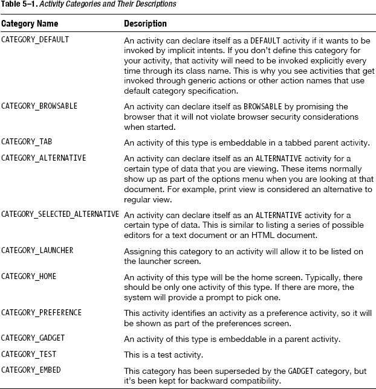

# 第 5 章

## 理解 Intent

Android 引入了一个称为 *intent* 的概念来调用组件。Android 的组件列表包括 `Activity`（UI 组件）、`Service`（后台代码）、`Broadcast Receiver`（响应广播消息的代码）和 `Content Provider`（抽象数据的代码）。

### Android Intent 基础

虽然 intent 很容易被理解为一种调用组件的机制，但 Android 将多个想法融入了 *intent* 的概念中。你可以使用 intent 从你的应用程序中调用外部应用程序。你可以使用 intent 从你的应用程序中调用内部或外部组件。你可以使用 intent 引发事件，以便其他人能以类似于发布-订阅模型的方式响应。你还可以使用 intent 设置闹钟。

**注意：** 什么是 intent？简单的回答可能是：intent 是一个动作及其相关的数据载荷。

在最简单的层面上，intent 是一个你可以告诉 Android 去执行（或 *调用*）的动作。Android 调用的动作取决于为该动作注册了哪些内容。假设你编写了以下 `Activity`：

```java
public class BasicViewActivity extends Activity
{
    @Override
    public void onCreate(Bundle savedInstanceState)
    {
        super.onCreate(savedInstanceState);
        setContentView(R.layout.some_view);
    }
}//eof-class
```

布局 `some_view` 需要指向 `/res/layout` 目录中一个有效的布局文件。然后，Android 允许你将该 `Activity` 注册到应用程序的清单文件中，使其可供其他应用程序调用。注册代码如下所示：
```

```
<activity android:name=".BasicViewActivity"
          android:label="Basic View Tests">
  <intent-filter>
   <action android:name="com.androidbook.intent.action.ShowBasicView"/>
   <category android:name="android.intent.category.DEFAULT" />
  </intent-filter>
</activity>
```

此处的注册不仅涉及一个 Activity，还涉及一个可用于调用该 Activity 的动作。Activity 的设计者通常会为这个动作选择一个名称，并将其指定为该 Activity 的 intent filter 的一部分。随着本章内容的深入，你将有机会了解更多关于这些 intent filter 的知识。

既然你已经指定了 Activity 及其与动作的注册关系，你就可以使用 intent 来调用这个 `BasicViewActivity`：

```
public static void invokeMyApplication(Activity parentActivity)
{
String actionName="com.androidbook.intent.action.ShowBasicView";
   Intent intent = new Intent(actionName);
   parentActivity.startActivity(intent);
}
```

**注意：** 动作名称的一般约定是 `<your-package-name>.intent.action.YOUR_ACTION_NAME`。

一旦 `BasicViewActivity` 被调用，它就能够发现是哪个 intent 调用了它。以下是重写后的 `BasicViewActivity` 代码，用于获取调用它的 intent：

```
public class BasicViewActivity extends Activity
{
    @Override
    public void onCreate(Bundle savedInstanceState)
    {
        super.onCreate(savedInstanceState);
        setContentView(R.layout.some_view);
        Intent intent = this.getIntent();
        if (intent == null)
        {
            Log.d("test tag", "This activity is invoked without an intent");
        }
    }
}//eof-class
```

## Android 中可用的 Intent

你可以通过调用 Android 自带的一些应用程序来测试运行 Intent。位于 [`http://developer.android.com/guide/appendix/g-app-intents.html`](http://developer.android.com/guide/appendix/g-app-intents.html) 的页面记录了部分可用的 Google 应用程序及其调用的 Intent。

 **注意：** 此列表可能因 Android 版本而异。

可用的应用程序集可能包括以下内容：

*   用于打开浏览器窗口的浏览器应用
*   用于拨打电话号码的应用
*   用于显示电话拨号器，让用户通过界面输入号码并拨打电话的应用
*   用于在给定经纬度坐标处显示世界地图的地图应用
*   能够显示 Google 街景的详细地图应用

`代码清单 5-1` 中的代码展示了如何通过它们公开的 Intent 来调用这些应用程序。

**代码清单 5-1.** *练习 Android 预置应用*

```
public class IntentsUtils
{
    public static void invokeWebBrowser(Activity activity)
    {
       Intent intent = new Intent(Intent.ACTION_VIEW);
       intent.setData(Uri.parse("http://www.google.com"));
       activity.startActivity(intent);
    }
    public static void invokeWebSearch(Activity activity)
    {
       Intent intent = new Intent(Intent.ACTION_WEB_SEARCH);
       intent.setData(Uri.parse("http://www.google.com"));
       activity.startActivity(intent);
    }
    public static void dial(Activity activity)
    {
       Intent intent = new Intent(Intent.ACTION_DIAL);
       activity.startActivity(intent);
    }

    public static void call(Activity activity)
    {
       Intent intent = new Intent(Intent.ACTION_CALL);
       intent.setData(Uri.parse("tel:555–555–5555"));
       activity.startActivity(intent);
    }
    public static void showMapAtLatLong(Activity activity)
    {
       Intent intent = new Intent(Intent.ACTION_VIEW);
       //geo:lat,long?z=zoomlevel&q=question-string
       intent.setData(Uri.parse("geo:0,0?z=4&q=business+near+city"));
       activity.startActivity(intent);
    }

    public static void tryOneOfThese(Activity activity)
    {
       IntentsUtils.invokeWebBrowser(activity);
    }
}
```

只要你有一个简单的 Activity，并通过菜单项调用 `tryOneOfThese(activity)`，你就可以执行这段代码。创建一个简单的菜单很容易（见 `代码清单 5-2`）。

**代码清单 5-2.** *创建简单菜单的测试框架*

```
public class MainActivity extends Activity
{
   public void onCreate(Bundle savedInstanceState)   {
      super.onCreate(savedInstanceState);

      TextView tv = new TextView(this);
      tv.setText("Hello, Android. Say hello");
      setContentView(tv);
   }
   @Override
   public boolean onCreateOptionsMenu(Menu menu)    {
      super.onCreateOptionsMenu(menu);
      int base=Menu.FIRST; // value is 1
      MenuItem item1 = menu.add(base,base,base,"Test");
      return true;
   }

   @Override
   public boolean onOptionsItemSelected(MenuItem item)   {
      if (item.getItemId() == 1)       {
         IntentUtils.tryOneOfThese(this);
      }
      else {
        return super.onOptionsItemSelected(item);
      }
      return true;
   }
}
```

 **注意：** 请参阅第 2 章了解如何基于这些文件创建 Android 项目，以及如何编译和运行它。你也可以阅读第 7 章的前面部分，查看更多关于菜单的示例代码。或者，你可以使用本章末尾提供的网址下载专门为本章节准备的 Eclipse 示例项目。不过，当你下载示例代码时，这个基础 Activity 可能会稍有不同，但概念保持不变。在下载的示例中，我们还从 XML 文件加载了菜单。

## 探索 Intent 的构成

深入理解 Intent 的另一个可靠方法是查看 Intent 对象包含的内容。一个 Intent 包含动作、数据（由数据 URI 表示）、额外的数据元素键值对，以及一个明确的类名（称为`组件名`）。只要 Intent 至少包含其中一项，其他几乎所有部分都是可选的。我们将依次探讨这些部分。

 **注意：** 当 Intent 带有组件名时，它被称为`显式` Intent。当 Intent 不包含组件名，而依赖于动作和数据等其他部分时，它被称为`隐式` Intent。在本章后续内容中，你将看到这两种 Intent 之间存在细微差别。

### Intent 与数据 URI

到目前为止，我们介绍了最简单的 Intent，即我们只需要一个动作名。代码清单 5-1 中的 `ACTION_DIAL` 活动就是其中之一；要调用拨号器，该清单中我们只需要拨号器的动作，不需要其他内容：

```java
public static void dial(Activity activity)
{
   Intent intent = new Intent(Intent.ACTION_DIAL);
   activity.startActivity(intent);
}
```

与 `ACTION_DIAL` 不同，用于拨打指定电话号码的 `ACTION_CALL` Intent（同样参考代码清单 5-1）接受一个名为 `Data` 的额外参数。此参数指向一个 URI，而该 URI 又指向电话号码：

```java
public static void call(Activity activity)
{
   Intent intent = new Intent(Intent.ACTION_CALL);
   intent.setData(Uri.parse("tel:555–555–5555"));
   activity.startActivity(intent);
}
```

Intent 的动作部分是一个字符串或字符串常量，通常以 Java 包名作为前缀。

Intent 的数据部分并非实际数据，而是指向数据的指针。此数据部分是一个表示 URI 的字符串。Intent 的 URI 可以包含可作为数据推断的参数，就像网站的 URL 一样。

此 URI 的格式可能因该动作调用的每个 Activity 而异。在本例中，`CALL` 动作决定了它期望何种数据 URI。它从 URI 中提取了电话号码。

 **注意：** 被调用的 Activity 也可以将 URI 用作数据源的指针，从数据源中提取数据并使用该数据。对于音频、视频和图像等媒体，就是这种情况。

### 通用操作

`Intent.ACTION_CALL` 和 `Intent.ACTION_DIAL` 这些操作很容易让我们错误地认为每个操作与其所调用的组件之间存在一一对应的关系。为了反驳这一点，我们来看一个来自清单 5–1 中 `IntentUtils` 代码的反例：

```java
public static void invokeWebBrowser(Activity activity)
{
   Intent intent = new Intent(Intent.ACTION_VIEW);
   intent.setData(Uri.parse("http://www.google.com"));
   activity.startActivity(intent);
}
```

请注意，这里操作只是简单地声明为 `ACTION_VIEW`。Android 如何知道应该调用哪个 Activity 来响应这样一个通用的操作名称呢？在这些情况下，Android 不仅依赖通用的操作名称，还依赖 URI 的特性。Android 会查看 URI 的协议（scheme），这里恰好是 `http`，然后询问所有已注册的 Activity，看哪些能理解这个协议。接着，它会进一步询问哪些能够处理 `VIEW` 操作，然后调用该 Activity。要使这一切正常工作，浏览器 Activity 应该已经针对 `http` 数据协议注册了一个 `VIEW` 意图。该意图声明在清单文件中可能如下所示：

```xml
<activity......>
<intent-filter>
          <action android:name="android.intent.action.VIEW" />
         <data android:scheme="http"/>
         <data android:scheme="https"/>
</intent-filter>
</activity>
```

你可以通过查看 [`http://developer.android.com/guide/topics/manifest/data-element.html`](http://developer.android.com/guide/topics/manifest/data-element.html) 上关于意图过滤器 `data` 元素的 XML 定义，来了解 `data` 节点更多允许的属性。意图过滤器 `data` XML 子节点的子元素或属性包括以下这些：

`host`

`mimeType`

`path`

`pathPattern`

`pathPrefix`

`port`

`scheme`

`mimeType` 是一个你经常会用到的属性。例如，下面这个用于显示笔记列表的 Activity 的意图过滤器，将 MIME 类型指定为一个笔记目录：

```xml
<intent-filter>
   <action android:name="android.intent.action.VIEW" />
   <data android:mimeType="vnd.android.cursor.dir/vnd.google.note" />
</intent-filter>
```

这个意图过滤器声明可以理解为：“调用此 Activity 来查看一个笔记集合。”

另一方面，显示单个笔记的屏幕，其意图过滤器使用了一个表示单个笔记项的 MIME 类型：

```xml
<intent-filter>
   <action android:name="android.intent.action.VIEW" />
   <data android:mimeType="vnd.android.cursor.item/vnd.google.note" />
</intent-filter>
```

这个意图过滤器声明可以理解为：“调用此 Activity 来查看单个笔记。”

### 使用额外信息

除了操作和数据这两个主要属性之外，意图还可以包含一个称为 `extras` 的额外属性。Extra 可以向接收意图的组件提供更多信息。额外数据以键/值对的形式存在：键名通常以包名开头，而值可以是任何基本数据类型，也可以是任意对象，只要它实现了 `android.os.Parcelable` 接口。这些额外信息由一个名为 `android.os.Bundle` 的 Android 类来表示。

`Intent` 类中以下两个方法提供了对额外 `Bundle` 的访问：

```java
//从 Intent 中获取 Bundle
Bundle extraBundle = intent.getExtras();

// 在 intent 中放入一个 bundle
Bundle anotherBundle = new Bundle();

// 用键/值对填充 bundle
...
// 然后设置 bundle 到 Intent 上
intent.putExtras(anotherBundle);
```

`getExtras` 很直观：它返回 intent 所携带的 `Bundle`。`putExtras` 会检查 intent 当前是否有一个 bundle。如果 intent 已经有一个 bundle，`putExtras` 会将新 bundle 中的额外键值对转移到现有的 bundle 中。如果 bundle 不存在，`putExtras` 会创建一个，并将新 bundle 中的键值对复制到创建的 bundle 中。

 **注意：** `putExtras` 会复制传入的 bundle，而不是直接引用它。所以如果你之后修改了传入的 bundle，并不会改变 intent 内部的 bundle。

你可以使用多种方法向 bundle 添加基本类型。以下是一些将简单数据类型添加到额外数据中的方法：

# Android Intent 详解

`putExtra(String name, boolean value);`

`putExtra(String name, int value);`

`putExtra(String name, double value);`

`putExtra(String name, String value);`

下面是一些不那么简单的 extras 方法：

```
// 简单数组支持
putExtra(String name, int[] values);
putExtra(String name, float[] values);

// 可序列化对象
putExtra(String name, Serializable value);

// Parcelable 支持
putExtra(String name, Parcelable value);

// 在给定的键下添加另一个 bundle
// Bundle 中的 Bundle
putExtra(String name, Bundle value);

// 从另一个 intent 添加 bundle
// Bundle 的副本
putExtra(String name, Intent anotherIntent);

// 显式 ArrayList 支持
putIntegerArrayListExtra(String name, ArrayList arrayList);
putParcelableArrayListExtra(String name, ArrayList arrayList);
putStringArrayListExtra(String name, ArrayList arrayList);
```

在接收端，以 `get` 开头的方法会根据键名从额外的 bundle 中检索信息。

`Intent` 类定义了与某些操作关联的额外键字符串。你可以在 [`http://developer.android.com/reference/android/content/Intent.html#EXTRA_ALARM_COUNT`](http://developer.android.com/reference/android/content/Intent.html#EXTRA_ALARM_COUNT) 上找到许多这些额外信息键常量。

让我们考虑一下该 URL 中列出的、与发送电子邮件相关的几个示例 extra：

*   `EXTRA_EMAIL`：你将使用此字符串键来保存一组电子邮件地址。该键的值为 `android.intent.extra.EMAIL`。它应指向一个包含文本形式电子邮件地址的字符串数组。

*   `EXTRA_SUBJECT`：你将使用此键来保存电子邮件的主题。该键的值为 `android.intent.extra.SUBJECT`。该键应指向一个提供主题的字符串。

### 使用组件直接调用 Activity

你已经看到了几种使用 Intent 启动 Activity 的方式。你看到了一个显式操作启动 Activity，也看到了一个通用操作借助数据 URI 启动 Activity。Android 还提供了一种更直接的方式来启动 Activity：你可以指定 Activity 的 `ComponentName`，它是围绕对象包名和类名的一个抽象。`Intent` 类提供了多种方法来指定组件：

- `setComponent(ComponentName name);`

- `setClassName(String packageName, String classNameInThatPackage);`

- `setClassName(Context context, String classNameInThatContext);`

- `setClass(Context context, Class classObjectInThatContext);`

归根结底，它们都是调用同一个方法的快捷方式：

`setComponent(ComponentName name);`

`ComponentName` 将包名和类名封装在一起。例如，以下代码调用了模拟器中自带的 `contacts` Activity：

```
Intent intent = new Intent();
intent.setComponent(new ComponentName(
    "com.android.contacts"
    ,"com.android.contacts.DialContactsEntryActivity");
startActivity(intent);
```

请注意，包名和类名都是完全限定的，并在传递给 `Intent` 类之前依次用于构造 `ComponentName`。

你也可以直接使用类名，而无需构造 `ComponentName`。再次考虑 `BasicViewActivity` 代码片段：

```
public class BasicViewActivity extends Activity
{
    @Override
    public void onCreate(Bundle savedInstanceState)
    {
        super.onCreate(savedInstanceState);
        setContentView(R.layout.some_view);
    }
}//eof-class
```

基于此，你可以使用以下代码来启动这个 Activity：

```
Intent directIntent = new Intent(activity, BasicViewActivity.class);
activity.start(directIntent);
```

然而，如果你希望任何类型的 Intent 都能启动一个 Activity，你应该像这样在 `AndroidManifest.xml` 文件中注册该 Activity：

```
<activity android:name=".BasicViewActivity"
          android:label="Test Activity">
```

 **注意：** 通过类名或名称直接调用 Activity 时，不需要 Intent 过滤器。如前所述，这种类型的 Intent 被称为`显式 Intent`。由于显式 Intent 指定了要调用的完全限定的 Android 组件，因此在调用该组件时会忽略该 Intent 的其他部分。

### 理解 Intent 类别

你可以将 Activity 分类，以便根据类别名称搜索它们。例如，在启动时，Android 会查找其类别标记为 `CATEGORY_LAUNCHER` 的 Activity。然后它会选取这些 Activity 的名称和图标，并将它们放置在主页屏幕上以供启动。

另一个例子：Android 会查找标记为 `CATEGORY_HOME` 的 Activity，以在启动时显示主屏幕。类似地，`CATEGORY_GADGET` 将一个 Activity 标记为适合嵌入或在另一个 Activity 中重用。

类似 `CATEGORY_LAUNCHER` 这样的类别的字符串格式遵循 `category` 定义约定：

```
android.intent.category.LAUNCHER
```

你需要了解这些用于 `category` 定义的文本字符串，因为 Activity 会在 `AndroidManifest.xml` 文件中将它们的类别注册为 Activity 过滤器定义的一部分。以下是一个示例：

```
<activity android:name=".HelloWorldActivity"
          android:label="@string/app_name">
    <intent-filter>
        <action android:name="android.intent.action.MAIN" />
        <category android:name="android.intent.category.LAUNCHER" />
    </intent-filter>
</activity>
```

 **注意：** Activity 可能具有某些能力来限制或启用它们，例如是否可以将它们嵌入到父 Activity 中。这些类型的 Activity 特征通过类别声明。

让我们快速浏览一些预定义的 Android 类别及其使用方法（参见表 5–1）。



你可以在以下针对 `Intent` 类的 Android SDK 网址中阅读这些 Activity 类别的详细信息：

[`http://developer.android.com/android/reference/android/content/Intent.html#CATEGORY_ALTERNATIVE`](http://developer.android.com/android/reference/android/content/Intent.html#CATEGORY_ALTERNATIVE)。

当你使用 `Intent` 启动 `Activity` 时，可以通过指定类别来选择要启动的 `Activity` 类型。或者，你可以搜索匹配某个类别的 `Activity`。以下是一个检索与 `CATEGORY_LAUNCHER` 类别相匹配的主 `Activity` 集合的示例：

```
Intent mainIntent = new Intent(Intent.ACTION_MAIN, null);
mainIntent.addCategory(Intent.CATEGORY_LAUNCHER);
PackageManager pm = getPackageManager();
List<ResolveInfo> list = pm.queryIntentActivities(mainIntent, 0);
```

`PackageManager` 是一个关键类，它允许你发现匹配特定 `Intent` 的 `Activity`，而无需调用它们。你可以遍历接收到的 `Activity`，并根据 `ResolveInfo` API 按需调用它们。以下是前面代码的扩展，它遍历 `Activity` 列表，并在匹配某个名称时调用其中一个 `Activity`。在代码中，我们使用了一个任意名称进行测试：

```
for(ResolveInfo ri: list)
{
    //ri.activityInfo.
    Log.d("test",ri.toString());
    String packagename = ri.activityInfo.packageName;
    String classname = ri.activityInfo.name;
    Log.d("test", packagename + ":" + classname);
    if (classname.equals("com.ai.androidbook.resources.TestActivity"))
    {
        Intent ni = new Intent();
        ni.setClassName(packagename,classname);
        activity.startActivity(ni);
    }
}
```

你也可以完全基于 `Intent` 类别（例如 `CATEGORY_LAUNCHER`）来启动 `Activity`：

```
public static void invokeAMainApp(Activity activity)
{
   Intent mainIntent = new Intent(Intent.ACTION_MAIN, null);
   mainIntent.addCategory(Intent.CATEGORY_LAUNCHER);
   activity.startActivity(mainIntent);
}
```

会有多个 `Activity` 匹配该 `Intent`，那么 Android 会选择哪一个？为了解决这个问题，Android 会显示一个“完成操作使用”对话框，列出所有可能的 `Activity`，供你选择其中一个运行。

以下是使用 `Intent` 前往主页的另一个示例：

```
//前往主屏幕
Intent mainIntent = new Intent(Intent.ACTION_MAIN, null);
mainIntent.addCategory(Intent.CATEGORY_HOME);
startActivity(mainIntent);
```

如果你不想使用 Android 的默认主页，你可以编写自己的主页，并将该 `Activity` 声明为 `HOME` 类别。在这种情况下，由于现在注册了多个主屏 `Activity`，上述代码将为你提供一个选项来打开你的主屏 `Activity`：

```
//用你的主屏替换默认主屏
<intent-filter>
   <action android:value="android.intent.action.MAIN" />
   <category android:value="android.intent.category.HOME"/>
   <category android:value="android.intent.category.DEFAULT" />
</intent-filter>
```

## 将 Intent 解析为其组件的规则

到目前为止，我们已经讨论了关于 `Intent` 的许多方面。总结一下，我们谈到了动作、数据 URI、额外数据，最后是类别。基于这些方面，Android 使用多种策略，根据 Intent 过滤器将 `Intent` 与其目标 `Activity` 进行匹配。

层级结构的顶端是附加到 `Intent` 上的组件名称。如果设置了此名称，则该 `Intent` 被称为显式 Intent。对于显式 `Intent`，只有组件名称重要；`Intent` 的其他所有方面或属性都被忽略。当 `Intent` 上没有组件名称时，该 `Intent` 被称为隐式 Intent。用于解析隐式 `Intent` 目标的规则有很多。

基本规则是：传入 `Intent` 的动作、类别和数据特性必须与 Intent 过滤器中指定的特性匹配（或存在）。与 `Intent` 不同，一个 Intent 过滤器可以指定多个动作、类别和数据属性。这意味着同一个 Intent 过滤器可以满足多个 `Intent`，也就是说一个 `Activity` 可以响应许多 `Intent`。但是，“匹配”的含义在动作、数据属性和类别之间有所不同。让我们看看隐式 `Intent` 每个部分的匹配标准。

### 动作

如果 `Intent` 上有一个动作，那么 Intent 过滤器必须将该动作作为其动作列表的一部分，或者不定义任何动作。因此，如果 Intent 过滤器没有定义动作，则该 Intent 过滤器匹配任何传入的 `Intent` 动作。

如果在 Intent 过滤器中指定了一个或多个动作，则至少有一个动作必须与传入 `Intent` 的动作匹配。

### 数据

如果 Intent 过滤器中未指定任何数据特性，则它不会匹配任何携带任何数据或数据属性的传入 `Intent`。这意味着它只会寻找那些根本没有指定数据的 `Intent`。

（过滤器中）缺少数据和缺少动作的作用是相反的。如果过滤器中没有动作，则一切皆匹配。如果过滤器中没有数据，则 `Intent` 中的每一点数据都是不匹配的。

### 数据类型

要使数据类型匹配，传入 `Intent` 的数据类型必须是 Intent 过滤器中指定的数据类型之一。`Intent` 中的数据类型必须存在于 Intent 过滤器中。

传入 `Intent` 的数据类型通过以下两种方式之一确定。首先，如果数据 URI 是 `content:` 或 `file:` URI，则内容提供者或 Android 会确定其类型。第二种方式是查看 `Intent` 的显式数据类型。为此，传入的 `Intent` 不应设置数据 URI，因为当在 `Intent` 上调用 `setType` 时，这会自动处理。

Android 还允许其 MIME 类型规范使用星号（`*`）作为子类型，以涵盖所有可能的子类型。

此外，数据类型是区分大小写的。

### 数据方案

要使数据方案匹配，传入 `Intent` 的数据方案必须是 Intent 过滤器中指定的方案之一。换句话说，传入的数据方案必须存在于 Intent 过滤器中。

传入 `Intent` 的方案是数据 URI 的第一部分。在 `Intent` 上，没有设置方案的方法。它纯粹是从类似 `http://www.somesite.com/somepath` 的 `Intent` 数据 URI 派生出来的。

如果传入 `Intent` URI 的数据方案是 `content:` 或 `file:`，则无论 Intent 过滤器的方案、域和路径如何，都被视为匹配。根据 SDK 的说法，这是因为每个组件都应该知道如何从 `content` 或 `file` URL 读取数据，这些 URL 本质上是本地的。换句话说，所有组件都应该支持这两种类型的 URL。

方案也是区分大小写的。

### 数据授权

如果过滤器中没有授权，则对于任何传入的数据 URI 授权（或域名）都是匹配的。如果在过滤器中指定了授权——例如 `www.somesite.com`——那么一个方案和一个授权必须与传入 `Intent` 的数据 URI 匹配。

例如，如果我们在 Intent 过滤器中指定 `www.somesite.com` 作为授权，方案指定为 `https`，那么该 `Intent` 将无法匹配 `http://www.somesite.com/somepath`，因为 `http` 没有被指示为受支持的方案。

授权也是区分大小写的。

## 数据路径

Intent 过滤器中没有数据路径意味着匹配任何传入数据 URI 的路径。如果在过滤器中指定了路径——例如 `somepath`——那么一个方案、一个授权和一个数据路径必须与传入 `Intent` 的数据 URI 匹配。

换句话说，方案、授权和路径协同工作以验证传入的 `Intent` URI，例如 `http://www.somesite.com/somepath`。所以 `path`、`authority` 和 `scheme` 不是孤立地工作，而是协同工作。

路径也是区分大小写的。

## Intent 类别

传入 `Intent` 中的每个类别都必须存在于过滤器类别列表中。过滤器中有更多的类别是可以的。如果一个过滤器*没有任何类别*，它将*只匹配一个没有提及任何类别*的 `Intent`。

然而，有一个陷阱。Android 将所有传递给 `startActivity()` 的*隐式* `Intent` 视为至少包含一个类别：`android.intent.category.DEFAULT`。`startActivity()` 中的代码将只搜索那些为传入的隐式 `Intent` 定义了 `DEFAULT` 类别的 Activity。因此，每个希望通过隐式 `Intent` 被调用的 Activity 都必须在其过滤器中包含默认类别。

即使一个 Activity 在其 Intent 过滤器中没有默认类别，如果你知道它的显式组件名称，你仍然可以像启动器那样启动它。如果你在没有将默认类别作为搜索条件的情况下自行显式搜索匹配的 `Intent`，你也可以通过这种方式启动这些 Activity。

从这个意义上说，这个 `DEFAULT` 类别是 `startActivity()` 实现的人为产物，而不是过滤器的固有行为。

还有一个额外的问题，因为 Android 声明，如果 Activity 仅打算从启动器屏幕调用，则 `DEFAULT` 类别是不必要的。因此，这些 Activity 通常只在其过滤器中包含 `MAIN` 和 `LAUNCHER` 类别。但是，也可以选择为这些 Activity 指定 `DEFAULT` 类别。

### 练习使用 `ACTION_PICK`

到目前为止，我们所练习的 Intent 或操作，主要是调用其他 Activity，而不期望返回结果。现在让我们来看一个更复杂一点的操作，它在被调用后会返回一个值。`ACTION_PICK` 就是这样一个通用操作。

`ACTION_PICK` 的用途是启动一个显示项目列表的 Activity。该 Activity 应允许用户从列表中选择一个项目。一旦用户选择了项目，Activity 应将所选项目的 URI 返回给调用者。这使得 UI 的功能可以被复用来选择特定类型的项目。

你应该使用指向 Android 内容游标的 MIME 类型来指示要选择的项目集合。该 URI 的 MIME 类型应类似于以下内容：

`vnd.android.cursor.dir/vnd.google.note`

Activity 负责根据 URI 从内容提供者中检索数据。这也是数据应尽可能封装到内容提供者中的原因。

对于像这样返回数据的操作，我们不能使用 `startActivity()`，因为 `startActivity()` 不返回结果。`startActivity()` 无法返回结果，因为它会在单独的线程中将新 Activity 作为模态对话框打开，并让主线程处理事件。换句话说，`startActivity()` 是一个异步调用，没有任何回调来指示被调用 Activity 中发生的事情。如果你想要返回数据，可以使用 `startActivity()` 的一个变体，名为 `startActivityForResult()`，它带有回调。

让我们看看 `Activity` 类中 `startActivityForResult()` 方法的签名：

`public void startActivityForResult(Intent intent, int requestCode)`

此方法启动一个你希望从中获得结果的 Activity。当该 Activity 退出时，源 Activity 的 `onActivityResult()` 方法会被调用，并传入给定的 `requestCode`。此回调方法的签名是：

`protected void onActivityResult(int requestCode, int resultCode, Intent data)`

`requestCode` 是你传入 `startActivityForResult()` 方法的参数。`resultCode` 可以是 `RESULT_OK`、`RESULT_CANCELED` 或自定义代码。自定义代码应以 `RESULT_FIRST_USER` 开始。`Intent` 参数包含被调用 Activity 想要返回的任何附加数据。对于 `ACTION_PICK` 的情况，Intent 中返回的数据指向单个项目的数据 URI。

代码清单 5–3 演示了如何调用一个返回结果的 Activity。

 **注意：** 代码清单 5–3 中的代码假定你已经安装了 Android SDK 发行版中的 NotePad 示例项目。如果你尚未在 SDK 中安装 NotePad 示例，我们在本章末尾提供了一个链接，指导你如何下载它。

**代码清单 5–3.** *调用操作后返回数据*

```java
public class SomeActivity extends Activity
{
.....
.....
public static void invokePick(Activity activity)
{
  Intent pickIntent = new Intent(Intent.ACTION_PICK);
  int requestCode = 1;
  pickIntent.setData(Uri.parse(
     "content://com.google.provider.NotePad/notes"));
  activity.startActivityForResult(pickIntent, requestCode);
}

protected void onActivityResult(int requestCode
    ,int resultCode
    ,Intent outputIntent)
{
  //这是为了通知父类（Activity）
  //被调用的 Activity 已完成，基类
  //可以进行必要的清理工作
  super.onActivityResult(requestCode, resultCode, outputIntent);
  parseResult(this, requestCode, resultCode, outputIntent);
}
public static void parseResult(Activity activity
    , int requestCode
    , int resultCode
    , Intent outputIntent)
{
    if (requestCode != 1)
    {
     Log.d("Test", "Some one else called this. not us");
             return;
    }
    if (resultCode != Activity.RESULT_OK)
    {
      Log.d(Test, "Result code is not ok:" + resultCode);
               return;
    }
    Log.d("Test", "Result code is ok:" + resultCode);
    Uri selectedUri = outputIntent.getData();
    Log.d("Test", "The output uri:" + selectedUri.toString());

    //继续显示笔记
    outputIntent.setAction(Intent.ACTION_VIEW);
    startActivity(outputIntent);
}
```

常量 `RESULT_OK`、`RESULT_CANCELED` 和 `RESULT_FIRST_USER` 都定义在 `Activity` 类中。这些常量的数值如下：

```
RESULT_OK = -1;
RESULT_CANCELED = 0;
RESULT_FIRST_USER = 1;
```

要使 `PICK` 功能正常工作，响应方中的实现代码应明确处理 `PICK` 的需求。让我们看看这在 Google 示例 NotePad 应用程序中是如何完成的。当在项目列表中选中某个项目时，会检查启动该 Activity 的 Intent 是否为 `PICK` Intent。如果是，则数据 URI 会被设置到一个新的 Intent 中，并通过 `setResult()` 返回：

```java
@Override
protected void onListItemClick(ListView l, View v, int position, long id) {
    Uri uri = ContentUris.withAppendedId(getIntent().getData(), id);

    String action = getIntent().getAction();
    if (Intent.ACTION_PICK.equals(action) ||
              Intent.ACTION_GET_CONTENT.equals(action))
   {
        // 调用者正在等待我们返回用户选择的笔记。
        // 他们已点击了其中一个，现在返回它。
        setResult(RESULT_OK, new Intent().setData(uri));
    } else {
        // 启动 Activity 以查看/编辑当前选中的项目
        startActivity(new Intent(Intent.ACTION_EDIT, uri));
    }
}
```

## 执行 GET_CONTENT 操作

`ACTION_GET_CONTENT` 与 `ACTION_PICK` 类似。在使用 `ACTION_PICK` 时，你需要指定一个指向项目集合（例如笔记集合）的 URI。你期望该操作从集合中选取一个笔记并将其返回给调用者。而使用 `ACTION_GET_CONTENT` 时，你向 Android 表明你需要一个特定 MIME 类型的项目。Android 会搜索那些能够创建此类项目或能够从符合该 MIME 类型的现有项目集合中进行选择的活动。

使用 `ACTION_GET_CONTENT`，你可以通过以下代码从 NotePad 应用支持的笔记集合中选取一个笔记：

```java
public static void invokeGetContent(Activity activity)
{
      Intent pickIntent = new Intent(Intent.ACTION_GET_CONTENT);
      int requestCode = 2;
      pickIntent.setType("vnd.android.cursor.item/vnd.google.note");
      activity.startActivityForResult(pickIntent, requestCode);
}
```

请注意，这里的 intent 类型被设置为单个笔记的 MIME 类型。这与以下代码片段中的 `ACTION_PICK` 形成对比，后者的输入是一个数据 URI：

```java
public static void invokePick(Activity activity)
{
  Intent pickIntent = new Intent(Intent.ACTION_PICK);
  int requestCode = 1;
  pickIntent.setData(Uri.parse(
     "content://com.google.provider.NotePad/notes"));
  activity.startActivityForResult(pickIntent, requestCode);
}
```

为了让一个活动能够响应 `ACTION_GET_CONTENT`，该活动必须注册一个意图过滤器，表明它可以提供该 MIME 类型的项目。以下是 SDK 中 NotePad 应用的实现方式：

```xml
<activity android:name="NotesList" android:label="@string/title_notes_list">
......
<intent-filter>
    <action android:name="android.intent.action.GET_CONTENT" />
    <category android:name="android.intent.category.DEFAULT" />
    <data android:mimeType="vnd.android.cursor.item/vnd.google.note" />
      </intent-filter>
......
</activity>
```

响应 `onActivityResult()` 的其他代码与之前的 `ACTION_PICK` 示例完全相同。如果有多个活动可以返回相同的 MIME 类型，Android 会显示选择器对话框，让你选择一个活动。

## 介绍待定 Intent

Android 有一种 intent 的变体，称为 *待定 intent*。在这种变体中，Android 允许组件将 intent 存储在一个位置以供将来使用，并可以在之后再次调用。例如，在闹钟管理器中，你希望在闹钟响起时启动一个服务。Android 通过围绕一个普通的对应 intent 创建一个包装后的待定 intent 并将其存储起来来实现这一点，这样即使调用进程终止，该 intent 仍然可以被分发到其目标。在创建待定 intent 时，Android 会存储关于原始进程的足够信息，以便在分发或调用时能够检查安全凭证。

让我们看看如何创建一个待定 intent：

```java
Intent regularIntent;
PendingIntent pi = PendingIntent.getActivity(context, 0, regularIntent,...);
```

 **注意：** `PendingIntent.getActivity()` 方法的第二个参数被称为 `requestCode`，在本例中我们将其设置为 0。当两个底层 intent 相同时，这个参数用于区分这两个待定 intent。这一点在第 20 章中讨论得更为详细，我们在那里将结合闹钟管理器来介绍待定 intent。

关于 `PendingActivity.getActivity()` 这个方法命名，有几个奇怪的地方。activity 在这里的作用是什么？为什么我们创建待定 intent 时不使用 `create`，而是使用 `get`？

要理解第一点，我们需要深入探讨一下普通 intent 的用法。一个普通 intent 可以用来启动一个 activity、一个服务，或者调用一个广播接收器。（你将在本书后面学习到服务和广播接收器。）使用 intent 调用这些不同类型的组件，其性质是不同的。为了适应这一点，Android 的上下文（`Activity` 的超类）提供了三种不同的方法：

- `startActivty(intent)`

- `startService(intent)`

- `sendBroadcast(intent)`

考虑到这些变体，如果我们要存储一个 intent 以供以后重用，Android 如何知道是启动 activity、启动服务，还是通过广播启动广播接收器呢？这就是为什么在创建待定 intent 时，我们必须明确指定创建它的目的，这也解释了以下三种独立的方法：

- `PendingIntent.getActivity(context, 0, intent, ...)`

- `PendingIntent.getService(context, 0, intent, ...)`

- `PendingIntent.getBroadcast(context, 0, intent, ...)`

现在来解释“get”这部分。Android 会存储 intent 并重用它们。如果你两次请求使用同一个 intent 对象创建待定 intent，你将得到同一个待定 intent。看一下 `PendingIntent.getActivity()` 方法的完整签名，这一点就更清楚了：

```java
PendingIntent.getActivity(Context context, //原始上下文
     int requestCode, //1,2, 3, 等
     Intent intent, //原始 intent
     int flags ) //标志
```

如果你的目标是获得一个不同的待定 intent 副本，你必须提供一个不同的 `requestCode`。我们在第 20 章中介绍闹钟管理器时会更详细地解释这一需求。如果两个 intent 的内部部分匹配（除了额外的 bundle 外），则它们被视为相同。允许额外的 bundle 不同，这不会影响 intent 的唯一性。如果你希望在两个其他方面相同的底层 intent 之间强制实现唯一性，你可以改变请求代码参数的值。这将使得待定 intent 变得唯一，即使底层 intent 并不唯一。

这些标志指示如果已存在一个待定 intent 时该如何处理——是否返回 null、覆盖 extras 等等。有关可能标志的更多详细信息，请参阅以下网址：

`http://developer.android.com/reference/android/app/PendingIntent.html`

通常，你可以为 `requestCode` 和标志传递 0，以获得默认行为。

### 资源

以下是一些有助于加深本章内容理解的实用链接：

- [`http://developer.android.com/reference/android/content/Intent.html`](http://developer.android.com/reference/android/content/Intent.html)：意图概览，包括众所周知的动作、附加数据等。

- [`http://developer.android.com/guide/appendix/g-app-intents.html`](http://developer.android.com/guide/appendix/g-app-intents.html)：列出了针对一系列 Google 应用的意图。在这里，你将了解如何调用浏览器、地图、拨号器和谷歌街景。

- [`http://developer.android.com/reference/android/content/IntentFilter.html`](http://developer.android.com/reference/android/content/IntentFilter.html)：介绍意图过滤器，在注册意图过滤器时非常有用。

- [`http://developer.android.com/guide/topics/intents/intents-filters.html`](http://developer.android.com/guide/topics/intents/intents-filters.html)：深入探讨意图过滤器的解析规则。

- [`http://developer.android.com/resources/samples/get.html`](http://developer.android.com/resources/samples/get.html)：可下载 NotePad 应用示例代码的网址。你需要加载这个示例项目来测试某些意图。

- [`http://developer.android.com/resources/samples/NotePad/index.html`](http://developer.android.com/resources/samples/NotePad/index.html)：NotePad 应用的在线源代码。

- [`www.openintents.org/`](http://www.openintents.org/)：一个旨在收集各厂商开放意图的网站项目。

- [`www.androidbook.com/proandroid4/projects`](http://www.androidbook.com/proandroid4/projects)：本章的可下载测试项目可在此网址获取。ZIP 文件名为 `ProAndroid4_ch05_TestIntents.zip`。

### 摘要

本章涵盖了关于意图的以下内容：

- 隐式意图是动作、数据 URI 以及作为附加数据传递的显式数据的集合。

- 显式意图是直接与类名相关联的意图，不考虑其前述部分中提到的隐式组成部分。

- 你使用意图来调用 Android 中的 Activity 或其他组件。

- 诸如 Activity 之类的组件通过意图过滤器声明它们想要响应的意图。

- 意图与意图过滤器之间的解析规则。

- 如何使用意图启动 Activity。

- 如何启动返回结果的 Activity。

- 意图类别的作用。

- 默认类别的细微差别。

- 什么是待定意图以及如何使用它们。

- 待定意图的独特性。

- 如何使用 `PICK` 和 `GET_CONTENT` 动作。

### 面试问题

1.  如何使用意图调用 Activity？

2.  什么是显式意图和隐式意图？

3.  意图由哪些组成部分构成？

4.  如何通过意图将数据发送到接收组件？

5.  你能说出 Android 应用中的主要组件吗？

6.  意图的数据部分是否直接包含数据？

7.  意图的动作部分是否应直接引用一个 Activity 或组件？

8.  当在意图中显式指定类名时，意图的哪些其他部分会被考虑？

9.  `action.MAIN` 的含义是什么？

10. 如果你在意图过滤器中未指定动作，是否意味着你的 Activity 可以响应所有动作？

11. 如果你在意图过滤器中未指定数据，你会匹配哪种类型的意图？

12. 为什么有必要在意图过滤器中为你的 Activity 设置一个默认类别？

13. 你的启动器 Activity 是否需要默认类别？

14. 如何调用一个可以向调用者返回结果的 Activity？

15. 调用 Activity 最快的方式是什么？

16. `action_pick` 和 `action_get_content` 之间有什么区别？
